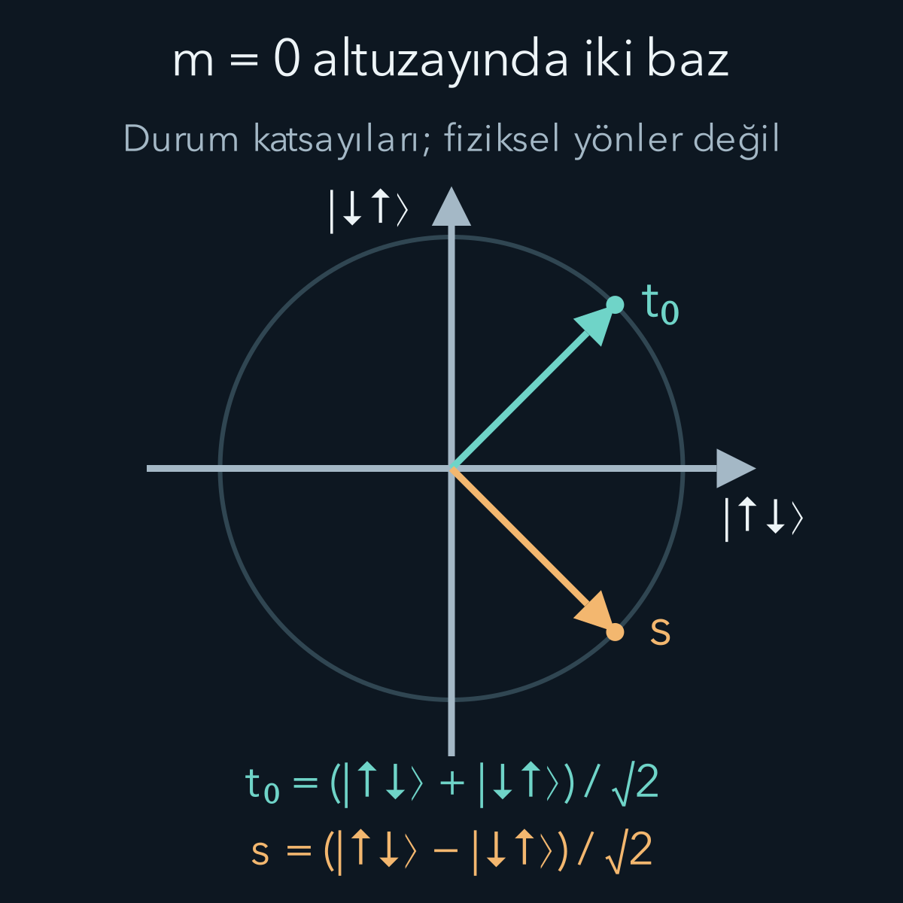
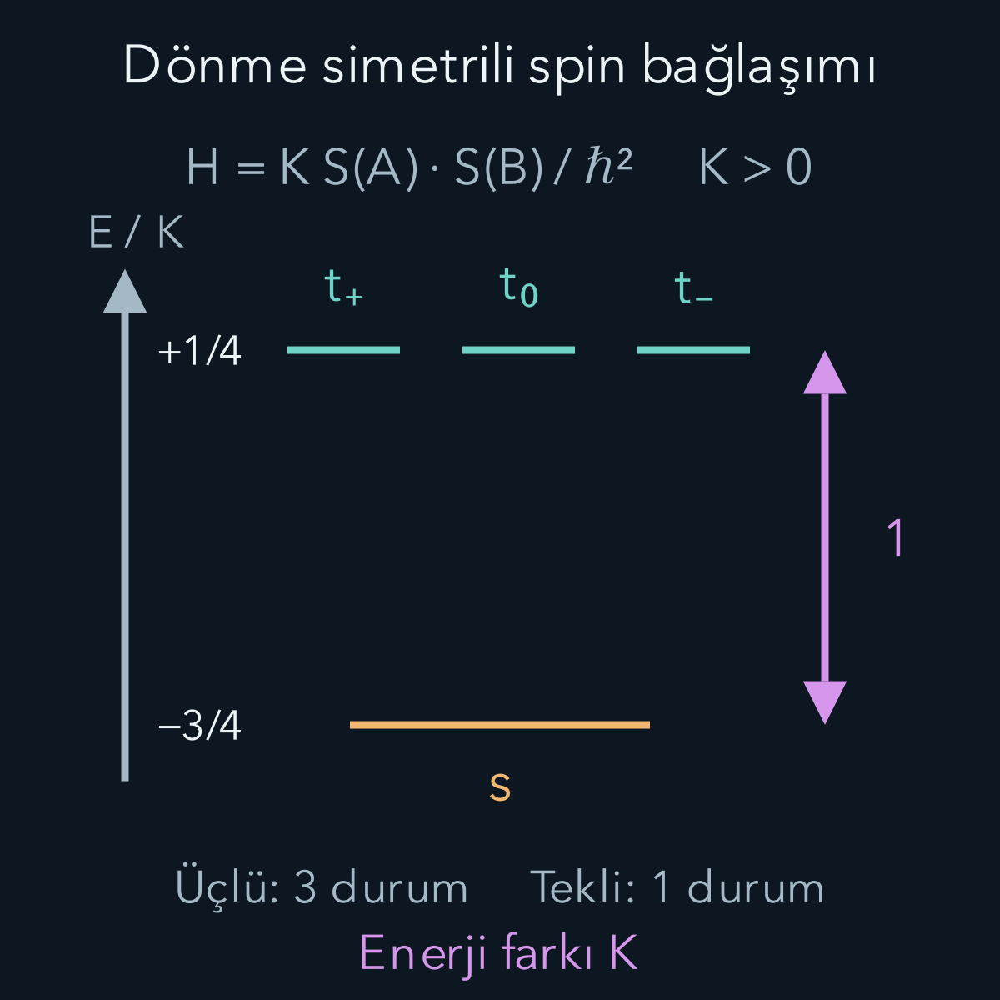

import ArticleVideo from '@/components/ArticleVideo.astro'
import kavram from './media/01-kavram.mp4?url'
import kavramPoster from './media/01-kavram.jpg?url'

İki parçacığın her biri spin yarım taşıyorsa toplamları yalnız “yarım artı yarım eşittir bir” hesabıyla belirlenmez. Bu toplamın bir olduğu durumlar vardır; sıfır olduğu bir durum da vardır. Çünkü topladığımız şey iki hazır uzunluk değil, birleşik durum uzayında etki eden açısal momentum işleçleridir. Ölçülen toplamın karesi ile tek tek bileşenlerin sonuçları farklı bilgi verir.

[Bir önceki hidrojen yazısında](/blog/merkezi-potansiyel-ve-hidrojen-atomi/) yörüngesel durumu ve spin eklenince artan durum sayısını gördük. Bu yazının hesap ön bilgileri [açısal momentum cebri](/blog/kuantumda-acisal-momentum/), [tensör çarpımı](/blog/tensor-carpimi-ve-dolaniklik/) ve [üniter zaman evrimi](/blog/hamiltonyen-ve-kuantum-zaman-evrimi/). İki ayrı konumda tutulan spin yarım sistemlerini A ve B diye etiketleyeceğiz. Uzaysal hareketi ayrıca çözmüyoruz; burada yalnız iki spin serbestlik derecesini ele alıyoruz.

## 1. İki sistem için dört boyut gerekir

$\hbar$ indirgenmiş Planck sabiti olsun. Tek spin için $z$ ölçümünün $+\hbar/2$ sonucuna ait durumu $|\uparrow\rangle$, $-\hbar/2$ sonucuna ait durumu $|\downarrow\rangle$ yazalım. Oklar ölçüm sonucu etiketidir; her parçacıkta önceden kesin bir üç boyutlu ok bulunduğunu söylemez.

Birleşik bazın sırasını sabitleyelim:

$$
|\uparrow\uparrow\rangle,\quad
|\uparrow\downarrow\rangle,\quad
|\downarrow\uparrow\rangle,\quad
|\downarrow\downarrow\rangle.
$$

İlk ok A'ya, ikinci ok B'ye aittir. Örneğin $|\uparrow\downarrow\rangle=|\uparrow\rangle_A\otimes|\downarrow\rangle_B$ demektir. Birleşik uzay tensör çarpımıyla kurulduğu için boyutu iki çarpı iki, yani dört olur. Her birleşik durum bu dört baz vektörünün karmaşık katsayılı toplamıdır.

Yalnız A'nın spinini ölçen işleç $S_{Ax}=S_x\otimes I$; yalnız B'ninki $S_{Bx}=I\otimes S_x$ biçimindedir. Burada $I$ iki boyutlu birim işleçtir. Kısa yazımda A ve B alt indisleri hangi tensör çarpanı üzerinde etkidiğini hatırlatır. Yerel işleçlerin aynı dört boyutlu uzaya taşınması, onları toplamadan önce yapılması gereken adımdır.

## 2. Toplam J neden yine açısal momentumdur?

Toplam bileşeni $J_x=S_{Ax}+S_{Bx}$, benzer biçimde $J_y$ ve $J_z$ olarak tanımlayalım. A ile B işleçleri farklı çarpanlara etki ettiğinden $[S_{Ai},S_{Bj}]=0$ olur. Bunun nedeni $(A\otimes I)(I\otimes B)=A\otimes B=(I\otimes B)(A\otimes I)$ eşitliğidir.

Komütatörü açınca:

$$
\begin{aligned}
[J_x,J_y]&=[S_{Ax},S_{Ay}]+[S_{Bx},S_{By}]\\
&=i\hbar(S_{Az}+S_{Bz})\\
&=i\hbar J_z.
\end{aligned}
$$

buluruz. Böylece toplam da önceki yazıda kurduğumuz açısal momentum cebrine uyar. Toplamın karesi $J^2=J_x^2+J_y^2+J_z^2$'dir. $J^2$ ve $J_z$ ortak özdurumlarını $|j,m\rangle$ diye adlandırabiliriz; özdeğerleri $\hbar^2j(j+1)$ ve $\hbar m$ olur.

Bileşenler basitçe toplansa da büyüklüklerin karelerinde çapraz terim vardır:

$$
J^2=S_A^2+S_B^2+2\mathbf S_A\cdot\mathbf S_B.
$$

Nokta çarpımı $S_{Ax}S_{Bx}+S_{Ay}S_{By}+S_{Az}S_{Bz}$ toplamıdır. Her spin yarım için $S_A^2=S_B^2=3\hbar^2I/4$ olur. Toplamın hangi değeri aldığı, iki spin arasındaki bu ortak terime bağlıdır; yalnız ayrı ayrı büyüklükleri bilmek yetmez.

## 3. Üçlü grubun en üst durumu

$|\uparrow\uparrow\rangle$ için $J_z$ sonucu $\hbar/2+\hbar/2=\hbar$'dır; yani $m=1$. İki spin yarımdan daha büyük toplam $z$ bileşeni üretilemez. Yükseltici $J_+=S_{A+}+S_{B+}$ bu durumu sıfırlar; ikisi de zaten kendi üst basamağındadır.

Önceki merdiven normu, en üst $m$ değerinin $j$'ye eşit olduğunu gösteriyordu. Dolayısıyla bu durum $j=1,m=1$ durumudur:

$$
|t_+\rangle=|1,1\rangle=|\uparrow\uparrow\rangle.
$$

$t$ harfi biraz sonra üç elemanlı grubu, yani **triplet** veya üçlü durumu belirtmek için kullanılacak. Alt artı, $m=+1$ basamağını ayırır. Bu bir enerji etiketi değildir; enerji düzenini ancak bir Hamiltonyen seçince belirleyeceğiz.

Şimdi $J_-=S_{A-}+S_{B-}$ uygulayalım. Tek spin yarımda $S_-|\uparrow\rangle=\hbar|\downarrow\rangle$ olduğundan:

$$
J_-|\uparrow\uparrow\rangle
=\hbar|\downarrow\uparrow\rangle
+\hbar|\uparrow\downarrow\rangle.
$$

Toplam $j=1,m=1$ merdiven katsayısı $\hbar\sqrt2$ idi. Sağ tarafın normu da $\hbar\sqrt2$'dir. Normalize orta basamak bu yüzden:

$$
|t_0\rangle=|1,0\rangle
=\frac{|\uparrow\downarrow\rangle+|\downarrow\uparrow\rangle}{\sqrt2}
$$

olur. Bir kez daha alçaltınca $J_-|t_0\rangle=\hbar\sqrt2|\downarrow\downarrow\rangle$ çıkar. Üçüncü durum $|t_-\rangle=|1,-1\rangle=|\downarrow\downarrow\rangle$'dır. Üçünün de $J^2$ sonucu $2\hbar^2$'dir.

## 4. Dördüncü durum nereye gitti?

Dört boyutlu uzayda yalnız üç ortonormal durum bulduk. $m=0$ altuzayında $|t_0\rangle$'a dik kalan birleşim:

$$
|s\rangle=\frac{|\uparrow\downarrow\rangle-|\downarrow\uparrow\rangle}{\sqrt2}
$$

olsun. İç çarpımı kontrol edersek $(1-1)/2=0$; norm karesi $(1+1)/2=1$ çıkar. Buna **singlet** veya tekli durum denir. $J_z|s\rangle=0$ olduğu açıktır; iki terimde de toplam bileşen sıfırdır.

Üstelik $J_+|s\rangle=0$ ve $J_-|s\rangle=0$ olur. Örneğin yükseltmede birinci terim $\hbar|\uparrow\uparrow\rangle$, eksi işaretli ikinci terim $-\hbar|\uparrow\uparrow\rangle$ verir; birbirlerini götürürler. $J_x=(J_++J_-)/2$ ve $J_y=(J_+-J_-)/(2i)$ de bu durumu sıfırlar. Dolayısıyla $J^2|s\rangle=0$; durum $j=0,m=0$'dır.

Ayrı spinlerin büyüklükleri kaybolmadı. Hâlâ her birinin $S^2$ değeri $3\hbar^2/4$'tür. Sıfır olan, birleşik sistemin toplam açısal momentumudur. Singlette birinci spin yönünün bilinmesi diye klasik bir açıklama gerekmez; belirli eksende sonuçlar karşıt çıkar fakat tek tek sonuçlar rastgeledir.

Şekil fiziksel uzayda iki parçacığın yönlerini çizmiyor. İki gerçek katsayılı durumun oluşturduğu durum altuzayını gösteriyor. Yatay eksen $|\uparrow\downarrow\rangle$, düşey eksen $|\downarrow\uparrow\rangle$ katsayısıdır. Köşegenler, bu bazdan eş ağırlıklı toplam ve fark bazına geçişi görünür kılar.

## 5. Aynı toplam bileşen, farklı toplam büyüklük

$|t_0\rangle$ ile $|s\rangle$ için $J_z$ sonucu aynıdır: sıfır. Fakat $J^2$ sonuçları farklıdır: sırasıyla $2\hbar^2$ ve sıfır. Bu yüzden yalnız iki yerel $z$ sonucunu toplayarak toplam açısal momentumun karesini ölçmüş olmayız.

Ürün bazındaki bir başlangıç durumu:

$$
|\uparrow\downarrow\rangle
=\frac{|t_0\rangle+|s\rangle}{\sqrt2}
$$

olarak yazılır. Bu durumda toplam $J^2$ ölçümü yüzde elli $2\hbar^2$, yüzde elli sıfır verir. Ortalama $\langle J^2\rangle=\hbar^2$ çıkar; fakat tek ölçümde $\hbar^2$ sonucu mümkün değildir. Ortalama ile olası özdeğer ayrımı burada yeniden karşımıza çıkar.

İdeal $J^2$ ölçümünde üçlü sonuç gelirse başlangıç durumu $|t_0\rangle$'a, tekli sonuç gelirse $|s\rangle$'e güncellenir. Buna karşılık yalnız $J_z$ ölçümünün sıfır sonucu iki boyutlu bir altuzayı seçer; bu iki durumu ayırt etmez. Ölçüm düzeneğinin hangi gözlenebiliri ölçtüğü, verinin ne anlattığını belirler.

Bu ayrım ölçüm sırasına da yansır. Başlangıçta $|t_0\rangle$ hazırlayalım. Doğrudan $J^2$ ölçersek kesinlikle $2\hbar^2$ buluruz. Önce A ve B'nin ayrı ayrı z bileşenlerini ölçersek iki olası kayıt $\uparrow\downarrow$ ve $\downarrow\uparrow$ olur. Her kayıt yarım olasılıklıdır. Kayıtların toplamı yine sıfır olsa da artık ilk durumda mevcut olan iki genlik arasındaki tutarlı toplam korunmamıştır.

Yerel sonuçları okuyup sonra unutmak bu etkiyi geri almaz. Ölçüm sonrası topluluk, eşit ağırlıklı iki ürün durumunun karışımıdır. [Durum matrisi](/blog/yogunluk-matrisleri-ve-karisik-durumlar/) gösterimiyle:

$$
\begin{aligned}
\rho={}&\tfrac12|\uparrow\downarrow\rangle\langle\uparrow\downarrow|\\
&+\tfrac12|\downarrow\uparrow\rangle\langle\downarrow\uparrow|.
\end{aligned}
$$

Bu toplulukta sonradan yapılan $J^2$ ölçümü yarım olasılıkla tekli sonuç verir. Başlangıçtaki kesin üçlü sonuç kaybolmuştur. Yalnız toplam $J_z$'yi ölçen ve sıfır altuzayındaki tutarlılığı koruyan ideal bir ölçüm ise $|t_0\rangle$'ı değiştirmez. Aynı sayısal toplamı üreten cihazların aynı kuantum ölçümü olmadığını böylece somut olarak görürüz. Burada ölçümün “ideal” olması, özaltuzayın içindeki durumu ayrıca ayırt etmemesi anlamına gelir.

## 6. Matris bütün hesabı bir araya getirir

Matrisin ortasındaki iki birin nereden geldiğini türetelim. $S_\pm=S_x\pm iS_y$ tanımlarını açıp çapraz terimleri sadeleştirince:

$$
\begin{aligned}
\mathbf S_A\cdot\mathbf S_B={}&S_{Az}S_{Bz}\\
&+\frac12(S_{A+}S_{B-}+S_{A-}S_{B+})
\end{aligned}
$$

bulunur. Örneğin $|\uparrow\downarrow\rangle$ üzerinde ilk terim $-\hbar^2/4$ ile aynı durumu verir. Parantezdeki ilk terim sıfırdır: A'nın zaten yukarı olan spinini daha yukarı çıkaramayız. İkinci terim önce B'yi yukarı, sonra A'yı aşağı geçirir; sonuç $\hbar^2|\downarrow\uparrow\rangle$ olur. Başındaki yarım çarpanını korursak:

$$
\begin{aligned}
\mathbf S_A\cdot\mathbf S_B|\uparrow\downarrow\rangle
={}&-\frac{\hbar^2}{4}|\uparrow\downarrow\rangle\\
&+\frac{\hbar^2}{2}|\downarrow\uparrow\rangle.
\end{aligned}
$$

Şimdi bunu toplam kare bağıntısına koyarız. İki tek spin karesinden $3\hbar^2/2$ gelir; yukarıdaki doğrudan katkının iki katı $-\hbar^2/2$'dir. İkisinin toplamı $\hbar^2$ eder. Yer değiştiren durumun katsayısı da ikiyle çarpılınca $\hbar^2$ olur. Böylece bir sütunu ezberlemeden bulduk. Diğer sütunlar aynı işlemle hesaplanınca sabit ürün bazımızda toplamın karesi:

$$
J^2=\hbar^2
\begin{pmatrix}
2&0&0&0\\
0&1&1&0\\
0&1&1&0\\
0&0&0&2
\end{pmatrix}
$$

olur. Orta $2\times2$ bloğun $(1,1)^T/\sqrt2$ özvektörü 2, $(1,-1)^T/\sqrt2$ özvektörü 0 özdeğerine aittir. Çapraz iki elemanı atarsak tekli ile üçlü ayrımını kaybederiz; farkı yaratan, iki ürün genliği arasındaki göreli işarettir.

Üçlü ve tekli bazına geçmek fiziksel durumu değiştirmek zorunda değildir; aynı vektörün yeni koordinatlarla yazılmasıdır. Dört yeni baz vektörünü eski bazdaki sütunlar olarak bir matrise koyarsak üniter bir baz değiştirme matrisi elde ederiz. Sütunların dikliği iç çarpımları, normlarının bir olması toplam olasılığı korur.

Genel bir $a|\uparrow\uparrow\rangle+b|\uparrow\downarrow\rangle+c|\downarrow\uparrow\rangle+d|\downarrow\downarrow\rangle$ durumunda üçlü katsayılar $a,(b+c)/\sqrt2,d$; tekli katsayı $(b-c)/\sqrt2$ olur. Burada $a,b,c,d$ karmaşık genliklerdir. Özellikle $b$ ile $c$'nin mutlak değerleri aynı olsa da göreli fazları tekli olasılığını değiştirebilir.

Göreli fazın etkisini sayısal bir ölçüm hesabıyla görünür yapalım. İki ürün durumunun eşit büyüklükte, fakat aralarında $\phi$ fazı bulunan birleşimini hazırlayalım:

$$
\begin{aligned}
|\chi_\phi\rangle={}&\frac1{\sqrt2}|\uparrow\downarrow\rangle\\
&+\frac{e^{i\phi}}{\sqrt2}|\downarrow\uparrow\rangle.
\end{aligned}
$$

Burada $\phi$ radyanla ölçülen göreli fazdır; durumun normu her fazda birdir. Tekli duruma izdüşüm, $\langle s|\chi_\phi\rangle=(1-e^{i\phi})/2$ verir. Mutlak kareyi açarken karmaşık eşleniği de çarparız; payda dört kalır, pay ise $2-2\cos\phi$ olur. Böylece tekli olasılığı $\sin^2(\phi/2)$, üçlü olasılığı $\cos^2(\phi/2)$ çıkar.

Faz sıfırsa kesin üçlü, faz pi ise kesin tekli sonuç alırız. Faz pi bölü iki olduğunda ikisi eşit olasılıklıdır. Oysa bütün bu hazırlanışlarda yerel z ölçümleri hep aynı iki karşıt sonucu yarımşar olasılıkla verir. Yerel z sayımlarının aynı çıkması, durumların aynı olduğunu söylemeye yetmez. Toplam kare ölçümü, o sayımların gösteremediği göreli faz bilgisini ayırt eder. Bu nedenle bir ortak durumun bilgisini yalnız dört ürün sonucunun olasılıklarıyla tarif edemeyiz; o bazdaki karmaşık genlikler arasındaki tutarlılığı da bilmeliyiz.

Bütün genlikleri aynı fazla çarpmak ise bu örnekte de farklıdır. İç çarpımın tamamı aynı fazla çarpılır; mutlak karesi sabit kalır. Tekli olasılığını değiştiren işlem, bir ürüne faz ekleyip diğerini aynı bırakmaktır. Bu ayrım, biraz sonra enerji farklarının zaman içinde neden ölçülebilir salınım ürettiğini de açıklar.

## 7. Dolanıklık ve ortak dönmeler

$|t_+\rangle$ ile $|t_-\rangle$ ürün durumlarıdır. $|t_0\rangle$ ve $|s\rangle$ ise tek bir A durumu ile tek bir B durumunun çarpımı olarak yazılamaz; dolanıktır. Bu nedenle üçlü grubun her elemanını dolanık saymak doğru değildir. Hangi birleşik durumu hazırladığımızı belirtmeliyiz.

Singlette iki spin de aynı eksende ölçülürse sonuçlar daima karşıttır. Bunun nedeni singletin ortak dönmeler altında değişmemesidir: $J_i|s\rangle=0$ olduğundan $e^{-i\theta\mathbf n\cdot\mathbf J/\hbar}|s\rangle=|s\rangle$. $\mathbf n$ dönme ekseninin birim vektörü, $\theta$ açıdır. Böylece z ekseninde gördüğümüz karşıtlık bütün ortak eksenlere taşınır.

Bu durum bir tarafa kontrol edilebilir sonuç seçme gücü vermez. A'nın yerel durum matrisi $I/2$'dir; her eksende artı ve eksi olasılığı yarımdır. Ortak sonuçları karşılaştırmak için klasik kayıtlar bir araya getirilir. Toplam spin hesabı, [Bell yazısındaki](/blog/bell-esitsizligi-ve-kuantum-korelasyonlari/) korelasyonların yapısıyla uyumludur; kendi başına uzaktan mesaj gönderme yöntemi değildir.

## 8. Toplam spin enerji hesabını da kolaylaştırabilir

İki spin arasında dönme simetrisine sahip basit bir etkileşim seçelim:

$$
H=\frac K{\hbar^2}\mathbf S_A\cdot\mathbf S_B.
$$

$K$ enerji birimindeki gerçek bir bağlaşım katsayısıdır. Bu Hamiltonyenin her gerçek iki spin sistemi için eksiksiz olduğunu iddia etmiyoruz; dış alan ve başka etkileşimler ihmal edildiğinde yararlı bir modeldir. Toplam kare bağıntısını kullanırsak:

$$
H=\frac K{2\hbar^2}\left(J^2-\frac32\hbar^2I\right).
$$

Üçlü için $J^2=2\hbar^2$ koyunca $E_t=K/4$; tekli için sıfır koyunca $E_s=-3K/4$ bulunur. Enerji farkı $E_t-E_s=K$'dır. $K>0$ ise tekli daha düşük, $K<0$ ise üçlü daha düşüktür. Enerji düzenini yalnız durum adlarından çıkaramayız; etkileşimin işareti önemlidir.

Örneğin $K=0{,}40\,\mathrm{meV}$ alırsak üçlü enerji $+0{,}10\,\mathrm{meV}$, tekli enerji $-0{,}30\,\mathrm{meV}$ olur. Sıfır enerji seçimi değişse bile aradaki $0{,}40\,\mathrm{meV}$ fark değişmez. Her üçlü bileşenin aynı enerjiye sahip olması bu modelin ortak dönme simetrisiyle ilişkilidir.

## 9. Ürün durumundan başlayan zaman evrimi

Başlangıç $|\uparrow\downarrow\rangle$ ise tekli ve üçlü katkılar eşit büyüklüktedir. Farklı enerjiler nedeniyle farklı faz kazanırlar:

$$
\begin{aligned}
|\psi(t)\rangle={}&\frac{e^{-iKt/(4\hbar)}}{\sqrt2}|t_0\rangle\\
&+\frac{e^{3iKt/(4\hbar)}}{\sqrt2}|s\rangle.
\end{aligned}
$$

Ürün bazına geri dönmek için toplam ve fark ifadelerini yerine koyalım. Boyutsuz zaman $\tau=Kt/\hbar$ ile ortak fazı dışarı alırsak:

$$
\begin{aligned}
|\psi(t)\rangle=e^{i\tau/4}\bigg[&\cos\frac\tau2|\uparrow\downarrow\rangle\\
&-i\sin\frac\tau2|\downarrow\uparrow\rangle\bigg].
\end{aligned}
$$

Bu adımda $e^{i\alpha}+e^{-i\alpha}=2\cos\alpha$ ve $e^{-i\alpha}-e^{i\alpha}=-2i\sin\alpha$ kullanılır. Başlangıç ürün sonucunun olasılığı $\cos^2(\tau/2)$; yer değiştirmiş iki sonucun olasılığı $\sin^2(\tau/2)$ olur. $\tau=\pi$ anında ikinci ürün durumu kesinleşir. $\tau=\pi/2$ anında olasılıklar yarımdır fakat göreli faz $-i$'dir; bu durum ne $|t_0\rangle$ ne de $|s\rangle$'dir.

<ArticleVideo src={kavram} poster={kavramPoster} title="Spin etkileşiminde iki ürün sonucunun olasılığı" caption="H = K S_A·S_B/ℏ² ve başlangıç |↑↓⟩ için boyutsuz zaman τ = Kt/ℏ ilerler. Turkuaz eğri başlangıç ürün sonucunun, sarı eğri |↓↑⟩ sonucunun olasılığıdır. Hareket, tekli ve üçlü bileşenlerin farklı faz kazanmasından doğar; her ölçüm anı eş hazırlanmış deneylerle karşılaştırılır." />

Sayısal zaman ölçeği de çıkarabiliriz. $\hbar\simeq0{,}6582\,\mathrm{meV\,ps}$ ve yukarıdaki $K=0{,}40\,\mathrm{meV}$ için ilk tam yer değiştirme $t=\pi\hbar/K\simeq5{,}17\,\mathrm{ps}$ anındadır. Pikosaniye için kullanılan $\mathrm{ps}$ birimi saniyenin trilyonda biridir. Enerji büyüdükçe aynı göreli faz daha kısa sürede birikir; formülde zamanın K ile ters orantılı çıkması bunu gösterir. İdeal salınımın uzun süre sürmesi modelde çevresel gürültü ve başka etkileşimler ihmal edildiği içindir. Gerçek bir deneyin görünürlüğünü bu basit Hamiltonyenden tek başına hesaplayamayız.

Bu evrim boyunca $J^2$ dağılımı hep yarı tekli, yarı üçlü kalır; Hamiltonyen $J^2$ ile komüte eder. Değişen, yerel ürün bazında ölçülecek ortak sonuç dağılımıdır. Enerji özbazında olasılıklar sabitken başka bazdaki olasılıkların salınması, göreli fazın ölçülebilir etkisidir.

## 10. Genel toplam kuralının sınırı

İki genel açısal momentum $j_A$ ve $j_B$ birleştirildiğinde toplam $j$, $|j_A-j_B|$ ile $j_A+j_B$ arasında birer adımla değişir. Her $j$ altuzayında $2j+1$ durum vardır. İki spin yarım için bu, $j=0,1$ ve $1+3=4$ durum demektir. Buradaki ayrıntılı merdiven hesabı bu en küçük örneği tamamen kurdu.

Örneğin yörüngesel $j_A=1$ ile spin $j_B=1/2$ birleşirse toplam değerler $j=1/2$ ve $j=3/2$ olur. İlk grupta iki, ikincide dört durum vardır; toplam altı durum ürün uzayının $(2\cdot1+1)(2\cdot1/2+1)=3\cdot2=6$ boyutunu korur. Baz değişimi durum yaratmaz veya eksiltmez; aynı uzayı ortak dönmelerin nasıl davrandığına göre parçalara ayırır. Bu boyut kontrolü, daha büyük toplam hesaplarında eksik bir basamağı fark etmenin yararlı bir yoludur.

Bu altı durumluk örneğin bir katsayısını da hesaplayalım. Ürün ketini $|m_l,m_s\rangle_{\text{ürün}}$ diye yazacağız; burada sabit $l=1$ ve $s=1/2$ etiketlerini kısaltmış olduk. En yüksek toplam bileşen $3/2$ olduğundan $|3/2,3/2\rangle=|1,1/2\rangle_{\text{ürün}}$'dür. Toplam alçaltıcı $J_-=L_-+S_-$ olsun. Soldaki $j=3/2$ merdiveni $\hbar\sqrt3$ çarpanı verir. Sağda yörüngeyi alçaltmanın çarpanı $\hbar\sqrt2$, spini alçaltmanınki $\hbar$'dır. İki tarafı $\hbar\sqrt3$'e bölünce:

$$
\begin{aligned}
|\tfrac32,\tfrac12\rangle={}&
\sqrt{\tfrac23}|0,\tfrac12\rangle_{\text{ürün}}\\
&+\sqrt{\tfrac13}|1,-\tfrac12\rangle_{\text{ürün}}.
\end{aligned}
$$

Norm karesi $2/3+1/3=1$'dir. Her iki terimde de bileşen toplamı $1/2$ olduğu halde yörünge ve spin ölçümleri farklı sonuçlar verir. Aynı $m=1/2$ altuzayında buna dik kalan normalize durum, seçtiğimiz genel fazla:

$$
\begin{aligned}
|\tfrac12,\tfrac12\rangle={}&
\sqrt{\tfrac13}|0,\tfrac12\rangle_{\text{ürün}}\\
&-\sqrt{\tfrac23}|1,-\tfrac12\rangle_{\text{ürün}}
\end{aligned}
$$

olur. İç çarpımda $\sqrt2/3-\sqrt2/3=0$ çıkar. Toplam yükseltici de ikinci durumu sıfırlar: İlk ürün teriminden $\hbar\sqrt{2/3}$, ikinci terimden bunun eksisi gelir. En üst bileşeni $1/2$ olduğundan bu durumun toplamı gerçekten $j=1/2$'dir. Bir kaynağın bütün bu ketin işaretini ters seçmesi farklı fizik anlamına gelmez; gözlenebilir olan, aynı açılımdaki katsayıların göreli işaretidir. Bu küçük hesap, toplam kuralının yanı sıra katsayıların da merdiven ve diklik koşullarından bulunabildiğini gösterir.

Bu kuralın daha büyük sayılardaki katsayıları, ortak özbazı ürün bazında açarak hesaplanır; bunlara Clebsch–Gordan katsayıları denir. Bu adı bilmek iki spin örneğini anlamanın önkoşulu değildir. Ayrıca tekli/üçlü spin simetrisiyle özdeş parçacıkların tüm durumunun değiş tokuş koşulu aynı şey değildir: Uzaysal kısım da hesaba katılmalıdır. Burada A ve B, ayrı spin alt sistemlerinin etiketleridir.

## Kaynaklar

Tensör uzayında toplam, iki spin yarım için üçlü/tekli baz ve toplam kare bağıntısı [MIT OCW, Quantum Physics II: Addition of Angular Momentum](https://ocw.mit.edu/courses/8-05-quantum-physics-ii-fall-2013/f27e44d7b761cec0ef1d01734f0a23b8_MIT8_05F13_Chap_10.pdf) ile karşılaştırıldı. İki spin durumlarının fiziksel bağlaşımı için [The Feynman Lectures, Cilt III, Bölüm 12: The Hyperfine Splitting in Hydrogen](https://www.feynmanlectures.caltech.edu/III_12.html) kontrol edildi. Buradaki K tanımı, sayısal örnek, zaman evrimi ve görseller özgün olarak hazırlanmıştır.

Kaynak bağlantıları ve ilgili bölümler 12 Ekim 2026 tarihinde doğrudan kontrol edildi.
