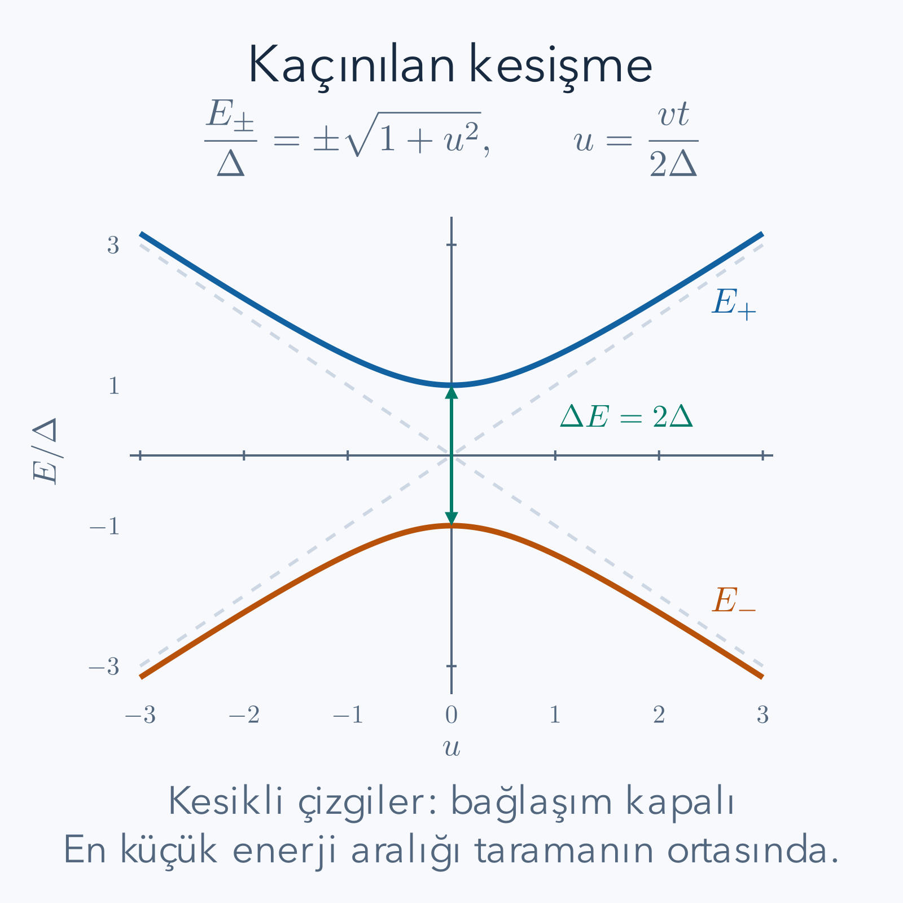

Bir atomun çevresindeki alanı değiştirdiğimizde enerji düzeyleri de değişir. Atom başlangıçta temel durumdaysa, alanı yeterince yavaş değiştirerek onu yeni temel durumda tutabilir miyiz? Bu soru, yalnız saatin kaç saniye gösterdiğiyle cevaplanamaz. Bir sistem için uzun olan süre, enerji düzeyleri birbirine çok yaklaşan başka bir sistem için kısa kalabilir. Amacımız bu karşılaştırmanın matematiğini kurmak ve başarısızlığın olasılığını iki düzeyli bir örnekte hesaplamak.

Ön bilgilerimiz [özdeğer ve özvektörler](/blog/ozdegerler-ozvektorler-ve-kosegenlestirme/), [Hamiltonyen ve zaman evrimi](/blog/hamiltonyen-ve-kuantum-zaman-evrimi/) ile [zamana bağlı pertürbasyon ve Rabi salınımları](/blog/zamana-bagli-perturbasyon-ve-rabi-salinimlari/). İç çarpımın olasılık genliği verdiğini kullanacağız. İhtiyaç duyduğumuz fazları aşağıda tanımlayacağız; başka bir geometrik faz yazısını önceden bilmek gerekmiyor.

## 1. Adyabatik sözcüğü burada ne anlatıyor?

Termodinamikte adyabatik işlem, ısı alışverişinin olmadığı işlem anlamına gelir. Burada aynı sözcük farklı bir teknik koşul anlatır: dış parametrelerin değişimi sırasında sistemin birbirinden ayrılmış anlık enerji özdurumları arasında geçişi küçük kalır. Sistem enerji alabilir; dış alan işi yapan bir kontrol mekanizmasına bağlıdır. Adyabatikliği enerji korunumu veya termal yalıtımla özdeşleştirmeyeceğiz.

Zamana bağlı Hamiltonyenimiz $H(t)$, ölçülebilir enerji operatörüdür. Belirli bir anı dondurup

$$
H(t)|n(t)\rangle=E_n(t)|n(t)\rangle
$$

denklemini çözeriz. Burada $n$ durum etiketi, $E_n$ enerji, $|n\rangle$ normalize özvektördür. Bu vektör gerçek zaman evrimi olmak zorunda değildir. O anda Hamiltonyenin hangi yönlerinin enerji ölçümüne karşılık geldiğini söyler. Gerçek durum $|\psi(t)\rangle$ ise Schrödinger denklemine uymalıdır. Değişen cetvel ile ölçülen nesneyi ayrı tutmak, ilerideki geçiş olasılığını anlamak için gereklidir.

İlk olarak sonlu boyutlu, düzgün değişen bir Hermit matris düşünelim. İzlemek istediğimiz özdeğerin yol boyunca diğerlerinden ayrılmış olduğunu varsayalım. Sonsuz boyutlu operatörlerde tanım bölgeleri ve spektral koşullar ayrıca önemlidir. Buradaki sonlu matris hesabı, tüm operatörler için koşulsuz bir teorem sayılmayacak.

## 2. Değişen bazda durumu nasıl açarız?

İndirgenmiş Planck sabiti $\hbar=h/(2\pi)$ olsun. Her özdurum için dinamik fazı

$$
\theta_n(t)=\frac1\hbar\int_{t_0}^{t}E_n(u)\,du
$$

olarak tanımlayalım. Enerjinin zamanla çarpımı etki birimindedir; $\hbar$ ile bölününce boyutsuz açı elde edilir. Genel durumu

$$
|\psi(t)\rangle=\sum_n c_n(t)e^{-i\theta_n(t)}|n(t)\rangle
$$

biçiminde yazarız. Özvektörler ortonormal olduğundan toplam olasılık $\sum_n|c_n|^2=1$ olur. Fazların mutlak değeri bir olduğu için enerji ölçümünde $E_n(t)$ bulma olasılığı $|c_n(t)|^2$'dir.

Türevi üç ayrı etkene uygulayalım:

$$
\frac{d|\psi\rangle}{dt}
=\sum_n e^{-i\theta_n}
\left(\dot c_n|n\rangle-\frac{iE_n}{\hbar}c_n|n\rangle+c_n|\dot n\rangle\right).
$$

Nokta zaman türevini gösterir. Sol tarafı $i\hbar$ ile çarpıp sağ taraftaki $H|\psi\rangle$ ile eşitleyince $E_nc_n|n\rangle$ terimleri iki taraftan silinir. Kalan denklemi soldan $e^{i\theta_m}\langle m|$ ile çarparız. Ortonormallik, $\langle m|n\rangle=\delta_{mn}$, ilk toplamdan yalnız $m$ terimini bırakır:

$$
\dot c_m=-\sum_n c_n\langle m|\dot n\rangle
 e^{i(\theta_m-\theta_n)}.
$$

Geçişin kaynağı yalnız enerjilerin değişmesi değildir. Özvektör yönlerinin değişmesi ve bunun başka durumlara izdüşümü de gerekir. Bu ayrımı birazdan tam çözülen bir örnekte kontrol edeceğiz.

## 3. Köşegen terim olasılığı mı değiştirir?

Özvektörün normunun türevi sıfırdır:

$$
0=\frac d{dt}\langle n|n\rangle
=\langle\dot n|n\rangle+\langle n|\dot n\rangle.
$$

Birinci terim ikincinin karmaşık eşleniğidir. Dolayısıyla $\langle n|\dot n\rangle$ saf sanaldır. Diğer durumlarla bağlaşım ihmal edildiğinde

$$
\dot c_n=-c_n\langle n|\dot n\rangle,
\qquad
c_n(t)=c_n(t_0)\exp\left[-\int_{t_0}^{t}\langle n|\dot n\rangle du\right]
$$

elde edilir. Üstel yine yalnız faz taşır; $|c_n|$ değişmez. Gerçek sayılı

$$
\gamma_n(t)=i\int_{t_0}^{t}\langle n|\dot n\rangle du
$$

tanımıyla bu çarpan $e^{i\gamma_n}$ olur. Anlık özdurumu takip etmek, dalga fonksiyonunun aynı sayısal vektör olarak kalması demek değildir; dinamik ve bazın hareketinden gelen fazlar taşır.

Açık bir zaman aralığında özvektörün fazını uygun seçerek köşegen bağlantıyı sıfırlamak mümkündür. Bu bir gösterim kolaylığıdır. Fiziksel geçiş olasılığı böyle bir seçimle değişmez. Kapalı bir parametre çevriminde başlangıç ve bitişteki fazların karşılaştırılması ayrıca anlam kazanır; burada geçiş hesabı için bu ileri tartışmaya ihtiyaç duymayacağız.

## 4. Enerji aralığı neden paydada çıkar?

Anlık özdenklemde hem operatörü hem vektörü türevleyelim:

$$
\dot H|n\rangle+H|\dot n\rangle
=\dot E_n|n\rangle+E_n|\dot n\rangle.
$$

Soldan $\langle m|$ ile çarpalım ve $m\ne n$ alalım. $\langle m|n\rangle=0$ olduğundan $\dot E_n$ terimi gider. Hermitlikten $\langle m|H=E_m\langle m|$ gelir. Kalan eşitlikleri ayrı yazarsak

$$
\begin{aligned}
\langle m|\dot H|n\rangle+E_m\langle m|\dot n\rangle
&=E_n\langle m|\dot n\rangle,\\
\langle m|\dot H|n\rangle
&=(E_n-E_m)\langle m|\dot n\rangle,\\
\langle m|\dot n\rangle
&=\frac{\langle m|\dot H|n\rangle}{E_n-E_m}.
\end{aligned}
$$

Son adımda enerji farkına böldük; bu yüzden eşit özdeğerleri olan durumlara formülü doğrudan uygulayamayız. Küçük aralık, aynı $\dot H$ için bazın daha hızlı dönmesine izin verir. Buna ek olarak katsayı denklemindeki bağıl fazın açısal hızı $|E_m-E_n|/\hbar$'dır. Büyük aralıkta hızlı dönen karmaşık terimlerin integralinde iptaller oluşabilir.

Bu iki etkiyi birleştiren yaygın yerel ölçek

$$
\eta_{mn}(t)=\frac{\hbar|\langle m|\dot H|n\rangle|}{|E_n-E_m|^2}
$$

olur. Payın birimi enerji karesidir; oran boyutsuzdur. Oranın küçük olması, düzgün ve tek geçişli örneklerde kullanışlı bir yavaşlık göstergesidir. Fakat tek başına her süre, her rezonanslı sürüş ve her spektrum için yeterli bir evrensel teorem değildir. Toplam süre, sınırdaki açma kapama, türevlerin davranışı ve tekrarlı geçişlerin fazları da hata sınırını etkiler. Bu yazı yerel ölçeği bu sınırlamayla kullanıyor.

## 5. Örnek 1: Enerjiler değişirken hiç geçiş olmayabilir

Sabit ortonormal bazımız $|1\rangle=(1,0)^T$, $|2\rangle=(0,1)^T$ olsun. Enerji değişim hızı $v$ için

$$
H(t)=\frac{vt}{2}\sigma_z,
\qquad \sigma_z=\begin{pmatrix}1&0\\0&-1\end{pmatrix}
$$

alalım. $v$ enerji/zaman birimindedir. Başlangıçta $|1\rangle$ seçilirse çözümün biçimi $|\psi\rangle=a(t)|1\rangle$ olur. Denklem

$$
i\hbar\dot a=\frac{vt}{2}a
$$

verir. İki tarafı $i\hbar a$ ile bölüp integre edelim:

$$
\frac{\dot a}{a}=-\frac{ivt}{2\hbar},\qquad
a(t)=a(t_0)e^{-iv(t^2-t_0^2)/(4\hbar)}.
$$

Üstelin mutlak değeri bir olduğundan $|a|^2=1$ kalır; $|2\rangle$ olasılığı sıfırdır. Kontrol için türev, üstelden $-ivt/(2\hbar)$ getirir; $i\hbar$ ile çarpınca Hamiltonyenin istediği $vt/2$ geri gelir.

Eğer $v$ pozitifse, $t$ negatifken $|1\rangle$ alt enerji düzeyidir, pozitifken üst enerji düzeyidir. Sistem sabit baz durumunda kalırken enerji sırasına göre etiketlenen temel durum değişmiştir. Tam kesişmede izole temel durum varsayımı bozulur. Dolayısıyla bu örnek “her yavaş işlem temel durumda bırakır” cümlesinin koşulsuz söylenemeyeceğini gösterir. Geçiş bağlaşımı sıfır olduğu için enerji değişiminin kendisi bazlar arası geçiş yaratmamıştır.

## 6. Kaçınılan kesişmenin iki düzeyli modeli

Şimdi iki sabit baz durumunu bağlayan, gerçek ve pozitif $\Delta$ enerjisini ekleyelim:

$$
H(t)=\frac{vt}{2}\sigma_z+\Delta\sigma_x
=\begin{pmatrix}vt/2&\Delta\\\Delta&-vt/2\end{pmatrix},
\qquad\sigma_x=\begin{pmatrix}0&1\\1&0\end{pmatrix}.
$$

$z=vt/2$ kısaltmasıyla karakteristik determinant

$$
\begin{aligned}
\det(H-EI)&=(z-E)(-z-E)-\Delta^2\\
&=E^2-z^2-\Delta^2=0
\end{aligned}
$$

olur. Enerjiler $E_\pm=\pm R$, $R=\sqrt{z^2+\Delta^2}$'dir. İki enerji arasındaki fark $g(t)=2R$ olduğundan en küçük aralık $t=0$'da $2\Delta$'dır. Üstelde kullanacağımız $\Delta$ bu aralığın yarısıdır; bu ayrım, geçiş formülündeki dört kat hatasını önler.

*Düz çizgiler bağlaşım kapalıyken sabit baz enerjilerini, eğriler bağlaşım açıkken gerçek özenerjileri gösterir. Düşey eksen enerji, yatay eksen tarama parametresidir; çizim $\Delta$ ile ölçeklenmiştir.*

Sabit $|1\rangle,|2\rangle$ bazına diyabatik baz diyeceğiz. Anlık $|+\rangle,|-\rangle$ özvektörlerine adyabatik baz diyeceğiz. Bu isimler gerçek hareketin yavaş veya hızlı olduğunu peşinen söylemez; hangi bazda olasılık ölçtüğümüzü söyler.

## 7. Özvektörleri ve karışma açısını açıkça kuralım

$\theta(t)$ açısını $0$ ile $\pi$ arasında

$$
\cos\theta=\frac zR,\qquad \sin\theta=\frac\Delta R
$$

ile tanımlayalım. İkinci eşitlik pozitif olduğu için açı dalı belirsiz kalmaz. Normalize özvektörler

$$
|+\rangle=\begin{pmatrix}\cos(\theta/2)\\\sin(\theta/2)\end{pmatrix},
\qquad
|-\rangle=\begin{pmatrix}-\sin(\theta/2)\\\cos(\theta/2)\end{pmatrix}
$$

seçilebilir. Örneğin $H|+\rangle$'ın ilk bileşeni $R[\cos\theta\cos(\theta/2)+\sin\theta\sin(\theta/2)]$ olur. Kosinüs fark formülü bunu $R\cos(\theta/2)$ yapar. İkinci bileşen de sinüs fark formülüyle $R\sin(\theta/2)$ verir. Böylece özvektör bağıntısını doğrudan doğruladık.

$v$ pozitifken çok negatif zamanda $\theta$ yaklaşık $\pi$, çok pozitif zamanda yaklaşık sıfırdır. Alt özvektör önce yaklaşık $-|1\rangle$, sonra yaklaşık $|2\rangle$ olur. Başlangıç temel durumunu adyabatik izlemek, sabit bazdaki nüfusu bir durumdan ötekine aktarmaktır. Alt enerji kolunda kalmak ile aynı diyabatik baz bileşeninde kalmak burada farklı olaylardır.

Açının türevini bir ara formüle saklamayalım. $R^2=z^2+\Delta^2$ eşitliğinin türevi $2R\dot R=2z\dot z$ verir; yani $\dot R=z\dot z/R$'dir. $\cos\theta=z/R$ bağıntısına bölüm ve zincir kurallarını uygulayalım:

$$
\begin{aligned}
-\sin\theta\,\dot\theta
&=\frac{\dot zR-z\dot R}{R^2}\\
&=\frac{\dot zR^2-z^2\dot z}{R^3}
=\frac{\Delta^2\dot z}{R^3},\\
-\frac\Delta R\dot\theta&=\frac{\Delta^2\dot z}{R^3},\\
\dot\theta&=-\frac{\Delta\dot z}{R^2}
=-\frac{v\Delta}{2R^2}.
\end{aligned}
$$

$\Delta$ pozitif olduğundan bölme geçerlidir; $z=0$ noktasında da $R=\Delta$ sıfır olmaz. Bu yöntem, $\tan\theta=\Delta/z$ ifadesinin sıfırdaki bölme sorununu önler. Kısaca $c=\cos(\theta/2)$ ve $s=\sin(\theta/2)$ dersek $|\dot -\rangle=-(\dot\theta/2)(c,s)^T$ olur. Açık iç çarpım

$$
\langle+|\dot -\rangle
=-\frac{\dot\theta}{2}(c^2+s^2)=-\frac{\dot\theta}{2}
$$

verir. Öte yandan $\dot H=(v/2)\sigma_z$ ve $\sigma_z|-\rangle=(-s,-c)^T$ olduğundan

$$
\begin{aligned}
\langle+|\dot H|-\rangle
&=\frac v2[-cs-sc]=-vcs\\
&=-\frac v2\sin\theta=-\frac{v\Delta}{2R}.
\end{aligned}
$$

Bu matris elemanını $E_--E_+=-2R$ ile bölersek $v\Delta/(4R^2)$ çıkar; az önce bulduğumuz $-\dot\theta/2$ ile aynıdır. Böylece genel özdenklem türevi ile doğrudan vektör türevi birbirini doğruladı. Yerel ölçekte mutlak değer alınır; aralık karesi $4R^2$ olduğundan

$$
\eta(t)=\frac{\hbar|v|\Delta}{8R^3},
\qquad\eta(0)=\frac{\hbar|v|}{8\Delta^2}
$$

çıkar. En tehlikeli bölge en küçük aralığın çevresidir. Buradaki sekiz sayısı seçtiğimiz yerel tanıma aittir; hata olasılığının doğrudan sekizde biri gibi yorumlanamaz.

## 8. Schrödinger sisteminden boyutsuz parametreye

Gerçek durumu diyabatik bazda $a(t)|1\rangle+b(t)|2\rangle$ yazarsak

$$
\begin{aligned}
i\hbar\dot a&=\frac{vt}{2}a+\Delta b,\\
i\hbar\dot b&=\Delta a-\frac{vt}{2}b.
\end{aligned}
$$

Hermitlik toplam normu korur. Örneğin $d|a|^2/dt$ bağlaşım teriminden $2\Delta\operatorname{Im}(a^*b)/\hbar$, $d|b|^2/dt$ bunun eksisini verir; toplam sıfırdır. Bu, sayısal çözümde ayrıca denetlenebilen bir koşuldur.

Sıfır olmayan $v$ için $\tau=t\sqrt{|v|/\hbar}$ ve $\lambda=\Delta/\sqrt{\hbar|v|}$ tanımlayalım. Zaman türevi $d/dt=\sqrt{|v|/\hbar}\,d/d\tau$ olur. İki denklemi $\sqrt{\hbar|v|}$ ile bölersek

$$
\begin{aligned}
i\frac{da}{d\tau}&=\frac{\operatorname{sgn}(v)\tau}{2}a+\lambda b,\\
i\frac{db}{d\tau}&=\lambda a-\frac{\operatorname{sgn}(v)\tau}{2}b
\end{aligned}
$$

buluruz. Fiziksel birimleri değiştirmek yeni bağımsız bir sayı getirmez; temel boyutsuz oran $\lambda^2=\Delta^2/(\hbar|v|)$'dir. Büyük oran güçlü bağlaşım veya yavaş tarama, küçük oran hızlı geçiş demektir. Sadece saniye cinsinden süre söylemenin neden yetersiz olduğunu denklem bu şekilde açıklar.

## 9. Landau–Zener sonucu tam olarak neyin olasılığı?

İdeal modelde tarama sonsuz negatif zamandan sonsuz pozitif zamana uzansın, $v$ ve $\Delta$ sabit kalsın, sistem kapalı olsun ve başlangıç durumu alt anlık enerji kolu olsun. Bu iki bağlı denklemin özel fonksiyonlarla elde edilen asimptotik sonucu

$$
P_{\rm ex}=P_{\rm diab}
=\exp\left[-\frac{2\pi\Delta^2}{\hbar|v|}\right]
$$

şeklindedir. Burada $P_{\rm ex}$ son durumda üst anlık enerji kolunda bulunma olasılığıdır. $P_{\rm diab}$ başlangıçtaki aynı sabit baz durumunda kalma olasılığıdır. Sonsuz uzak uçlarda bazların yukarıdaki eşleşmesi nedeniyle bu iki olay aynıdır. Temel durumda başarılı izleme olasılığı $1-P_{\rm ex}$ olur.

Üstelin tam katsayısını burada Weber denkleminin bağlantı formüllerinden türetmedik. İçe aktardığımız ileri sonuç budur; modelin denklemini, ölçek parametresini ve olasılığın hangi ölçüme karşılık geldiğini ise kendimiz kurduk. Yalnız yerel $\eta$ oranından üstel katsayısını tahmin etmiş gibi davranmak doğru olmaz.

Sınır kontrolleri öğreticidir. $|v|$ sıfıra yaklaşırken, sabit pozitif $\Delta$ için uyarılma olasılığı sıfıra yaklaşır. $\Delta$ sıfıra yaklaşırken sonuç bire gider: durum diyabatik bazda kalır ve enerji sırası değiştiği için sonunda uyarılmış olur. Bu son limit, birinci örnekteki tam çözümle uyumludur; aralığın kapandığı noktada adyabatik varsayımın korunmasını beklemiyoruz.

## 10. Örnek 2: Aynı aralıkta yavaş tarama

Hesabı enerji için elektronvolt, zaman için nanosaniye birimleriyle yapalım. Bu birimlerde $\hbar=6.582119569\times10^{-7}\,\mathrm{eV\,ns}$'dir. $\Delta=10^{-6}\,\mathrm{eV}$ ve $v=10^{-6}\,\mathrm{eV/ns}$ seçelim. En küçük aralık iki mikroelektronvolttur. Önce oranı hesaplarız:

$$
\lambda^2=\frac{10^{-12}}{(6.582119569\times10^{-7})(10^{-6})}
\approx1.51927.
$$

Payda $6.582119569\times10^{-13}\,\mathrm{eV^2}$'dir; birimler tamamen silinir. Üstel ve olasılık

$$
2\pi\lambda^2\approx9.54584,
\qquad P_{\rm ex}\approx e^{-9.54584}\approx0.0000715
$$

olur. Temel durumda kalma olasılığı yaklaşık $0.9999285$, yani yüzde $99.99285$'tir. Yerel gösterge de $\eta(0)=1/(8\lambda^2)\approx0.0823$ verir. Bu sayıyı yüzde hata olarak okumuyoruz; gerçek asimptotik hata üstel sonuçtan geldi.

Kontrol olarak düzeylerin güçlü karıştığı bölgeyi $|vt/2|\lesssim\Delta$ kabul edersek yarı genişlik yaklaşık $2\Delta/|v|=2\,\mathrm{ns}$ çıkar. Tam tarama bu bölgenin çok öncesinden başlamalı ve çok sonrasında bitmelidir. Sadece bu dört nanosaniyelik pencereyi kullanmak, sonsuz uçlar varsayımını kendiliğinden sağlamaz.

## 11. Örnek 3: Hızı on katına çıkarırsak

Aynı $\Delta$ ile $v=10^{-5}\,\mathrm{eV/ns}$ alalım. Payda on kat büyür; dolayısıyla $\lambda^2\approx0.151927$ olur. Aynı işlem zinciri

$$
2\pi\lambda^2\approx0.954584,
\qquad P_{\rm ex}\approx0.38497,
\qquad 1-P_{\rm ex}\approx0.61503
$$

verir. Hız yalnız on kat arttığı halde başarısızlık olasılığı yaklaşık on binde birden yüzde otuz sekize çıktı. Üstel bağımlılığın pratik anlamı budur. Yerel gösterge yaklaşık $0.823$ olduğundan küçük parametre yaklaşımı da artık güven vermez.

Bu hesapta olasılıkların toplamı birdir; kaybolan norm veya üçüncü bir enerji düzeyi yoktur. Eğer laboratuvar ölçümü üçüncü düzeylere önemli nüfus gösteriyorsa iki düzeyli model yetersizdir. Veriyi bu formüle zorla uydurmak yerine Hamiltonyenin boyutunu ve ek bağlaşımları incelemek gerekir. Farklı başlangıç süperpozisyonları da aynı tek sayıyla anlatılamaz; genliklerin göreli fazları son olasılıklara girebilir.

## 12. Sonlu tarama, tekrarlar ve yöntemin sınırı

Gerçek deneyde $-T$ ile $+T$ arasında tarama yapılır. Uçlarda $|vT|/2$ değeri $\Delta$'dan çok büyük değilse diyabatik ve anlık bazlar neredeyse aynı değildir. Başlangıçta saf $|1\rangle$ hazırlamak, tam temel özdurumu hazırlamakla eşdeğer olmaz. Bitişte hangi bazda ölçüm yapıldığı da açıkça belirtilmelidir. Sonsuz zaman formülü bu iki ayrımı gizleyebildiği için uç koşulları yazılmadan verilen bir yüzde eksik bilgidir.

Birden çok geçiş yapılırsa ilk geçişte ayrılan genlikler arada farklı dinamik fazlar toplar. İkinci geçişte bu genlikler yeniden birleşebilir; olasılıkları doğrudan toplamak yerine karmaşık genlikleri evriltmek gerekir. Çevreyle etkileşim, sıcaklık ve faz kaybı bu girişimi değiştirebilir. Kapalı sistemin tek geçişli formülü böyle durumlarda evrensel cevap değildir.

Bağımsız bir kontrol yöntemi, iki bağlı Schrödinger denklemini küçük zaman adımlarıyla çözüp her adımda normu, sonunda da anlık üst özvektöre izdüşümü ölçmektir. Adım küçültülünce sonuç sabitlenmeli; $T$ büyütülünce asimptotik değere yaklaşmalıdır. Bunlar birbirinden ayrı iki yakınsama denetimidir. Bir programın çok küçük adım kullanması, yanlış sonlu başlangıç koşulunu düzeltmez.

Bu problemde yavaşlığın içeriği artık somuttur: değişimin başka özduruma bağlaşımını, enerji aralığını, başlangıç hazırlamasını ve taramanın uçlarını birlikte belirtiriz. Anlık enerjilerin resmi olası yolları gösterir; gerçek durumun hangi yolu ne olasılıkla izlediğini Schrödinger denklemi belirler.

## 13. Küçük geçiş genliği neden zamana yayılır?

Yerel koşulun neyi yaklaşıklaştırdığını daha açık görebiliriz. Başlangıçta yalnız $n$ durumu dolu olsun ve köşegen fazları baz seçimine alalım. İlk yaklaşımda $c_n$ değerini bir, henüz küçük olan diğer katsayıları sıfır kabul ederiz. Önceki katsayı denklemini bir kez integre etmek

$$
c_m(t)\approx-\int_{t_0}^t\langle m(u)|\dot n(u)\rangle
\exp\left[\frac i\hbar\int_{t_0}^{u}(E_m-E_n)ds\right]du
$$

verir. Bu birinci geçiş genliğidir; karesi küçük kaldığı sürece başlangıç katsayısını değişmez sayma varsayımı tutarlıdır. Formülde bütün zaman aralığı yer alıyor. Bir andaki küçük bağlaşım, uzun süre boyunca aynı fazla birikirse önemli katkı verebilir. Bu yüzden yalnız en büyük yerel oranı okuyup her problemde kesin hata yüzdesi vermeyiz.

İntegralin yapısını anlamak için bağlaşımı $F(u)$, üstelin fazını $\Theta(u)$ diye adlandıralım. Aralık sıfır değilse $\dot\Theta=(E_m-E_n)/\hbar$ da sıfır değildir. Üstelin türevi $i\dot\Theta e^{i\Theta}$ olduğundan $e^{i\Theta}du=d(e^{i\Theta})/(i\dot\Theta)$ yazabiliriz. Kısmi integrasyon açıkça

$$
\int F e^{i\Theta}du
=\left[\frac{F e^{i\Theta}}{i\dot\Theta}\right]_{t_0}^{t}
-\int e^{i\Theta}\frac d{du}\left(\frac{F}{i\dot\Theta}\right)du
$$

verir. Sınır teriminin büyüklüğünde $\hbar|F|/|E_m-E_n|$ bulunur. Özdenklem türevinden $F$ yerine Hamiltonyen türevi yazılınca iki enerji farkı paydası ortaya çıkar. Ama ikinci integral de vardır; onu kontrol etmeden yalnız sınır terimine bakmak ispatı tamamlamaz. Düzgünlük ve sürüşün açılıp kapanmasının neden önemli olduğunu bu eksik bırakılmamış ifade gösterir.

Fiziksel olarak hızlı dönen kompleks oklar farklı zamanlardaki katkıları kısmen iptal eder. Rezonanslı, çok çevrimli bir sürüş bu iptali değiştirebilir. “Sistem her küçük zaman diliminde az değişti” cümlesi bu nedenle yeterli hata analizi değildir. Hamiltonyenin tüm zaman bağımlılığını bilmek gerekir. İdeal Landau–Zener modeli, bu genel integral sorununu belirli bir doğrusal tarama için tam asimptotik olarak çözülebilen özel durumdur.

## 14. Sonlu uçlarda hazırlama hatasını hesaplamak

Başlangıç zamanını $-T$ seçelim ve $v$ pozitif olsun. $z=-vT/2$ negatif, $R=\sqrt{z^2+\Delta^2}$ pozitiftir. Alt özvektörün sabit $|1\rangle$ durumuyla örtüşme karesi $\sin^2(\theta/2)$ olur. Yarım açı özdeşliğinden bu olasılık $(1-\cos\theta)/2=(1+|z|/R)/2$'dir. Dolayısıyla başlangıçta saf diyabatik durum hazırlamanın anlık temel duruma göre hatası

$$
\epsilon_{\rm prep}=\frac12\left(1-\frac{|z|}{\sqrt{z^2+\Delta^2}}\right)
$$

çıkar. Bu hata geçiş sırasında oluşan Landau–Zener hatasından farklıdır; daha zaman evrimi başlamadan vardır. İki hata genlik düzeyinde girişim de yapabileceği için genel olarak yalnız yüzdeleri toplamak doğru bir düzeltme yöntemi değildir.

Örneğin $|z|=5\Delta$ olduğunda oran $5/\sqrt{26}\approx0.980581$ olur ve hazırlama hatası yaklaşık $0.0097097$, yani yüzde $0.971$ çıkar. İlk yavaş tarama örneğindeki ideal geçiş hatasından bu değer çok daha büyüktür. Başlangıcın “aralıktan birkaç kat uzakta” olması her hassasiyet hedefi için yeterli değildir. $|z|=50\Delta$ seçilirse hata yaklaşık $0.00009997$'ye iner. Hedeflenen doğruluk arttıkça uç koşuluna daha fazla özen gerekir.

Büyük uzaklık davranışını cebirsel olarak da kontrol edebiliriz. $x=\Delta^2/z^2$ küçükken $(1+x)^{-1/2}\approx1-x/2$ ilk Taylor yaklaşımıdır. Örtüşmedeki oran bu ifadeye eşittir; hazırlama hatası yaklaşık $x/4=\Delta^2/(4z^2)$ olur. İlk örnekte yaklaşık $1/100$ değerinin bulunması, tam yüzdeye yakındır. Bu Taylor sonucu yalnız $|z|$ değerinin bağlaşım enerjisinden büyük olduğu rejimde kullanılmalıdır.

## 15. Bir hata hedefinden tarama hızına gitmek

Bazen hız verilip hata sorulmaz; kabul edilebilir hata verilip hızın üst sınırı sorulur. İdeal asimptotik modelde hedef $P_{\rm ex}\leq\varepsilon$ olsun. Burada $\varepsilon$ sıfır ile bir arasında pozitif sayıdır. Olasılık formülünün doğal logaritmasını alırız. Logaritma artan olduğundan eşitsizliğin yönü önce değişmez; eksi işaretli ifadeyi düzenlerken yön değişimini açıkça izlemek gerekir:

$$
-\frac{2\pi\Delta^2}{\hbar|v|}\leq\ln\varepsilon,
\qquad
\frac{2\pi\Delta^2}{\hbar|v|}\geq\ln(1/\varepsilon),
\qquad
|v|\leq\frac{2\pi\Delta^2}{\hbar\ln(1/\varepsilon)}.
$$

Örneğin ilk sayısal bağlaşım için binde bir hata hedefi seçelim. Doğal logaritma $\ln1000\approx6.907755$'tir. Payın $\hbar$ ile bölünmüş değeri yaklaşık $9.54584\times10^{-6}\,\mathrm{eV/ns}$ olduğundan izinli hız yaklaşık $1.38190\times10^{-6}\,\mathrm{eV/ns}$ ve altıdır. Önceki yavaş hız bu sınırın altında, hızlı hız üstündedir; bulduğumuz olasılıklar bu sıralamayı doğrular.

Bu sınırın altına inmek deneyin bütün hatalarını binde birin altına indirdiğimizi kanıtlamaz. Sonlu uç hazırlaması, alan gürültüsü ve diğer düzeyler modelden ayrı kontrol edilmelidir. Ayrıca taramayı yavaşlatırken deney süresi uzar; çevreyle etkileşim artık ihmal edilemiyorsa kapalı sistem varsayımı daha kötü hale gelebilir. Matematiksel limit ile gerçek aygıtın en iyi çalışma noktası bu nedenle farklı olabilir. Modeli kullanmanın doğru yolu, önce verdiği ideal hız ölçeğini hesaplayıp sonra onu ihlal eden fiziksel süreçlerin boyutunu karşılaştırmaktır.

## 16. Enerji beklentisi değişirken olasılık korunabilir

Norm korunumu ile enerji korunumu iki farklı denetimdir. Zamanla değişen bir Hamiltonyen için durum normalize kalır; fakat dış kontrol enerji aktarabilir. Enerji beklentisini $\mathcal E=\langle\psi|H|\psi\rangle$ tanımlayalım. Türev üç terim verir: bir terim bra vektöründen, biri Hamiltonyenden, biri ket vektöründen gelir. Schrödinger denkleminden $|\dot\psi\rangle=-iH|\psi\rangle/\hbar$ ve onun eşleniğinden $\langle\dot\psi|=i\langle\psi|H/\hbar$ yazılır. Birinci ve üçüncü terimler zıt işaretli aynı $H^2$ beklentisini taşır; toplamları sıfırdır. Sonuç

$$
\frac{d\mathcal E}{dt}=\langle\psi|\dot H|\psi\rangle
$$

olur. Bu eşitlik kapalı sistemde bile açık zaman bağımlılığının enerji aktarımına izin verdiğini gösterir. Adyabatik sözcüğünü başta ısı yalıtımıyla karıştırmamamızın matematiksel nedeni de burada görünür.

İdeal alt kolu izleyen durum için beklenti $E_-=-R$'dir. Türevi $-z\dot z/R$ olur. Aynı vektörde $\sigma_z$ beklentisi $s^2-c^2=-\cos\theta=-z/R$ olduğundan $\langle\dot H\rangle=(v/2)(-z/R)$ bulunur. $\dot z=v/2$ ile iki hesap aynıdır. Bu bağımsız denetim hem enerji işaretini hem özvektör bileşenlerinin doğru yerleştirildiğini kontrol eder.

Taramanın simetrik uçlarında alt enerjiler aynı olabilir; bu, aradaki her anda enerji sabittir demek değildir. Sistem geçiş yapıp son durumda üst kola çıkarsa son enerji beklentisi ayrıca uyarılma olasılığına bağlı olur. Çok uzak pozitif zamanda alt ve üst düzeyler arasında enerji farkı büyük olduğundan küçük bir uyarılma olasılığı bile enerji ölçümünde ayrı bir sonuç sınıfı oluşturur. Olasılıkların toplamını denetlemek bu iki enerjinin aynı olmasını gerektirmez. Sayısal çözümde enerji beklentisini sürekli sabit tutmaya zorlamak, zamanla değişen bu model için yanlış bir test olurdu.

Sayısal değerleri raporlarken de aynı ayrımı koruruz. Bir olasılığın küçük olması, her deney tekrarında küçük bir enerji artışı olacağı anlamına gelmez. İdeal son enerji ölçümü ya alt ya üst sonucu verir; küçük olan, üst sonucun çok tekrar içindeki sıklığıdır. Beklenen enerji ise bu iki olası enerjinin olasılıklarla ağırlıklandırılmış ortalamasıdır. Bu ölçüm yorumu, genliğin karesini neden aldığımızı fiziksel bir gözlemle birleştirir.

## 17. Kaynaklar ve burada kullanılan kapsam

[MIT OCW, Adiabatic Approximation ders notları](https://ocw.mit.edu/courses/8-06-quantum-physics-iii-spring-2018/95ffb7405e75bec4f75564318e173ce0_MIT8_06S18ch6.pdf) anlık baz ve adyabatik yaklaşım için birincil ders kaynağıdır. [MIT OCW, Landau–Zener geçişleri ders dökümü](https://ocw.mit.edu/courses/8-06-quantum-physics-iii-spring-2018/9e70f0bb9895d58c13d417c307760de1_yg3NGFpZr4w.pdf) kesişen düzeyler ile anlık durumlar ayrımını açıklar. Buradaki sayılar, vektörler ve birim dönüşümleri yazıdaki Hamiltonyen konvansiyonuyla hesaplandı; tam asimptotik geçiş yasasının özel fonksiyon ispatı kapsam dışındadır.
