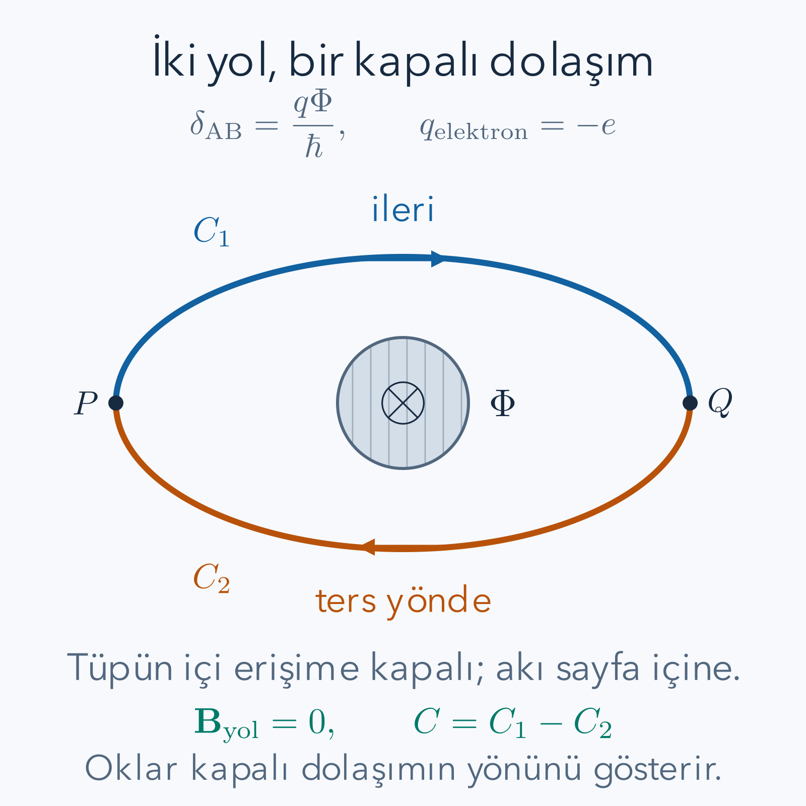

Elektron demetini iki kola ayırıp bir mıknatısın iki yanından geçirelim. Mıknatısın alanını elektronların erişemediği ince bir bölgede hapsedebilirsek, elektronun yürüdüğü yollar boyunca manyetik alan sıfır olabilir. Buna rağmen kollar yeniden birleştirildiğinde girişim deseni içerideki manyetik akıya bağlı olur. Aharonov–Bohm etkisinin sorusu budur: yerel manyetik kuvvetin bulunmadığı yolların göreli kuantum fazı nasıl değişir?

Ön bilgilerimiz [karmaşık sayılar ve faz](/blog/karmasik-sayilar-ve-euler-bagintisi/), [kuantum durumu ve Born kuralı](/blog/kuantum-durumu-superpozisyon-ve-born-kurali/) ile [Schrödinger denklemi ve olasılık akımı](/blog/schrodinger-denklemi-ve-olasilik-akimi/). [Klasik Hamilton mekaniği](/blog/klasik-hamilton-mekanigi/) kanonik momentumun neden mekanik momentumla aynı olmayabileceğini açıklar. Alan, akı ve potansiyel arasındaki gerekli ilişkileri burada yeniden kuracağız; sonraki Hall veya süperiletkenlik yazılarını önkoşul yapmıyoruz.

## 1. Bir fazın hangi kısmı ölçülebilir?

Normalize bir durumun tüm bileşenlerini aynı $e^{i\alpha}$ karmaşık sayısıyla çarparsak ölçüm olasılıkları değişmez; çünkü bu sayının mutlak değer karesi birdir. Burada $\alpha$ gerçek bir açı, $i$ karesi eksi bir olan sayıdır. Buna ortak veya global faz deriz. Ancak iki farklı yolun genliklerinden yalnız birine faz eklemek ortak faz işlemi değildir. Kollar birleştiğinde karmaşık sayılar önce toplanır, mutlak değer karesi sonra alınır.

Bunu küçük bir cebirle görelim. İki katkı $a$ ve $be^{i\delta}$ ise

$$
|a+be^{i\delta}|^2
=|a|^2+|b|^2+a^*be^{i\delta}+ab^*e^{-i\delta}.
$$

Son iki terim birbirinin eşleniğidir ve toplamları gerçektir. $a,b$ pozitif gerçek seçilebildiğinde bu toplam $2ab\cos\delta$ olur. Faz farkı, her kolun tek başına yoğunluğu değişmese de birleşimdeki olasılığı değiştirir. Bu nedenle tek kola bakarak görülmeyen bir etki girişimde ortaya çıkabilir.

Burada koherens gereklidir: yolların göreli fazı denemeden denemeye kontrolsüz biçimde dağılmamalıdır. Hangi yoldan geçildiğini çevreye kaydeden bir etkileşim girişimi azaltabilir. Yolların uzunluğunun eşit olması, tek başına koherens garantisi değildir; zamanlama, enerji dağılımı ve çevresel kayıtlar da önemlidir.

## 2. Manyetik alan, akı ve vektör potansiyeli

Manyetik alan vektörünü $\mathbf B$, vektör potansiyelini $\mathbf A$ ile göstereceğiz. SI birimlerinde

$$
\mathbf B=\nabla\times\mathbf A,
\qquad
\mathbf E=-\nabla\phi-\partial_t\mathbf A
$$

ilişkileri vardır. $\phi$ elektrik skaler potansiyeli, $\nabla$ uzay türevlerini içeren operatördür. Rotasyonel, bir vektör alanının küçük kapalı çevrim etrafındaki dolaşımını ölçer. $\mathbf A$'nın birimi tesla metre, $\phi$'nin birimi volttur. Bunlar farklı büyüklüklerdir; ikisine yalnız “potansiyel” deyip aynı işlevi yüklemeyeceğiz.

Yönü seçilmiş bir $S$ yüzeyinden geçen manyetik akı

$$
\Phi=\int_S\mathbf B\cdot d\mathbf S
$$

olarak tanımlanır. Birimi weber, yani tesla metrekaredir. Yüzeyin normal yönünü ters çevirirsek akının işareti değişir. Stokes teoremi düzgün bir potansiyel alanı için

$$
\oint_{\partial S}\mathbf A\cdot d\mathbf l=\Phi
$$

der. Çevrimin yönü ile yüzey normali sağ el kuralıyla eşleştirilir. Böylece işaretler keyfî biçimde bağımsız seçilemez. Faz hesabında hem parçacık yükünün işaretini hem bu dolaşım yönünü saklayacağız.

## 3. Yüklü parçacığın Hamiltonyeni

Parçacığın kütlesi $M$, elektrik yükü $q$ olsun. Elektron için $q=-e$ ve $e$ pozitif temel yük büyüklüğüdür. Kanonik momentum operatörü $\mathbf p=-i\hbar\nabla$ olduğunda minimal bağlaşım kuralı

$$
\boldsymbol\Pi=\mathbf p-q\mathbf A,
\qquad
H=\frac{\boldsymbol\Pi^2}{2M}+q\phi
$$

verir. $\boldsymbol\Pi$ mekanik momentumdur. $q\mathbf A$ momentum birimi taşır; aynı toplamda bulunan terimlerin birimleri bu nedenle uyumludur. Spinle doğrudan alan bağlaşımını bu girişte ihmal ediyoruz. Elektron yollarında alan sıfır olan ideal düzenek, bu sadeleştirme için ayrıca uygundur.

Kareyi açarken dikkat gerekir: $\mathbf p$ bir türev operatörüdür, $\mathbf A$ ise konuma bağlı olabilir. Bu yüzden

$$
(\mathbf p-q\mathbf A)^2
=\mathbf p^2-q(\mathbf p\cdot\mathbf A+\mathbf A\cdot\mathbf p)+q^2\mathbf A^2
$$

bir operatör eşitliğidir; ortadaki iki terim gerekçe olmadan $2\mathbf A\cdot\mathbf p$ yapılamaz. Bu yazıda kareyi bu biçimde açmak yerine kovaryant momentumun dönüşümünü doğrudan kontrol edeceğiz. Böylece türevin hangi fonksiyona etki ettiği görünür kalır.

## 4. Ayar dönüşümü fiziksel alanları değiştirmez

Düzgün, gerçek bir $\chi(\mathbf r,t)$ fonksiyonu seçelim ve

$$
\mathbf A'=\mathbf A+\nabla\chi,
\qquad \phi'=\phi-\partial_t\chi
$$

diyelim. Bir gradyanın rotasyoneli sıfır olduğu için $\mathbf B'=\mathbf B$ olur. Elektrik alanında ise iki ek terim birbirini götürür:

$$
\begin{aligned}
\mathbf E'&=-\nabla(\phi-\partial_t\chi)
-\partial_t(\mathbf A+\nabla\chi)\\
&=-\nabla\phi-\partial_t\mathbf A
+\nabla\partial_t\chi-\partial_t\nabla\chi\\
&=\mathbf E.
\end{aligned}
$$

Son satır için uzay ve zaman türevlerinin yer değiştirebilecek kadar düzgün olduğunu kullandık. Aynı alanları veren bu gösterim değişimine ayar dönüşümü diyoruz. Fiziksel olarak farklı bir mıknatıs üretmedik; alanların potansiyellerle yazılışını değiştirdik.

Kuantum durumu da birlikte dönüşmelidir:

$$
\psi'=e^{iq\chi/\hbar}\psi.
$$

Üstelin boyutsuz olması için $q\chi$ etki birimindedir. Konuma bağlı bir fazı ekleyip Hamiltonyeni olduğu gibi bırakırsak genellikle başka bir fiziksel durum elde ederiz. Ayar dönüşümü, durumun ve potansiyellerin birlikte değiştirildiği işlemdir; bu iki uygulamayı karıştırmak yanlış sonuç verir.

## 5. Türevdeki ek fazın açık iptali

$U=e^{iq\chi/\hbar}$ kısaltmasını kullanalım. Çarpım kuralı

$$
\nabla(U\psi)=U\nabla\psi+\frac{iq}{\hbar}(\nabla\chi)U\psi
$$

verir. $-i\hbar$ ile çarpıldığında ikinci terimin katsayısı $(-i)(i)q=q$ olur. Dolayısıyla

$$
\begin{aligned}
(-i\hbar\nabla-q\mathbf A')\psi'
&=U\left[-i\hbar\nabla\psi+q\nabla\chi\,\psi
-q(\mathbf A+\nabla\chi)\psi\right]\\
&=U(-i\hbar\nabla-q\mathbf A)\psi.
\end{aligned}
$$

Ek gradyan terimleri tam olarak silindi. Bu özelliğe kovaryant dönüşüm denir: sonuç aynı faz çarpanıyla dönüşür. İşlem her bileşen için geçerli olduğu için karesine de uygulanır; $\boldsymbol\Pi'^2\psi'=U\boldsymbol\Pi^2\psi$ olur.

Zaman türevini de atlamayalım:

$$
\begin{aligned}
i\hbar\partial_t\psi'
&=U(i\hbar\partial_t\psi-q\partial_t\chi\,\psi),\\
H'\psi'
&=U(H\psi-q\partial_t\chi\,\psi).
\end{aligned}
$$

Başlangıçtaki Schrödinger denklemi doğruysa iki yeni ifade de eşittir. Yoğunluk $|\psi'|^2=|\psi|^2$ ve mekanik momentuma dayanan olasılık akımı da değişmez. Böylece “potansiyel Hamiltonyende göründü, o halde potansiyelin her değeri ölçülebilir” çıkarımının neden doğru olmadığını doğrudan hesapladık. Ölçülebilir olan ayar seçiminden bağımsız bileşimlerdir.

## 6. Alanın sıfır olduğu bir bölgede faz biriktirmek

Zamandan bağımsız bir deney ve yollar boyunca elektrik potansiyeli sıfır olsun. Küçük, delik içermeyen bir bölgede $\mathbf B=0$ ise $\mathbf A=\nabla\chi$ yazılabilir. Potansiyelsiz çözüm $\psi_0$ biliniyorsa bir önceki dönüşüm hesabından

$$
\psi=e^{iq\chi/\hbar}\psi_0
$$

çözümünü elde ederiz. $P$ başlangıç, $Q$ bitiş noktası olmak üzere aynı yerel dal boyunca

$$
\chi(Q)-\chi(P)=\int_P^Q\mathbf A\cdot d\mathbf l
$$

olduğundan ek faz $q/\hbar$ çarpı bu çizgi integralidir. Her kısa parça için yazılıp parçalar birleştirildiğinde açık yolun manyetik faz katkısı aynı integral biçiminde birikir.

Bu açık yol katkısı tek başına ayardan bağımsız değildir. $\mathbf A$'ya $\nabla\chi$ eklenirse çizgi integrali $\chi(Q)-\chi(P)$ kadar değişir. Ancak iki yol aynı başlangıç ve bitişe sahipse iki ek uç terimi çıkarma sırasında iptal olur. Deneyin ölçtüğü nicelik bu farktır. Zamanla değişen alanlarda skaler potansiyelin katkısı da vardır; genel yol fazındaki elektromanyetik terim $q\int(\mathbf A\cdot d\mathbf r-\phi\,dt)/\hbar$ olur. Aşağıdaki statik düzende yalnız manyetik kısım gerekir.

## 7. İki yolun farkından kapalı çevrime

$C_1$ ve $C_2$ yollarının ikisini de $P$'den $Q$'ya doğru tanımlayalım. Yol birin fazından yol ikinin fazını çıkarınca

$$
\begin{aligned}
\delta_{\rm AB}
&=\frac q\hbar\left(\int_{C_1}\mathbf A\cdot d\mathbf l
-\int_{C_2}\mathbf A\cdot d\mathbf l\right)\\
&=\frac q\hbar\oint_C\mathbf A\cdot d\mathbf l
=\frac{q\Phi}{\hbar}.
\end{aligned}
$$

Burada kapalı $C$ çevrimi, $C_1$'i ileri ve $C_2$'yi geri izler. $\Phi$ bu çevrimin yönüne göre işaretli akıdır. Elektron için $\delta_{\rm AB}=-e\Phi/\hbar$ olur. Yolları yer değiştirirsek veya alanın yönünü ters çevirirsek fazın işareti değişir. Sadece simetrik bir çıkıştaki kosinüse bakmak bu işareti gizleyebilir; kaydırılmış referans fazıyla işaret ölçülebilir.

*Solenoidin taralı içi elektronlara kapalıdır. Mavi kol ileri, turuncu kolun tersi geri izlendiğinde kapalı çevrim oluşur. Akı yüzeyden geçer; parçacık yollarındaki ideal manyetik alan sıfırdır.*

Yol boyunca kinetik enerjiler veya uzunluklar farklıysa ayrıca bir referans fazı $\delta_0$ bulunur. Toplam gözlenen fark $\delta=\delta_0+\delta_{\rm AB}$'dir. Manyetik akının etkisini ayırmak için diğer koşulları sabit tutup akı değişimine bakarız. Geometrik yol farkını yok sayıp tüm fazı otomatik olarak AB etkisine atfetmeyiz.

## 8. Solenoid dışında alan sıfırken integral neden sıfır değil?

İdeal, uzun bir solenoidin yarıçapı $R$, toplam akısı $\Phi$ olsun. Dışarıda $r>R$ için silindirik yönde

$$
\mathbf A(r)=\frac{\Phi}{2\pi r}\,\hat{\boldsymbol\varphi}
$$

seçilebilir. Dış bölgedeki rotasyonelin eksen bileşeni

$$
B_z=\frac1r\frac d{dr}(rA_\varphi)
=\frac1r\frac d{dr}\left(\frac\Phi{2\pi}\right)=0
$$

olur. Buna karşılık yarıçapı $r$ olan bir çemberde $d\mathbf l=r\,d\varphi\,\hat{\boldsymbol\varphi}$ olduğundan

$$
\oint\mathbf A\cdot d\mathbf l
=\int_0^{2\pi}\frac\Phi{2\pi r}r\,d\varphi
=\frac\Phi{2\pi}(2\pi)=\Phi.
$$

Stokes teoremiyle çelişki yoktur. Çemberin gerdiği disk, solenoidin içinden de geçer; diskin her noktasında alan sıfır değildir. Alanın yalnız çevrim üzerinde sıfır olduğunu bilmek yüzey integralini sıfırlamaz. Solenoid dışındaki erişilebilir bölge ise deliklidir: onu saran çemberi deliğe girmeden bir noktaya büzemeyiz.

Yerel olarak $\chi=\Phi\varphi/(2\pi)$ seçersek $\mathbf A=\nabla\chi$ olur. Fakat $\varphi$ bir turda $2\pi$ artar; aynı fiziksel noktada $\chi$ değeri $\Phi$ kadar farklı çıkar. Bu fonksiyon tüm dış bölgede tek değerli bir ayar fonksiyonu değildir. Faz çarpanı özel akılarda tek değerli olabilir; genel akıda çok değerli bir dönüşümü izinli sayıp etkiyi silmek sınır koşulunu değiştirmiş olur.

## 9. Normalize girişim olasılığını kuralım

İki dengeli, ideal demet ayırıcı düşünelim. İlk ayırıcıdan sonra yol durumu $(|1\rangle+|2\rangle)/\sqrt2$ olsun. Yol fazları $\alpha_1,\alpha_2$ eklenir. İkinci ayırıcıyı

$$
|1\rangle\longmapsto\frac{|+\rangle+|-\rangle}{\sqrt2},
\qquad
|2\rangle\longmapsto\frac{|+\rangle-|-\rangle}{\sqrt2}
$$

olarak tanımlayalım. Bunlar cihazın seçtiğimiz faz konvansiyonlarıdır. Çıkış genlikleri

$$
a_+=\frac{e^{i\alpha_1}+e^{i\alpha_2}}2,
\qquad
a_-=\frac{e^{i\alpha_1}-e^{i\alpha_2}}2
$$

olur. Paydadaki iki, iki ayrı $\sqrt2$ normalizasyonunun çarpımıdır. Mutlak değer karesi alırsak

$$
P_+=\frac{1+\cos\delta}{2},
\qquad P_-=\frac{1-\cos\delta}{2},
\qquad\delta=\alpha_1-\alpha_2.
$$

Toplamları her fazda birdir ve her biri sıfır ile bir arasındadır. Tek bir ekrandaki iki yarık yoğunluğunu bu iki çıkış formülüyle özdeşleştirmiyoruz; orada konuma bağlı yayılma zarfları ayrıca gerekir. İki çıkışlı ideal düzenek, normalize olasılığı açıkça hesaplamak için seçildi.

## 10. Örnek 1: Yarım akı kuantumunda tam çıkış değişimi

Elektron için akı periyodunun pozitif büyüklüğünü

$$
\Phi_0=\frac he=\frac{2\pi\hbar}{e}
\approx4.135667697\times10^{-15}\,\mathrm{Wb}
$$

olarak tanımlayalım. Referans fazı $\delta_0=0$ ve işaretli akı $\Phi=\Phi_0/2$ olsun. Birim dönüşümüyle akı yaklaşık $2.067833848\times10^{-15}\,\mathrm{Wb}$'dir. Faz

$$
\delta=-\frac e\hbar\frac h{2e}=-\pi
$$

olur. Önce yükler sadeleşir, sonra $h/\hbar=2\pi$ kullanılır. $\cos(-\pi)=-1$ olduğundan $P_+=0$, $P_-=1$ bulunur. Sıfır akıda tüm parçacıkların gittiği artı çıkış karanlık olmuştur.

Fazın eksi olması olasılığın negatif olmasına yol açmaz. Olasılık karmaşık genliğin normundan hesaplanır; açının işareti ayrı bir bilgidir. Akı $\Phi_0$'a çıkarılırsa faz $-2\pi$ olur ve çıkışlar başlangıç değerine döner. Bu periyot, akının yalnız tamsayı katlar alması gerektiğini söylemez; dışarıdan uygulanan akı sürekli değişebilir. Periyodik olan girişim sinyalidir.

## 11. Örnek 2: Çeyrek akı ve referans fazının rolü

Akı $\Phi_0/4$ olduğunda elektronun ek fazı $-\pi/2$'dir. Referans sıfırken kosinüs sıfır olur:

$$
P_+=P_-=\frac12.
$$

Buna bakıp fazın artı mı eksi mi olduğunu belirleyemeyiz. Şimdi manyetik akıdan bağımsız bir yol ayarıyla $\delta_0=\pi/3$ ekleyelim. Aynı pozitif akıda toplam fark

$$
\delta=\frac\pi3-\frac\pi2=-\frac\pi6,
\qquad
P_+=\frac{1+\sqrt3/2}{2}\approx0.933013
$$

olur. Eksi çıkış yaklaşık $0.066987$'dir. Akının yönü ters çevrilirse $\delta=\pi/3+\pi/2=5\pi/6$ ve $P_+\approx0.066987$ çıkar. Böylece aynı büyüklükteki ters yönlü akılar seçilmiş bir referansla ayırt edilebilir.

Bu sonuç, “fazın işareti önemsizdir” biçimindeki kısaltmanın neden sınırlı olduğunu gösterir. Referans sıfırken kosinüs çift fonksiyondur; fiziksel düzenek başka bir faz içerdiğinde bu simetri tek bir çıkışın akı bağımlılığında kalmayabilir. Bütün faz konvansiyonlarını birlikte değiştirmek yine aynı ölçüm sonucunu verir.

## 12. Örnek 3: Dengesiz yollar ve görünürlük

İlk ayırıcıdan sonra yol olasılıkları $p$ ve $1-p$ olsun. Fazlardan önce genlikleri $\sqrt p$ ve $\sqrt{1-p}$ seçelim. İkinci ayırıcı yine dengeliyse

$$
P_+=\frac12\left[1+2\sqrt{p(1-p)}\cos\delta\right]
$$

elde edilir. Bu eşitlik, iki genliğin toplamını önce $\sqrt2$ ile bölüp normunu alarak bulunur. Girişim görünürlüğü, en büyük ve en küçük sinyalin farkının toplamına oranı olarak

$$
\mathcal V=\frac{P_{+,\max}-P_{+,\min}}{P_{+,\max}+P_{+,\min}}
=2\sqrt{p(1-p)}
$$

olur. $p=0.8$ için çarpım $0.16$, karekök $0.4$, görünürlük $0.8$'dir. Sıfır toplam fazda $P_+=0.9$, yarım tur farkta $P_+=0.1$, çeyrek tur farkta $P_+=0.5$ bulunur. Tam karanlık oluşmaması tek başına faz kaybının kanıtı değildir; yol genlikleri zaten eşit olmayabilir.

Kontrol için $p=1/2$ konulduğunda görünürlük bir ve önceki formül geri gelir. $p$ bire yaklaşırsa tek yol kalır, görünürlük sıfıra iner; akıya bağlı göreli fazı karşılaştıracak ikinci katkı bulunmaz. Koherens kaybı da görünürlüğü azaltabilir fakat bunun dengesizlikten ayrı deneysel olarak incelenmesi gerekir.

## 13. Kuvvet, sızıntı alanı ve akı kuantumunun yükü

İdeal statik düzende parçacıkların eriştiği yerde $\mathbf E=\mathbf B=0$ ise klasik Lorentz kuvveti $q(\mathbf E+\mathbf u\times\mathbf B)$ sıfırdır; $\mathbf u$ parçacık hızıdır. AB fazı bu yollara gizli bir yerel manyetik kuvvet eklediğimiz anlamına gelmez. Her ayrık kolun yoğunluğu salt faz çarpımından değişmez; değişiklik kolların yeniden birleşmesinde görünür. Toplam düzenek, kaynaklar ve sınır koşulları kuantum karşılaştırmasının bir parçasıdır.

Gerçek solenoid sonlu uzunlukta olabilir, alan sızabilir veya elektriksel potansiyel farkı oluşabilir. Bunlar parçacığı yerel olarak saptırıp ek dinamik faz oluşturabilir. Deneyde sızıntı alanı, elektrostatik fark, mekanik yol değişimi ve koherens kontrol edilmelidir. Bu gereklilik, ideal teorinin içindeki sıfır alan varsayımı ile bir laboratuvar aygıtının ölçülen özelliklerini ayırır. Zamanla akı değiştirilirse indüklenen elektrik alanı da hesaba katılmalıdır; statik formülü bu sırada tek başına kullanmayız.

Son olarak $h/e$ ile sık karşılaşılan $h/(2e)$ farklı yük ölçekleridir. Burada tek elektronun yük büyüklüğü $e$ olduğu için periyot $h/e$ çıktı. Yük büyüklüğü $2e$ olan koherent çiftlerin fazı için aynı $2\pi$ koşulu $h/(2e)$ verir. Bu ifade, tek elektronun yükünün yarıya düştüğünü söylemez. Hangi taşıyıcının fazını karşılaştırdığımızı belirtmeden yalnız “akı kuantumu” demek iki farklı fiziksel durumu karıştırır.

## 14. Akıya duyarlı halka: ayrı bir ölçüm örneği

Girişim düzeni dışında bir kontrol yapmak için parçacığı yarıçapı $r_0$ olan ince bir halkada tutalım. Halka yalnız bir boyutlu açısal koordinata izin versin; merkezindeki akı tüpüne parçacık erişemesin. Tüpün dışında yine manyetik alan sıfırdır. Teğetsel potansiyel $A_\varphi=\Phi/(2\pi r_0)$, kanonik teğetsel momentum ise $-i\hbar\partial_\varphi/r_0$ olur. Karesini alıp kinetik enerjiye yerleştirince

$$
H=\frac1{2Mr_0^2}\left(-i\hbar\partial_\varphi-\frac{q\Phi}{2\pi}\right)^2
$$

elde ederiz. Halka geometrisini seçtiğimiz için radyal hareket enerjisini bu etkin modelin dışında tuttuk. Bu kısıtlama olmadan iki boyutlu serbest parçacığın bütün Hamiltonyeni yalnız bu açısal ifadeden ibaret olmazdı.

Dalga fonksiyonunun aynı fiziksel noktada tek değerli olması $\psi(\varphi+2\pi)=\psi(\varphi)$ koşulunu verir. Normalize baz fonksiyonları $\psi_\ell=e^{i\ell\varphi}/\sqrt{2\pi}$ ve $\ell$ bir tamsayıdır; normalizasyon burada açısal ölçüye göredir. Türev $\partial_\varphi\psi_\ell=i\ell\psi_\ell$ verdiğinden

$$
E_\ell(\Phi)=\frac{\hbar^2}{2Mr_0^2}
\left(\ell-\frac{q\Phi}{h}\right)^2
$$

buluruz. Bir elektron için parantez $\ell+\Phi/\Phi_0$ olur. Sıfır akıda temel açısal durum $\ell=0$'dır. Yarım akı periyodunda $\ell=0$ ve $\ell=-1$ durumlarının ikisi de aynı $1/4$ parantez karesini verir. Tam bir akı periyodunda en düşük durum $\ell=-1$ olur ve enerji yeniden sıfıra iner.

Buradaki “yeniden aynı” ifadesi spektrumun tamamı içindir: akıya bir periyot eklediğimizde tamsayı etiketleri bir basamak kayar. Tek tek aynı etiketli özenerjilerin değişmediğini söylemiyoruz. Bu etiket kaymasını atlamak, periyodik spektrumdan yanlış bir enerji korunumu çıkarılmasına yol açabilir. Akıyı gerçekten zamanla değiştiren bir süreçte elektrik alan indüklenir; enerji aktarımı ve hangi durumun izlendiği ayrıca çözülmelidir. Statik özenerjiler, bu süreç hakkında tek başına tam bir dinamik cevap vermez.

Bu halka hesabı iki yol sonucunu bağımsız bir sınır koşulu üzerinden kontrol eder. Potansiyeli yerel olarak sıfırlamaya çalışsak bile dalga fonksiyonunun halka çevresindeki tek değerliliğine aktarılan faz aynı akı bilgisini korur. Etkiyi yalnız Hamiltonyenin bir satırından kaldırmak yeterli değildir; dalga fonksiyonunun izin verilen tanım bölgesi de hesapta tutulmalıdır.

## 15. Görünürlük ile faz kaybını ayırt etmek

Dengesiz iki yol örneğinde görünürlüğün küçülmesi hâlâ tam koherent bir saf durumla açıklanabiliyordu. Şimdi her tekrarın göreli fazına kontrolsüz bir $\zeta$ eklendiğini düşünelim. Tek tek tekrarlar için artı çıkış olasılığı $(1+\mathcal V\cos(\delta+\zeta))/2$'dir. Çok tekrarın ortalaması alınırken fazın kendisini değil bu olasılığı ortalamalıyız. Kosinüs doğrusal olmadığından ortalama fazı formüle koymak genel olarak aynı sonucu vermez.

Somut olarak gürültü iki değeri eşit olasılıkla alsın: $+\beta$ ve $-\beta$. Kosinüs toplam özdeşliğiyle ortalama

$$
\frac{\cos(\delta+\beta)+\cos(\delta-\beta)}2
=\cos\delta\cos\beta
$$

olur. Böylece görünürlük ek bir $|\cos\beta|$ çarpanıyla azalır. $\beta=\pi/3$ ise dengeli kollarda bile ortalama görünürlük yarıya düşer. Sıfır merkez fazda artı çıkış olasılığı $3/4$, yarım tur merkez fazda $1/4$ olur. Bu sonuç, bütün tekrarların ortalama fazı sıfır olduğu halde tam yapıcı girişim oluşmadığını gösterir. Faz dağılımı hakkında yalnız ortalamasını bilmek yeterli değildir.

Bir deneyde benzer sinyal azalması dengesiz demet ayırıcıdan, enerji dağılımından veya çevresel faz gürültüsünden gelebilir. Bu olasılıkların hepsi aynı ölçüm eğrisine bazı koşullarda benzer biçimde yansır. Ayırıcıların geçirgenliğini ayrı ölçmek ve akı sabitken faz kararlılığını izlemek bu nedenle anlamlıdır. Yalnız azalan tepe yüksekliğini okuyup elektronun akıyı artık “hissetmediği” sonucuna varamayız.

## 16. Bir faz haritası ile fiziksel alanı ayırmak

Ayar dönüşümünün iptalini çok basit bir yerel örnekle yeniden düşünelim. Başlangıçta bir doğru boyunca potansiyel sıfır olsun. Sabit gerçek $\kappa$ için $\chi(x)=\kappa x$ seçersek yeni potansiyel $A_x'=\kappa$ sabit olur ve yeni dalga fonksiyonu $e^{iq\kappa x/\hbar}\psi(x)$'tir. Artık dalga fonksiyonunun uzay boyunca fazı daha hızlı dönüyor gibi görünür. Fakat yeni kanonik momentum ile yeni mekanik momentum aynı şey değildir.

Başlangıç çözümü $e^{ikx}$ düzlem dalgası olsun. Dönüşen fonksiyonun dalga sayısı $k+q\kappa/\hbar$ olur. Kanonik momentum ölçüm gösterimi $\hbar k+q\kappa$ değerini taşır. Mekanik momentumdan $qA_x'=q\kappa$ çıkarınca yeniden $\hbar k$ elde edilir. Aynı hareketi iki farklı gösterimde anlatmış olduk; hız ve kinetik enerji değişmedi. Bu doğrudan hesap, konuma bağlı faz gradyanını tek başına ivme veya kuvvet diye okumanın neden hatalı olduğunu gösterir.

İki yolun aynı uçları arasında bu dönüşümün faz farkı da birbirini götürür. Kapalı bir çevrimde tek değerli $\chi$ için başlangıç ve bitiş aynı olduğundan toplam değişim sıfırdır. Solenoid örneğindeki küresel sorun ise tam burada ortaya çıkar: dış bölgenin tümünde aynı düzgün, tek değerli fonksiyonla potansiyeli yok edemeyebiliriz. Dolayısıyla yerel iptal hesabı ve kapalı çevrimin ölçülebilir fazı birbirine karşı iki önerme değildir; ikisi birlikte teorinin ayardan bağımsız yapısını gösterir.

## 17. Akıdan alan şiddetine dönmek

Fazı belirleyen büyüklük yalnız manyetik alanın tepe değeri değildir; kapalı çevrimin sardığı akıdır. Bunu sayıyla kontrol etmek için tüpün içinde düzgün bir alan ve dairesel kesit varsayalım. Yarıçap yüz nanometre olsun. Metreye çevirdiğimizde yarıçap $10^{-7}$ metre, alan ise $\pi\times10^{-14}$ metrekaredir. Yarım elektron akı periyodunu üretmek için gerekli alan büyüklüğü

$$
B=\frac{\Phi_0/2}{\pi R^2}
\approx\frac{2.067833848\times10^{-15}}{3.141592654\times10^{-14}}
\,\mathrm T\approx0.0658212\,\mathrm T
$$

çıkar. Bu alanın parçacık yollarında bulunduğunu varsaymadık; ideal tüpün içindeki alanı hesapladık. Aynı akıyı yarıçapı iki kat büyük kesitte üretmek için alan dörtte bire iner. İki kol tüpün tamamını sarıyorsa ideal AB fazı değişmez. Dolayısıyla fazı yalnız tesla cinsinden alanla ilişkilendirmek eksik olur; geometri de akı üzerinden hesaba girer.

Buna karşılık yollar tüpün bir kısmından geçecek veya alan sızıntısının olduğu bölgeye girecek biçimde değiştirilirse artık aynı ideal problem çözülmüyor demektir. Akı katkısına ek olarak yerel kuvvet ve dinamik faz araştırılmalıdır. Bu ayrım hesapta basittir: önce erişilebilir bölgeyi, sonra alanın nerede sıfır olduğunu, en son kapalı yolun hangi yüzeyi sardığını belirtiriz. Alan sıfır cümlesinin hangi bölgeye ait olduğunu yazmadan kurulan bir anlatım, Stokes teoremiyle sahte bir çelişki üretir.

## 18. Kaynaklar ve yorum sınırı

[MIT, R. L. Jaffe'nin yüklü parçacık ders notları](https://ocw.mit.edu/courses/8-06-quantum-physics-iii-spring-2016/3e3e804176b9c697b16abd811b5dfa89_MIT8_06S16_Supplementry.pdf), özellikle dördüncü bölümde, solenoid dışındaki potansiyel ve AB düzenini ele alır. [David Tong, The Quantum Hall Effect, bölüm 1.5.3](https://www.damtp.cam.ac.uk/user/tong/qhe/qhe.pdf) akı tüpü etrafındaki fazın açık ders kaynağıdır. Buradaki türev iptalleri, normalize iki çıkış hesabı ve sayısal örnekler SI birimleriyle ve işaretli $q$ konvansiyonuyla yazıldı. Sonuç, ayara bağlı her yerel potansiyel değerinin doğrudan ölçüldüğü iddiası değil; kapalı yol fazının ölçülebilir olduğudur.
