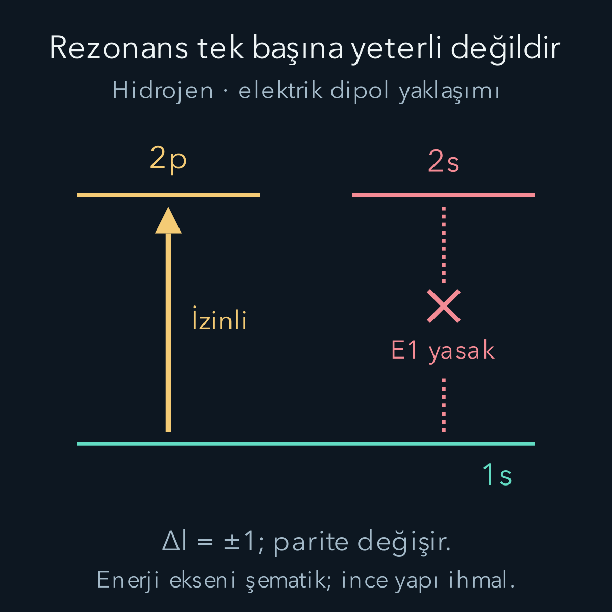
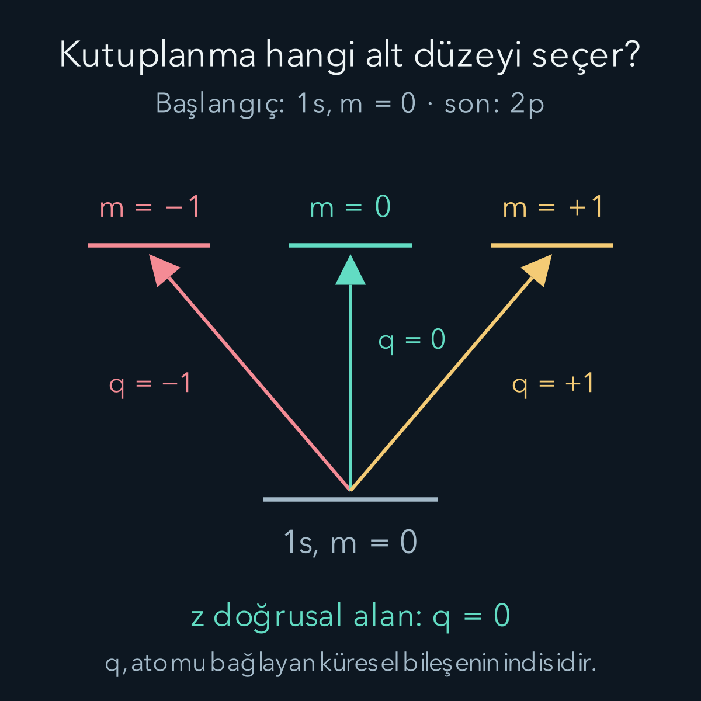

import ArticleVideo from '@/components/ArticleVideo.astro'
import kavram from './media/01-kavram.mp4?url'
import kavramPoster from './media/01-kavram.jpg?url'

Atomun iki enerji düzeyi arasındaki farkı bilmek, hangi ışığı soğurabileceği hakkında önemli bir başlangıçtır. Fakat yeterli değildir. Işığın frekansı tam enerji farkına uysa bile geçiş matris elemanı sıfır olabilir. Aynı frekansta farklı kutuplanmış iki alan, farklı atomik alt düzeylere bağlanabilir. Tayfın çizgilerini anlamak için enerji farkının yanında bağlantının yapısını da hesaplamamız gerekir.

Bu yazının ön bilgileri [hidrojen dalga fonksiyonları](/blog/merkezi-potansiyel-ve-hidrojen-atomi/), [parite](/blog/kuantumda-simetri-ve-parite/), [açısal momentum](/blog/kuantumda-acisal-momentum/), [zamana bağlı pertürbasyon ve Rabi salınımları](/blog/zamana-bagli-perturbasyon-ve-rabi-salinimlari/) ile [Fermi'nin altın kuralıdır](/blog/ferminin-altin-kurali/). Önce fiziksel etkileşimi kuracak, sonra hidrojenin bir geçişini integral sonuna kadar hesaplayacağız. Atom kuantumla, dış ışık alanı ise verilen klasik bir alanla anlatılacak.

## 1. Atomun dipol momenti neden konumla orantılıdır?

Çekirdeği başlangıç noktasında sabit, elektronun yükünü $-e$ alalım; $e>0$ temel yük büyüklüğüdür. Nötr hidrojen atomunun elektrik dipol momenti:

$$
\mathbf d=-e\mathbf r
$$

olur. $\mathbf r$ elektronun çekirdeğe göre konum operatörüdür. Dipol momentin birimi coulomb metre, elektrik alanın birimi volt/metredir. Bir dipolün dış elektrik alanla enerji etkileşimi $-\mathbf d\cdot\mathbf E$ olduğundan:

$$
H_I(t)=e\mathbf r\cdot\mathbf E(t).
$$

Alt $I$, burada etkileşim terimini belirtir. Artı işaret elektron yükünün negatifliğinden ve dipol enerjisindeki eksi işaretten birlikte gelir. Olasılık sonunda mutlak kare içerdiği için genel bir eksi işaret çoğu tek geçiş hesabını değiştirmez; fakat farklı genliklerin girişimini hesaplarken işaret ve fazları baştan tutarlı seçmek gerekir.

Bu ifadede alanı atom boyunca aynı kabul ettik. Gerçekte bir düzlem dalga $\mathbf E(\mathbf r,t)$ konuma da bağlıdır. Alanın fazı atom boyu kadar yer değiştirince çok az değişiyorsa konum bağımlılığını ilk yaklaşımda atabiliriz. Bu **elektrik dipol yaklaşımıdır**; kısaca E1 geçişi denir. $a$ atomun ilgili boyut ölçeği, $k=2\pi/\lambda_{\text{ışık}}$ dalga sayısı ise koşul $ka\ll1$'dir. $\lambda_{\text{ışık}}$ ışığın dalga boyudur; spin–yörünge yazısındaki enerji katsayısıyla ilgisi yoktur.

Yaklaşımın fiziksel anlamı elektronun alanla hiç hareket etmemesi değildir. Elektronun konum operatörü etkileşimde duruyor; ihmal edilen şey dış alanın atomun bir ucundan diğerine değişmesidir. Daha yüksek uzaysal terimler elektrik kuadrupol gibi başka geçişler getirir. Manyetik etkileşimler de ayrı operatörler içerir.

## 2. Sinüslü alanın bağlantı katsayısı

Alan $z$ yönünde doğrusal kutuplanmış olsun:

$$
\mathbf E(t)=E_0\hat{\mathbf z}\cos\omega t.
$$

$E_0$ gerçek tepe alan genliği, $\omega$ açısal frekans, $\hat{\mathbf z}$ birim yön vektörüdür. Bir ışık dalgasında elektrik alan yayılma yönüne diktir; örneğin bu alan $x$ yönünde ilerleyen bir dalgaya ait olabilir. $z$ kutuplanması deyip aynı anda dalganın $z$ yönünde ilerlediğini varsaymıyoruz.

Başlangıç ve son enerji özdurumları $|i\rangle,|f\rangle$ ise:

$$
\begin{aligned}
\langle f|H_I(t)|i\rangle
&=eE_0 z_{fi}\cos\omega t,\\
z_{fi}&=\langle f|z|i\rangle.
\end{aligned}
$$

$z_{fi}$ uzunluk birimli bir matris elemanıdır. Tek bir durumun ortalama konumu $\langle i|z|i\rangle$ ile aynı nicelik değildir. Atomun bir enerji durumunda kalıcı dipol momenti sıfır olsa bile iki farklı durum arasındaki geçiş dipolü sıfır olmayabilir.

$\cos\omega t=(e^{-i\omega t}+e^{i\omega t})/2$ olduğundan soğurmaya yakın rezonans yapan terimin enerji genliği $eE_0z_{fi}/2$'dir. Birinci mertebe geçiş olasılığı:

$$
\begin{aligned}
P_{i\to f}(t)&\approx
\frac{e^2E_0^2|z_{fi}|^2t^2}{4\hbar^2}
\operatorname{sinc}^2\!\left(\frac{\Delta t}{2}\right),\\
\Delta&=\frac{E_f-E_i}{\hbar}-\omega.
\end{aligned}
$$

$\hbar$ indirgenmiş Planck sabiti, $\Delta$ frekans kaçıklığı ve $\operatorname{sinc}u=\sin u/u$'dur. Hızlı dönen diğer terimi, önceki yazıdaki dönen dalga koşulları altında ihmal ettik. Formülde iki ayrı seçicilik görüyoruz: enerji farkı sinc eğrisinin merkezini belirler; $z_{fi}$ ise o geçişe bağlantı bulunup bulunmadığını belirler.

## 3. Parite aynıysa dipol integrali sıfırdır

Uzay yansımasında $\mathbf r\mapsto-\mathbf r$ olur. Parite özdurumlarının işaretleri $\pi_i,\pi_f=\pm1$ olsun. Konum operatörü tek paritelidir: yansımada $z\mapsto-z$. Matris elemanını tüm uzayı yansıtarak tekrar yazmak:

$$
z_{fi}=-\pi_f\pi_i\,z_{fi}
$$

verir. Eğer iki durumun paritesi aynıysa $\pi_f\pi_i=+1$ ve $z_{fi}=-z_{fi}$ olur. Bu ancak $z_{fi}=0$ ile mümkündür. Sonuç integralin pozitif ve negatif bölgelerinin tam birbirini götürmesidir; “geçiş zor olduğu için küçük” demek değildir.

Elektrik dipol geçişi için paritenin değişmesi bu nedenle gerekli bir koşuldur. Fakat gerekli koşul yeterli koşul değildir: zıt pariteli iki durumda da başka açısal kısıtlar veya radyal integralin sıfırlanması bağlantıyı engelleyebilir. “İzinli” sözcüğünü bütün matris elemanının sıfır olmamasına izin veren simetri koşulları anlamında kullanacağız; her izinli çizginin eşit güçlü olduğunu söylemeyeceğiz.

Hidrojenin yörüngesel durumlarının paritesi $(-1)^l$'dir. s durumları çift, p durumları tek, d durumları yeniden çifttir. Böylece $1s\to2s$ için parite değişmez ve E1 matris elemanı sıfırdır; $1s\to2p$ ise bu ilk engeli aşar.

## 4. Açısal momentum ve kutuplanma birlikte seçer

Elektrik dipol operatörü uzayda bir vektör gibi dönüşür. Bir vektörün açısal yapısı açısal momentum bir ile temsil edilir. Önceki toplama kuralına göre başlangıçtaki $l$ ile bu bir birleştiğinde son yörüngesel sayı yalnız $l-1,l,l+1$ olabilir; negatif değerler zaten durum değildir. Parite değişmesi gerektiği için aynı $l$ seçeneği elenir. Böylece tek elektronlu merkezî potansiyelde E1 kuralı:

$$
\boxed{\Delta l=l_f-l_i=\pm1}
$$

olur. Baş kuantum sayısı için benzer bir $\Delta n=\pm1$ kuralı yoktur. Enerji uyumu ve radyal integral ayrıca belirleyicidir. Örneğin başlangıç ve son p durumları arasında $n$ değişmesi, tek başına parite engelini kaldırmaz.

İzdüşüm kuralını matris elemanından doğrudan çıkarabiliriz. Konumun **küresel bileşenlerini**:

$$
\begin{aligned}
r_0&=z,\\
r_{+1}&=-\frac{x+iy}{\sqrt2},\\
r_{-1}&=\frac{x-iy}{\sqrt2}
\end{aligned}
$$

diğer bir bileşen bazı olarak tanımlayalım. Bunlar yeni konumlar değil, bildiğimiz $x,y,z$ operatörlerinin doğrusal birleşimleridir. İndis $q=0,\pm1$ için açısal momentum komütatörü $[L_z,r_q]=\hbar q r_q$ olur. Bunun iki enerji durumunun arasındaki matris elemanını alalım:

$$
\hbar(m_f-m_i)\langle f|r_q|i\rangle
=\hbar q\langle f|r_q|i\rangle.
$$

Kullandığımız komütatörü Kartezyen bileşenlerden doğrulayalım. $L_z=xp_y-yp_x$ ve konum-momentum komütatörleri:

$$
\begin{aligned}
[L_z,x]&=i\hbar y, & [L_z,y]&=-i\hbar x,\\
[L_z,x+iy]&=\hbar(x+iy),\\
[L_z,x-iy]&=-\hbar(x-iy),\\
[L_z,z]&=0
\end{aligned}
$$

verir. Sabit $\mp1/\sqrt2$ çarpanları bu özelliği değiştirmez; dolayısıyla küresel bileşenlerin q etiketleri tam olarak komütatörün işaret ve büyüklüğünü taşır. Yukarıdaki matris elemanının solunda da $\langle f|L_z=\hbar m_f\langle f|$ ve $L_z|i\rangle=\hbar m_i|i\rangle$ kullanılır. İki sıranın farkı $\hbar(m_f-m_i)$ çarpanını bu yüzden üretir. Böylece kutuplanma kuralını yalnız bir tablo olarak değil, işlecin genlikleri hangi açısal momentum bileşenlerine taşıyabildiğinin sonucu olarak okuyabiliriz.

Burada $m_i,m_f$ yörüngesel izdüşüm kuantum sayılarıdır; kütle değildir. Sıfır olmayan bağlantı için:

$$
\Delta m=m_f-m_i=q
$$

zorunludur. $z$ yönlü doğrusal alan $r_0=z$ operatörünü seçtiği için $\Delta m=0$ olur. $x$ yönlü doğrusal alan ise $r_{+1}$ ve $r_{-1}$ birleşimidir; $\Delta m=\pm1$ kanallarını bağlayabilir.

Dairesel kutuplanmada hangi işaretin seçildiğini “sağ” veya “sol” sözcüğünü ezberleyerek belirlemeyelim; bu adlar bakış yönüne göre karışabilir. Soğurmayı taşıyan $e^{-i\omega t}$ bileşeninin vektörü $(\hat{\mathbf x}+i\hat{\mathbf y})/\sqrt2$ seçilmişse etkileşim $(x+iy)/\sqrt2=-r_{+1}$ ile orantılıdır ve $\Delta m=+1$ seçer. Karmaşık eşleniği $\Delta m=-1$ seçer. Şekildeki $q$ etiketleri, atomu bağlayan operatör bileşenini gösterir.

Buradaki elektrik dipol operatörü spin uzayında birim operatörle çarpılıdır. Spin ile yörüngenin ayrı etiketlendiği yaklaşımda spin kısmının iç çarpımı alınır; farklı spin durumları ortogonal olduğundan $\Delta m_s=0$ çıkar. [Spin–yörünge bağlaşımı](/blog/spin-yorunge-etkilesimi/) önemli olduğunda ise enerji durumları $j,m_j$ ile etiketlenir. Aynı vektör toplama mantığı toplam için $\Delta j=0,\pm1$ kuralını, ayrıca $j=0\to j=0$ geçişinin yasaklığını verir. Parite değişimi koşulu sürer. Aşağıdaki açık hesapta ince yapıyı ihmal edip yörüngesel hidrojen durumlarını kullanacağız.

## 5. Hidrojenin bir geçişini seçmek

Başlangıç $|i\rangle=|1,0,0\rangle$ yani $1s$, son durum $|f\rangle=|2,1,0\rangle$ yani $2p,m=0$ olsun. Üç sayı $n,l,m$ sırasındadır. Spin durumu iki tarafta aynı kabul edilir ve spin iç çarpımı bir verir. Dış alan $z$ doğrultusunda olduğundan seçtiğimiz son izdüşüm doğru kanaldır.

Hidrojen dalga fonksiyonu $\psi_{nlm}=R_{nl}(r)Y_{lm}(\theta,\phi)$ olarak ayrılır. $r$ uzaklık, $\theta$ kutupsal açı, $\phi$ azimut açısıdır. $z=r\cos\theta$ ve hacim elemanı $d^3r=r^2dr\,d\Omega$ olup $d\Omega=\sin\theta\,d\theta\,d\phi$'dir. Dolayısıyla:

$$
\begin{aligned}
z_{fi}&=I_r I_\Omega,\\
I_r&=\int_0^\infty R_{21}(r)R_{10}(r)r^3dr,\\
I_\Omega&=\int Y_{10}^*\cos\theta\,Y_{00}\,d\Omega.
\end{aligned}
$$

Radyal fonksiyonları gerçek seçtik. $r^3$'ün bir çarpanı operatördeki $r$'den, ikisi hacim elemanından gelir. Bu çarpanı atlamak hem sonucu hem birimi yanlış yapar. Açısal integral boyutsuz, radyal integral uzunluk birimindedir.

## 6. Açısal integral ve radyal integral

Gerekli iki küresel harmonik:

$$
Y_{00}=\frac1{\sqrt{4\pi}},\qquad
Y_{10}=\sqrt{\frac3{4\pi}}\cos\theta.
$$

Bunları yerine koyunca:

$$
\begin{aligned}
I_\Omega&=\frac{\sqrt3}{4\pi}
\int_0^{2\pi}d\phi
\int_0^\pi\cos^2\theta\sin\theta\,d\theta\\
&=\frac{\sqrt3}{4\pi}(2\pi)\frac23\\
&=\frac1{\sqrt3}.
\end{aligned}
$$

İç integralde $u=\cos\theta$ dönüşümüyle $\int_{-1}^1u^2du=2/3$ kullandık. $m=\pm1$ son durumlarını aynı $z$ alanıyla deneseydik $\phi$ integralinde $e^{\pm i\phi}$ kalacak ve bütün turdaki integral sıfırlanacaktı. Böylece izdüşüm kuralını bu örnekte integral üzerinde de görüyoruz.

Bohr yarıçapı $a_0$ olmak üzere radyal fonksiyonlar:

$$
\begin{aligned}
R_{10}(r)&=\frac2{a_0^{3/2}}e^{-r/a_0},\\
R_{21}(r)&=\frac1{2\sqrt6\,a_0^{3/2}}
\frac r{a_0}e^{-r/(2a_0)}.
\end{aligned}
$$

Çarpımlarındaki üstel $e^{-3r/(2a_0)}$, katsayı $r/(\sqrt6a_0^4)$ olur. Hacim ve konum çarpanlarıyla:

$$
I_r=\frac1{\sqrt6a_0^4}
\int_0^\infty r^4e^{-3r/(2a_0)}dr.
$$

$\beta=3/(2a_0)$ tanımlayalım. $\int_0^\infty e^{-\beta r}dr=1/\beta$ eşitliğini dört kez $\beta$'ya göre türetmek $\int_0^\infty r^4e^{-\beta r}dr=24/\beta^5$ verir. Aynı sonuç dört kez kısmi integralden de çıkar. Böylece:

$$
\begin{aligned}
I_r&=\frac{24}{\sqrt6a_0^4}
\left(\frac{2a_0}{3}\right)^5\\
&=\frac{256}{81\sqrt6}\,a_0,\\
z_{fi}&=\frac{256}{243\sqrt2}\,a_0\\
&\approx0{,}745\,a_0.
\end{aligned}
$$

Sonucun sıfır olmadığını gördük; geçiş hem simetri tarafından izinli hem de bu radyal dalga fonksiyonları için gerçekten bağlantılıdır. $a_0\approx5{,}292\times10^{-11}\,\mathrm m$ ile $z_{fi}\approx3{,}94\times10^{-11}\,\mathrm m$ ve geçiş dipol büyüklüğü $e|z_{fi}|\approx6{,}32\times10^{-30}\,\mathrm{C\,m}$ olur.

## 7. Hangi frekans ve hangi darbe süresi?

Kaba hidrojen enerjisi $E_n\approx-13{,}6\,\mathrm{eV}/n^2$ olduğundan $E_2-E_1\approx10{,}2\,\mathrm{eV}$'dir. Rezonans $\hbar\omega=E_2-E_1$ koşuludur. $hc\approx1239{,}84\,\mathrm{eV\,nm}$ kullanırsak:

$$
\lambda_{\text{ışık}}
=\frac{hc}{E_2-E_1}
\approx121{,}6\,\mathrm{nm}.
$$

$h=2\pi\hbar$ Planck sabitidir. Bu morötesi bölgededir. Radyal fonksiyonları sonsuz ağır çekirdek yaklaşımıyla kullandık; burada verilen yuvarlak dalga boyu hassas hidrojen tayfının tüm küçük düzeltmelerini içermez.

Dipol yaklaşımını da sayıyla kontrol edebiliriz: $2\pi a_0/\lambda_{\text{ışık}}\approx0{,}0027$. İlgili orbital boyutu birkaç Bohr yarıçapı olsa da ışık fazının atom üzerindeki değişimi küçük kalır. Buna karşılık dalga boyu atom boyutuna yaklaştığında aynı yaklaşımın korunacağını varsayamayız.

İdeal, izole iki düzey modelinde rezonanstaki Rabi açısal frekansı:

$$
\Omega=\frac{eE_0|z_{fi}|}{\hbar},
\qquad P_f(t)=\sin^2(\Omega t/2)
$$

olur. Bu tanım kosinüsün tam tepe genliğine dayanır; rezonans yapan Hamiltonyen elemanı $\hbar\Omega/2$'dir. Örneğin $E_0=10^7\,\mathrm{V/m}$ seçersek $\Omega\approx5{,}99\times10^{11}\,\mathrm{s^{-1}}$ ve ilk tam aktarım için $t_\pi=\pi/\Omega\approx5{,}25\,\mathrm{ps}$ buluruz. ps, saniyenin $10^{-12}$'sidir. Optik açısal frekans yaklaşık $1{,}55\times10^{16}\,\mathrm{s^{-1}}$ olduğundan $\Omega/\omega\approx3{,}9\times10^{-5}$ küçüktür.

Bu bir darbe tasarımının ideal model hesabıdır. Sonlu darbenin tayf genişliği, diğer atom düzeyleri, ince yapı, alanın düzgünlüğü ve ışınımsal bozunma gerçek uygulamada ayrıca kontrol edilmelidir. Burada bulduğumuz büyük aktarımı, herhangi bir şiddette ve sürede ışık altında her gerçek atomun zorunlu davranışı diye yorumlamıyoruz.

<ArticleVideo src={kavram} poster={kavramPoster} title="Dipol bağlantısı ve rezonanstaki nüfus aktarımı" caption="z kutuplanması 1s ile 2p,m=0 durumlarını bağlar; 1s–2s E1 bağlantısı sıfırdır. Alt eğri ideal iki düzey modelinde P=sin²(Ωt/2) sonucunu gösterir. İlk yükseliş soğurma, geri dönüş aynı dış alanın uyardığı yayım yönündeki nüfus aktarımıdır; kendiliğinden yayım burada modellenmiyor." />

## 8. Altın kural nerede, Rabi hesabı nerede kullanılır?

Tek frekanslı eşevreli alanla yalıtılmış iki bağlı düzeyi sürüyorsak uzun sürede Rabi denklemleri gerekir. Kısa sürede $\sin(\Omega t/2)\approx\Omega t/2$ ve ikinci bölümün rezonans olasılığına geri döneriz. Olasılık henüz küçükken kullanılan pertürbasyon hesabı ile tam iki düzey evrimi bu sınırda tutarlıdır.

Yaklaşık sürekli bir son durum kümesi varsa, örneğin yeterince yüksek frekanslı ışık elektronun bağdan kurtulduğu iyonlaşma durumlarına bağlanıyorsa, [altın kuralın](/blog/ferminin-altin-kurali/) durum yoğunluğu integrali kullanılabilir. Etkileşimin aynı dipol biçimi için hız, uygun kanallar üzerinde:

$$
\Gamma=\frac{2\pi}{\hbar}
\left|\frac{eE_0z_{fi}}2\right|^2
\rho(E_i+\hbar\omega)
$$

olur. Ancak burada bağlı–sürekli durum matris elemanları ve durum yoğunluğu aynı normalizasyonla hesaplanmalıdır; bağlı $2p$ için bulduğumuz sayıyı bir iyonlaşma hesabına taşımayız. Tek bir ayrık $2p$ düzeyine keyfî bir yoğunluk ekleyip sabit hız üretmek de doğru değildir.

Alan farklı frekansları istatistiksel olarak içeriyorsa, ayrık atom düzeyleri için de ışığın tayf yoğunluğu üzerinden bir ortalama gerekir. Bu, son atom durumlarının yoğunluğuyla aynı nesne değildir. Hangi değişken üzerinde topladığımızı belirtmeden yalnız “yoğunlukla çarp” demek hem fiziksel yorumu hem birimleri belirsiz bırakır.

## 9. Uyarılmış yayım ve kendiliğinden yayımın ayrıldığı yer

Başlangıç üst durumda ise klasik sinüslü alanın diğer frekans bileşeni alt duruma aktarımı rezonanslı olarak sürer. Buna **uyarılmış yayım** denir. Hermit dipol operatörü için $z_{if}=z_{fi}^*$ olduğundan belirli bir durum çifti arasındaki yukarı ve aşağı bağlantının mutlak karesi aynıdır. Farklı dejenerasyon gruplarının toplam hızları ise başlangıç nüfusları ve kanal sayıları nedeniyle aynı olmak zorunda değildir.

Dış alanı tamamen sıfırladığımızda kullandığımız Hamiltonyende $H_I=0$ olur. Atom bir enerji özdurumundaysa yalnız fazı değişir; bu model kendi başına üst durumdan aşağıya ışık yaydırmaz. **Kendiliğinden yayımı** elde etmek için elektromanyetik alanın kuantum serbestlik derecelerini de sisteme katmak gerekir. Alanın boşluk durumu, klasik olarak her yerde sıfır olan bir sürme fonksiyonuyla aynı fiziksel içerik değildir. Burada kendiliğinden yayım hızı veya yaşam süresi hesaplamadık.

Son olarak “yasak geçiş” ifadesi her olası mekanizmanın yokluğu değildir. $1s$ ile $2s$ arasında tek elektrik dipol geçişi yasaktır; bu çift için önemli bir alternatif iki fotonlu süreçtir. Bunu, iki etkileşim adımında toplamda uygun pariteyi ve açısal momentumu sağlayan bir geçiş olarak düşünebiliriz; burada o ikinci mertebe hesabı yapmadık. Daha genel E1-yasak geçişlerde yüksek çokkutup terimleri veya durumları karıştıran dış alanlar da başka bağlantılar açabilir. Ancak her alternatifin kendi seçim kuralları vardır; örneğin sıradan bir elektrik kuadrupol teriminin s ile s durumunu otomatik olarak bağladığını söylemiyoruz. Bir tayf çizgisinin zayıflığını yorumlarken hem kullanılan yaklaşık etkileşimi hem de hangi simetrinin korunduğunu belirtmek gerekir. Bu yazıda artık enerji farkı, kutuplanma ve dalga fonksiyonu örtüşmesinin üç ayrı soruyu yanıtladığını somut bir hidrojen hesabında görebiliyoruz.

## Kaynaklar ve kapsam

Elektrik dipol etkileşimi, kutuplanmaya bağlı seçim kuralları ve klasik alanın sınırları için [David Tong, Quantum Mechanics in Electromagnetic Fields, bölümler 4.3–4.4](https://www.damtp.cam.ac.uk/user/tong/aqm/topics4.pdf); hidrojenin radyal ve açısal ayrımı için [David Tong, A Quantum Particle in Three Dimensions](https://www.damtp.cam.ac.uk/user/tong/qm/qmhtml/S4.html) kullanıldı. Geçişin açısal ve radyal integralleri, sayısal dipol büyüklüğü ve ideal darbe ölçeği bağımsız olarak denetlendi. Etkileşim klasik dış alanla sınırlıdır; tam kuantum elektromanyetik alan hesabı yapılmadı.
