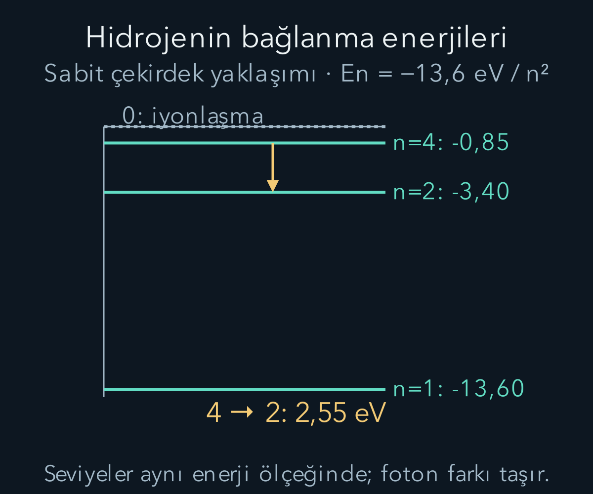
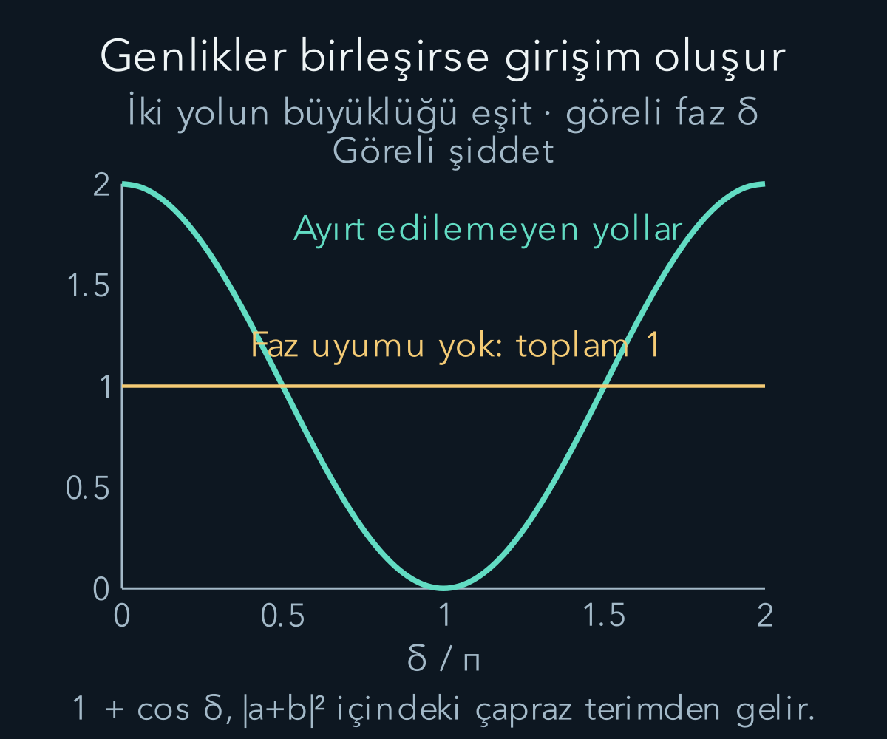

import ArticleVideo from '@/components/ArticleVideo.astro'
import kavram from './media/01-kavram.mp4?url'
import kavramPoster from './media/01-kavram.jpg?url'

Bir gazdan çıkan ışığı renklerine ayırdığımızda bazen kesintisiz bir gökkuşağı yerine ince çizgiler görürüz. Belirli renklerin seçilmesi, atomun her enerjiyi aynı biçimde alışveriş edemediğine işaret eder. Aynı dönemde elektron demetlerinin kristallerde oluşturduğu kırınım desenleri başka bir sınırı gösterdi: maddeyi yalnız küçük klasik bilyelerle anlatmak da yeterli değildi.

[Fotoelektrik etkide](/blog/kuantuma-gecis-isil-isinim-ve-fotoelektrik/) bir ışık kuantumunun enerjisini $E_\gamma=h\nu$ olarak tanıdık. Burada $h$ Planck sabiti, $\nu$ frekanstır. [Elektriksel kuvvet](/blog/elektrik-yuku-alan-ve-potansiyel/), [dairesel hareket](/blog/hareket-konum-hiz-ve-ivme/) ve [açısal momentum](/blog/donme-tork-ve-acisal-momentum/) bilgilerini bir araya getireceğiz. Bohr modelini tarihsel bir ara basamak olarak kuracak, başarısını ve sınırını birbirine karıştırmayacağız.

## 1. Bir tayf çizgisi hangi bilgiyi taşır?

Atom bir yüksek enerji durumundan daha düşük enerji durumuna geçip tek foton yayıyorsa enerji korunumu $E_\gamma=E_{\mathrm{ilk}}-E_{\mathrm{son}}$ verir. Sol taraf pozitiftir; yayımda atomun enerji kaybetmesi gerekir. Soğurmada bunun tersi olur: gelen fotonun enerjisi uygun bir enerji farkını karşılayabilir. Burada atomun bütün ayrıntılarını henüz bilmiyoruz. Ancak çizgilerin enerjileriyle atom içindeki enerji farklarını bağlayabiliriz.

Boşlukta $\nu=c/\lambda$ olduğundan bir çizginin dalga boyunu ölçmek, foton enerjisini $hc/\lambda$ olarak bulmayı sağlar. Bu bağıntıdaki $\lambda$ ışığın dalga boyudur. Biraz sonra elektron için de dalga boyu tanımlayacağız; aynı sembolün hangi nesneye ait olduğunu bağlamla belirteceğiz. Atomun boyutu ile yayılan ışığın dalga boyu da aynı uzunluk değildir.

Çizgilerin ideal modelde keskin olması, gerçek ölçümde sıfır genişlikte çıkmaları gerektiği anlamına gelmez. Atomların hareketi Doppler genişlemesi, çarpışmalar başka genişlemeler, ölçüm aygıtı ise sonlu çözünürlük getirir. Bu etkiler ayrık enerji yapısını silmez; gözlenen çizginin biçimini belirler. Burada çizgi merkezlerinin enerji hesabıyla ilgileniyoruz.

## 2. Klasik atomun kararlılık sorunu

Rutherford tipi resimde pozitif yük küçük bir çekirdekte toplanır, elektronlar çevrede bulunur. Elektrostatik çekim, dairesel hareket için gerekli merkezcil kuvveti sağlayabilir. Fakat klasik elektromanyetizmaya göre ivmelenen bir yük ışınım yapar. Dairesel hareketin sürati sabit olsa bile hız yönü değişir; dolayısıyla ivme vardır.

Enerji yayan klasik elektronun aynı dairesel yörüngede sonsuza kadar kalması beklenmez. Enerji kaybı yörüngesini değiştirir. Atomun kararlı olmasıyla bu beklenti arasında bir sorun doğar. Bunu çözmek için ‘elektron çok hızlı döndüğü için düşmez’ demek yeterli değildir; yörünge hareketi zaten hesabın içindedir. Açık kalan, enerji yayımına rağmen neden kararlı durumların bulunduğudur.

Bohr 1913'te bazı yörüngeleri özel kararlı durumlar kabul ederek yeni kurallar önerdi. Bu kurallar klasik mekanikten türetilmiş sonuçlar değildi. Model, hidrojenin bazı tayf çizgilerini açıklamakta başarılı oldu; fakat bu başarı bütün atomların gerçekten klasik daireler çizen elektronlardan oluştuğunu kanıtlamaz. Modern kuantum mekaniğinde temel nesne klasik yörünge değildir.

## 3. Hidrojen için varsayımları açık yazmak

Hidrojende protonun yükü $+e$, elektronun yükü $-e$ olsun; $e$ pozitif temel yük büyüklüğüdür. Elektron kütlesine $m_e$, elektriksel kuvvet sabitine $k_e=1/(4\pi\varepsilon_0)$ diyelim. Önce protonu sabit kabul edeceğiz. Bu, proton elektrondan çok ağır olduğu için iyi bir ilk yaklaşımdır. Daha hassas hesapta elektron kütlesi yerine iki cisim probleminin indirgenmiş kütlesi kullanılır.

Dairesel yörüngenin yarıçapı $r$, elektron sürati $v$ olsun. Coulomb çekiminin büyüklüğü $k_e e^2/r^2$, gerekli merkezcil kuvvet $m_ev^2/r$ olur. Bunları eşitleyince:

$$
\frac{m_ev^2}{r}=\frac{k_e e^2}{r^2},
\qquad m_ev^2=\frac{k_e e^2}{r}.
$$

Bohr'un ek kuantum koşulu açısal momentum için $m_evr=n\hbar$ biçimindedir. Burada $n=1,2,3,\ldots$ pozitif tam sayı; $\hbar=h/(2\pi)$, yani indirgenmiş Planck sabitidir. $\hbar$ birimi $\mathrm{J\,s}$ olup açısal momentum birimi $\mathrm{kg\,m^2/s}$ ile aynıdır. Bu koşulu bir varsayım olarak ekliyoruz; Coulomb yasasından kendiliğinden çıkmaz.

## 4. İzin verilen yarıçapları hesaplamak

Açısal momentum koşulunu sürat için çözelim: $v=n\hbar/(m_er)$. Kuvvet denklemine bu ifadeyi koyduğumuzda:

$$
m_e\frac{n^2\hbar^2}{m_e^2r^2}=\frac{k_e e^2}{r}.
$$

Önce solda bir $m_e$ sadeleşir, sonra iki tarafı $r^2$ ile çarparız. Böylece $n^2\hbar^2/m_e=k_e e^2r$ ve:

$$
r_n=\frac{\hbar^2}{m_ek_e e^2}n^2=a_0n^2
$$

bulunur. $a_0\approx5{,}29\times10^{-11}\ \mathrm m$ Bohr yarıçapıdır. Modelde ilk üç yarıçap $a_0$, $4a_0$, $9a_0$ olur; aralıklar eşit değildir. Bu sayıların günümüzde hidrojen atomunun doğal uzunluk ölçeğini vermesi önemlidir. Fakat modern temel durumda elektronun kesin olarak yarıçapı $a_0$ olan bir çember üzerinde bulunduğunu söyleyemeyiz.

Sürat de $v_n=k_ee^2/(n\hbar)$ olur. İlk durum için yaklaşık $2{,}19\times10^6\ \mathrm{m/s}$ çıkar. Bunun ışık hızına oranı yaklaşık $0{,}0073$'tür. Bu yüzden ilk hidrojen hesabında göreli düzeltmeleri küçük saymak makuldür. Çekirdek yükü büyüyen başka sistemlere aynı yaklaşımı kontrol etmeden taşımamalıyız.

## 5. Enerjinin neden negatif olduğunu görmek

Potansiyel enerjinin sıfırını elektronla proton sonsuz uzaktayken seçelim. Zıt yükler için $U(r)=-k_ee^2/r$ olur. Kuvvet denkleminden kinetik enerji $K=m_ev^2/2=k_ee^2/(2r)$ çıkar. Toplam:

$$
E=K+U=\frac{k_ee^2}{2r}-\frac{k_ee^2}{r}
=-\frac{k_ee^2}{2r}.
$$

İzin verilen yarıçapları yerine koyunca:

$$
E_n=-\frac{m_ek_e^2e^4}{2\hbar^2}\frac1{n^2}
\approx-\frac{13{,}6\ \mathrm{eV}}{n^2}.
$$

Negatif toplam enerji, kinetik enerjinin negatif olduğu anlamına gelmez. Kinetik enerji pozitiftir; potansiyel enerjinin negatif katkısı daha büyüktür. Sistem, seçtiğimiz sıfıra göre bağlıdır. Elektronu sonsuza ayırmak için dışarıdan enerji vermek gerekir. $n$ büyüdükçe enerji sıfıra alttan yaklaşır; bağlı durumlar arasındaki enerji aralığı küçülür.

## 6. Bir tayf çizgisini baştan sona hesaplamak

Elektronun modelde $n=4$ durumundan $n=2$ durumuna geçtiğini düşünelim. İlk enerji $-13{,}6/16=-0{,}850\ \mathrm{eV}$, son enerji $-13{,}6/4=-3{,}400\ \mathrm{eV}$ olur. Atomun enerji değişimi $E_{\mathrm{son}}-E_{\mathrm{ilk}}=-2{,}550\ \mathrm{eV}$'tur. Yayılan foton bu kaybın pozitif büyüklüğünü taşır:

$$
E_\gamma=(-0{,}850)-(-3{,}400)=2{,}550\ \mathrm{eV}.
$$

$hc\approx1240\ \mathrm{eV\,nm}$ kullanırsak dalga boyu $\lambda=1240/2{,}550\approx486\ \mathrm{nm}$ çıkar. Sonucun görünür bölgede bulunması, atom boyutunun yüzlerce nanometre olduğu anlamına gelmez. Bir enerji farkını elektromanyetik dalga boyuna çevirdik; atom yarıçapını ölçmedik.

Genel olarak yüksek $n_i$ durumundan düşük $n_f$ durumuna yayım için:

$$
\frac1\lambda=R_H\left(\frac1{n_f^2}-\frac1{n_i^2}\right)
$$

biçimindeki Rydberg bağıntısı elde edilir. $R_H$ ters uzunluk birimli sabittir; burada enerji ölçeğinin $hc$'ye bölünmesinden gelir. Protonun hareketini ihmal eden yaklaşık sabitle gerçek hidrojenin sabiti çok az farklıdır. Hassas tayf hesabında bu küçük ayrımı saklamamalıyız.

<ArticleVideo src={kavram} poster={kavramPoster} title="Momentum ile dalga boyu" caption="İdeal düzlem dalgasının momentumu iki katına çıkarılır. de Broglie bağıntısına göre dalga boyu yarıya iner." />

## 7. İyonlaşma ve modelin sınırı

Temel durum enerjisi $-13{,}6\ \mathrm{eV}$ olan atomu, elektronla protonun sonsuz ayrılıkta sıfır kinetik enerjili olduğu eşiğe taşımak için en az $13{,}6\ \mathrm{eV}$ gerekir. Buna temel durumdan **iyonlaşma enerjisi** denir. Başlangıç $n=2$ ise eşik $3{,}4\ \mathrm{eV}$ olur. İyonlaşma, başka bir bağlı çizgiye geçmekten farklıdır; son durum artık ayrık bağlı düzeylerden biri değildir.

Örneğin temel durumdaki ideal hidrojene 15 elektronvoltluk bir foton soğurulduğunu varsayalım. Geri tepme ve başka etkileri ihmal eden yaklaşımda $13{,}6\ \mathrm{eV}$ bağdan kurtulmaya gider, kalan $1{,}4\ \mathrm{eV}$ elektronun kinetik enerjisidir. Gerçek iki cisim hesabında momentum korunumu nedeniyle proton da geri teper. Küçük düzeltmelerin varlığı, ilk enerji bütçesinin neden iyi ama yaklaşık olduğunu açıklar.

Bohr modeli çok elektronlu atomların genel tayfını, çizgi şiddetlerini ve spin etkilerini tek başına açıklamaz. Ayrıca modern hidrojen temel durumunun yörüngesel açısal momentumu sıfırdır; Bohr'un ilk yörünge koşulu ise $\hbar$ verir. Enerji değerlerinin başarılı olması, resimdeki her mekanik ayrıntının doğru olması anlamına gelmez. İleride aynı enerji dizisinin farklı bir durum denklemiyle nasıl doğduğunu anlayacağız.

## 8. Madde için dalga boyu fikri

Foton için $E=pc$ ve $E=h\nu=hc/\lambda$ bağıntılarını birleştirirsek $p=h/\lambda$ buluruz. Buradaki $p$ momentum büyüklüğüdür. De Broglie, $\lambda=h/p$ ilişkisinin madde parçacıkları için de anlamlı olabileceğini önerdi. Bu, elektronun kütlesiz olduğu iddiası değildir. Kütleli parçacığın enerji-momentum bağıntısı farklıdır; dalga boyunu momentumla ilişkilendiren öneri ortaktır.

Küçük hızlarda elektron momentumu yaklaşık $p=m_ev$ olur. Kinetik enerjiden başlarsak $K=p^2/(2m_e)$ olduğundan $p=\sqrt{2m_eK}$ ve:

$$
\lambda=\frac h{\sqrt{2m_eK}}.
$$

Bu formülün koşulu, kinetik enerjinin durgunluk enerjisine göre küçük olmasıdır. Daha yüksek enerjide $p=\sqrt{E^2-m_e^2c^4}/c$ kullanılmalıdır. ‘Elektron dalga boyu’ için tek bir hızdan bağımsız sabit yoktur; hazırlanan momentum dağılımına bağlıdır.

Küçük enerji koşulunun hangi terimi ihmal ettiğini de görebiliriz. Toplam enerji $E=m_ec^2+K$ olduğundan göreli bağıntının karesini açalım:

$$
\begin{aligned}
p^2c^2
&=(m_ec^2+K)^2-m_e^2c^4\\
&=2m_ec^2K+K^2.
\end{aligned}
$$

$c^2$ ile bölüp ortak çarpanı alırsak:

$$
p=\sqrt{2m_eK}\sqrt{1+\frac{K}{2m_ec^2}}.
$$

İkinci kökün içindeki ek oran çok küçükken kök yaklaşık birdir ve önceki klasik momentum bulunur. $K=100\,\mathrm{eV}$ için $K/(2m_ec^2)\approx9{,}8\times10^{-5}$ olur. Dolayısıyla klasik hesap bu örnekte dalga boyunu çok az fazla verir; göreli momentum biraz daha büyük, $h/p$ biraz daha küçüktür. Bu kontrol, bir sonraki sayısal örnekte neden klasik formülü kullanabileceğimizi gösterir.

## 9. Hızlandırılan elektronun dalga boyu

Başlangıç kinetik enerjisi ihmal edilen elektron, 100 voltluk hızlandırıcı potansiyel farkından geçsin. Enerji kazancı büyüklük olarak $K=eU=100\ \mathrm{eV}$ olur; $U$ burada gerilim büyüklüğüdür. Joule'e çevirince $K\approx1{,}602\times10^{-17}\ \mathrm J$ bulunur. Elektron kütlesini $9{,}11\times10^{-31}\ \mathrm{kg}$ alalım.

Önce karekökün içini hesaplarız: $2m_eK\approx2{,}919\times10^{-47}\ \mathrm{kg^2m^2/s^2}$. Karekök $p\approx5{,}40\times10^{-24}\ \mathrm{kg\,m/s}$ verir. Son adımda $h/p\approx1{,}23\times10^{-10}\ \mathrm m=0{,}123\ \mathrm{nm}$ çıkar. Bu büyüklük atomlar arası uzaklık ölçeğindedir; kristallerin elektron demetlerini kırınıma uğratabilmesi için uygun bir uzunluktur.

Yaklaşımın kontrolü için $v=p/m_e\approx5{,}93\times10^6\ \mathrm{m/s}$ buluruz. $v/c\approx0{,}020$ olduğundan göreli düzeltme küçüktür. Alternatif enerji kontrolü de $100\ \mathrm{eV}$'un elektronun yaklaşık $511\,000\ \mathrm{eV}$ durgunluk enerjisine göre çok küçük olduğunu gösterir. Sonucun sadece birimini değil, formülü kullandığımız rejimi de doğruladık.

## 10. Kırınım, çarpışma izi ve genlik

Bir kristalin düzenli atom dizilimi, farklı saçılma yollarının dalgalarının belirli yönlerde güçlenmesine izin verir. Elektron kırınımı bu yapıyı ölçülebilir kılar. Bu olgu yalnız ‘elektron küçük olduğu için aralıklardan geçer’ açıklamasıyla yakalanamaz; seçilen yönlerin momentumla değişimi dalga boyu bağıntısını izler.

Tek tek gönderilen elektronlar ekranda tek tek yerel izler bırakır. Çok sayıda aynı hazırlığın tekrarıyla bu izlerin dağılımı girişim desenine yaklaşabilir. Dalga dili bir elektronun ekranda yarım izler bırakacağını söylemez. Tek olayın yerel kaydıyla çok tekrarın olasılık dağılımı farklı seviyelerdeki bilgilerdir.

Şekilde iki yolun genlik büyüklüğü eşit seçildi. Aralarındaki göreli faza $\delta$ dersek toplam şiddet, yolların ayrı şiddetleri toplamına bölündüğünde $1+\cos\delta$ olur. Faz ilişkisinin kaybolduğu karşılaştırma çizgisi bu ölçekte 1'dir; düşey eksen tek bir noktadaki mutlak olasılık değildir.

İki ayırt edilemeyen yol için karmaşık genlikleri $a$ ve $b$ ile gösterelim. Toplam olasılığa katkı $|a+b|^2=|a|^2+|b|^2+2\operatorname{Re}(a^*b)$ olur. Yıldız karmaşık eşleniği, $\operatorname{Re}$ gerçek kısmı belirtir. Son terim **girişim terimidir**. Yol bilgisi fiziksel olarak kaydedilip yollar ayırt edilir hâle geldiğinde aynı toplama kuralını koşulsuz kullanamayız. Hangi kayıtların tutulduğunu belirtmek, deney tanımının bir parçasıdır.

## 11. Duran dalga benzetmesinin yararı ve sınırı

Bohr çemberinin çevresine tam sayıda dalga boyu sığdığını varsayarsak $2\pi r=n\lambda$ elde ederiz. De Broglie bağıntısını kullanınca $2\pi r=nh/(m_ev)$ ve $m_evr=n\hbar$ çıkar. Bu eşleşme, tarihsel kuantum koşulunu dalga diliyle hatırlamak için yararlıdır. Ancak elektronun gerçek atomdaki dalga fonksiyonunun bir çember etrafındaki ip dalgası olduğunu kanıtlamaz.

Bir benzetme doğru bir bağıntıya götürse bile, onun bütün sonuçlarını fiziksel gerçek kabul edemeyiz. Duran dalga sınır koşullarının ayrık değerler seçmesi fikrini koruyacağız; geometrik çember varsayımını zorunlu tutmayacağız. Atomun üç boyutlu dalga durumlarını kurmak için sürekli uzayda normalleştirme ve bir enerji denklemi gerekecek. Bu araçlar hazır olmadan yörünge çizimini modern atom resmi diye sunmayacağız.

Burada iki ayrı kısıt gördük: enerji farkları ışığın çizgilerini seçiyor, momentum ise madde dalgasının uzaysal ölçeğini belirliyor. Şimdi kuantum durumunu en az matematikle tanımak için daha küçük bir deney ailesine döneceğiz. Konumun sonsuz sayıda değerinden önce, aynı aygıtta yalnız iki sonuç veren spin ölçümlerini incelemek yeni durum dilini adım adım kurmamızı sağlayacak.

## 12. Bir dalga boyu hesabını nasıl yorumlamalı?

Elektronun dalga boyunu 0,123 nanometre bulduğumuzda elektrona bu çapta bir küre biçmiş olmadık. Dalga boyu, momentumla bağlantılı faz değişiminin uzaysal ölçeğidir. Bir dalganın tepeleri arasındaki uzaklıkla dalganın kapladığı toplam bölge farklı olabilir. Çok sayıda dalga bileşenini birleştirerek bir paket oluşturduğumuzda paketin genişliği ayrıca belirlenir. Tek bir dalga boyu bilgisi, parçacığın kesin konumunu vermez.

Bu ayrımı gündelik ölçekte sayılarla da görebiliriz. Kütlesi 0,010 kilogram olan bir cismin sürati 2 metre/saniye ise momentumu 0,020 kilogram metre/saniye olur. De Broglie bağıntısının verdiği dalga boyu yaklaşık $6{,}626\times10^{-34}/0{,}020=3{,}31\times10^{-32}$ metredir. Aynı bağıntı kullanılmıştır, fakat ölçek atomlar arası uzaklıklardan olağanüstü küçüktür. Günlük bir topun kapı aralığında gözle görülen kırınım oluşturmamasını anlamak için bu ölçek farkı önemlidir; ayrıca çevreyle etkileşimler de girişimi gözlemlemeyi zorlaştırır.

Öte yandan küçük dalga boyu, her durumda kesin bir klasik yörünge bildiğimiz anlamına gelmez. Deneyin çözünürlüğü, hazırlama biçimi ve çevreyle etkileşimler hangi yaklaşımın yeterli olduğunu birlikte belirler. Klasik modelin ne zaman işe yaradığını tek bir ‘büyük veya küçük nesne’ ayrımına indirmemeliyiz. Farklı fiziksel nicelikler, farklı karşılaştırma ölçeklerine sahip olabilir.

Atom örneğinde de enerji farkları ile mutlak enerji sıfırını ayırmak gerekir. Bütün atom enerjilerine aynı sabit değeri eklersek, iki düzey arasındaki fark değişmez; tayf çizgileri aynı kalır. Bağlılığın negatif enerjiyle anlatılması seçtiğimiz sonsuz ayrılık sıfırına bağlıyken, yayılan fotonun pozitif enerji büyüklüğü doğrudan ölçülebilir farktır. Bu ayrım, daha sonra Hamiltonyenin sabit enerji kaymasının yalnız ortak faz üretmesini anlamamız için hazırlık sağlar.

Tayfı okurken de aynı sırayı izleyeceğiz: önce hangi iki durumun karşılaştırıldığını belirleyecek, sonra enerji farkının işaretini kontrol edecek, en sonunda frekans veya dalga boyuna çevireceğiz. Bu sıra, negatif enerji düzeylerinden yanlışlıkla negatif foton enerjisi üretmemizi engeller.

## Kaynakça

Aşağıdaki açık kaynaklar 11 Ekim 2026 tarihinde yeniden doğrudan kontrol edildi. Metin, hesap örnekleri ve şekiller bu yazı için özgün olarak hazırlandı.

- [OpenStax — Bohr’s Model of the Hydrogen Atom](https://openstax.org/books/university-physics-volume-3/pages/6-4-bohrs-model-of-the-hydrogen-atom): Enerji seviyeleri ve tayf bağıntısı.
- [OpenStax — De Broglie’s Matter Waves](https://openstax.org/books/university-physics-volume-3/pages/6-5-de-broglies-matter-waves): Momentum-dalga boyu ilişkisi ve elektron kırınımı.
