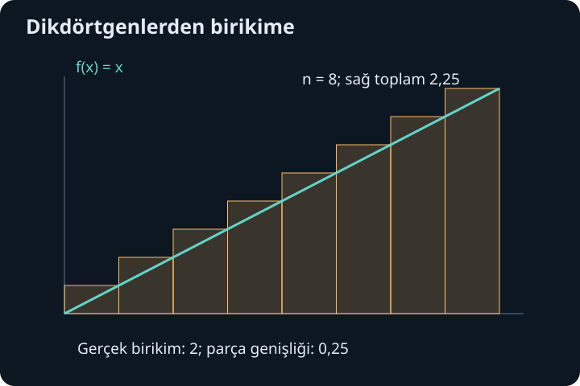
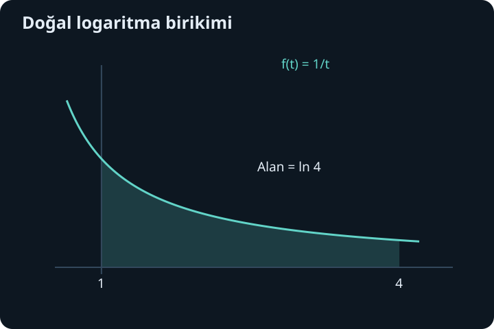

import ArticleVideo from '@/components/ArticleVideo.astro'
import kavram from './media/01-kavram.mp4?url'
import kavramPoster from './media/01-kavram.jpg?url'

Bir musluk dakikada sabit iki litre su akıtıyorsa beş dakikada biriken miktarı bulmak kolaydır: hız ile süreyi çarparız. Akış hızı sürekli değişiyorsa tek bir çarpım yetmez. Süreyi küçük parçalara ayırıp her parçada yaklaşık sabit bir hız kullanabiliriz. Parçaları incelttikçe yaklaşımın nasıl bir değere oturduğu sorusu bizi integrale götürür.

[Önceki yazıda](/blog/turev-teoremleri-ve-uygulamalari/) türevin bir aralığın değişimi hakkında ne söylediğini gördük. Şimdi küçük katkıları toplayacağız. İhtiyacımız olan ön bilgiler limit, süreklilik, toplamlar ve türevdir. İntegrali yalnız “türevi tersine almak” diye başlatmayacağız; önce birikimi tanımlayacak, sonra bu iki işlemin neden birbirini geri aldığını açıklayacağız.

## 1. Toplamı kısa yazmak

$1+2+3+4$ toplamını $\sum_{k=1}^{4}k$ biçiminde yazabiliriz. Büyük sigma işareti $\sum$ “topla” anlamındadır. Alttaki $k=1$ başlangıcı, üstteki 4 bitişi, sağdaki $k$ ise toplanacak ifadeyi söyler. $k$ bir sayacın adıdır; her seferinde sıradaki tamsayıyı alır. Dolayısıyla $\sum_{k=1}^{4}k^2=1^2+2^2+3^2+4^2=30$ olur.

Sabit çarpan dışarı alınabilir: $\sum_{k=1}^{n}3a_k=3\sum_{k=1}^{n}a_k$. İki dizinin terim terim toplamı da ayrı toplanabilir. Bunlar yeni kurallar değil, sonlu toplamlarda alıştığımız dağılma özelliğinin kısa yazımıdır. $n$, kaç terim topladığımızı gösteren pozitif tamsayıdır; daha sonra bu sayıyı büyüterek bir limit alacağız.

İlk $n$ pozitif tamsayının toplamı $n(n+1)/2$'dir. Bunu toplamı bir kez ileri, bir kez geri yazıp alt alta toplarsak görebiliriz: her sütun $n+1$ eder ve $n$ sütun vardır. İki kopyanın toplamı $n(n+1)$ olduğundan bir kopya yarısıdır. Bu küçük toplam formülü, ilk integralimizi doğrudan tanımdan hesaplamaya yetecek.

## 2. Bir aralığı bölüp katkıları toplamak

$[a,b]$ aralığını $a=x_0<x_1<\cdots<x_n=b$ noktalarıyla bölelim. $i$'nci parçanın genişliği $\Delta x_i=x_i-x_{i-1}$ olsun. Her parçadan $\xi_i$ adlı bir örnek nokta seçelim. Yunan harfi $\xi$, burada yalnız parçanın içindeki seçilmiş girdiyi temsil eder. O parçanın katkısını $f(\xi_i)\Delta x_i$ ile yaklaşık hesaplarız. Hepsinin toplamı:

$$
S=\sum_{i=1}^{n}f(\xi_i)\Delta x_i
$$

olur. Buna Riemann toplamı denir. Yükseklik $f(\xi_i)$, genişlik $\Delta x_i$ olduğundan geometrik olarak dikdörtgenleri topluyoruz. Fonksiyon bir akış hızıysa aynı çarpım o kısa sürede geçen yaklaşık miktardır.

Bölmenin en büyük parça genişliğine $\|P\|$ diyelim. Belirli integralin varlığı, yalnız eşit aralıklı bir örneğin düzgün davranması değildir. $\|P\|\to0$ iken, örnek noktalar ve bölmeler nasıl seçilirse seçilsin toplam aynı sonlu değere gidiyorsa:

$$
\int_a^b f(x)\,dx
=\lim_{\|P\|\to0}\sum_{i=1}^{n}f(\xi_i)\Delta x_i
$$

yazarız. Uzun integral işareti toplam fikrini, $a$ ve $b$ alt ve üst sınırları, $dx$ ise hangi değişken boyunca biriktiğini gösterir. Bu tanımda $dx$'i sıradan bir sıfır sayısı gibi çarpmıyoruz; sonlu toplamların limitini adlandırıyoruz.

### Dört parçayla toplamın bütün parçalarını adlandırmak

$f(x)=x$ fonksiyonunu $[0,2]$ üzerinde dört eşit parçaya bölelim. Bölme noktaları $x_0=0$, $x_1=1/2$, $x_2=1$, $x_3=3/2$, $x_4=2$'dir. Her genişlik $\Delta x_i=1/2$ olur. Sağ uçları örnek seçersek yükseklikler sırasıyla $1/2$, 1, $3/2$ ve 2'dir. Toplamı açık yazınca

$$
\begin{aligned}
S_4
&=\frac12\frac12+1\frac12
+\frac32\frac12+2\frac12\\
&=\frac14+\frac12+\frac34+1\\
&=\frac52
\end{aligned}
$$

buluruz. Her terimde önce yükseklik ile genişliği çarptık, sonra dört katkıyı topladık. Yalnız yükseklikleri toplasaydık 5 bulurduk; aralığın uzunluğunu hesaba katmamış olurduk.

Dört parça, beş bölme noktası gerektirir; $x_0$'ın bulunmasının nedeni budur. Örnek nokta $\xi_i$ ise yeni bir bölme ucu olmak zorunda değildir: parçanın ortası da seçilebilir. Bu örnekte orta noktalar $1/4$, $3/4$, $5/4$, $7/4$ olur ve toplamları genişlik $1/2$ ile çarpılınca tam 2 çıkar. Doğrusal fonksiyonda orta nokta seçimi özel olarak tam sonuç verir; her eğri için aynı şey beklenmez.

## 3. Doğrusal örneği tanımdan hesaplamak

$f(x)=x$ ve $[0,2]$ aralığını ele alalım. Eşit genişlikli $n$ parçanın her biri $\Delta x=2/n$ olur. Sağ uçları seçersek $x_i=2i/n$ ve toplam:

$$
S_n=\sum_{i=1}^{n}\frac{2i}{n}\frac2n
=\frac4{n^2}\frac{n(n+1)}2
=2+\frac2n
$$

olur. $n\to\infty$ iken sonuç 2'ye gider. Sol uçları seçersek toplam $2-2/n$ çıkar. Fonksiyon artan olduğu için alt ve üst dikdörtgen toplamları bütün diğer örnek seçimlerini aralarına alır. Aralarındaki fark $4/n$ sıfıra gider; sıkıştırma birikimin 2 olduğunu gösterir.

Geometri de aynı sonucu verir: tabanı 2, yüksekliği 2 olan üçgenin alanı $2\cdot2/2=2$'dir. Fakat integral yönteminin gücü üçgen olmayan şekillere de uygulanabilmesidir. Bir alan formülünü biliyor olmamız gerekmiyor; küçük parçaların toplamının limitini kurabiliyoruz.

### Eşit olmayan parçalar da aynı sonuca yaklaşır mı?

İntegral tanımı, yalnız eşit parçalardan oluşan tek bir diziye bakmıyordu. $f(x)=x$ için bu daha güçlü koşulu da doğrudan denetleyebiliriz. $i$'nci parçanın genişliği $\Delta x_i$ olsun. Bu parçada sağ ve sol uç yüksekliklerinin farkı da $x_i-x_{i-1}=\Delta x_i$ olur. Dolayısıyla üst ve alt dikdörtgenlerin alan farkı $(\Delta x_i)^2$'dir.

En büyük genişliği $\|P\|$ ile gösterdiğimiz için her parçada $\Delta x_i\le\|P\|$ olur. Toplam farkı böylece sınırlarız:

$$
\begin{aligned}
U(P)-L(P)
&=\sum_i(\Delta x_i)^2\\
&\le\|P\|\sum_i\Delta x_i\\
&=2\|P\|.
\end{aligned}
$$

Burada $U(P)$ üst toplam, $L(P)$ alt toplamdır; genişliklerin toplamı bütün aralığın uzunluğu olan 2'dir. Ayrıca her parçadaki gerçek yamuk alanı, alt ve üst dikdörtgen alanının ortalamasıdır. Bu yamuklar birlikte alanı 2 olan üçgeni doldurur. Bu yüzden 2, alt ve üst toplamın arasında kalır.

Her örnek nokta toplamı da aynı iki sınır arasındadır. En büyük parça daraldığında bu sınırların farkı sıfıra gider; parçaların eşit olması gerekmeden bütün seçimler 2'ye yaklaşır. Böylece hesapladığımız sayının integral tanımındaki bütün bölmeleri kapsadığını gördük.

## 4. Süreklilik neden yeterlidir?

Kapalı ve sınırlı bir aralıkta sürekli fonksiyon Riemann integrallenebilirdir. Burada sürekli olmak bir yeterli koşuldur; integrallenebilen her fonksiyon sürekli olmak zorunda değildir. Sonlu sayıda sıçraması bulunan sınırlı fonksiyonlar da integrallenebilir. Öte yandan her sınırlı fonksiyona koşulsuz integral atayamayız.

Sürekliliğin yeterli olmasının fikri, küçük parçadaki en büyük ve en küçük yükseklikleri karşılaştırmaktır. Sürekli fonksiyon, kapalı aralıkta düzgün süreklidir: istenen küçük yükseklik farkını sağlamak için bütün aralıkta işe yarayan ortak bir genişlik sınırı seçilebilir. Parçaları bu sınırdan dar tutarsak her parçanın üst ve alt yüksekliği arasındaki fark küçük olur. Üst ve alt toplam arasındaki fark, bu küçük yükseklik farkının toplam genişlik $b-a$ ile çarpımından büyük olamaz.

Dolayısıyla üst ve alt toplamlar aynı sınıra sıkışır. Buradaki “bütün aralıkta ortak” ifadesi önemlidir. Tek bir noktada süreklilik bir bölgedeki toplam davranışı tek başına kontrol etmez. Kapalı ve sınırlı aralık koşulu, yerel süreklilik bilgisini tüm aralığı yöneten bir sınıra dönüştürür.

## 5. İntegral işaretli birikimdir

Fonksiyon eksenin üstündeyse dikdörtgen katkıları pozitiftir. Altındaysa yükseklik negatiftir ve katkı da negatiftir. Bu nedenle integral her zaman geometrik alan değildir. $f(x)=x$ için $[-1,1]$ aralığındaki negatif ve pozitif üçgenler birbirini götürür:

$$
\int_{-1}^{1}x\,dx=0.
$$

İki bölgenin toplam geometrik alanı ise 1'dir. Geometrik alanı ölçmek için $|f(x)|$'i toplarız. Aynı ayrım ileride hızdan yer değiştirme ile toplam yol arasındaki farkı açıklayacak.

Sınırları ters çevirdiğimizde yönü tersine çeviririz: $\int_b^a f=-\int_a^b f$. Aynı noktadan aynı noktaya integral sıfırdır. Aralığı $c$'de bölmek katkıları ayırır: $\int_a^b f=\int_a^c f+\int_c^b f$. Toplamın doğrusallığı da limite geçer; $\int(\alpha f+\beta g)=\alpha\int f+\beta\int g$ olur. Burada $\alpha$ ve $\beta$ sabit sayılardır, her integral aynı sınırlar üzerinde alınır.

### İşaret ile toplama yönünü ayrı ayrı izlemek

$f(x)=x$ fonksiyonunu bu kez $[-1,2]$ üzerinde toplayalım. $[-1,0]$ parçasındaki üçgen eksenin altında olduğundan katkısı $-1/2$, $[0,2]$ parçasındaki üçgenin katkısı 2'dir. İşaretli birikim $3/2$, toplam geometrik alan ise $1/2+2=5/2$ olur.

Sınırları ters çevirirsek aynı fonksiyonun integrali $-3/2$ olur. Bu eksi işareti, fonksiyonun bütünüyle negatif olduğunu söylemez; toplama yönünü değiştirdiğimizi söyler. İki farklı işareti karıştırmıyoruz: fonksiyon değerinin işareti katkının yönünü, sınırların sırası ise aralığı hangi yönde katettiğimizi belirler.

Birim kontrolü de integralin ne anlattığını ayırır. $x$ saniye ve $f(x)$ litre/saniye olsaydı sonuç litre olurdu. $x$ metre ve $f(x)$ metre olsaydı sonuç metrekare olurdu. Aynı sayısal işlem bağlama göre farklı bir büyüklük ölçebilir. Her durumda küçük katkı, “birim girdi başına miktar” ile “küçük girdi aralığı”nın çarpımıdır; yalnız bir grafiğin yüksekliğini toplamak değildir.

## 6. Üst sınır hareket ederse yeni bir fonksiyon doğar

$f$ sürekli olsun ve başlangıç noktası $a$ sabit kalsın. $x$'e kadar biriken miktarı:

$$
A(x)=\int_a^x f(t)\,dt
$$

ile tanımlayalım. İntegral içinde $t$ yazmamız, içeride dolaşan değişkenle hareketli üst sınırı ayırır. Bu $t$'ye kukla değişken denir; $u$ yazsak aynı fonksiyon olur. Dıştaki $x$, ne kadar ilerlediğimizi belirler.

Üst sınırı $h$ kadar ilerletince eklenen miktar $A(x+h)-A(x)=\int_x^{x+h}f(t)\,dt$ olur. Pozitif $h$ için bu dar şeridin ortalama yüksekliği fark oranıdır:

$$
\frac{A(x+h)-A(x)}h=\frac1h\int_x^{x+h}f(t)\,dt.
$$

Dar aralıkta $f(t)$ değerlerinin en küçüğü ile en büyüğü, bu ortalamayı aralarına alır. Süreklilik nedeniyle $h\to0$ iken ikisi de $f(x)$'e yaklaşır. Negatif $h$ için integralin yönü ve paydanın işareti birlikte ters döner; aynı sıkıştırma çalışır. Sonuç:

$$
\boxed{A'(x)=f(x).}
$$

Bu, kalkülüsün temel teoreminin birinci yönüdür. Biriken miktarın anlık değişim hızı, o anda biriken katkının yoğunluğudur. Geometrik bir şerit düşüncesi, türev ile integral arasında tam bir eşitliğe dönüşür.

<ArticleVideo src={kavram} poster={kavramPoster} title="İnceleyen Riemann dikdörtgenleri" caption="f(x) = x için 0 ile 2 arasında orta nokta dikdörtgenleri inceliyor. Bu doğrusal örnekte orta nokta toplamı her bölmede tam 2’dir; parçaların biçimi giderek üçgensel bölgeyi izler." />

### Hareketli sınırdaki türevi açık bir fonksiyonla görmek

$A(x)=\int_1^x2t\,dt$ için antitürevi bildiğimizden $A(x)=x^2-1$ bulabiliriz. Bu fonksiyonun türevi $A'(x)=2x$'tir; integralin içindeki kuralı hareketli üst sınırda değerlendirdiğimizde de tam bu sonuç çıkar. Dikkat edelim: integralin içindeki $2t$'nin türevini alıp 2 yazmadık. Birikimin türevi, o andaki katkı yoğunluğu olan $2x$'tir.

Fark oranını da aynı örnekte açalım:

$$
\begin{aligned}
A(x+h)-A(x)&=2xh+h^2,\\
\frac{A(x+h)-A(x)}h&=2x+h.
\end{aligned}
$$

$h\to0$ iken limit $2x$ olur. Başlangıç sınırının 1 olması, fonksiyonda $-1$ sabiti oluşturdu; türevi değiştirmedi. Başlangıcı 0 seçseydik $x^2$ elde ederdik ve yerel eklenme hızı yine aynı olurdu.

$x<1$ için $A(x)$ negatif olabilir. Örneğin $A(1/2)=-3/4$'tür. Buna rağmen $A'(1/2)=1$ pozitiftir: üst sınırı biraz sağa götürmek negatif birikimi sıfıra yaklaştırarak artırır. Fonksiyonun değeriyle türevin işareti burada da farklı bilgileri taşır.

## 7. İntegrali uç değerlerle hesaplamak

$F'(x)=f(x)$ sağlayan bir $F$ fonksiyonuna $f$'nin antitürevi denir. Birinci teoremle kurduğumuz $A$ da aynı türeve sahiptir. Dolayısıyla $(F-A)'=0$ olur. Ortalama değer teoremi, türevi sıfır olan fonksiyonun aralıkta sabit olduğunu söyler. $A(a)=0$ olduğundan bu sabit $F(a)$'dır. $x=b$ koyarsak:

$$
\boxed{\int_a^b f(x)\,dx=F(b)-F(a).}
$$

Bu ikinci yön, hesaplama yöntemidir. Sürekli bir fonksiyonun antitürevini bulabildiğimizde sonsuz sayıda dikdörtgen toplamak yerine iki değeri çıkarırız. Fakat her sürekli fonksiyonun antitürevinin alıştığımız temel fonksiyonlarla yazılması gerekmez. İntegralin varlığıyla kolay bir kapalı formunun varlığı ayrı konulardır.

Örneğin $\int_0^2 3x^2\,dx$ için $F(x)=x^3$ seçeriz; çünkü türevi $3x^2$'dir. Sonuç $2^3-0^3=8$ olur. $\int_0^{\pi/2}\cos x\,dx$ için antitürev sinüs olduğundan sonuç $1-0=1$'dir. Her iki örnekte de önce türevle kontrol edilebilen bir fonksiyon bulduk, sonra sınırları kullandık.

Belirsiz integral $\int f(x)\,dx=F(x)+C$ ifadesi, bir sayı değil antitürev ailesidir. $C$ keyfi sabittir; türevi sıfır olduğundan bütün aile aynı türevi verir. Bir aralıkta herhangi iki antitürevin farkı sabittir. Ayrık tanım aralıklarında bu sabitleri birbirinden bağımsız seçmek gerekebilir.

### İki sınır da değişirse birikimin türevi

Temel teoremde alt sınırı sabit, üst sınırı doğrudan $x$ seçtik. Şimdi iki sınırın da $x$'e bağlı olduğu bir örneği çözelim:

$$
B(x)=\int_x^{x^2}(1+t^2)\,dt.
$$

Burada $t$, integral içinde dolaşan değişkendir; $x$ ise toplamanın nerede başlayıp nerede biteceğini belirler. Türev alırken integrandın içindeki $t$'ye göre türev almıyoruz. Değişen şey, birikim aralığıdır.

Başlangıcı 0 olan yardımcı fonksiyonu $H(u)=\int_0^u(1+t^2)dt$ diye tanımlayalım. Aralıkları ayırma özelliğiyle $B(x)=H(x^2)-H(x)$ olur. Temel teorem $H'(u)=1+u^2$ verir; zincir kuralını iki terime ayrı uygulayınca:

$$
\begin{aligned}
B'(x)&=H'(x^2)\cdot2x-H'(x)\\
&=2x(1+x^4)-(1+x^2).
\end{aligned}
$$

Örneğin $x=2$ noktasında üst sınır 4, alt sınır 2'dir. Üst uçta integrandın değeri $1+4^2=17$ ve bu ucun değişim hızı 4'tür; katkısı $17\cdot4=68$ olur. Alt uçta integrandın değeri $1+2^2=5$, ucun değişim hızı 1'dir. Alt sınır sağa ilerlediğinde başlangıçtan bir bölüm çıkarıldığı için bu katkı eksidir. Sonuç $B'(2)=68-5=63$ bulunur.

Hesabı antitürevle de denetleyebiliriz. $1+t^2$'nin antitürevi $t+t^3/3$ olduğundan $B(x)=x^2+x^6/3-x-x^3/3$ çıkar. Bunun türevi $2x+2x^5-1-x^2$'dir; yukarıdaki ifadeyle aynıdır.

$0<x<1$ olduğunda $x^2<x$ olur; yani üstte yazılı sınır sayı doğrusu üzerinde soldadır. Bu durumda $B(x)$ negatif işaretli birikimdir. Sınırları sessizce küçükten büyüğe sıralarsak başka bir fonksiyon tanımlamış oluruz. Genel kural, sürekli $f$ ve türevlenebilir sınırlar için üst ucun katkısından alt ucun katkısını çıkarmaktır: $f(b(x))b'(x)-f(a(x))a'(x)$. Uçların yerleri değişse de yönlü integral bu hesabı tutarlı kılar.

### Antitürevdeki sabit, belirli integralden neden silinir?

$f(x)=2x$ için $F_1(x)=x^2$ ve $F_2(x)=x^2+7$ iki antitürevdir. $[1,3]$ üzerindeki integralde birincisi $9-1=8$, ikincisi $(9+7)-(1+7)=8$ verir. Sabit, üst uçta eklenirken alt uçta çıkarıldığı için yok olur.

Genel gerekçe de aynı yapıdadır. $A'=f$ ve $F'=f$ olduğundan $(F-A)'=0$ olur. Önceki dersteki ortalama değer teoremi, bu farkın bir aralık boyunca sabit olduğunu söylüyordu. $x=a$'da $A(a)=0$ yazınca sabit $F(a)$ çıkar. Böylece

$$
\begin{aligned}
F(x)-A(x)&=F(a),\\
A(x)&=F(x)-F(a)
\end{aligned}
$$

eşitlikleri elde edilir. Son olarak $x=b$ koymak, uç değerler formülünü verir. “İntegral ile türev birbirini geri alır” cümlesindeki sabit ayrıntısı buradan gelir: türev, fonksiyonun başlangıç yüksekliğini kaybeder.

Bu nedenle belirli bir integralin sonuna keyfi $C$ eklemeyiz; sınırları verilmiş birikim tek bir sayıdır. Belirsiz integralde ise başlangıç değeri seçilmediği için bir fonksiyon ailesi vardır. Aynı integral işaretinin bu iki kullanımını sınırların bulunup bulunmamasıyla ayırırız.

## 8. Başlangıç bilgisi sabiti seçer

Bir depodaki miktarın zamana göre değişimi $Q'(t)=2t+1$ litre/dakika olsun. Burada $t$ dakika, $Q$ litre birimindedir; formüldeki sayısal katsayılar bu birim seçimine göredir. Antitürev $Q(t)=t^2+t+C$ olur. Başlangıçta $Q(0)=5$ litre bulunduğunu bilirsek $C=5$ çıkar. Üçüncü dakikada miktar $Q(3)=9+3+5=17$ litredir.

Aynı hesabı birikimle yapabiliriz: eklenen miktar $\int_0^3(2t+1)dt=12$ litre, başlangıç miktarı 5 litre; toplam 17 litredir. Bu iki anlatım aynı yapıyı farklı yerden görür. Antitürevde kaybolan sabit, başlangıçta zaten var olan miktarı temsil eder. Birikimin sınırlarını seçmek de aynı başlangıcı hesaba katmanın yoludur.

### Başlangıç bilgisi sıfırın dışında verilirse

Aynı değişim kuralı $Q'(t)=2t+1$ için bu kez $Q(2)=10$ litre verilsin. Antitürev yine $Q(t)=t^2+t+C$'dir; ancak $t=2$ koyunca $4+2+C=10$ olur ve $C=4$ bulunur. Başlangıç bilgisi verilen noktadaki miktar 10 olsa da formüldeki sabit 10 değildir. $C$, bu yazımda $t=0$'daki değerdir.

Doğrudan birikim yoluyla üçüncü dakikaya geçersek

$$
\begin{aligned}
Q(3)-Q(2)
&=\int_2^3(2t+1)\,dt\\
&=[t^2+t]_2^3\\
&=12-6=6
\end{aligned}
$$

litre eklenir. Böylece $Q(3)=10+6=16$ litre çıkar. Antitürevden de $9+3+4=16$ buluruz. İki yöntem aynı başlangıç noktasını doğru kullandığında aynı sonucu verir.

Bu hesapta integral toplam miktarı değil, iki zaman arasındaki **miktar değişimini** verdi. Başlangıçta içeride bulunan suyu sonradan eklemek zorundayız. Hızdan konuma, gelir hızından toplam gelire veya akıştan depolanan miktara geçerken bu ayrım aynı şekilde karşımıza çıkar.

## 9. Doğal logaritmi döngüsüz tanımlamak

Şimdi pozitif $x$ için yeni bir fonksiyon tanımlayalım:

$$
L(x)=\int_1^x\frac1t\,dt,\qquad x>0.
$$

$1/t$ pozitif girdilerde sürekli olduğundan temel teorem hemen $L'(x)=1/x$ verir. $L(1)=0$'dır ve türevi pozitif olduğu için $L$ kesin artandır. $x>1$ ise birikim pozitif, $0<x<1$ ise ters yönlü integral negatif olur.

Bu fonksiyonun neden logaritm olduğunu gösterelim. Sabit $a>0$ seçip $H(x)=L(ax)-L(x)$ tanımlayalım. Zincir kuralıyla:

$$
H'(x)=\frac a{ax}-\frac1x=0.
$$

Dolayısıyla $H$ sabittir. $x=1$ koyunca sabit $L(a)$ olur. Böylece:

$$
L(ax)=L(a)+L(x)
$$

elde edilir. Çarpmayı toplamaya dönüştüren temel logaritma özelliği, önceden bir logaritma türevi varsaymadan ortaya çıktı. Özellikle $L(1/a)=-L(a)$ ve pozitif tamsayı $n$ için $L(a^n)=nL(a)$ olur.

$L(2)>0$ olduğundan $L(2^n)=nL(2)$ sınırsız büyür. Karşılıklarda $L(2^{-n})=-nL(2)$ sınırsız küçülür. Süreklilik ve artış sayesinde $L$ bütün gerçek değerleri tam bir kez alır. Bu nedenle bütün gerçek sayılarda tanımlı, pozitif değerler alan bir ters fonksiyonu vardır.

### Logaritma özelliğinin iki sonucunu ara adımlarla çıkarmak

$L(ax)=L(a)+L(x)$ eşitliğinde $x=1/a$ yazabiliriz; çünkü $a>0$ iken karşılıklısı da pozitiftir. Sol taraf $L(1)=0$ olur. Dolayısıyla $0=L(a)+L(1/a)$ ve $L(1/a)=-L(a)$ çıkar. Eksi işareti, çarpmanın tersini almanın toplama tarafında çıkarma oluşturduğunu anlatır.

Kuvvet kuralında da aynı eşitliği tekrarlıyoruz: $L(a^2)=L(a)+L(a)=2L(a)$, ardından $L(a^3)=L(a^2)+L(a)=3L(a)$ olur. Pozitif tam sayılar için bu tekrar $L(a^n)=nL(a)$ verir.

$L$'nin bütün gerçek çıktılara erişmesini anlamak için $L(2)>0$ olduğunu bilmek yeterlidir. Hatta $1\le t\le2$ aralığında $1/2\le1/t\le1$ olduğundan $1/2\le L(2)\le1$ bulunur. Bu pozitif miktarın $n$ katı istediğimiz kadar büyür. Karşılıklı girdiler aynı ölçüde negatif çıktılar verir. Süreklilik, bu uç değerler arasındaki hiçbir çıktı seviyesinin atlanmamasını; kesin artış ise her seviyenin yalnız bir kez alınmasını sağlar. Ters fonksiyon kurmamızı sağlayan iki ayrı görev bunlardır.

## 10. Üstel fonksiyon, e sayısı ve eski gösterim

$L$'nin tersine $E$ diyelim: $L(E(y))=y$. Ters fonksiyonun türev kuralında $L'(x)=1/x$ hiçbir pozitif noktada sıfır değildir. Böylece:

$$
E'(y)=\frac1{L'(E(y))}=E(y).
$$

Türevi kendisine eşit olan üstel fonksiyona ulaştık. $e=E(1)$ sayısını tanımlarsak $L(e)=1$ olur. $L$'nin çarpım kuralı ve bire birliği, $E(u+v)=E(u)E(v)$ verir. Ayrıca $E(0)=1$'dir. Tamsayılar için $E(n)=e^n$; rasyonel girdiler için $E(p/q)=e^{p/q}$ elde edilir. Burada $q>0$ ve $p$ tamsayıdır; pozitif $q$'ncu kök tek olduğu için eşitlik belirgindir.

Gerçek üsler rasyonel üslerin sürekli uzantısı olarak kurulduğunda da aynı fonksiyona ulaşılır. Dolayısıyla $E(x)=e^x$ ve $L(x)=\ln x$ yazabiliriz. Önceden çarpma ve üs kurallarıyla tanıdığımız doğal logaritma, integral tanımıyla uyumludur. Kanıtın sırası dikkat çekicidir: önce integral, sonra logaritma türevi, ardından ters fonksiyon ve üstel türev geldi; birbirini varsayan iki kanıt kurulmadı.

Her $a>0$ için $a^x=e^{x\ln a}$ yazılır. Zincir kuralı:

$$
(a^x)'=a^x\ln a
$$

verir. $a\ne1$ için $\log_a x=\ln x/\ln a$ olduğundan:

$$
(\log_a x)'=\frac1{x\ln a},\qquad x>0.
$$

Örneğin $(e^{3x})'=3e^{3x}$ ve $(\ln(1+x^2))'=2x/(1+x^2)$ olur. İkinci örneğin içi her zaman pozitif olduğundan bütün gerçek girdiler kullanılabilir. $\ln x$'in türevi $1/x$ diye negatif girdileri otomatik dahil edemeyiz; gerçek logaritmanın tanım alanı pozitiftir.

### Ters fonksiyonun neden üs toplama kuralına uyduğunu göstermek

$E$, $L$'nin tersi olduğundan $L(E(u))=u$ ve $L(E(v))=v$ olur. $E$ pozitif değerler aldığı için bu iki değerin çarpımına logaritma özelliğini uygulayabiliriz:

$$
\begin{aligned}
L(E(u)E(v))
&=L(E(u))+L(E(v))\\
&=u+v\\
&=L(E(u+v)).
\end{aligned}
$$

$L$ bire bir olduğu için aynı çıktıyı veren pozitif girdileri eşitleyebiliriz: $E(u)E(v)=E(u+v)$. Üslerin toplanması özelliği böylece terslikten ve logaritmanın çarpım özelliğinden çıktı.

$e=E(1)$ seçimiyle $E(2)=E(1+1)=e^2$ bulunur. Rasyonel bir örnek için $E(1/2)^2=E(1)=e$ olur; $E(1/2)$ pozitif olduğundan $\sqrt e$'ye eşittir. Benzer biçimde $E(0)=1$ ve $E(-1)E(1)=E(0)$ olduğundan $E(-1)=1/e$ çıkar. Böylece yeni tanımladığımız fonksiyonun, daha önce tanıdığımız pozitif tabanlı üslerin temel kurallarıyla neden uyuştuğunu adım adım gördük.

Genel gerçek üslere geçişte kullanılan süreklilik, rasyonel girdilerle yaklaşırken tek bir tutarlı değer seçmemizi sağlar. Bu son uzatma ayrıntısı üs ve logaritma dersindeki tanımı kullanır; burada kurduğumuz yeni sonuç, o fonksiyonun türevinin neden kendisi olduğudur.

İntegral böylece hem birikimin tanımı hem türevi geri almanın yolu oldu. Doğal logaritma ve üstel fonksiyonun türevleri de aynı temele bağlandı. Bundan sonra asıl hesap sorusu, verilen bir fonksiyonun antitürevini hangi dönüşümlerle bulabileceğimiz olacak.

## Kaynaklar

- [OpenStax, Calculus Volume 2: Approximating Areas](https://openstax.org/books/calculus-volume-2/pages/1-1-approximating-areas)
- [OpenStax, Calculus Volume 1: The Fundamental Theorem of Calculus](https://openstax.org/books/calculus-volume-1/pages/5-3-the-fundamental-theorem-of-calculus)
- [OpenStax, Calculus Volume 1: Derivatives of Exponential and Logarithmic Functions](https://openstax.org/books/calculus-volume-1/pages/3-9-derivatives-of-exponential-and-logarithmic-functions)
