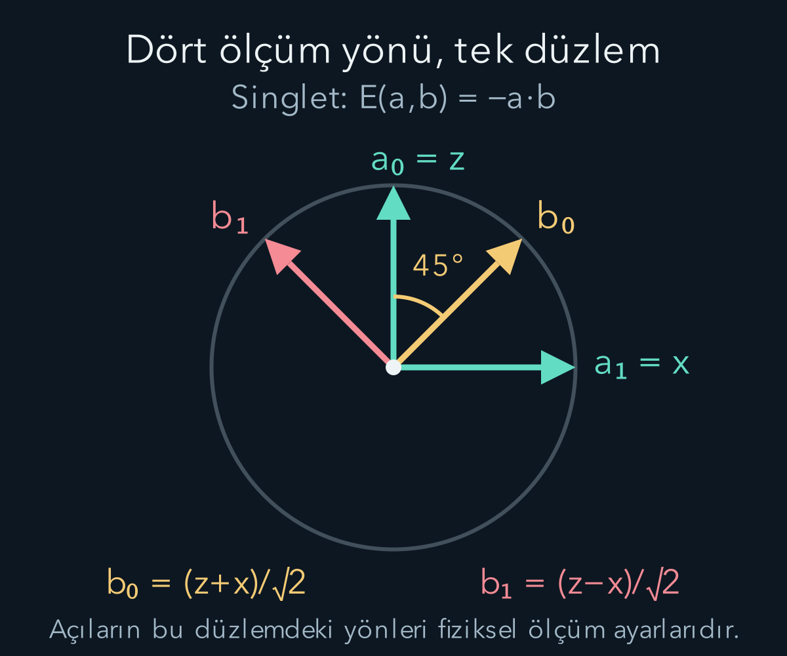
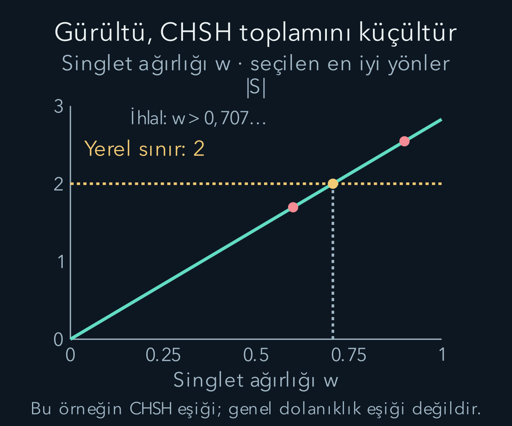

import ArticleVideo from '@/components/ArticleVideo.astro'
import kavram from './media/01-kavram.mp4?url'
import kavramPoster from './media/01-kavram.jpg?url'

Birbirinden uzakta bulunan iki sistemin sonuçları güçlü biçimde ilişkili olabilir. Aynı renkli iki kartı ayrı zarflara koymak klasik bir korelasyon üretir. Kuantum dolanıklığı için soru daha keskindir: farklı ölçüm ayarları arasında görülen bütün korelasyonlar, yerel sonuçların ortak bir geçmiş bilgisiyle belirlendiği bir modelle açıklanabilir mi? **Bell eşitsizlikleri**, bu soruyu ölçülebilir sayılara dönüştürür.

[Tensör çarpımı ve dolanıklık](/blog/tensor-carpimi-ve-dolaniklik/), [yoğunluk matrisleri](/blog/yogunluk-matrisleri-ve-karisik-durumlar/), [Pauli matrisleri](/blog/kuantum-gozlenebilirleri-ve-beklenen-deger/) ve [koşullu olasılık](/blog/olasilik-sayma-ve-kosullu-bilgi/) bu yazının ön bilgileridir. Bell ailesinin iki ayarlı, iki sonuçlu **CHSH** biçimini kuracağız. Adı Clauser, Horne, Shimony ve Holt soyadlarının baş harflerinden gelir. Varsayımları açık yazacak, sonra kuantum tahminini aynı sonuç tanımlarıyla hesaplayacağız.

## 1. Deneyin ayarları ve sonuçları

A ve B adlı iki laboratuvar her denemede birer parçacık alsın. A iki ölçüm ayarından birini, $x=0$ veya $x=1$ seçsin. B de $y=0$ veya $y=1$ seçsin. Buradaki $x,y$ konum koordinatları değil, ayar etiketleridir. Her ölçüm sonucu $+1$ veya $-1$ olarak kodlansın.

Spin örneğinde fiziksel sonuçlar $\pm\hbar/2$ idi. Şimdi yalnız işareti kullanmak için sonucu $2/\hbar$ ile ölçekliyoruz; CHSH değişkenleri boyutsuzdur. Bir denemede seçilen ayar çiftiyle birlikte iki sonuç kaydedilir. Aynı parçacık çiftinde dört ayar birleşiminin hepsi ölçülmez; farklı denemelerde farklı birleşimler kullanılır.

Her ayar çifti için korelasyonu $E_{xy}=\langle AB\rangle_{xy}$ diye tanımlayalım. Aynı işaretler çarpımda $+1$, zıt işaretler $-1$ verir. Bu nedenle $E_{xy}$ eksi bir ile artı bir arasındadır. Tam aynı sonuçlar artı bir, tam ters sonuçlar eksi bir korelasyon verir; sıfır değeri bu işaret çarpımının ortalamasının sıfır olduğunu söyler.

Bu ortalamayı olasılıklarla da yazabiliriz: $E_{xy}=P(\text{aynı}|x,y)-P(\text{zıt}|x,y)$. İki olasılığın toplamı bir olduğundan $P(\text{aynı}|x,y)=(1+E_{xy})/2$, $P(\text{zıt}|x,y)=(1-E_{xy})/2$ çıkar. Örneğin $E_{xy}=-0{,}6$, sonuçların yüzde 80 olasılıkla zıt, yüzde 20 olasılıkla aynı olmasıdır. Bu sayı tek bir parçacığın artı gelme olasılığını belirtmez; iki kaydın birlikte nasıl davrandığını anlatır.

## 2. Yerel modelin açık varsayımları

Çifti hazırlayan kaynağın ortak geçmişini veya modelin ek değişkenlerini $\lambda$ ile gösterelim. Bu sembol tek bir sayı olmak zorunda değildir; modele göre ayrıntılı bir bilgi listesi olabilir. Dağılımını $\mu(\lambda)$ yazalım; negatif değildir ve integrali birdir. Farklı denemelerde bu ortak değişken farklı değerler alabilir.

**Ölçüm ayarı bağımsızlığı**, $\mu(\lambda|x,y)=\mu(\lambda)$ koşuludur. Ayarların seçimiyle kaynak değişkeninin istatistiksel ilişkisi, modelde ayarlara göre farklı alt topluluklar seçmeye izin vermeyecek biçimde sınırlandırılır. Bu, insanın felsefi özgür iradesini deneyde ölçtüğümüz iddiası değildir; olasılık modelinin belirli bağımsızlık koşuludur.

**Yerel çarpanlaşma** koşulu ise:

$$
P(A,B|x,y,\lambda)
=P(A|x,\lambda)P(B|y,\lambda)
$$

biçimindedir. Ortak geçmiş $\lambda$ verildiğinde A'nın yanıtı yalnız kendi ayarına, B'nin yanıtı yalnız kendi ayarına bağlıdır. Bu koşul yalnız gözlenen yerel marjinallerin değişmemesinden daha güçlüdür. Kuantumun mesaj gönderememe özelliğiyle bu yerel model koşulunu aynı şey saymayacağız.

Bu varsayımlar ve uygun rastgele örnekleme birlikte, dört ayar çiftinin aynı $\lambda$ dağılımıyla karşılaştırılmasına izin verir. Sonraki cebirsel sınır tam bu yapıdan çıkacak. Deneysel ihlal yorumlanırken hangi varsayımların bir arada sınandığını açık tutacağız.

## 3. Önce kesin yerel yanıtlar için sınır

Belirli bir $\lambda$ için A'nın iki ayara vereceği yanıtlar $A_0,A_1\in\{-1,+1\}$, B'ninkiler $B_0,B_1\in\{-1,+1\}$ olsun. Bunlar tek denemede hepsinin ölçüldüğünü söylemez; sınadığımız yerel modelin ayarlara bağlı yanıt fonksiyonlarıdır. Şu birleşimi kuruyoruz:

$$
\begin{aligned}
C_\lambda&=A_0B_0+A_0B_1+A_1B_0-A_1B_1\\
&=A_0(B_0+B_1)+A_1(B_0-B_1).
\end{aligned}
$$

$B_0$ ve $B_1$ ya eşittir ya zıttır. Eşitlerse fark sıfır, toplam $\pm2$ olur. Zıtlarsa toplam sıfır, fark $\pm2$ olur. Her iki durumda yalnız bir parantez katkı verir ve $C_\lambda=\pm2$ çıkar. $A$ işaretleri büyüklüğü değiştirmez.

Bütün $\lambda$ değerleri üzerinde aynı dağılımla ortalama aldığımızda $|\langle C_\lambda\rangle|\le\langle|C_\lambda|\rangle=2$ olur. Ölçülebilir birleşimi:

$$
S=E_{00}+E_{01}+E_{10}-E_{11}
$$

tanımlarsak yerel sınır $\boxed{|S|\le2}$'dir. Eşitsizlikte bir eksi işareti bulunması önemlidir; dört korelasyonu keyfî işaretlerle değiştirdiğimizde ayar veya sonuç etiketlerinin de tutarlı değişmesi gerekir.

## 4. Rastgele yerel yanıtlar da aynı sınıra uyar

Modelin her $\lambda$ için kesin sonuç vermesini zorunlu tutmak istemeyebiliriz. Bu durumda yerel ortalamalar $a_x(\lambda)=\sum_A A P(A|x,\lambda)$ ve $b_y(\lambda)=\sum_B B P(B|y,\lambda)$ olur. Her biri eksi bir ile artı bir arasındadır. Yerel çarpanlaşma, koşullu korelasyonu $a_xb_y$ yapar.

Aynı cebirde $|a_0(b_0+b_1)+a_1(b_0-b_1)|\le|b_0+b_1|+|b_0-b_1|$ elde edilir. Sağ taraf $2\max(|b_0|,|b_1|)\le2$'dir. Ortalama alınca yine aynı CHSH sınırı çıkar. Böylece ihlal yalnız en basit kesin yanıt modelini değil, belirtilen çarpanlaşma ve ayar bağımsızlığına sahip rastgele yerel modelleri de sınar.

Bu adım, Bell sonucunu belirsiz bir ‘her şey önceden yazılmış olamaz’ sloganına indirgemememizi sağlar. Hangi olasılık yapısının imkânsız olduğunu açıkça biliyoruz. Farklı bir yorum veya kuram bu varsayımlardan hangisini değiştirdiğini belirtmeden yalnız isim değiştirerek aynı sınırdan kaçamaz.

## 5. Kuantum durumunu ve ölçümleri seçmek

İki spin yarım parçacığı singlet durumunda hazırlayalım:

$$
|\Psi^-\rangle=\frac{|01\rangle-|10\rangle}{\sqrt2}.
$$

Burada $|0\rangle$ ve $|1\rangle$, her parçacığın $z$ doğrultusundaki artı ve eksi spin sonuçlarına karşılık gelen baz ketleridir. İlk etiket A'ya, ikincisi B'ye aittir. İki ket birbirine dik olduğu için normun karesi $1/2+1/2=1$ olur. Aradaki eksi, iki bileşenin göreli fazıdır; bütüne verilen önemsiz bir eksi işaret değildir. **Singlet**, bu belirli iki parçacıklı durumun adıdır.

A tarafında birim uzaysal yön $\mathbf a$ boyunca ölçülen boyutsuz işaret gözlenebiliri $A_{\mathbf a}=\mathbf a\cdot\boldsymbol\sigma$ olsun. $\boldsymbol\sigma=(\sigma_x,\sigma_y,\sigma_z)$ Pauli işleçleri üçlüsüdür. B tarafında aynı biçimde $B_{\mathbf b}=\mathbf b\cdot\boldsymbol\sigma$ kullanılır. Her birinin özdeğerleri $\pm1$'dir.

Ortak korelasyon:

$$
E(\mathbf a,\mathbf b)=
\langle\Psi^-|A_{\mathbf a}\otimes B_{\mathbf b}|\Psi^-\rangle
$$

olur. Tensör işareti ölçümlerin farklı alt sistemlere ait olduğunu belirtir. Bu yüzden A ve B'nin yerel işleçleri birbirleriyle değişmelidir; fakat aynı tarafta iki farklı yönün işleçleri değişmeli olmak zorunda değildir. Kuantum ihlalinin cebirinde bu ikinci özellik belirleyici olur.

## 6. Singlet korelasyonunu hesaplamak

Aynı eksende iki Pauli işleci singleti eksi işaretle çarpar. Örneğin $\sigma_z\otimes\sigma_z$, hem 01 hem 10 bileşenine eksi işaret verir. $\sigma_x\otimes\sigma_x$ bu iki bileşeni yer değiştirir; aradaki eksi nedeniyle sonuç yine eksi singlet olur. $\sigma_y$'nin karmaşık çarpanlarını koruduğumuzda aynı sonuç çıkar.

Farklı eksen çiftlerinin beklenen değerleri sıfırdır; matrisleri uygulayıp singletle iç çarpım alarak denetlenebilir. Böylece $\langle\sigma_i\otimes\sigma_j\rangle=-\delta_{ij}$ olur. $\delta_{ij}$, indeksler eşitse bir, farklıysa sıfırdır. Yön bileşenlerini açarsak:

$$
\begin{aligned}
E(\mathbf a,\mathbf b)&=\sum_{i,j}a_ib_j(-\delta_{ij})\\
&=-\sum_i a_ib_i\\
&=-\mathbf a\cdot\mathbf b.
\end{aligned}
$$

Birim yönler arasında açı $\theta$ varsa korelasyon $-\cos\theta$'dır. Aynı yön için eksi bir, dik yön için sıfır, ters yön için artı bir çıkar. Bu sınırlar spin etiketleriyle tutarlıdır. Foton kutuplanması deneylerinde fiziksel polarizör açılarıyla farklı iki kat açı ilişkileri görülebilir; burada spin yönlerini kullanıyoruz.

Bir sonraki hesabımız yalnız $x$ ve $z$ yönlerini kullanacak. Bu düzlemdeki çapraz terimlerden birini açıkça görelim:

$$
(\sigma_z\otimes\sigma_x)|\Psi^-\rangle
=\frac{|00\rangle+|11\rangle}{\sqrt2}.
$$

Çünkü $|01\rangle$, $|00\rangle$ olur; $|10\rangle$ ise $-|11\rangle$ olur ve singletteki ikinci eksiyle birleşince artı verir. Elde edilen ket, yalnız 01 ve 10 bileşenleri olan singlete diktir; iç çarpım ve dolayısıyla bu çapraz korelasyon sıfırdır. Ters sıradaki $\sigma_x\otimes\sigma_z$ için sonuç aynı ketin eksisidir; onun da singletle iç çarpımı sıfırdır. Böylece kullanacağımız düzlem için $E=-a_xb_x-a_zb_z$ sonucunun bütün terimlerini tek tek kontrol etmiş olduk.

## 7. Dört yönle kuantum ihlali

A'nın ayarlarını $\mathbf a_0=\hat z$, $\mathbf a_1=\hat x$ seçelim. Şapkalı $\hat z$ ve $\hat x$ bu satırda birim uzay yönleridir. B için $\mathbf b_0=(\hat z+\hat x)/\sqrt2$ ve $\mathbf b_1=(\hat z-\hat x)/\sqrt2$ olsun. B yönleri $z$ ekseninin iki yanında kırk beş derece yapar; hepsi $xz$ düzlemindedir.

Noktasal çarpımlarla $\mathbf a_0\cdot\mathbf b_0=\mathbf a_0\cdot\mathbf b_1=1/\sqrt2$, $\mathbf a_1\cdot\mathbf b_0=1/\sqrt2$ ve $\mathbf a_1\cdot\mathbf b_1=-1/\sqrt2$ bulunur. Singlet eksi işaretini uygulayınca:

$$
E_{00}=E_{01}=E_{10}=-\frac1{\sqrt2},\qquad
E_{11}=+\frac1{\sqrt2}.
$$

Seçtiğimiz CHSH birleşimi $S=-1/\sqrt2-1/\sqrt2-1/\sqrt2-(+1/\sqrt2)=-2\sqrt2$ olur. Dolayısıyla $|S|=2\sqrt2\approx2{,}828>2$ bulunur. Eksi sonuç bir sorun değildir; sınır mutlak değer içindir. Etiketleri değiştirerek pozitif ihlal yazılabilir, fakat işaretler bütün hesap boyunca tutarlı kalmalıdır.

Yönlerin neden önemli olduğunu ara açılarla da hesaplayabiliriz. $\mathbf b_0=\cos\theta\,\hat z+\sin\theta\,\hat x$ ve $\mathbf b_1=\cos\theta\,\hat z-\sin\theta\,\hat x$ seçilsin; $0\le\theta\le\pi/4$ olsun. A yönleri sabitken ilk iki korelasyon $-\cos\theta$, üçüncü $-\sin\theta$, dördüncü $+\sin\theta$ olur. Bu nedenle $S=-2(\cos\theta+\sin\theta)$ ve $|S|=2(\cos\theta+\sin\theta)$ çıkar. Aşağıdaki videoda durum hep singlet olarak kalır; değişen şey B'nin ölçüm ayarlarıdır. Başlangıçta iki B yönü çakışır ve değer 2'dir; kırk beş dereceye açıldıklarında $2\sqrt2$ olur.

<ArticleVideo src={kavram} poster={kavramPoster} title="Ölçüm yönleri değişirken CHSH toplamı" caption="Singlette A tarafının z ve x yönleri sabit kalır. B tarafının iki yönü z ekseninden simetrik olarak 0° ile 45° arasında açılır. |S|=2(cosθ+sinθ), 2’den 2√2’ye yükselir. Yerel modelin varsayımları metinde açıklanır." />

## 8. Gerçek sayımlardan korelasyon bulmak

Bir ayar çiftinde dört ortak sonuç sayısını $N_{++},N_{+-},N_{-+},N_{--}$ diye yazalım. Toplam deneme sayısı bunların toplamı olsun. Örnek korelasyonu:

$$
\widehat E=
\frac{N_{++}+N_{--}-N_{+-}-N_{-+}}
{N_{++}+N_{--}+N_{+-}+N_{-+}}
$$

olarak hesaplanır. Şapka burada kuramsal ortalama yerine veriden kestirilen değeri belirtir. Dört ayar çifti için bu hesabı yapıp aynı işaret düzeniyle $\widehat S$ oluştururuz. Ayar başına deneme sayıları farklı olsa bile önce her korelasyonu kendi uygun toplamına bölmeliyiz.

Örneğin bir ayar çiftinde 1000 geçerli denemenin 850'si zıt, 150'si aynı işaret olsun. Korelasyon $(150-850)/1000=-0{,}70$ olur. Bu, kuantum örneğimizdeki $-1/\sqrt2\approx-0{,}707$ değerine yakındır. Sonlu örnekler tam teorik oranı vermek zorunda değildir; istatistiksel dalgalanma değerlendirilmelidir.

‘Geçerli deneme’ tanımı burada özellikle önemlidir. Kaydedilemeyen veya seçilip atılan olayları sonuçlarla ilişkili biçimde dışlamak, örneklem dağılımını değiştirebilir. Deneysel Bell sınaması, yalnız dört güzel korelasyon sayısı üretmekten daha fazlasını gerektirir; denemelerin nasıl sayıldığı önceden açık olmalıdır.

## 9. Deneysel açıklıkları kapatmak

**Algılama açıklığı**, kaydedilen olayların bütün denemeleri tarafsız temsil etmemesi ihtimalidir. Düşük detektör veriminde yalnız görülen olayları seçmek, ek örnekleme varsayımları gerektirebilir. Yüksek verim ve uygun önceden tanımlanmış deneme şemaları bu sorunu azaltır veya ilgili deneyde kapatır.

**Yerellik açıklığı**, bir taraftaki ayar veya sonuç bilgisinin diğer ölçümü normal bir sinyalle etkileyebilmesi ihtimalidir. Ayar seçimi ve ölçüm olaylarının uygun uzaysı ayrılıkla düzenlenmesi, ışık hızında bir sinyalin yetişmesini engellemek üzere tasarlanır. Yalnız laboratuvarlar kilometrelerce ayrı demek yeterli değildir; zamanlama da ölçülmelidir.

Ayar seçimlerinin kaynakla bağımsızlığı, cihazların geçmiş denemelerden bilgi taşıması ve istatistiksel analiz de ayrıca değerlendirilir. ‘Açıklıksız’ sözü hiçbir mantıksal veya fiziksel varsayım kalmadığı anlamına gelmez. Belirli deneysel kaçış yollarının aynı düzende kapatıldığını ifade eder. Bilimsel sonuç, açıkça belirtilmiş model sınıfı ve test varsayımlarıyla okunur.

## 10. Birincil deney sonuçlarının anlamı

Hensen ve çalışma arkadaşlarının 2015 deneyinde 1,3 kilometre aralıklı elektron spinleri kullanıldı. Çalışma 245 denemede $S=2{,}42\pm0{,}20$ bildirdi ve ilgili yerel model sıfır hipotezi için $p=0{,}039$ değerini verdi. Olay hazır bildirimli düzen, verimli spin okuması ve hızlı ayar seçimi algılama ile yerellik açıklıklarını birlikte ele almak için kullanıldı. Bu sayılar ideal $2\sqrt2$ hesabımızla aynı şey değildir; gerçek deneyin sonlu veri sonucudur.

Buradaki p değeri, ‘yerel modelin doğru olma olasılığı yüzde 3,9’ demek değildir. Belirtilen sıfır hipotezi ve analiz altında, gözlenen kadar veya daha güçlü ihlal üreten veri olasılığına ilişkin test sonucudur. Deneyin hata modeli ve deneme bağımsızlığına ilişkin yaklaşımı okunmadan yalnız $S>2$ sayısına bakmak yeterli olmaz.

Aynı dönemde Shalm ve çalışma arkadaşları ile Giustina ve çalışma arkadaşları foton çiftleriyle ilgili temel deneysel açıklıkları birlikte ele alan bağımsız testler yayımladı. Farklı fiziksel sistemlerin benzer model sınıflarını sınaması, tek bir aygıtın özel davranışına dayanmayan bir deneysel tablo oluşturur. Kaynakçada doğrudan bu çalışmaların açık erişimli birincil kayıtları yer alıyor.

## 11. İhlal ışık üstü mesaj değildir

Singletin her yerel indirgenmiş durumu $I/2$'dir. A, hangi ekseni seçerse seçsin kendi sonucunu artı ve eksi yarı yarıya görür. B'nin uzaktaki ayar seçimi A'nın bu dağılımını değiştirmez. Önceki yoğunluk matrisi hesabında yerel işlemler ve seçilmemiş sonuçlar için bu mesaj gönderememe yapısını gördük.

Bunu ortak olasılıktan da çıkarabiliriz. Sonuç değerlerini laboratuvar adlarından ayırmak için $r,s\in\{-1,+1\}$ yazalım. Artı veya eksi sonucu seçen izdüşüm $\Pi_r(\mathbf a)=(I+r\,\mathbf a\cdot\boldsymbol\sigma)/2$ biçimindedir. Born kuralında iki izdüşümün tensör çarpımını açınca sabit terim bir, tek taraflı Pauli ortalamaları sıfır, ortak terim $-rs\,\mathbf a\cdot\mathbf b$ verir:

$$
P(r,s|\mathbf a,\mathbf b)=\frac{1-rs\,\mathbf a\cdot\mathbf b}{4}.
$$

B'nin iki sonucunu topladığımızda noktasal çarpımın katkıları birbirini götürür:

$$
P(r|\mathbf a,\mathbf b)
=\frac{1-r\,\mathbf a\cdot\mathbf b}{4}
+\frac{1+r\,\mathbf a\cdot\mathbf b}{4}
=\frac12.
$$

Sonuçta B'nin yönü kalmadı. Ortak olasılıklar yönlerle değişirken A'nın tek başına eriştiği olasılıklar değişmiyor. B'nin sonucuna göre bir alt topluluk seçmek başka bir işlemdir; hangi kayıtların seçildiğini A'ya bildirmek için ayrıca iletişim gerekir.

Bell ihlali, ortak veriler karşılaştırıldığında ortaya çıkar. A tek başına kendi rastgele dizisinden B'nin ayarını okuyamaz. Dört korelasyonun hesaplanması için ayar ve sonuç kayıtlarının daha sonra sıradan iletişimle bir araya getirilmesi gerekir. Kuantum ortak olasılıklarının yerel çarpanlaşmaya uymamasıyla kullanılabilir mesaj taşınması aynı iddia değildir.

Bu nedenle ‘Bell deneyi göreliliği çürüttü’ sonucu çıkmaz. Deney, belirli yerel gizli değişken yapısının bütün korelasyonları açıklayamadığını gösterir. Bunu tüm gerçeklik kavramlarının çürütülmesi veya insan bilincinin fiziksel sonuç yarattığının kanıtı olarak genişletmek de eşitsizliğin kapsamını aşar.

## 12. Gürültü sınamayı nasıl etkiler?

Hazırlığın saf singlet yerine $\rho=w|\Psi^-\rangle\langle\Psi^-|+(1-w)I_4/4$ olduğunu düşünelim. $0\le w\le1$ ağırlığı singlet katkısını, $I_4/4$ ise dört boyutlu tamamen karışık katkıyı gösterir. Her iki matris geçerli olduğu için bu pozitif ağırlıklı toplam da geçerli bir durumdur. Ortalamalar yoğunluk matrisinde doğrusal olduğundan korelasyonlar iki katkının ağırlıklı toplamıdır.

Tamamen karışık katkıda Pauli çarpımlarının izi sıfırdır; dolayısıyla $E(\mathbf a,\mathbf b)=-w\,\mathbf a\cdot\mathbf b$ çıkar. Yukarıdaki dört ayarla $|S|=2\sqrt2\,w$ olur. Örneğin $w=0{,}9$ için yaklaşık 2,55 elde edilir ve yerel sınır aşılır. $w=0{,}6$ için yaklaşık 1,70 bulunur; bu ayarlardaki test ihlal göstermez.

Bu hesap, gürültünün ideal korelasyonları nasıl zayıflattığını açıkça gösterir. İhlal için bu örnekte $w>1/\sqrt2$ gerekir. Bu eşik, durumun dolanıklık sınırı diye otomatik okunamaz; CHSH hesabından yalnız bu ölçüm birleşiminin ne zaman ihlal verdiğini çıkardık. Dolanıklığın ayrı matematiksel ölçütünü incelemeden sınanmamış daha güçlü bir sonuç ilan etmiyoruz.

## 13. Dolanıklık her ölçümde ihlal demek değildir

Dolanık bir durumu uygunsuz ayarlarla ölçersek CHSH ihlali görmeyebiliriz. Örneğin bütün ayarları aynı $z$ yönüne koyarsak singlette dört korelasyon da eksi birdir ve $S=-1-1-1+1=-2$ olur. Durum hâlâ dolanıktır; seçilen test sınırı aşmamıştır. Bir ihlal görmemek tek başına dolanıklığın yokluğunu kanıtlamaz.

Genel karışık durumlarda dolanıklık ile Bell ihlali daha da farklı kavramlardır. Her dolanık karışık durum standart tek kopyalı CHSH testinde ihlal vermez. Bu yazı bu genel sınıflandırmanın ispatını yapmıyor; yalnız saf singlet ve belirli ayarlar için açık ihlali kuruyor. Durum hazırlığı, gürültü ve ölçüm seçimi deneysel görünürlüğü birlikte belirler.

Bu aşamada temel kuantum dilinin parçaları aynı hesapta birleşti: normalize durum, tensör çarpımı, Hermit ölçüm, Born kuralı, ortak olasılık ve istatistik. Eşitsizliği ezberlemek yerine hangi varsayımlardan çıktığını, kuantumun hangi sayıları ürettiğini ve deneyin neyi sınadığını ayrı ayrı takip edebiliriz. Bu ayrım, daha ileri kuantum bilgi çalışmalarında hem güçlü sonuçları hem sınırlarını doğru okumamızı sağlayacak.

## Kaynakça

Aşağıdaki açık kaynaklar 12 Ekim 2026 tarihinde yeniden doğrudan kontrol edildi. Metin, hesap örnekleri ve şekiller bu yazı için özgün olarak hazırlandı.

- [Clauser, Horne, Shimony ve Holt — Proposed Experiment to Test Local Hidden-Variable Theories](https://journals.aps.org/prl/abstract/10.1103/PhysRevLett.23.880): CHSH biçiminin özgün çalışması; yayın sayfası ve düzeltme bağlantısı.
- [Hensen ve arkadaşları — Experimental loophole-free violation of a Bell inequality](https://arxiv.org/abs/1508.05949): Elektron spinleriyle olay hazır bildirimli 2015 deneyi.
- [Shalm ve arkadaşları — A strong loophole-free test of local realism](https://arxiv.org/abs/1511.03189): Fotonlarla bağımsız Bell sınaması.
- [Giustina ve arkadaşları — Significant-loophole-free test of Bell’s theorem](https://arxiv.org/abs/1511.03190): Fotonlarla yüksek verimli Bell sınaması.
- [MIT OpenCourseWare — Multiparticle States and Tensor Products](https://ocw.mit.edu/courses/8-05-quantum-physics-ii-fall-2013/resources/lecture-notes-8/): Bileşik spin durumları ve korelasyonların matematiği.
