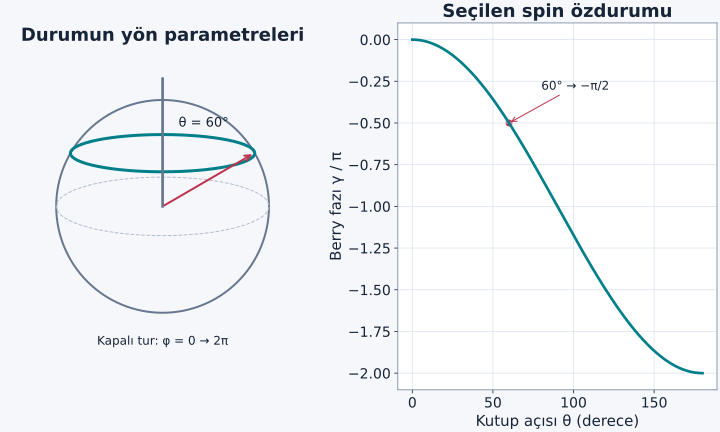
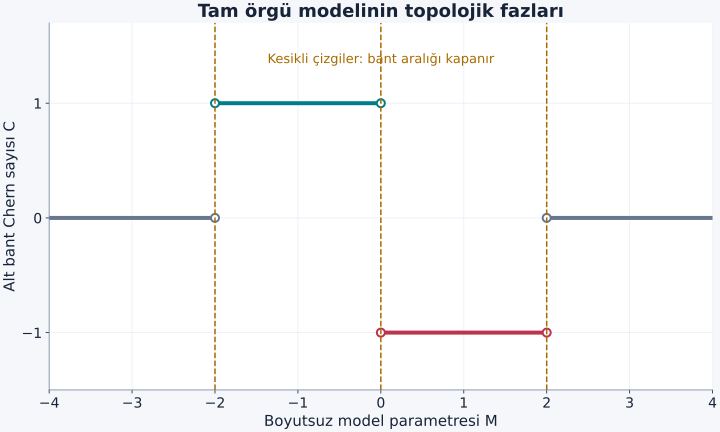

Bir kuantum sisteminin dış koşullarını yavaşça değiştirip başlangıç değerlerine geri getirelim. Hamiltonyen başlangıçtakine eşit olabilir; enerji ve ölçüm olasılıkları da başlangıç değerlerine dönmüş olabilir. Yine de durumun fazında, yalnız geçen zamanla açıklanmayan bir iz kalabilir. Berry fazı bu izin adıdır. Topolojik bantlara giden yol, önce bu fazı hesaplayıp hangi kısmının gösterim seçimine bağlı olduğunu ayırmaktan geçer.

[Karmaşık sayılar ve faz](/blog/karmasik-sayilar-ve-euler-bagintisi/), [özvektörler](/blog/ozdegerler-ozvektorler-ve-kosegenlestirme/), [enerji bantları](/blog/kristaller-ve-enerji-bantlari/) ve [kuantum Hall etkisi](/blog/landau-duzeyleri-ve-kuantum-hall-etkisi/) ön bilgilerimiz. Bu yazıda birbirinden enerji aralığıyla ayrılmış tek parçacık bantlarını kullanacağız. Etkileşen çok parçacıklı topolojinin genel kuramını tek bant formülleriyle özdeşleştirmeyeceğiz.

## 1. Parametre uzayı gerçek konum uzayı olmayabilir

Hamiltonyen $H(\mathbf R)$ kontrol edilen bir parametreler takımına bağlı olsun. $\mathbf R$, örneğin manyetik alanın yönünü belirleyen iki açı veya kristaldeki dalga vektörü olabilir. Bu sembol her zaman parçacığın gerçek uzaydaki konumu demek değildir. Parametreler değişirken bir enerji özdurumu $|u_n(\mathbf R)\rangle$ ve özenerjisi $E_n(\mathbf R)$ de değişir.

**Adyabatik** değişim, sistemin seçilen özdurum kolundan diğerlerine geçişinin ihmal edilebildiği kadar yavaş değişimdir. Yalnız “uzun zaman sürdü” demek yeterli değildir; değişim hızı, diğer durumlara enerji ayrımı ve bağlaşım matris elemanlarıyla karşılaştırılır. Yol üzerinde enerji aralığı kapanırsa tek durumu izleme varsayımı bozulabilir. Adyabatik sözcüğünün termodinamikteki “ısı alışverişi yok” anlamıyla burada aynı teknik tanım kullanılmıyor.

## 2. İki ayrı fazın hesabı

Adyabatik durumda gerçek zamanla evrilen durumu:

$$
|\psi(t)\rangle=e^{i\alpha(t)}|u_n(\mathbf R(t))\rangle
$$

biçiminde yazalım. $\alpha$ toplam faz, $\hbar$ indirgenmiş Planck sabitidir. Schrödinger denklemine koyup soldan $\langle u_n|$ ile çarparsak:

$$
-\hbar\dot\alpha+i\hbar\langle u_n|\dot u_n\rangle=E_n
$$

elde ederiz. Dolayısıyla toplam faz iki parçaya ayrılır:

$$
\alpha(t)=-\frac1\hbar\int_0^tE_n(t')\,dt'
+i\int_0^t\langle u_n|\dot u_n\rangle\,dt'.
$$

İlk terim **dinamik fazdır**; aynı enerjiyle daha uzun beklersek büyür. İkinci terim, parametre yolundaki değişime bağlı **geometrik fazdır**. Normalizasyon $\langle u|u\rangle=1$ olduğundan türevi $\langle\dot u|u\rangle+\langle u|\dot u\rangle=0$ olur. Bu yüzden $\langle u|\dot u\rangle$ saf sanaldır ve $i$ ile çarpılan geometrik faz gerçektir.

Kapalı bir $\mathcal C$ yolu boyunca özvektörün düzgün seçildiği ve tur sonunda $|u(T)\rangle=|u(0)\rangle$ olarak kapandığı bir gösterimde geometrik faz:

$$
\gamma_n=\oint_{\mathcal C}\boldsymbol{\mathcal A}_n\cdot d\mathbf R,
\qquad \boldsymbol{\mathcal A}_n=i\langle u_n|\nabla_{\!R}u_n\rangle
$$

şeklinde yazılır. $\boldsymbol{\mathcal A}$ **Berry bağlantısıdır**; elektromanyetik vektör potansiyeli değildir. İki kavramın dönüşüm biçimleri benzediğinden benzer matematik kullanılır. Adyabatik yaklaşım ve geometrik fazın temel türevi [Tong'un yaklaşım yöntemleri dersinin](https://www.davidtong.org/pdfs/teaching/topics-in-quantum-mechanics/topicsinqm2.pdf) kapsamındadır.

## 3. Keyfi faz seçimi sonucu bozar mı?

Aynı özdurumu $|u'\rangle=e^{i\chi(\mathbf R)}|u\rangle$ ile gösterebiliriz. $\chi$ parametreye bağlı gerçek bir fonksiyondur. Türevi açalım:

$$
\nabla u'=e^{i\chi}(i\nabla\chi\,u+\nabla u).
$$

İç çarpımda fazlar gider; seçtiğimiz $\mathcal A=i\langle u|\nabla u\rangle$ işaretiyle:

$$
\boldsymbol{\mathcal A}'=\boldsymbol{\mathcal A}-\nabla\chi
$$

bulunur. Kapalı yol integrali $\chi$'nin tur sonundaki değişimini çıkarır. Aynı fiziksel faz çarpanı tur sonunda kendine dönüyorsa bu değişim $2\pi$'nin tam katıdır. Dolayısıyla $e^{i\gamma}$ değişmez; Berry fazı fiziksel olarak $2\pi$'ye göre tanımlanır.

Seçilen özvektör gösterimi tur sonunda kendi başlangıç vektörüne tam dönmüyorsa yalnız bağlantı integrali yeterli değildir. Genel kapalı fiziksel yol için uç noktaların fazını da ekleriz:

$$
\gamma=\int_{\mathcal C}\boldsymbol{\mathcal A}\cdot d\mathbf R
+\arg\langle u(0)|u(T)\rangle\pmod{2\pi}.
$$

$\arg$, karmaşık iç çarpımın faz açısıdır. Bu ek, kapanmayan gösterimin uç nokta farkını giderir; kapanan gösterimde sıfır olur. Bu faz seçimi koşulları [Xiao, Chang ve Niu'nun Berry fazı derlemesinde](https://arxiv.org/pdf/0907.2021) sistematik olarak açıklanır. Tek bir durumun genel fazı doğrudan ölçülmez. Ölçüm için iki farklı yol izleyen bileşenleri girişimde karşılaştırabiliriz. Dinamik fazı eşitlemek veya ayrı hesaplayıp çıkarmak gerekebilir. Geometrik fazın varlığı, genel fazın tek başına gözlenebilir olduğu anlamına gelmez; gözlenen şey iki evrimin göreli fazıdır.

## 4. Örnek: İki bileşenli durumda bir tam tur

Normalize durumu iki açıyla seçelim:

$$
|u(\theta,\phi)\rangle=
\begin{pmatrix}\cos(\theta/2)\\e^{i\phi}\sin(\theta/2)\end{pmatrix}.
$$

$\theta$ kutupsal açı, $\phi$ azimut açısıdır. Bu durum, yönü bu açılarla belirlenen bir spin özdurumu olarak hazırlanabilir. $\theta$ sabitken $\phi$ sıfırdan $2\pi$'ye gitsin. Türev:

$$
\begin{aligned}
\partial_\phi u&=\begin{pmatrix}0\\ie^{i\phi}\sin(\theta/2)\end{pmatrix},\\
\mathcal A_\phi&=i\langle u|\partial_\phi u\rangle\\
&=-\sin^2(\theta/2).
\end{aligned}
$$

Böylece:

$$
\begin{aligned}
\gamma&=\int_0^{2\pi}\mathcal A_\phi\,d\phi\\
&=-2\pi\sin^2(\theta/2)\\
&=-\pi(1-\cos\theta).
\end{aligned}
$$

$\theta=60^\circ$ için $\cos\theta=1/2$, dolayısıyla $\gamma=-\pi/2$ radyandır. İki eşit genlikli girişim kolunda başlangıç faz farkı sıfırken yalnız bir kola bu geometrik faz eklensin. Dinamik fark giderildiğinde bir çıkış olasılığı $P=(1+\cos\gamma)/2=1/2$ olur; sıfır farkta aynı çıkış $P=1$ idi. Bu, göreli fazın bir ölçüm olasılığını nasıl değiştirdiğini açıkça gösterir.

Yolun kürede çevrelediği katı açı $\Omega=2\pi(1-\cos\theta)$ olduğundan bu durum için $\gamma=-\Omega/2$'dir. Tur yönünü ters çevirirsek işaret tersine döner. Aynı yolu iki kat yavaş dolaşmak geometrik fazı değiştirmez; dinamik fazı ise genellikle değiştirir.

Şekil: Küre elektronun gerçek uzayda izlediği yörünge değildir; iki bileşenli durumun yön parametrelerini gösterir. İşaret, durum ve dolaşım yönü seçimimize aittir.

## 5. Bağlantıdan eğriliğe

İki parametre $R_1,R_2$ için **Berry eğriliğini**:

$$
\mathcal F_{12}=\partial_{R_1}\mathcal A_2-\partial_{R_2}\mathcal A_1
$$

diye tanımlarız. Ayar dönüşümünde eklenen gradyanın çapraz türevleri birbirini götürdüğü için $\mathcal F$ değişmez. Küçük bir kapalı yolda faz yaklaşık “eğrilik çarpı çevrilen alan”dır. Bu, eğriliğin yerel geometrik anlamıdır. Parametreler açıysa bu alan açı uzayındadır; dalga vektörüyse momentum etiketleri uzayındadır.

Örnek durumumuzda $\mathcal A_\theta=0$, dolayısıyla $\mathcal F_{\theta\phi}=-(1/2)\sin\theta$ olur. $\theta=0$'dan seçilen kutup açısına ve $\phi=0$'dan $2\pi$'ye integral almak yine $-\pi(1-\cos\theta)$ verir. Bu hesap Stokes teoreminin uygun düzgün bölgede uygulanmasıdır. Her kapalı yüzeyde tek bir düzgün faz seçimi yapılabildiğini varsaymak ise daha sonra hata doğurabilir.

## 6. Kristalde parametre olarak dalga vektörü

Bloch durumu $\psi_{n\mathbf k}(\mathbf r)=e^{i\mathbf k\cdot\mathbf r}u_{n\mathbf k}(\mathbf r)$ biçimindedir. $u$ hücre periyodik kısmı, $n$ bant etiketi, $\mathbf k$ dalga vektörüdür. Her $\mathbf k$ için normalize hücre periyodik özvektörün nasıl değiştiğini izleyebiliriz. Bant enerjisi aynı kalan iki modelin özvektörleri farklı biçimde değişebilir; topolojik bilgi yalnız enerji grafiğinde okunmayabilir.

İki boyutlu kristalde $k_x,k_y$ temel bölge içinde alınır. Bölgenin karşılıklı kenarları ters örgü ötelenmesiyle aynı fiziksel etiketlere bağlanır. Bir dikdörtgenin önce sağ–sol, sonra üst–alt kenarlarını özdeşleştirmek **torus** denen kapalı yüzeyin matematiksel yapısını verir. Bu, kristalin fiziksel olarak simit şeklinde büküldüğü anlamına gelmez; parametre etiketlerinin kapanmasını anlatır.

Tek ve diğerlerinden ayrılmış bant için:

$$
C_n=\frac1{2\pi}\int_{\mathrm{BZ}}\mathcal F_{xy}(\mathbf k)\,d^2k
$$

**Chern sayısıdır**. BZ, tüm Brillouin bölgesidir. Uygun düzgünlük ve bant ayrımı altında $C_n$ tam sayıdır. Berry fazı her çevrimde tam sayı olmak zorunda değildir; önceki örnekte $-\pi/2$ bulduk. Tam sayı, kapalı iki boyutlu parametre yüzeyinin tamamındaki eğrilik integraline aittir.

## 7. Tam sayı nereden gelir ve neden hemen sıfır değildir?

Kapalı yüzeyi küçük bölgelere ayırıp her bölgede düzgün bir özvektör fazı seçebiliriz. Komşu bölgelerin ortak sınırında iki gösterim bir $e^{i\chi}$ fazıyla bağlanır. Eğriliği bölge bölge integre edince iç sınır katkıları, bu fazların toplam sarımına dönüşür. Bir kapalı turda faz çarpanı kendine dönmek zorunda olduğundan kalan toplam $2\pi$'nin tam katıdır. Bu, tam sayının temel geometrik nedenidir.

Eğer tüm torusta tek bir düzgün, periyodik özvektör seçilebilseydi sınır katkıları tümüyle iptal olur ve $C=0$ çıkardı. $C\ne0$ durumunda tam da böyle tek bir küresel faz seçimi mümkün değildir. “Eğrilik bir rotasyonel; kapalı yüzeyde integrali mutlaka sıfır” demek, varlığı garanti edilmeyen küresel potansiyeli varsayar. [TU Delft'in Haldane ve Chern dersi](https://topocondmat.org/w4-haldane/haldane-model/) bu faz seçimi ile bant geometrisi arasındaki ilişkiyi açıklar.

Burada tam Brillouin bölgesinin kapalı yapısı önemlidir. Sınırsız bir süreklilik modelinde yalnız $\mathbb R^2$ üzerinde benzer integral yazıp sonucu otomatik olarak tam sayı ilan edemeyiz. Sonsuzdaki sınır koşulu, uygun kompaktlaştırma veya tam örgü modeli gerekir. Tek bir düşük enerjili koninin yarım katkısı, kendi başına bütün bir kristalin Chern sayısı değildir.

## 8. Örnek: İki bantlı bir örgü modelini hesaplamak

Kare örgüde boyutsuz dalga değişkenleri $K_x=k_xa$, $K_y=k_ya$ olsun; $a$ örgü aralığıdır. $-\pi\le K_x,K_y<\pi$ bölgesini kullanıyoruz. Enerji ölçeği $t>0$, boyutsuz parametre $M$ ile:

$$
H=t\begin{pmatrix}
d_z&d_x-id_y\\d_x+id_y&-d_z
\end{pmatrix}.
$$

$$
\begin{aligned}
d_x&=\sin K_x,\\
d_y&=\sin K_y,\\
d_z&=M+\cos K_x+\cos K_y.
\end{aligned}
$$

modelini seçelim. $\mathbf d=(d_x,d_y,d_z)$ bu üç gerçek katsayının vektörüdür; gerçek uzaydaki elektrik alan değildir. Matrisin özenerjileri $E_\pm=\pm t|\mathbf d|$ olur. Aralığın kapanması için üç $d$ bileşeni aynı anda sıfır olmalıdır. İlk ikisi ancak $K_x,K_y=0$ veya $\pi$'de sıfırlanır. Üçüncü bileşen bu noktalarda sırasıyla $M+2$, $M$, $M$, $M-2$ olur. Dolayısıyla olası geçişler $M=-2,0,2$'dedir.

Bu iki düzeyli modelin alt bandı için, kullandığımız bağlantı işaretiyle:

$$
\begin{aligned}
\mathcal F_{xy}
&=\frac{\mathbf d\cdot(\partial_{K_x}\mathbf d\times\partial_{K_y}\mathbf d)}{2|\mathbf d|^3}\\
&=\frac{\cos K_x+\cos K_y+M\cos K_x\cos K_y}{2|\mathbf d|^3}.
\end{aligned}
$$

Bu kısa formül normalize iki bileşenli özvektörün türevlerinden elde edilir. Son eşitlikte vektörel çarpım açıkça alınmıştır; böylece sayısal integral için belirsiz bir geometrik tarif yerine doğrudan fonksiyonumuz vardır.

## 9. Sayısal Chern hesabını adımlarıyla okumak

Brillouin bölgesini her yönde 200 eşit aralığa bölelim. Adım $\Delta K=2\pi/200$ olur. Her küçük karenin orta noktasında yukarıdaki eğriliği hesaplayıp:

$$
C\simeq\frac{(\Delta K)^2}{2\pi}
\sum_{i=1}^{200}\sum_{j=1}^{200}
\mathcal F_{xy}(K_{x,i},K_{y,j})
$$

toplamını alırız. $M=1$ için sonuç yaklaşık $-1{,}000000$; $M=3$ için sayısal yuvarlama düzeyinde $0{,}000000$ bulunur. Izgara 100 veya 400 seçildiğinde aynı tam sayılara yakınsama kontrol edilir. Tam sayıya yakın tek bir sonuç tek başına ispat değildir; burada düzgün, aralıklı örgü modelini ve yakınsamayı birlikte kullanıyoruz.

$M=1$'den $M=3$'e giderken $M=2$'de $K_x=K_y=\pi$ noktasında aralık kapanır. Chern sayısı ancak tek bandı ayıran koşul bozulduğunda değişebilir. $t=10\,\mathrm{meV}$ seçersek hem $M=1$ hem $M=3$ için en küçük bant ayrımı $2t=20\,\mathrm{meV}$'dir. Aynı minimum aralık, aynı topolojik faz demek değildir; özvektörlerin tüm bölgedeki düzeni farklıdır.

Şekil: Sınır noktalarında alt bant tek başına ayrılmadığından gösterilen Chern sayısı tanımlı değildir. İşaretler $\mathcal A=i\langle u|\nabla u\rangle$ ve seçilen eksen yönleri içindir.

## 10. Dolu bandın Hall yanıtı

Model hesabındaki türevleri boyutsuz $K_x,K_y$ değişkenlerine göre aldık. Fiziksel $k_x,k_y$ türevleri için eğrilik $\mathcal F^{(k)}_{xy}=a^2\mathcal F^{(K)}_{xy}$ olur; alan elemanı ise $d^2k=d^2K/a^2$ değişir. Çarpanlar Chern integralinde birbirini götürür. Aşağıdaki hareket denklemlerinde fiziksel $k$ değişkenine ait eğrilik kullanılır; onun birimi uzunluk karesidir. Böylece hızın ikinci terimi de metre/saniye biriminde kalır.

Bir bandın grup hızı $\hbar^{-1}\nabla_{\!k}E$'dir. Tam dolu bantta bu katkının bölge toplamı sıfır olabilir. Berry eğriliği varsa zayıf elektrik alan, dalga paketinin hızına enine bir katkı da verir. Elektron yükü $-e$ için hareket denklemleri:

$$
\hbar\dot{\mathbf k}=-e\mathbf E,
\qquad
\dot{\mathbf r}=\frac1\hbar\nabla_{\!k}E
-\dot{\mathbf k}\times\boldsymbol{\mathcal F}
$$

biçimindedir. İki boyutta eğrilik düzleme dik bileşen taşır. Dolu bandın enine katkısını tüm $\mathbf k$ durumları üzerinde toplamak, Chern integralini verir. $j_x=\sigma_{xy}E_y$ ve yukarıdaki işaret seçimiyle:

$$
\sigma_{xy}=-\frac{e^2}{h}\sum_{n\,\mathrm{dolu}}C_n.
$$

Dolayısıyla örnek modelin $M=1$ alt bandı tek dolu bantsa $\sigma_{xy}=+e^2/h\simeq38{,}74\,\mu\mathrm S$ olur. Siemens iletkenlik birimidir. $M=3$ için bu topolojik Hall katkısı sıfırdır. İşaret alanın, eksenlerin ve akım tensörü tanımının tutarlı seçilmesine bağlıdır; ölçülebilir büyüklük keyfi bir özvektör fazıyla değişmez.

## 11. Topolojik koruma neyi vaat eder?

Tam sayı, küçük ve düzgün değişimlerle sürekli biçimde $-1$'den sıfıra kayamaz. Bant aralığı korunurken Chern sayısı değişmez. Bu matematiksel dayanıklılıktır; bir cihazın her sıcaklıkta, her düzensizlikte ve her temas koşulunda kusursuz çalışacağı vaadi değildir. Sıcaklık dolulukları değiştirebilir, yeterli düzensizlik aralığı veya hareketlilik koşullarını bozabilir, etkileşimler tek parçacık betimini yetersiz bırakabilir.

Farklı Chern sayılı iki bölgenin sınırında, uygun koşullarda net yönlü kenar kanalları bulunur. Böylece hacmin bant geometrisi ile sınır taşınımı bağlantı kurar. Kuantum Hall yazısında gördüğümüz dolu hacim ve ileten kenar birlikteliği, burada daha genel bir dile kavuşur. Enerji, doluluk, faz ve parametre uzayının kapanması ayrı adımlardı; her birini koruyarak bir araya getirdiğimizde topolojik bant kavramı anlam kazanır.
