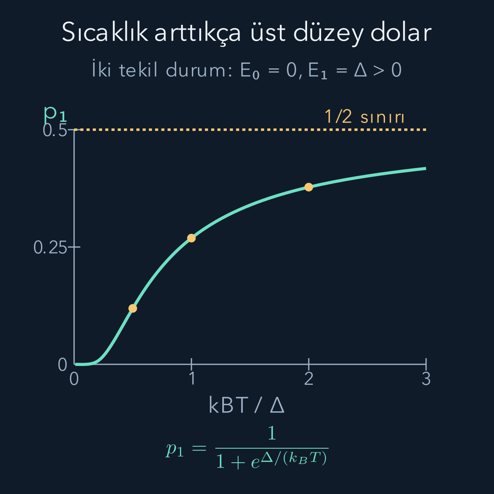
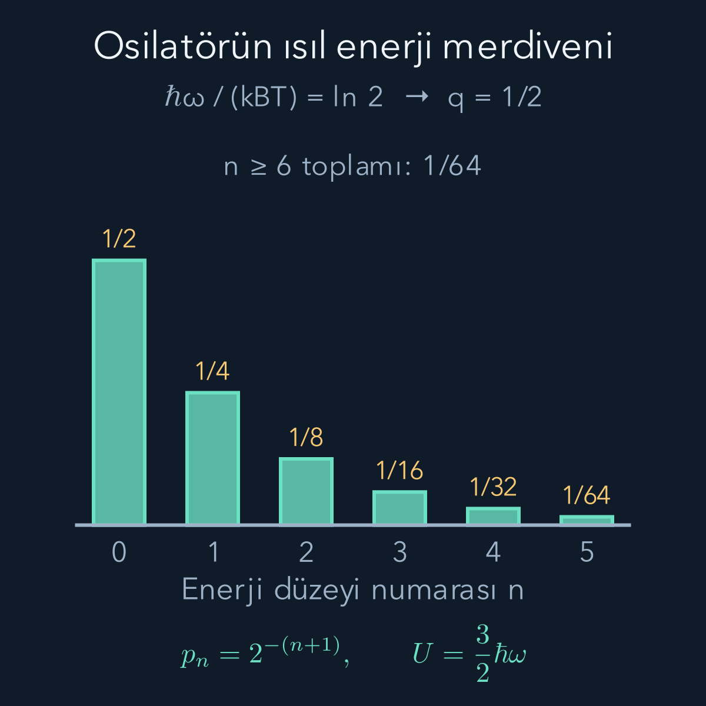

import ArticleVideo from '@/components/ArticleVideo.astro'
import kavram from './media/01-kavram.mp4?url'
import kavramPoster from './media/01-kavram.jpg?url'

Bir atomun izin verilen enerjilerini bilmek, sıcak bir ortamda hangi enerjinin ne sıklıkla ölçüleceğini henüz söylemez. Aynı atomu soğuk bir ortamda hazırlamakla sıcak bir ortamda hazırlamak farklı sonuç dağılımları verebilir. Enerji düzeyleri sistemin Hamiltonyeninden gelir; o düzeylerin ısıl dengedeki ağırlıklarıysa sıcaklıkla birlikte belirlenir. Bu yazıda bu iki bilgiyi birbirine bağlayacağız.

Ön bilgilerimiz [olasılık ve beklenen değer](/blog/olasilik-sayma-ve-kosullu-bilgi/), [entropi](/blog/entropi-ve-termodinamigin-ikinci-yasasi/), [enerji özdurumları](/blog/schrodinger-denklemi-ve-olasilik-akimi/) ve [yoğunluk matrisi](/blog/yogunluk-matrisleri-ve-karisik-durumlar/). [Harmonik osilatörün](/blog/kuantum-harmonik-osilatoru/) enerji merdivenini de ikinci örnekte kullanacağız. Buradaki sıcaklıklar mutlak sıcaklık, yani kelvin cinsindendir; üstel fonksiyona Celsius değerini doğrudan koyamayız.

## 1. Denge demek enerji alışverişinin durması değildir

Küçük bir sistemi çok daha büyük bir çevreyle temas ettirelim. Çevre, küçük sistemin alıp verdiği enerji yüzünden sıcaklığı fark edilir biçimde değişmeyecek kadar büyükse ona **ısı banyosu** deriz. Sistem bazen enerji alabilir, bazen verebilir. Isıl dengede bu tekil değişimler sürerken enerji ölçümlerinin uzun süreli dağılımı değişmez.

İki varsayım yapıyoruz. Birincisi, sistemin banyo ile bağlaşımı kendi enerji düzeylerini kuvvetle değiştirmeyecek kadar zayıftır. İkincisi, izin verilen geçişlerin dengeye ulaşması için yeterli zaman geçmiştir. Tamamen yalıtılmış, özel hazırlanmış bir durumun yalnız beklemekle otomatik olarak bu dağılıma gelmesi gerekmez. Denge dağılımı, hazırlama sürecinden bağımsız geçerli bir zaman evrimi yasası değildir.

Başlangıçta sistemin hacmini ve parçacık sayısını sabit tutacağız. Banyoyla enerji alışverişi var, parçacık alışverişi yok. Sabit sıcaklıkta bu koşulları sağlayan denge betimine **kanonik topluluk** denir. “Topluluk” aynı koşullarda hazırlanmış çok sayıda deney kopyasını düşünmenin adıdır; laboratuvarda gerçekten sonsuz sayıda kopya bulunması gerekmez.

## 2. Mikro durum ile enerji değeri aynı şey değildir

Sistemin Hamiltonyenine $H$, enerji özdurumlarına $|i\rangle$, özdeğerlerine $E_i$ diyelim:

$$
H|i\rangle=E_i|i\rangle.
$$

$i$ bir enerji özdurumunu etiketler. Çok parçacıklı sistemde bu, bütün sistemin bir durumudur; yalnız bir parçacığın enerjisini seçmiş olmayız. Bu yazıda mikro durumları böyle bir ortonormal enerji bazıyla sayacağız. Aynı enerjiye sahip birkaç bağımsız durum varsa, hepsini ayrı ayrı saymak gerekir.

Örneğin bir alt durumun enerjisi sıfır, birbirine dik üç üst durumun her birinin enerjisi $\Delta$ olsun. İki farklı enerji değeri vardır ama dört mikro durum vardır. Üst enerji düzeyinin **dejenerasyonu**, yani o enerjiyi taşıyan bağımsız durum sayısı, üçtür. Enerji düzeyleri üzerinde toplam alırken bu çokluğu ayrıca eklemezsek yanlış olasılık buluruz.

## 3. Üstel ağırlık banyodaki durum sayısından gelir

Sistem ile banyonun toplam enerjisi $E_{\mathrm{top}}$ sabit olsun. Sistem $E_i$ enerjisindeyken banyonun enerjisi $E_{\mathrm{top}}-E_i$ olur. Banyoda bu enerjiye uygun durum sayısını $\Omega_B(E_{\mathrm{top}}-E_i)$ ile gösterelim. Toplam yalıtılmış sistemin erişilebilir mikro durumlarını eşit ağırlıkla sayarsak, küçük sistemin bir durumunun ağırlığı onunla uyumlu banyo durumlarının sayısıyla orantılıdır.

[Entropi yazısındaki](/blog/entropi-ve-termodinamigin-ikinci-yasasi/) $S_B=k_B\ln\Omega_B$ bağıntısını kullanalım. $S_B$ banyonun entropisi, $k_B$ Boltzmann sabitidir; $\ln$ doğal logaritmadır. Banyodan küçük bir enerji çıkarmanın etkisini birinci mertebede açabiliriz:

$$
\begin{aligned}
S_B(E_{\mathrm{top}}-E_i)
&\simeq S_B(E_{\mathrm{top}})
-E_i\frac{\partial S_B}{\partial E_B},\\
\frac{\partial S_B}{\partial E_B}&=\frac1T.
\end{aligned}
$$

Türev sabit banyo hacmi ve parçacık sayısında alınır. İkinci satır sıcaklığın entropiyle ilişkisini kullanır. Yerine koyup $k_B$'ye böler, ardından üstelini alırsak:

$$
\Omega_B(E_{\mathrm{top}}-E_i)
\simeq \text{sabit}\times e^{-E_i/(k_BT)}.
$$

Buradaki sabit bütün $i$ durumları için aynıdır. Yüksek enerjili sistem durumu, banyoya daha az enerji bıraktığından genellikle daha az banyo düzeniyle eşleşir. **Boltzmann ağırlığı** dediğimiz üstel çarpan bu saymadan çıkar. Banyoyu büyük seçmek, sıcaklığının değişmesini ve açılımdaki yüksek mertebe düzeltmelerini ihmal edebilmemizi sağlar. Bu kanonik kurulumun standart çerçevesi [Tong'un istatistiksel fizik notlarında](https://davidtong.org/pdfs/teaching/statistical-physics/statphys1.pdf) verilir; aşağıdaki örnekleri kendi sayımlarımızla açacağız.

Birinci mertebe açılımın ne zaman yeterli olduğunu enerji dalgalanması ölçeğinde kontrol edebiliriz. Banyonun ısı kapasitesi $C_B=\partial E_B/\partial T$ ise zincir kuralıyla:

$$
\begin{aligned}
\frac{\partial^2 S_B}{\partial E_B^2}
&=\frac{\partial(1/T)}{\partial T}\frac{\partial T}{\partial E_B}\\
&=-\frac1{T^2C_B}.
\end{aligned}
$$

Sisteme aktarılan küçük bir $\delta E$ için ihmal edilen ikinci mertebe entropi katkısı $-(\delta E)^2/(2T^2C_B)$'dir. Bunu $k_B$'ye bölünce üstel ağırlıktaki düzeltme elde edilir. Büyük $C_B$, hem $\delta T_B\simeq-\delta E/C_B$ değişimini hem bu düzeltmeyi küçültür. Burada önemli olan seçilmiş enerji sıfırına göre sayının büyüklüğü değil, sistemin alışveriş yaptığı enerji aralığıdır; açılımı dengedeki banyo enerjisi çevresinde yapmak bu ayrımı korur.

## 4. Bölüşüm fonksiyonu normalizasyon toplamıdır

Kısaltma olarak $\beta=1/(k_BT)$ yazalım. $k_BT$ bir enerjidir; dolayısıyla $\beta E_i$ boyutsuzdur. Ağırlıkları olasılığa çevirmek için toplamlarına böleriz:

$$
\begin{aligned}
Z&=\sum_i e^{-\beta E_i},\\
p_i&=\frac{e^{-\beta E_i}}{Z}.
\end{aligned}
$$

$Z$ **bölüşüm fonksiyonu**dur. Adı yeni olsa da ilk görevi bildiğimiz normalizasyondur: $\sum_i p_i=1$. İki durumun olasılık oranında $Z$ sadeleşir:

$$
\frac{p_j}{p_i}=e^{-\beta(E_j-E_i)}.
$$

Bütün enerjilere aynı $C$ sabitini eklersek, $Z$ de $e^{-\beta C}$ ile çarpılır. Pay ve payda aynı çarpanı taşıdığı için olasılıklar değişmez. Ortalama enerji ise beklendiği gibi $C$ kadar kayar. Bu nedenle enerji sıfırını rahatça seçebilir, fakat hangi sıfırı seçtiğimizi sonuçları yorumlarken korumalıyız.

Toplamı tek tek durumlar yerine farklı enerji değerleri üzerinden yazmak da mümkündür. $g_\alpha$ dejenerasyonu, $E_\alpha$ enerji değerini gösterirse:

$$
Z=\sum_\alpha g_\alpha e^{-\beta E_\alpha}.
$$

O enerjinin toplam olasılığı $g_\alpha e^{-\beta E_\alpha}/Z$ olur. Her mikro durumun olasılığıyla bütün enerji düzeyinin olasılığı arasındaki fark tam bu $g_\alpha$ çarpanıdır.

## 5. İki düzeyli atomu sayısal olarak hesaplayalım

Bir atomun yalnız iki iç durumunun erişilebilir olduğunu varsayalım. Her düzey tekil olsun; enerjiler $E_0=0$ ve $E_1=\Delta>0$ olsun. Atomun hareket enerjisini bu küçük iç durum modeline katmıyoruz. Daha yüksek iç düzeyler varsa, onların ağırlıklarının ihmal edilebilir olduğu sıcaklık aralığında bu yaklaşımı kullanırız.

$$
\begin{aligned}
Z&=1+e^{-\beta\Delta},\\
p_0&=\frac1{1+e^{-\beta\Delta}},\\
p_1&=\frac1{1+e^{\beta\Delta}}.
\end{aligned}
$$

Enerji ölçümü ya sıfır ya $\Delta$ verir. Beklenen enerji bu iki sonucun ağırlıklı toplamıdır:

$$
U=\langle H\rangle=0p_0+\Delta p_1.
$$

$\Delta=0{,}030\,\mathrm{eV}$ ve $T=300\,\mathrm K$ seçelim. $\mathrm{eV}$ elektronvolt enerji birimidir; $k_B\simeq8{,}61733\times10^{-5}\,\mathrm{eV/K}$ kullanınca:

$$
\begin{aligned}
k_BT&\simeq0{,}025852\,\mathrm{eV},\\
\beta\Delta&\simeq1{,}16045,\\
e^{-\beta\Delta}&\simeq0{,}31334,\\
p_1&\simeq0{,}23859,\\
U&\simeq0{,}007158\,\mathrm{eV}.
\end{aligned}
$$

Ortalama enerji izin verilen iki enerji arasında çıktı. Bu yeni bir enerji özdeğeri değildir: Çok sayıda ölçümde sonuçların yaklaşık yüzde 23,9'u üst düzeye, kalanı alt düzeye aittir. Bu sonuçların aritmetik ortalaması $U$'ya yaklaşır.

$k_BT\ll\Delta$ iken üst düzey üstel olarak bastırılır. $k_BT\gg\Delta$ iken iki mikro durum yaklaşık eşit ağırlık kazanır ve $p_1\to1/2$ olur. Üst durumun olasılığı bu pozitif sıcaklıklı modelde bire yaklaşmaz. Isıtmak enerji seçimini üst duruma kesin biçimde yönlendirmez; iki erişilebilir durum arasındaki farkın ağırlık üzerindeki etkisini azaltır.

Üst düzeyin üç bağımsız durumu olsaydı $Z=1+3e^{-\beta\Delta}$ yazardık. Aynı sayılarla toplam üst düzey olasılığı yaklaşık $0{,}48455$ olurdu. Yüksek sıcaklık sınırı da $3/4$ olurdu. Tek tek dört durum eşitlenirken iki enerji düzeyinin toplam olasılıklarının eşitlenmemesi bir çelişki değildir.

<ArticleVideo src={kavram} poster={kavramPoster} title="İki düzeyin sıcaklıkla paylaşılması" caption="Enerji aralığı Δ sabit tutulurken kBT/Δ oranı 0,2'den 2'ye çıkarılıyor. Sütunlar alt ve üst durumun denge olasılıklarıdır; her anda toplamları birdir. Çizilen süreç bir denge sıcaklığı taramasıdır, tek atomun gerçek zamanlı enerji geçişi değildir." />

## 6. Aynı toplamdan ortalama enerjiyi çıkarabiliriz

Her enerjiye ait olasılığı hesaplayıp çarpmak doğrudan yöntemdir. $Z$'nin türevi de aynı hesabı kısa biçimde taşır. Enerji düzeyleri sıcaklıktan bağımsızken:

$$
\begin{aligned}
\frac{\partial Z}{\partial\beta}
&=-\sum_i E_i e^{-\beta E_i},\\
-\frac1Z\frac{\partial Z}{\partial\beta}
&=\sum_i E_i p_i=U,\\
U&=-\frac{\partial\ln Z}{\partial\beta}.
\end{aligned}
$$

Türev her üstel terimin önüne o terimin enerjisini getirir; normalizasyon da $Z$'ye bölünerek yapılır. Formülün nedeni budur. Sistemin hacmi veya dış alanı değiştirilirse enerji düzeyleri de değişebilir; bu türevde o parametreleri sabit tutuyoruz.

Enerjinin yayılımını da doğrudan ölçebiliriz. İki düzey için $\langle H^2\rangle=\Delta^2p_1$ olduğundan varyans:

$$
\operatorname{Var}(H)
=\Delta^2p_1(1-p_1)
$$

olur. Sıfır sıcaklık sınırında sistem tek bir enerjiye yerleştiğinden bu yayılım sıfırlanır. Genel bağıntıyı görmek için $\ln Z$'nin ikinci türevini açalım:

$$
\begin{aligned}
\partial_\beta^2\ln Z
&=\frac{Z''}Z-\left(\frac{Z'}Z\right)^2\\
&=\langle H^2\rangle-\langle H\rangle^2\\
&=\operatorname{Var}(H).
\end{aligned}
$$

Burada üstteki tırnaklar $\beta$ türevini gösterir. $U=-\partial_\beta\ln Z$ olduğundan $\partial_\beta U=-\operatorname{Var}(H)$ olur. Ayrıca $d\beta/dT=-1/(k_BT^2)$'dir. Zincir kuralı iki eksi işareti birleştirir:

$$
C=\frac{\partial U}{\partial T}
=\frac{\operatorname{Var}(H)}{k_BT^2}.
$$

$C$ sistemin sabit dış parametrelerdeki ısı kapasitesidir. Bu bağıntı, enerji dalgalanmalarının sıcaklığı değiştirmenin ortalama enerji üzerindeki etkisiyle nasıl bağlantılı olduğunu gösterir; yalnız ortalamayı bilmek dağılımın bütün bilgisini vermez.

## 7. Osilatörün sonsuz merdivenini toplamak

Harmonik osilatörün düzeyleri $E_n=\hbar\omega(n+1/2)$, $n=0,1,2,\ldots$ idi. $\omega$ açısal frekans, $\hbar$ indirgenmiş Planck sabitidir. Ardışık düzey aralığı $\hbar\omega$'dır. $q=e^{-\beta\hbar\omega}$ tanımıyla $0<q<1$ olur:

$$
\begin{aligned}
Z&=e^{-\beta\hbar\omega/2}
\sum_{n=0}^{\infty}q^n,\\
Z&=\frac{e^{-\beta\hbar\omega/2}}{1-q},\\
p_n&=(1-q)q^n.
\end{aligned}
$$

Geometrik serinin toplamı $1/(1-q)$'dir. Sıfır nokta enerjisi her düzeyde ortak olduğundan olasılıklarda sadeleşir; fakat ortalama enerjiden silinmez. Ortalama düzey numarasını bulmak için geometrik toplamın $q$ türevini alalım:

$$
\begin{aligned}
\sum_{n=0}^{\infty}nq^{n-1}
&=\frac1{(1-q)^2},\\
\langle n\rangle
&=(1-q)\frac{q}{(1-q)^2}
=\frac{q}{1-q}.
\end{aligned}
$$

Böylece:

$$
U=\frac{\hbar\omega}{2}
+\frac{\hbar\omega}{e^{\beta\hbar\omega}-1}.
$$

İlk terim temel durumun enerjisi, ikincisi sıcaklıkla gelen ek enerjidir. $T\to0$ iken ek terim sıfırlanır. Yüksek sıcaklıkta $x=\beta\hbar\omega$ küçüktür ve $1/(e^x-1)=1/x-1/2+O(x)$ açılımı $U\simeq k_BT$ verir. Klasik yay modelindeki kinetik ve potansiyel enerjinin toplamına böyle ulaşırız; bu son yaklaşık sonuç için düzey aralığının ısıl enerjiye göre küçük olması gerekir.

## 8. Sonsuz toplamı elle görülebilir bir örneğe çevirmek

$\beta\hbar\omega=\ln2$ seçersek $q=1/2$ olur. Olasılıklar sırayla $1/2,1/4,1/8,1/16,\ldots$'dir. Temel durum en olası tek durumdur ama yalnız başına bütün olasılığı taşımaz. Ortalama düzey numarası $q/(1-q)=1$, ortalama enerji $3\hbar\omega/2$ çıkar.

Örneğin $\hbar\omega=0{,}020\,\mathrm{eV}$ ise bu koşul $T=\hbar\omega/(k_B\ln2)\simeq334{,}84\,\mathrm K$ verir. Temel enerji $0{,}010\,\mathrm{eV}$, ısıl ek enerji $0{,}020\,\mathrm{eV}$, toplam ortalama $0{,}030\,\mathrm{eV}$ olur. Şekilde ilk altı sütunun toplamı $63/64$'tür; kalan $1/64$ sonsuz kuyruğa aittir. Bir görseli altı düzeyde kesmek, fiziksel modelde yalnız altı düzey var demek değildir.

Bu örnekte $\langle n\rangle=1$ bulunması her deneyin $n=1$ verdiğini de söylemez. $n=1$ ölçme olasılığı yalnız $1/4$'tür. Ortalama ile en olası sonuç, hatta ortalamanın kendisiyle tek deneyin sonucu, ayrı kavramlardır. Isıl hesapları yorumlarken bu ayrımı baştan korumak gerekir.

## 9. Isıl karışım ile saf süperpozisyonu ayırmak

Denge yoğunluk matrisi enerji bazında:

$$
\rho_T=\sum_i p_i|i\rangle\langle i|
=\frac{e^{-\beta H}}Z
$$

olur. İki düzeyde bu matris köşegeninde $p_0,p_1$ taşır, köşegen dışında sıfır vardır. Buna karşılık $|\psi\rangle=\sqrt{p_0}|0\rangle+\sqrt{p_1}|1\rangle$ saf durumu aynı enerji olasılıklarına sahiptir ama yoğunluk matrisinde $\sqrt{p_0p_1}$ çapraz terimleri vardır. Enerji ölçümlerinin aynı çıkması bütün ölçümlerin aynı çıkacağı anlamına gelmez.

Örneğin $|+\rangle=(|0\rangle+|1\rangle)/\sqrt2$ yönüne izdüşüm ölçelim. Isıl karışım için sonuç olasılığı $(p_0+p_1)/2=1/2$'dir. Yukarıdaki aynı fazlı saf durumda ise $1/2+\sqrt{p_0p_1}$ olur. İki düzeyli sayısal örneğimizde bu yaklaşık $0{,}92622$'dir. Farkı yaratan, saf durumun iki bileşeni arasındaki ölçülebilir faz ilişkisidir.

Fiziksel entropiyi doğal logaritmayla $S=-k_B\operatorname{Tr}(\rho\ln\rho)$ biçiminde yazarsak, ısıl durum için $S=-k_B\sum_i p_i\ln p_i$ elde ederiz. Birimi joule/kelvindir. Saf durumun entropisi sıfırdır; iki olasılığı da sıfırdan farklı olan ısıl karışımınki pozitiftir. Enerji ölçümünden doğan sonuç belirsizliğiyle durumun karışıklığını bu yüzden özdeşleştiremeyiz.

## 10. Tek atomdan birçok bağımsız atoma geçmek

Aynı iki düzeyli modelden N tane, ayrı konumlarda tutulan ve birbirleriyle etkileşmeyen atom düşünelim. Her atomun iç durum enerjisi toplama katkı yapar. Bir atomun alt veya üst düzeyde olması diğer atomun iç durumunu kısıtlamıyorsa, ortak ağırlık tek atom ağırlıklarının çarpımıdır. İki atom için olasılıklar $p_0^2$, $p_0p_1$, $p_1p_0$, $p_1^2$ biçiminde yazılır. Ortadaki iki seçenek, burada adreslenebilir farklı konumlardaki iç durumları anlattığından ayrı deney sonuçlarıdır.

Bu bağımsız iç durum modeli için toplam bölüşüm fonksiyonu $Z_N=Z_1^N$ olur. Logaritma çarpımı toplama çevirdiğinden $\ln Z_N=N\ln Z_1$ ve toplam ortalama enerji $U_N=NU_1$ çıkar. Tek bir atomun hangi enerjiyi vereceği belirsizliğini korurken, çok sayıda atomun atom başına ortalama enerjisi daha dar bir dağılım kazanır. Bağımsız katkıların enerji varyansları toplandığından toplam varyans N ile, standart sapma ise $\sqrt N$ ile büyür. Ortalama N ile büyüdüğü için göreli dalgalanma $1/\sqrt N$ ölçeğinde küçülür.

Bu çarpanlaşma her çok parçacıklı sisteme uygulanamaz. Atomlar kuvvetle etkileşirse toplam enerji bağımsız iç enerjilerin toplamı olmaz. Aynı uzaysal kuantum durumlarını paylaşabilen özdeş parçacıklarda da izin verilen ortak durumları doğru saymalıyız. Bölüşüm fonksiyonunun tanımı değişmez; değişen şey toplamın hangi fiziksel durumlar üzerinde alındığıdır.

## 11. Parçacık sayısına da izin verirsek

Şimdiye kadar sistemin parçacık sayısı sabitti. Bir gazın küçük alt bölgesine bakarsak, sınırdan hem enerji hem parçacık geçebilir. Böyle bir dengeyi yalnız sıcaklıkla tarif etmek yetmez. Çevrenin parçacık ekleyip çıkarmaya ilişkin koşulunu da belirtmeliyiz.

**Kimyasal potansiyel** $\mu$, dengedeki sistemin parçacık sayısını artırmanın enerji ve entropiyle birlikte belirlenen maliyetini ifade eder. Helmholtz serbest enerjisi $F=U-TS$ tanımıyla, sabit sıcaklık ve hacimde $\mu=(\partial F/\partial N)_{T,V}$ olur. $N$ parçacık sayısıdır; $\mu$ enerji birimi taşır. Dolayısıyla $\mu$ yalnız yeni parçacığın tek başına kinetik enerjisi değildir; çevredeki diğer parçacıkların yeniden yerleşmesi de serbest enerjiye dahildir.

Aynı sıcaklıkta parçacık alışverişine açık iki bölge dengede aynı kimyasal potansiyele ulaşır. Bu yeni denge koşulu, bir kuantum durumuna kaç özdeş parçacığın yerleşeceğini sormamızı sağlar. Enerji düzeyini bulma, banyonun ağırlığını belirleme ve izin verilen dolulukları sayma adımları artık birbirinden ayrılmıştır; bozonlarla fermiyonların farklı ısıl davranışı bu son adımda ortaya çıkacaktır.
