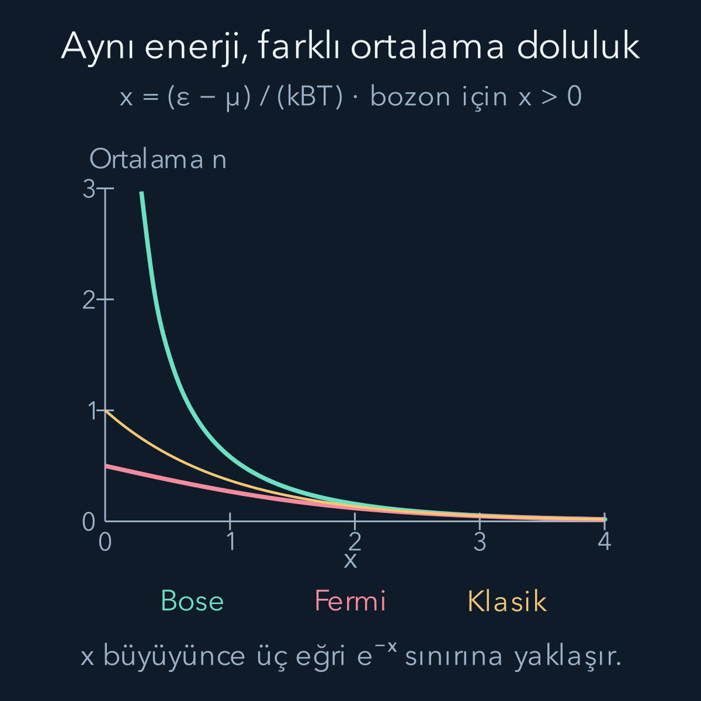
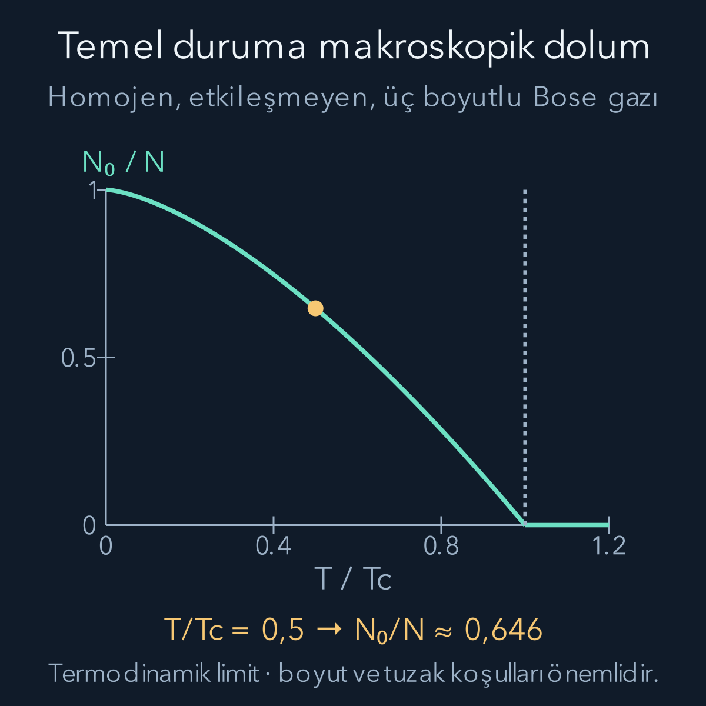

import ArticleVideo from '@/components/ArticleVideo.astro'
import kavram from './media/01-kavram.mp4?url'
import kavramPoster from './media/01-kavram.jpg?url'

Soğuyan bir gazdaki parçacıkların hepsi en düşük enerjili duruma yerleşebilir mi? Cevap yalnız sıcaklığa bağlı değildir. Özdeş parçacıkların izin verilen ortak durumları da belirleyicidir. Bozonlar için aynı tam tek parçacık durumunda çok sayıda parçacık bulunabilir. Fermiyonlar için o durumun doluluğu sıfır veya birdir. Şimdi bu sayma farkını ölçülebilir denge dağılımlarına çevireceğiz.

Ön bilgilerimiz [özdeş parçacıklar ve Pauli ilkesi](/blog/ozdes-parcaciklar-bozonlar-ve-fermiyonlar/), [Boltzmann ağırlığı ve bölüşüm fonksiyonu](/blog/boltzmann-dagilimi-ve-bolusum-fonksiyonu/) ve [olasılık hesabı](/blog/olasilik-sayma-ve-kosullu-bilgi/). Etkileşmeyen, göreli olmayan parçacıklarla başlayacağız. Gerçek bir gazdaki etkileşimlerin ne zaman ihmal edilebildiği ayrıca incelenmelidir; burada dağılımların sayma kökenini görmek için ideal modeli seçiyoruz.

## 1. Önce parçacık alışverişini tarif etmek

Bir kabın küçük bir bölgesini sistem olarak seçersek çevreyle hem enerji hem parçacık alışverişi olabilir. Bölgedeki parçacık sayısının tek tek deneylerde değişmesi, ortalamasını belirleyemeyeceğimiz anlamına gelmez. Sıcaklık enerji alışverişinin denge koşulunu, **kimyasal potansiyel** $\mu$ ise parçacık alışverişinin denge koşulunu belirler.

$\mu$ enerji birimi taşır. Sabit sıcaklık $T$ ve hacim $V$ altında Helmholtz serbest enerjisine $F=U-TS$ dersek $\mu=(\partial F/\partial N)_{T,V}$ olur. Burada $U$ ortalama iç enerji, $S$ fiziksel entropi, $N$ parçacık sayısıdır. Bir parçacık eklemenin maliyetine yalnız onun enerjisi değil, izin verilen durumların ve entropinin değişimi de katılır. Bu nedenle kimyasal potansiyel negatif de olabilir; negatif değer bir parçacığın zorunlu olarak negatif kinetik enerji taşıdığı anlamına gelmez.

Aynı sıcaklıkta iki büyük bölge arasında küçük bir $\delta N$ parçacık aktarımında toplam serbest enerji değişimi yaklaşık $(\mu_1-\mu_2)\delta N$ olur; $\delta N$ ikinci bölgeden birinciye aktarılan sayıdır. Bir yönde aktarım serbest enerjiyi azaltıyorsa henüz denge yoktur. Parçacık alışverişine açık dengede kimyasal potansiyeller eşitlenir. Bu açıklama dış alanların uygun enerji katkılarının serbest enerjiye dahil edildiğini varsayar.

## 2. Enerjiye ek olarak parçacık sayısını da saymak

Banyoyu büyük tutup bir mikro duruma $E$ enerjisi ve $N$ parçacık ayıralım. Banyonun hem enerjisi hem parçacık sayısı azalır. Sabit hacimde $dS_B=(dE_B-\mu\,dN_B)/T$ olduğundan banyonun entropi değişimi yaklaşık $(-E+\mu N)/T$'dir. Bir önceki yazıdaki durum sayma adımı şimdi şu ağırlığı verir:

$$
\text{ağırlık}=e^{-\beta(E-\mu N)},
\qquad \beta=\frac1{k_BT}.
$$

$k_B$ Boltzmann sabitidir. $E-\mu N$ enerji birimindedir; üs yine boyutsuzdur. Enerji eklemek üstel ağırlığı azaltırken, parçacığın banyodan gelmesi $\mu N$ katkısını getirir. Bu denge betimine **büyük kanonik topluluk** denir. Henüz parçacığın bozon veya fermiyon olduğunu kullanmadık.

Şimdi bütün gaz yerine tek bir tam tek parçacık durumuna odaklanalım. Enerjisi $\varepsilon$, doluluğu $n$ olsun. “Tam durum” konum dalgasıyla birlikte spin gibi içsel etiketleri de içerir. Aynı enerjili iki spin durumu iki ayrı doluluk yuvasıdır. Parçacıklar etkileşmiyorsa bu yuvada $n$ parçacığın enerjisi $n\varepsilon$ olur. Ortak ağırlık:

$$
q^n,\qquad q=e^{-\beta(\varepsilon-\mu)}
$$

şeklindedir. Bundan sonra yalnız hangi $n$ değerlerine izin verildiğini değiştireceğiz. Standart ideal gaz çerçevesi [Tong'un kuantum gazları notlarında](https://davidtong.org/pdfs/teaching/statistical-physics/statphys3.pdf) yer alır; aşağıdaki türetim tek yuvanın açık normalizasyon hesabıdır.

## 3. Fermiyon için iki seçenek vardır

Bir fermiyon yuvası boştur veya tek parçacıkla doludur: $n=0,1$. Normalizasyon toplamına $\Xi_\varepsilon$ diyelim. Büyük kanonik bölüşüm fonksiyonunun tek duruma ait parçası budur:

$$
\begin{aligned}
\Xi_\varepsilon&=1+q,\\
P(0)&=\frac1{1+q},\\
P(1)&=\frac q{1+q}.
\end{aligned}
$$

Ortalama doluluk $\bar n=0P(0)+1P(1)$ olduğundan:

$$
\bar n_F(\varepsilon)
=\frac1{e^{\beta(\varepsilon-\mu)}+1}.
$$

Bu **Fermi–Dirac dağılımıdır**. Ortalama her zaman sıfır ile bir arasındadır. Ortalama $0{,}3$ bulmak, bir ölçümde parçacığın yüzde otuzunu bulmak demek değildir. Tekrarların yüzde otuzunda yuva dolu, geri kalanında boştur. Aynı uzaysal orbitalin iki ayrı spin yuvası varsa toplam ortalama doluluk ikiye kadar çıkabilir; bu Pauli ilkesini ihlal etmez.

$\varepsilon=\mu$ için $q=1$ ve $\bar n_F=1/2$ olur. $\varepsilon-\mu$ birkaç $k_BT$ kadar pozitifse doluluk küçüktür. Birkaç $k_BT$ kadar negatifse yuva hemen hemen doludur. Fermiyon hesabında $q>1$ olması sorun yaratmaz; yalnız iki terim topladığımız için yakınsaklık kısıtı yoktur.

## 4. Bozon için geometrik seri vardır

Aynı tam durumda $n=0,1,2,\ldots$ bozon bulunabilir. Her doluluk için bir sayı durumu sayarız; parçacıklara yapay isimler takarak fazladan yerleşim sayısı üretmeyiz. Normalizasyon:

$$
\Xi_\varepsilon=1+q+q^2+\cdots
=\frac1{1-q}
$$

olur. Bu sonsuz toplamın sonlu olması için $q<1$, yani $\mu<\varepsilon$ gerekir. Normalize doluluk olasılığı $P(n)=(1-q)q^n$'dir. Önceki yazıdaki geometrik seri türevini yeniden kullanırsak:

$$
\begin{aligned}
\bar n_B
&=(1-q)\sum_{n=0}^{\infty}nq^n\\
&=\frac q{1-q}
=\frac1{e^{\beta(\varepsilon-\mu)}-1}.
\end{aligned}
$$

Bu **Bose–Einstein dağılımıdır**. Ortalama doluluk birden büyük olabilir. Paydadaki eksi işareti sonradan eklenmiş bir çekim kuvveti değildir; izinli dolulukların sonsuz geometrik toplamından gelir.

Sonlu ideal Bose sisteminde bütün yuvalar için normalizasyon istiyorsak, $\mu$ en düşük tek parçacık enerjisi $\varepsilon_0$'dan da küçük olmalıdır. Temel enerjiyi sıfır seçince koşul $\mu<0$ olur. Yoğunlaşma anlatımında karşılaşacağımız $\mu\to0$ ifadesi, bu sıfıra alttan yaklaşan bir termodinamik limittir; sonlu sistemin temel durum formülüne doğrudan $\mu=0$ koyup sonsuz ortalamayı sonlu parçacık sayısı sanmayacağız.

## 5. Aynı boyutsuz enerji farkını karşılaştırmak

$x=(\varepsilon-\mu)/(k_BT)$ tanımlayalım. $x=\ln2$ seçildiğinde $q=1/2$ olur. Fermiyon için boşluk olasılığı $2/3$, doluluk olasılığı $1/3$, dolayısıyla $\bar n_F=1/3$'tür. Bozon için $P(0)=1/2$, $P(1)=1/4$, $P(2)=1/8$ şeklinde devam eder ve $\bar n_B=1$ çıkar.

Bozonun ortalaması bir olsa da tam bir parçacık bulma olasılığı yalnız $1/4$'tür. Yüksek doluluklu seyrek sonuçlar ortalamaya ağırlık taşır. Fermiyonun aynı yuvada iki parçacık bulunma olasılığı sıfırdır. Bu örnek, ortalama dolulukla belirli bir doluluğun olasılığını ayırmayı sağlar.

Bu karşılaştırma aynı $x$ değerinde yapılmıştır. Aynı yoğunlukta gerçek bir Bose gazı ile Fermi gazını karşılaştırırken iki gazın kimyasal potansiyelleri genellikle aynı olmaz. Önce parçacık sayısı koşulunu sağlayan $\mu$ bulunur, sonra doluluklar hesaplanır. Bir grafikte aynı $x$'i seçmek bu ayrı fiziksel koşulları kendiliğinden eşitlemez.

<ArticleVideo src={kavram} poster={kavramPoster} title="Tek kuantum durumunun ortalama doluluğu" caption="x = (ε − μ)/(kBT) değeri 3'ten 0,3'e azalırken ideal Bose ve Fermi dolulukları gösteriliyor. Sütunlar ortalama parçacık sayısıdır; tek ölçümdeki kesirli parçacıklar değildir. Kesikli n = 1 çizgisi Fermi yuvasının doluluk sınırını işaretler." />

## 6. Kimyasal potansiyel parçacık sayısıyla bulunur

Tek parçacık durumlarını $r$ ile etiketlersek ortalama toplam sayı $\bar N=\sum_r\bar n_r$ olur. Gerçekte kapalı bir kabın $N$ sayısını sabit tutmak istiyorsak, büyük kanonik hesabı kullanırken $\mu$'yü bu toplam $N$ olacak şekilde seçeriz. Sıcaklığı değiştirdiğimizde aynı sayıyı korumak için kimyasal potansiyel de genellikle değişir.

Dolayısıyla $T$, $\mu$ ve $N$ bağımsız üç ayar değildir. Büyük kanonik yöntemde ilk ikisini seçip üçüncüyü hesaplayabiliriz; sabit sayılı deneydeyse $T$ ile $N$'yi seçip $\mu$'yü çözeriz. Büyük sistemlerde bu yöntem ortalama büyüklükler için çok kullanışlıdır. Sonlu sistemlerin dalgalanmaları veya Bose yoğunlaşmasının temel durum dalgalanmaları gibi sorularda toplulukların farkları daha dikkatli ele alınmalıdır.

## 7. Fermiyonlar sıfır sıcaklıkta nasıl yerleşir?

$T\to0$ sınırında $\varepsilon<\mu$ için üstel sıfıra, $\varepsilon>\mu$ için sonsuza gider. Böylece Fermi doluluğu altta bir, üstte sıfır olur. En düşük tam durumları sırayla doldururuz. Sabit yoğunluklu büyük bir serbest Fermi gazında sıfır sıcaklık dolum sınırının enerjisine **Fermi enerjisi** $E_F$ denir; bu sınırda $\mu\to E_F$ olur.

Sonlu sıcaklıkta doluluk basamağı yaklaşık birkaç $k_BT$ genişliğinde yumuşar. $E_F$ tanımında kullanılan sıfır sıcaklık enerji ölçeğini, her sıcaklıktaki $\mu(T)$ ile özdeşleştirmeyiz. Ayrıca tek bir sonlu sistemde en yüksek dolu düzey ile en düşük boş düzey arasında boşluk varsa sıfır sıcaklıktaki kimyasal potansiyelin konumu ayrı incelik taşır; burada sık düzeyli büyük gaz limitindeyiz.

Üç boyutlu, hacmi $V=L^3$ olan bir küp için periyodik sınır koşulları seçelim. Dalga vektörünün her bileşeni $2\pi/L$ aralıklarla değer alır. Dolayısıyla dalga vektörü uzayında bir durumun hücre hacmi $(2\pi)^3/V$'dir. Büyüklüğü $k_F$'den küçük vektörler bir küre oluşturur. İki spin durumlu elektronlarda sayı:

$$
\begin{aligned}
N&=2\frac{V}{(2\pi)^3}
\frac{4\pi k_F^3}{3},\\
\nu\equiv\frac NV&=\frac{k_F^3}{3\pi^2},\\
k_F&=(3\pi^2\nu)^{1/3}.
\end{aligned}
$$

$\nu$ parçacık sayısının hacme oranı, yani sayı yoğunluğudur. Buradaki küre gerçek uzayda elektronların sıkıştığı bir top değildir; dolu dalga vektörlerinin geometrisidir. Serbest elektronun enerjisi $\hbar^2k^2/(2m)$ olduğundan:

$$
E_F=\frac{\hbar^2}{2m}
(3\pi^2\nu)^{2/3}.
$$

Örnek olarak $\nu=10^{28}\,\mathrm{m^{-3}}$ ve elektron kütlesi $m\simeq9{,}109\times10^{-31}\,\mathrm{kg}$ alırsak $k_F\simeq6{,}665\times10^9\,\mathrm{m^{-1}}$, $E_F\simeq1{,}693\,\mathrm{eV}$ buluruz. Eşdeğer sıcaklık ölçeği $T_F=E_F/k_B\simeq1{,}964\times10^4\,\mathrm K$'dir. Bu, gazın gerçekten o sıcaklıkta olduğu anlamına gelmez. Pauli dolumunun getirdiği enerji ölçeğini kelvinle ifade eder. $300\,\mathrm K$ bu ölçeğe göre küçüktür; yalnız sıcaklığı gündelik anlamda “yüksek” bulmak elektron gazını klasik yapmaz.

## 8. Bose gazında uyarılmış durumların kapasitesi

Bozonlar için tek bir duruma çok parçacık yerleşebilir. Yine de her soğuma hemen yoğunlaşma demek değildir. Sabit yoğunluklu, homojen, etkileşmeyen, tek iç durumlu üç boyutlu gazı ele alalım. Temel enerjiyi sıfır seçelim. Serbest hareket enerjisi yine $\varepsilon=\hbar^2k^2/(2m)$'dir.

Yukarıdaki küre sayımını spin çarpanı olmadan yapıp enerjiye göre türev alırsak, birim enerji başına durum sayısı:

$$
D(\varepsilon)=\frac{V}{4\pi^2}
\left(\frac{2m}{\hbar^2}\right)^{3/2}
\sqrt\varepsilon
$$

olur. $D(\varepsilon)d\varepsilon$, küçük bir enerji aralığındaki tek parçacık durumlarının yaklaşık sayısıdır. Burada büyük kutunun sık düzeylerini sürekli kabul ediyoruz. Uyarılmış durumlardaki toplam sayıyı bulmak için her aralıktaki durum sayısını Bose doluluğuyla çarparız.

$\mu$ sıfıra alttan yaklaşırken uyarılmış durumların taşıyabileceği en büyük ortalama sayı:

$$
N_{\mathrm{uy}}^{\max}
=\int_0^\infty
\frac{D(\varepsilon)}{e^{\beta\varepsilon}-1},d\varepsilon
=\frac{V}{\lambda_T^3}\zeta(3/2)
$$

çıkar. Burada $\lambda_T=h/\sqrt{2\pi m k_BT}$ ısıl dalga boyudur; $h=2\pi\hbar$'dır. $\zeta(3/2)=\sum_{\ell=1}^{\infty}\ell^{-3/2}\simeq2{,}612$ bir sayıdır. Bu katsayıyı yeni bir fizik varsayımı olarak eklemedik: $1/(e^x-1)=\sum_{\ell\ge1}e^{-\ell x}$ açılımını integralde kullanıp $x=\beta\varepsilon$ değişkenine geçince elde edilir. Her terimin integrali $\int_0^\infty x^{1/2}e^{-\ell x}dx=\sqrt\pi/(2\ell^{3/2})$ olduğundan bu seri belirir.

## 9. Yoğunlaşma eşiği ve boyutun rolü

Sıcaklık düşünce $\lambda_T$ büyür; uyarılmış durumların kapasitesi $T^{3/2}$ ile azalır. Sabit $N$ bu kapasiteyi aşınca kalan parçacıkların sayısı temel durumda makroskopik olur. Eşik sıcaklık $T_c$, $N=N_{\mathrm{uy}}^{\max}$ koşulundan gelir:

$$
T_c=\frac{2\pi\hbar^2}{mk_B}
\left(\frac{\nu}{\zeta(3/2)}\right)^{2/3}.
$$

$T<T_c$ için temel durumdaki sayıya $N_0$ dersek:

$$
\frac{N_0}N=1-\left(\frac T{T_c}\right)^{3/2}.
$$

$T=T_c/2$ örneğinde uyarılmış kesir $2^{-3/2}\simeq0{,}35355$, temel kesir $0{,}64645$ olur. Sayı yoğunluğu $10^{20}\,\mathrm{m^{-3}}$ ve parçacık kütlesi $1{,}44\times10^{-25}\,\mathrm{kg}$ olan varsayımsal ideal gaz için $T_c\simeq3{,}99\times10^{-7}\,\mathrm K$ çıkar. Bu yaklaşık $0{,}399$ mikrokelvindir. Sayı belirli bir gerçek deneyin tahmini değildir; homojen ideal modelin ölçeğini gösterir.

Bu sonuçta **üç boyut** şartı neden var? Serbest gazda $d$ boyut için düşük enerjili durum yoğunluğu $\varepsilon^{d/2-1}$ ile ölçeklenir. Bose paydası düşük enerjide yaklaşık $\beta\varepsilon$ olur. Dolayısıyla uyarılmış sayı integralinin düşük enerji kısmı $\varepsilon^{d/2-2}$ davranır. $\int_0^\delta \varepsilon^a d\varepsilon$ ancak $a>-1$ ise sonludur. Burada koşul $d>2$ çıkar. Homojen ideal gazın termodinamik limitinde bir ve iki boyutta sonlu sıcaklıkta aynı yoğunlaşma eşiğini elde etmeyiz.

Tuzak potansiyelleri durum yoğunluğunu, sonlu boyut etkileri sınır davranışını, etkileşimlerse kolektif fiziği değiştirir. Bu nedenle laboratuvar gazlarına yukarıdaki formülü koşulsuz aktaramayız. Yoğunlaşma “bütün parçacıklar uzayda tek noktaya yığıldı” anlamına da gelmez; tek bir geniş uzaysal kuantum durumunun doluluğu büyümüştür. Süperakışkanlıkla ilişkili olsa da yalnız ideal gaz yoğunlaşması hesabı bir akışın sürtünmesizliğini kanıtlamaz.

## 10. İki dağılımın ortak klasik sınırı

$x=(\varepsilon-\mu)/(k_BT)\gg1$ ise $e^x$, hem artı hem eksi birden çok büyüktür. İki dağılım da:

$$
\bar n\simeq e^{-x}
=e^{\beta\mu}e^{-\beta\varepsilon}
$$

biçimine yaklaşır. Bu **Maxwell–Boltzmann sınırıdır**. Örneğin $x=5$ için klasik değer $0{,}006738$, Fermi değeri $0{,}006693$, Bose değeri $0{,}006784$ olur. Her doluluk küçük olduğu için aynı durumun birden fazla parçacıkla paylaşılmasının farkı zayıftır.

Üç boyutlu serbest gazda bunun kullanışlı ölçütü $\nu\lambda_T^3/g\ll1$'dir; $g$ aynı enerjiye sahip iç durumların sayısıdır. Yoğunluğu azaltmak veya sıcaklığı artırmak bu oranı küçültür. Yalnız parçacık türünün bozon olması yoğunlaşmayı, fermiyon olması da her koşulda belirgin kuantum istatistiğini garanti etmez. Tür izinli durumları belirler; yoğunluk ve sıcaklık bu kısıtların ölçümlerde ne kadar görünür olduğunu belirler.

Bu yazı boyunca aynı işi üç aşamada yaptık: Çevre $T$ ve $\mu$ koşullarını belirledi, izinli doluluklar normalizasyon toplamını belirledi, enerji durumlarının sayısı da toplam parçacık sayısını verdi. Bir kristalde elektronların ısıl doluluğunu hesaplarken Fermi–Dirac adımı aynı kalacak. Asıl yeni soru, kristalin periyodik ortamında hangi tek parçacık enerjilerinin var olduğudur.
