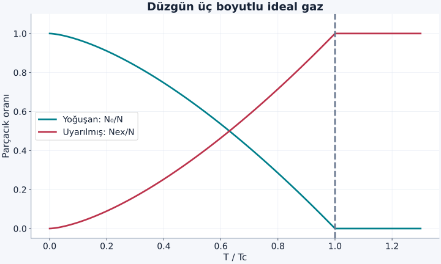
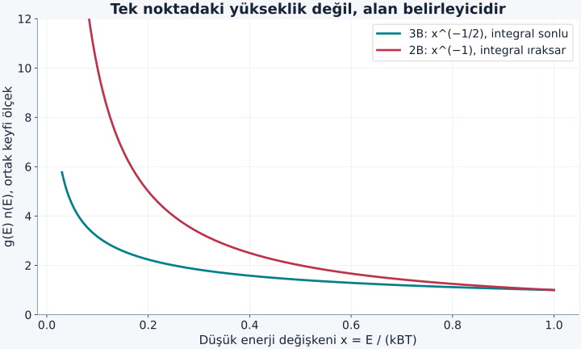

Fermiyon gazında düşük enerjili durumlar dolunca yeni parçacıklar daha yüksek durumlara yerleşmek zorundaydı. Bozonlar için böyle bir dışarlama kuralı yoktur. Aynı tek parçacık durumunda çok sayıda bozon bulunabilir. Fakat bu izin, her sıcaklıkta bütün parçacıkların aynı durumda olacağı anlamına gelmez. Bose–Einstein yoğuşmasını anlamak için, sıcaklığın ve mevcut durum sayısının bu ortak doluluğu ne zaman zorunlu kıldığını hesaplamalıyız.

[Özdeş parçacıklar](/blog/ozdes-parcaciklar-bozonlar-ve-fermiyonlar/), [Bose–Einstein dağılımı](/blog/bose-einstein-ve-fermi-dirac-dagilimlari/) ve [Fermi gazı](/blog/fermi-gazi-ve-dejenerasyon-basinci/) ön bilgilerimiz. İlk modelimiz kutuda, üç boyutlu, etkileşmeyen, sayısı korunan bozon gazıdır. Tek bir iç durum kullanacağız; spin veya iç düzey çokluğunu ayrıca eklemiyoruz. Yoğuşmayı önce bu sınırlı modelde türetecek, sonra deneysel atom bulutlarına geçerken farkları ayıracağız.

## 1. “Aynı durumda” olmak “aynı noktada” olmak değildir

Bir tek parçacık durumu uzayın tamamına yayılmış bir dalga fonksiyonuyla tanımlanabilir. Çok sayıda bozon aynı durumda bulunduğunda aynı uzaysal olasılık biçimini paylaşır; hepsinin tek bir geometrik noktaya yığılması gerekmez. Örneğin periyodik kutunun sıfır momentum durumu uzayda düzgün yoğunluk taşır. Bu durumda ortak doluluk artarken yoğunluk tek noktada sonsuz olmaz.

**Bose–Einstein yoğuşması**, termodinamik limitte bir tek parçacık durumunun doluluğunun toplam parçacık sayısıyla aynı mertebede büyümesidir. $N$ toplam sayı, $N_0$ en düşük durumdaki sayı ise $N_0/N$ oranı sıfırdan farklı kalır. Bir durumda beş yerine elli parçacık bulunması tek başına makroskopik yoğuşma tanımı değildir; sistemin büyüklüğüyle karşılaştırma gerekir.

“Yoğuşma” adı sıvılaşmayı çağrıştırabilir. Burada esas değişen tek parçacık kuantum durumlarının doluluğudur. Çok seyrek bir atom gazı, gaz yoğunluğunu korurken bu kuantum rejime girebilir. Gerçek atomlarda molekül oluşumu ve başka fazlar mümkün olduğundan deneyin kararlılık koşulları ayrıca önemlidir.

## 2. Kimyasal potansiyelin üst sınırı

Taban durum enerjisini $E_0=0$ seçelim. Enerjisi $E$ olan tek parçacık durumunun ortalama doluluğu:

$$
\bar n(E)=\frac1{e^{(E-\mu)/(k_BT)}-1}
$$

olur. $\mu$ kimyasal potansiyel, $k_B$ Boltzmann sabitidir. Doluluk negatif olamayacağı için sonlu sistemde $\mu<0$ gerekir. $\mu$ taban enerjiye alttan yaklaştıkça:

$$
N_0=\frac1{e^{-\mu/(k_BT)}-1}
$$

büyür. Küçük pozitif $y=-\mu/(k_BT)$ için $e^y-1\simeq y$ kullanırsak $N_0\simeq-k_BT/\mu$ elde ederiz. Dolayısıyla büyük fakat sonlu $N_0$ için $\mu\simeq-k_BT/N_0$ negatiftir.

Yoğuşmuş fazda “$\mu=0$” yazılması termodinamik limitteki sınır ifadesidir. Sonlu parçacık sayısında bu değeri doğrudan tek durum formülüne koyup sonsuz parçacık elde etmek fiziksel bir çelişki çözümü değildir. Taban durumunu toplamdan ayırmak gerekir; tam da bu nedenle $N=N_0+N_{\mathrm{ex}}$ yazacağız.

## 3. Uyarılmış durumları saymak

Kütlesi $m$ olan parçacık için enerji $E=\hbar^2k^2/(2m)$ olsun. Üç boyutlu kutuda, tek iç durum için birim enerji başına durum yoğunluğu:

$$
g(E)=\frac{V}{4\pi^2}\left(\frac{2m}{\hbar^2}\right)^{3/2}\sqrt E
$$

olur. Burada $V$ hacim, $\hbar$ indirgenmiş Planck sabitidir. Bu toplam örneğin durum yoğunluğudur; birim hacim başına olanı $g/V$'dir. Fermiyon yazısındaki iki spin çarpanı burada yoktur.

Uyarılmış parçacık sayısı:

$$
N_{\mathrm{ex}}=\int_0^\infty\frac{g(E)\,dE}{e^{(E-\mu)/(k_BT)}-1}
$$

ile bulunur. Sürekli integral tek bir taban durumunun makroskopik doluluğunu doğru saymaz; bu yüzden o durumu ayrı tuttuk. Büyük kutuda yüksekçe durumların aralığı küçük olduğundan integral yaklaşımı uygundur. Çok küçük tuzaklarda sonlu düzey ayrımları açıkça hesaba katılmalıdır.

## 4. Uyarılmış bulutun en büyük doluluğu

Verilen sıcaklıkta $\mu$ en fazla sıfıra yaklaşabilir. Dolayısıyla uyarılmış durumların alabileceği en büyük denge parçacık sayısını $\mu\to0$ ile buluruz. $x=E/(k_BT)$ değişkenini seçersek $dE=k_BT\,dx$ ve $\sqrt E=\sqrt{k_BT}\sqrt x$ olur. Toplam sıcaklık çarpanı $(k_BT)^{3/2}$'dir:

$$
N_{\mathrm{ex}}^{\max}
=\frac{V}{4\pi^2}\left(\frac{2mk_BT}{\hbar^2}\right)^{3/2}
\int_0^\infty\frac{\sqrt x}{e^x-1}\,dx.
$$

İntegralin değeri $\Gamma(3/2)\zeta(3/2)=(\sqrt\pi/2)\times2{,}612\ldots$'dır. $\Gamma$ ve $\zeta$ burada standart özel fonksiyonların adıdır; bu sayıyı kullanmak için bütün kuramlarını bilmek gerekmez. Nasıl ortaya çıktığını görmek için $1/(e^x-1)=\sum_{\ell=1}^{\infty}e^{-\ell x}$ açılımı yapılabilir. Her terimin integralinde $u=\ell x$ değişkeni $\ell^{-3/2}$ çarpanı üretir; bu çarpanların toplamına $\zeta(3/2)$ denir.

**Termal de Broglie dalga boyunu**:

$$
\lambda_T=\sqrt{\frac{2\pi\hbar^2}{mk_BT}}
$$

diye tanımlayınca sonuç sadeleşir:

$$
N_{\mathrm{ex}}^{\max}=\frac{V}{\lambda_T^3}\zeta(3/2).
$$

Bu bir fermiyon dışarlama sınırı değildir. Tek tek uyarılmış durumlar sınırsız bozon alabilir. Sınır, bütün durumların **aynı sıcaklık ve kimyasal potansiyelde denge dağılımına uyması** koşulundan gelir. Bu ayrım, “bozonlara da kapasite kuralı geldi” yanlışını önler.

## 5. Kritik sıcaklık ve yoğuşan oran

$n=N/V$ toplam yoğunluk olsun. Eşik, bütün parçacıkların uyarılmış bulutta henüz tutulabildiği $N=N_{\mathrm{ex}}^{\max}$ koşuludur. Buradan:

$$
T_c=\frac{2\pi\hbar^2}{mk_B}
\left[\frac{n}{\zeta(3/2)}\right]^{2/3}
$$

bulunur. $T<T_c$ olduğunda uyarılmış bulutta kalan sayı $N_{\mathrm{ex}}=N(T/T_c)^{3/2}$ olur. Geri kalanlar taban duruma gider:

$$
\frac{N_0}{N}=1-\left(\frac T{T_c}\right)^{3/2}.
$$

Bu sonuç **üç boyutlu düzgün ideal gaz** içindir. Yoğunluk artarsa eşik yükselir, parçacık kütlesi artarsa aynı yoğunlukta düşer. Faz uzayı yoğunluğu adı verilen boyutsuz $n\lambda_T^3$ büyüklüğü eşikte $2{,}612\ldots$ değerini alır. Dalga paketlerinin örtüşmesi sezgisinin daha kesin ölçüsü budur. [Ketterle'nin Nobel dersinde](https://www.nobelprize.org/uploads/2018/06/ketterle-lecture.pdf) seyrek atom gazlarıyla bu rejime ulaşılmasının deneysel çerçevesi anlatılır.

Şekil: Toplam sayı sabittir; iki oran her noktada bire tamamlanır. Eşik üzerinde yoğuşan oran sıfırdır; formülü negatif değerlere uzatmayız.

## 6. Örnek: Seyrek rubidyum gazının eşik ölçeği

Rubidyum-87 atom kütlesini $m=1{,}4432\times10^{-25}\,\mathrm{kg}$, düzgün yoğunluğu $n=10^{20}\,\mathrm{m^{-3}}$ seçelim. Bu, belirli bir deneyin ölçümü değil, ideal kutu modelinin örneğidir. Önce yoğunluk kısmı:

$$
\left(\frac{10^{20}}{2{,}612}\right)^{2/3}
\simeq1{,}136\times10^{13}\,\mathrm{m^{-2}}
$$

olur. Ön çarpan $2\pi\hbar^2/(mk_B)\simeq3{,}507\times10^{-20}\,\mathrm{K\,m^2}$ olduğundan $T_c\simeq3{,}98\times10^{-7}\,\mathrm K=398\,\mathrm{nK}$ bulunur. Nano öneki $10^{-9}$ demektir.

$T=200\,\mathrm{nK}$ için $T/T_c\simeq0{,}502$ ve:

$$
N_0/N=1-(0{,}502)^{3/2}\simeq0{,}644
$$

elde edilir. $N=10^5$ atom varsa yaklaşık $6{,}44\times10^4$ atom ortak taban durumdadır. Kalanların “kuantum dışı” olduğu söylenmez; onlar da aynı Bose istatistiğine uyan farklı uyarılmış durumları doldurur.

Aynı eşikte $\lambda_{T_c}=(2{,}612/n)^{1/3}\simeq297\,\mathrm{nm}$, ortalama uzaklık ölçeği $n^{-1/3}\simeq215\,\mathrm{nm}$ çıkar. İki uzunluğun aynı mertebeye gelmesi dalga örtüşmesi sezgisini destekler. Eşit olmak zorunda değillerdir; kullanılan termal dalga boyu tanımı belirli bir sayısal katsayı içerir.

## 7. Atom tuzağında üs neden değişir?

Gerçek deneylerde atomlar çoğu kez düzgün kutu yerine yaklaşık harmonik bir potansiyelde tutulur. Üç doğrultudaki açısal frekanslar $\omega_x,\omega_y,\omega_z$ olsun; geometrik ortalama $\bar\omega=(\omega_x\omega_y\omega_z)^{1/3}$'tür. Bu kez yüksekçe enerjilerde durum yoğunluğu $\sqrt E$ yerine $E^2/[2(\hbar\bar\omega)^3]$ ile büyür. Çünkü enerji, üç osilatör kuantum sayısının toplamıyla artar.

Bu durum sayımını enerji sıfırını tuzak tabanına kaydırarak açalım. Düzeyler $E=\hbar(\omega_xn_x+\omega_yn_y+\omega_zn_z)$, $n_i\ge0$ biçimindedir. Belirli bir E'nin altında kalan tam sayı noktaları, kuantum sayısı uzayında eksen kesişimleri $E/(\hbar\omega_i)$ olan bir dört yüzlü içindedir. Düzeyler sıkken nokta sayısını bu cismin hacmiyle yaklaştırırız:

$$
\begin{aligned}
\mathcal N(E)&\simeq\frac16
\frac{E^3}{\hbar^3\omega_x\omega_y\omega_z},\\
g(E)&=\frac{d\mathcal N}{dE}
=\frac{E^2}{2(\hbar\bar\omega)^3}.
\end{aligned}
$$

$1/6$ üç dik eksenli dört yüzlünün hacim katsayısıdır. Bose integralinde $x=E/(k_BT)$ seçildiğinde $E^2dE$ toplamda $T^3$ getirir; $\int_0^\infty x^2/(e^x-1)\,dx=2\zeta(3)$ içindeki iki de yoğunluğun paydasındaki ikiyi götürür. Böylece üs değişiminin kaynağı görünür olur. Anizotropik tuzakta sürekli yaklaşım için $k_BT$'nin üç ayrı $\hbar\omega_i$ aralığından da büyük olması gerekir; yalnız geometrik ortalamayı kontrol etmek çok sıkı tek bir yönü gözden kaçırabilir.

Büyük parçacık sayısı ve bu düzey aralığı koşulları altında ideal tuzak için:

$$
\begin{aligned}
T_c^{\mathrm{tuzak}}&=\frac{\hbar\bar\omega}{k_B}
\left[\frac N{\zeta(3)}\right]^{1/3},\\
\frac{N_0}{N}&=1-(T/T_c)^3.
\end{aligned}
$$

olur; $\zeta(3)\simeq1{,}202$. Kutu ile tuzak sonuçlarının üslerini karıştırmak büyük bir hesap hatasıdır. Birinde hacim ve düzgün yoğunluk, diğerinde parçacık sayısı ve tuzağın sıkılığı doğal parametrelerdir. İki model aynı fiziksel düzeneği betimlemediği için formüller birbirleriyle çelişmez.

## 8. Örnek: Yüz hertzlik harmonik tuzak

$N=10^5$ ve $\bar\omega=2\pi\times100\,\mathrm{s^{-1}}$ seçelim. Verilen $100\,\mathrm{Hz}$ çevrim frekansıdır; formüldeki açısal frekansa çevirmek için $2\pi$ gerekir. $\hbar\bar\omega/k_B\simeq4{,}799\,\mathrm{nK}$ ve $(10^5/1{,}202)^{1/3}\simeq43{,}66$ bulunur. Böylece:

$$
T_c^{\mathrm{tuzak}}\simeq209{,}5\,\mathrm{nK}.
$$

$T=100\,\mathrm{nK}$ için $N_0/N=1-(100/209{,}5)^3\simeq0{,}891$ olur. Yaklaşık $8{,}91\times10^4$ atom yoğuşmuştur. Kutu formülündeki $3/2$ üssünü kullansaydık yaklaşık $0{,}670$ bulurduk; fark yuvarlama hatasından değil, yanlış durum yoğunluğundan doğardı.

Ayrıca eşikte $k_BT_c/(\hbar\bar\omega)\simeq43{,}66\gg1$ olduğundan sürekli durum yoğunluğu yaklaşımı makuldür. Sonlu sayı ve etkileşim düzeltmeleri yine vardır. Buradaki kontrol, yaklaşık modelin kendi ölçek koşulunu sınar; tüm deneysel belirsizlikleri ortadan kaldırmaz.

## 9. Boyutun belirlediği düşük enerji sorunu

Düzgün ideal gazı bir veya iki boyuta taşırsak düşük enerjideki durum yoğunluğu değişir. $\mu\to0$ limitinde Bose doluluğu yaklaşık $k_BT/E$ olur. Üç boyutta $g(E)\propto\sqrt E$ olduğundan integrand yaklaşık $E^{-1/2}$'dir ve sıfır yakınındaki integral sonludur. İki boyutta $g(E)$ sabittir; integrand $1/E$ olur ve integral logaritmik olarak ıraksar.

Bu nedenle sonsuz düzgün ideal iki boyutlu gazda sonlu sıcaklıkta aynı BEC eşiği bulunmaz. Bu sonuç, bütün iki boyutlu deneylerde hiçbir ortak kuantum davranışı olamaz demek değildir. Tuzak, sonlu boyut ve etkileşim koşulları değiştirebilir; özellikle etkileşen iki boyutlu sistemlerde farklı bir faz düzeni mümkündür. Boyutu değiştirirken sadece kutunun bir kenarını silip üç boyutlu eşik formülünü kullanamayız.

Şekil: Eğriler yalnız düşük enerji üslerini karşılaştırır ve ortak keyfi ölçek kullanır. Her iki eğri de sıfıra giderken yükselir; belirleyici olan yükseklik değil, sıfıra kadar biriken integral alanının sonlu olup olmamasıdır.

### Yoğuşma görüntüsü nasıl yorumlanır?

Bir atom bulutu tuzaktan serbest bırakılıp bir süre genişletildikten sonra görüntülenebilir. Uygun koşullarda genişleme, başlangıçtaki momentum dağılımı hakkında bilgi verir. Dar bir merkezi bileşenin geniş termal buluttan ayrılması yoğuşmayı belirlemede yararlıdır. Fakat görüntüdeki her dar tepe otomatik olarak ideal gazdaki taban durum doluluğuna eşit değildir. Etkileşim enerjisi açılma sırasında kinetik enerjiye dönüşebilir; tuzağın şekli ve görüntüleme çözünürlüğü de profilin biçimini etkiler.

Bu nedenle deneysel yoğuşan oran, seçilen modelle görüntüyü çözümleyerek çıkarılır. Buradaki $N_0/N$ formülünü bir piksel parlaklığıyla doğrudan özdeşleştirmiyoruz. Aynı biçimde düşük sıcaklık tek başına yeterli değildir; yoğunluk da eşik koşuluna girer. Gazı soğuturken çok fazla seyreltirsek termal dalga boyu büyüse de parçacıklar arasındaki uzaklık daha hızlı büyüyebilir. $n\lambda_T^3$ ölçütü iki etkinin tek sayıda birlikte kontrol edilmesini sağlar. Bu, mutlak sıcaklık yerine boyutsuz bir yoğunluk–dalga boyu karşılaştırmasının neden daha açıklayıcı olduğunu gösterir.

## 10. Ortak faz, etkileşim ve akış

Yoğuşmuş bileşeni çoğu zaman $\Psi(\mathbf r)=\sqrt{n_0(\mathbf r)}e^{i\theta(\mathbf r)}$ biçiminde bir alanla betimleriz. $n_0$ yoğuşan yoğunluk, $\theta$ fazdır. Bu temsil tek bir atomun dalga fonksiyonuyla aynı normalizasyonu kullanmaz; mutlak karesinin integrali yoğuşan parçacık sayısını verir. Mutlak genel faz doğrudan ölçülmez; iki bulutun veya iki konumun göreli fazı girişimde görünür hale gelebilir.

İdeal gaz sonucu gerçek etkileşen sistemi bütünüyle açıklamaz. Etkileşimler taban durumunu, uyarılma spektrumunu ve yoğuşan oranı değiştirir. Özellikle Bose–Einstein yoğuşması ile **süperakışkanlık** aynı tanım değildir. İlki makroskopik durum doluluğunu, ikincisi akışın ve fazın bozucu etkilere tepkisini ilgilendirir. İdeal düzgün gaz BEC gösterebilirken serbest parçacık spektrumu Landau ölçütünde sıfır kritik hız verir. Bu nedenle “çok atom aynı durumda, öyleyse her koşulda sürtünmesiz akar” sonucunu çıkarmayız.

[MIT'nin Bose yoğuşması dersleri](https://www.mit.edu/~levitov/8514/) bu ortak alan betimini etkileşen gazlara doğru genişletir. Buradaki sayım bize yoğuşmanın neden ortaya çıktığını verdi; akışın hangi koşullarda korunacağını belirlemek için bir sonraki adımda uyarılmaların enerji ve momentumunu da incelemek gerekir.
