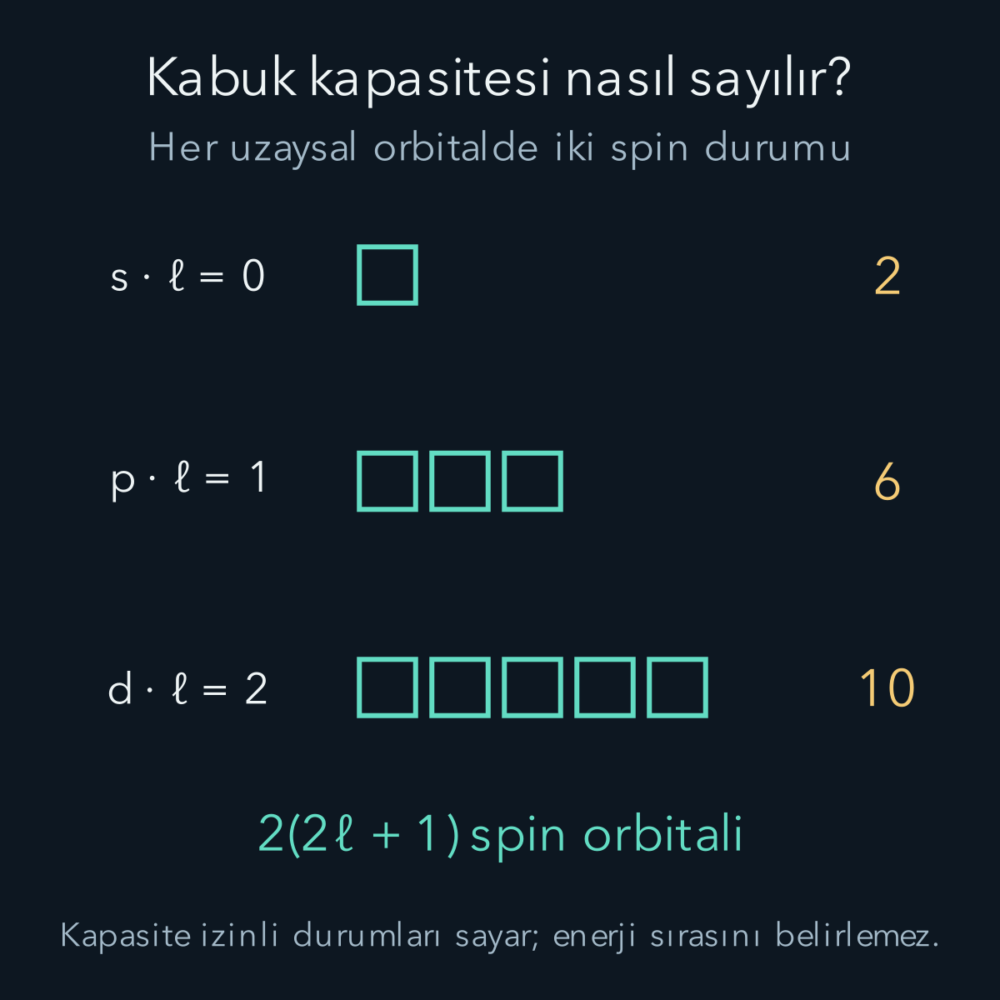
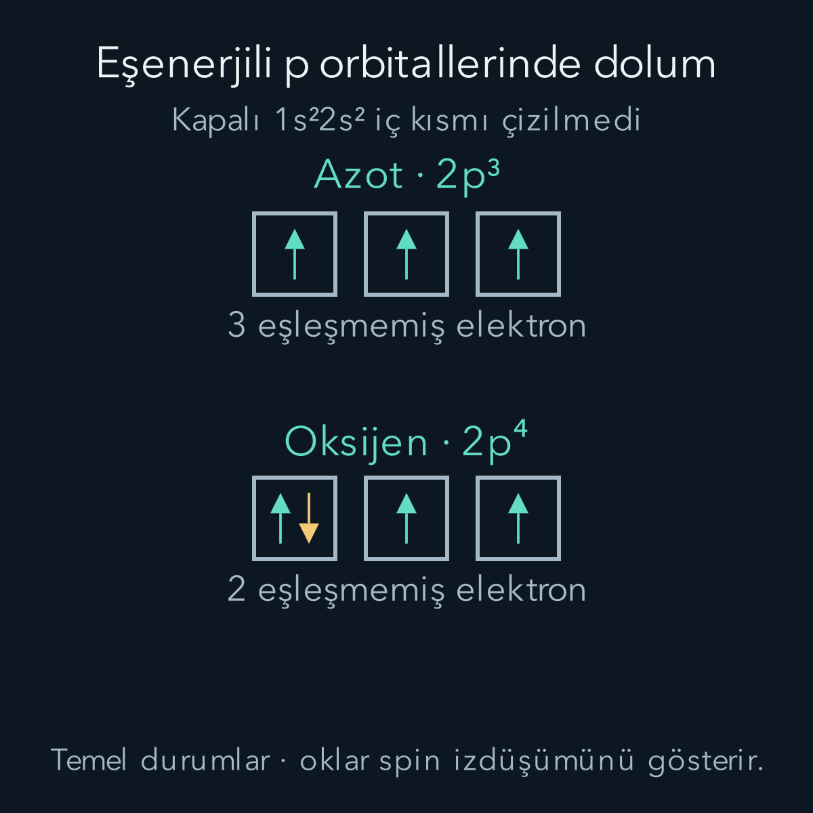

import ArticleVideo from '@/components/ArticleVideo.astro'
import kavram from './media/01-kavram.mp4?url'
import kavramPoster from './media/01-kavram.jpg?url'

Periyodik tabloda bazı özellikler tekrar eder: Bir dış elektronla başlayan bir diziyi, dış alt kabukları dolmuş bir atom izleyebilir. Bu düzeni yalnız kutulara ok yerleştirme kuralıyla ezberlemek mümkündür. Fakat kutuların neden var olduğunu ve enerjilerinin neden değiştiğini anlamak, ezberin nerede bozulacağını da gösterir.

[Helyum yazısında](/blog/helyum-ve-elektron-etkilesimi/) ikinci elektronun yeni bir etkileşim getirdiğini gördük. Burada o düşünceyi N elektrona taşıyacağız. [Hidrojen orbitalleri](/blog/merkezi-potansiyel-ve-hidrojen-atomi/), [fermiyon antisimetri koşulu](/blog/ozdes-parcaciklar-bozonlar-ve-fermiyonlar/), [spinlerin toplanması](/blog/acisal-momentumlarin-toplanmasi/) ve [varyasyon yöntemi](/blog/varyasyon-yontemi/) ön bilgilerimizdir. Determinantı ise gerekli ölçüde burada kuracağız; onu önceden biliyor olmak gerekmiyor.

## 1. Tek atom, birçok koordinat

N elektron ve çekirdek yükü $+Ze$ için, sabit çekirdekli ve görelilik dışı Hamiltonyeni atomik birimlerde yazalım:

$$
\begin{aligned}
\frac H{E_h}&=\sum_{i=1}^{N}
\left(-\frac12\nabla_i^2-\frac Z{r_i}\right)
+\sum_{i<j}\frac1{r_{ij}}.
\end{aligned}
$$

Uzunluk birimi Bohr yarıçapı $a_0$, enerji birimi Hartree $E_h\approx27{,}2114$ eV'dir. $r_{ij}$ i ve j koordinatlarındaki elektronların uzaklığıdır. $i<j$ işareti her çifti yalnız bir kez saydırır. Örneğin üç elektron için çiftler 12, 13 ve 23'tür; 21'i ayrıca eklemeyiz.

Toplam çift sayısı $N(N-1)/2$'dir. On elektronda 45, yirmi elektronda 190 çift bulunur. Asıl güçlük yalnız terim sayısı değildir: Her itme terimi farklı koordinatları bağlar. Tam dalga fonksiyonu bütün elektron konumlarına ve spin değişkenlerine birlikte bağlıdır. Tek elektron için çizdiğimiz orbital, böyle bir ortak fonksiyonun tamamı değildir.

Nötr atomda $N=Z$ olur. İyonda bu eşitlik gerekmez. Elektron çıkarınca Z sabit kalır, N azalır; böylece hem toplam yük hem kalan elektronların etkileşim ortamı değişir.

## 2. Spin orbitali neden gerekli?

Bir uzaysal orbital $\phi_a(\mathbf r)$ olsun. Elektronun spin izdüşümü için iki ortonormal durum seçelim: $\alpha$ ve $\beta$. Bunlar sırasıyla $+\hbar/2$ ve $-\hbar/2$ sonuçlarına karşılık gelir. Konum ve spin değişkenlerini birlikte $x=(\mathbf r,\sigma)$ ile gösterirsek:

$$
u_a(x)=\phi_a(\mathbf r)\alpha(\sigma),
\qquad
u_b(x)=\phi_a(\mathbf r)\beta(\sigma)
$$

iki farklı **spin orbitali**dir. Uzaysal parçaları aynı olsa da spin iç çarpımı sıfır olduğu için bunlar ortogonaldir. Pauli ilkesi aynı uzaysal orbitalde iki elektron olamaz demez; aynı tam tek parçacık durumunda iki özdeş fermiyon bulunamaz der.

Bu ayrım, helyumun 1s orbitalinde iki elektron barındırmasını açıklar. Üçüncü bir elektron geldiğinde yalnız iki spin seçeneği olduğu için aynı uzaysal orbitalde yeni bir spin orbitali kalmaz. Yeni bir uzaysal durum gerekir. Fakat bu durumun hangisi olacağını antisimetri tek başına söylemez; enerji hesabına da ihtiyacımız vardır.

## 3. İki elektrondan determinant fikrine

u ve v ortonormal spin orbitalleri olsun. $u(x_1)v(x_2)$ çarpımı, etiketleri değiştirdiğimizde otomatik olarak eksi işaret almaz. İstenen fonksiyonu iki yerleşimi çıkararak kurarız:

$$
\Psi(x_1,x_2)=\frac1{\sqrt2}
[u(x_1)v(x_2)-v(x_1)u(x_2)].
$$

Köşeli parantezdeki işlem ikiye iki determinanttır. Bir matris için determinantın bu boyuttaki tanımı $ad-bc$ olduğundan:

$$
\Psi=\frac1{\sqrt2}
\begin{vmatrix}
u(x_1)&v(x_1)\\
u(x_2)&v(x_2)
\end{vmatrix}.
$$

Satırlar elektron koordinat yuvalarını, sütunlar kullanılan spin orbitallerini gösterir. İki satır değişince determinant işaret değiştirir. İki sütun aynı olursa determinant sıfırdır; aynı spin orbitalini iki kez kullanmak normalize edilebilecek bir durum üretmez. Pauli koşulu böylece formülün içine yerleşmiştir.

N elektron için aynı fikir:

$$
\Psi(x_1,\ldots,x_N)
=\frac1{\sqrt{N!}}\det[u_j(x_i)].
$$

Bu ifadeye Slater determinantı denir. $N!$, N faktöriyeldir; $N(N-1)\cdots2\cdot1$ çarpımını anlatır. Determinant açıldığında orbitallerin koordinatlara atanmasının $N!$ farklı sıralaması çıkar. Her yerleşim, onu temel sıralamaya götüren değiş tokuşların tek veya çift oluşuna göre eksi veya artı işaret taşır.

Normalizasyon katsayısının nereden geldiğini de görelim. Orbitaller ortonormalse farklı yerleşimler arasındaki çapraz integrallerin en az bir çarpanı sıfır olur. Her yerleşimin kendi normu birdir. Toplam norm karesi $N!$ olduğundan, fonksiyonu $\sqrt{N!}$'e bölmek gerekir. Orbitaller ortonormal değilse bu basit katsayı yeterli olmaz; örtüşme matrisinin determinantı da hesaba girer.

Determinantın normalizasyonu ve bir ile iki elektronlu operatörlerin bu durumlarda nasıl hesaplandığı [MIT Slater determinantı dersinde](https://ocw.mit.edu/courses/5-73-quantum-mechanics-i-fall-2018/653b326897250844da1d83d0d1582636_MIT5_73F18_Lec31.pdf) daha genel biçimde izlenebilir.

## 4. Tek determinantın başarısı ve sınırı

Determinant antisimetriyi tam olarak sağlar, fakat herhangi bir determinant gerçek temel durum değildir. Kullanılan orbitaller kötü seçilmiş olabilir. Üstelik en iyi tek determinant bile bütün elektron korelasyonlarını temsil etmeyebilir. Birçok determinantın uygun katsayılarla birleşimi daha esnek bir ortak durum verir.

Hartree–Fock yaklaşımı, enerjiyi tek determinantlar içinde küçülten orbitalleri arar. Bu, her elektronu bağımsız bırakarak etkileşimi silmek değildir. Diğer dolu orbitaller, her orbitalin denklemine ortalama Coulomb ve değiş tokuş katkılarıyla girer. Orbitaller değişince bu katkılar, katkılar değişince orbitaller yeniden değişir. Kendisiyle tutarlı çözüm, bu döngünün aynı duruma dönmesidir.

Pratikte önce yaklaşık orbitaller seçilir, onların yoğunluğundan etkileşimler hesaplanır, tek parçacık denklemleri çözülür ve yeni orbitallerle enerji yeniden değerlendirilir. Ardışık enerjilerin yakınlaşması hesapta bir durma ölçütüdür. Bununla birlikte yakınsama, bulunan çözümün bütün olası determinantlar arasındaki en düşük çözüm olduğunu tek başına garanti etmez; farklı başlangıç dolumları da karşılaştırılabilir.

## 5. Orbital enerjilerini neden doğrudan toplayamıyoruz?

Bir determinantın enerji beklentisi şu yapıya sahiptir:

$$
E=\sum_i h_{ii}
+\frac12\sum_{i,j}(J_{ij}-K_{ij}).
$$

$h_{ii}$ i spin orbitalinin kinetik ve çekirdek çekim enerjisidir. $J_{ij}$ doğrudan itme, $K_{ij}$ değiş tokuş katkısıdır. Bunlar burada enerji birimi taşır; atomik birimde hesaplandıysa $E_h$ ile çarpılır. $i=j$ için J ile K birbirini götürür; elektron kendi kendisiyle fiziksel olarak etkileşmez. Çift toplamındaki 1/2, ij ve ji çift sayımını düzeltir.

J ile K'nın farkını görmek için $v_{12}=e^2/(4\pi\varepsilon_0r_{12})$ Coulomb enerjisini tanımlayalım. $\varepsilon_0$ boşluğun elektriksel geçirgenliğidir; bu ifadede uzaklık SI birimindedir. Kısa iki parçacık gösteriminde:

$$
\begin{aligned}
J_{ij}&=\langle u_i u_j|v_{12}|u_i u_j\rangle,\\
K_{ij}&=\langle u_i u_j|v_{12}|u_j u_i\rangle.
\end{aligned}
$$

İlk terim iki yük yoğunluğunun itmesini sayar. İkincide sağdaki orbitaller yer değiştirmiştir; bu, antisimetrik durumun çapraz terimidir. Elektronların gerçekten yer değiştirerek gidip gelmesini anlatmaz. Uzay ve spin çarpımına ayrılan orbitallerde ters spinler için K'nın spin çarpanı $\langle\alpha|\beta\rangle\langle\beta|\alpha\rangle=0$ olur. J'de ise her spin kendi normuyla çarpılır ve itme kalır. Böylece ters spinli elektronların değiş tokuş katkısının sıfırlanması, aralarında Coulomb itmesi olmadığı anlamına gelmez. Bu ayrım [MIT'nin iki elektronlu matris elemanları hesabındaki](https://ocw.mit.edu/courses/5-73-quantum-mechanics-i-fall-2018/653b326897250844da1d83d0d1582636_MIT5_73F18_Lec31.pdf) doğrudan ve değiş tokuş terimlerine karşılık gelir.

Kendisiyle tutarlı kanonik Hartree–Fock orbitallerinin özdeğerleri ise:

$$
\epsilon_i=h_{ii}+\sum_j(J_{ij}-K_{ij})
$$

biçimindedir. Hepsini toplarsak çift etkileşimlerinin tamamını iki kez sayarız. Bu nedenle:

$$
E=\sum_i\epsilon_i-
\frac12\sum_{i,j}(J_{ij}-K_{ij}).
$$

Basit bir sayısal kontrol yapalım. İki dolu spin orbitali için tek parçacık katkılarının her biri $-5$ eV, ortak net çift etkileşimi $+1$ eV olsun. Toplam enerji $-5-5+1=-9$ eV'dir. Her orbitalin denkleminde diğerinin $+1$ eV etkisi bulunduğundan iki orbital özdeğeri de $-4$ eV olur. Onları toplamak $-8$ eV verir; fazla sayılan $+1$ eV'yi çıkardığımızda doğru $-9$ eV'ye döneriz.

## 6. Perdeleme ve merkeze nüfuz etme

Elektronların ortalama negatif yük dağılımı çekirdeğin çekimini kısmen perdeler. Basit bir merkezî alan modelinde tek parçacık denklemi, yalnız çekirdeğin $-Z/r$ potansiyeli yerine etkili bir $V_{\rm eff}(r)$ içerir. Bu potansiyelin yarıçapa bağımlılığı, hidrojenin saf Coulomb probleminden farklıdır. Hartree–Fock değiş tokuş işleci ise genel olarak yerel bir potansiyel değildir; tek bir $V_{\rm eff}(r)$ resmi bütün yöntemin tam eşdeğeri sayılmaz.

Aynı n değerindeki s ve p orbitallerinin enerjilerinin ayrılmasını bu farklılıkla anlayabiliriz. s orbitalleri merkez yakınında olasılık taşıyabilir; daha büyük açısal momentumlu orbitallerin radyal hareketinde $\ell(\ell+1)/(2r^2)$ merkezkaç terimi bulunur. İç bölgeye daha fazla nüfuz eden orbital, perdelenmiş dış alanın yanında daha güçlü çekirdek çekimini de örnekler.

Bu nedenle hidrojenin yalnız n'ye bağlı enerji yozlaşması çok elektronlu atomda genellikle korunmaz. “Aynı kabuktalar, kesinlikle aynı enerjideler” çıkarımı yapılamaz. Dış alan yokken aynı n ve $\ell$ içindeki farklı manyetik yönelimlerin eşenerjili oluşu ise dönme simetrisiyle bağlantılı ayrı bir konudur.

## 7. Kabuk kapasitesini saymak

Merkezî alan orbitallerini yaklaşık olarak n, $\ell$, $m_\ell$ ile etiketleriz. n pozitif tam sayı, $\ell=0,1,\ldots,n-1$, $m_\ell=-\ell,\ldots,+\ell$ olur. Her $\ell$ için $2\ell+1$ uzaysal orbital; her birinde iki spin seçeneği vardır. Dolayısıyla alt kabuk kapasitesi:

$$
2(2\ell+1).
$$

$\ell=0,1,2,3$ için alışılmış harfler s, p, d, f'dir. Kapasiteler sırasıyla 2, 6, 10 ve 14 elektrondur. Bütün n kabuğunu toplarsak:

$$
\begin{aligned}
N_{\rm kapasite}
&=2\sum_{\ell=0}^{n-1}(2\ell+1)\\
&=2[2\,n(n-1)/2+n]=2n^2.
\end{aligned}
$$

Örneğin üçüncü kabuk 3s, 3p, 3d alt kabuklarından oluşur ve toplam $2+6+10=18$ durum taşır. Bu, doğada üçüncü kabuğun bütün orbitalleri dolmadan dördüncü kabuğa geçilemez demek değildir. Kapasite sayımı izinli durumları sayar; enerji sıralaması hakkında tek başına hüküm vermez.

## 8. İlk atomlarda dolumun anlamı

$1s^2$ yazımındaki 1 baş kuantum sayısını, s alt kabuğu, üstteki 2 elektron sayısını gösterir. İlk birkaç nötr atomun temel durumları:

| Atom | Baskın elektron yerleşimi | Açık dış alt kabuk |
| --- | --- | --- |
| Helyum | $1s^2$ | Yok |
| Lityum | $1s^2 2s^1$ | Bir 2s elektronu |
| Berilyum | $1s^2 2s^2$ | Yok |
| Bor | $1s^2 2s^2 2p^1$ | Bir 2p elektronu |
| Karbon | $1s^2 2s^2 2p^2$ | İki 2p elektronu |
| Azot | $1s^2 2s^2 2p^3$ | Üç 2p elektronu |
| Oksijen | $1s^2 2s^2 2p^4$ | Dört 2p elektronu |
| Neon | $1s^2 2s^2 2p^6$ | Yok |

“Baskın” sözcüğü önemlidir: Gerçek ortak durum, uygun simetrili çeşitli yerleşimlerin karışımını içerebilir. Yapılandırma etiketi kullanışlı bir başlangıçtır; bütün dalga fonksiyonunu vermez. Ayrıca berilyumun açık alt kabuğu olmaması, onun neonla aynı kimyasal davranışı göstereceği anlamına gelmez. Yakındaki boş durumların enerjileri de önemlidir.

Lityumun üçüncü elektronu 1s'e eklenemez; o iki spin durumu doludur. Düşük enerjili uygun seçenek 2s olur. Sonraki örneklerde p alt kabuğuna geldiğimizde üç eşenerjili uzaysal orbital arasındaki seçim için elektron etkileşimlerini değerlendirmek gerekir. [Fitzpatrick'in atom yapısı notları](https://farside.ph.utexas.edu/teaching/362k/10_Atomic_Structure.pdf) bu temel yerleşimleri merkezî alan yaklaşımıyla ilişkilendirir.

## 9. Hund tercihini küçük bir modelle görmek

İki farklı p orbitalinde aynı spin izdüşümlü iki elektronun uzaysal durumu antisimetriktir. Helyumdaki sabit-orbital hesabına benzer biçimde enerji $2h_0+J-K$ olur. Burada $h_0=\langle a|h|a\rangle=\langle b|h|b\rangle$, yalnız kinetik ve çekirdek çekiminden gelen tek elektron katkısıdır; önceki bölümdeki Hartree–Fock orbital özdeğeri $\epsilon_i$ değildir. Aynı uzaysal orbitalde ters spinli iki elektron için enerji $2h_0+U$ olsun; U o orbitaldeki doğrudan itme integralidir.

Yalnız karşılaştırma amacıyla $h_0=-5$ eV, $J=1$ eV, $K=0{,}2$ eV ve $U=1{,}4$ eV seçelim. Bunlar belirli bir atomun ölçülmüş sayıları değildir. Farklı orbitallerde paralel spinli durumun enerjisi $-10+1-0{,}2=-9{,}2$ eV, aynı orbitalde eşleşmiş durumunki $-10+1{,}4=-8{,}6$ eV olur. Farklı orbitallerin tekli spin birleşimi ise $-10+1+0{,}2=-8{,}8$ eV verir.

Bu örnekte üçlü durum daha düşüktür. Fakat bir orbitalin tek parçacık enerjisi diğerinden çok düşük olsaydı, onu iki ters spinle doldurmak avantajlı olabilirdi. Hund tercihini eşenerjili veya yakın enerjili orbitaller ve belirli bir yapılandırma bağlamında kullanmamızın nedeni budur. Gerçek atomlarda orbitaller yeniden düzenlenir; enerji farkı yalnız sabit bir K terimine indirgenemez.

İlk Hund kuralı, aynı yapılandırmanın izinli terimleri arasında büyük toplam spini tercih eder. Burada S toplam spin kuantum sayısı, L toplam yörüngesel açısal momentum kuantum sayısı, J ise bu iki açısal momentumun birleşiminin kuantum sayısıdır. Hafif atomların uygun LS bağlaşımı koşullarında ikinci kural, seçilmiş en büyük S için izinli en büyük L değerini tercih eder. Üçüncü kural, alt kabuk yarıdan az doluysa en küçük $J=|L-S|$, yarıdan fazla doluysa en büyük $J=L+S$ değerini en alta yerleştirir. Yarı dolu alt kabuğun en büyük spinli temel teriminde tipik olarak $L=0$ olur ve $J=S$ kalır. Bu son ayrılma [spin–yörünge etkileşimiyle](/blog/spin-yorunge-etkilesimi/) bağlantılıdır. Bunlar Pauli'yi geçersiz kılan talimatlar veya her iyon için değişmez bir teorem değildir. Güçlü spin–yörünge etkileşimi ve yakın yapılandırmaların karışması basit sıralamayı bozabilir.

## 10. Azot ve oksijen kutularını okumak

Azotun üç 2p elektronu için üç farklı orbitalde paralel oklar çizeriz. Bu, toplam spin $S=3/2$ çoklusunun en büyük $M_S=3/2$ bileşenini temsil eder. Oksijene geçtiğimizde dördüncü p elektronu boş bir p orbitali bulamaz; birine ters spinle yerleşir. İki eşleşmemiş elektron kalır ve temel terimin toplam spini $S=1$ olur.

<ArticleVideo src={kavram} poster={kavramPoster} title="p alt kabuğunda art arda elektron dolumu" caption="Bor, karbon, azot ve oksijenin temel durum dolum şemaları. Oklar klasik yörüngeler değil, seçilen eksendeki spin izdüşümleridir; her atomda orbitaller yeniden düzenlenir." />

Dış manyetik alan yokken atomun belirli bir laboratuvar yönünü seçmek zorunda olmadığını unutmayalım. Ok çizimi, uygun bir bazda bir bileşeni gösterir. Tam açısal momentum özdurumunu kurmak bazen birden çok determinantın birleşimini gerektirir. “Üç ok yukarı” çizimi, atomdaki elektronların küçük pusula iğneleri gibi sabit doğrultularda döndüğünü anlatmaz.

## 11. Dolum sırası neden evrensel merdiven değildir?

$1s,2s,2p,3s,3p,4s,3d$ gibi bir sıra birçok nötr atom için yararlı başlangıç kuralıdır. Fakat her yeni elektron potansiyeli değiştirir. Özellikle 4s ve 3d gibi yakın enerjili alt kabuklarda elektron sayısı, yük durumu ve orbitalin yeniden düzenlenmesi sıralamayı etkiler. Krom ve bakırın temel yerleşimleri, basit merdivenin ürettiği dolumlardan farklı örneklerdir.

İyonlaşma sırası da dolum listesini tersten okumakla genel olarak bulunmaz. Elektronu çıkardıktan sonraki iyonun toplam enerjisini, başlangıç atomunun toplam enerjisiyle karşılaştırırız. Geçiş metallerinde 4s elektronlarının 3d elektronlarından önce çıkarılması, başlangıçta 4s dolumunun uygun olmasıyla çelişmez; iki karşılaştırma farklı N değerlerine ve farklı öz-tutarlı orbitallere aittir.

Örneğin [NIST demir verilerinde](https://physics.nist.gov/PhysRefData/Handbook/Tables/irontable1.htm) nötr demirin baskın dış yerleşimi $3d^6 4s^2$, bir kez iyonlaşmış demirinki $3d^6 4s$ olarak verilir. İlk iyonlaşmada 4s dolumu azalır.

Periyodik davranış, benzer dış dolumların yeniden ortaya çıkmasından doğar; yalnız bir rakam dizisinden değil. İç elektronların perdelemesi, dış orbitalin yaygınlığı ve erişilebilir boş durumlar birlikte iyonlaşma ve bağlanma eğilimlerini belirler. Kuantum ilkeleri bu düzenin temelini sağlar, fakat ayrıntılı kimyasal sonuçlar için gerçek atomun enerji farklarını hesaplamak gerekir.
