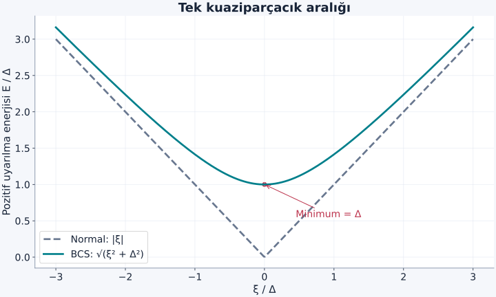
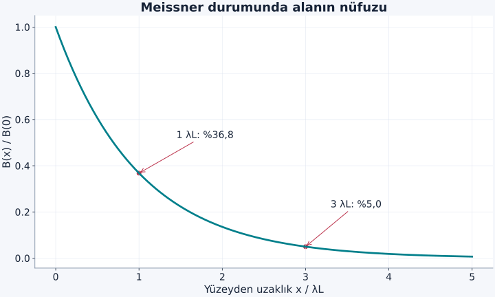

Elektronlar aynı işaretli yük taşır ve birbirini iter. O halde bir metalin elektronları nasıl ortak bir eşleşmiş düzen oluşturabilir? Sorunun ilk kısmı, kristalde elektronun yalnız başka elektronlarla değil, iyonların hareketiyle de etkileştiğini hatırlamaktır. İkinci kısmı ise iki elektronun boş uzaydaki bağlanması ile dolu bir Fermi denizi çevresindeki eşleşmenin aynı problem olmadığını görmektir.

[Fermi gazı](/blog/fermi-gazi-ve-dejenerasyon-basinci/), [fononlar](/blog/orgu-titresimleri-ve-fononlar/), [değiş tokuş](/blog/degis-tokus-etkilesimi-ve-manyetik-duzen/) ve [süperakışkanlık](/blog/superakiskanlik-ve-kuantum-girdaplari/) ön bilgilerimiz. Bu yazı geleneksel, zayıf bağlaşımlı, izotrop $s$ dalgası BCS süperiletkenliğini tanıtıyor. Bütün süperiletkenlerin eşleşme mekanizmasını fononlara indirgemiyoruz. Kuramın adındaki BCS, Bardeen, Cooper ve Schrieffer'in soyadlarından gelir.

## 1. Direnç kaybolması ile manyetik yanıt

Normal metalde elektrik alan elektron dağılımını kaydırır; saçılmalar düzenli akımı gevşetir. Süperiletken faz uygun sıcaklık, alan ve akım sınırları içinde kalıcı akım taşıyabilir. Fakat süperiletkenliği yalnız “direnç sıfır” diye tanımlamak eksiktir. **Meissner etkisi**, dengeye ulaşabilen süperiletkenin manyetik alanı hacminin içinden dışlamasıdır; yüzey yakınındaki sonlu nüfuz bölgesi hariç tutulur.

Kusursuz iletken düşünce deneyinde elektrik alan sıfırsa Faraday yasası $\partial\mathbf B/\partial t=0$ der. Bu, başlangıçtaki akının korunmasını sağlar; başlangıçta bulunan alanın mutlaka dışarı atılacağını söylemez. Süperiletken Meissner durumunda ise alan altında soğutulurken de uygun sınırlar içinde hacimden alan dışlanır. Bu termodinamik fark, yalnız normal metalin saçılma süresini sonsuza götürmenin neden yeterli olmadığını gösterir. [MIT'nin uygulamalı süperiletkenlik giriş dersi](https://www.ocw.mit.edu/courses/6-763-applied-superconductivity-fall-2005/41b2882232b1b43823ec488969c21b6d_lecture1.pdf) bu ayrımı deneysel özelliklerle kurar.

## 2. Fonon aracılı etkin çekim ne demektir?

Bir elektron iyon örgüsünün yerel yük dağılımını etkileyebilir. İyonlar elektrondan ağır olduğu için tepki anlık değildir. Bu örgü cevabı başka bir elektronun enerjisini belirli koşullarda düşürebilir. Ortak elektron–örgü probleminde fononları etkin biçimde elediğimizde, belirli enerji ve momentum aralığında elektronlar arasında çekici bir katkı elde edilir.

Bu, Coulomb itmesinin yok olduğu veya elektronların her uzaklıkta birbirini çektiği anlamına gelmez. Ekranlanmış itme ile örgüden gelen katkının uygun eşleşme kanalındaki toplamı önemlidir. “Bir elektron çukur açar, öteki içine düşer” resmi ancak kaba bir sezgidir; gerçek eşleşme, Fermi yüzeyi yakınındaki çok sayıda kuantum durumunun ortak düzenidir. Enerji aralığının fonon ölçeğiyle sınırlı olması, hesapta neden bir kesme enerjisi kullanacağımızı açıklar.

## 3. Cooper problemi: Dolu denizin üstünde iki elektron

Sıfır sıcaklıkta dolu Fermi denizinin hemen üstüne iki elektron ekleyelim. Toplam momentumlarını sıfır seçerek $\mathbf k$ ve $-\mathbf k$ durumlarını eşleştirelim. Zıt spinli singlet, simetrik uzaysal eşleşmeyle uyumludur. $\xi=E-E_F$ Fermi enerjisinden ölçülen tek parçacık enerjisi, $E_c>0$ etkileşim aralığının üst sınırı olsun.

Etkin çekimi bu aralıkta sabit ve boyutsuz bağlaşımını $\lambda>0$ kabul eden basit modelde iki parçacıklı bağlanma enerjisi $E_b>0$ için:

$$
1=\lambda\int_0^{E_c}\frac{d\xi}{2\xi+E_b}
=\frac\lambda2\ln\frac{2E_c+E_b}{E_b}
$$

bulunur. Burada $\lambda$, çekim katsayısı ile tek spin durum yoğunluğunun çarpımını içeren tanımdır; sabit yoğunluk yaklaşımı yapılmıştır. Logaritmayı açıp çözünce:

$$
E_b=\frac{2E_c}{e^{2/\lambda}-1}
\simeq2E_c e^{-2/\lambda}
$$

elde edilir. Son yaklaşım $\lambda\ll1$ içindir. Her pozitif $\lambda$ için küçük de olsa çözüm vardır. Bu sonuç dolu Fermi denizi ve seçtiğimiz çekim kanalına aittir; boş uzaydaki her zayıf üç boyutlu çekimin mutlaka molekül oluşturacağı iddiası değildir.

## 4. İki parçacıklı hesap neden bütün metal değildir?

Cooper hesabında denizi donmuş kabul edip yalnız iki ek elektronu çözdük. Gerçek süperiletken fazda Fermi yüzeyi çevresindeki çok sayıda elektron birlikte yeniden düzenlenir. Hangi elektronun hangi elektronla kalıcı bir çift kimliği taşıdığını söylemek genellikle mümkün değildir. Zayıf bağlaşımda çift korelasyonunun uzaysal boyutu parçacık aralığından çok daha büyüktür; çok sayıda çift üst üste örtüşür.

BCS durumu, her karşıt momentum çifti için boş olma ile dolu olma genliklerini tutarlı bir ortak fazda birleştirir. Bu açıklama, parçacık sayısının deneyde belirsiz tutulması gerektiği anlamına gelmez; kesin sayıya izdüşürülmüş durumlar da kurulabilir. Büyük sistemde kullanılan fazı belirli yaklaşım, gözlenebilir denge sonuçlarını kullanışlı biçimde verir. Eşleşme genliği $\Delta$ hem bir enerji ölçeği hem ortak düzenin parametresidir; genel olarak karmaşık sayı olabilir.

## 5. Uyarılma enerji aralığı

Normal durumda Fermi enerjisine göre $\xi_{\mathbf k}=E_{\mathbf k}-\mu$ yazalım; $\mu$ kimyasal potansiyeldir. BCS yaklaşımındaki iki bileşenli elektron–delik karışımı:

$$
\begin{pmatrix}\xi_{\mathbf k}&\Delta\\
\Delta^*&-\xi_{\mathbf k}\end{pmatrix}
$$

matrisiyle temsil edilir. Köşegenleştirmek için determinantı sıfıra eşitleriz:

$$
\begin{aligned}
(\xi-E)(-\xi-E)-|\Delta|^2&=0,\\
E^2&=\xi^2+|\Delta|^2.
\end{aligned}
$$

Pozitif uyarılma enerjisi:

$$
E_{\mathbf k}=\sqrt{\xi_{\mathbf k}^2+|\Delta|^2}
$$

olur. Fermi yüzeyinde $\xi=0$ olduğundan en küçük tek kuaziparçacık enerjisi $|\Delta|$'dır. Negatif özdeğer bağımsız bir negatif enerji parçacığı olarak sayılmaz; elektron–delik gösteriminin eşlenik koludur. Çifti kırıp iki kuaziparçacık üretmenin en küçük toplam bedeli bu ideal tam aralıklı durumda $2|\Delta|$ olur.

Şekil: Grafik tek kuaziparçacık enerjisini gösterir. Çift kırılmasının $2\Delta$ eşiği ile grafikteki minimum $\Delta$ birbirine karıştırılmamalıdır.

## 6. BCS aralığı neden üstel küçük olabilir?

Aynı basitleştirilmiş sabit durum yoğunluğu modelinin sıfır sıcaklık öz tutarlılık denklemi:

$$
1=\lambda\int_0^{E_c}\frac{d\xi}{\sqrt{\xi^2+\Delta^2}}
=\lambda\,\operatorname{arsinh}\frac{E_c}{\Delta}
$$

olur. $\operatorname{arsinh}x=\ln(x+\sqrt{x^2+1})$ ters hiperbolik sinüstür. $E_c\gg\Delta$ olduğunda yaklaşık $\ln(2E_c/\Delta)$ kullanılır. Buradan:

$$
\Delta(0)\simeq2E_c e^{-1/\lambda}
$$

çıkar. İki elektron Cooper problemindeki üstelin $-2/\lambda$, çok parçacıklı BCS aralığında $-1/\lambda$ olması bir yazım hatası değildir; farklı problemlerin enerji ölçekleridir. $E_b$ ile $2\Delta$'yı özdeş sayamayız.

Sonlu sıcaklıkta aynı yaklaşım $k_BT_c\simeq1{,}134E_c e^{-1/\lambda}$ verir. İki ifadeyi bölersek fonon kesme enerjisi ve bağlaşım katsayısı gider:

$$
\frac{2\Delta(0)}{k_BT_c}\simeq3{,}53.
$$

Bu zayıf bağlaşımlı izotrop BCS oranıdır; her süperiletkende kesin evrensel sayı değildir. Anizotropi, güçlü bağlaşım ve farklı eşleşme türleri sonucu değiştirebilir.

## 7. Örnek: Aralık, sıcaklık ve foton eşiği

$E_c=20\,\mathrm{meV}$ ve $\lambda=0{,}30$ seçelim. $e^{-1/\lambda}=e^{-3{,}333}\simeq0{,}03567$ olduğundan:

$$
\Delta(0)\simeq2(20)(0{,}03567)=1{,}427\,\mathrm{meV}.
$$

$k_B=0{,}0861733\,\mathrm{meV/K}$ ile $T_c\simeq1{,}134\times20\times0{,}03567/0{,}0861733\simeq9{,}39\,\mathrm K$ bulunur. Aralık kesme enerjisinden yaklaşık on dört kat küçüktür; zayıf bağlaşım yaklaşımı için beklenen yöndedir, fakat sonuçlar yine yaklaşık model sayılarıdır.

Çift kırılmasının enerji eşiği $2\Delta\simeq2{,}854\,\mathrm{meV}$'dir. $h=4{,}13567\times10^{-15}\,\mathrm{eV\,s}$ ile buna karşılık gelen frekans:

$$
\begin{aligned}
f_{\min}&=\frac{2\Delta}{h}\\
&=\frac{2{,}854\times10^{-3}}{4{,}13567\times10^{-15}}\,\mathrm{Hz}\\
&\simeq6{,}90\times10^{11}\,\mathrm{Hz}.
\end{aligned}
$$

olur. Bu enerji eşiği, her fotonun mutlaka soğurulacağını garanti etmez; bağlaşım, momentum ve deney geometrisi de önemlidir. “Eşiği geçmek” gerekli enerji koşulunu sağlar, tüm geçiş olasılığını vermez.

## 8. Örnek: Cooper çiftinin uzaysal ölçeği

$\hbar$ indirgenmiş Planck sabiti olmak üzere, zayıf bağlaşımda karakteristik çift korelasyon uzunluğu:

$$
\xi_0=\frac{\hbar v_F}{\pi\Delta(0)}
$$

ile tahmin edilir. $v_F$ Fermi hızıdır. $v_F=1{,}0\times10^6\,\mathrm{m/s}$ ve önceki $\Delta=1{,}427\,\mathrm{meV}=2{,}286\times10^{-22}\,\mathrm J$ değerini kullanırsak:

$$
\begin{aligned}
\xi_0&=\frac{\hbar v_F}{\pi\Delta}\\
&\simeq\frac{1{,}05457\times10^{-28}}{7{,}182\times10^{-22}}\,\mathrm m\\
&\simeq1{,}47\times10^{-7}\,\mathrm m\\
&=147\,\mathrm{nm}.
\end{aligned}
$$

buluruz. Atomlar arası uzaklık $0{,}30\,\mathrm{nm}$ olsaydı bu uzunluk yaklaşık 490 atom aralığına karşılık gelirdi. Bu sayı, zayıf BCS çiftlerinin küçük ve yalıtılmış moleküller olarak düşünülmemesi gerektiğini gösterir.

$\xi_0$ bir elektronun diğerine sabit uzaklığı veya sert bir çift yarıçapı değildir. Eşleşme korelasyonunun yayılma ölçeğidir. Malzemedeki düzensizlik ve sıcaklık, deneyde kullanılan diğer koherens uzunluğu tanımlarını etkileyebilir. Aynı sembolün farklı yaklaşımlarda biraz farklı anlamlarda kullanılabildiği unutulmamalıdır.

## 9. Ortak faz manyetik alanı nasıl dışlar?

Yüklü ortak alanın akımı elektromanyetik vektör potansiyeline de bağlıdır. Meissner durumunun basit London betimlemesinde düz yüzeyden içeri $x$ uzaklığındaki alan:

$$
\frac{d^2B}{dx^2}=\frac{B}{\lambda_L^2},
\qquad B(x)=B(0)e^{-x/\lambda_L}
$$

biçimindedir. $\lambda_L$ London nüfuz derinliği, $\mu_0$ boşluğun manyetik geçirgenliğidir. Sonsuza giderken büyüyen üstel çözümü fiziksel sınır koşulu dışlar. Çift yoğunluğu $n_p$, çift kütlesi $m_p\simeq2m_e$ ve çift yük büyüklüğü $2e$ ile $\lambda_L=\sqrt{m_p/[\mu_0n_p(2e)^2]}$ yazılabilir. Bu basit ifade etkin kütle ve gerçek malzeme ayrıntılarına göre genelleştirilir.

Şekil: Alan bir yüzey katmanı içinde sönümlenir. Meissner etkisi, yüzeyde bile alanın her noktada tam sıfır olması iddiası değildir. Çizim düz ve kalın bir örneğin ideal profilidir.

### Aralık açılması dolulukları da değiştirir

Normal gazın sıfır sıcaklıkta Fermi enerjisinde keskin bir doluluk basamağı vardı. BCS taban durumunda eşleşme, bu sınırın çevresindeki boş ve dolu çift genliklerini karıştırır. Tek elektron doluluğunun temel biçimi $v_{\mathbf k}^2=[1-\xi_{\mathbf k}/E_{\mathbf k}]/2$ olur. Buradaki $v_{\mathbf k}$ bir hız değildir; geleneksel adlandırmayla olasılık genliğidir. $E_{\mathbf k}=\sqrt{\xi_{\mathbf k}^2+\Delta^2}$ yerine konulunca Fermi yüzeyinde doluluk $1/2$ çıkar. Çok aşağıda $\xi$ büyük negatifken bire, çok yukarıda büyük pozitifken sıfıra yaklaşır.

Bu yumuşama sıcaklık sıfırdayken de bulunur. Dolayısıyla keskin basamağın yumuşadığını görmek her zaman yalnız ısınma anlamına gelmez; taban durumun kendisi değişmiş olabilir. Eşleşme sıfıra götürülürse $E\to|\xi|$ olur ve normal gazın basamağı geri gelir. Bu sınır kontrolü, kullanılan yeni ifadenin eski modelle nasıl birleştiğini gösterir. Her tam fermiyon durumu için doluluk hâlâ sıfır ile bir arasındadır; Pauli ilkesinde hiçbir istisna yapılmamıştır.

Örneğin $\xi=\Delta$ noktasında $E=\sqrt2\Delta$ ve doluluk $(1-1/\sqrt2)/2\simeq0{,}1464$ olur. Karşı noktada, $\xi=-\Delta$ için doluluk $0{,}8536$'dır. Bu iki değer birbirini bire tamamlar. Değişim bütün denizi aynı miktarda karıştırmaz; esas olarak Fermi yüzeyi çevresindeki eşleşme enerji aralığında belirgindir. Böylece “bütün elektronlar çift oldu” cümlesinin gizlediği doluluk yapısını daha somut okuyabiliriz.

## 10. Enerji aralığı tek başına açıklamanın tamamı değildir

Aralık, düşük sıcaklıkta uyarılma üretimini bastırır. Fakat “çarpışmalar aralığı aşamaz, dolayısıyla her şey açıklanır” cümlesi eksiktir. Akımın korunması ortak fazın katılığı, elektromanyetik yanıt ve akım taşıyan durumun kararlılığıyla birlikte ele alınır. Kritik akım veya yeterince güçlü manyetik alan ortak düzeni bozabilir. Tür-II süperiletkenlerde belirli alan aralığında kuantum akı girdapları hacme girer; bunların hareketi enerji kaybı üretebilir.

Bu ayrım, eşleşmeyi Pauli ilkesinin kaldırılması olarak yorumlamamızı önler; ortak düzen fermiyonların tekil durum doluluğunu ihlal etmez.

Elektronların hepsinin tek bir fermiyon durumuna dolduğunu da söylemeyiz. Pauli ilkesi geçerliliğini korur; ortak düzen iki elektronlu eşleşme korelasyonundadır. [Feynman'ın süperiletkenlik semineri](https://www.feynmanlectures.caltech.edu/III_21.html), bu makroskopik fazın elektromanyetik alanla ilişkisinin kavramsal bir anlatımını sunar. Burada mikroskobik eşleşme ve enerji aralığını kurduk. Ortak fazın iki ayrı süperiletken arasında nasıl ölçülebilir akım ürettiği, bundan sonraki doğal sorudur.
