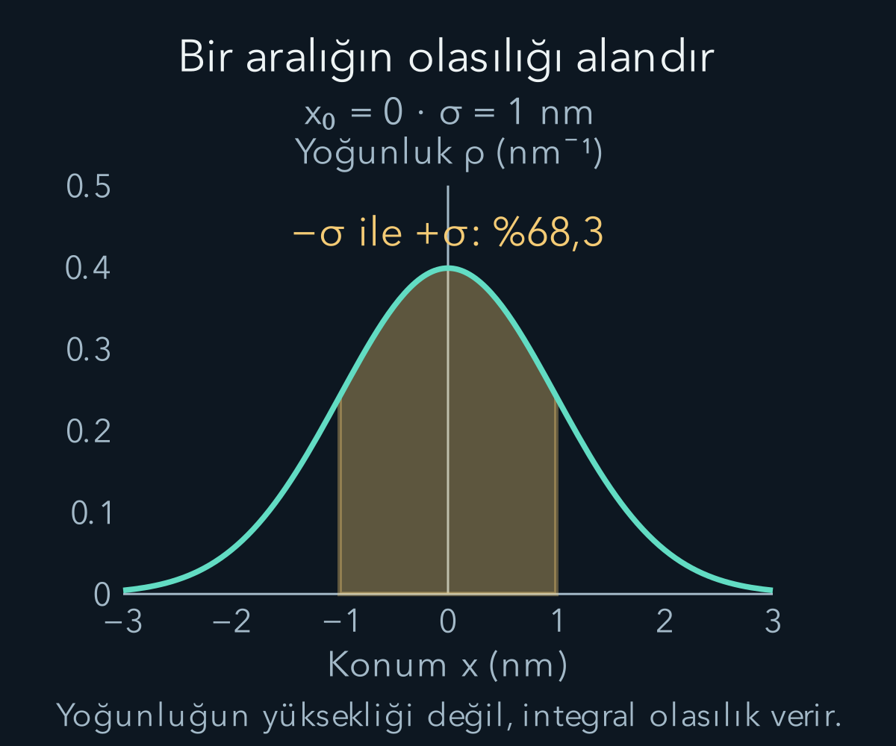
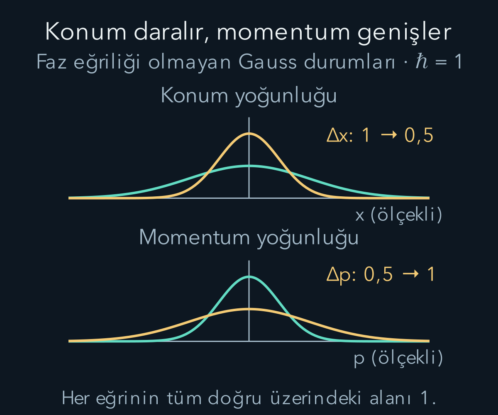

import ArticleVideo from '@/components/ArticleVideo.astro'
import kavram from './media/01-kavram.mp4?url'
import kavramPoster from './media/01-kavram.jpg?url'

İki sonuçlu spin ölçümünde durumu iki karmaşık genlikle yazdık. Konum ölçümünde ise olası sonuçlar yalnız iki nokta değildir; parçacık bir doğru üzerindeki sürekli konumlarda bulunabilir. Bu kez her konuma bir karmaşık genlik değeri atayan fonksiyon kullanacağız. **Dalga fonksiyonu**, kuantum durumunun konum gösterimidir; yalnız yoğunluk eğrisi veya parçacığın izlediği gizli bir yol değildir.

[Durum ve Born kuralı](/blog/kuantum-durumu-superpozisyon-ve-born-kurali/), [sürekli olasılık dağılımları](/blog/rastgele-degiskenler-ve-dagilimlar/) ve [Fourier dönüşümü](/blog/fourier-serileri-ve-dalga-paketleri/) ön bilgilerimizdir. Bu yazıda bir boyutta, spinsiz veya spin durumu ayrıca sabitlenmiş tek parçacığı ele alıyoruz. Bütün doğru üzerindeki normalleştirilebilir durumlarla başlayacak, sınırları olan uzayların neden ayrı koşullar gerektirdiğini de belirteceğiz.

## 1. Bir sayı listesi yerine fonksiyon

Sabit bir anda konum genliğine $\psi(x)$ diyelim. $x$ gerçek konum değişkenidir; $\psi$ karmaşık değer alabilir. Zamanı gerektiğinde $\psi(x,t)$ biçiminde ekleyeceğiz. Born kuralının sürekli karşılığı, $[a,b]$ aralığında bulunma olasılığını:

$$
P(a\le x\le b)=\int_a^b|\psi(x)|^2\,dx
$$

olarak verir. $\rho(x)=|\psi(x)|^2$ **konum olasılık yoğunluğudur**. Yoğunluk ile olasılık aynı sayı değildir. Bir aralığın olasılığını bulmak için yoğunluğu o aralık boyunca toplarız; sonsuz küçük parçaları toplama işlemi integraldir.

Konum metre cinsindense $\rho$ birimi $\mathrm{m^{-1}}$, $\psi$ birimi $\mathrm{m^{-1/2}}$ olur. Böylece $\rho\,dx$ boyutsuz olasılık verir. Yoğunluğun sayısal değeri birden büyük olabilir; bu bir ihlal değildir. Bir uzunluk birimi değiştiğinde yoğunluğun sayısal yüksekliği değişir, ama aynı fiziksel aralığın olasılığı değişmez.

Sürekli yoğunluk modelinde tek bir matematiksel noktanın olasılığı sıfırdır. Buna rağmen her ölçüm bir konum aralığında kayıt oluşturur. Gerçek detektörün çözünürlüğü sonludur; sıfır genişlikte bir noktayı sonsuz hassasiyetle okuyor değildir. Nokta olasılığıyla yoğunluk yüksekliğini karıştırmak, sürekli dağılımlarda sık karşılaşılan bir hatadır.

## 2. Normalleştirme ve kare integrallenebilirlik

Parçacığın bir yerde bulunma olasılığı bir olmalıdır:

$$
\int_{-\infty}^{\infty}|\psi(x)|^2\,dx=1.
$$

Sonlu normlu fonksiyonların oluşturduğu uzay $L^2(\mathbb R)$ ile gösterilir. $\mathbb R$ bütün gerçek konum doğrusudur; $L^2$ adı mutlak değerin karesinin integrallenebilir olmasına işaret eder. Sonlu boyutlu vektör normundaki toplam, burada integrale dönüşmüştür.

İki durumun iç çarpımı $\langle\phi|\psi\rangle=\int\phi^*(x)\psi(x)\,dx$ olur. Yine ilk fonksiyon eşlenir. Fiziksel hesaplarda yalnız tek tek noktalardaki temsil değerlerinden çok, bu integraller belirleyicidir; ölçüsü sıfır bir noktada değer değiştirmek aynı $L^2$ durumunu temsil edebilir. Bu matematiksel ayrıntı, fonksiyonun her yerde görünen grafiğiyle fiziksel durumun tam olarak özdeş olmadığını hatırlatır.

Kare integrallenebilir olmak, bütün gözlenebilirlerin ortalamasının ve varyansının sonlu olacağını garanti etmez. Çok uzun kuyrukları olan bir dağılım normalleşebilir ama konumun ikinci momenti ıraksayabilir. Ayrıca momentum işleci türev gerektirir. Bu nedenle dalga fonksiyonunu normalleştirmek başlangıç koşuludur; her işlemi uygulamak için yeterli tek koşul değildir.

## 3. Gauss paketini normalleştirmek

Konum merkezi $x_0$, genişlik parametresi $\sigma>0$ ve momentum merkezi $p_0$ olan durumu şöyle seçelim:

$$
\psi(x)=N\exp\left[-\frac{(x-x_0)^2}{4\sigma^2}\right]
\exp\left[\frac{ip_0(x-x_0)}\hbar\right].
$$

İkinci üstel saf fazdır; mutlak değer karesinde bir olur. Dolayısıyla yoğunluk $|N|^2\exp[-(x-x_0)^2/(2\sigma^2)]$'dir. Önceki çok katlı integral çalışmasındaki Gauss sonucundan bu üstel fonksiyonun bütün doğru üzerindeki integrali $\sqrt{2\pi}\sigma$ olur. Birim norm için $|N|^2=1/(\sqrt{2\pi}\sigma)$ seçilir.

Ortak fazı sıfır alarak $N=(2\pi\sigma^2)^{-1/4}$ yazabiliriz. Böylece:

$$
\rho(x)=\frac1{\sqrt{2\pi}\sigma}
\exp\left[-\frac{(x-x_0)^2}{2\sigma^2}\right].
$$

Dikkat edersek dalga fonksiyonunun üstel paydasında $4\sigma^2$, yoğunluğun paydasında $2\sigma^2$ vardır. Fonksiyonu karelerken bu fark ortaya çıkar. İkisini aynı genişlik ifadesi sanmak, normalleştirme ve momentum yayılımında ikilik çarpan hatalarına yol açar.

## 4. Konum ortalaması ve yayılımı

Konumun beklenen değeri $\langle x\rangle=\int x|\psi(x)|^2dx$ olur. Gauss paketinde $y=x-x_0$ değişkenini seçersek $x=y+x_0$ yazılır. Yoğunluk $y$'ye göre çift fonksiyondur. $y\rho(y)$ tek olduğu için simetrik bütün doğru üzerinde integrali sıfırdır. Kalan $x_0\int\rho\,dy=x_0$ olur.

Varyans $\langle(x-x_0)^2\rangle$'dir. Standart Gauss integralinin parametreye göre türevi veya kısmi integrasyon, bu değeri $\sigma^2$ verir. Böylece $\Delta x=\sigma$ olur. $\sigma$ yalnız grafikte rastgele seçtiğimiz bir genişlik etiketi değil, bu normalleştirme konvansiyonunda konum standart sapmasıdır.

Örneğin $x_0=0$ ve $\sigma=1\ \mathrm{nm}$ olsun. Simetriden sağ yarıdaki toplam olasılık $1/2$'dir. Merkezin iki yanında birer standart sapma içindeki olasılık yaklaşık yüzde 68,3'tür. Bu son sayı, standart normal yoğunluğun $-1$ ile $+1$ arasındaki integralinden gelir; bütün Gauss eğrisinin alanının yaklaşık üçte ikisi bu aralıktadır. Parçacığın mutlaka bu bölgede olacağını söylemez.

Merkez çevresindeki çok dar $0{,}02\ \mathrm{nm}$ aralığında yoğunluğu yaklaşık sabit alırsak olasılık $(1/\sqrt{2\pi}\,\mathrm{nm})\times0{,}02\ \mathrm{nm}\approx0{,}0080$ çıkar. Bu yaklaşık hesap yüzde 0,8 verir. Aralık genişletildiğinde yoğunluk önemli ölçüde değişeceği için merkez yüksekliğiyle çarpmak yerine tam integral kullanılmalıdır.

## 5. Konum yoğunluğu durumun tamamı değildir

Gauss paketindeki $p_0$ parametresini değiştirirsek $\rho(x)$ değişmez; yalnız konuma bağlı faz değişir. Buna rağmen momentum ölçümü farklı sonuç dağılımına sahip olacaktır. Dolayısıyla konum yoğunluğunu bilmek, kuantum durumunun bütün bilgisini bilmek değildir. Önceki iki durum örneğinde aynı baz olasılıklarına sahip farklı fazları başka bazda ayırabilmiştik; burada aynı yapı sürekli durumda görülür.

Konumdan bağımsız tek bir $e^{i\chi}$ çarpanı global fazdır ve hiçbir ölçüm olasılığını değiştirmez. Buna karşılık $e^{ip_0x/\hbar}$ konuma bağlıdır; bütün konum bileşenlerine aynı fazı vermez. Bunu global faz sanmak, momentum kaymasını gözden kaçırır. Fonksiyonun mutlak değerinin aynı olması, iki durumun eşdeğer olması için yeterli değildir.

Dalga fonksiyonunun gerçek ve sanal kısımlarını çizebiliriz, fakat bunların tek tek grafik yükseklikleri olasılık değildir. Fiziksel yoğunluk iki kısmın karelerinin toplamıdır. Bazı noktada gerçek kısım sıfır olsa bile sanal kısım sıfır değilse yoğunluk kaybolmaz. Karmaşık gösterimi yalnız sinüs eğrisinin görsel benzeri olarak okumamalıyız.

## 6. Momentum gösterimine geçmek

De Broglie bağıntısıyla dalga sayısı $k$ ve momentum $p$ arasında $p=\hbar k$ vardır. Konum fonksiyonunu momentum bileşenlerine ayırmak için Fourier dönüşümünün şu konvansiyonunu kullanacağız:

$$
\phi(p)=\frac1{\sqrt{2\pi\hbar}}\int_{-\infty}^{\infty}
 e^{-ipx/\hbar}\psi(x)\,dx,
$$

$$
\psi(x)=\frac1{\sqrt{2\pi\hbar}}\int_{-\infty}^{\infty}
 e^{ipx/\hbar}\phi(p)\,dp.
$$

İleri dönüşümde eksi, ters dönüşümde artı işareti vardır. İki tarafta aynı normalleştirme çarpanını seçtik. Daha önce dalga sayısıyla kullanılan $1/\sqrt{2\pi}$ konvansiyonundan momentum değişkenine geçerken $dp=\hbar\,dk$ ölçü dönüşümü de hesaba katılır. Çarpandaki $\hbar$ süs değildir; normun doğru ölçüyle korunmasını sağlar.

Çarpandaki karekökü olasılığı koruyarak bulabiliriz. Dalga sayısı gösterimine $\widetilde\psi(k)$ diyelim. Aynı bileşen aralığı için:

$$
|\phi(p)|^2\,dp
=|\widetilde\psi(k)|^2\,dk,
\qquad k=\frac p\hbar.
$$

$dk=dp/\hbar$ olduğundan, iki gösterimin faz konvansiyonunu aynı seçerek $\phi(p)=\widetilde\psi(p/\hbar)/\sqrt\hbar$ yazabiliriz. Dalga sayısı dönüşümünün $1/\sqrt{2\pi}$ katsayısıyla birleşince $1/\sqrt{2\pi\hbar}$ çıkar. Ters yönde ise $\widetilde\psi(k)=\sqrt\hbar\,\phi(\hbar k)$ ve $dk=dp/\hbar$ kullanılır; yine aynı katsayı kalır. Bu yüzden yalnız üstel içindeki $k$ yerine $p/\hbar$ koymak yeterli değildir: yoğunluğun hangi aralık başına tanımlandığı da değişmiştir.

$|\phi(p)|^2$ momentum olasılık yoğunluğudur ve $\int|\phi(p)|^2dp=1$ olur. $\phi$ birimi momentumun eksi yarım kuvvetidir. Konum fonksiyonuyla momentum fonksiyonunun birimleri bu yüzden aynı değildir. Dönüşümdeki üsteller ise boyutsuzdur; $px$ ve $\hbar$ aynı eylem birimini taşır.

## 7. Gauss paketinin momentum dağılımı

Seçtiğimiz Gauss fonksiyonunu dönüşüme koyup $y=x-x_0$ yazalım. Fazın konum merkezinden gelen kısmı $e^{-ipx_0/\hbar}$ dışarı çıkar. Kalan integral, Gauss Fourier dönüşümüdür:

$$
\int e^{-y^2/(4\sigma^2)}e^{-i(p-p_0)y/\hbar}dy
=2\sigma\sqrt\pi\,e^{-\sigma^2(p-p_0)^2/\hbar^2}.
$$

Normalleştirme çarpanlarıyla birlikte sonuç:

$$
\phi(p)=\left(\frac{2\sigma^2}{\pi\hbar^2}\right)^{1/4}
 e^{-\sigma^2(p-p_0)^2/\hbar^2}e^{-ipx_0/\hbar}.
$$

Mutlak değer karesini standart Gauss biçimiyle karşılaştırırsak merkez $p_0$, varyans $\hbar^2/(4\sigma^2)$ olur. Yani $\Delta p=\hbar/(2\sigma)$ elde edilir. Konum paketini daraltmak momentum dağılımını genişletir. Bu belirli Gauss ailesinde çarpım $\Delta x\Delta p=\hbar/2$'dir. Bütün durumlar için alt sınırın neden geçerli olduğunu daha sonra işleçlerle kanıtlayacağız; tek Gauss örneğini genel ispat yerine kullanmıyoruz.

<ArticleVideo src={kavram} poster={kavramPoster} title="Bir konum aralığının olasılığı" caption="Normalize Gauss yoğunluğu üzerinde aynı genişlikte bir aralık kaydırılır. Sarı alan aralığın olasılığını gösterir; yoğunluğun noktasal değeriyle karıştırılmaz." />

## 8. Momentumu türev olarak görmek

Ters Fourier ifadesindeki bir düzlem dalga bileşeninin türevini alırsak $d(e^{ipx/\hbar})/dx=(ip/\hbar)e^{ipx/\hbar}$ olur. $-i\hbar$ ile çarpınca bu bileşen $p$ sayısıyla çarpılmış olur. Uygun fonksiyonlarda bu nedenle konum gösterimindeki momentum işleci:

$$
\hat p=-i\hbar\frac d{dx}
$$

biçimindedir. Şapka işleci skaler momentum değişkeninden ayırır. Konum işleci ise $(\hat x\psi)(x)=x\psi(x)$ olarak fonksiyonu konum değişkeniyle çarpar. İşleç bir sayı değildir; önce bir fonksiyona uygulanıp yeni bir fonksiyon üretir.

Momentum ortalaması, gerekli integraller varsa $\langle p\rangle=\int\psi^*(-i\hbar\psi')dx$ olarak hesaplanabilir. Gauss paketinde türev $\psi'=[-(x-x_0)/(2\sigma^2)+ip_0/\hbar]\psi$ olur. Dolayısıyla momentum uygulaması $[p_0+i\hbar(x-x_0)/(2\sigma^2)]\psi$ verir. İkinci terimin yoğunlukla integrali simetriden sıfır olur; ortalama $p_0$ çıkar. Fourier hesabıyla aynı sonuca ulaştık.

## 9. İşlecin tanım kümesi neden önemlidir?

Her $L^2$ fonksiyonu sıradan anlamda türevlenebilir değildir. Bu yüzden $-i\hbar d/dx$ yazmak tek başına tam bir işleç tanımı değildir. Bütün doğru üzerinde momentum için uygun öz-eşlenik tanım kümesi, zayıf türevi de kare integrallenebilir olan fonksiyonlarla kurulabilir. Başlangıç düzeyinde, yeterince düzgün ve sonsuzda yeterince hızlı azalan fonksiyonlarla çalışmak bu işlemleri güvenle yapmamızı sağlar. Gauss paketimiz bu koşulları sağlar.

Kısmi integrasyonda $\int\phi^*(-i\hbar\psi')dx$ ifadesini diğer tarafa aktarırken sınır terimi $-i\hbar[\phi^*\psi]_{-\infty}^{\infty}$ oluşur. Bu terimin uygun koşullarla yok olması gerekir. Sonlu bir aralıkta hangi uç koşullarının seçildiği, momentumun öz-eşlenik tanımını ve spektrumunu etkiler. Yalnız ‘matris Hermitti, türev de öyledir’ diyerek sınırları atlayamayız.

Konum işleci için de $x\psi$ fonksiyonunun uygun norm koşulunu sağlaması gerekir. Sonlu boyutlu matrisler bütün vektörlere uygulanabilirken sınırsız işleçler yalnız seçilmiş tanım kümelerinde işler. Bu ayrım, ileride potansiyel kuyusundaki duvarları ve enerji işleci sınır koşullarını doğru kurmamızı sağlayacak.

## 10. Düzlem dalga neden tek başına normalleşmez?

$\psi(x)=Ce^{ip_0x/\hbar}$ bütün doğru üzerinde sabit yoğunluğa sahiptir: $|\psi|^2=|C|^2$. $C\ne0$ için bu yoğunluğun sonsuz uzunluktaki integrali sonsuzdur. $C=0$ seçersek norm sıfır olur. Dolayısıyla bütün doğru üzerindeki tam belirli momentum düzlem dalgası, birim normlu sıradan $L^2$ durumu değildir.

Yine de Fourier bileşenleri olarak çok yararlıdır. Gerçek normalleştirilebilir paketleri bu genelleştirilmiş bileşenlerin toplamıyla kurabiliriz. Dirac delta normalleştirmesi bu kullanımı matematiksel olarak ifade eden ayrı bir araçtır; burada onu önceden biliyormuşuz gibi kullanmıyoruz. Kesin momentumun ideal sınırıyla dar momentum dağılımlı fiziksel paketi ayırıyoruz.

Sonlu uzunluk $L$ üzerinde periyodik sınır koşulu seçersek $\psi(L)=\psi(0)$ koşulu $p_n=2\pi n\hbar/L$ değerlerini seçer ve düzlem dalga $1/\sqrt L$ çarpanıyla normalleşir. Bu, bütün doğru üzerindeki durumla aynı problem değildir. Fonksiyonu aralık dışında sıfır yapıp uçlardaki süreksizlikleri görmezden gelmek de momentum işleminin tanım kümesi sorunlarını çözmez.

## 11. Gauss varyansının ara hesabı

Konum varyansını yalnız bilinen normal dağılım sonucuna dayandırmadan görelim. $y=x-x_0$ yazdığımızda yoğunluğun türevi $\rho'(y)=-(y/\sigma^2)\rho(y)$ olur. Buradan $y\rho(y)=-\sigma^2\rho'(y)$ çıkar. İkinci moment integralinde bir $y$ çarpanını bu ifadeyle değiştirebiliriz:

$$
\int_{-\infty}^{\infty}y^2\rho(y)dy
=-\sigma^2\int_{-\infty}^{\infty}y\rho'(y)dy
=-\sigma^2[y\rho(y)]_{-\infty}^{\infty}
+\sigma^2\int_{-\infty}^{\infty}\rho(y)dy.
$$

Gauss fonksiyonu kuvvetlerden daha hızlı azaldığı için sınır terimi sıfırdır. Son integral normalleşmeden birdir; sonuç gerçekten $\sigma^2$ olur. Burada hem sınır davranışını hem normalleşmeyi kullandık. Aynı cebiri daha yavaş azalan bir dağılıma koşulsuz uygulamak, yok olmayan sınır terimini veya ıraksayan momenti saklayabilir.

## 12. Birim değiştirince fonksiyon yüksekliği

Konumu metre yerine nanometreyle sayısal olarak ifade etmek istediğimizi düşünelim. $x=a q$ yazalım; $a=10^{-9}\ \mathrm m$ ve $q$ boyutsuz sayıdır. Aynı fiziksel aralığın olasılığı $|\psi_x(x)|^2dx=|\psi_q(q)|^2dq$ olmalıdır. $dx=a\,dq$ olduğundan yeni temsil $\psi_q(q)=\sqrt a\,\psi_x(aq)$ biçiminde seçilir. Genliğin yüksekliği ölçekle değişirken olasılık aynı kalır.

Bir nanometre genişliğindeki Gauss paketinin merkez yoğunluğu metre başına yaklaşık $3{,}99\times10^8$ olur. Nanometre başına sayısal yoğunluğu ise yaklaşık $0{,}399$'dur. Büyük ilk sayı olasılığın birden büyük olduğu anlamına gelmez; çok küçük uzunluk birimine göre yoğunluk bildirir. Bir nanometrelik aralık için hangi gösterimi kullanırsak kullanalım aynı alanı hesaplarız.

Bu kontrol, bir yazılımdan alınan dalga fonksiyonu grafiğini okurken de yararlıdır. Düşey eksenin genlik mi, yoğunluk mu, yoksa yalnız görsel amaçlı yeniden ölçeklenmiş bir eğri mi olduğunu bilmeliyiz. Normalize görünüş, fiziksel normalleşmenin kanıtı değildir; ilgili ölçüyle integralin gerçekten bir olduğunu denetlemek gerekir. Konum ve momentum grafikleri yan yana çizildiğinde ayrı birimlere sahip olmaları da bu nedenle açıkça belirtilmelidir.

Eksenlerin sayısal aralıklarını eşit çizmek, konum genişliğiyle momentum genişliğinin aynı fiziksel büyüklük olduğu anlamına gelmez. Karşılaştırılabilen şey doğrudan uzunluklar değil, uygun birimlerle hesaplanan standart sapmalar ve aralarındaki matematiksel bağıntıdır. Bu ayrımı şekillerdeki kısa etiketlerde de koruduk.

## 13. Bir ölçekte iki yayılımı hesaplamak

Konum standart sapması $\sigma=1\ \mathrm{nm}=10^{-9}\ \mathrm m$ olan Gauss paketinde $\Delta p\approx1{,}055\times10^{-34}/(2\times10^{-9})=5{,}28\times10^{-26}\ \mathrm{kg\,m/s}$ olur. Serbest ve göreli olmayan elektron için hız dağılımının standart sapması $\Delta v=\Delta p/m_e\approx5{,}79\times10^4\ \mathrm{m/s}$'dir. Bu, ortalama hız değildir; ortalamanın çevresindeki yayılımdır.

$p_0=0$ seçsek bile momentum sonuçları her seferinde sıfır olmaz. Dağılım sıfır çevresinde simetriktir ve pozitif-negatif sonuçlar ortalamada dengelenir. Paketi aynı merkezde iki kat daraltırsak $\Delta p$ ve bu yaklaşımda $\Delta v$ iki katına çıkar. Dalga fonksiyonu değiştirildiği için yeni bir hazırlama yapılmıştır; yalnız bir grafiğin yakınlaştırma ölçeğini değiştirmedik.

Artık konum ve momentum, aynı kuantum durumunun iki farklı gösterimidir. Birinde yoğunluk konum aralıklarını, diğerinde momentum aralıklarını sayar. Fazlar iki gösterim arasındaki geçişte fiziksel rol oynar. Sonraki yazıda bu konum fonksiyonunun Hamiltonyen altında nasıl değiştiğini ve olasılığın bir bölgeden diğerine nasıl aktığını hesaplayacağız.

## Kaynakça

Aşağıdaki açık kaynaklar 11 Ekim 2026 tarihinde yeniden doğrudan kontrol edildi. Metin, hesap örnekleri ve şekiller bu yazı için özgün olarak hazırlandı.

- [OpenStax — Wave Functions](https://openstax.org/books/university-physics-volume-3/pages/7-1-wave-functions): Olasılık yoğunluğu, normalleştirme ve ortalamalar.
- [Caltech, Feynman Lectures — The Dependence of Amplitudes on Position](https://www.feynmanlectures.caltech.edu/III_16.html): Konum genlikleri ve momentumla ilişkisi.
- [Caltech, Feynman Lectures — Operators](https://www.feynmanlectures.caltech.edu/III_20.html): Momentum türev işleci ve ortalama hesabı.
