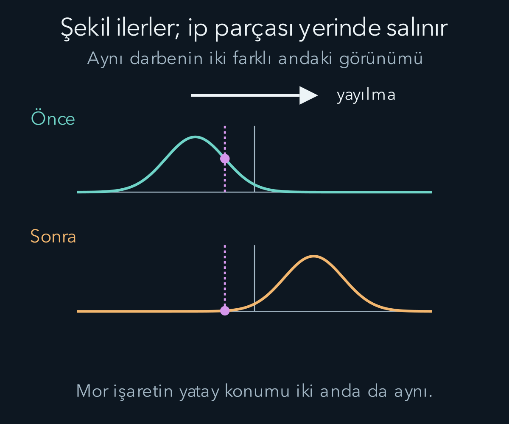
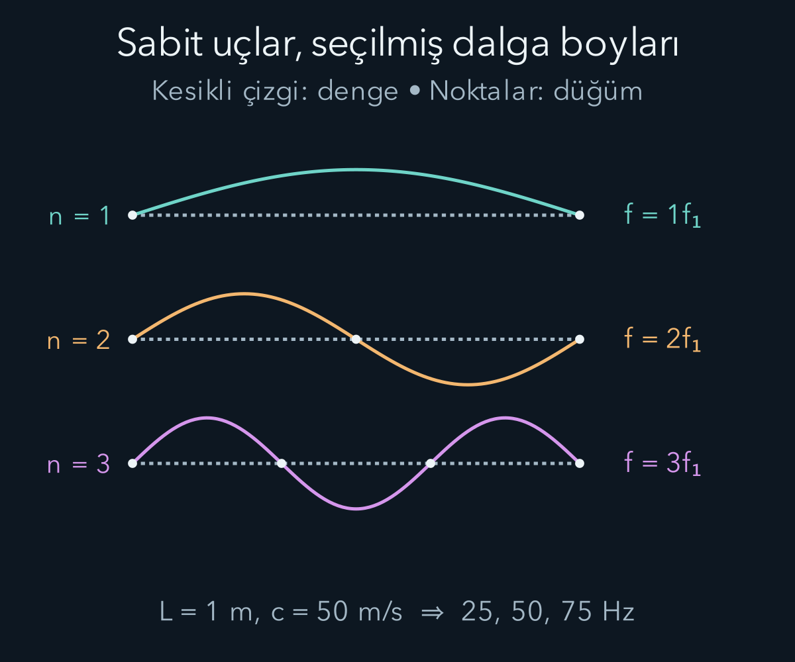

import ArticleVideo from '@/components/ArticleVideo.astro'
import kavram from './media/01-kavram.mp4?url'
import kavramPoster from './media/01-kavram.jpg?url'

Gergin bir ipin ucunu bir kez yukarı aşağı oynattığımızda, ip boyunca ilerleyen bir tümsek oluşabilir. Tümsek bir uçtan ötekine giderken ipin her küçük parçası bütün yolculuğu yapmaz. Parçalar denge konumları çevresinde hareket eder; komşularına uyguladıkları kuvvetler değişimi bir sonraki bölgeye aktarır. Dalga, yerel hareketin uzay boyunca örgütlenmesidir.

[Salınım yazısında](/blog/salinim-sonum-ve-rezonans/) bir veya iki bağlı kütlenin hareketini öğrendik. Şimdi konumu uzaya ve zamana bağlı bir fonksiyonla anlatacağız. Kısmi türevler, trigonometrik toplam özdeşlikleri ve Newton yasası ön bilgilerimizdir. İp modeli üzerinden kurduğumuz ilişkilerin hangi kısımlarının genel, hangilerinin bu ortama özel olduğunu ayıracağız.

## 1. İki değişkenli bir hareket fonksiyonu

İpin denge doğrultusunu $x$ ekseni, yukarı sapmayı $u$ ile gösterelim. $u(x,t)$, ipin $x$ ile etiketlenen parçasının $t$ anındaki düşey yer değiştirmesidir. Hem $x$ hem $u$ metreyle, zaman saniyeyle ölçülür. Aynı fonksiyonu iki farklı şekilde okuyabiliriz.

Zamanı sabit tutup $x$ boyunca bakarsak ipin o andaki fotoğrafını görürüz. Konumu sabit tutup zamanı değiştirirsek belirli bir ip parçasının hareketini izleriz. Bu iki grafik birbirine benzeyebilir ama yatay eksenlerinin birimleri farklıdır. Fotoğraftaki eğim $\partial u/\partial x$ boyutsuz, zamandaki değişim $\partial u/\partial t$ metre bölü saniyedir.

Sapmanın yayılmaya dik olduğu bu dalga **enine dalga**dır. Havadaki küçük ses dalgalarında ise parçacıkların hareketi yayılma doğrultusuyla aynı doğrultudadır; bunlara boyuna dalga deriz. Boyuna dalganın basınç grafiğini sinüs gibi çizmek, havanın geometrik olarak yukarı aşağı kıvrıldığı anlamına gelmez. Çizilen düşey niceliğin fiziksel anlamını her örnekte belirtmek gerekir.

Gerçek su yüzeyi dalgalarında parçacık hareketi daha karmaşık olabilir ve yalnız düşey salınıma indirgenmeyebilir. Bu nedenle ipteki basit çizimi bütün mekanik dalgaların eksiksiz resmi olarak kullanmayacağız. Burada küçük sapmalı, doğrusal bir örnek üzerinde temel dili kuruyoruz.

## 2. Şeklin sağa mı sola mı gittiğini okumak

Herhangi bir başlangıç şekline $f(x)$ diyelim. $u(x,t)=f(x-ct)$ yazımı, bu şeklin pozitif $x$ yönünde $c$ süratiyle ilerlemesini anlatır. Aynı özellik, örneğin tepe, $x-ct$ sabit kaldığında izlenir. Buradan $x=ct+\text{sabit}$ çıkar; zaman artarken konum büyür.

Buna karşılık $f(x+ct)$ negatif yöne ilerler. İşaretin ilk bakışta ters görünmesi mümkündür: Eksi işaret sağa hareketi üretir, çünkü aynı fonksiyon girdisini korumak için zamanla $x$ artmalıdır. Bu yöntem, dalga yönünü ezberlemek yerine sabit faz veya sabit şekil noktasını takip etmemizi sağlar.

İlerleyen şeklin sürati $c$ ile ipin bir parçasının düşey hızı aynı nicelik değildir. İlki bozulmanın yatay ilerlemesini, ikincisi maddenin yerel hareketini anlatır. İp üzerindeki renkli bir işaret, tümsek geçerken yukarı aşağı hareket eder ve sonra başlangıç yüksekliğine dönebilir. İşaretin yatayda tümsekle birlikte koşması gerekmez.

## 3. Sinüslü dalganın sayıları

Düzenli bir ilerleyen dalgayı:

$$
u(x,t)=A\cos(kx-\omega t+\phi)
$$

ile yazalım. $A$ genlik, $\phi$ başlangıç fazıdır. $k=2\pi/\lambda$ dalga sayısı, $\lambda$ dalga boyudur. $\omega=2\pi f$ açısal frekans, $f$ frekanstır. Dalga boyu aynı anda iki ardışık tepe arasındaki mesafe; dönem $T=1/f$ aynı yerde iki ardışık tepe geçişi arasındaki süredir.

Kosinüsün içi bir açı olduğundan $kx$ ve $\omega t$ boyutsuzdur. Dalga sayısı radyan bölü metreyle, açısal frekans radyan bölü saniyeyle ifade edilir. Sabit faz şartından $kx-\omega t=\text{sabit}$ ve dolayısıyla:

$$
c=\frac{\omega}{k}=\lambda f
$$

elde edilir. Bu bağıntı aynı dalganın uzaydaki ve zamandaki tekrarını bağlar. Ortamdaki yayılma yasasını tek başına belirlemez; frekans ile dalga boyunun hangi çiftlerinin mümkün olduğunu ayrıca ortam modeli söyler.

Dalga boyu yarım metre, frekans on hertz olsun. Yayılma sürati beş metre bölü saniye, dalga sayısı $4\pi\,\mathrm{rad/m}$, açısal frekans $20\pi\,\mathrm{rad/s}$ olur. Genliği bir santimetre seçersek ip parçasının en büyük düşey sürati $A\omega=0{,}20\pi\,\mathrm{m/s}$ çıkar. Yaklaşık sıfır virgül altmış üç olan bu değer, beş metre bölü saniyelik dalga süratinden farklıdır.

## 4. Dalga denklemini kuvvetten çıkarmak

İpin birim uzunluk başına kütlesi $\mu$, gerilme kuvvetinin büyüklüğü $\mathcal T$ olsun. Gerilme için kullandığımız süslü harf, dönem $T$ ile karışmasın. Küçük eğimleri, sabit gerilmeyi, düzgün yoğunluğu ve ihmal edilebilir sönümü varsayıyoruz. İpin yatay yer değiştirmesini birinci yaklaşımda ihmal ediyoruz.

Uzunluğu $dx$ olan küçük parçanın kütlesi $\mu\,dx$ olur. Sol uçtaki gerilme sola, sağ uçtaki gerilme sağa doğru ip teğeti boyunca etkir. Küçük eğimlerde düşey bileşen gerilme çarpı eğime yaklaşık eşittir. Net düşey kuvvet:

$$
F_y\approx\mathcal T\left[u_x(x+dx,t)-u_x(x,t)\right]
\approx\mathcal T u_{xx}\,dx
$$

olur. Alt indisler kısmi türevleri kısaltır. Newton yasasıyla bu kuvveti kütle çarpı düşey ivmeye eşitleriz:

$$
\mu\,dx\,u_{tt}=\mathcal T u_{xx}\,dx.
$$

Ortak $dx$ sadeleşince:

$$
u_{tt}=c^2u_{xx},\qquad c=\sqrt{\frac{\mathcal T}{\mu}}
$$

bulunur. Bu **dalga denklemi**, zamandaki ivmenin ipin yerel eğriliğiyle belirlendiğini söyler. Tepe aşağı doğru kıvrılıyorsa net kuvvet aşağı yönlüdür. Düz ve eğimi değişmeyen küçük bölgede iki ucun düşey gerilmeleri birbirini dengeler.

Gerilmeyi dört katına çıkarmak dalga süratini iki katına çıkarır. Birim uzunluk kütlesini dört katına çıkarmak sürati yarıya indirir. Örneğin $\mathcal T=25\,\mathrm N$, $\mu=0{,}010\,\mathrm{kg/m}$ için $c=50\,\mathrm{m/s}$ olur. Kuvvetin birimini kütle bölü uzunluğa böldüğümüzde metre kare bölü saniye kare çıkar; karekök doğru sürat birimini verir.

### Küçük genlik ile küçük eğim aynı değildir

Dalga denklemini çıkarırken gereken nicelik yalnız genliğin metre cinsinden küçük olması değildi; ipin eğiminin küçük olmasıydı. Sinüslü dalgada en büyük eğim $Ak$ olur. Aynı genlikte dalga boyunu çok küçültürsek dalga sayısı büyür ve ip çok keskin kıvrılır. Bu durumda küçük açı yaklaşımı geçerli olmayabilir. Dolayısıyla genliği dalga boyuyla birlikte değerlendirmek gerekir.

Yukarıdaki bir santimetre genlik ve yarım metre dalga boyunda en büyük eğim yaklaşık sıfır virgül on üçtür. Genliği aynı tutup dalga boyunu on kat küçültmek bu değeri on kat büyütür. Eğimin büyümesi hem gerilmenin sabit kalması hem yatay hareketin ihmal edilmesi gibi diğer kabulleri de etkileyebilir. Bir sayının küçük görünmesi, bütün boyutsuz oranların küçük olduğu anlamına gelmez.

Bu kontrol, fiziksel model seçiminin genel bir örneğidir. Kullanılan yaklaşım hangi oranın veya hangi açının küçük olmasına dayanıyorsa onu hesaplarız. Yalnız şeklin ekranda pürüzsüz görünmesi yeterli değildir. Görsel çizim ölçeği değiştirilebilir; boyutsuz eğim ise seçtiğimiz fiziksel dalganın özelliğidir.

## 5. Çözümler ve başlangıç bilgileri

$f(x-ct)$ biçimini dalga denklemine koyarsak zamana göre ikinci türevin $c^2f''$, konuma göre ikinci türevin $f''$ olduğunu görürüz. Böylece düzgün her sağa ilerleyen şekil bu denklemi sağlar. Sola ilerleyen $g(x+ct)$ de sağlar. Doğrusal denklem için ikisinin toplamı yine çözümdür:

$$
u(x,t)=f(x-ct)+g(x+ct).
$$

Sonsuz, düzgün ve sönümsüz ip modelinde başlangıç şekli ile başlangıçtaki düşey hız dağılımı, bu iki ilerleyen parçayı belirler. Yalnız ilk fotoğrafı bilmek hareketin tamamını belirlemez. Aynı şekil o anda sağa, sola veya iki yöne birden gelişen hareketin parçası olabilir.

Örneğin sonsuz ipte başlangıç şekli $F(x)$ olsun ve ip her noktada durgun bırakılmış olsun. İki eşit parçaya ayrılan çözüm:

$$
u(x,t)=\frac12F(x-ct)+\frac12F(x+ct)
$$

bu iki koşulu birlikte sağlar. $t=0$ anında iki yarım şekil toplanarak $F(x)$ olur. Zaman türevini aldığımızda ise:

$$
u_t(x,0)=-\frac c2F'(x)+\frac c2F'(x)=0.
$$

Sağa ve sola giden parçalar başlangıçta aynı yerde üst üste durur; sonrasında ayrılırlar. Buna karşılık yalnız $u=F(x-ct)$ seçseydik ilk fotoğraf yine aynı olurdu, fakat başlangıç düşey hızı $-cF'(x)$ olurdu. Demek ki ipi belirli bir şekle getirip durgun bırakmakla aynı şekli tek yöne ilerlerken fotoğraflamak farklı başlangıç durumlarıdır. Bu örnekte $F$'nin gerekli türevlerinin var olduğunu ve uçlardan henüz bir yansıma gelmediğini kabul ediyoruz.

Sonlu bir ipte uçların nasıl tutulduğu da gerekir. Sabit uçta sapma sıfırdır. Serbest uç için uygun kuvvet koşulu kullanılır. Bu sınır bilgileri gelen dalgaların yansımasını ve izinli salınımları etkiler. Önceki diferansiyel denklemlerde başlangıç ile sınır koşullarını ayırmamızın fiziksel karşılığı burada açıkça görülür.

Sabit bir uca ulaşan darbenin yansıması ters işaretli olabilir. Uçtaki toplam sapmanın her an sıfır kalması için gelen ve yansıyan katkılar uçta birbirini götürmelidir. Serbest uçta ise uygun sınır koşulu eğimin sıfır olmasıdır; ideal modelde yansımanın yer değiştirme işareti farklı davranır. Yansıma, dalganın keyfî biçimde karar değiştirmesi değil sınırda gereken kuvvet ve hareket koşullarının sonucudur.

İki farklı ip birleştiğinde darbenin bir bölümü geri yansıyıp bir bölümü öteki ipe geçebilir. Geçen dalganın sürati yeni ipin gerilme ve yoğunluğuyla belirlenir. Ortak bağlantıda frekans değişmezken dalga boyu değişebilir. Bu nedenle bir ortam sınırında bütün dalga özelliklerinin aynı kalmasını beklemeyiz; hangi niceliğin süreklilik koşuluyla belirlendiğini ayrı hesaplarız.

## 6. Süperpozisyon ve girişim

İki küçük dalga aynı ip bölgesinde karşılaştığında toplam sapma $u=u_1+u_2$ olur. Buna **süperpozisyon** deriz. Bu özellik doğrusal modelden gelir; büyük deformasyonlarda aynı basit toplam kuralı yeterli olmayabilir. Dalgalar geçici olarak birbirini büyütebilir veya küçültebilir; ideal doğrusal modelde karşılaşmadan sonra şekillerini koruyarak yoluna devam ederler.

Aynı yönde, aynı frekans ve dalga sayısıyla ilerleyen eşit genlikli iki dalganın faz farkı $\Delta\phi$ olsun. Kosinüs toplam özdeşliği toplam genlik büyüklüğünü $2A|\cos(\Delta\phi/2)|$ verir. Faz farkı sıfırsa genlik iki katına çıkar. Faz farkı pi ise iki dalga tam olarak birbirini söndürebilir.

Burada toplanan büyüklükler yer değiştirmelerdir. Enerji genliğin karesine bağlı olduğundan iki ayrı enerji ifadesini her noktada doğrudan toplamak girişim katkısını kaçırabilir. Bir bölgede küçük toplam genlik görmek, dalgaların bütün enerjisinin yok olduğunu söylemez. Başka bölgelerde dağılım, akış ve yerel hareket birlikte değerlendirilmelidir.

Ayrıca faz farkı zamanla rastgele değişiyorsa uzun süreli ölçümde girişim katkısı ortalamada kaybolabilir. Sabit faz ilişkisini koruyan dalgalara uyumlu, yani koherent denir. İleride ışık deneylerinde kararlı aydınlık ve karanlık çizgiler görebilmek için bu ilişkinin neden önemli olduğunu kullanacağız.

## 7. Zıt yönlerden gelen dalgalar

Eşit genlikli iki dalga ters yönde ilerlesin:

$$
u_1=A\cos(kx-\omega t),\qquad
u_2=A\cos(kx+\omega t).
$$

Toplam özdeşliği:

$$
u=2A\cos(kx)\cos(\omega t)
$$

verir. Uzay ve zaman çarpanlara ayrıldı. Dalga şekli bir bütün olarak sağa veya sola ilerlemiyor; her konum kendi genliğiyle salınıyor. Buna **duran dalga** deriz. $\cos(kx)=0$ olan düğüm noktaları her zaman hareketsizdir. Genliğin en büyük olduğu yerlere karın noktaları denir.

Komşu düğümler arası uzaklık yarım dalga boyudur. Bir düğümle yanındaki karın arası uzaklık çeyrek dalga boyudur. Duran dalga, maddenin her yerde durduğu anlamına gelmez. Yalnız belirli düğümler sabit kalır; aradaki parçalar salınır. İki ilerleyen dalganın ortalama enerji akışları eşit ve tersse net ortalama akış sıfır olabilir; yerel enerji yine zamanla biçim değiştirir.

## 8. Sabit uçlar frekansları seçer

Uzunluğu $L$ olan ipin iki ucu sabit olsun: $u(0,t)=u(L,t)=0$. İlk koşulu otomatik sağlayan uzaysal biçim $\sin(kx)$ olur. İkinci uç için $\sin(kL)=0$ gerekir. Sıfırdan farklı hareketler:

$$
k_n=\frac{n\pi}{L},\qquad
\lambda_n=\frac{2L}{n},\qquad
f_n=\frac{nc}{2L},\qquad n=1,2,3,\ldots
$$

değerlerini seçer. $n$ pozitif tam sayı mod numarasıdır. Birinci mod temel frekans, diğerleri bu ideal modelde onun tam sayı katlarıdır. Sınır koşulu sürekli seçenekler arasından belirli değerleri ayırdı. Bu matematiksel fikir kuantuma geçerken yeniden karşımıza çıkacak, fakat burada tamamen klasik bir ipin titreşimini anlatıyoruz.

Uzunluğu bir metre ve dalga sürati elli metre bölü saniye olan ipte temel frekans yirmi beş hertzdir. İkinci ve üçüncü modlar elli ve yetmiş beş hertz olur. İpin herhangi bir başlangıç şekli tek moda uymak zorunda değildir; birçok modun toplamı gerekebilir. İpi nereden çekip bıraktığımız hangi modların ne kadar uyarıldığını etkiler.

Gerçek müzik tellerinin sertliği, kalınlığı ve kayıpları ideal tam sayı katlarını değiştirebilir. Ayrıca sesin duyulması için telin çevreye enerji aktarması gerekir. Matematiksel olarak kusursuz, hiç enerji kaybetmeyen tek başına bir tel modeli gerçek bir enstrümanın bütün akustiğini içermez.

<ArticleVideo src={kavram} poster={kavramPoster} title="İlerleyen dalga ve salınan nokta" caption="Dalganın biçimi sağa ilerlerken sarı noktanın yatay konumu sabit kalır. Ortam noktasının salınımı ile dalga biçiminin ilerlemesi farklı hareketlerdir." />

## 9. Dalganın taşıdığı enerji ve güç

Küçük bir ip parçasının kinetik enerjisi $\tfrac12\mu\,dx\,u_t^2$ olur. Küçük eğim nedeniyle ipin uzamasına karşı yapılan iş de birim uzunluk başına $\tfrac12\mathcal T u_x^2$ elastik enerji verir. Bu ikinci terimin geometrisini açalım. Küçük parçanın eğilmiş uzunluğu $ds=\sqrt{dx^2+du^2}=dx\sqrt{1+u_x^2}$ olur. Küçük eğimde $\sqrt{1+u_x^2}\approx1+u_x^2/2$; dolayısıyla fazla uzunluk $ds-dx\approx u_x^2dx/2$ çıkar. Sabit gerilmeye karşı bu uzunluğu oluşturmanın işi $\mathcal T(ds-dx)$ olduğundan elastik katkı $\mathcal T u_x^2dx/2$ olur. Yaklaşımın küçük olan büyüklüğü yine boyutsuz eğimdir.

Toplam enerji yoğunluğu, burada birim uzunluk başına enerji anlamında:

$$
\mathcal E=\frac12\mu u_t^2+\frac12\mathcal T u_x^2
$$

biçimindedir ve birimi joule bölü metredir. İkinci terim, yay enerjisi gibi deformasyonla ilişkilidir. Küçük eğim yaklaşımı olmadan bu sade karesel biçimin değiştirilmesi gerekir.

Pozitif $x$ yönüne aktarılan anlık güç $P=-\mathcal T u_xu_t$ olarak yazılır. Sağa ilerleyen sinüslü dalgada bu çarpım negatif işaretle birlikte pozitif enerji akışı verir. Bir çevrimde sinüs karesinin ortalaması yarım olduğundan:

$$
\overline P=\frac12\mu c\omega^2A^2
$$

elde edilir. Aynı ipte ve frekansta genliği iki katına çıkarmak ortalama gücü dört katına çıkarır. Frekansın karesi de görünür; aynı genlikte daha hızlı salınan parçalar daha büyük hızlarla hareket eder.

Örneğin $\mu=0{,}010\,\mathrm{kg/m}$, $c=50\,\mathrm{m/s}$, $A=0{,}001\,\mathrm m$ ve $f=10\,\mathrm{Hz}$ için $\omega=20\pi\,\mathrm{s^{-1}}$ olur. Ortalama güç yaklaşık $9{,}87\times10^{-4}\,\mathrm W$ çıkar. Genlik bir milimetre olsa da bütün birim dönüşümlerini açık tutmak gerekir; milimetreyi metre sanmak enerji hesabında milyon kat hata üretir.

## 10. Her dalgada aynı hız mı vardır?

İdeal ip denkleminde $\omega=ck$ doğrusal bağıntısı vardır. Farklı dalga sayıları aynı $c$ süratiyle ilerler; bu nedenle uygun şekil bozulmadan taşınabilir. Gerçek bazı ortamlarda $\omega$ ile $k$ arasındaki ilişki doğrusal değildir. Buna **dispersiyon**, yani yayılmanın frekansa bağlı olması denir.

Tek bir sinüslü bileşenin faz hızı $v_{\mathrm{faz}}=\omega/k$ olur. Yakın dalga sayılarından oluşan dar bir paketin zarfı ise uygun koşullarda $v_{\mathrm{grup}}=d\omega/dk$ hızıyla ilerler. Bu iki hız doğrusal bağıntıda eşittir, genel olarak eşit olmak zorunda değildir. Zarfın biçimini koruyabildiği dar bant yaklaşımını ayrıca belirtmek gerekir.

Bir sonraki yazıda karmaşık bir şekli sinüs ve kosinüs bileşenlerine ayırarak bu ifadeyi kuracağız. Böylece tek bir sinüsle sınırlı kalmadan bir darbenin, bir ses dalgasının veya yerelleşmiş bir paketin uzay ve frekans yapısını birlikte okuyabileceğiz.

## Kaynaklar

- [OpenStax — İlerleyen dalgalar](https://openstax.org/books/university-physics-volume-1/pages/16-1-traveling-waves).
- [OpenStax — Gergin ipte dalga hızı](https://openstax.org/books/university-physics-volume-1/pages/16-3-wave-speed-on-a-stretched-string).
- [OpenStax — Dalganın enerjisi ve gücü](https://openstax.org/books/university-physics-volume-1/pages/16-4-energy-and-power-of-a-wave).
- [OpenStax — Duran dalgalar ve rezonans](https://openstax.org/books/university-physics-volume-1/pages/16-6-standing-waves-and-resonance).
