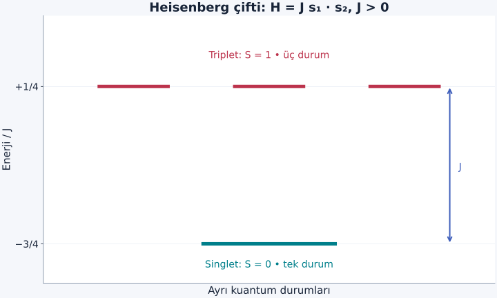
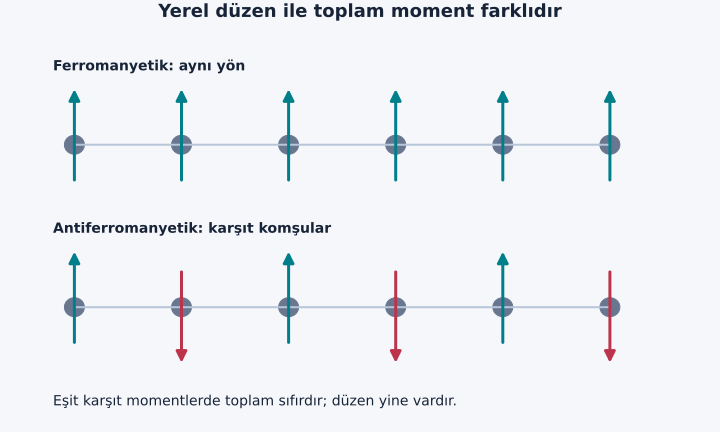

Bir önceki yazıda bağımsız manyetik momentlerin dış alanla bir miktar hizalanmasını hesapladık. Fakat kalıcı bir mıknatıs, dış alan yokken de düzen taşıyabilir. Bu olguyu açıklamak için “alan atomları döndürüyor” demek yetmez; atomların birbirleriyle hangi enerji üzerinden haberleştiğini sormalıyız. Bu yazının merkezindeki değiş tokuş etkileşimi, elektronların özdeş olmasının ve elektriksel etkileşimin birlikte doğurduğu bir kuantum etkisidir.

[Diyamanyetizma ve paramanyetizma](/blog/diyamanyetizma-ve-paramanyetizma/), [özdeş parçacıklar](/blog/ozdes-parcaciklar-bozonlar-ve-fermiyonlar/), [helyumun iki elektronu](/blog/helyum-ve-elektron-etkilesimi/) ve [açısal momentumların toplanması](/blog/acisal-momentumlarin-toplanmasi/) bağlantılarını kullanacağız. Önce yalnız iki spin için kesin bir hesap yapacağız. Sonra çok sayıda spinli bir katıya geçerken hangi sonuçların ek varsayım gerektirdiğini belirteceğiz.

## 1. Küçük mıknatıs benzetmesi nerede yetersiz kalır?

İki manyetik dipol klasik elektromanyetik alanları üzerinden etkileşir. $\mu_0$ boşluğun manyetik geçirgenliği, $\mu_B$ Bohr magnetonu ve $k_B$ Boltzmann sabiti olsun. Aralarındaki uzaklık $r$, momentlerin büyüklükleri yaklaşık $\mu_B$ ise dipol enerjisinin ölçeği:

$$
E_{\mathrm{dip}}\sim\frac{\mu_0\mu_B^2}{4\pi r^3}
$$

olur. Açısal çarpanları burada yalnız ölçek görmek için bir mertebesinde aldık. $r=0{,}30\,\mathrm{nm}$ konulunca $E_{\mathrm{dip}}\sim3{,}2\times10^{-25}\,\mathrm J$, yani $E_{\mathrm{dip}}/k_B\sim0{,}023\,\mathrm K$ çıkar. Bu mekanizma vardır ve önem kazanabildiği sistemler bulunur; fakat yüzlerce kelvin ölçeğinde manyetik düzeni yalnız bu tahminle açıklayamayız.

Elektron dalgalarının örtüşmesi, daha büyük bir enerji ayrımı sağlayabilir. Buradaki “değiş tokuş”, iki ayırt edilebilir bilyenin fiziksel olarak yer değiştirip yeniden yerine dönmesi değildir. Aynı iki elektronun etiketlerini değiştirirken çok parçacıklı dalga fonksiyonunun nasıl davranması gerektiğiyle ilgilidir. Etiketler gözlenebilir kimlik kartları değildir.

## 2. Spin simetrisi uzaysal durumu sınırlar

İki elektronun toplam durumu, elektron etiketleri değiştirildiğinde eksi işaret almalıdır. Spin ve uzaysal kısımların ayrı yazılabildiği durumda birinin simetrik, diğerinin antisimetrik olması gerekir. İki spin $1/2$ için **singlet**:

$$
|s\rangle=\frac{|\uparrow\downarrow\rangle-|\downarrow\uparrow\rangle}{\sqrt2}
$$

antisimetriktir. Buradaki oklar seçilen eksendeki spin ölçüm sonuçlarını gösterir. Singletin toplam spin kuantum sayısı $S=0$'dır. **Triplet** ise toplam $S=1$ olan üç simetrik durumdan oluşur: iki paralel durum ve $(|\uparrow\downarrow\rangle+|\downarrow\uparrow\rangle)/\sqrt2$.

Dolayısıyla singlet simetrik uzaysal kısmı, triplet antisimetrik uzaysal kısmı gerektirir. Aynı iki orbitalden kurulan bu uzaysal birleşimler, elektronların birbirine yakın bulunma olasılığını farklılaştırır. Coulomb enerjisi uzaklığa bağlı olduğundan farklı olasılık dağılımları farklı enerji verebilir. “Elektriksel kuvvet spin yönünü görüyor” demiyoruz; izin verilen uzaysal durumlar spin simetrisiyle kısıtlanıyor.

## 3. İki orbitalle değiş tokuş integrali

Ortonormal $a(\mathbf r)$ ve $b(\mathbf r)$ orbitallerini seçelim. Etiketli koordinatlar $\mathbf r_1,\mathbf r_2$ olmak üzere:

$$
\psi_\pm=\frac{a(\mathbf r_1)b(\mathbf r_2)\pm b(\mathbf r_1)a(\mathbf r_2)}{\sqrt2}
$$

normalize simetrik ve antisimetrik birleşimlerdir. $e>0$ temel yük büyüklüğü, $\varepsilon_0$ boşluğun elektriksel geçirgenliği olmak üzere iki elektronun itme potansiyeli $V_{12}=e^2/(4\pi\varepsilon_0|\mathbf r_1-\mathbf r_2|)$ olsun. Beklenti değerini açtığımızda doğrudan terim $D$ ile çapraz terim $K$ ortaya çıkar:

$$
\begin{aligned}
D&=\langle ab|V_{12}|ab\rangle,\\
K&=\langle ab|V_{12}|ba\rangle,\\
E_\pm&=E_0+D\pm K.
\end{aligned}
$$

$E_0$ ortak tek parçacık enerji katkısıdır. Bu sabit orbital yaklaşımında singletin enerjisi $E_0+D+K$, tripletinki $E_0+D-K$ olur. $K>0$ ise triplet daha düşüktür. Çapraz terim, etiketleri ayrı parçacık kimlikleri gibi kabul eden bir olasılık toplamında bulunmazdı; kuantum genliklerinin toplamından gelir.

Ancak orbitallerin biçimini değiştirme, çift doluluk veya başka ara durumlar hesaba katıldığında toplam singlet–triplet farkı değişebilir. Dolayısıyla bu küçük hesabı “her yerde paralel spin daha ucuzdur” kuralına dönüştürmeyiz. [Spin Hamiltonyenleri üzerine açık araştırma derlemesi](https://mdpi-res.com/d_attachment/molecules/molecules-26-00803/article_deploy/molecules-26-00803.pdf) farklı değiş tokuş yollarının aynı etkin spin diline nasıl katkı verdiğini tartışır.

## 4. Heisenberg Hamiltonyeninin işaretini seçmek

Düşük enerjide yük hareketini ayrı çözmek yerine yalnız spinleri tutan etkin bir model kullanabiliriz. Boyutsuz spin operatörlerini $\mathbf s_i=\mathbf S_i/\hbar$ diye tanımlayalım. Burada $\mathbf S_i$ açısal momentum operatörü, $\hbar$ indirgenmiş Planck sabitidir. İki spin için seçimimiz:

$$
H=J\,\mathbf s_1\cdot\mathbf s_2
$$

olsun. $J$ enerji birimi taşır. **Bu yazıdaki işaretle** $J>0$ antiferromanyetik, $J<0$ ferromanyetik eğilim demektir. Başka kaynaklar Hamiltonyenin önüne eksi koyabilir. Sadece “$J$ pozitif” cümlesini karşılaştırmak bu yüzden yeterli değildir; formülün tamamına bakılır.

Klasik oklar için skaler çarpım paralelde pozitif, ters yönlerde negatiftir. Bu, işareti sezdirir ama kuantum özenerjilerini bulmak için yeterli değildir. Singletin sabit iki zıt okun fotoğrafı olmadığını hatırlamalıyız. Singlet her eksende ölçülen sonuçlar arasında korelasyon taşır; tek tek spinlerin belirli bir üç boyutlu oku yoktur.

## 5. Singlet ve triplet enerjilerini adım adım bulmak

Toplam boyutsuz spin $\mathbf s=\mathbf s_1+\mathbf s_2$ için kareyi açalım:

$$
\mathbf s^2=\mathbf s_1^2+\mathbf s_2^2+2\mathbf s_1\cdot\mathbf s_2.
$$

Her spin $1/2$ olduğundan $\mathbf s_i^2$ özdeğeri $(1/2)(1/2+1)=3/4$'tür. Toplam spin $S$ için $\mathbf s^2$ özdeğeri $S(S+1)$ olur. Böylece:

$$
\begin{aligned}
E(S)&=\frac J2\left[S(S+1)-\frac32\right],\\
E_s&=-\frac{3J}{4},\qquad E_t=\frac J4.
\end{aligned}
$$

Aralık $E_t-E_s=J$'dir. Singlet tek durum, triplet üç durum içerir. $J>0$ için singlet, $J<0$ için triplet taban durumudur. Sabit enerji eklemek bu aralığı değiştirmez. Yukarıdaki sabit orbital hesabıyla eşleştirirsek $J=-2K$ elde ederiz; bu, doğrudan değiş tokuş örneğinin neden ferromanyetik işaret verdiğini açıklar.

Şekil: Üç üst çizginin aynı yükseklikte olması sıfır alandaki dejenerasyonu gösterir. Çizgilerin yatay konumu fiziksel konum değildir; ayrı kuantum durumlarını okunur biçimde ayırır.

## 6. Örnek: Isınan bir spin çiftinde singlet olasılığı

$J=4{,}0\,\mathrm{meV}>0$ ve $T=20\,\mathrm K$ alalım. $1\,\mathrm{meV}=10^{-3}\,\mathrm{eV}$; $k_B=0{,}0861733\,\mathrm{meV/K}$ olduğundan $k_BT=1{,}7235\,\mathrm{meV}$ bulunur. Enerji sıfırını singlete kaydırırsak singlet $0$, üç triplet durumu $J$ enerjisindedir. Bölüşüm fonksiyonu:

$$
Z=1+3e^{-J/(k_BT)}
$$

olur. Üç çarpanı unutursak üç ayrı durumu tek durum sanmış oluruz. Sayıları yerleştirelim:

$$
\begin{aligned}
\frac J{k_BT}&=2{,}321,\\
e^{-J/(k_BT)}&\simeq0{,}0982,\\
p_s&=\frac1{1+3(0{,}0982)}\\
&\simeq0{,}7725.
\end{aligned}
$$

Triplet ailesinin toplam olasılığı yaklaşık $0{,}2275$'tir. Sıfır sıcaklık sınırında $p_s\to1$, çok yüksek sıcaklıkta dört durum eşit olasılıklı olduğu için $p_s\to1/4$ olur. Yüksek sıcaklıkta “singlet ve triplet yarı yarıya” demek yanlıştır; enerjiyi değil, aynı enerjideki durum sayısını da sayıyoruz.

Bu sonlu iki spin sistemi, sıcaklığa göre yumuşak değişir; tek başına termodinamik faz geçişi oluşturmaz. Hesabın kesin olması, onu doğrudan bir kristalin geçiş sıcaklığı formülü yapmaz. Çok sayıda bağın ortak davranışı ayrıca çözülmelidir.

## 7. Zıt spinleri kayıran sanal hareket

İki komşu yerleşim noktası ve toplam iki elektron düşünelim. Her noktada bir orbital bulunsun. Elektronun komşuya geçiş genliği $t$, aynı orbitalde iki elektron bulunmasının enerji bedeli $U>0$ olsun. $t$ enerji birimlidir; zaman değildir. $U\gg t$ olduğunda gerçek çift doluluk pahalıdır, fakat kuantum durumunda kısa ömürlü ara bileşenler halinde katkı verebilir.

Aynı orbitalde iki elektron bulunacaksa spin kısmı singlet olmalıdır. Bu yüzden singlet, çift doluluk içeren ara durumlarla karışarak enerjisini düşürebilir; triplet aynı kanalı kullanamaz. İkinci mertebe enerji kaymasının genel yapısı “bağlaşımın karesi bölü enerji bedeli”dir. İki yönlü geçişleri ve iki çift doluluk durumunu birlikte sayınca:

$$
J_{\mathrm{AF}}\simeq\frac{4t^2}{U}>0
$$

elde edilir. Bu iki noktalı, yarı dolu Hubbard modelinin güçlü etkileşim sınırıdır. İyonlar arasında bir bağlayıcı atom üzerinden oluşan benzer dolaylı süreçler **süper değiş tokuş** adıyla incelenir. Gerçek çok orbitalli malzemelerde bağ açısı, orbital doluluğu ve başka etkileşimler işareti değiştirebilir; tek formül bütün manyetik kimyanın yerine geçmez.

Buradaki “sanal” sözcüğü, enerji korunumu kısa süreliğine ihlal ediliyor demek değildir. Tam özdurum, tek doluluk ağırlığı büyük olan bir durumla küçük çift doluluk bileşenlerinin durağan birleşimidir. $4t^2/U$ katsayısını görmek için tek doluluklu singlet ile ona bağlanan normalize çift doluluk birleşimini baz seçebiliriz. Uygun baz fazıyla ilgili matris:

$$
H_s=\begin{pmatrix}0&-2t\\-2t&U\end{pmatrix}
$$

olur. İki geçiş yönünün genlikleri bu seçilmiş birleşimde toplanır. Alt özdeğer ve büyük U açılımı:

$$
\begin{aligned}
E_s&=\frac{U-\sqrt{U^2+16t^2}}2,\\
\sqrt{U^2+16t^2}&\simeq U+\frac{8t^2}{U},\\
E_s&\simeq-\frac{4t^2}{U}
\end{aligned}
$$

verir. Tripletin bu referansta enerjisi sıfır kaldığından fark pozitiftir. Böylece $J>0$ sonucu hem seçtiğimiz Heisenberg işaretiyle hem singletin alçalmasıyla tutarlıdır. Küçük oran $t/U$, ihmal edilen sonraki terimlerin kontrol parametresidir.

[Georgetown'ın iki noktalı Hubbard modeli notlarında](https://site.physics.georgetown.edu/~jkf/grad_quant2/html/lecture39.html) bu enerji ayrılması tam özdeğer problemi içinde de izlenebilir.

## 8. Örnek: Geçiş genliğinden enerji ölçeğine

$t=0{,}10\,\mathrm{eV}$, $U=4{,}0\,\mathrm{eV}$ seçelim. Önce yaklaşım oranını kontrol ederiz: $t/U=0{,}025\ll1$. Ardından:

$$
J=\frac{4(0{,}10)^2}{4{,}0}\,\mathrm{eV}
=0{,}010\,\mathrm{eV}=10\,\mathrm{meV}.
$$

Sıcaklık ölçeği $J/k_B=10/0{,}0861733\simeq116\,\mathrm K$ olur. Bu sayı etkileşimin ısıyla yarışacağı kabaca ölçeği verir. **Geçiş sıcaklığı kesin olarak 116 K'dir** diyemeyiz: Boyut, komşu sayısı, simetri, dalgalanmalar ve diğer bağlar belirleyicidir.

$t$ yarıya indirilip $U$ sabit tutulursa $J$ dörtte bire, $2{,}5\,\mathrm{meV}$'ye iner. Buna karşılık $U$ iki katına çıkarsa $J$ yarıya iner. Elektriksel itmenin büyük olması, bu örnekte manyetik bağlaşımı büyütmez; sanal çift doluluğu zorlaştırdığı için onu küçültür. Formülün payı ve paydası böyle fiziksel bir anlam kazanır.

## 9. Çok sayıda spin: Düzenin türü ile net moment farklıdır

Bir örgü için $H=\sum_{\langle ij\rangle}J_{ij}\mathbf s_i\cdot\mathbf s_j$ yazarız. Köşeli komşuluk etiketi her bağı bir kez sayar. Ferromanyetik düzende yerel momentler ortak yönü kayırır. İki alt örgülü basit antiferromanyetik düzende komşular ters yönlüdür. Eşit momentler birbirini götürüyorsa toplam $M=0$ olabilir; bu, düzensizlik anlamına gelmez.

İki alt örgünün ortalamaları $\mathbf M_A$ ve $\mathbf M_B$ ise net düzen $\mathbf M_A+\mathbf M_B$, zıt yönlü düzen ise farklarıyla izlenebilir. Eşit olmayan karşıt momentlerde net değer kalabilir; bu tür düzen **ferrimanyetizma**dır. Üçgen gibi bir geometride her komşu çiftini aynı anda tam ters yapmak mümkün olmayabilir. Bu geometrik uyuşmazlığa **frustrasyon** denir; basit iki renkli çizim böyle bir örgüyü temsil etmez.

Şekil: Oklar ortalama yerel düzeni temsil eder. Özellikle kuantum spin $1/2$ antiferromıknatısının gerçek durumu, bu klasik çizimden daha fazla dolanıklık ve dalgalanma içerebilir.

### Ortak taban durum ile tek tek ölçüm

Singlet çiftinde her spin için tek başına yukarı ve aşağı olasılıkları eşittir. Buna rağmen çiftin enerjisi, iki bağımsız ve rastgele spininkinden farklıdır. Farkı belirleyen $\langle\mathbf s_1\cdot\mathbf s_2\rangle$ korelasyonudur; yalnız $\langle\mathbf s_1\rangle$ ve $\langle\mathbf s_2\rangle$ ortalamalarını çarpıp aynı bilgiyi elde edemeyiz. Bu, manyetik düzen tartışırken bir noktadaki ortalama kadar farklı noktalar arasındaki ortak olasılıkların da neden gerekli olduğunu gösterir. Kuantum antiferromıknatısın klasik karşıt ok çizimini okurken bu sınıra dikkat edeceğiz.

## 10. Alanın kalkması, bölmeler ve sıcaklık

Bir ferromıknatısın farklı bölgeleri farklı yönlerde düzenlenebilir. Bu **manyetik domenler** toplam dış alan enerjisini azaltabilir; dolayısıyla ferromanyetik bir örnek ölçümde küçük net moment gösterebilir. Yerel düzenin varlığı ile tüm örneğin tek yönde mıknatıslanması ayrı sorulardır. Alan uygulamak yalnız atomik yönleri değiştirmez; domen sınırlarını da hareket ettirebilir. Kalıcılık ve histerezis, bu hareketin enerji engelleriyle de ilgilidir.

Isı artınca düzensiz durumların çokluğu düzenli durumun düşük enerjisiyle yarışır. Ancak aynı etkileşim ölçeği her boyutta aynı sonucu vermez. Örneğin ideal düşük boyutlu modellerde dalgalanmalar uzun menzilli düzeni engelleyebilir. Dış alan, anizotropi veya katmanlar arası zayıf bağlar bu sonuca etki eder. [Tong'un spinlerden alanlara geçiş notları](https://www.damtp.cam.ac.uk/user/tong/sft/sfthtml/S1.html), düzen parametresi ile termal dalgalanmaların birlikte ele alınışını kurar.

Bu aşamada kesin olarak bildiğimiz şey, iki spin için enerji farkının nasıl hesaplandığıdır. Çok sayıda spin için “düşük enerji” ile “en çok olasılık” arasındaki yarışın düzeni hangi sıcaklıkta değiştirdiğini görmek üzere, etkileşimi daha sade tutan bir istatistik modeli kurabiliriz.
