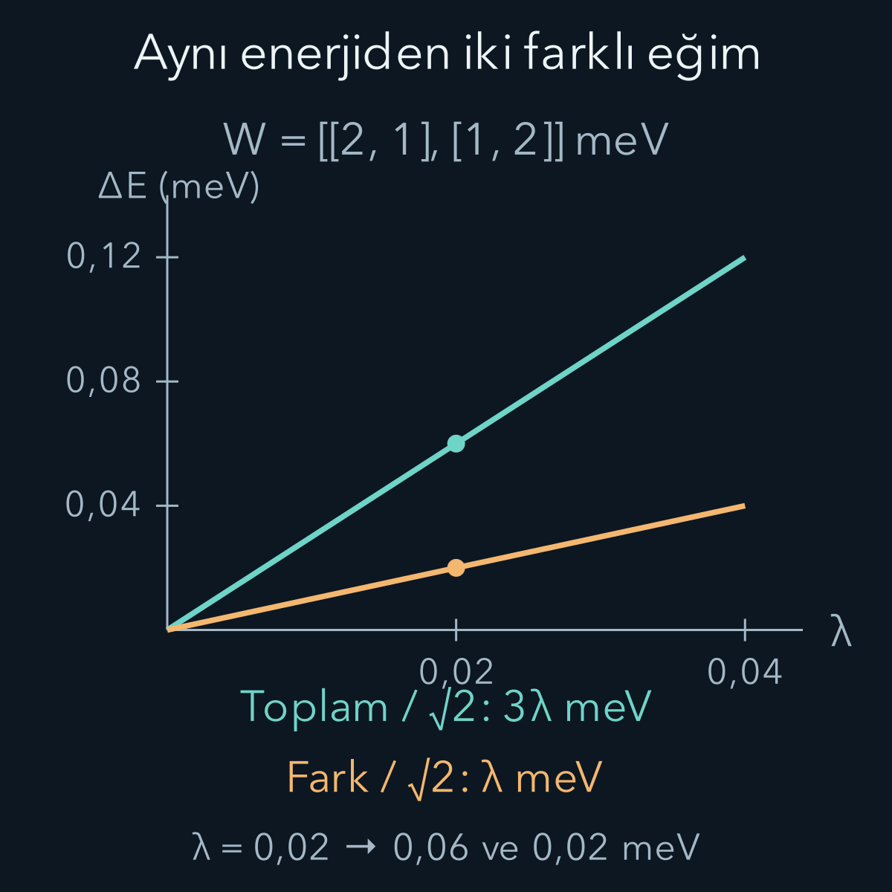
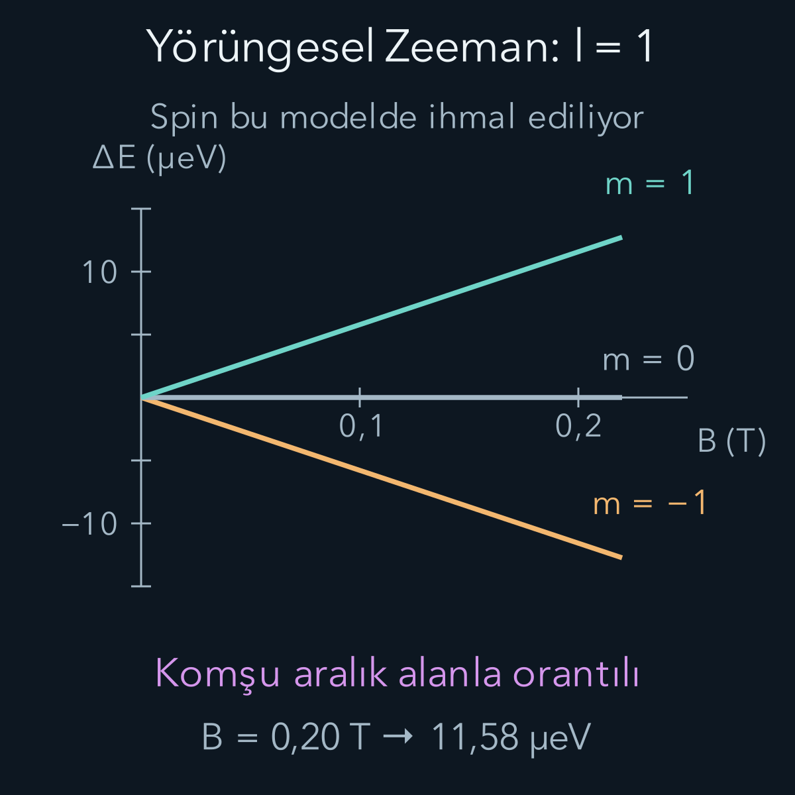

import ArticleVideo from '@/components/ArticleVideo.astro'
import kavram from './media/01-kavram.mp4?url'
import kavramPoster from './media/01-kavram.jpg?url'

Bir enerji ölçümünde aynı sayıyı vermek, iki kuantum durumunun aynı olması demek değildir. [Hidrojen atomunda](/blog/merkezi-potansiyel-ve-hidrojen-atomi/) birçok farklı durumun aynı enerjiye sahip olabildiğini gördük. Sisteme küçük bir dış etki ekleyince bu durumlar farklı enerjilere ayrılabilir. Dış etki çok küçük olsa bile seçtiği özvektörler, başlangıçta yazdığımız baz vektörlerinden belirgin biçimde farklı olabilir.

[Önceki pertürbasyon yazısında](/blog/zamandan-bagimsiz-perturbasyon-teorisi/) durum düzeltmesinin paydasında enerji farkı vardı. Bu fark sıfır olduğunda artık aynı formülü kullanamayız. Bu yazı, eş enerjili altuzayda önce hangi hesabın yapılması gerektiğini kuruyor. Sonra [açısal momentum](/blog/kuantumda-acisal-momentum/) ve [toplam açısal momentum](/blog/acisal-momentumlarin-toplanmasi/) bilgilerimizi kullanarak manyetik alanın enerji seviyelerini ayırmasını açıklıyor. Matrisleri köşegenleştirmek için [özdeğer hesabı](/blog/ozdegerler-ozvektorler-ve-kosegenlestirme/) yeterli önbilgidir.

## 1. Enerji aynıysa başlangıç yönü serbesttir

$H_0$ bilinen Hamiltonyenimiz olsun. İki ortonormal durum için:

$$
\begin{aligned}
H_0|a\rangle&=E_0|a\rangle,\\
H_0|b\rangle&=E_0|b\rangle
\end{aligned}
$$

sağlansın. Doğrusallık nedeniyle $c_a|a\rangle+c_b|b\rangle$ birleşimi de aynı $E_0$ enerjisine aittir. $|c_a|^2+|c_b|^2=1$ ise normalize olur. Bu iki boyutlu eş enerjili uzaya **dejenere altuzay** diyoruz. $E_0$ burada ortak enerji, a ve b baz etiketleri, c katsayıları ise karmaşık genliklerdir.

Başlangıç Hamiltonyeni bu altuzayda $E_0I$ gibi davranır; her yönde aynı özdeğeri verir. Bu nedenle “a durumunun küçük değişimi” sorusu, a'nın yeni probleme uygun başlangıç yönü olduğunu varsayar. Oysa dış etki a ile b'nin başka bir birleşimini seçebilir. Önce bu serbestliği çözmemiz gerekir.

Eş enerjililik, bir ölçümün iki sonucu ayırt edememesiyle de karıştırılmamalıdır. Burada matematiksel olarak aynı Hamiltonyenin aynı özdeğerine ait bağımsız durumlar vardır. Enerjileri çok yakın ama eşit olmayan iki seviye ise yaklaşık dejenerasyon oluşturabilir; karşılaştırılan aralığın ek bağlaşım kadar küçük olup olmadığına bakarız.

Eş enerjili uzayda baz seçmek ile deneyde bir durum hazırlamak farklı işlerdir. Matematiksel olarak toplam ve fark bazına geçmemiz, başlangıçta hazırlanmış bir durumu kendiliğinden başka bir duruma dönüştürmez. Aynı durumun koordinatlarını başka bir bazda yazmış oluruz. Yeni Hamiltonyenin durağan durumlarını bulduğumuzda hangi birleşimlerin tek bir enerji vereceğini öğreniriz. Eski bazdaki bir durum hazırlanmışsa, yeni enerji ölçümünün olasılıkları ayrıca bu birleşimlere izdüşürülerek hesaplanır. Bu ayrım, küçük alanın durumu aniden belirli bir birleşime zorladığı gibi yanlış bir yorumdan korur.

## 2. Küçük etkiyi altuzaya izdüşürmek

Yine $H=H_0+\lambda W$ yazalım. W enerji birimindeki Hermitsel ek işleç, λ boyutsuz parametredir. Aradığımız özdurumun sıfırıncı derece kısmını $|\psi_0\rangle=c_a|a\rangle+c_b|b\rangle$; enerjisini $E=E_0+\lambda w+\cdots$ olarak yazalım. w ilk enerji düzeltmesinin katsayısıdır.

Birinci derece denklem önceki yazıyla aynı biçimdedir:

$$
\begin{aligned}
&(H_0-E_0I)|\psi_1\rangle\\
&\qquad=(wI-W)|\psi_0\rangle.
\end{aligned}
$$

Şimdi $P=|a\rangle\langle a|+|b\rangle\langle b|$ izdüşümünü tanımlayalım. P bu dejenere altuzayı seçer. $P(H_0-E_0I)=0$ olduğundan denklem:

$$
PWP|\psi_0\rangle=w|\psi_0\rangle
$$

haline gelir. Demek ki ilk yapılacak iş, W'nin tüm uzaydaki özdeğer problemi değil, seçilen dejenere altuzaydaki kısıtlanmış matrisini köşegenleştirmektir.

Matris elemanlarını $W_{ij}=\langle i|W|j\rangle$ ile tanımlarsak:

$$
\begin{pmatrix}W_{aa}&W_{ab}\\W_{ba}&W_{bb}\end{pmatrix}
\begin{pmatrix}c_a\\c_b\end{pmatrix}
=w\begin{pmatrix}c_a\\c_b\end{pmatrix}.
$$

Bulduğumuz özdeğerler enerji kaymalarını, özvektörler doğru başlangıç birleşimlerini verir. Bu işlem altuzay içinde sonlu bir baz değişimidir; λ ile küçük olmak zorunda değildir. Enerji ayrımı yine λ ile küçülür.

## 3. İki durumlu bir sayısal örnek

Altuzay içindeki ek matrisin:

$$
W_{\mathrm{alt}}=\begin{pmatrix}2&1\\1&2\end{pmatrix}\mathrm{meV}
$$

olduğunu düşünelim. meV, elektronvoltun binde biridir. Köşegenlere bakıp her iki enerjinin $2\lambda\,\mathrm{meV}$ kaydığını söylemek yanlış olur; çapraz bağlaşım eş enerjili durumları karıştırır.

Özdeğer için, sayısal w'yi meV biriminde yazarsak $(2-w)^2-1=0$ olur. Buradan $w_+=3$ ve $w_-=1$ çıkar. Normalize özvektörler sırasıyla:

$$
\begin{aligned}
|+\rangle&=\frac{|a\rangle+|b\rangle}{\sqrt2},\\
|-\rangle&=\frac{|a\rangle-|b\rangle}{\sqrt2}
\end{aligned}
$$

olur. Enerjiler ilk derecede $E_0+3\lambda\,\mathrm{meV}$ ve $E_0+\lambda\,\mathrm{meV}$'dir. Örneğin λ=0,02 için kaymalar 0,06 ve 0,02 meV; aralık 0,04 meV çıkar. λ ne kadar küçülürse küçülsün seçilen birleşimler eş ağırlıklı kalır.

Bu model bütün sistem yalnız bu iki durumdan oluşuyorsa tam olarak çözülmüştür. Başka durumlar varsa onların bağlaşımından daha yüksek derece katkılar gelebilir. Genel Hermitsel iki durum matrisi $\bigl(\begin{smallmatrix}a&b\\b^*&d\end{smallmatrix}\bigr)$ için ilk katsayılar $(a+d)/2\pm\sqrt{((a-d)/2)^2+|b|^2}$'dir. a ve d gerçek, b karmaşık olabilir; enerji ayrımı b'nin mutlak değerine bağlıdır, özvektörün göreli fazı ise b'nin fazını da taşır.

Örneğin sistem başlangıçta $|a\rangle$ durumunda hazırlanmış olsun. Yukarıdaki iki özdurumu kullanarak $|a\rangle=(|+\rangle+|-\rangle)/\sqrt2$ yazabiliriz. Yeni Hamiltonyeni ölçtüğümüzde iki özenerjiden her birinin olasılığı yarımdır. Ortalama kayma yine $2\lambda\,\mathrm{meV}$ çıkar; çünkü 3 ile 1'in eş ağırlıklı ortalaması 2'dir. Fakat bu ortalama, tek bir ölçümde elde edilebilen üçüncü bir enerji değildir. Başta yalnız köşegen elemana bakmak bu nedenle beklentiyi doğru verirken özenerjileri yanlış belirleyebilir. Matrisin köşegenindeki bir sayı ile matrisin özdeğeri aynı kavram değildir.

## 4. Altuzayın dışında pertürbasyon sürer

Doğru $|\psi_0\rangle$ seçildikten sonra, dejenere gruba ait olmayan eski $|k\rangle$ durumlarına karışım yine enerji farklarıyla bastırılır:

$$
\langle k|\psi_1\rangle=
\frac{\langle k|W|\psi_0\rangle}{E_0-E_k^{(0)}}.
$$

Bu paydalar sıfır değildir. Önce altuzay içinde doğru baz bulunur; sonra dış durumlarla küçük karışımlar hesaplanır. $PWP$ birim matrisin katıysa ilk derecede ayrım olmaz. Bu, tüm yüksek derecelerde eş enerjili kalacaklarını kanıtlamaz; ikinci derece etkiler veya kalan simetriler ayrıca incelenir.

Yakın fakat eşit olmayan seviyelerde de aynı küçük blok yaklaşımı yararlı olabilir. Örneğin $\bigl(\begin{smallmatrix}0&g\\g&\delta\end{smallmatrix}\bigr)$ matrisinde g bağlaşım, δ eski aralık olsun. $|g|\ll|\delta|$ ise olağan pertürbasyon uygundur. Aralık bağlaşım kadar küçülürse bu bloğu tam köşegenleştirmek, ayrı ayrı $g/\delta$ açılımlarından daha güvenilir olur. δ=0 limitinde özvektörlerin eş ağırlıklı hale gelmesi bu ihtiyacı açıkça gösterir.

## 5. Manyetik alan nasıl bir enerji terimi ekler?

Manyetik dipol momenti $\boldsymbol\mu$ olan bir sistemin düzgün dış alanla etkileşimi $H_B=-\boldsymbol\mu\cdot\mathbf B$ biçimindedir. Önce elektronun spinini bilinçli olarak ihmal edip yalnız yörüngesel katkıyı inceleyelim. Elektronun yükü $-e$, e pozitif yük büyüklüğü, kütlesi $m_e$ olsun. Yörüngesel moment:

$$
\boldsymbol\mu_L=-\frac{e}{2m_e}\mathbf L
=-\mu_B\frac{\mathbf L}{\hbar}.
$$

Burada kullanılan sabit:

$$
\mu_B=\frac{e\hbar}{2m_e}
$$

olur. $\mu_B$ pozitif Bohr magnetonudur; SI birimi joule/tesladır. Eksi işareti elektronun negatif yükünden gelir. Alanı z yönünde $\mathbf B=B\mathbf e_z$ seçersek iki eksi birbirini götürür:

$$
H_B=\frac{\mu_B B}{\hbar}L_z.
$$

Bu sonuç elektronun küçük bir klasik halka üzerinde kesin yörünge izlediğini varsaymamızı gerektirmez. Kuantum modelde manyetik moment ile açısal momentum arasındaki işleç bağıntısını kullanıyoruz. Düzgün alan enerjiyi ayırabilir; parçacığı uzayda ayıran bir kuvvet hesabı için alanın konumsal değişimi de gerekir.

## 6. Yörüngesel Zeeman ayrımı

Dönme simetrili bir merkezî potansiyelde, sabit radyal durum ve l için $m_l=-l,\ldots,l$ durumları aynı enerjidedir. $L_z|l,m_l\rangle=\hbar m_l|l,m_l\rangle$ olduğundan H_B bu altuzayda zaten köşegendir:

$$
\boxed{\delta E_{m_l}=\mu_B Bm_l.}
$$

l=1 için üç kayma $-\mu_BB,0,+\mu_BB$ olur. B sıfırken üç durum aynı seviyededir; alanın seçtiği eksen boyunca farklı bileşenler farklı enerji alır. Bu, dejenere pertürbasyonun kolay bir örneğidir: Başlangıçta doğru baz olarak Lz özbazını seçmişizdir. Başka bir bazda aynı işleci yazsaydık önce matrisini köşegenleştirmemiz gerekirdi.

Örneğin $|a\rangle=(|1,1\rangle+|1,-1\rangle)/\sqrt2$ ve $|b\rangle=(|1,1\rangle-|1,-1\rangle)/\sqrt2$ seçilirse bu iki boyutlu bölümde H_B matrisi $\mu_BB\bigl(\begin{smallmatrix}0&1\\1&0\end{smallmatrix}\bigr)$ olur. Köşegenler sıfır olsa da enerji kaymaları sıfır değildir; özdeğerler $\pm\mu_BB$'dir. Başlangıç bazını değiştirmek fiziksel ayrımı değiştiremez.

$\mu_B\simeq5{,}7884\times10^{-5}\,\mathrm{eV/T}$ alalım. B=0,20 T için komşu seviyelerin aralığı $1{,}15768\times10^{-5}\,\mathrm{eV}$, yani yaklaşık 11,58 mikroelektronvolttur. En alt ile en üst arasındaki fark bunun iki katıdır. Küçük bir enerji ayrımı ölçümde dar çizgileri ayırabilir; mutlak atom enerjisine göre küçük olması önemsiz olduğu anlamına gelmez.

<ArticleVideo src={kavram} poster={kavramPoster} title="Manyetik alanla yörüngesel enerji ayrımı" caption="Spin ihmal edilen l=1 modelinde B alanı artırılırken m_l = −1, 0, +1 enerji seviyeleri ayrılıyor. Düşey konum enerjidir; üç sütun farklı m_l değerlerini ayırır. Alan değeri üstte yazılıdır. Ayrı durağan alan ayarları karşılaştırılıyor; bu animasyon parçacıkların uzaysal hareketini göstermiyor." />

Alanı x yönüne çevirmek, merkezî potansiyelin bu yörüngesel modelinde enerji ayrımının büyüklüğünü değiştirmez. Bu kez ek işleç $\mu_BBL_x/\hbar$ olur ve uygun özdurumlar Lx özdurumlarıdır. Eski Lz bazında matris çapraz elemanlar içerir; köşegenleştirdiğimizde yine $-\mu_BB,0,+\mu_BB$ özdeğerlerini buluruz. Alanın yönü hangi durumun hangi enerjiye ait olduğunu değiştirir; dönme simetrisi enerji kümesini aynı tutar. Gerçek sistemde yönlere bağlı başka bir etkileşim varsa bu sonuç yeniden değerlendirilir.

## 7. Zayıf alan derken hangi enerjiye göre?

Şimdi elektronun spinini geri ekleyelim. Yaklaşık spin manyetik momenti $\boldsymbol\mu_S=-2\mu_B\mathbf S/\hbar$ olduğundan:

$$
H_B=\frac{\mu_BB}{\hbar}(L_z+2S_z)
$$

yazarız. İki katsayısı elektron için bu anlatımda kullanılan yaklaşımdır; daha hassas ölçümler küçük düzeltmeler gerektirir. Spin-yörünge etkileşimi, elektronun spin ve yörüngesel açısal momentumunu bağlayan bir iç enerji terimidir. Basit modeli $A\mathbf L\cdot\mathbf S/\hbar^2$ biçiminde yazabiliriz; A enerji birimindeki katsayıdır. Bu terim J=L+S toplamına göre farklı j gruplarını farklı enerjilere taşıyabilir.

Dolayısıyla gerçek atomdaki **zayıf alan Zeeman rejimi**, manyetik enerji $\mu_BB$'nin ilgili ince yapı ayrımı $\Delta_{\text{ince}}$'den çok küçük olduğu rejimdir. İnce yapı, spin-yörünge ve göreli hareket düzeltmeleri gibi etkilerle oluşan küçük enerji yapısıdır. Atomun bağlanma enerjisinden küçük olmak tek başına yeterli değildir; çok daha küçük iç ayrımlar vardır.

Bu rejimde önce iç etkileşimi içeren özdurumları seçer, sonra alanı ekleriz. Uygun durum etiketleri l, s, j ve $m_j$ olur; $m_l$ ile $m_s$ ayrı ayrı kesin olmak zorunda değildir. Alan iç ayrımlarla karşılaştırılabilir hale gelince ilgili durumları birlikte köşegenleştirmek gerekir. Hiperince yapı gibi daha da küçük etkileri ihmal ettiğimizi de belirtmeliyiz; onları çözmek istiyorsak “zayıf” karşılaştırması yeniden yapılır.

## 8. Spinli bir örneği katsayılarıyla kurmak

l=1 ve s=1/2 birleşsin. Toplam j değerleri 3/2 ve 1/2'dir. En üst durum $|3/2,3/2\rangle=|m_l=1,\uparrow\rangle$ olur. Toplam alçaltıcı $J_-=L_-+S_-$ uygulandığında sol tarafta $\hbar\sqrt3$ katsayısı, sağda yörüngesel alçaltmadan $\hbar\sqrt2|0,\uparrow\rangle$ ve spin alçaltmadan $\hbar|1,\downarrow\rangle$ gelir. Böylece:

$$
\begin{aligned}
|3/2,1/2\rangle&=\sqrt{\frac23}|0,\uparrow\rangle\\
&\quad+\sqrt{\frac13}|1,\downarrow\rangle.
\end{aligned}
$$

Aynı $m_j=1/2$ altuzayında buna dik kalan normalize durum:

$$
\begin{aligned}
|1/2,1/2\rangle&=\sqrt{\frac13}|0,\uparrow\rangle\\
&\quad-\sqrt{\frac23}|1,\downarrow\rangle
\end{aligned}
$$

olur. Burada ürün ketindeki ilk sayı $m_l$, ok spin bileşenidir. W olarak manyetik terimi kullanırken $(L_z+2S_z)/\hbar$ birinci ürün durumunda $0+1=1$, ikincide $1-1=0$ verir. O halde beklenen değerler, bu bir ve sıfırın olasılık ağırlıklı ortalamalarıdır:

$$
\begin{aligned}
\delta E_{3/2,1/2}&=\frac23\mu_BB,\\
\delta E_{1/2,1/2}&=\frac13\mu_BB.
\end{aligned}
$$

Negatif m değerlerinde işaret ters döner; $j=3/2,m_j=3/2$ için kayma $2\mu_BB$ olur. Sonuçlar $\delta E=g_j\mu_BBm_j$ biçiminde toplanabilir: Bu örnekte $g_{3/2}=4/3$, $g_{1/2}=2/3$ bulunur. $g_j$ boyutsuz etkin manyetik katsayıdır. Onu hazır bir formül olarak ezberlemek yerine burada iki gerçek genlikten çıkardık.

Manyetik terim farklı j grupları arasında da matris elemanına sahip olabilir. Onları bu ilk derece hesabında ayrı tutabilmemizin nedeni ince yapı aralığının manyetik bağlaşımdan büyük olmasıdır. Aynı $m_j=1/2$ için iki grubun çapraz elemanının büyüklüğü $\sqrt2\mu_BB/3$ çıkar; güçlü karışım ölçüsü yaklaşık bunun $\Delta_{\text{ince}}$'ye oranıdır. Böylece “zayıf alan” koşulu yine önceki yazının bağlaşım/enerji aralığı ölçüsüne bağlanır.

Çapraz elemanı aynı iki genlikle bulabiliriz. Ürün bazında boyutsuz manyetik işleç $D=\operatorname{diag}(1,0)$, iki j durumunun sütunları ise $v=(\sqrt{2/3},\sqrt{1/3})^T$ ve $w=(\sqrt{1/3},-\sqrt{2/3})^T$'dir. Bu nedenle $v^\dagger Dw=\sqrt{2/3}\sqrt{1/3}=\sqrt2/3$ olur. j bazında bütün blok:

$$
\begin{aligned}
H_{m_j=1/2}
&=\begin{pmatrix}E_{3/2}&0\\0&E_{1/2}\end{pmatrix}\\
&\quad+\frac{\mu_BB}{3}
\begin{pmatrix}2&\sqrt2\\\sqrt2&1\end{pmatrix}.
\end{aligned}
$$

İlk matris alan yokkenki ince yapı enerjilerini içerir. İkinci matrisin köşegenleri kullandığımız ilk derece kaymalar, çapraz elemanı ise ihmal edilen j karışımıdır. Sadece manyetik matrisin özdeğerleri $\mu_BB$ ve sıfırdır; izinin $\mu_BB$, determinantının sıfır olması bunu kontrol eder. Bunlar başlangıç ürün bazındaki değerlerle aynıdır. İnce yapı aralığı önemliyken iki matrisi birlikte ele alırız; $g_j$ eğimlerini her alan büyüklüğünde kesin özenerji sanmayız.

Ölçeği sayıya dökmek için varsayımsal bir $\Delta_{\text{ince}}=1\,\mathrm{meV}$ aralığı ve B=0,20 T seçelim. Bu aralığı hidrojenin belirli bir düzeyinin gerçek değeri olarak vermiyoruz; karşılaştırma hesabı için seçiyoruz. Manyetik ölçek $0{,}0115768\,\mathrm{meV}$, çapraz eleman yaklaşık $0{,}00546\,\mathrm{meV}$ olur. İlk karışım genliği yaklaşık $0{,}00546$, bu küçük katkının olasılık ölçeği yaklaşık $3\times10^{-5}$'tir. Aynı alanı aralığı yüz kat küçük bir gruba uygularsak bu kontrol artık küçük çıkmaz. Dış cihazın aynı alan değerini üretmesi, her atomik altuzay için aynı yaklaşımın geçerli olacağını garanti etmez.

Burada aynı $m_j$ değerine sahip iki durumun neden birbirine bağlanabildiğini de görebiliriz. Alan z yönünde olduğu için manyetik terim toplam z bileşeniyle komütasyon yapar; farklı $m_j$ değerlerini birbirine karıştırmaz. Fakat toplam açısal momentumun büyüklüğü aynı korumaya sahip değildir: $L_z+2S_z$, $J_z$ ile aynı işleç değildir. Bu nedenle farklı j grupları arasında yukarıda hesapladığımız çapraz eleman kalabilir. Alan yeterince küçükken bu elemanın ilk etkisi durumdaki küçük karışım, enerjideki etkisi ise ikinci derece katkıdır. İnce yapı aralığı küçüldüğünde yalnız birinci derece eğimleri kullanmak bu katkıları gözden kaçırır.

Bu örnekte $g_j$ katsayısı toplam açısal momentumun manyetik alana ne kadar etkili bağlandığını sayıya döker. Katsayılar farklı olduğu için aynı alan, farklı j gruplarının komşu $m_j$ seviyelerinde farklı aralıklar üretir. $j=1/2$ grubundaki iki dalın ayrımı $2\mu_BB/3$, $j=3/2$ grubundaki komşu dalların ayrımı $4\mu_BB/3$ olur. Dört dallı grubun en alt ve en üst kaymaları arasındaki toplam fark ise $4\mu_BB$'dir. Böylece bir katsayının değeri, komşu aralık ve grubun bütün genişliği arasında yeniden ayrım yapmış oluyoruz.

## 9. Enerji ayrımı ile görülen çizgi sayısı

Bir atomun ışık frekansı başlangıç ve son enerji farkından gelir: $h\nu=E_i-E_f$. Alan açılınca frekans kayması $(\delta E_i-\delta E_f)/h$ olur; yalnız üst seviyeyi çizmek her zaman bütün spektrumu belirlemez. Son seviyeler de ayrılabilir, bazı geçişlerin matris elemanları sıfır olabilir ve gözlenen şiddetler hazırlanan nüfuslara bağlıdır.

Örneğin spin ihmal edilen l=1 üst gruptan l=0 alt duruma elektrik dipol geçişleri uygun koşullarda üç frekans oluşturur; ancak her enerji dalından her başka dala gelişigüzel ok çizilemez. Alan yönü, ışığın kutuplanması ve ölçüm geometrisi hangi çizginin görüldüğünü etkiler. Bu yazının grafikleri enerji özdeğerlerini gösterir; bir spektrumun bütün çizgi şiddetlerini hesaplamaz.

Yörüngesel örnekteki komşu kayma farkını frekans birimine çevirelim. $h\simeq4{,}13567\times10^{-15}\,\mathrm{eV\,s}$ kullanırsak B=0,20 T için $\mu_BB/h\simeq2{,}80\times10^9\,\mathrm{Hz}$ çıkar. Bu yaklaşık 2,80 GHz, uygun geçişlerin komşu frekans kaymaları arasındaki aralıktır; atomun yayımladığı ışığın toplam frekansı değildir. Toplam frekansa alan yokkenki geçiş enerjisi de katılır. Küçük bir enerji farkının büyük görünen frekans sayısı vermesi, Planck sabitinin birim dönüşümündeki rolünden kaynaklanır.

Hesapta diğer sınırımız alanın karesiyle gelen yörüngesel terimlerdir. Zayıf alan modelinde doğrusal Zeeman terimini tuttuk; çok güçlü alanlarda veya çok geniş atomik durumlarda karesel katkıların küçüklüğü ayrıca sınanmalıdır. Böylece dejenere altuzay hesabı bize hem enerji ayrımını hem de hangi baz ve ölçeklerle çalışmamız gerektiğini verir.

## Kaynaklar

Altuzayda köşegenleştirme [MIT OCW, Quantum Physics III, Chapter 1: Perturbation Theory](https://ocw.mit.edu/courses/8-06-quantum-physics-iii-spring-2018/a0889c5ca8a479c3e56c544d646fb770_MIT8_06S18ch1.pdf), zayıf alan ile ince yapı karşılaştırması [aynı ders, Chapter 2: Hydrogen Fine Structure](https://ocw.mit.edu/courses/8-06-quantum-physics-iii-spring-2018/439fc15f7ed10dd76c69dc3f7fea600e_MIT8_06S18ch2.pdf) üzerinden doğrulandı. Yörüngesel momentin işareti ve Bohr magnetonu [OpenStax University Physics III, 8.2](https://openstax.org/books/university-physics-volume-3/pages/8-2-orbital-magnetic-dipole-moment-of-the-electron) ile karşılaştırıldı. İki durum örneği, spinli katsayı hesabı ve görseller özgün olarak düzenlendi.

Kaynaklara erişim ve formül kontrolü: **12 Ekim 2026**.
