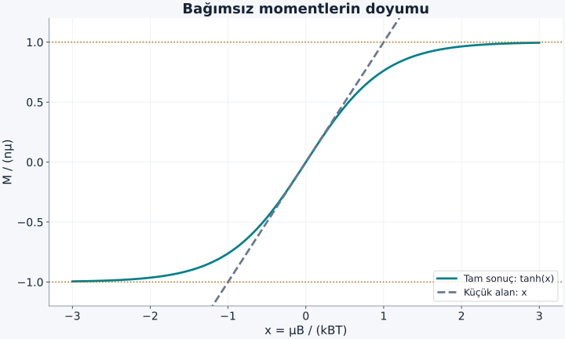
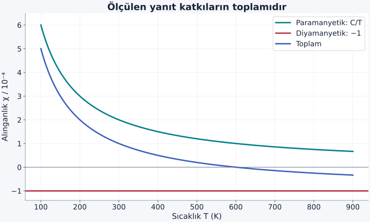

Bir mıknatısın demiri çekmesi, maddenin manyetik davranışlarının yalnız bir örneğidir. Bazı maddeler dış alanı biraz güçlendiren, bazıları biraz zayıflatan bir yanıt verir. Dahası, aynı maddenin içinde bu iki katkı birlikte bulunabilir. Ölçülen şey onların toplamıdır. İlk sorumuz bu yüzden “Madde mıknatıs mı?” değil, “Belirli sıcaklıkta uygulanan alana hangi büyüklükte ve hangi yönde yanıt veriyor?” olacak.

[Manyetik alan ve indüksiyon](/blog/manyetizma-ve-elektromanyetik-induksiyon/), [spin](/blog/stern-gerlach-deneyi-ve-spin/), [Zeeman ayrılması](/blog/dejenerasyon-ve-zeeman-etkisi/) ve [Boltzmann olasılıkları](/blog/boltzmann-dagilimi-ve-bolusum-fonksiyonu/) ön bilgilerimiz. Önce birbirini etkilemeyen yerelleşmiş momentleri inceleyeceğiz. Ardından bu hesabı metaldeki hareketli elektronlara neden doğrudan uygulayamayacağımızı göreceğiz. Kullanılan alanlar zayıf olduğunda doğrusal yanıtı, kuvvetli olduğunda doyumu ayrı tutacağız.

## 1. Manyetik moment neyi ölçer?

Bir akım halkasının veya atomik durumun dış manyetik alanla etkileşimini **manyetik dipol momenti** $\boldsymbol\mu$ ile tanımlarız. Dış alan $\mathbf B$ içinde etkileşim enerjisi:

$$
E=-\boldsymbol\mu\cdot\mathbf B
$$

olur. Nokta iki vektörün skaler çarpımıdır. Moment alanla aynı yöndeyse enerji düşük, ters yöndeyse yüksektir. Momentin SI birimi $\mathrm{J/T}$, eşdeğer biçimde $\mathrm{A\,m^2}$'dir. Elektronun spin açısal momentumu ile manyetik momenti negatif yük nedeniyle ters yönlüdür. Bu yazıda “yukarı” dediğimizde spin okunu değil, **momentin alan yönündeki izdüşümünü** kastediyoruz.

Bir örnekte $N$ tane moment, $V$ hacmini doldursun. Birim hacim başına ortalama toplam moment **mıknatıslanma**dır:

$$
\mathbf M=\frac1V\sum_{j=1}^{N}\langle\boldsymbol\mu_j\rangle.
$$

$\mathbf M$ birimi $\mathrm{A/m}$ olur. Köşeli ayraç, çok sayıda ölçümdeki veya dengedeki ortalamayı gösterir. Tek atomun momenti sıfır olmasa bile farklı yönler birbirini götürürse örneğin toplam mıknatıslanması sıfır olabilir. “Moment yok” ile “momentler var ama toplamları sıfır” aynı durum değildir.

## 2. B ile H neden ayrı yazılıyor?

SI gösteriminde makroskopik alanlar arasında:

$$
\mathbf B=\mu_0(\mathbf H+\mathbf M)
$$

bağıntısı vardır. $\mu_0$ boşluğun manyetik geçirgenliği, $\mathbf H$ birimi $\mathrm{A/m}$ olan manyetik alan şiddetidir. İzotrop, zayıf ve tersinir yanıtta $\mathbf M=\chi\mathbf H$ yazarız. Boyutsuz $\chi$, **manyetik alınganlıktır**. $\chi>0$ ise paramanyetik, $\chi<0$ ise diyamanyetik katkı söz konusudur. Böylece $\mathbf B=\mu_0(1+\chi)\mathbf H$ elde edilir.

Burada $H$ örnek içindeki makroskopik alandır. Sonlu bir örneğin şekli, kendi oluşturduğu alanı etkilediğinden bobinin boşluktaki alanıyla her zaman aynı değildir. Hesaplarımızda küçük $|\chi|$ ve alanı yaklaşık düzgün tutan geometri kullanacağız. Böylece mikroskobik enerji hesabında $B\simeq\mu_0H$ yaklaşımı yeterli olacak. Bu ayrımı yapmadan farklı kaynaklardaki $B$ ve $H$ türevlerini birbirine geçirmek, gereksiz bir $\mu_0$ hatası doğurur.

## 3. İki seçenekli bir momentin denge olasılıkları

Her momentin alan doğrultusunda yalnız $+\mu$ ve $-\mu$ değerlerini alabildiği bir model kuralım; $\mu>0$ moment büyüklüğüdür. Enerjiler:

$$
E_+=-\mu B,\qquad E_- =+\mu B
$$

olur. Enerji ayrımı $2\mu B$'dir. $T$ mutlak sıcaklık, $k_B$ Boltzmann sabiti olmak üzere boyutsuz değişkeni $x=\mu B/(k_BT)$ seçelim. Boltzmann ağırlıklarını toplarsak tek momentin bölüşüm fonksiyonu:

$$
z=e^{x}+e^{-x}=2\cosh x
$$

çıkar. Buradaki $\cosh x=(e^x+e^{-x})/2$ hiperbolik kosinüstür. Olasılıklar ağırlıkların toplamlarına bölünmesiyle bulunur: $p_+=e^x/z$, $p_-=e^{-x}/z$. Toplamları tam birdir. Düşük enerjili durum daha olasıdır ama sonlu sıcaklıkta yüksek enerjili durum bütünüyle yasak değildir.

Ortalama moment, mümkün değerlerle olasılıklarının çarpımlarını toplamaktır:

$$
\langle\mu_z\rangle
=\mu p_+-\mu p_-
=\mu\frac{e^x-e^{-x}}{e^x+e^{-x}}
=\mu\tanh x.
$$

$\tanh$ hiperbolik tanjanttır; bir açı ölçümü değildir. $n=N/V$ moment yoğunluğu ile $M=n\mu\tanh x$ olur. Alan sıfırken iki seçenek eşit ağırlıklıdır. Alan büyüdükçe düşük enerjili seçeneğin ağırlığı artar. Bu hesapta hiçbir moment komşusunu hizalamaz; bütün eğilim dış alandan gelir.

Şekil: Momentlerin toplamı sınırsız büyüyemez. Bütün momentler aynı yöndeyken $|M|=n\mu$ olur; küçük alan doğrusunu bu sınırın ötesine uzatamayız.

## 4. Curie yasası hangi yaklaşımdan çıkar?

$|x|\ll1$ iken $e^{x}\simeq1+x$ ve $e^{-x}\simeq1-x$ yazalım. Üstteki fark yaklaşık $2x$, alttaki toplam yaklaşık $2$ olur. Böylece $\tanh x\simeq x$ ve:

$$
\begin{aligned}
M&\simeq\frac{n\mu^2B}{k_BT}\\
&\simeq\frac{\mu_0n\mu^2}{k_BT}H,\\
\chi&=\frac CT,\qquad C=\frac{\mu_0n\mu^2}{k_B}.
\end{aligned}
$$

bulunur. Bu iki düzeyli modelin **Curie yasasıdır**. $C$ kelvin birimi taşır; $C/T$ boyutsuzdur. Sıcaklık yükselince enerji farkının olasılıkları ayırma gücü azalır. Formüldeki $1/T$ bu denge yarışının sonucudur.

Gerçek atomun birden fazla manyetik alt düzeyi varsa katsayı değişir; açısal momentum sayısı ve uygun manyetik moment gerekir. Buradaki $\mu$'yü gelişigüzel bir atomun tam momentiyle değiştirmek yeterli olmayabilir. Ayrıca momentler etkileşmeye başladığında bağımsız olasılıkların çarpımı kullanılamaz. Özellikle düşük sıcaklıkta $C/T$'nin sonsuza gitmesi fiziksel bir öngörü sayılmaz: Önce küçük alan veya bağımsız moment varsayımı bozulabilir.

## 5. Örnek: Bir teslada ne kadar hizalanma var?

$n=10^{28}\,\mathrm{m^{-3}}$, $\mu=\mu_B=9{,}274\times10^{-24}\,\mathrm{J/T}$ ve $T=300\,\mathrm K$ seçelim. $\mu_B$ **Bohr magnetonudur**. Bir teslalık alanda:

$$
x=\frac{9{,}274\times10^{-24}\times1}
{1{,}380649\times10^{-23}\times300}
\simeq0{,}002239.
$$

Bu değer gerçekten birden çok küçüktür. Doyum mıknatıslanması $n\mu=9{,}274\times10^4\,\mathrm{A/m}$ iken gerçek değer:

$$
M=n\mu\tanh x\simeq207{,}6\,\mathrm{A/m}
$$

olur. $H\simeq B/\mu_0\simeq7{,}958\times10^5\,\mathrm{A/m}$ olduğundan $\chi\simeq2{,}61\times10^{-4}$ çıkar. Doyumun yalnız yaklaşık yüzde $0{,}224$'üne ulaşıldı.

Olasılık farkı $p_+-p_-=\tanh x\simeq0{,}002239$ olduğu için $p_+\simeq0{,}50112$, $p_-\simeq0{,}49888$ bulunur. Makroskopik yanıt için bütün momentlerin aynı yöne bakması gerekmez. Çok küçük bir olasılık dengesizliği, çok büyük parçacık sayısıyla çarpıldığında ölçülebilir hale gelir. Sonuçlar seçtiğimiz bağımsız moment modeline aittir; herhangi bir metalin ölçülmüş değeri olarak yorumlanmamalıdır.

## 6. Diyamanyetik yanıt nereden gelir?

Alan yalnız mevcut momentlerin olasılığını değiştirmez; elektronların uzaysal kuantum durumlarını da değiştirir. Bağlı elektronlarda indüklenen yörüngesel yanıt çoğunlukla alana karşıdır. Kapalı kabuklu atomlarda kalıcı moment katkıları birbirini götürdüğünde bu negatif yanıt görünür hale gelebilir. Diyamanyetizma için atomun önceden küçük bir çubuk mıknatıs gibi moment taşıması şart değildir.

Basit, küresel ve bağlı bir elektron bulutu modelinde atom başına indüklenmiş moment yaklaşık:

$$
\mu_{\mathrm{ind},z}=-\frac{e^2\langle r^2\rangle}{6m_e}B
$$

biçimindedir. $e>0$ temel yük büyüklüğü, $m_e$ elektron kütlesi, $\langle r^2\rangle$ çekirdekten uzaklığın karesinin ortalamasıdır. Eksi işareti karşı yönü gösterir. Çok elektron için uygun elektron katkıları toplanır. Bu bağıntıyı serbest taşıyıcılara ya da her türlü kristale uygulamıyoruz; zayıf alan altında izotrop bağlı durumun ölçek hesabıdır.

Bu modelde sıcaklık doğrudan formüle girmez; atomik orbital büyük ölçüde değişmedikçe yanıt zayıf sıcaklık bağımlılığı gösterir. Paramanyetik iki seçenekli modelde ise mevcut momentlerin olasılıkları ısıya duyarlıydı. [OpenStax'ın madde manyetizması bölümü](https://openstax.org/books/university-physics-volume-2/pages/12-7-magnetism-in-matter), bu iki temel yanıtın işaretlerini ve makroskopik ayrımını karşılaştırır.

Negatif işaret ve $1/6$ katsayısı, uygun bir bağlı durum için enerji hesabından da çıkar. Alan z doğrultusunda, vektör potansiyeli $\mathbf A=\mathbf B\times\mathbf r/2$ seçilsin. Elektronun kinetik terimi $(\mathbf p+e\mathbf A)^2/(2m_e)$ içinde alanın karesine bağlı katkı:

$$
\Delta E_{B^2}=\frac{e^2B^2}{8m_e}\langle x^2+y^2\rangle
$$

olur. Küresel bir orbitalde üç yön eşdeğerdir; $\langle x^2+y^2\rangle=2\langle r^2\rangle/3$ olur. Böylece $\Delta E_{B^2}=e^2B^2\langle r^2\rangle/(12m_e)$ çıkar. İndüklenen momenti $-\partial E/\partial B$ ile bulunca B'nin türevinden gelen iki çarpanı yukarıdaki sonucu verir. Alan enerjiyi artırdığı için moment alanın tersine yönelir. Bu yalın türetimde sıfır alan durumunu yörüngesel açısal momentumu sıfır olan bağlı bir durum seçtik; doğrusal yörüngesel terim onu karıştırmaz. Başka yakın düzeylerden gelen paramanyetik katkıları veya spin yanıtını bu tek $B^2$ terimine dahil etmedik.

[Feynman'ın diyamanyetizma hesabı](https://www.feynmanlectures.caltech.edu/II_34.html), aynı indüklenmiş moment katsayısını yörünge hareketinin alanla değişmesi üzerinden elde eder.

## 7. Örnek: Negatif alınganlığın büyüklüğü

Bir elektronlu ideal atomlar için $n=10^{28}\,\mathrm{m^{-3}}$ ve $\sqrt{\langle r^2\rangle}=0{,}10\,\mathrm{nm}=10^{-10}\,\mathrm m$ seçelim. Böylece $\langle r^2\rangle=10^{-20}\,\mathrm{m^2}$ olur. $M=n\mu_{\mathrm{ind},z}$ ve $B\simeq\mu_0H$ kullanınca:

$$
\chi_{\mathrm{dia}}
=-\frac{\mu_0ne^2\langle r^2\rangle}{6m_e}
\simeq-5{,}90\times10^{-7}.
$$

$B=1\,\mathrm T$ için $M\simeq\chi B/\mu_0=-0{,}470\,\mathrm{A/m}$ bulunur. Negatif değer, momentin seçtiğimiz pozitif alan doğrultusuna ters olmasını ifade eder; negatif bir moment “yokluk” değildir. Bu örnekte paramanyetik örneğimize göre yanıt çok küçüktür, fakat iki modelin farklı parçacık yapılarını temsil ettiğini unutmamalıyız.

Aynı yoğunlukta bulut yarıçapını iki katına çıkarsaydık $\langle r^2\rangle$ dört katına, modeldeki alınganlık büyüklüğü de dört katına çıkardı. Böyle bir ölçek denemesi, formülün atomun uzaysal büyüklüğüne neden duyarlı olduğunu gösterir. Gerçek atomlar için orbital boyutu ve elektron sayısı bağımsız ayarlanabilir düğmeler değildir.

Şekil: Çizilen örnekte $\chi_{\mathrm{para}}=0{,}06\,\mathrm K/T$ ve $\chi_{\mathrm{dia}}=-10^{-4}$ seçildi. Toplamın işareti değişebilir; çizgi gerçek bir malzemenin veri uyarlaması değildir.

## 8. Metal elektronları neden aynı Curie hesabını izlemez?

[Durum yoğunluğu ve Fermi yüzeyi](/blog/durum-yogunlugu-ve-fermi-yuzeyi/) hesabında düşük enerjili durumların fermiyonlarla dolduğunu gördük. Metalde bir elektronun spinini değiştirip daha düşük enerjiye geçmesi, hedef kuantum durumunun boş olmasını gerektirir. Fermi denizinin derinindeki birçok elektron için iki spin yönünün ilgili durumları zaten doludur. Küçük alana esas yanıtı Fermi enerjisi çevresindeki ince bir enerji katmanı verir.

Üç boyutlu, etkileşmeyen, parabolik dağılımlı elektron gazında düşük sıcaklıktaki **Pauli paramanyetizması**:

$$
\chi_P=\mu_0\mu_B^2D(E_F)
=\frac{3\mu_0n\mu_B^2}{2E_F}
$$

olur. $D(E_F)$ iki spini birlikte sayan, birim hacim ve birim enerji başına durum yoğunluğudur. Bu formüldeki $E_F$ joule alınmalıdır. $T\ll E_F/k_B$ koşulunda başlıca ölçek $1/T$ değil, $1/E_F$'dir. Aynı ideal modelde yörüngesel Landau katkısı $-\chi_P/3$ olur; bu oran gerçek çok bantlı katılarda evrensel değildir. Bu düşük sıcaklık sınırları [Tong'un kuantum gazları notlarında](https://davidtong.org/pdfs/teaching/statistical-physics/statphys3.pdf) ele alınır.

### Enerji ayrımı ile yönlü kuvveti ayırmak

Düzgün alanın momentin enerjisini değiştirmesi ile maddeyi bir bölgeye doğru çekmesi farklı sorulardır. Alan her yerde aynıysa, yön seçimi için enerji farkı vardır fakat örneğin merkezini bir yana taşıyacak uzaysal enerji eğimi bulunmayabilir. Bir moment için kuvveti anlamak üzere enerji $E(z)$'nin konuma göre türevine bakarız: $F_z=-dE/dz$. Alanın büyüklüğü değişiyorsa aynı yönlü kalıcı moment yaklaşık $F_z=\mu_z\,dB/dz$ kuvveti hisseder. Bu yüzden bir mıknatısa yaklaşma deneyinde alanın yalnız yönünü değil, değişim hızını da düşünmek gerekir.

İndüklenen momentte enerji hesabı daha dikkat ister; moment alan uygulanırken oluşur. Doğrusal durumda momenti son değerinde sabit bir dipol gibi kabul edip $-\mu B$ yazmak iki kat hata verebilir. Küçük bir izotrop örneğin indüklenmiş yanıt enerjisi, uygun dış alan düzeninde yaklaşık $U=-\chi V B^2/(2\mu_0)$ biçimindedir. Buradaki $V$ örnek hacmidir. Türevden kuvvetin alanın karesinin değişimine bağlı olduğunu görürüz. Pozitif alınganlık daha kuvvetli alana, negatif alınganlık daha zayıf alana yönelmeyi kayırır. Bu ölçek hesabı numune şekli ve iç alan düzeltmeleri ihmal edildiğinde kullanılır.

Dolayısıyla “alanı zayıflatıyor” ifadesi ile “mıknatıstan itiliyor” gözlemi ilişkili olmakla birlikte özdeş tanımlar değildir. İlk ifade yerel manyetik yanıta, ikincisi düzgün olmayan alandaki net kuvvete ilişkindir. Homojen bir alandaki enerji ölçümü ile mıknatıs kutbu yakınındaki hareket deneyini karşılaştırırken bu ayrımı korumak, diyamanyetik yanıtın küçük olmasına rağmen neden mekanik olarak gözlenebildiğini anlamayı kolaylaştırır.

## 9. Ölçümün söylediği ve söylemediği

Pozitif küçük bir alınganlık, kalıcı ferromanyetik düzen kanıtı değildir. Bağımsız moment modeli alan kaldırılınca yeniden eşit olasılıklara döner. Negatif alınganlık da elektronların spin taşımadığını kanıtlamaz; pozitif ve negatif katkıların toplamı ölçülür. Numune şekli, sıcaklık aralığı ve birim sistemi belirtilmeden iki deneysel sayı karşılaştırılmamalıdır.

Burada alanın tek tek kuantum durumlarını ve onların doluluklarını değiştirmesini ayırmayı öğrendik. Komşu momentler birbirini güçlü biçimde etkilediğinde yeni bir enerji ölçeği gerekir. O durumda alan olmadan da ortak düzen oluşabilmesini açıklamak için bağımsız atom hesabının ötesine geçeceğiz.
