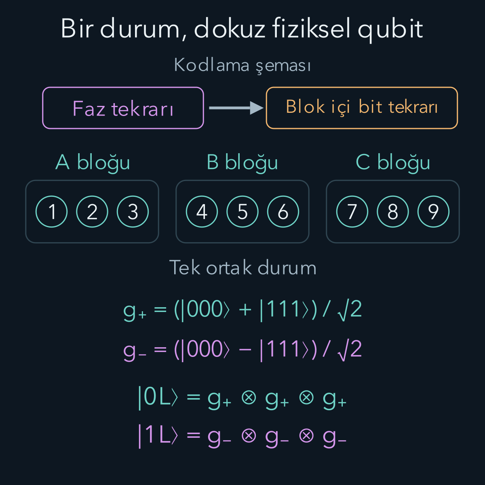
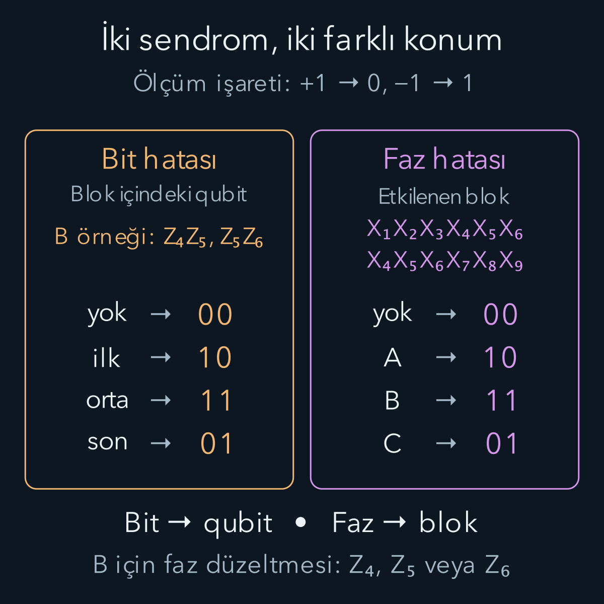

import ArticleVideo from '@/components/ArticleVideo.astro'
import kavram from './media/01-kavram.mp4?url'
import kavramPoster from './media/01-kavram.jpg?url'

Bir bilgiyi koruduğumuzu söylerken hangi değişimlere karşı koruduğumuzu da söylememiz gerekir. [Hata düzeltmeye girişte](/blog/kuantum-hata-duzeltmeye-giris/) üç fiziksel qubit kullanarak tek bir bit çevirme hatasını düzelttik. Aynı kod, göreli fazı değiştiren bir Z hatasını göremiyordu. Ölçtüğümüz iki eşitlik bozulmadığı hâlde sakladığımız kuantum bilgi değişebiliyordu.

Şimdi bu açığı kapatan bir kod kuracağız. Önce faz hatasını tanıdığımız bit hatasına dönüştüren baz değişimini anlayacağız. Ardından iki korumayı iç içe yerleştirerek bir mantıksal qubiti dokuz fiziksel qubite kodlayacağız. Amaç dokuz ayrı kopya üretmek değil, **tek bir bilinmeyen durumun genliklerini ortak bir kod uzayında korumaktır**.

Bu yazı [kapılar ve devrelerdeki](/blog/kuantum-kapilari-ve-devreler/) X, Z, H ve CNOT kapılarını, tensör çarpımını ve önceki yazının parite ölçümünü kullanıyor. Son bölümde [kuantum kanallarındaki](/blog/kuantum-kanallari-ve-dekoherens/) Kraus gösterimine kısa bir bağlantı kuracağız. Önce kusursuz kodlama, ölçüm ve düzeltme işlemleri altında çalışıyoruz; gerçek aygıt sınırlarını ayrıca belirteceğiz.

## 1. Koruyacağımız şey: iki genlik ve aralarındaki ilişki

Başlangıç qubiti şu durumda olsun:

$$
\begin{aligned}
|\psi\rangle&=\alpha|0\rangle+\beta|1\rangle,\\
|\alpha|^2+|\beta|^2&=1.
\end{aligned}
$$

Alfa ve beta karmaşık olasılık genlikleridir. Modüllerinin kareleri ölçüm olasılıklarını verir; aralarındaki göreli faz, başka bazlardaki ölçümleri etkiler. Bilmediğimiz bu iki sayıyı kodlama sırasında ölçmeyeceğiz.

X, hesaplama bazındaki sıfır ve biri yer değiştirir. Z ise sıfırı değiştirmez, bir bileşenine eksi işareti getirir:

$$
\begin{aligned}
X|\psi\rangle&=\beta|0\rangle+\alpha|1\rangle,\\
Z|\psi\rangle&=\alpha|0\rangle-\beta|1\rangle.
\end{aligned}
$$

İkincisinde aynı bazda sıfır ve bir olasılıkları değişmediği için hata görünmez sanılabilir. Fakat örneğin artı durumunun eksi durumuna dönüşmesi, Hadamard'dan sonraki ölçüm sonucunu değiştirir. Sağlam bir kuantum bellek her iki etkiyi de hesaba katmalıdır.

## 2. Faz hatası, başka bazda bir yer değiştirmedir

Artı ve eksi durumlarını yeniden yazalım:

$$
|+\rangle=\frac{|0\rangle+|1\rangle}{\sqrt2},
\qquad
|-\rangle=\frac{|0\rangle-|1\rangle}{\sqrt2}.
$$

Z'yi bu ifadelere uygularsak:

$$
Z|+\rangle=|-\rangle,
\qquad Z|-\rangle=|+\rangle.
$$

Böylece hesaplama bazında faz değiştiren işlem, artı/eksi bazında iki durumu yer değiştirir. H kapısı bu iki baz arasında geçiş yapar: $H|0\rangle=|+\rangle$, $H|1\rangle=|-\rangle$ ve $H^2=I$. Burada I, hiçbir şeyi değiştirmeyen birim işlemdir. Bu ilişkiler birlikte $HZH=X$ eşitliğini verir.

Üç qubitlik bit tekrar kodunu hazırlayıp her qubite H uygularsak:

$$
\begin{aligned}
&\alpha|000\rangle+\beta|111\rangle\\
&\quad\longrightarrow\alpha|+++\rangle+\beta|---\rangle.
\end{aligned}
$$

Ortadaki qubitte Z hatası şimdi artı/eksi sözcüklerini $+-+$ ve $-+-$ biçimlerine götürür. İki bileşende de ortadaki işaret komşularından farklıdır. Artı/eksi değerlerinin eşitliğini ölçerek hata yerini bulabiliriz.

Bu eşitlikler X ölçümleriyle ilişkilidir: artı durumu X'in artı bir, eksi durumu eksi bir özdurumudur. Özdurum demek, işlem uygulandığında durumun yalnız ilgili özdeğerle çarpılması demektir. Dolayısıyla $X_1X_2$ ve $X_2X_3$ çiftlerinin özdeğerleri, iki komşunun aynı mı farklı mı olduğunu söyler. Alt indis hangi fiziksel qubite etki edildiğini belirtir; diğer qubitlerde birim işlem vardır.

Yalnız baz değiştirmek bit ve faz korumasını birlikte sağlamaz. Bu yeni üçlü kodda tek X hatası, eksi bileşenine göreli eksi getirerek mantıksal bilgiyi bozabilir. İki korumayı birleştirmek için bir kodun qubitlerini ikinci bir kodun içine yerleştireceğiz.

## 3. Dokuz qubiti nasıl düzenliyoruz?

Fiziksel qubitleri soldan sağa 1'den 9'a numaralandıralım. Üç blok seçiyoruz:

| Blok | İçindeki qubitler |
| --- | --- |
| A | 1, 2, 3 |
| B | 4, 5, 6 |
| C | 7, 8, 9 |

Önce 1, 4 ve 7 numaralı qubitlerde faz tekrar kodunu kuracağız. Sonra bu üç qubitin her birini, kendi bloğundaki iki sıfır qubitle birlikte bit tekrar koduna çevireceğiz. Böylece faz koruması bloklar arasında, bit koruması her bloğun içinde çalışacak.

Üç fiziksel qubitin şu iki durumuna kısa ad verelim:

$$
\begin{aligned}
|g_+\rangle&=\frac{|000\rangle+|111\rangle}{\sqrt2},\\
|g_-\rangle&=\frac{|000\rangle-|111\rangle}{\sqrt2}.
\end{aligned}
$$

Buradaki g yalnız bir etikettir; yeni bir kapı veya değişken değildir. Her durum normalize edilmiştir. İç çarpımları $(1-1)/2=0$ olduğundan birbirlerine diktirler. Üç qubitten oluşsalar da bu iki doğrultu birlikte iki boyutlu bir altuzay verir.

Shor kodunun mantıksal sıfır ve birini şöyle tanımlıyoruz:

$$
\begin{aligned}
|0_L\rangle&=|g_+\rangle_A|g_+\rangle_B|g_+\rangle_C,\\
|1_L\rangle&=|g_-\rangle_A|g_-\rangle_B|g_-\rangle_C.
\end{aligned}
$$

Yan yana yazılan durumlar tensör çarpımı anlamındadır. A, B, C alt indisleri ilgili üçlü bloğu gösterir. L, mantıksal qubit anlamına gelir; bu yazının $|0_L\rangle$ ve $|1_L\rangle$ durumları önceki üç qubitlik kodunkilerden farklı tanımlanmıştır.

Kodlanmış bilgi:

$$
|\psi_L\rangle=\alpha|0_L\rangle+\beta|1_L\rangle
$$

olur. Alfa ve beta hâlâ birer kez bulunur. Her bloğa ayrı bir $\alpha|g_+\rangle+\beta|g_-\rangle$ kopyası yazmadık. Öyle yapsaydık üç çarpanın açılımında $\alpha^3$, $\alpha^2\beta$ gibi farklı katsayılar çıkardı. Bizim dönüşümümüz girişe göre doğrusaldır ve bilinmeyen durumu klonlamaz.

## 4. Kodlama devresini adım adım kurmak

İlk qubit $|\psi\rangle$ durumunda, diğer sekiz qubit sıfırda olsun. CNOT'ta kontrol 1 ise hedef çevrilir, kontrol 0 ise hedef değişmez. Devreyi üç aşamada kurabiliriz.

İlk aşamada 1 kontrol, 4 hedef CNOT; ardından 1 kontrol, 7 hedef CNOT uygularız. Yalnız 1, 4, 7 sırasını yazarsak durum $\alpha|000\rangle+\beta|111\rangle$ olur. Diğer altı qubit hâlâ sıfırdadır.

İkinci aşamada 1, 4 ve 7'ye H uygularız. Bu üç lider qubit artık $\alpha|+++\rangle+\beta|---\rangle$ durumundadır. Bu, az önce tanıdığımız faz tekrar kodudur.

Üçüncü aşamada her lider, kendi bloğundaki öteki iki qubitin kontrolü olur. Uygulanan CNOT'lar:

$$
\begin{aligned}
A:&\quad 1\to2,\quad 1\to3,\\
B:&\quad 4\to5,\quad 4\to6,\\
C:&\quad 7\to8,\quad 7\to9.
\end{aligned}
$$

Okun solu kontrol, sağı hedeftir. Bir blokta ne olduğunu açıkça görelim:

$$
\begin{aligned}
|+\rangle|00\rangle
&=\frac{|000\rangle+|100\rangle}{\sqrt2}\\
&\longrightarrow\frac{|000\rangle+|110\rangle}{\sqrt2}\\
&\longrightarrow |g_+\rangle.
\end{aligned}
$$

Başlangıç eksi durumundaysa aynı iki CNOT, artı yerine eksi işaretini taşıyarak $|g_-\rangle$ üretir. Üç bloğa birlikte uygulandığında tam olarak $\alpha|0_L\rangle+\beta|1_L\rangle$ elde edilir. Genliklerin sayısal değerlerini bilmek gerekmez.

Üç ayrı $1/\sqrt2$ çarpanının çarpımı $1/(2\sqrt2)$'dir. Örneğin $|0_L\rangle$'yi tamamen açarsak her blok için 000 veya 111 seçilen sekiz terim vardır; her terimin genliği $1/\sqrt8$ olur. Toplam olasılık $8\times1/8=1$ çıkar. Dokuz qubitlik bütün uzayın 512 baz durumu vardır; kod bunların hepsine eşit genlik dağıtmaz.

## 5. Bit hatası: bloğun içindeki komşuları karşılaştırmak

Her blokta hesaplama bazı bitlerinin eşitliğini kontrol ederiz. A için $Z_1Z_2$, $Z_2Z_3$; B için $Z_4Z_5$, $Z_5Z_6$; C için $Z_7Z_8$, $Z_8Z_9$ ölçülür. Bu altı gözlenebilirin her biri, hatasız kodun hem mantıksal sıfırında hem birinde artı bir özdeğeri verir.

Ölçüm sonucunu bit olarak kaydetmek için **artı bir → 0, eksi bir → 1** kuralını kullanıyoruz. Bir bloktaki sendrom sırası daima ilk–orta karşılaştırması, ardından orta–son karşılaştırmasıdır.

| Blok içindeki X hatası | Sendrom |
| --- | --- |
| Yok | 00 |
| İlk qubit | 10 |
| Orta qubit | 11 |
| Son qubit | 01 |

Örneğin $X_5$ hatasında B bloğunun iki durumu şu hâle gelir:

$$
X_5|g_\pm\rangle_B
=\frac{|010\rangle\pm|101\rangle}{\sqrt2}.
$$

010 ve 101 sözcüklerinin ikisinde de iki komşu çifti farklıdır. Sendrom 11 çıkar. Artı ve eksi bileşen aynı sendromu verdiğinden ölçüm, alfa ile beta arasında seçim yapmaz. A ve C bloklarının sendromu 00 kalır. B'deki 11, beşinci qubite X uygulanmasını söyler; $X_5^2=I$ olduğu için bit hatası giderilir.

Burada öğrendiğimiz şey mantıksal bilginin sıfır mı bir mi olduğu değildir. Belirlediğimiz hata sınıfı içinde hangi düzeltmenin gerektiğini öğrendik. Aynı kodda farklı bir gözlenebilir ölçmek, örneğin bir bloğun artı/eksi işaretini tek başına öğrenmek, bu güvenceyi taşımaz.

## 6. Faz hatası neden yalnız bir bloğun işaretini değiştirir?

B bloğundaki beşinci qubite Z uygulayalım. Üçlü 000 terimi değişmez, 111 terimi eksi alır. Sonuç:

$$
\begin{aligned}
Z_5|g_+\rangle_B&=|g_-\rangle_B,\\
Z_5|g_-\rangle_B&=|g_+\rangle_B.
\end{aligned}
$$

Aynı hesabı dördüncü veya altıncı qubitte yapsaydık aynı sonuç çıkardı. Çünkü her iki baz sözcüğünde üç basamak da birbirine eşittir. Bu, ileride düzeltmeyi kolaylaştıracak bir özelliktir.

Blok işaretlerini geçici olarak yalnız + ve − ile gösterelim. Kodlanmış durumun iki bileşeni +++ ile −−− düzenindedir. B'deki tek Z sonrasında bunlar +−+ ile −+− olur. İki durumda da farklı olan **B bloğudur**.

Bit sendromları bu değişimi göremez: üçlülerin içinde hâlâ 000 ve 111 vardır. Fazı karşılaştıracak yeni ölçümler gerekir. Bunun için bir bloğun üç qubitini birlikte çeviren işlemi tanımlayalım:

$$
T_A=X_1X_2X_3.
$$

Benzer biçimde $T_B=X_4X_5X_6$ ve $T_C=X_7X_8X_9$ olsun. Üç X, 000 ile 111'i yer değiştirir. Bu yüzden:

$$
\begin{aligned}
T_A|g_+\rangle_A&=|g_+\rangle_A,\\
T_A|g_-\rangle_A&=-|g_-\rangle_A.
\end{aligned}
$$

Yani T'nin özdeğeri bloğun + veya − etiketini verir. Fakat $T_A$'yı **tek başına ölçmemeliyiz**: sonuç mantıksal sıfır ile biri ayırır ve genel süperpozisyonu bozar. Önceki yazıdaki gibi tek tek değerleri değil, iki değerin ilişkisini ölçeceğiz.

## 7. Faz sendromu: blok işaretlerini karşılaştırmak

İki gözlenebilir seçelim:

$$
\begin{aligned}
P_{AB}&=T_AT_B=X_1X_2X_3X_4X_5X_6,\\
P_{BC}&=T_BT_C=X_4X_5X_6X_7X_8X_9.
\end{aligned}
$$

P harfi burada bu parite gözlenebilirlerine verdiğimiz addır; ölçüm projektörü anlamında kullanılmıyor. İlk ölçüm A ile B'nin, ikincisi B ile C'nin işaretlerini karşılaştırır. Eşit işaretlerin çarpımı artı bir, farklı işaretlerin çarpımı eksi birdir.

Hatasız +++ ve −−− bileşenlerinde iki çarpım da artı birdir. B hatalı olduğunda +−+ için de −+− için de iki çarpım eksi birdir. Yine genlikleri ayırmadan hata bilgisi çıkarırız. Aynı özdeğer–bit kuralıyla faz sendrom sıramız $AB,BC$ olur:

| Tek Z hatasının bloğu | Faz sendromu |
| --- | --- |
| Yok | 00 |
| A | 10 |
| B | 11 |
| C | 01 |

Tablo bir fiziksel qubit numarası vermez. 11 sonucu, faz hatasının B bloğunda olduğunu söyler; 4, 5, 6 arasında ayrım yapmaz. Bu ayrım düzeltme için gerekli değildir. B bloğunun herhangi bir qubitine Z uygulamak onun işaretini yeniden değiştirir.

Örneğin hata $Z_5$, düzeltme $Z_4$ seçilirse toplam işlem $Z_4Z_5$ olur. B'nin 000 bileşeni iki kez artı alır. 111 bileşeni iki kez eksi alır ve çarpım artıya döner. Dolayısıyla hem $|g_+\rangle_B$ hem $|g_-\rangle_B$ değişmeden kalır. Hatanın tam yerini öğrenmeden etkisini geri aldık. Aynı kod üzerindeki farklı hataların aynı etkiyi göstermesine **kod dejenerasyonu** denir; buradaki anlamı enerji düzeylerinin çakışması değildir.

## 8. Bu ölçümler birbirini neden bozmuyor?

Bir X ile aynı qubitteki Z'nin sırası değiştirilirse eksi işareti gelir: $XZ=-ZX$. Farklı qubitlere etki eden işlemler ise yer değiştirebilir. Şimdi $Z_4Z_5$ ile $P_{AB}$'yi karşılaştıralım. İlk gözlenebilirin iki Z'si, ikinci gözlenebilirdeki iki X ile aynı yerlerde çakışır. Sırayı değiştirirken iki eksi gelir; $(-1)^2=1$ olduğundan toplam sıra değişimi sonucu etkilemez.

Her Z kontrolü ile her X kontrolünün çakışma sayısı sıfır veya ikidir. Yalnız Z içeren kontroller kendi aralarında, yalnız X içerenler de kendi aralarında zaten komütatiftir. Böylece altı bit kontrolü ve iki faz kontrolü birbirleriyle komütatiftir. İdeal ortak özdurumlarda birini ölçmek, diğerinin belirli sonucunu bozmaz. Daha genel hatalı durumda ölçümler, bu ortak özdeğerlerle tanımlanan hata altuzaylarından birini seçer.

Bu sekiz gözlenebilir, kodun bütün durumlarını artı bir özdeğeriyle değişmeden bıraktığı için **stabilizörler**, yani kodu sabit bırakan işlemler olarak adlandırılır. Bu yeni terimin burada yaptığı iş basittir: Hatasız durumu karakterize eden eşitlikleri bir arada ifade eder.

Ölçümün nasıl yapılabileceğini de belirtelim. İki Z'nin paritesini, sıfırda hazırlanmış bir yardımcı qubite iki veri qubitinden CNOT uygulayarak çıkarmıştık. Altı X'in çarpımı için ilgili altı veri qubitine H uygularız; sonra her birinden aynı sıfır yardımcıya CNOT uygulayıp yardımcıyı ölçer, veri qubitlerine tekrar H uygularız. $H X H=Z$ olduğu için bu baz değişimi, altı X özdeğerinin çarpımını hesaplama bazındaki pariteye dönüştürür.

Her yeni parite ölçümünde yardımcı yeniden sıfırda hazırlanır; aynı yardımcıyı ölçmeden ve sıfırlamadan bütün kontroller için kullanmayız. Yardımcının tek biti, altı ayrı ölçüm sonucunu açıklamaz; yalnız toplam pariteyi verir. Altı veri qubitini tek tek ölçmek aynı işlem değildir ve korunacak bilgiyi bozabilir. Bu devre ölçüm fikrini açıklar; yardımcı veya kapı hatalarının yayılmasına karşı ayrıca tasarlanmış bir devre olduğunu henüz iddia etmiyoruz.

## 9. Çözümlü örnek: beşinci qubitte iki hata türü

Şimdi karmaşık genlikli bir giriş seçelim:

$$
|\psi_L\rangle
=\frac{\sqrt3}{2}|0_L\rangle+\frac{i}{2}|1_L\rangle.
$$

Burada i sanal birimdir; olasılıkların toplamı $3/4+1/4=1$ olur. Kod, i ile belirlenen göreli fazı da korumalıdır.

Beşinci qubitte önce Z, sonra X olsun. Operatörler sağdan sola uygulandığı için toplam hatayı şöyle yazarız:

$$
E=X_5Z_5.
$$

Bu iki farklı qubite yayılan bir olay değildir; tek fiziksel qubitte iki hata türünün birleşimidir. $Y=iXZ$ olduğu için Y hatasıyla yalnız genel bir faz bakımından farklıdır. Bir durumun tamamını aynı karmaşık fazla çarpmak, ölçüm olasılıklarını değiştirmez.

E'nin B bloğunda ne yaptığını açalım:

$$
\begin{aligned}
E|g_+\rangle_B&=\frac{|010\rangle-|101\rangle}{\sqrt2},\\
E|g_-\rangle_B&=\frac{|010\rangle+|101\rangle}{\sqrt2}.
\end{aligned}
$$

Bit örüntüsü değişmiş, iki işaret etiketi de yer değiştirmiştir. Üç bit sendromu sırasıyla A:00, B:11, C:00 çıkar. Faz sendromu 11'dir. X etkisi, X'lerden oluşan faz kontrolleriyle komütatif olduğundan Z'nin bıraktığı faz sendromunu gizlemez. Z etkisi de bit kontrollerinin sonucunu değiştirmez.

B içindeki 11'e karşı $X_5$ uygularız. Ardından faz için B bloğunu seçen 11'e karşı, örneğin $Z_4$ uygularız. Toplam düzeltme $C=Z_4X_5$'tir. Son durumu satır satır hesaplayalım:

$$
\begin{aligned}
CE|\psi_L\rangle
&=Z_4X_5X_5Z_5|\psi_L\rangle\\
&=Z_4Z_5|\psi_L\rangle\\
&=|\psi_L\rangle.
\end{aligned}
$$

İkinci satırda iki X birbirini götürdü. Üçüncü satırda, az önce doğruladığımız üzere B'nin iki Z'si hem 000 hem 111 üzerinde toplam artı bir verdi. Böylece $\sqrt3/2$ ve $i/2$ katsayıları aynen kaldı. Mantıksal sıfır veya bir okunmadı.

E yerine tam $Y_5=iX_5Z_5$ hatası olsaydı aynı düzeltme $i|\psi_L\rangle$ verirdi. Bu i, artık yalnız beta bileşeninde değildir; bütün durumu çarpan genel fazdır. Korunan mantıksal durum fiziksel olarak aynıdır.

<ArticleVideo src={kavram} poster={kavramPoster} title="Shor kodunda iki sendromla düzeltme" caption="Qubitler A:1–2–3, B:4–5–6, C:7–8–9 düzeninde. Beşinci qubite önce Z, sonra X gelir. B içindeki bit sendromu 11, X₅'i seçer; faz sendromu 11, B bloğunu seçer ve Z₄ yeterlidir. Düzeltme sırası önce X₅, sonra Z₄. Sendrom etiketleri ölçüm kaydıdır; hareket ayrık adımların gösterimidir." />

## 10. Küçük ve sürekli hatalar nasıl ele alınır?

Gerçek gürültü yalnız tam X, Y veya Z uygulamak zorunda değildir. Örneğin tek qubitte küçük bir dönme şu biçimde olabilir:

$$
U=\cos(\theta/2)I-i\sin(\theta/2)X.
$$

Teta dönme açısıdır. Bu işlemi beşinci qubite uygularsak kodlanmış durumun hatasız dalı ile $X_5$ hatalı dalının süperpozisyonunu elde ederiz. Sendrom ölçümü, bu iki dal için farklı sonuç verir: bütün bit sendromları 00 veya yalnız B'de 11. Olasılıklar sırasıyla $\cos^2(\theta/2)$ ve $\sin^2(\theta/2)$ olur. İlkinde hiçbir işlem, ikincisinde $X_5$ uygulanır; iki durumda da aynı mantıksal bilgi geri gelir.

Daha genel bir tek qubit işlemi, dört Pauli doğrultusunda açılabilir:

$$
A=aI+bX+cY+dZ.
$$

A burada genel bir matris, a, b, c, d karmaşık katsayılardır; blok A etiketiyle karıştırılmamalıdır. I, X, Y, Z ikiye iki matrislerin uzayını gerer. Dolayısıyla yalnız bu dört kapıdan birinin rastgele seçilmesini değil, onların doğrusal birleşimlerini de ele almak gerekir.

Shor kodunda sabit bir qubit üzerindeki I, X, Y, Z etkileri farklı sendromlar verir. Ölçüm bu hata dallarını ayırırken her dalda alfa ve beta aynı mantıksal bilgiyi taşır. Sonuca göre uygulanan düzeltme bu bilgiyi geri getirir. Hatanın açısını veya katsayılarını önceden bilmek zorunda değiliz.

Üniter olmayan bir yerel kanal için de her Kraus işleci böyle bir Pauli açılımına sahiptir. Düzeltme bütün bu dallarda aynı mantıksal bilgiyi geri verdiğinden kanalın toplamı da düzeltilir. Buradaki güvence, gürültünün **bir fiziksel qubitle sınırlı olması** ve kodlama–sendrom–düzeltmenin ideal yapılması koşuluyla okunmalıdır. Her qubitin aynı anda ayrı bir hataya uğraması bu koşulu sağlamaz.

## 11. İki fiziksel hata neden güvence dışında?

Kod bazı çoklu hata desenlerini de düzeltebilir; örneğin farklı bloklara düşen bit hataları ayrı ayrı bulunabilir. Fakat her iki qubit hatasının düzeltilebildiğini söyleyemeyiz. Aynı A bloğunda $X_1X_2$ oluşsun. İlk iki basamak birlikte değiştiği için A'nın bit sendromu 01 olur. Tek hata varsayımıyla çalışan düzeltici bunu üçüncü qubit hatası sanır ve $X_3$ uygular.

Geriye $X_1X_2X_3=T_A$ kalır. Bu işlem $|g_+\rangle_A$'yı değiştirmez, $|g_-\rangle_A$'ya eksi verir. Dolayısıyla:

$$
\begin{aligned}
&\alpha|0_L\rangle+\beta|1_L\rangle\\
&\quad\longrightarrow\alpha|0_L\rangle-\beta|1_L\rangle.
\end{aligned}
$$

Kod uzayına döndük ama mantıksal bir faz hatası bıraktık. Önceki üç qubitlik tekrar kodunda üç X, mantıksal bit değişimi yapıyordu. Buradaki mantıksal baz farklı tanımlandığı için bir bloktaki üç X, dokuz qubitlik kod üzerinde mantıksal Z etkisi yapar. Fiziksel işlemin adından tek başına mantıksal etkisini çıkaramayız.

Dokuz veri qubiti kullanmak da bütün donanım maliyeti değildir. Sendromları çıkarmak için yardımcı qubitler, ek kapılar ve ölçümler gerekir. Bunlar hata yaparsa yanlış sendrom üretilebilir veya hata birden fazla veri qubitine yayılabilir. Gerçek koruma, yalnız kod durumlarını seçmekle değil, işlemlerin nasıl yürütüldüğüyle de ilgilidir.

Bu yazıda kurduğumuz yapı, kuantum hata düzeltmenin temel engeli nasıl aştığını somutlaştırdı: Bilinmeyen durumu kopyalamadan kodladık; bit hatasının yerini ve faz hatasının bloğunu farklı karşılaştırmalarla bulduk; düzeltme sırasında alfa ile betayı öğrenmedik. Daha ileri kodları incelerken taşıyacağımız fikir, daha çok qubitten önce **mantıksal bilgiyi açığa çıkarmayan ölçümleri tasarlamak** olacak.

## Kaynaklar

Dokuz qubitlik kodun standart tanımı ve bit–faz korumalarının iç içe kurulması [IBM Quantum Learning — The 9-qubit Shor code](https://quantum.cloud.ibm.com/learning/en/courses/foundations-of-quantum-error-correction/correcting-quantum-errors/shor-code) ile karşılaştırıldı. Hata altuzayları, Pauli açılımı, dejenerasyon ve stabilizör yaklaşımı için [John Preskill — Quantum Error Correction](https://www.preskill.caltech.edu/ph219/chap7_26_6A.pdf) kullanıldı. Anlatım, qubit numaralandırması, aynı qubitte birleşik hata örneği, ara hesaplar ve Manim görselleri bu yazı için hazırlandı; kodlama ve düzeltme ayrıca sayısal olarak denetlendi.

Kaynak erişimi ve formül kontrolü: **13 Ekim 2026**.
