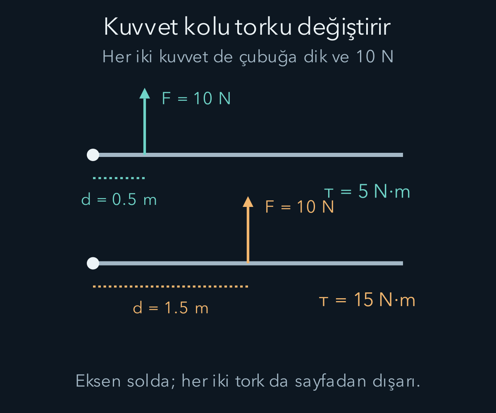
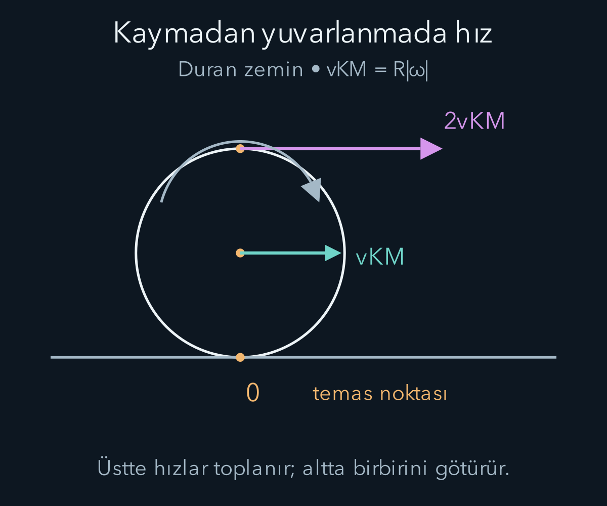

import ArticleVideo from '@/components/ArticleVideo.astro'
import kavram from './media/01-kavram.mp4?url'
import kavramPoster from './media/01-kavram.jpg?url'

Bir kapıyı menteşesine yakın bir yerden itmekle kolundan itmek aynı dönme etkisini oluşturmaz. Kuvvetin büyüklüğü ve yönü aynı olsa bile uygulandığı yer değişince kapının davranışı değişir. Ötelemede yalnız net kuvveti toplamak yeterliyken, dönmede kuvvetin eksene göre nerede uygulandığını da izlememiz gerekir. Bu konum bilgisi torkun içinde yer alır.

[Momentum yazısında](/blog/momentum-itme-ve-carpismalar/) kuvvetin zaman boyunca etkisini ve kütle merkezini kurduk. Burada radyan, vektörel çarpım ve integral bilgilerini kullanacağız. Vektörel çarpımın hem büyüklük hem sağ el kuralıyla belirlenen yön taşıdığını hatırlayalım. Önce sabit bir eksen çevresindeki basit dönmeyi inceleyecek, daha genel üç boyutlu hareket için hangi ifadeleri sınırlamamız gerektiğini ayrıca belirteceğiz.

**Ön bilgi bağlantıları:** [Radyan](/blog/birim-cember-radyan-ve-trigonometrik-grafikler/) ve [vektörel çarpım](/blog/uc-boyutta-vektorel-carpim/). Tork için kullandığımız uzaklık, kuvvetin uygulandığı noktaya olan uzaklıkla her zaman aynı değildir; etkin olan kuvvetin etki çizgisine dik uzaklıktır.

## 1. Dönmenin ortak değişkeni açı

**Rijit cisim**, parçaları arasındaki uzaklıkların değişmediği ideal cisimdir. Gerçek cisimler biçim değiştirebilir; burada bu değişimi ihmal ediyoruz. Sabit bir eksen çevresinde dönen rijit cismin farklı noktaları farklı yarıçaplı çemberler çizer. Aynı sürede hepsi aynı açıyı tarar, fakat aynı yolu almaz.

Açıyı $\theta$ ile, radyan cinsinden gösterelim. Bir noktanın eksene dik uzaklığı $r$ ise yay uzunluğu $s=r\theta$ olur. Açısal hız $\omega=d\theta/dt$, açısal ivme $\alpha=d\omega/dt$ biçiminde tanımlanır. Birimleri radyan bölü saniye ve radyan bölü saniye karedir. Radyan boyutsuz olsa da birim yazımında açısal değişimi vurgulamak için tutulabilir.

Sabit eksende bir dönüş yönünü pozitif seçeriz. Karşı yöndeki dönme negatif açısal hızla anlatılır. Bir noktanın teğetsel hız bileşeni $v_t=r\omega$, teğetsel ivme bileşeni $a_t=r\alpha$ olur. Bunun yanında çemberin merkezine doğru $a_r=r\omega^2$ büyüklüğünde ivme vardır. Açısal hız sabitse teğetsel ivme sıfırdır ama merkez yönlü ivme devam eder.

Yarıçapları on ve yirmi santimetre olan iki nokta aynı gövde üzerinde saniyede iki radyan dönüyorsa teğetsel süratleri sırasıyla yirmi ve kırk santimetre bölü saniyedir. Dış nokta aynı açı için iki kat yol alır. Bu fark, kütlenin eksenden uzak yerleşmesinin dönme enerjisini neden değiştirdiğine hazırlanır.

## 2. Tork kuvvetin uygulama yerini içerir

Seçtiğimiz sabit başlangıç noktasından kuvvetin uygulandığı noktaya giden konum vektörü $\mathbf r$ olsun. Kuvvetin bu başlangıca göre **torku**:

$$
\boldsymbol\tau=\mathbf r\times\mathbf F
$$

ile tanımlanır. Çarpı işareti vektörel çarpımdır. Büyüklük $\tau=rF\sin\phi$ olur; $\phi$ konum ile kuvvet arasındaki açıdır. Seçilen başlangıç noktasının kuvvetin etki çizgisine dik uzaklığına $d$ dersek aynı büyüklüğü $\tau=Fd$ yazabiliriz. Bu dik uzaklık kuvvet koludur.

Kuvvetin etki çizgisi seçilen başlangıç noktasından geçiyorsa bu noktaya göre tork vektörü sıfırdır. Bir eksen çevresindeki dönme etkisi ise torkun o eksen doğrultusundaki bileşeniyle belirlenir. Kuvvet çizgisinin ekseni kesmesi bu bileşeni sıfırlayabilir; genel üç boyutlu durumda bütün tork vektörünün sıfır olduğu sonucu çıkmaz. Kuvvet yarıçapa dikse aynı kuvvet ve aynı uzaklık için tork büyüklüğü en büyük olur. Kapı koluna kapının düzlemine dik itmek ile menteşeye doğru itmek arasındaki fark budur.

Sağ elin parmakları $\mathbf r$ yönünden $\mathbf F$ yönüne kıvrıldığında başparmak tork yönünü gösterir. Düzlemde dönmeyi anlatırken saat yönünün tersini pozitif seçmek, sayfadan dışarı yönlü ekseni pozitif seçmeye karşılık gelir. Yön kuralını belirledikten sonra bütün kuvvetleri aynı kuralla toplarız.

Tork birimi newton metredir. İşle aynı temel birimlere sahip olsa da torku burada joule diye adlandırmayacağız. İş skaler çarpımla, tork vektörel çarpımla tanımlandı; fiziksel görevleri farklıdır. Birimlerin aynı boyuta sahip olması nicelikleri birbirinin yerine kullanabileceğimiz anlamına gelmez.

## 3. Açısal momentum parçacık için de tanımlıdır

Bir parçacığın seçilmiş başlangıca göre **açısal momentumu**:

$$
\mathbf L=\mathbf r\times\mathbf p
$$

olarak tanımlanır. $\mathbf p=m\mathbf v$ doğrusal momentumdur. Açısal momentumun birimi kilogram metre kare bölü saniyedir. Bu tanım için cismin mutlaka çember çizmesi gerekmez. Düz bir çizgide giden parçacık da başlangıç noktasına göre sıfır olmayan açısal momentum taşıyabilir.

Başlangıç noktası eylemsiz sistemde sabit olsun. Türev alalım:

$$
\frac{d\mathbf L}{dt}
=\frac{d\mathbf r}{dt}\times\mathbf p
+\mathbf r\times\frac{d\mathbf p}{dt}.
$$

İlk terim $\mathbf v\times m\mathbf v=0$ olur; paralel vektörlerin vektörel çarpımı sıfırdır. İkinci terimde momentum türevi net kuvvettir. Sonuç:

$$
\frac{d\mathbf L}{dt}=\boldsymbol\tau_{\mathrm{net}}.
$$

Bu, doğrusal momentumun türevinin kuvvete eşit olmasıyla aynı yapıyı taşır. Ancak başlangıç noktasını hareket ettirirsek ek terimler çıkabilir; türetimdeki sabit başlangıç koşulunu unutmuyoruz. Açısal momentum ve torku aynı noktaya göre tanımlamak da zorunludur.

Bir sistemde iç kuvvetlerin toplam torkunun sadeleştiği Newton tipi merkezi etkileşimlerde toplam açısal momentumun değişimini dış tork belirler. Dış tork sıfırsa toplam açısal momentum korunur. Yalnız net dış kuvvetin sıfır olması yeterli değildir: Eşit zıt iki kuvvet farklı doğrultu çizgilerinde uygulanarak net kuvveti sıfır, net torku sıfır olmayan bir kuvvet çifti oluşturabilir.

## 4. Eylemsizlik momenti neden uzaklığın karesini içerir?

Sabit eksen çevresinde dönen bir parçacığın kinetik enerjisi $\tfrac12mv^2=\tfrac12mr^2\omega^2$ olur. Rijit cismin parçaları aynı açısal hızla döndüğüne göre enerjileri topladığımızda:

$$
K_{\mathrm{dönme}}=\frac12\left(\sum_i m_i r_i^2\right)\omega^2
=\frac12I\omega^2.
$$

$ I=\sum_i m_i r_i^2$ ifadesi seçilen eksene göre **eylemsizlik momenti**dir. Buradaki $r_i$ her parçanın eksene dik uzaklığıdır. Birimi kilogram metre karedir. Kütlelerin yalnız toplamı değil, eksene göre dağılımı önemlidir. Aynı kütleyi iki kat uzağa koymak katkısını dört katına çıkarır.

Sürekli bir cisimde toplam, küçük kütle parçaları üzerinden integrale dönüşür: $I=\int r_\perp^2\,dm$. Alt indis uzaklığın eksene dik olduğunu hatırlatır. Yoğunluk düzgün değilse $dm$ yazımının içinde bu dağılımı da belirtmek gerekir. Bir cismin tek başına “eylemsizlik momenti”ni söylemek ekseni belirtmeden eksik bir bilgidir.

Kütlesiz çubuğun iki ucunda birer kilogramlık iki küçük kütle, merkezden yarım metre uzakta bulunsun. Merkezden geçen dik eksene göre $I=1(0{,}5)^2+1(0{,}5)^2=0{,}50\,\mathrm{kg\,m^2}$ olur. Eksen uçlardan birine taşınırsa bir kütle eksende, diğeri bir metre uzaktadır; $I=1{,}00\,\mathrm{kg\,m^2}$ çıkar. Cisim aynı kaldı, fakat dönme ekseni değişti.

## 5. Bir çubuğun eylemsizlik momentini hesaplamak

Uzunluğu $\ell$, kütlesi $M$ olan ince ve düzgün çubuğu ele alalım. Çubuğa dik eksen merkezden geçsin. Merkezde sıfır seçtiğimiz $x$ koordinatı $-\ell/2$ ile $\ell/2$ arasındadır. Birim uzunluk başına kütle $\lambda=M/\ell$ olur; küçük parçanın kütlesi $dm=\lambda\,dx$ yazılır.

Böylece:

$$
I_{\mathrm{merkez}}=\frac{M}{\ell}\int_{-\ell/2}^{\ell/2}x^2\,dx
=\frac{M}{\ell}\left[\frac{x^3}{3}\right]_{-\ell/2}^{\ell/2}
=\frac{M\ell^2}{12}.
$$

Küpün negatif alt sınırdaki değeri eksi olduğundan iki uç katkısı birbirine eklenir. Bu hesap uzak noktalara daha büyük ağırlık verdiğimiz bir kütle toplamıdır. Çubuğun kütlesini ortada tek noktaya koymak, gerçek dönme enerjisini vermezdi; bütün kütlenin eksene uzaklığını sıfırlamış olurduk.

Eksen çubuğun ucundan geçerse integral sıfırdan $\ell$ uzunluğuna alınır ve $I_{\mathrm{uç}}=M\ell^2/3$ bulunur. Aynı sonucu **paralel eksen teoremi** verir:

$$
I=I_{\mathrm{KM}}+Md^2.
$$

Burada bilinen eksen kütle merkezinden geçer; yeni eksen ona paraleldir ve aralarındaki uzaklık $d$ kadardır. Çubukta $d=\ell/2$ koyunca $M\ell^2/12+M\ell^2/4=M\ell^2/3$ elde edilir. Formülü herhangi iki eksen arasında gelişigüzel kullanamayız; biri kütle merkezi ekseni, ikisi paralel olmalıdır.

Teoremin nedeni de görülebilir. Yeni eksene uzaklığın karesini açınca eski uzaklığın karesi, $d^2$ ve bir çapraz terim oluşur. Kütle merkezine göre ağırlıklı konum toplamı sıfır olduğundan çapraz terimin toplamı yok olur. Geriye eski eylemsizlik momenti ile toplam kütle çarpı $d^2$ kalır.

### Disk için küçük halkaları toplamak

Düzgün bir diskin kütlesi bütün alana eşit dağılsın. Yüzey kütle yoğunluğunu $\sigma=M/(\pi R^2)$ diye tanımlayalım. Merkezden $r$ uzaklıkta, kalınlığı $dr$ olan ince halkanın alanı yaklaşık çevresi çarpı kalınlığı, yani $2\pi r\,dr$ olur. Dolayısıyla kütlesi $dm=2\pi\sigma r\,dr$ yazılır. Halkanın bütün noktaları dönme eksenine aynı uzaklıkta olduğundan katkısı $r^2dm$ olur.

Bu katkıları merkezden dış kenara kadar toplayalım:

$$
I=2\pi\sigma\int_0^Rr^3\,dr
=\frac{\pi\sigma R^4}{2}
=\frac12MR^2.
$$

Diskin eylemsizlik momentinin ince çemberinkinden küçük olması böylece anlaşılır. Çemberde bütün kütle en dış yarıçapta bulunurken diskte kütlenin bir bölümü eksene daha yakındır. Aynı toplam kütle ve dış yarıçap, aynı eylemsizlik momentini zorunlu kılmaz. Dönme davranışını hesaplamak için cismin yalnız dış görünüşü değil, içindeki kütle dağılımı da gerekir.

## 6. Sabit eksen için dönme denklemi

Sabit bir eksen çevresindeki rijit dönmede açısal momentumun eksen bileşeni $L_z=I_z\omega$ olur. Eylemsizlik momenti değişmiyorsa türev almak:

$$
\tau_{z,\mathrm{net}}=I_z\alpha
$$

verir. Alt indis, eksen üzerindeki bileşeni kullandığımızı vurgular. Bu denklem, sabit eksen çevresinde açısal ivmeyi bulmamızı sağlar. Bir torkun başka eksenlerde bileşenleri varsa yatakların veya bağlantıların etkileri ayrıca değerlendirilebilir.

Genel üç boyutlu bir rijit cisimde $\mathbf L$ vektörü her zaman $\boldsymbol\omega$ ile paralel değildir. Kütle dağılımını bir eylemsizlik tensörüyle, yani matrisle temsil etmek gerekebilir. Bu yazıdaki skaler $I$ bağıntısını bütün uzay hareketine koşulsuz genişletmiyoruz. Simetri ekseni çevresinde dönme gibi uygun durumlarda vektörler paralel olabilir.

Kütlesi iki kilogram, uzunluğu bir metre olan düzgün çubuk merkezinden geçen dik eksen çevresinde dönsün. Eylemsizlik momenti $2/12=1/6\,\mathrm{kg\,m^2}$ olur. Eksen bileşeni yarım newton metre olan sabit net tork uygulanırsa açısal ivme $(1/2)/(1/6)=3\,\mathrm{rad/s^2}$ çıkar. Başlangıçta duruyorsa iki saniye sonra açısal hızı altı radyan bölü saniyedir.

Bu sürede açısal yer değiştirme $\tfrac12\alpha t^2=6\,\mathrm{rad}$ olur. Torkun yaptığı iş $\tau\Delta\theta=3\,\mathrm J$, son dönme enerjisi $\tfrac12(1/6)(6^2)=3\,\mathrm J$ bulunur. İş hesabı ile hareket hesabı birbirini doğruladı. Açıyı dereceyle doğrudan çarpmak bu enerji eşitliğini bozardı; burada radyan kullandık.

Torkun sıfır olması durumunu da dikkatle okuyalım. Sabit eksende açısal hız sabit kalır; bu sabit sıfır olmak zorunda değildir. Dönmekte olan ideal bir tekerleğin dönmesini sürdürmek için sürekli net tork gerekmez. Yavaşlıyorsa sürtünme veya hava direnci gibi bir etki net tork oluşturuyor olabilir. Buna karşılık dönmeyen bir gövde üzerinde büyük torklar bulunabilir ama toplamları sıfır olabilir. Dengeyi her bir kuvveti veya her bir torku sıfırlamakla karıştırmıyoruz.

Bir cismin bütünüyle mekanik dengede olması için hem net kuvvetin hem uygun bir noktaya göre net torkun sıfır olması gerekir. Net kuvvet koşulu kütle merkezinin ivmesini, net tork koşulu dönme davranışını sınırlar. Kapının iki farklı yerinden zıt yönlerde itmek, bu iki koşulun birbirinden bağımsız olabileceğini somut biçimde gösterir.

## 7. Açısal momentum korunurken enerji değişebilir

Düşük dış tork altında dönen bir patenci kollarını içeri topladığında kütlesini eksene yaklaştırır ve eylemsizlik momentini küçültür. Eksen boyunca toplam açısal momentum yaklaşık korunduğundan $I_1\omega_1=I_2\omega_2$ olur. Eylemsizlik momenti yarıya inerse açısal hız iki katına çıkar.

Bu sonuç dönme kinetik enerjisinin de korunduğunu söylemez. Açısal momentum sabitken enerji $K=L^2/(2I)$ yazılabilir. Eylemsizlik momenti küçüldükçe enerji artar. Artan mekanik enerji, kolları içeri çeken kasların yaptığı işten ve bedenin iç enerji kaynaklarından gelir. Dış torkun küçük olması, içeride iş yapılamayacağı anlamına gelmez.

Örneğin başlangıç eylemsizlik momenti iki kilogram metre kare ve açısal hız üç radyan bölü saniye olsun. Açısal momentum altı kilogram metre kare bölü saniye, enerji dokuz jouledür. Eylemsizlik momenti bire indiğinde açısal hız altı olur; enerji on sekiz jouleye çıkar. Dokuz joulelik artışın fiziksel kaynağını hesaba katmadan “korunum bütün enerjiyi artırdı” demeyiz.

<ArticleVideo src={kavram} poster={kavramPoster} title="Kuvvetin açısı torku değiştirir" caption="Kuvvet büyüklüğü ve uygulama uzaklığı sabitken kuvvetin yönü değişir. Dik bileşen en büyük olduğunda tork büyüklüğü en yüksektir." />

## 8. Kaymadan yuvarlanma iki hareketi birleştirir

Yarıçapı $R$ olan bir tekerlek yatay sabit zeminde kaymadan yuvarlansın. Kütle merkezi ileri giderken tekerlek kendi merkezi çevresinde döner. Temas noktasının yere göre anlık hızı sıfır olduğunda kütle merkezinin sürati ile açısal hız büyüklüğü arasında $v_{\mathrm{KM}}=R|\omega|$ ilişkisi vardır.

Bu, her dönen veya ilerleyen tekerlekte geçerli değildir. Tekerlek patinaj yapıyorsa ya da kilitlenip kayıyorsa ilişki bozulur. Kaymadan yuvarlanma bir temas koşuludur. Temas noktasının anlık hızının sıfır olması, o noktanın bütün zaman boyunca aynı yerde kaldığını veya ivmesinin sıfır olduğunu da söylemez.

Toplam kinetik enerji, kütle merkezinin öteleme enerjisi ile merkez çevresindeki dönme enerjisinin toplamıdır:

$$
K=\frac12Mv_{\mathrm{KM}}^2+\frac12I_{\mathrm{KM}}\omega^2.
$$

İnce çember biçimli tekerlekte bütün kütle merkeze $R$ uzaklıkta olduğundan $I_{\mathrm{KM}}=MR^2$ olur. Kaymadan yuvarlanırken iki enerji eşittir. Düzgün dolu diskte ise eşmerkezli ince halkalar üzerinden integral alınır ve $I_{\mathrm{KM}}=\tfrac12MR^2$ bulunur; dönme enerjisi aynı merkez süratinde daha küçüktür.

Şekilde merkez hızı sağa $v_{\mathrm{KM}}$ olsun. Saat yönündeki dönme, üst noktaya merkeze göre sağa $R|\omega|$, alt noktaya sola $R|\omega|$ hız katkısı verir. Yere göre hızları bulurken merkez hızını ekleriz: üstte $v_{\mathrm{üst}}=v_{\mathrm{KM}}+R|\omega|=2v_{\mathrm{KM}}$, altta $v_{\mathrm{alt}}=v_{\mathrm{KM}}-R|\omega|=0$ olur. Bu hız toplaması, çizimin neden simetrik hız okları içermediğini açıklar.

Duran zeminde ideal rijit yuvarlanmada temas noktası anlık olarak hareketsiz olduğundan statik sürtünme bu noktada güç aktarmaz. Yine de yuvarlanmanın kurulmasını veya sürmesini sağlayan gerekli torku oluşturabilir. Gerçek lastiklerde deformasyon, kayma ve yuvarlanma direnci nedeniyle enerji kaybı olabilir; ideal model bu süreçleri içermez.

## 9. Aynı yükseklikten inen farklı cisimler

Bir cisim kaymadan yuvarlanarak $h$ yüksekliği kadar alçalsın. Başlangıçta durduğunu ve enerji kaybını ihmal ettiğimizi kabul edelim. Enerji korunumu:

$$
Mgh=\frac12Mv^2+\frac12I_{\mathrm{KM}}\frac{v^2}{R^2}
$$

olur. Buradan:

$$
v^2=\frac{2gh}{1+I_{\mathrm{KM}}/(MR^2)}
$$

çıkar. İnce çember için payda iki; düzgün dolu disk için bir buçuktur. Aynı yükseklik farkında diskin kütle merkezi daha büyük sürate ulaşır. Çünkü aynı potansiyel enerji azalmasının daha küçük oranını kendi çevresindeki dönmeye ayırır.

Bu karşılaştırma, yarıçapların veya kütlelerin eşit olmasından çok boyutsuz $I/(MR^2)$ oranına bağlıdır. Fakat kaymadan yuvarlanma koşulunu sağlayacak yeterli statik sürtünme bulunmalıdır. Yüzey çok kaygansa enerji hesabına bu koşulu ekleyemeyiz. Dönme ve öteleme ayrı değişkenler olarak çözülür, kayma varsa enerji başka biçimlere de aktarılabilir.

Kuvvet, tork, momentum ve enerji aynı hareketin farklı yönlerini tamamlıyor. Bir sonraki yazıda merkezi bir kuvvet olan kütleçekimi inceleyeceğiz. Kuvvetin merkeze yönelmesiyle torkun sıfırlanması, yörüngelerin düzenini anlamamızda temel rol oynayacak.

Bir dönme hesabında ekseni her satırda aynı tutmak, işaretler ve korunum koşulları kadar önemlidir; eksen değişirse niceliklerin tanımı da değişir.

## Kaynaklar

- [OpenStax — Eylemsizlik momentlerinin hesaplanması](https://openstax.org/books/university-physics-volume-1/pages/10-5-calculating-moments-of-inertia).
- [OpenStax — Tork](https://openstax.org/books/university-physics-volume-1/pages/10-6-torque).
- [OpenStax — Açısal momentum](https://openstax.org/books/university-physics-volume-1/pages/11-2-angular-momentum).
- [OpenStax — Yuvarlanma hareketi](https://openstax.org/books/university-physics-volume-1/pages/11-1-rolling-motion).
