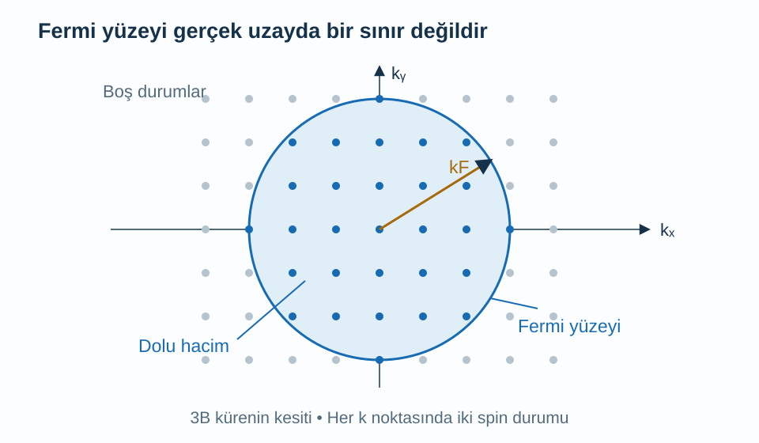
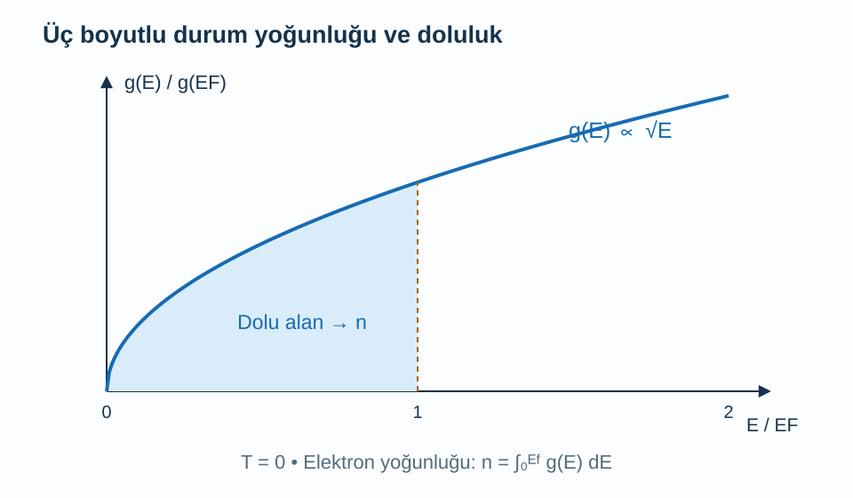

Bir enerji bandının çizimini görmek, o bandın farklı enerjilerde kaç elektron barındırabileceğini henüz söylemez. Aynı enerji aralığına bazı yerlerde az, başka yerlerde çok sayıda kuantum durumu sığabilir. Bu ayrım, elektronların nasıl dolduğunu, sıcaklık artınca kaçının davranış değiştirebildiğini ve hangi enerji çevresinin iletkenlikte önemli olduğunu anlamak için gereklidir.

Bu yazı [ters örgü](/blog/ters-orgu-ve-bragg-kirinimi/), [enerji bantları](/blog/kristaller-ve-enerji-bantlari/) ve [Fermi–Dirac dağılımı](/blog/bose-einstein-ve-fermi-dirac-dagilimlari/) üzerine kurulur. İntegrali küçük katkıların toplamı olarak kullanacağız; gerekirse [belirli integral](/blog/belirli-integral-ve-temel-teorem/) yazısına dönülebilir. Önce etkileşmeyen, üç boyutlu serbest elektron modelini tam olarak sayacağız. Sonra bu sonucun gerçek kristallerde ne kadarını koruduğunu ayıracağız.

## 1. Bir kuantum durumu neyi sayar?

Kenarı $L$, hacmi $V=L^3$ olan büyük bir kutu düşünelim. Kutunun karşılıklı yüzlerini matematiksel olarak birbirine bağlayan periyodik sınır koşulu seçelim. Dalga bir yönde $L$ ilerleyince aynı değere dönmelidir. Düzlem dalga için bu, $e^{ik_xL}=1$ koşuludur; $k_x$, dalga vektörünün $x$ bileşenidir. Böylece:

$$
\begin{aligned}
k_x&=\frac{2\pi n_x}{L}\\
k_y&=\frac{2\pi n_y}{L}\\
k_z&=\frac{2\pi n_z}{L}
\end{aligned}
$$

elde edilir. $n_x,n_y,n_z$ tam sayılardır. Komşu izinli değerler her doğrultuda $2\pi/L$ uzaklıkta olduğundan, dalga vektörü uzayında bir uzaysal durumun payına $(2\pi/L)^3=(2\pi)^3/V$ hacim düşer. Bu bir gerçek uzay hacmi değildir; birimi $\mathrm{m^{-3}}$ olan bir dalga vektörü uzayı hücresidir.

Elektronun iki spin durumu vardır. Manyetik alanı ve spin ayrışmasını ihmal ettiğimiz bu modelde her uzaysal dalga için iki ayrı tek elektron durumu sayarız. Pauli ilkesi aynı spin dahil bütünüyle aynı tek parçacık durumuna ikinci elektron koymamızı yasaklar. Bazen kaynaklar durum yoğunluğunu spin başına verir; bazen iki spini birlikte içerir. Sonuçlardaki iki çarpanını karşılaştırmadan önce bu tercihi kontrol etmek gerekir.

## 2. Küre içindeki noktaları saymak

Serbest elektronun enerjisi $E=\hbar^2k^2/(2m_e)$ olsun. Burada $m_e$ elektronun kütlesi, $\hbar$ indirgenmiş Planck sabiti, $k=|\mathbf k|$ dalga vektörünün büyüklüğüdür. Enerjinin sıfırını bandın dibinde seçiyoruz. Enerji yalnız büyüklüğe bağlı olduğu için aynı enerjideki durumlar dalga vektörü uzayında bir küre üzerinde bulunur.

Yarıçapı $k$ olan kürenin hacmi $4\pi k^3/3$'tür. Bunu bir durumun kapladığı hücre hacmine bölüp spin çarpanı olan ikiyle çarparsak, enerjisi bu kürenin sınır enerjisinden küçük durum sayısını elde ederiz:

$$
\begin{aligned}
\mathcal N(k)&=2\frac{V}{(2\pi)^3}\frac{4\pi k^3}{3}\\
&=\frac{Vk^3}{3\pi^2}.
\end{aligned}
$$

$\mathcal N$ kullanılabilir durum sayısıdır; henüz elektronların hepsinin bunları doldurduğunu söylemedik. Büyük kutu sınırında nokta sayımını hacim oranıyla yaklaştırdık. Küçük bir kutunun sınırında birkaç noktanın dahil olup olmaması önem kazanır; makroskopik bir katıda bu fark toplam sayıya göre çok küçüktür.

Enerji bağıntısını $k$ için çözelim. Önce iki tarafı $2m_e/\hbar^2$ ile çarpar, sonra pozitif karekökü alırız: $k=\sqrt{2m_eE}/\hbar$. Bunu sayım formülüne koyunca:

$$
\frac{\mathcal N(E)}V=
\frac1{3\pi^2}\left(\frac{2m_e}{\hbar^2}\right)^{3/2}E^{3/2}
$$

bulunur. Buradaki $3/2$ üssü, üç boyutlu küre hacminin $k^3$ olmasıyla enerjinin $k^2$ olmasının birlikte sonucudur.

Şekil üç boyutlu kürenin iki boyutlu kesitidir. Noktalar kristaldeki atom konumları değildir. Dolu bölgeyi gerçek uzayda elektronların sıkıştığı bir top gibi yorumlamamalıyız.

## 3. Durum yoğunluğu türevden çıkar

**Durum yoğunluğu**, küçük bir enerji aralığında kaç durum bulunduğunu ifade eder. Hacim başına yoğunluğu $g(E)$ ile gösterelim:

$$
g(E)=\frac1V\frac{d\mathcal N}{dE}.
$$

Böylece $E$ ile $E+dE$ arasındaki durum sayısı yaklaşık $Vg(E)dE$ olur. $dE$ küçük enerji genişliğidir. Bir önceki $E^{3/2}$ ifadesinin türevi $(3/2)E^{1/2}$ olduğundan:

$$
g(E)=\frac1{2\pi^2}\left(\frac{2m_e}{\hbar^2}\right)^{3/2}\sqrt E.
$$

Bu formül $E>0$ için geçerlidir; bandın altında bu modelde durum yoktur. Enerjiyi joule cinsinden kullanırsak birim $\mathrm{J^{-1}m^{-3}}$ olur. Elektronvolt cinsinden enerji aralığıyla çarpacaksak yoğunluğu da elektronvolt başına çevirmeliyiz. Sadece grafiğin eksenine eV yazıp joule başına sayıları aynen bırakmak birim hatasıdır.

Durum yoğunluğu ile elektron yoğunluğu farklıdır. Kullanılabilir her durum dolu olmayabilir. Doluluk olasılığı $f(E)$ olduğunda hacim başına elektron sayısı:

$$
n=\int_0^\infty g(E)f(E)\,dE
$$

olur. $n=N/V$ elektron yoğunluğu, $N$ elektron sayısıdır. Her küçük aralıktaki yer sayısını o yerlerin ortalama doluluk oranıyla çarpıp topluyoruz. Bu işlem bir oturma düzeni benzetmesine izin verir; fakat kuantum durumları uzayda sabit birer koltuk değildir.

Enerji birimini değiştirmeyi açıkça yapalım. $E_J=cE_{\rm eV}$ ve $c=1{,}602176634\times10^{-19}\,\mathrm{J/eV}$ ise aynı aralıktaki durum sayısı değişmemelidir:

$$
\begin{aligned}
g_J(E_J)\,dE_J&=g_{\rm eV}(E_{\rm eV})\,dE_{\rm eV},\\
g_{\rm eV}(E_{\rm eV})&=c\,g_J(cE_{\rm eV}).
\end{aligned}
$$

Yani yalnız enerji değerini dönüştürmeyiz; yoğunluğun dikey ölçeğini de c ile çarparız. Örneğin bir noktada $10^{47}\,\mathrm{J^{-1}m^{-3}}$ olan durum yoğunluğu, aynı enerjide yaklaşık $1{,}602\times10^{28}\,\mathrm{eV^{-1}m^{-3}}$ olur. Büyük sayı değişikliği fiziksel yer sayısını değiştirmez: karşılık gelen enerji genişliği ters yönde değişerek çarpımı korur.

## 4. Sıfır sıcaklıkta Fermi yüzeyi

Mutlak sıfırda, etkileşmeyen elektronlar Pauli ilkesine uyarak en düşük durumları doldurur. Doldurulan en yüksek enerjiye **Fermi enerjisi** $E_F$, ilgili kürenin yarıçapına **Fermi dalga sayısı** $k_F$ denir. Sayım denkleminde $\mathcal N=N$ ve $k=k_F$ koyarsak:

$$
\begin{aligned}
n&=\frac{k_F^3}{3\pi^2}\\
k_F&=(3\pi^2n)^{1/3}\\
E_F&=\frac{\hbar^2}{2m_e}(3\pi^2n)^{2/3}.
\end{aligned}
$$

Küp kök alınmasının nedeni durum sayısının küre hacmiyle büyümesidir. Yoğunluğu sekiz kat artırırsak $k_F$ iki kat, $E_F$ dört kat olur. Enerjinin yoğunlukla doğrusal artmasını beklememeliyiz; durumları üç boyutlu bir geometri içinde dolduruyoruz.

**Fermi yüzeyi** bu dolu hacmin sınırıdır. Serbest modelde küre olan sınır, kristalde bant enerjisi $E_b(\mathbf k)=E_F$ koşulunu sağlayan daha karmaşık yüzeylere dönüşebilir; $b$ bant etiketidir. Birden çok ayrı parça veya boşluk benzeri cepler oluşabilir. Bir bandın tamamen dolu olması durumunda ise o bant içinde dolu ile boş durumları ayıran bir Fermi yüzeyi bulunmaz. Bu ayrımın bant yapısıyla ilişkisi [Tong'un katıda elektron dinamiği notlarında](https://davidtong.org/pdfs/teaching/solid-state-physics/solidstate3.pdf) açıklanır.

## 5. Sayısal örnek: Bir metal ölçeği

Model elektron yoğunluğunu $n=8{,}0\times10^{28}\,\mathrm{m^{-3}}$ seçelim. Bu sayı belirli bir metalin ayrıntılı bant yapısını temsil etmez; yalnız metal yoğunluğu ölçeğinde bir örnektir. $\hbar=1{,}05457\times10^{-34}\,\mathrm{J\,s}$ ve $m_e=9{,}10938\times10^{-31}\,\mathrm{kg}$ kullanacağız.

Önce yoğunluğu geometrik çarpanla çarparız:

$$
3\pi^2n\simeq2{,}3687\times10^{30}\,\mathrm{m^{-3}}.
$$

Küp kök aldığımızda $k_F\simeq1{,}3330\times10^{10}\,\mathrm{m^{-1}}$ çıkar. Ardından enerji:

$$
\begin{aligned}
\frac{\hbar^2}{2m_e}&\simeq6{,}1043\times10^{-39}\,\mathrm{J\,m^2},\\
k_F^2&\simeq1{,}7770\times10^{20}\,\mathrm{m^{-2}},\\
E_F&\simeq1{,}0847\times10^{-18}\,\mathrm J\\
&\simeq6{,}770\,\mathrm{eV}.
\end{aligned}
$$

olur. Son adımda $1\,\mathrm{eV}=1{,}60218\times10^{-19}\,\mathrm J$ kullandık. Fermi hızını $v_F=\hbar k_F/m_e$ ile hesaplarsak yaklaşık $1{,}543\times10^6\,\mathrm{m/s}$ buluruz. Bu yüksek hız net elektrik akımı olduğu anlamına gelmez; dengede zıt yönlerdeki durumlar simetrik doludur.

Fermi sıcaklığı $T_F=E_F/k_B$ diye tanımlanır; $k_B=1{,}380649\times10^{-23}\,\mathrm{J/K}$ Boltzmann sabitidir. Burada $T_F\simeq7{,}86\times10^4\,\mathrm K$ çıkar. Bu sayı elektronların gerçekten o sıcaklıkta olduğu iddiası değildir. Kuantum doluluğunun enerji ölçeğini sıcaklık birimine çevirir. Oda sıcaklığı bu ölçekten çok küçük olduğundan klasik seyrek gaz yaklaşımı bu elektronlar için uygun değildir.

## 6. Sonlu sıcaklıkta sınır nasıl yumuşar?

Sıcaklık $T>0$ olduğunda doluluk:

$$
f(E)=\frac1{e^{(E-\mu)/(k_BT)}+1}
$$

olur. $\mu$ kimyasal potansiyeldir; elektron sayısı sabitken sıcaklığa göre ayarlanır. Mutlak sıfır limitinde uygun koşullarda $E_F$'ye yaklaşır; sonlu sıcaklıkta ikisini her koşulda birebir aynı saymak doğru değildir. $E=\mu$ noktasında üstel $1$ olduğu için $f=1/2$ çıkar.

$E=\mu+3k_BT$ için doluluk $1/(e^3+1)\simeq0{,}0474$; $E=\mu-3k_BT$ için yaklaşık $0{,}9526$'dır. Sıcaklık bütün bandı eşit biçimde yeniden doldurmaz; değişim başlıca kimyasal potansiyelin birkaç $k_BT$ çevresinde gerçekleşir. Derindeki elektronların üstlerinde yakın boş durumlar bulunmadığı için küçük enerji aktarımıyla hareket alanları sınırlıdır.

Eğrinin altındaki dolu alan elektron yoğunluğunu verir. Eğrinin yüksekliği tek başına elektron sayısı değildir; enerji aralığı boyunca integral alınmalıdır. Sonlu sıcaklıkta bu alanın keskin kenarı doluluk fonksiyonu nedeniyle yumuşar.

## 7. Sayısal örnek: İki boyutta sayım değişir

Elektronların ince bir tabakada yalnız iki yönde serbest olduğu ideal modeli ele alalım. Alan $A=L^2$, alan başına elektron yoğunluğu $n_{2D}=N/A$ olsun. Dalga vektörü uzayındaki bir durumun alanı $(2\pi)^2/A$, yarıçapı $k$ olan dairenin alanı $\pi k^2$'dir. Spin çarpanını yine iki alarak:

$$
\frac{\mathcal N(k)}A=\frac{k^2}{2\pi}.
$$

Parabolik enerji $E=\hbar^2k^2/(2m)$ olsun; $m$ bu örnekte kullanılan pozitif kütle parametresidir. $k^2=2mE/\hbar^2$ yerine konulduğunda:

$$
\begin{aligned}
\frac{\mathcal N(E)}A&=\frac{mE}{\pi\hbar^2}\\
g_{2D}(E)&=\frac{m}{\pi\hbar^2}
\end{aligned}
$$

bulunur. Türev artık sabittir. Üç boyuttaki karekök sonucunu iki boyuta aynen taşımak yanlış olur. Bunun kaynağı elektronun başka bir istatistiğe geçmesi değil, sayılan geometrinin küreden daireye dönüşmesidir.

$n_{2D}=1{,}0\times10^{16}\,\mathrm{m^{-2}}$, $m=m_e$ seçelim. $k_F=\sqrt{2\pi n_{2D}}=2{,}5066\times10^8\,\mathrm{m^{-1}}$ olur. Fermi enerjisi:

$$
\begin{aligned}
E_F&=\frac{\pi\hbar^2n_{2D}}{m_e}\\
&=3{,}8354\times10^{-22}\,\mathrm J\\
&\simeq2{,}394\,\mathrm{meV}.
\end{aligned}
$$

Burada meV, elektronvoltun binde biridir. Karşılık gelen $T_F$ yaklaşık $27{,}78\,\mathrm K$'dir. Aynı kütleyi kullanmamıza rağmen seçilen yüzey yoğunluğunun enerji ölçeği önceki metal örneğinden çok küçüktür. Yoğunluğun birimi de farklı olduğundan iki yoğunluğun sayısal değerlerini doğrudan karşılaştırmak anlamlı değildir.

## 8. Dar bir enerji kabuğunda kaç durum vardır?

Fermi yüzeyinin önemi yalnız geometrik bir adlandırmadan ibaret değildir. Fermi enerjisi yakınındaki küçük bir $\Delta E$ aralığında durum yoğunluğu fazla değişmiyorsa hacim başına durum sayısı yaklaşık $\Delta n_{\mathrm{durum}}=g(E_F)\Delta E$ olur. Buradaki $\Delta n_{\mathrm{durum}}$ gerçek uyarılmış elektron sayısı değildir; kullanılabilir durum sayısını ifade eder. Elektronların hangi yönde yeniden dağıldığını bulmak için doluluk değişimini de bilmeliyiz.

Üç boyutlu serbest modelde daha önce türettiğimiz sayım ve yoğunluk formüllerini birbirine bölersek $g(E_F)=3n/(2E_F)$ elde ederiz. Böylece ince kabuğun bütün durumlara oranı:

$$
\frac{\Delta n_{\mathrm{durum}}}{n}
\simeq\frac{3\Delta E}{2E_F}
$$

olur. Metal örneğinde $\Delta E=0{,}026\,\mathrm{eV}$ seçersek oran yaklaşık $0{,}00576$, yani yüzde $0{,}58$ çıkar. Bu, Fermi enerjisine göre dar bir enerji aralığının bütün elektronları içermediğini gösterir. Küçük bir sıcaklık veya zayıf bir uyarı, elektron sayısının tamamını aynı ölçüde yeniden düzenlemez.

Hesapta enerji aralığı pozitif bir genişliktir. Simetrik olarak Fermi enerjisinin hem altını hem üstünü kapsayan bir pencere seçersek toplam genişliği buna göre tanımlamalıyız. Aynı $\Delta E$ simgesini bir hesapta yarı genişlik, diğerinde tam genişlik için kullanmak iki çarpanı hatasına yol açabilir. Kabuk yaklaşımının koşulu da açıktır: $\Delta E$, durum yoğunluğunun belirgin değiştiği enerji ölçeğine göre küçük olmalıdır.

## 9. Modeli gerçek bir banda taşırken

Bir bant dibinin yakınında enerji yaklaşık parabolikse, sayımın geometrisini koruyup uygun etkin kütleyi kullanabiliriz. Birden fazla eşdeğer vadi varsa her vadinin durum katkısını eklemeliyiz. Eğri parabolik değilse ya da kütle yönlere göre değişiyorsa tek bir küre formülü bütün enerji aralığında geçerli olmaz. İdeal bir ve iki boyutlu modellerin eşik davranışları da gerçek kalınlık, düzensizlik ve sıcaklık nedeniyle değişebilir.

Sayımın genel düşüncesi daha geniştir: Enerji yüzeyinin çevresinde ince bir kabuk alır, o kabuğun içerdiği izinli dalga vektörlerini sayarız. Enerji dalga vektörüne göre yavaş değişiyorsa dar enerji aralığına daha çok durum sığabilir. [Tong'un kuantum gazları notlarındaki durum sayımı](https://davidtong.org/pdfs/teaching/statistical-physics/statphys3.pdf) bu geometrik yaklaşımın temelini verir. Doluluk ve yer sayısını ayrı tutmak, sonraki taşıma ve yarı iletken hesaplarında aynı formüle farklı fiziksel anlamlar yüklememizi önleyecektir.
