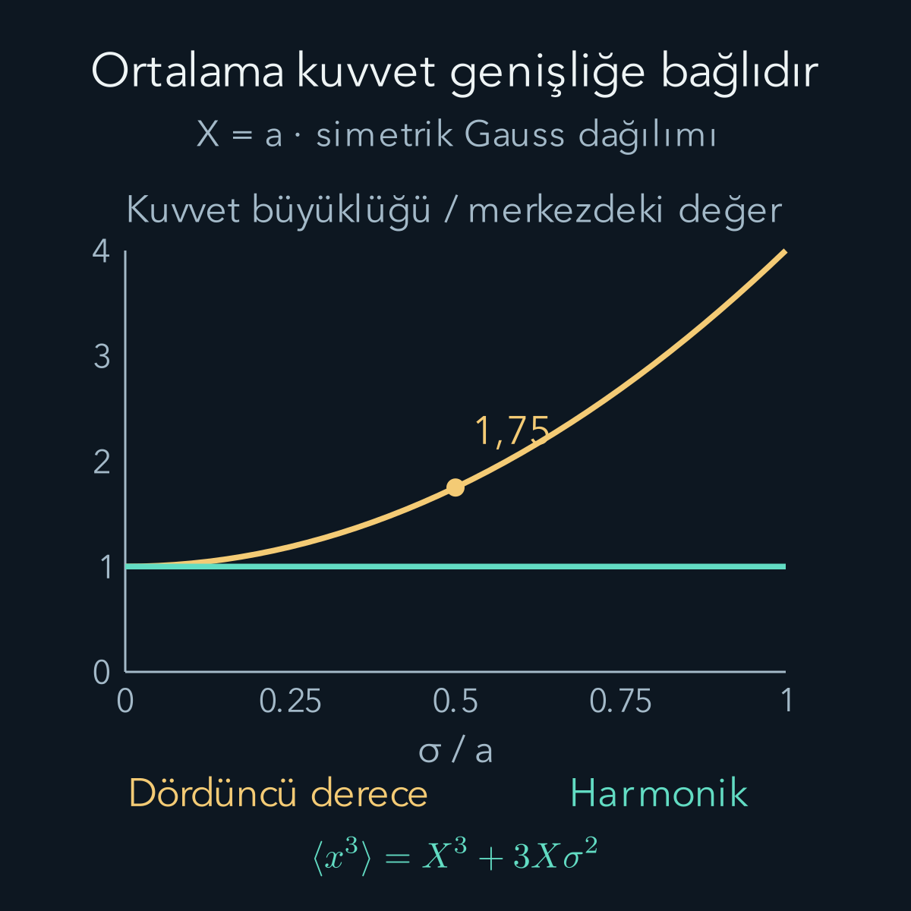
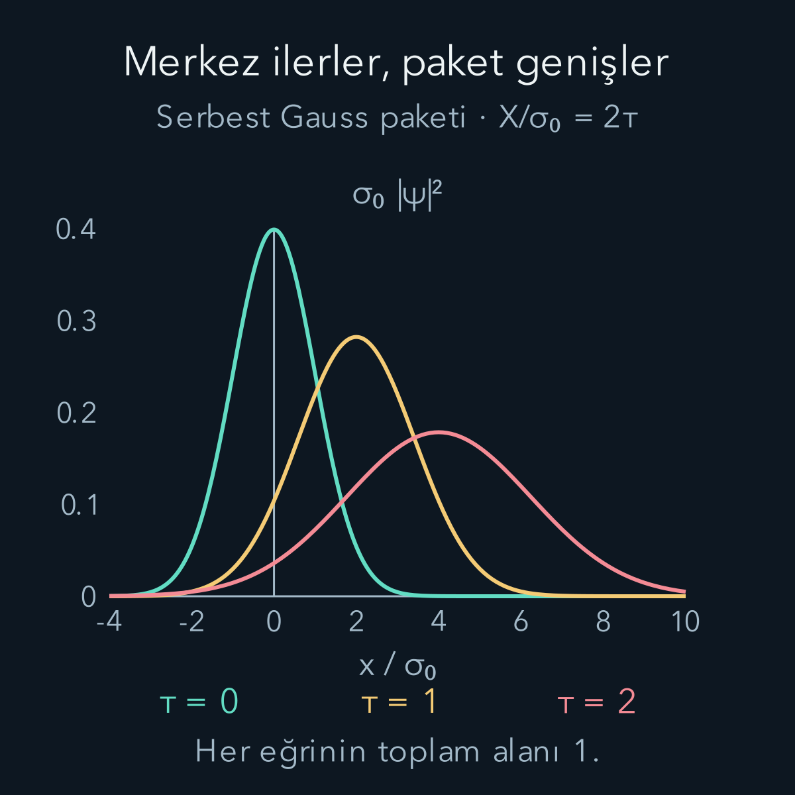

import ArticleVideo from '@/components/ArticleVideo.astro'
import kavram from './media/01-kavram.mp4?url'
import kavramPoster from './media/01-kavram.jpg?url'

Bir topun hareketini anlatırken konumunu zamana bağlı tek bir sayı olarak yazabiliyoruz. Bir elektron içinse genellikle bir konum olasılık dağılımı hesaplıyoruz. Bu iki anlatım arasında nasıl bağ kurulur? Dağılımın ortalamasını izlediğimizde Newton'un hareket denklemini bulabilir miyiz? Ehrenfest teoremi bu soruya kesin bir başlangıç verir; fakat tek başına “her kuantum sistemi küçük bir klasik parçacıktır” sonucunu vermez.

Bu yazıda [Hamiltonyen ve zaman evrimi](/blog/hamiltonyen-ve-kuantum-zaman-evrimi/), [komütatör ve belirsizlik](/blog/komutatorler-ve-belirsizlik-iliskisi/) ve [dalga paketleri](/blog/fourier-serileri-ve-dalga-paketleri/) bilgilerini kullanacağız. Türevde çarpım kuralını yeniden açıkça uygulayacağız. Hedefimiz önce tam bir denklem çıkarmak, sonra bu denklemi klasik harekete benzetirken eklediğimiz yaklaşık adımı belirlemektir.

## 1. Ortalama hangi deneyin ortalamasıdır?

Aynı başlangıç durumunda çok sayıda sistem hazırladığımızı düşünelim. Her birini aynı süre boyunca kendi halinde bırakalım ve o sürenin sonunda konum ölçelim. Sonuçlar $x_1,x_2,\ldots$ gibi farklı sayılar olabilir. Çok sayıda denemede aritmetik ortalama, kuramsal beklenen değere yaklaşır:

$$
X(t)\equiv\langle x\rangle
=\int_{-\infty}^{\infty}x|\psi(x,t)|^2\,dx.
$$

Burada $\psi$ normalize dalga fonksiyonu, $|\psi|^2$ birim uzunluk başına olasılık yoğunluğu, $t$ zaman ve $X$ dağılımın ortalama konumudur. Normalizasyon $\int|\psi|^2dx=1$ demektir. Ortalama, tek deneyde mutlaka elde edilecek sonuç değildir. İki ayrı bölgede yoğunlaşmış bir dağılımın ortalaması, aralarında neredeyse hiç parçacık bulunmayan bir noktaya bile düşebilir.

Dağılımın genişliği de ayrı bir niceliktir:

$$
\begin{aligned}
\sigma_x^2&=\langle(x-X)^2\rangle\\
&=\langle x^2\rangle-X^2.
\end{aligned}
$$

$\sigma_x$ konumun standart sapmasıdır; konum gibi metre birimindedir. $X$'in değişmesi dağılımın yer değiştirmesini, $\sigma_x$'in değişmesi yayılmasını veya daralmasını anlatır. Bunlardan biri diğerini belirlemez. Ayrıca farklı zamanlardaki bu ortalamaları aynı elektronu sürekli konum ölçerek izlemekle karıştırmamalıyız. Sürekli ölçüm, izlemeye çalıştığımız evrimi değiştirebilir.

## 2. Beklenen değerin türevini birlikte açmak

Genel bir gözlenebilirin operatörünü $A(t)$ ile gösterelim. Beklenen değeri bra-ket dilinde $\langle A\rangle=\langle\psi|A|\psi\rangle$'dir. $A$'nın kendisi de açıkça zamana bağlı olabilir. Örneğin ölçüm ekseni zamanla döndürülüyorsa ölçülen bileşenin tanımı değişir.

Schrödinger denklemi ve onun eşlenik transpozu:

$$
\begin{aligned}
i\hbar\frac{d|\psi\rangle}{dt}&=H|\psi\rangle,\\
\frac{d|\psi\rangle}{dt}&=-\frac{i}{\hbar}H|\psi\rangle,\\
\frac{d\langle\psi|}{dt}&=\frac{i}{\hbar}\langle\psi|H.
\end{aligned}
$$

$H$ Hamiltonyen, yani enerji operatörüdür; $\hbar$ indirgenmiş Planck sabiti, $i^2=-1$ sanal birimdir. Son satırda işaretin değişmesi $i$'nin karmaşık eşleniğinin $-i$ olmasından gelir. Hamiltonyeni Hermit, yani eşlenik transpozuna eşit aldık.

Şimdi üç çarpanın her birinin türevini sırayla alalım:

$$
\begin{aligned}
\frac{d\langle A\rangle}{dt}
&=\frac{d\langle\psi|}{dt}A|\psi\rangle\\
&\quad+\langle\psi|\frac{\partial A}{\partial t}|\psi\rangle\\
&\quad+\langle\psi|A\frac{d|\psi\rangle}{dt}.
\end{aligned}
$$

Durumların türevlerini yukarıdan koyunca ilk terim $(i/\hbar)\langle HA\rangle$, son terim $-(i/\hbar)\langle AH\rangle$ olur. Dolayısıyla:

$$
\boxed{\begin{aligned}
\frac{d\langle A\rangle}{dt}
&=\frac{i}{\hbar}\langle[H,A]\rangle\\
&\quad+\left\langle\frac{\partial A}{\partial t}\right\rangle.
\end{aligned}}
$$

$[H,A]=HA-AH$ komütatörüdür; çarpımların sırası önemlidir. Bu, genel **Ehrenfest bağıntısıdır**. Sağda iki ayrı değişim kaynağı vardır: durumun Hamiltonyenle evrilmesi ve operatörün tanımının açıkça zamanla değişmesi. $H$ zamanla değişse de bu eşitlik geçerlidir; türev aldığımız nicelik $A$ olduğundan ayrıca bir $\partial H/\partial t$ terimi kendiliğinden eklenmez. Ancak $A=H$ seçersek o terim zaten son beklenti içinde bulunur.

Burada operatör çarpımlarının ve beklenen değerlerin tanımlı olduğunu varsayıyoruz. Aşağıda tüm gerçek doğru üzerinde yeterince düzgün, uçlarda hızla azalan dalga fonksiyonları kullanacağız. Sonsuz sert duvar gibi tekil sınırlar olduğunda yüzey terimlerini ayrıca incelemek gerekir; düzgün potansiyeller için yaptığımız işlemleri duvara doğrudan taşımayacağız.

## 3. Konumun türevi momentumdur

Bir boyutta, dış manyetik alan içermeyen şu Hamiltonyeni seçelim:

$$
H=\frac{p^2}{2m}+V(x).
$$

$m$ sabit pozitif kütle, $p$ momentum operatörü, $V$ potansiyel enerjidir. Konum temsilinde $p=-i\hbar\partial_x$ olur. Bu yazıda $x$ ve $p$ operatörlerinin açık zaman bağımlılığı yoktur. Önceki yazıda bulduğumuz $[x,p]=i\hbar$ eşitliğinden $[p,x]=-i\hbar$ elde ederiz.

Komütatörün çarpım kuralı $[AB,C]=A[B,C]+[A,C]B$ olduğundan:

$$
\begin{aligned}
[p^2,x]&=p[p,x]+[p,x]p\\
&=-2i\hbar p,\\
[H,x]&=-\frac{i\hbar}{m}p.
\end{aligned}
$$

$V(x)$ ile $x$ aynı fonksiyonu çarpmak türünden işlemler olduğu için $[V(x),x]=0$ kullandık. Sonucu genel bağıntıya koyunca:

$$
\boxed{\dot X=\frac{\langle p\rangle}{m}.}
$$

Üstteki nokta zamana göre türev demektir. Birim denetimi de doğru: momentumun kütleye bölümü metre/saniyedir. Bu sonuç herhangi bir dar paket yaklaşımı kullanmadan elde edildi.

## 4. Momentumun türevi hangi kuvvettir?

Şimdi $A=p$ seçelim. $p^2$ ile $p$ yer değiştirir. Potansiyel için işareti ezberlemek yerine, düzgün bir deneme fonksiyonu $f(x)$ üzerinde hesaplayalım:

$$
\begin{aligned}
[V,p]f&=-i\hbar V f'
+i\hbar(Vf)'\\
&=-i\hbar Vf'
+i\hbar(V'f+Vf')\\
&=i\hbar V'f.
\end{aligned}
$$

Kesme işareti konuma göre türevdir. Böylece $[V,p]=i\hbar V'(x)$ ve:

$$
\begin{aligned}
\frac{d\langle p\rangle}{dt}&=-\langle V'(x)\rangle,\\
m\ddot X&=\langle F(x)\rangle,
\qquad F(x)=-V'(x).
\end{aligned}
$$

$F$ kuvvettir. Buradaki tam sonuç **kuvvetin ortalamasını** içerir. Newton denklemindeki tek yörüngeyi elde etmek içinse $m\ddot X=F(X)$ yazmak isterdik. Genel olarak $\langle F(x)\rangle$ ile $F(\langle x\rangle)$ eşit değildir. “Önce fonksiyonu uygula, sonra ortalamasını al” ile “önce ortalamayı al, sonra fonksiyonu uygula” aynı işlem değildir. Örneğin ortalaması sıfır olan bir dağılımda $\langle x^2\rangle$ pozitif olabilir; oysa $\langle x\rangle^2=0$'dır.

## 5. Harmonik potansiyelde merkez denklemi tam kapanır

$V(x)=m\omega^2x^2/2$ olsun. $\omega$ açısal frekanstır ve birimi saniyenin tersidir. Kuvvet $F(x)=-m\omega^2x$ olduğundan ortalama almak yalnız $x$'i $X$ ile değiştirir:

$$
\langle F(x)\rangle=-m\omega^2X.
$$

Dolayısıyla $\ddot X+\omega^2X=0$. Başlangıç ortalama konumu $X_0$, ortalama momentumu $P_0$ ise çözüm:

$$
X(t)=X_0\cos\omega t
+\frac{P_0}{m\omega}\sin\omega t.
$$

Bu, klasik harmonik hareket denkleminin aynısıdır. Üstelik paket dar olmak zorunda değildir: kuvvetin konuma doğrusal bağlı olması yeterlidir. Sabit kuvvette ve serbest parçacıkta da merkez denklemi aynı nedenle tam olarak kapanır.

Yine de iki durumun merkez hareketleri aynı diye bütün kuantum durumları aynı olmaz. Aynı $X_0$ ve $P_0$'a sahip iki paket farklı genişliklerde olabilir. Birinin genişliği zamanla salınırken diğerininki sabit kalabilir. Harmonik potansiyelde uygun eşevreli durumun genişliği sabittir; bu özel özellik her başlangıç durumuna genellenmez. Teorem burada yalnız birinci momentleri, yani konum ve momentum ortalamalarını belirledi.

## 6. Doğrusal olmayan kuvvette genişlik hesaba girer

Karşılaştırma için $V(x)=g x^4/4$ seçelim; $g>0$ bir sabittir ve birimi joule/metre üzeri dörttür. Kuvvet $F(x)=-g x^3$ olur. $x=X+\delta x$ yazalım; $\delta x$ merkezden sapmadır. Tanım gereği $\langle\delta x\rangle=0$ ve $\langle(\delta x)^2\rangle=\sigma_x^2$.

Küpü açıp her terimin ortalamasını alırsak:

$$
\begin{aligned}
\langle x^3\rangle
&=X^3+3X^2\langle\delta x\rangle\\
&\quad+3X\langle(\delta x)^2\rangle
+\langle(\delta x)^3\rangle\\
&=X^3+3X\sigma_x^2+\mu_3.
\end{aligned}
$$

$\mu_3$ üçüncü merkezî momenttir; dağılımın asimetrisini ölçen bir niceliktir. O anda merkez etrafında simetrik bir dağılım için sıfırdır. Böyle bir anda:

$$
m\ddot X=-g(X^3+3X\sigma_x^2).
$$

Örneğin $a$ bir uzunluk ölçeği olsun. $X=a$ ve $\sigma_x=a/2$ seçersek $X^3=a^3$, $3X\sigma_x^2=3a^3/4$ çıkar. Merkezdeki kuvvet $-ga^3$ iken ortalama kuvvet $-1{,}75ga^3$ olur. Aynı merkez, yüzde 75 daha büyük kuvvet büyüklüğüyle karşılaşır. Bu bir başlangıç anı hesabıdır; dördüncü dereceden potansiyelde dağılımın her zaman Gauss veya simetrik kalacağını varsaymadık.

Genişlik $a/10$ olsaydı oran $1+3/100=1{,}03$ olurdu. Bu kez merkez kuvveti yüzde üçlük düzeltmeyle yaklaşırdı. Dolayısıyla “paket dar” demek mutlak metre sayısına bakmak değildir. Paket, kuvvetin belirgin değiştiği uzunluk ölçeğine göre dar olmalıdır.

## 7. Genel kuvvet için yaklaşımın ölçüsü

Kuvvet paket boyunca düzgün değişiyorsa merkez çevresinde Taylor açılımı yapabiliriz:

$$
\begin{aligned}
F(X+\delta x)&=F(X)+F'(X)\delta x\\
&\quad+\tfrac12F''(X)(\delta x)^2+\cdots.
\end{aligned}
$$

Ortalama alınca doğrusal sapma terimi kaybolur:

$$
\langle F(x)\rangle
=F(X)+\tfrac12F''(X)\sigma_x^2+\cdots.
$$

İlk düzeltme, kuvvetin eğriliği ile paketin varyansının çarpımıdır. $F(X)\ne0$ ise $|F''(X)|\sigma_x^2/2\ll|F(X)|$ kullanışlı bir yerel denetimdir. Ayrıca daha yüksek türevlerin ve momentlerin katkıları da küçük olmalıdır. $F(X)=0$ civarında sıfıra bölünen bir “yüzde hata” kullanmak anlamsızdır; düzeltmeyi deneyin kabul ettiği mutlak kuvvet veya ivme hatasıyla karşılaştırırız.

Başlangıçta iyi çalışan yaklaşımın sonsuza kadar iyi kalması gerekmez. Dalga paketi yayılabilir, iki ayrı kola ayrılabilir veya kuvvetin daha hızlı değiştiği bir bölgeye girebilir. Bu yüzden klasik yaklaşım, belirli bir başlangıç durumu ve belirli bir zaman aralığı için denetlenir.

## 8. Serbest pakette yayılma süresini hesaplamak

Serbest parçacıkta $V=0$ ve $P_0=\langle p\rangle$ sabittir. Merkez $X=X_0+P_0t/m$ doğrusu üzerinde gider. Başlangıçtaki konum-momentum korelasyonu sıfır olan minimum belirsizlikli bir Gauss paketi için genişlik:

$$
\sigma_x(t)=\sigma_0
\sqrt{1+\left(\frac{t}{t_0}\right)^2},
\qquad t_0=\frac{2m\sigma_0^2}{\hbar}.
$$

$\sigma_0$ başlangıç standart sapmasıdır. Bu sonucu momentlerle görebiliriz; bunun için zaman bağımlılığını durumdan operatöre aktaran kısa bir gösterim tanımlayalım. $U(t)$ üniter zaman evrimi operatörü, $U^\dagger$ onun eşlenik transpozu olsun. **Heisenberg operatörü** $x_H(t)=U^\dagger(t)xU(t)$ olarak tanımlanır. Başlangıç durumunda $x_H(t)$'nin beklentisi, evrilmiş durumda $x$'in beklentisine eşittir; bu, yeni bir fiziksel varsayım değil aynı hesabın başka yazımıdır. Momentum için de $p_H(t)=U^\dagger pU$ tanımlarız.

$\dot U=-iHU/\hbar$ ve $\dot U^\dagger=iU^\dagger H/\hbar$ olduğundan çarpım kuralı $\dot x_H=(i/\hbar)U^\dagger[H,x]U=p_H/m$ verir. Serbest parçacıkta $[H,p]=0$ olduğu için $\dot p_H=0$'dır. İntegral alınca $p_H(t)=p$ ve $x_H(t)=x+pt/m$ elde edilir. Önceki bölümlerdeki Schrödinger operatörleri $x,p$ yine zamandan bağımsızdır; zaman taşıyan yeni nesne alt indisli $x_H$'dir. Bu son eşitliğin başlangıç durumundaki varyansını açmak:

$$
\sigma_x^2(t)=\sigma_0^2
+\frac{2t}{m}C_{xp}
+\frac{t^2}{m^2}\sigma_p^2
$$

verir. Burada $\delta x=x-X_0$ ve $\delta p=p-P_0$ başlangıç ortalamalarından sapma operatörleridir. $C_{xp}=\langle\delta x\delta p+\delta p\delta x\rangle_0/2$ başlangıçtaki simetrik kovaryans, $\sigma_p$ başlangıç momentum standart sapmasıdır. Alt $0$, beklentinin başlangıç durumunda alındığını belirtir; simetrik toplam, yer değiştirmeyen iki operatörden gerçek bir kovaryans üretir. Başlangıç için $C_{xp}=0$ ve minimum belirsizlikli Gauss için $\sigma_p=\hbar/(2\sigma_0)$ koyunca üstteki genişlik çıkar. Başlangıçta korelasyon varsa paket bir süre daralabilir; verdiğimiz karekök yasası bütün serbest durumlar için aynı biçimde geçerli değildir.

Başlangıç korelasyonunun daralma yaratabileceğine bir örnek verelim. Ortalamaları sıfır olan, zarfı Gauss biçimindeki $\psi(x,0)=N\exp[-(1+i)x^2/(4\sigma_0^2)]$ durumunu seçelim; N normalleştirme sabitidir. Karesel faz yoğunluğu değiştirmez. Türevden $p\psi=\hbar(-1+i)x\psi/(2\sigma_0^2)$ bulunur. Buradan $\sigma_p^2=\hbar^2/(2\sigma_0^2)$ ve $C_{xp}=\operatorname{Re}\langle xp\rangle=-\hbar/2$ çıkar. Genel varyans formülü:

$$
\sigma_x^2(t)=\sigma_0^2-\frac{\hbar t}{m}
+\frac{\hbar^2t^2}{2m^2\sigma_0^2}
$$

verir. Türev $-\hbar/m+\hbar^2t/(m^2\sigma_0^2)$ olduğundan minimum $t_*=m\sigma_0^2/\hbar$ anındadır; o anda $\sigma_x^2=\sigma_0^2/2$ olur. Paket önce daralıp sonra yayılır. Belirsizlik ihlal edilmedi: Momentum genişliği serbest evrimde sabittir ve minimumda $\sigma_x\sigma_p=(\sigma_0/\sqrt2)(\hbar/(\sqrt2\sigma_0))=\hbar/2$ çıkar. Böylece “serbest” olmak ile “ilk andan itibaren mutlaka genişlemek” aynı koşul değildir; başlangıç fazı da gerekir.

Şekil ve videoda $\tau=t/t_0$, $X_0=0$ ve $P_0t_0/(m\sigma_0)=2$ seçildi. Böylece $X/\sigma_0=2\tau$ ve $\sigma_x/\sigma_0=\sqrt{1+\tau^2}$. $\tau=0,1,2$ için genişlik oranları sırasıyla $1,\sqrt2,\sqrt5$ olur. Yüksekliğin düşmesi olasılığın kaybolması değildir: yoğunluk eğrisinin altındaki toplam alan her anda birdir.

<ArticleVideo src={kavram} poster={kavramPoster} title="Serbest paketin merkezi ve genişliği" caption="Altın çizgi beklenen konumu, pembe aralık iki standart sapmalık genişliği gösterir. Merkez sabit hızla ilerlerken serbest Gauss paketi yayılır. Çizgiler tek parçacığın ölçülmüş yörüngesini göstermez." />

Bir elektron için $m\approx9{,}11\times10^{-31}\,\mathrm{kg}$ ve $\sigma_0=1\,\mathrm{nm}=10^{-9}\,\mathrm m$ seçelim. $\hbar\approx1{,}055\times10^{-34}\,\mathrm{J\,s}$ kullanınca:

$$
\begin{aligned}
t_0&=\frac{2(9{,}11\times10^{-31})(10^{-9})^2}
{1{,}055\times10^{-34}}\,\mathrm s\\
&\approx1{,}73\times10^{-14}\,\mathrm s.
\end{aligned}
$$

Yaklaşık 17 femtosaniyede genişlik $\sqrt2$ katına çıkar; femtosaniye saniyenin $10^{-15}$'idir. Merkez yine kusursuz bir doğru izler. Demek ki merkezin klasik hareketi, paketin küçük ve yerelleşmiş kalacağına dair güvence değildir.

## 9. Klasik sınırdan ne anladık?

Ehrenfest teoremi kuantum kuramının içinde tam bir ortalama hareket bağıntısı kurdu. Newton'un tek yörünge hesabına geçiş ise dağılımın yeterince yerelleşmesini ve kuvvetin bu dağılım boyunca uygun biçimde değişmesini gerektiriyor. Ölçüm çözünürlüğü de önemlidir: deney paketin genişliğini ayıramıyorsa merkezle anlatmak pratikte yeterli olabilir.

Büyük kütle, aynı başlangıç genişliği için serbest yayılma süresini büyütür. Ancak kütle tek başına bütün klasik davranışı açıklamaz. Çevreyle etkileşim, girişimin gözlenebilirliği ve hazırlanan durumun biçimi de ayrı sorulardır. Burada onların yerine bir slogan koymadık; elde ettiğimiz sonuç, hangi kuvvet ortalamasının hesaplanacağı ve hangi ek koşullarda merkezdeki kuvvetle değiştirilebileceğidir.

## Kaynaklar ve kapsam

Genel beklenen değer bağıntısı ve düzgün sınır koşullarının önemi için [Durham Üniversitesi, Ehrenfest’s Theorem](https://www.maths.dur.ac.uk/users/kasper.peeters/mathphys/ehrenfest.html); açık zaman bağımlılığını içeren operatör denklemi için [Lancaster Üniversitesi, Dynamics for time-dependent Hamiltonians](https://www.lancaster.ac.uk/staff/schomeru/lecturenotes/Quantum%20Mechanics/S19.html) kullanıldı. Buradaki dördüncü dereceden potansiyel karşılaştırması, boyutsuz şekil ölçekleri ve sayısal yayılma hesabı bu yazı için ayrı olarak kurulup denetlendi.
