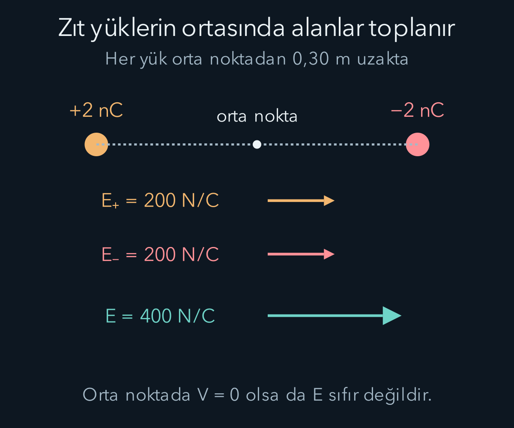
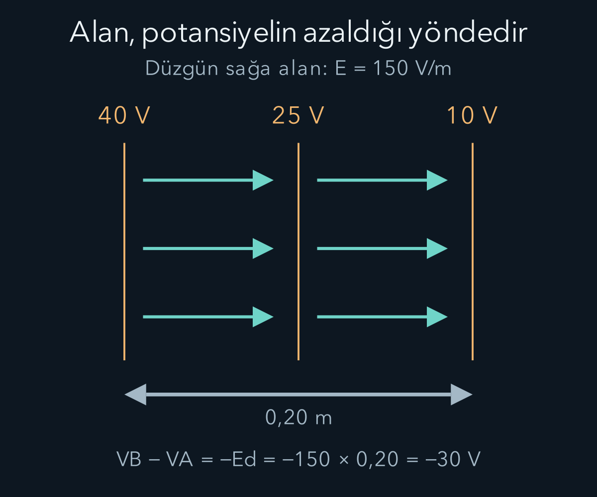

import ArticleVideo from '@/components/ArticleVideo.astro'
import kavram from './media/01-kavram.mp4?url'
import kavramPoster from './media/01-kavram.jpg?url'

Birbirine yaklaştırılan iki cisim bazen çeker, bazen iter. Kütleçekimde kullandığımız tek yönlü çekim fikri bunu tek başına açıklamaz. Elektriksel etkileşimde iki işaretli yeni bir özellik vardır: yük. Bu özelliğin oluşturduğu kuvveti, uzaydaki etkisini anlatan alanı ve enerji hesabını kolaylaştıran potansiyeli sırayla kuracağız.

[Entropi ve ikinci yasayla](/blog/entropi-ve-termodinamigin-ikinci-yasasi/) enerji dönüşümlerinin yönünü inceledik. Şimdi yeni bir etkileşimi aynı kuvvet ve enerji diliyle kuruyoruz. Kuvvet, vektör toplamı ve [potansiyel enerji](/blog/is-enerji-ve-korunum/) önceki araçlarımızdır. [Alanların matematiğinde](/blog/vektor-alanlari-ve-integral-teoremleri/) çizgi integrali, akı ve gradyan kavramlarını da gördük. Şimdi bu matematiksel nesnelerin elektriksel karşılıklarını tanımlayacağız. İlk kapsamımız durgun yüklerin oluşturduğu **elektrostatik** alan ve vakumdur; zamanla değişen elektromanyetik alanlara daha sonra geçeceğiz.

## 1. Elektrik yükü bir işaretli niceliktir

Elektrik yükünü $q$ ile gösteririz. SI birimi coulomb, $\mathrm C$ olur. Pozitif ve negatif işaretler iki yük türünü ayırır. Aynı işaretli yükler birbirini iter, zıt işaretli yükler çeker. İşaret seçimi tarihsel bir adlandırmadır; “pozitif daha güçlü” veya “negatif daha az” anlamına gelmez.

Elektronun yükü $-e$, protonun yükü $+e$ biçimindedir. Temel yük büyüklüğü $e=1{,}602176634\times10^{-19}\,\mathrm C$ olarak SI tanımında kesin belirlenmiştir. Bu sayı [NIST sabitler kaydında](https://physics.nist.gov/cuu/Constants/Value/e.html) doğrulanabilir. Elektronun kütlesiyle yükü farklı niceliklerdir; yükün işareti kütlenin işareti değildir.

Bir cismin net yükü, pozitif ve negatif katkıların cebirsel toplamıdır. Nötr cisimde bu toplam sıfırdır; içinde hiç yük taşıyan parçacık bulunmadığı anlamına gelmez. Yüklerin küçük yer değiştirmeleri, net yük değişmeden elektriksel etkiler oluşturabilir. İletkenler ve yalıtkanlar arasındaki farkı da yüklerin ne kadar kolay yeniden dağıldığı üzerinden inceleyeceğiz.

Kapalı bir sistemin toplam elektrik yükü korunur. Bir cisim yük kazanırken başka bir yerden yük aktarılmış olabilir. Elektriklenmeyi yoktan keyfî yük üretimi gibi anlatmayız. Pozitif ve negatif yüklerin sayısal katkıları birlikte izlenir. Makroskobik hesaplarda çok küçük temel yük birimi nedeniyle yükü çoğu zaman sürekli değişken gibi modellemek yeterlidir.

## 2. Coulomb kuvvetinin yönü

Vakumda, birbirinden $r$ uzaklıktaki iki durgun noktasal yükün kuvvet büyüklüğü:

$$
F=k_e\frac{|q_1q_2|}{r^2},
\qquad k_e=\frac1{4\pi\varepsilon_0}
$$

olur. $\varepsilon_0$ vakumun elektriksel geçirgenliğidir. Yaklaşık $k_e=8{,}99\times10^9\,\mathrm{N\,m^2/C^2}$ ve $\varepsilon_0=8{,}85\times10^{-12}\,\mathrm{C^2/(N\,m^2)}$ kullanılabilir. Bu yuvarlatılmış sayılar hesap duyarlılığına uygun seçilir.

İşareti formülün içinde taşımak için $\hat{\mathbf r}_{12}$ vektörünü birinci yükten ikinciye doğru tanımlayalım. Birincinin ikinciye uyguladığı kuvvet:

$$
\mathbf F_{1\to2}=k_e\frac{q_1q_2}{r^2}\hat{\mathbf r}_{12}
$$

olur. Çarpım pozitifse kuvvet dışarı, yani itme yönündedir. Çarpım negatifse birim vektörün tersine, yani çekme yönündedir. Büyüklük formülüyle yönlü formülü ayırmak, negatif bir “kuvvet büyüklüğü” yazmamızı önler.

Bu bağıntı noktasal yükler içindir. Yayılmış yüklerde küçük katkılar toplanır. Cisimlerin boyutu aralarındaki uzaklığa göre çok küçükse nokta yaklaşımı kullanılabilir. Bir maddenin içinde elektriksel tepki de önem kazanır; vakum katsayısını her ortama hiçbir değişiklik olmadan taşımayız. Şimdilik kaynak yükleri sabit tuttuğumuz klasik modeli kullanıyoruz.

## 3. Alan kaynakla deneme yükünü ayırır

Bir noktaya küçük bir deneme yükü $q_0$ yerleştirdiğimizde kuvvet $\mathbf F=q_0\mathbf E$ olsun. Böylece **elektrik alanı** $\mathbf E$, birim pozitif yük başına kuvvet olarak tanımlarız. Birimi newton bölü coulombdur. Deneme yükünün kaynak dağılımını belirgin biçimde değiştirmediği ideal sınır düşünülür.

Kaynak yük pozitifse alan ondan dışarıya, negatifse ona doğru yönelir. Pozitif deneme yükü alanla aynı yönde, negatif deneme yükü ters yönde kuvvet alır. Alanın yönünü her deneme yükünün hareketine göre yeniden değiştirmeyiz; yön tanımı pozitif yük üzerinden sabitlenmiştir.

Başlangıçtaki noktasal $q$ yükü için $\mathbf E=k_eq\hat{\mathbf r}/r^2$ olur. Birçok kaynak yük varsa alanlar vektörel toplanır. Kaynakların konumu $\mathbf r_i$, gözlenen nokta $\mathbf r$ ise:

$$
\mathbf E(\mathbf r)=k_e\sum_i
q_i\frac{\mathbf r-\mathbf r_i}{|\mathbf r-\mathbf r_i|^3}.
$$

Her terimin uzaklığı ve yönü kendi kaynağına göredir. Yalnız büyüklükleri toplamak alanların birbirini güçlendirdiği ve götürdüğü bölgeleri karıştırabilir. Süperpozisyon, ayrı kaynakların aynı noktadaki katkılarını birleştiren fiziksel model özelliğidir.

## 4. İki yükün ortasında ne olur?

Sol tarafta $+2\,\mathrm{nC}$, sağ tarafta $-2\,\mathrm{nC}$ noktasal yükler olsun. Aralarındaki uzaklık altmış santimetredir; orta nokta her yüke otuz santimetre uzaktadır. Nano öneki $10^{-9}$ çarpanını gösterir. Hesabı yuvarlatmak için $k_e=9{,}0\times10^9$ kullanalım.

Pozitif yükün orta noktada oluşturduğu alan sağa, negatif yükün alanı da sağadır. Her birinin büyüklüğü:

$$
E_1=\frac{(9{,}0\times10^9)(2\times10^{-9})}{(0{,}30)^2}
=200\,\mathrm{N/C}
$$

olur. Toplam alan sağa dört yüz newton bölü coulombdur. Orta noktaya $+3\,\mathrm{nC}$ deneme yükü koysaydık kuvvet $1{,}2\times10^{-6}\,\mathrm N$ sağa olurdu. Aynı büyüklükte negatif deneme yükü sola kuvvet alırdı.

Eşit büyüklükte iki pozitif yük olsaydı orta noktadaki alanlar zıt yönde olup birbirini götürürdü. Bu örnekte toplam yükü tek başına bilmek yeterli değildir; uzaysal yerleşim ve işaretler alanı belirler. Toplam yükü sıfır olan artı-eksi çift de her yerde sıfır alan oluşturmaz.

Alan çizgileri, alanın yönünü resmetmeye yarayan çizimlerdir. Bir çizginin teğeti o noktadaki alan yönünü gösterir. Çizgiler yüklerin yörüngesi olmak zorunda değildir; yüklü cismin başlangıç hızı varsa hareket alan doğrultusuyla anında aynı olmaz. Alan çizgisi ile parçacık yolu, kuvvet ve hız gibi ayrı bilgilerdir.

## 5. Akı ve Gauss yasası

Kapalı bir yüzeyden çıkan toplam elektrik akısı:

$$
\Phi_E=\oint\mathbf E\cdot\hat{\mathbf n}\,dA
$$

ile tanımlanır. $\hat{\mathbf n}$ dışa yönlü birim normal, $dA$ küçük alan parçasıdır. Alan dışa yöneliyorsa pozitif, içe yöneliyorsa negatif katkı gelir. Gauss yasası bu akıyı yüzeyin içindeki net yükle bağlar:

$$
\oint\mathbf E\cdot\hat{\mathbf n}\,dA
=\frac{Q_{\mathrm{iç}}}{\varepsilon_0}.
$$

Kapalı yüzey gerçek bir zar olmak zorunda değildir; hesap için seçilen hayali yüzeydir. İç yük sıfırsa net akı sıfır olur, fakat yüzeyin her noktasında alanın sıfır olması gerekmez. Dışarıdaki yüklerin alanı bir bölümden içeri, başka bölümden dışarı geçerek net sıfır katkı sağlayabilir.

Gauss yasası genel bir ilişki olsa da alanın büyüklüğünü kolayca çıkarmak için uygun simetri gerekir. Noktasal yük çevresinde küresel yüzey seçersek alan her noktada normal yönlü ve aynı büyüklüktedir. İntegral $E4\pi r^2$ olur ve Coulomb alanı geri elde edilir. Alan büyüklüğü yüzeyde değişiyorsa onu integralin dışına sabit gibi çıkaramayız.

## 6. Küre ve levhada simetriyi kullanmak

Bu bölümde büyüklük formüllerini yazarken kürenin toplam yükünü $Q>0$, tek levhanın yüzey yoğunluğunu $\sigma>0$ seçiyoruz. Negatif yükte alan yönü tersine döner; büyüklükte ise sırasıyla $|Q|$ ve $|\sigma|$ kullanılır.

Yükü yüzeye küresel simetriyle yayılmış yarıçapı $R$ olan ince kabuğun dış alanı $k_eQ/r^2$ olur. İçeride net alan sıfırdır. İçte yükün bulunmaması tek başına yeterli gerekçe değildir; alanın sıfır sonucuna ulaşmamızı küresel simetri sağlar. Bu, önceki kütleçekim kabuk sonucuyla matematiksel benzerlik taşır.

Yükü hacme düzgün yayılmış yalıtkan bir kürede iç durum farklıdır. $r<R$ yarıçaplı Gauss yüzeyinin içerdiği yük $Q(r)=Q(r/R)^3$ olur. Dolayısıyla iç alanın büyüklüğü $E=k_eQr/R^3$ biçiminde merkezden uzaklıkla artar. Aynı toplam yük ve dış yarıçap, içeride aynı alanı zorunlu kılmaz; yükün yüzeyde mi hacimde mi bulunduğu önemlidir.

Sonsuz, düzgün yüklü ince levhada yüzey yük yoğunluğu $\sigma$ olsun; birimi coulomb bölü metre karedir. Simetri alanın levhaya dik, iki yanda eş büyüklükte olduğunu söyler. İki kapaklı küçük silindirik Gauss yüzeyi seçersek yan yüzeyden akı gelmez ve $2EA=\sigma A/\varepsilon_0$ olur. Böylece $E=\sigma/(2\varepsilon_0)$ elde edilir.

Eşit ve zıt yoğunluklu iki paralel sonsuz levha arasında alanlar aynı yönde toplanarak $E=\sigma/\varepsilon_0$ verir; dışarıda birbirini götürür. Gerçek sonlu levhalarda kenarlara yakın alan kıvrılır. Bu ideal sonuç, aralık levha boyutlarına göre küçükken orta bölgede iyi bir yaklaşım olabilir.

## 7. Potansiyel, yük başına enerjidir

Durgun kaynakların elektrostatik alanı korunumlu olduğundan potansiyel farkını:

$$
V(B)-V(A)=-\int_A^B\mathbf E\cdot d\mathbf r
$$

ile tanımlarız. $V$ elektrik potansiyeli, birimi volt, $\mathrm V$ olur. Bir volt bir joule bölü coulombdur. Deneme yükü $q$ için potansiyel enerji farkı $\Delta U=q\Delta V$ biçimindedir. Kaynaklar sabitken seçilen sıfırla $U=qV$ yazabiliriz.

Alan bir vektör, potansiyel skalerdir. Tek boyutta $E_x=-dV/dx$, genel olarak $\mathbf E=-\nabla V$ olur. Alan, potansiyelin en hızlı azaldığı yönü gösterir. Pozitif yük bu yönde kuvvet alır; negatif yük ters yönde kuvvet alırken onun potansiyel enerjisi de uygun harekette azalır.

Potansiyelin sıfırını değiştirmek alanı değiştirmez. Her yere aynı sabiti eklersek gradyan sabit kalır. Voltaj dediğimiz potansiyel farkı ise iki nokta arasında bu seçimden bağımsızdır. Tek bir noktanın “on volt” olması bir referansa göre söylenir. Referans belirtilmeden mutlak elektriksel yüksekliği tanımlamış olmayız.

## 8. Noktasal yükün potansiyeli ve işaretler

Sonsuzda sıfır seçilen noktasal yük potansiyeli:

$$
V(r)=k_e\frac{q}{r}
$$

olur. Bu sonucu potansiyel tanımından da çıkarabiliriz. Kaynağa göre dışarı yönlü radyal koordinatı $r'$ kullanalım. Noktasal yükün alan bileşeni $E_r=k_eq/(r')^2$ olduğundan, sonsuzdan $r$ uzaklığına integral:

$$
\begin{aligned}
V(r)-V(\infty)
&=-k_eq\int_\infty^r\frac{dr'}{(r')^2}\\
&=-k_eq\left[-\frac1{r'}\right]_\infty^r\\
&=\frac{k_eq}{r}
\end{aligned}
$$

verir. İlk eksi potansiyel tanımından, köşeli parantezdeki eksi $1/(r')^2$ fonksiyonunun integralinden gelir. Sonsuzdaki $1/r'$ katkısı sıfıra yaklaşır. $q$'nun işaretini hesap boyunca taşıdığımız için sonuç negatif kaynak için de geçerlidir; büyüklük formülündeki mutlak değeri buraya koymayız.

Türevini alıp eksi işaretle çarpmak Coulomb alanını geri verir. Pozitif kaynağın potansiyeli pozitif, negatif kaynağınki negatiftir. Birçok yük için potansiyeller cebirsel toplanır; alanları ise vektörel toplamıştık.

Zıt iki yük örneğimizde orta noktanın potansiyeli $+60\,\mathrm V-60\,\mathrm V=0$ olur. Alan ise sağa dört yüz newton bölü coulombdu. Potansiyelin sıfır olması alanın sıfır olduğunu göstermez. Alan potansiyelin değeriyle değil uzaysal değişimiyle ilişkilidir. Bir doğrunun yüksekliği sıfır olduğu yerde eğiminin sıfır olması gerekmediği gibi.

Pozitif üç nanocoulomb yük, kırk voltluk noktadan on voltluk noktaya götürülsün. Potansiyel farkı eksi otuz volttur; enerji farkı $\Delta U=(3\times10^{-9})(-30)=-9\times10^{-8}\,\mathrm J$ çıkar. Elektrik alanın yaptığı iş bunun ters işaretlisi, pozitif $9\times10^{-8}\,\mathrm J$ olur. Başka iş yoksa kinetik enerji bu kadar artar.

Negatif yükte işaret tersine döner. Elektron daha yüksek elektrik potansiyeline doğru giderken elektriksel potansiyel enerjisi azalabilir, çünkü yükü negatiftir. “Yük daima düşük voltaja gider” cümlesi bu nedenle doğru değildir. Kuvvet ve enerji için yük işareti açıkça tutulmalıdır.

### Elektronvolt bir enerji birimidir

Atom ölçeğindeki enerjileri joule ile yazmak çok küçük sayılar gerektirir. Temel yük büyüklüğündeki bir yükün bir voltluk potansiyel farkıyla ilişkili enerji büyüklüğüne bir elektronvolt deriz. Simgesi $\mathrm{eV}$ olan bu birim için $1\,\mathrm{eV}=1{,}602176634\times10^{-19}\,\mathrm J$ olur. Adında volt bulunması onu potansiyel birimi yapmaz; yük ile potansiyel farkının çarpımıdır.

Bir elektron uygun yönde yüz voltluk potansiyel farkında hızlandırılırsa ve başka enerji alışverişleri ihmal edilirse yüz elektronvolt kinetik enerji kazanır. Burada hızlandırmanın yönünü elektronun negatif yüküne göre seçmek gerekir. Sayı, hareketin bütün koşullarını tek başına söylemez; başlangıç enerjisi varsa son enerjiye eklenir. Bu birim ileride atomik ve kuantum olaylarını anlatırken hesapları okunur hale getirecek.

### Kaynakların da hareket ettiği enerji hesabı

Şimdi iki kaynağı birlikte sistem seçelim. Birinci yük yerindeyken ikinciyi sonsuzdan belirli bir uzaklığa çok yavaş getirirsek, ilk yükün potansiyeliyle ikinci yükün çarpımı iki yükün etkileşim enerjisini verir: $U=k_eq_1q_2/r$. Aynı işaretli yüklerde pozitiftir; onları birbirine yaklaştırmak dışarıdan iş gerektirir. Zıt işaretlerde negatiftir; ayrılmaları için enerji vermek gerekir.

Çok sayıda yükte bütün farklı çiftlerin etkileşim enerjilerini birer kez sayarız. Her yükün ötekilerden gelen potansiyelini yüküyle çarpıp toplarsak aynı çift iki kez görünür; bu yöntemde yarım çarpanı gerekir. Tek bir deneme yükünün sabit kaynaklar içindeki enerjisiyle bütün kaynak düzeninin toplam enerjisini ayırmak, aynı enerjiyi iki kere toplamamızı önler. Noktasal yükün kendi alan enerjisi ise burada kullandığımız çiftler hesabının ayrı bir konusudur.

## 9. Eşpotansiyel yüzeyler

Potansiyelin sabit olduğu yüzeylere eşpotansiyel yüzey denir. Böyle bir yüzey boyunca küçük yer değiştirmede potansiyel farkı sıfırdır. Elektrostatik alanın teğetsel bileşeni olsaydı bu hareket boyunca sıfır olmayan iş oluşurdu. Dolayısıyla alan, sıfır olmadığı düzgün noktalarda eşpotansiyel yüzeye diktir.

Noktasal yük için eşpotansiyeller eşmerkezli kürelerdir. İki paralel levhanın orta bölgesinde yaklaşık düzgün alan varsa eşpotansiyeller paralel düzlemlerdir. Alanın büyüklüğü aynı potansiyel farkının daha kısa mesafede değiştiği yerde daha büyüktür. Haritadaki eş yükselti çizgilerinin sıklaştığı bölgede eğimin büyümesine matematiksel olarak benzer bir ilişki vardır.

Düzgün sağa yönlü $E$ alanında iki nokta arasındaki yatay uzaklık $d$ ise $V_B-V_A=-Ed$ olur. Potansiyel birimi metreye bölünürse volt bölü metre çıkar; bu birim newton bölü coulombla aynıdır. Alanı iki farklı deneysel yoldan ifade edebilmemiz bu birim eşitliğinde görünür.

## 10. İletken dengeye ulaştığında

İletkende bazı yük taşıyıcıları kolayca yer değiştirebilir. Elektrostatik dengede iletken malzemenin içinde net elektrik alan sıfır olmalıdır; sıfır olmayan alan taşıyıcıları hareket ettirerek dengeyi bozardı. Bu nedenle bağlı bir iletkenin içi ve yüzeyi aynı potansiyeldedir.

Bu, bütün uzayda alanın sıfır olduğu anlamına gelmez. İletkenin yüzey yükleri dışarıda alan oluşturabilir. Yüzeyin hemen dışındaki alanın teğetsel bileşeni dengede sıfırdır; aksi halde yüzey yükleri hareket ederdi. Normal bileşen yüzey yük yoğunluğuyla ilişkilidir. Geometri, yüzeydeki yük yoğunluğunun farklı noktalarda farklı olmasına yol açabilir.

Küresel iletkenin potansiyeli içeride sabitken dışarıda bir noktasal yükünki gibi değişir. İçeride alan sıfır olması potansiyelin sıfır olması demek değildir. Önceki orta nokta örneğinin tersiyle karşılaştık: Bu kez potansiyel sıfır olmayan sabit, alan sıfırdır. Alan ile potansiyeli sürekli birlikte düşünmek bu iki kavramı karıştırmamızı önler.

<ArticleVideo src={kavram} poster={kavramPoster} title="Nokta yükünden uzaklaşmak" caption="Pozitif yükün alanı dışarı yönelir. Uzaklık iki katına çıktığında oklarla gösterilen alan büyüklüğü dörtte bire iner." />

Elektriksel kuvveti alanla, enerjiyi potansiyelle ifade etmeyi öğrendik. Bir sonraki adımda yükü iki iletken arasında depolamayı ve bir devre boyunca hareket ettirmeyi inceleyeceğiz. Potansiyel farkı, akım ve enerji aktarımı aynı hesapta birleşecek.

## Kaynaklar

- [NIST — Temel yük](https://physics.nist.gov/cuu/Constants/Value/e.html).
- [OpenStax — Coulomb yasası](https://openstax.org/books/university-physics-volume-2/pages/5-3-coulombs-law) ve [elektrik alanı](https://openstax.org/books/university-physics-volume-2/pages/5-4-electric-field).
- [OpenStax — Gauss yasasının uygulanması](https://openstax.org/books/university-physics-volume-2/pages/6-3-applying-gausss-law).
- [OpenStax — Elektrik potansiyeli ve potansiyel farkı](https://openstax.org/books/university-physics-volume-2/pages/7-2-electric-potential-and-potential-difference).
