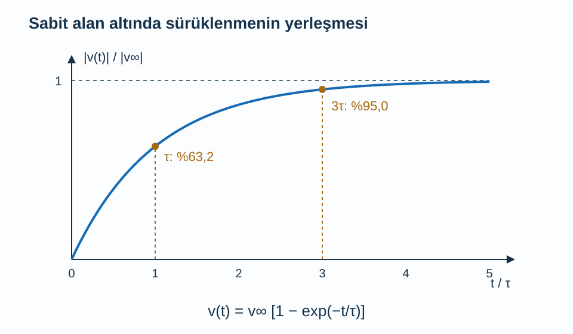
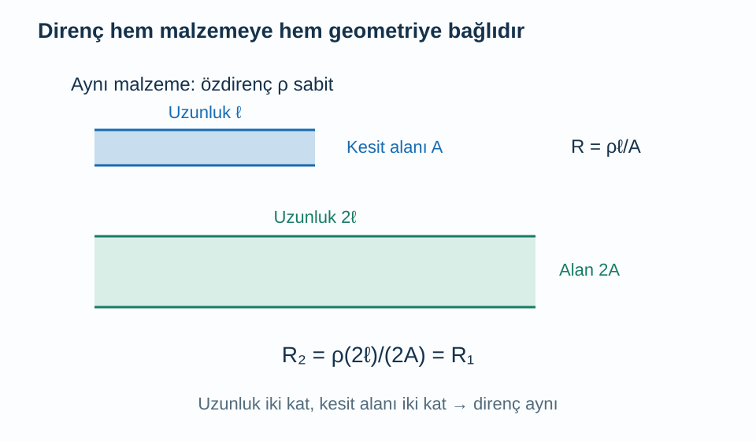

Bir metal telin iki ucuna gerilim uygulandığında akım geçer. Elektrik alanı elektronlara kuvvet uygular; fakat sabit gerilim altında akım genellikle sürekli büyümez, belirli bir değere yaklaşır. Yalnız kuvvet ve ivme denklemiyle başlayan bir açıklama bu durumu tamamlayamaz. Elektron dağılımının kazandığı yönlü hareketin nasıl gevşediğini de hesaba katmamız gerekir.

[Etkin kütle ve delikler](/blog/etkin-kutle-ve-delikler/) yazısında bant eğriliğini hareketle ilişkilendirdik. [Fermi yüzeyi](/blog/durum-yogunlugu-ve-fermi-yuzeyi/) yazısında da büyük mikroskobik hızların dengede birbirini götürebildiğini gördük. Şimdi bu iki düşünceye basit bir saçılma modeli ekleyeceğiz. Modelimiz homojen, izotropik, düşük alanlı ve tek taşıyıcı türüne sahip bir ortamdır. Elektron bandını ilgili enerji aralığında pozitif sabit etkin kütleli parabolle temsil edeceğiz.

## 1. Rastgele hız ile sürüklenme hızı

Alan yokken elektronlar bütünüyle hareketsiz değildir. Bununla birlikte dengedeki dağılımda bir yöndeki hızların katkısını zıt yöndeki hızlar dengeler. **Sürüklenme hızı** $\mathbf v_d$, bütün taşıyıcıların hızlarının yönlü ortalamasıdır. Dengedeki sıfır ortalamanın küçük bir alanla kayması, elektrik akımı oluşturur.

Bu ayrım iki farklı zaman ölçeğini karıştırmamızı önler. Bir elektronun mikroskobik hızı büyük olabilir; tel boyunca net sürüklenmesi çok yavaş olabilir. Devrenin elektriksel tepkisinin başlaması da tek bir elektronun kaynaktan alıcıya kadar gitmesini beklemez. Bu yazı devrede elektromanyetik sinyalin yayılışını hesaplamıyor; alan kurulmuş bir bölgede taşıyıcıların ortalama yanıtını hesaplıyor.

Elektron yoğunluğunu $n$ ile gösterelim; birimi $\mathrm{m^{-3}}$'tür. Elektron yükü $-e$, $e>0$ temel yük büyüklüğü olsun. Bir kesitten birim zamanda geçen yükü saydığımızda **akım yoğunluğu**:

$$
\mathbf j=-ne\mathbf v_d
$$

olur. $\mathbf j$ birimi $\mathrm{A/m^2}$'dir. Elektronlar alanın tersine sürüklense de negatif yük taşıdıkları için geleneksel akım alan yönündedir. Hem hızın hem yükün işaretini birlikte kullanmadan yalnız hareket okuna bakmak sık görülen bir yanılgıdır.

## 2. Gevşeme zamanı neyi anlatır?

Elektron dağılımının yönlü kısmının karakteristik bir $\tau$ süresinde azaldığını varsayalım. $\tau>0$ **momentum gevşeme zamanı**, yani dağılımın akım taşıyan kısmının sönüm ölçeğidir. Basit Drude resmi bunu ortalama çarpışmalar arası süreyle ilişkilendirir. Daha gerçekçi saçılmalarda her olay yönlü momentumu aynı ölçüde değiştirmediği için herhangi bir ömür ölçümündeki süreyle birebir aynı olmak zorunda değildir.

Etkin kütle $m^*$, elektrik alanı $\boldsymbol{\mathcal E}$ olsun. Ortalama hareket için:

$$
m^*\frac{d\mathbf v_d}{dt}
=-e\boldsymbol{\mathcal E}-\frac{m^*\mathbf v_d}{\tau}
$$

yazarız. İlk terim alan kuvvetidir. İkinci terim ortalama sürüklenmeye ters yöndedir ve dağılımı dengeye döndürür. Bu, her elektronun hareket boyunca sürekli bir sürtünme kuvveti yaşadığını söyleyen mikroskobik bir yasa değildir; çok sayıda saçılmanın ortalama etkisini temsil eder.

Tam periyodik, hareketsiz bir örgüyü sürekli rastgele engeller dizisi saymak doğru olmaz. Bloch durumları zaten o periyodik potansiyeli içerir. Sonlu özdirence katkı yapan süreçler arasında kusurlar, safsızlıklar ve örgü titreşimleri bulunabilir. Elektronların kendi aralarındaki saçılmalarının dirence etkisi de momentumun nasıl gevşediğine bağlıdır. [Tong'un Drude modeli açıklaması](https://davidtong.org/pdfs/teaching/solid-state-physics/solidstate3.pdf) bu yarı klasik taşıma yaklaşımını bant dinamiğiyle birlikte ele alır.

## 3. Sabit alan açıldığında ne olur?

Alanı $+x$ yönünde sabit seçelim. Sürüklenme hızının o yöndeki bileşenini $v_d$ ile yazarsak:

$$
\frac{dv_d}{dt}+\frac{v_d}{\tau}=-\frac{e\mathcal E}{m^*}.
$$

Durağan çözümde türev sıfırdır; dolayısıyla $v_\infty=-e\mathcal E\tau/m^*$ olur. Genel çözümü bulmak için $w=v_d-v_\infty$ tanımlayalım. Sabit terimler birbirini götürür ve $dw/dt=-w/\tau$ kalır. Bu denklemin çözümü $w(t)=w(0)e^{-t/\tau}$'dır. Başlangıçta sürüklenme yoksa $v_d(0)=0$ ve:

$$
v_d(t)=-\frac{e\mathcal E\tau}{m^*}\left(1-e^{-t/\tau}\right)
$$

elde edilir. $t=0$ koyunca sıfır çıkması başlangıç koşulunu doğrular. Çok uzun zamanda üstel sıfıra yaklaşır, hız sabit değere gider. Bir $\tau$ sonunda son değerin yaklaşık yüzde $63{,}2$'sine, üç $\tau$ sonunda yüzde $95{,}0$'ına ulaşılır.

Eğri sürüklenme hızının büyüklüğünü gösterir. Elektronların yönü alanın tersidir; normalleştirme yapıldığı için grafikte pozitif büyüklük çizilmiştir. Bu yön bilgisi akım hesabında ayrıca korunur.

## 4. Ohm yasası denklemden nasıl çıkar?

Durağan hızı akım yoğunluğuna yerleştirelim:

$$
\begin{aligned}
j&=-ne\left(-\frac{e\mathcal E\tau}{m^*}\right)\\
&=\frac{ne^2\tau}{m^*}\mathcal E.
\end{aligned}
$$

İki eksi işaret çarpılıp artı olur. **İletkenlik** $\sigma$ ve **özdirenç** $\rho$ tanımlarını:

$$
\begin{aligned}
\sigma&=\frac{ne^2\tau}{m^*}\\
\rho&=\frac1\sigma\\
j&=\sigma\mathcal E
\end{aligned}
$$

biçiminde yaparız. $\sigma$ birimi $\mathrm{S/m}$, $\rho$ birimi $\Omega\,\mathrm m$'dir. Taşıyıcı sayısı veya gevşeme zamanı arttıkça aynı alan daha büyük akım üretir. Etkin kütle arttığında aynı kuvvetin yanıtı küçüldüğü için iletkenlik azalır; diğer parametrelerin sabit tutulduğu bir karşılaştırma yapıyoruz.

Hareketlilik $\mu_e=e\tau/m^*$ diye tanımlanır. Birimi $\mathrm{m^2/(V\,s)}$ olur ve $v_d=-\mu_e\mathcal E$ yazılır. Hareketlilik hızın kendisi değildir; hızın alan başına büyüklüğüdür. Bu gösterimle $\sigma=ne\mu_e$ olur. Delikler de varsa basit bağımsız taşıyıcı yaklaşımında katkıları eklenir: $\sigma=e(n\mu_e+p\mu_h)$. $p$ delik yoğunluğu, $\mu_h$ pozitif delik hareketliliğidir.

## 5. Sayısal örnek: Bir metal modelinin iletkenliği

$n=8{,}0\times10^{28}\,\mathrm{m^{-3}}$, $\tau=2{,}5\times10^{-14}\,\mathrm s$, $m^*=m_e=9{,}10938\times10^{-31}\,\mathrm{kg}$ seçelim. Bunlar öğretici model parametreleridir. Temel yük $e=1{,}60218\times10^{-19}\,\mathrm C$ ile:

$$
\begin{aligned}
ne&\simeq1{,}2817\times10^{10}\,\mathrm{C/m^3},\\
\frac{e\tau}{m_e}&\simeq4{,}397\times10^{-3}\,\mathrm{m^2/(V\,s)},\\
\sigma&=(ne)\frac{e\tau}{m_e}\\
&\simeq5{,}636\times10^7\,\mathrm{S/m}.
\end{aligned}
$$

Özdirenç tersini alarak bulunur: $\rho\simeq1{,}774\times10^{-8}\,\Omega\,\mathrm m$. Hareketlilik:

$$
\begin{aligned}
\mu_e&=\frac{e\tau}{m_e}\\
&\simeq4{,}397\times10^{-3}\,\mathrm{m^2/(V\,s)}.
\end{aligned}
$$

Alanı $\mathcal E=10\,\mathrm{V/m}$ seçersek $v_d=-0{,}04397\,\mathrm{m/s}$ ve $j=5{,}636\times10^8\,\mathrm{A/m^2}$ çıkar. Sürüklenme hızı saniyede yalnız birkaç santimetre ölçeğinde olmasına rağmen taşıyıcı yoğunluğu çok büyük olduğundan akım yoğunluğu büyük olabilir. Bu sonuç belirli bir telin bu akımı ısınmadan taşıyabileceğini söylemez; ısıl koşulları henüz hesaba katmadık.

Önceki yazıdaki benzer yoğunluğun Fermi hızı yaklaşık milyon metre/saniye ölçeğindeydi. Buradaki küçük sürüklenme onun üzerine eklenen küçük yönlü asimetridir. İki hızı aynı büyüklük sanmak, hem akımın hem saçılmalar arasındaki hareketin yanlış yorumlanmasına neden olur.

## 6. Sayısal örnek: Malzemeden tel direncine

Aynı model malzemeden uzunluğu $\ell=0{,}50\,\mathrm m$, kesit alanı $A=1{,}0\,\mathrm{mm^2}=1{,}0\times10^{-6}\,\mathrm{m^2}$ olan bir tel yapalım. Uçlar arasındaki gerilim $U$, toplam akım $I$ olsun. Homojen telde $\mathcal E=U/\ell$ ve $j=I/A$ yazabiliriz. Bunları $j=\sigma\mathcal E$ içine koyarsak:

$$
\begin{aligned}
\frac IA&=\sigma\frac U\ell\\
U&=\frac{\ell}{\sigma A}I.
\end{aligned}
$$

Dolayısıyla direnç $R=U/I=\rho\ell/A$ olur. Sayıları yerine koyunca:

$$
\begin{aligned}
R&=\frac{(1{,}774\times10^{-8})(0{,}50)}{1{,}0\times10^{-6}}\\
&\simeq8{,}872\times10^{-3}\,\Omega.
\end{aligned}
$$

$I=2{,}0\,\mathrm A$ akım için gerilim $U=IR\simeq0{,}01774\,\mathrm V$, güç $P=I^2R\simeq0{,}03549\,\mathrm W$ bulunur. Direnç malzeme kadar geometriden de etkilenir. Aynı telin uzunluğu iki katına çıkarsa direnç iki kat; kesiti iki katına çıkarsa direnç yarı olur. Özdirenç ise bu ideal homojen karşılaştırmada değişmez.

Bu örnekteki alan $U/\ell\simeq0{,}03549\,\mathrm{V/m}$'dir; önceki örneğin $10\,\mathrm{V/m}$ alanıyla aynı değildir. Bir hesapta bulduğumuz akım yoğunluğunu başka geometri ve gerilime fark etmeden taşımamalıyız. Sayısal örnekler arasındaki koşulları açık tutmak, formülleri doğru yerlerde kullanmanın önemli bir parçasıdır.

Şekilde birinci tel referanstır. İkinci tel iki kat uzunluk ve iki kat kesit alanına sahip olduğunda bu iki etki birbirini götürür, direnç aynı kalır. Çizimdeki kalınlık alanı şematik temsil eder; çapı iki kat yapmak alanı dört kat yapardı.

## 7. Elektrik enerjisi nereye gider?

Durağan durumda sürüklenme kinetik enerjisi zamanla büyümez. Buna rağmen alanın birim hacimde yaptığı işin hızı $\mathbf j\cdot\boldsymbol{\mathcal E}=\sigma\mathcal E^2$ pozitiftir. Bu güç elektron sistemi ve çevresi arasındaki enerji alışverişiyle, sonuçta ısıya dönüşebilen süreçlerle dengelenir. Momentum gevşemesi ile enerji gevşemesi aynı mikroskobik süre olmak zorunda değildir.

Drude denklemi, ortalama akımın nasıl sabitlendiğini anlatır; telin sıcaklığının ne kadar artacağını tek başına söylemez. Bunun için ısı sığası, çevreye ısı aktarımı ve sıcaklığa bağlı iletkenlik gerekir. Sabit $\tau$ varsayımı, güçlü ısınma sırasında özellikle başarısız olabilir. Ohm yasasının doğrusal olması malzemenin her akımda aynı dirence sahip kalacağı anlamına gelmez.

## 8. Alan yön değiştirirse akım hemen yetişir mi?

Sabit alan çözümü, alanın değişim süresi gevşeme zamanından çok uzunsa iyi bir yaklaşık resim verir. Alan çok hızlı değiştiğinde ise sürüklenmenin yerleşmesi için yeterli zaman kalmaz. Bu sınırı görmek için $\mathcal E(t)=\operatorname{Re}[\mathcal E_0e^{-i\omega t}]$ seçelim. $\omega$ alanın açısal frekansı, $\mathcal E_0$ karmaşık genlik, $\operatorname{Re}$ gerçek kısmı alma işlemidir. Karmaşık gösterim yalnız sinüs ve kosinüsü birlikte taşır; ölçülen alan gerçektir.

Hız için aynı zaman bağımlılığını denediğimizde türev $-i\omega$ çarpanı getirir. Ortalama hareket denkleminden:

$$
\begin{aligned}
\left(\frac1\tau-i\omega\right)v_0
&=-\frac{e\mathcal E_0}{m^*}\\
\sigma(\omega)&=\frac{\sigma_0}{1-i\omega\tau}
\end{aligned}
$$

bulunur. $v_0$ hız genliği, $\sigma_0=ne^2\tau/m^*$ daha önce bulduğumuz doğru akım iletkenliğidir. Karmaşık iletkenlik, akımın alanla aynı fazda ve çeyrek çevrim kaymış bileşenlerini birlikte kodlar. Alanla aynı fazdaki kısım $\operatorname{Re}\sigma=\sigma_0/[1+(\omega\tau)^2]$ olur.

$\omega\tau\ll1$ ise doğru akım sonucu geri gelir. $\omega\tau=1$ noktasında aynı fazdaki iletkenlik yarıya iner. Bu sonuç “yüksek frekansta malzeme mutlaka yalıtkandır” demek değildir; modelin sınırları içinde akımın büyüklüğü ve fazı değişir. Daha yüksek frekanslarda bantlar arası geçişler ve başka polarizasyon süreçleri de eklenebilir.

## 9. Modelin başarıları ve sınırları

Drude yaklaşımı, yoğunluk, hareketlilik ve direnç arasındaki ilişkileri az parametreyle kurar. Ancak metallerde elektronların doluluğunu klasik Maxwell dağılımıyla açıklamak yeterli değildir. Fermi–Dirac istatistiği, hangi durumların saçılmaya açık olduğunu belirler. Parabolik bantta uygun gevşeme zamanı yaklaşımı aynı iletkenlik biçimini verebilir; benzer formül, bütün fiziksel varsayımların aynı olduğu anlamına gelmez.

Gerçek malzemelerde $\tau$ enerjiye ve yöne bağlı olabilir. Birden fazla bant, anizotropik kütle, sınır saçılması, güçlü alan ve kuantum girişimi tek sayıdan oluşan iletkenlik modelini yetersiz bırakabilir. Çok kısa örneklerde taşıyıcılar içeride yeterince saçılmadan sınırı aşarsa yerel Ohm yasası yerine temasları ve iletim olasılıklarını içeren bir yaklaşım gerekir.

Sıcaklık değişimi de tek bir parametreyi etkilemez. Metallerde taşıyıcı sayısı yaklaşık sabitken saçılma değişimi baskın olabilir; yarı iletkenlerde hem taşıyıcı sayısı hem hareketlilik güçlü değişebilir. [MIT'nin yarı iletkenlerde sürüklenmeye giriş notları](https://ocw.mit.edu/courses/6-012-microelectronic-devices-and-circuits-fall-2009/resources/mit6_012f09_lec01/) bu ikinci duruma geçiş sağlar. İletkenliğin neden değiştiğini anlamak için bundan sonra yalnız elektronların hareketini değil, kaç taşıyıcı bulunduğunu da hesaplayacağız.
