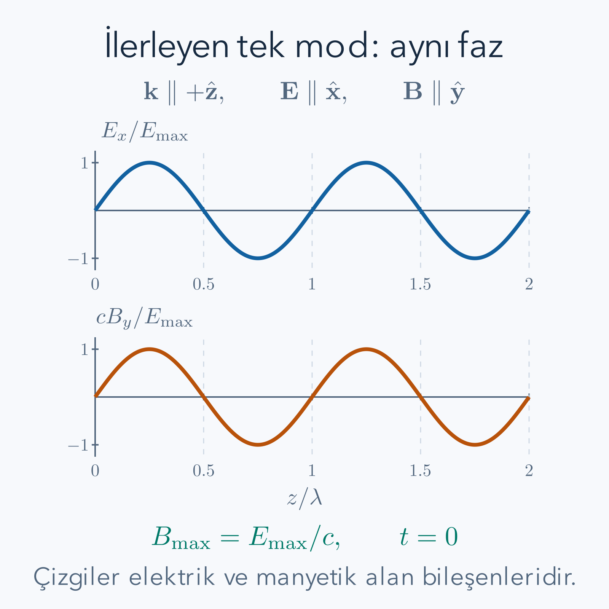

Bir atom ışık soğurduğunda enerjisi belirli bir miktar artar. Önceki atom–ışık hesabında atomu kuantum sistemi, ışığı dışarıdan verilen klasik bir sinüs olarak yazmıştık. Şimdi sinüsün genliğini de kuantum operatörü yapacağız. Başlangıç noktası “ışık küçük toplardan oluşur” varsayımı değil, Maxwell alanının enerjisidir. Alanı bağımsız salınım modlarına ayırdıktan sonra her modun harmonik osilatör gibi davrandığını göreceğiz. Bir modun enerji basamağına eklenen uyarıma foton diyeceğiz.

Ön bilgiler [harmonik osilatör](/blog/kuantum-harmonik-osilatoru/), [ikinci kuantizasyon](/blog/ikinci-kuantizasyon/) ve [atom–ışık etkileşimi](/blog/atom-isik-etkilesimi-ve-secim-kurallari/) yazılarıdır. Bozon merdivenlerindeki karekök katsayılarını kullanacağız; fakat alanın hacim ve frekans katsayısını ayrıca türeteceğiz. Bütün hesaplarda SI birimleri kullanılacak. $\epsilon_0$ boşluğun elektriksel geçirgenliği, $\mu_0$ manyetik geçirgenliği ve $c=1/\sqrt{\epsilon_0\mu_0}$ ışık hızıdır. Madde içinde ilerleme, kayıplı ortam ve elektrik yüklerinin kendi Coulomb alanı bu serbest ışınım hesabına dahil değildir.

## 1. Serbest ışınımda hangi alanları kuantumlaştırıyoruz?

Yük ve akım olmayan bölgede Maxwell denklemleri:

$$
\begin{aligned}
\nabla\cdot\mathbf E&=0,&\nabla\cdot\mathbf B&=0,\\
\nabla\times\mathbf E&=-\partial_t\mathbf B,&
\nabla\times\mathbf B&=c^{-2}\partial_t\mathbf E
\end{aligned}
$$

olur. Elektrik ve manyetik alanları bir vektör potansiyelden kurabiliriz. Coulomb ayarında $\nabla\cdot\mathbf A=0$ seçilir. İncelediğimiz yüksüz, serbest ışınım sektöründe skaler potansiyeli sıfır alarak:

$$
\mathbf E=-\partial_t\mathbf A,
\qquad \mathbf B=\nabla\times\mathbf A
$$

yazarız. Bu, her elektromanyetik problemde skaler potansiyelin sıfır olduğu iddiası değildir. Yükler varsa boyuna elektrik alan Gauss yasasıyla belirlenir ve ayrıca ele alınır. Serbest foton modlarına üçüncü bir boyuna kutuplanma eklemeyeceğiz.

Ampère denklemine bu ifadeleri koyarsak $\nabla\times(\nabla\times\mathbf A)=-c^{-2}\partial_t^2\mathbf A$ olur. Vektör özdeşliği $\nabla\times(\nabla\times\mathbf A)=\nabla(\nabla\cdot\mathbf A)-\nabla^2\mathbf A$ ve ayar koşulu birlikte:

$$
\partial_t^2\mathbf A-c^2\nabla^2\mathbf A=0
$$

dalga denklemini verir. Alanın her bağımsız uzaysal örüntüsünün zamandaki davranışını bu denklem belirleyecektir.

## 2. Periyodik kutu ve iki kutuplanma

Hacmi $V=L^3$ olan kübik bir hesap kutusu alalım. Alan bir kenardan çıkınca karşı kenarda aynı değerle devam etsin. Bu **periyodik sınır koşulu**, gerçek bir metal duvar modeli değildir; sonsuz uzayın modlarını ayrık sayabilmek için kullanılan bir düzenlemedir. Düzlem dalganın $x$ yönünde bir kutu kadar ötelenince aynı kalması $e^{ik_xL}=1$ gerektirir. Dolayısıyla:

$$
\mathbf k=\frac{2\pi}{L}(m_x,m_y,m_z),
\qquad m_x,m_y,m_z\in\mathbb Z.
$$

Dalga vektörü $\mathbf k$ ilerleme yönünü ve uzaysal değişim ölçeğini belirler. Dalga denklemine $e^{i(\mathbf k\cdot\mathbf r-\omega t)}$ koyunca $-\omega^2+c^2|\mathbf k|^2=0$, pozitif frekans için $\omega=c|\mathbf k|$ çıkar. Burada $\omega$ açısal frekanstır; saniyedeki döngü sayısı $\nu=\omega/(2\pi)$ olur.

Enine koşul $\mathbf k\cdot\boldsymbol\epsilon_{\mathbf k s}=0$ gerektirir. $s=1,2$ ile gösterilen iki bağımsız birim kutuplanma vektörü seçebiliriz. Gerçek doğrusal vektörler kullanacağız ve $\boldsymbol\epsilon_{\mathbf k s}\cdot\boldsymbol\epsilon_{\mathbf k s'}=\delta_{ss'}$ alacağız. $\mathbf k=0$ modu $\omega=0$ verir; serbest ışınım osilatörü değildir ve aşağıdaki toplamların dışındadır. Homojen statik alanın sınır koşulları ayrı bir problemdir.

*Çizim bir doğrusal kutuplanmayı gösterir. İkinci kutuplanma, aynı ilerleme yönüne dik düzlemde elektrik alanın bağımsız diğer yönünü seçer. Dalga çizgileri alanın genliğini temsil eder; fotonların izlediği kıvrımlı yollar değildir.*

## 3. Bir klasik modun enerjisini osilatöre çevirmek

Önce gerçek duran dalga modları kullanmak kanonik koordinatları açık gösterir. $\mathbf u_\lambda(\mathbf r)$ gerçek, enine ve ortonormal mod fonksiyonları olsun. $\lambda$ bütün mod indislerini birleştiren etikettir. Koşulları:

$$
\int_V d^3r\,\mathbf u_\lambda\cdot\mathbf u_\mu=\delta_{\lambda\mu},
\qquad -\nabla^2\mathbf u_\lambda=k_\lambda^2\mathbf u_\lambda
$$

şeklindedir. Potansiyeli $\mathbf A=\epsilon_0^{-1/2}\sum_\lambda Q_\lambda(t)\mathbf u_\lambda$ açalım. $Q_\lambda$ modun gerçek genlik koordinatıdır. Alan enerjisi:

$$
U=\frac12\int_V d^3r\left(\epsilon_0\mathbf E^2+
\frac{\mathbf B^2}{\mu_0}\right)
$$

olur. Elektrik katkısında ortonormallik hemen $\frac12\sum_\lambda\dot Q_\lambda^2$ verir. Manyetik katkıda periyodik sınır koşuluyla yüzey terimi sıfırdır; kısmi integrasyon ve enine koşul:

$$
\begin{aligned}
\int_V(\nabla\times\mathbf u_\lambda)\cdot
(\nabla\times\mathbf u_\mu)\,d^3r
&=\int_V\mathbf u_\lambda\cdot(-\nabla^2\mathbf u_\mu)\,d^3r\\
&=k_\mu^2\delta_{\lambda\mu}
\end{aligned}
$$

verir. Böylece enerji:

$$
U=\frac12\sum_\lambda(\dot Q_\lambda^2+\omega_\lambda^2Q_\lambda^2)
$$

biçimine iner. Aynı modlar için Lagrange fonksiyonu $\mathcal L=\frac12\sum_\lambda(\dot Q_\lambda^2-\omega_\lambda^2Q_\lambda^2)$ seçilir. Kanonik momentum $P_\lambda=\partial\mathcal L/\partial\dot Q_\lambda=\dot Q_\lambda$ olur. Her mod, ölçeklendirilmiş kütlesi bir olan bir osilatördür. Bu bir fotonun durgun kütlesinin bir kilogram olduğunu söylemez; $Q$ fiziksel parçacık konumu değildir.

## 4. Kanonik değişkenlerden merdiven operatörlerine

Kuantumlaştırmada klasik $Q,P$ yerine Hermit operatörler koyar ve $[Q_\lambda,P_\mu]=i\hbar\delta_{\lambda\mu}$ isteriz. $\hbar=h/(2\pi)$ indirgenmiş Planck sabitidir. Tek mod için indisleri kısa süre saklayıp:

$$
a=\sqrt{\frac{\omega}{2\hbar}}Q+
\frac{iP}{\sqrt{2\hbar\omega}},
\qquad
a^\dagger=\sqrt{\frac{\omega}{2\hbar}}Q-
\frac{iP}{\sqrt{2\hbar\omega}}
$$

tanımlayalım. $u=\sqrt{\omega/(2\hbar)}$, $v=1/\sqrt{2\hbar\omega}$ dersek:

$$
\begin{aligned}
[a,a^\dagger]&=[uQ+ivP,uQ-ivP]\\
&=-iuv[Q,P]+iuv[P,Q]\\
&=uv\hbar+uv\hbar=2uv\hbar=1.
\end{aligned}
$$

Katsayıların çarpımı $uv=1/(2\hbar)$ olduğu için sonuç bir çıkar. Ters bağıntılar:

$$
Q=\sqrt{\frac{\hbar}{2\omega}}(a+a^\dagger),
\qquad
P=-i\sqrt{\frac{\hbar\omega}{2}}(a-a^\dagger)
$$

olur. İki ifadeyi toplamak $Q$'yu, çıkarmak $P$'yi ayırır. Böylece alan moduna bozon cebirini keyfi olarak yapıştırmış olmadık; klasik mod enerjisini ve kanonik kuantum kuralını birlikte kullandık.

## 5. Enerji basamakları ve fotonun tanımı

Ters bağıntıları $H=(P^2+\omega^2Q^2)/2$ içine yerleştirelim. $P$ içindeki $-i$ karesinin eksi olduğunu korumak gerekir:

$$
\begin{aligned}
H&=\frac{\hbar\omega}{4}
\big[(a+a^\dagger)^2-(a-a^\dagger)^2\big]\\
&=\frac{\hbar\omega}{2}(aa^\dagger+a^\dagger a)\\
&=\hbar\omega\left(a^\dagger a+\frac12\right).
\end{aligned}
$$

İkinci satırda $a^2$ ve $(a^\dagger)^2$ terimleri birbirini götürdü; iki karışık çarpım toplandı. Son satırda $aa^\dagger=a^\dagger a+1$ kullanıldı. $|n\rangle$ sayı özdurumunun enerjisi $E_n=\hbar\omega(n+1/2)$ olur. Ardışık seviyelerin farkı $E_{n+1}-E_n=\hbar\omega$'dır. Bu fark, o modun bir fotonunun enerjisidir.

Birçok mod için $H=\sum_{\mathbf k s}\hbar\omega_{\mathbf k}(n_{\mathbf k s}+1/2)$ yazılır. İlerleyen dalga bazında bir fotonun momentumu $\hbar\mathbf k$, kutuplanması $s$ etiketidir. Bir modun $n$ foton taşıması, aynı uzaysal ve kutuplanma durumunun $n$ uyarımla dolmasıdır. Belirli bir fotonun kesin konumunu gösteren küçük bir nokta bu tanımın parçası değildir. Konum ve algılama soruları alan korelasyonlarıyla ayrıca incelenir.

## 6. İlerleyen dalga açılımında sayımı doğru yapmak

Duran dalga bazından ilerleyen dalga bazına birimsel bir mod dönüşümü yapılabilir. Tek boyutta sinüs ve kosinüs biçimindeki iki gerçek osilatör, zıt yönlü iki ilerleyen modun birleşimidir. Dolayısıyla hem $\mathbf k$ hem $-\mathbf k$ değerlerini tutarken bunlara ilaveten aynı serbestlikleri bir kez daha duran dalga olarak eklemeyiz. Bir mod bazını seçip onun içinde kalırız.

İlerleyen bazda, gerçek doğrusal kutuplanmalarla ve $\theta_{\mathbf k}=\mathbf k\cdot\mathbf r-\omega_{\mathbf k}t$ tanımıyla Heisenberg potansiyeli:

$$
\mathbf A(\mathbf r,t)=\sum_{\mathbf k\ne0,s}
\sqrt{\frac{\hbar}{2\epsilon_0\omega_{\mathbf k}V}}
\boldsymbol\epsilon_{\mathbf k s}
\left(a_{\mathbf k s}e^{i\theta_{\mathbf k}}
+a_{\mathbf k s}^\dagger e^{-i\theta_{\mathbf k}}\right)
$$

olur. Buradaki $a$ sembolleri zamanın sıfır anındaki operatörlerdir; serbest zaman bağımlılığı üstel fazlara yazılmıştır. Aynı zaman bağımlılığını operatörlere de koyup bir kez daha fazla çarpmayız. Her terimin eşleniği eşidir; dolayısıyla $\mathbf A$ Hermittir. Karmaşık dairesel kutuplanma vektörleri seçilseydi yaratma teriminde kutuplanmanın da karmaşık eşleniği alınmalıydı. Gerçek vektör seçimi bu ek işareti sadeleştirdi.

## 7. Elektrik ve manyetik alanların katsayıları

Elektrik alan için eksi zaman türevi alalım. $\partial_t e^{i\theta}=-i\omega e^{i\theta}$, eşlenik üstel için $\partial_t e^{-i\theta}=i\omega e^{-i\theta}$ olur. Böylece:

$$
\mathbf E(\mathbf r,t)=i\sum_{\mathbf k\ne0,s}
\sqrt{\frac{\hbar\omega_{\mathbf k}}{2\epsilon_0V}}
\boldsymbol\epsilon_{\mathbf k s}
\left(a_{\mathbf k s}e^{i\theta_{\mathbf k}}
-a_{\mathbf k s}^\dagger e^{-i\theta_{\mathbf k}}\right).
$$

Manyetik alan için uzaysal dönel alınır. Sabit kutuplanma vektörü üzerinde türev yoktur; üstel türevi $i\mathbf k$ getirir:

$$
\mathbf B(\mathbf r,t)=i\sum_{\mathbf k\ne0,s}
\sqrt{\frac{\hbar}{2\epsilon_0\omega_{\mathbf k}V}}
(\mathbf k\times\boldsymbol\epsilon_{\mathbf k s})
\left(a_{\mathbf k s}e^{i\theta_{\mathbf k}}
-a_{\mathbf k s}^\dagger e^{-i\theta_{\mathbf k}}\right).
$$

Tek ilerleyen bileşende $\mathbf B=c^{-1}\hat{\mathbf k}\times\mathbf E$ ilişkisi vardır. Elektrik ve manyetik alanın katsayıları arasındaki $1/c$ farkı $|\mathbf k|/\omega=1/c$'den gelir. Her iki ifade de Hermittir: parantez anti-Hermit, başındaki $i$ ise eşlenik alınca işaret değiştirir. Alanın gözlenebilir olabilmesi için bu kontrol gereklidir.

## 8. Çözülmüş örnek: 600 nanometrelik foton

Dalga boyu $\lambda=600\,\mathrm{nm}=6.00\times10^{-7}\,\mathrm m$ olsun. Vakum için $\nu=c/\lambda$ ve $\omega=2\pi\nu$ kullanacağız. $c=299\,792\,458\,\mathrm{m/s}$, $h=6.62607015\times10^{-34}\,\mathrm{J\,s}$ değerleriyle:

$$
\begin{aligned}
\nu&=\frac{2.99792458\times10^8}{6.00\times10^{-7}}\,\mathrm{s^{-1}}
=4.99654\times10^{14}\,\mathrm{Hz},\\
\omega&=3.13942\times10^{15}\,\mathrm{s^{-1}},\\
E_\gamma&=h\nu
=3.31074\times10^{-19}\,\mathrm J.
\end{aligned}
$$

Bir elektronvolt $1.602176634\times10^{-19}\,\mathrm J$ olduğundan joule değerini bu dönüşüm katsayısına böleriz:

$$
E_\gamma=2.06640\,\mathrm{eV}.
$$

Momentum büyüklüğü $p=E_\gamma/c=h/\lambda=1.10435\times10^{-27}\,\mathrm{kg\,m/s}$ çıkar. Kontrol için $pc=E_\gamma$ yeniden sağlanır. $h\nu$ yerine yanlışlıkla $h\omega$ kullanmak sonucu $2\pi$ kat büyütürdü. Dalga boyu iki katına çıksaydı frekans, enerji ve momentum yarıya inerdi; bağıntıların ters orantısı bu sınır kontrolünü verir. Foton enerjisine osilatörün yarım kuantum vakum katkısını eklemiyoruz: tek foton, vakuma göre enerji farkıdır.

## 9. Çözülmüş örnek: bir modun alan ölçeği

Elektrik alan katsayısına $\mathcal E=\sqrt{\hbar\omega/(2\epsilon_0V)}$ diyelim. Bu katsayı tek başına klasik tepe genliği değildir. Aynı 600 nm modunu küp kenarı $L=0.600\,\mathrm{mm}$ olan periyodik kutuda seçelim. Bu uzunluk dalga boyunun tam bin katıdır; $\mathbf k$ izinli kafese uyar. Hacim:

$$
V=(6.00\times10^{-4}\,\mathrm m)^3=2.16\times10^{-10}\,\mathrm{m^3}
$$

olur. $\epsilon_0\simeq8.85419\times10^{-12}\,\mathrm{F/m}$ kullanınca:

$$
\begin{aligned}
\mathcal E^2
&=\frac{3.31074\times10^{-19}}
{2(8.85419\times10^{-12})(2.16\times10^{-10})}\,
\mathrm{(V/m)^2}\\
&\simeq86.555\,\mathrm{(V/m)^2},\\
\mathcal E&\simeq9.3035\,\mathrm{V/m}.
\end{aligned}
$$

Kutuyu değiştirince bu katsayı değişir: $V$ sekiz kat büyürse $\mathcal E$ değeri $\sqrt8$'e bölünür. Bu, tek bir fotonun aynı enerjiyle daha büyük normalize moda dağılmasıdır. Serbest uzayda bir fiziksel dalga paketi hesaplanırken mod katsayıları ve mod yoğunluğu birlikte dönüşür; keyfi kutu seçimi ölçülebilir bir sonucu değiştiremez. Gerçek bir kavitede ise modun etkin hacmi fiziksel alan yoğunlaşmasını belirler ve atomun bağlanmasını gerçekten etkileyebilir.

## 10. Alan katsayısını enerji integraliyle kontrol etmek

Tek bir ilerleyen mod ve ona paralel elektrik bileşenini alalım:

$$
E=i\mathcal E(ae^{i\theta}-a^\dagger e^{-i\theta}).
$$

Karesini çarparken sıra korunur:

$$
E^2=\mathcal E^2\left(aa^\dagger+a^\dagger a
-a^2e^{2i\theta}-(a^\dagger)^2e^{-2i\theta}\right).
$$

Sıfır olmayan periyodik $\mathbf k$ için $\int_Ve^{\pm2i\mathbf k\cdot\mathbf r}d^3r=0$ olur. Elektrik enerjisi integrali $\epsilon_0V\mathcal E^2(aa^\dagger+a^\dagger a)/2$ verir. Aynı modda $B^2=E^2/c^2$ ve $1/(\mu_0c^2)=\epsilon_0$ olduğu için manyetik katkı buna eşittir. İkisini toplarsak:

$$
\begin{aligned}
H_{\text{mod}}&=\epsilon_0V\mathcal E^2(2\hat n+1)\\
&=\hbar\omega(\hat n+1/2)
\end{aligned}
$$

elde edilir. İkinci satır tam olarak seçtiğimiz katsayının karesini kullanır. Elektrik veya manyetik katkılardan birini unutmak, katsayıya yanlış bir karekök iki yerleştirmek ya da fotonun toplam enerjisini yalnız elektrik enerjisine eşitlemek normalizasyon hatasına yol açardı. Çok modlu hesapta ortogonallik ve karşılıklı çapraz terimler de hesaba katılır; bağımsız osilatör enerjileri aynı toplamı verir.

## 11. Vakumda ortalama alan neden sıfırdır?

Vakum için $a|0\rangle=0$ ve $\langle0|a^\dagger=0$ olduğundan $\langle E\rangle_0=0$ çıkar. Fakat bir önceki kare ifadede $\langle aa^\dagger\rangle_0=1$ kalır, diğer terimler sıfırdır. Dolayısıyla seçilen tek modun vakumu için:

$$
\langle E^2\rangle_0=\mathcal E^2,
\qquad (\Delta E)^2_0=\mathcal E^2.
$$

Bu, sıfır ortalamalı fakat sıfır olmayan varyanstır. Aynı olgu bir rastgele değişkenin artı ve eksi sonuçlarının ortalamasının sıfır, kare ortalamasının pozitif olmasında da görülür; burada dağılımın kaynağı kuantum durumudur. Vakumun sıfır vektör olmaması bu noktada doğrudan önem taşır.

Genel Fock durumunda $\langle n|a|n\rangle=0$ çünkü $|n-1\rangle$ ile $|n\rangle$ diktir. Buna rağmen $\langle E^2\rangle_n=\mathcal E^2(2n+1)$ olur. Önceki sayısal modda vakumun kök ortalama kare alanı yaklaşık $9.30\,\mathrm{V/m}$, tek fotonlu durumunki $\sqrt3\mathcal E\simeq16.11\,\mathrm{V/m}$ çıkar. Sayı durumunun kesin enerjiye sahip olması kesin elektrik alanına sahip olması demek değildir. Alan ve sayı farklı operatörlerdir.

## 12. Çözülmüş örnek: soğurmada karekök n

Atomun alt durumuna $|g\rangle$, üst durumuna $|e\rangle$ diyelim. Elektrik dipol etkileşimi $H_I=-\mathbf d\cdot\mathbf E(\mathbf r_A)$ olur; $\mathbf r_A$ atomun konumu, $\mathbf d$ dipol operatörüdür. Atomik geçiş dipolünü $\mathbf d_{eg}=\langle e|\mathbf d|g\rangle$ tanımlayalım. Tek moddan bir foton soğurma matris elemanı, alanın yok etme teriminden gelir:

$$
\langle e,n-1|H_I|g,n\rangle
=-i\mathcal E(\mathbf d_{eg}\cdot\boldsymbol\epsilon)
\sqrt n\,e^{i\theta_A}.
$$

Burada $\langle n-1|a|n\rangle=\sqrt n$ kullanıldı. Frekans, atomun enerji farkına uygun olmalı; dipolün kutuplanmaya izdüşümü sıfır olmamalıdır. Karekök katsayısı bu iki koşulun yerine geçmez. Zayıf etkileşimde aynı süre ve aynı atom için geçiş olasılığı katsayının karesiyle, yani $n$ ile orantılıdır.

Örneğin dört fotonlu başlangıçta genlik tek fotonlu başlangıcın iki katı, düşük olasılık sınırındaki geçiş olasılığı dört katıdır. Vakumda $n=0$ olduğu için bu soğurma sıfırdır. Uyarılmış atomun ışıması ise yaratma terimini kullanır ve $\sqrt{n+1}$ getirir; $n=0$ için de sıfır olmaz. Bu ayrım enerji korunumludur: vakumdan soğurma ile atomun kendi uyarılma enerjisini alana bırakması farklı başlangıç durumlarıdır. Sonlu bir kapalı tek modun dinamiği geri dönüşlü olabilir; serbest uzayda sönümlü ışıma oranı için çok mod ve uygun zaman ölçekleri ayrıca ele alınır.

## 13. Sıfır nokta enerjisi ve sonsuz toplamın anlamı

Her modun vakum enerjisi $\hbar\omega/2$ olduğundan bütün modları sınırsız frekansa kadar toplamak biçimsel olarak ıraksar. Bu hesap tek başına ölçülebilir bir “sonsuz enerji deposu” sonucu değildir. Etkin modelin hangi frekanslara kadar geçerli olduğu, hangi referans enerjisinin çıkarıldığı ve hangi farkın ölçüldüğü belirtilmelidir. Tek mod varyansımız sonludur; bütün uzay ve bütün frekansların aynı noktadaki alan karesini sınırsız toplamak farklı, düzenleme gerektiren bir sorudur.

Foton sayısına göre normal sıralama, yaratmaları sola taşıyarak $:H:=\sum\hbar\omega a^\dagger a$ yazar ve serbest alan vakumunu enerji referansı seçer. Bu işlem $[a,a^\dagger]=1$ ilişkisini veya alan dalgalanmalarını yok etmez. Enerji sıfırının seçilmesiyle fiziksel korelasyonların sıfırlanması aynı işlem değildir. Sınır koşulları değiştiğinde vakum enerji farkları gibi sorular daha dikkatli düzenleme ve fiziksel model ister. Burada bir sonsuz toplamdan doğrudan deneysel kuvvet formülü çıkarmıyoruz.

## 14. Duran dalgada yerel elektrik ve manyetik enerji

İlerleyen tek modda elektrik ve manyetik enerjilerin eşitliğini kullandık. Aynı cümleyi her noktada, her alan örüntüsü için genellememek gerekir. Bunu göstermek için küp içinde $z$ boyunca sinüs biçiminde değişen, elektrik yönü $x$ olan gerçek bir mod alalım. Normalize uzaysal fonksiyon:

$$
\mathbf u(\mathbf r)=\sqrt{\frac2V}\sin(kz)\,\hat{\mathbf x},
\qquad k=2\pi m/L,\quad m\ne0
$$

olsun. Tam sayıda dönem üzerinde sinüs karesinin ortalaması yarım olduğundan integraldeki iki katsayısı normu bire getirir. Potansiyel $\mathbf A=Q\mathbf u/\sqrt{\epsilon_0}$ seçilir. Elektrik alan genliği sinüs, manyetik alan genliği kosinüs taşır:

$$
\begin{aligned}
E_x&=-\sqrt{\frac2{\epsilon_0V}}P\sin(kz),\\
B_y&=\sqrt{\frac2{\epsilon_0V}}kQ\cos(kz).
\end{aligned}
$$

Bu ifadelerden elektrik alanın düğümünde manyetik alanın uzaysal katsayısının en büyük olduğu görülür. Duran dalga, iki yönde giden dalgaların girişimidir; her noktasında ilerleyen tek dalganın yerel oranını sağlamaz. Örneğin sinüsün sıfır olduğu noktada bu modun elektrik katkısı sıfırdır, manyetik katkısı genel olarak sıfır değildir. Bu, Maxwell denklemlerine aykırılık oluşturmaz.

Bir sayı durumunda $\langle P^2\rangle=\hbar\omega(n+1/2)$ ve $\langle Q^2\rangle=\hbar(n+1/2)/\omega$ olduğundan yerel beklenen enerji yoğunlukları:

$$
\begin{aligned}
\langle u_E(z)\rangle&=\frac{\hbar\omega}{V}(n+1/2)\sin^2(kz),\\
\langle u_B(z)\rangle&=\frac{\hbar\omega}{V}(n+1/2)\cos^2(kz)
\end{aligned}
$$

olur. Toplamları bu ideal mod için konumdan bağımsızdır. Her birini hacimde toplarsak toplam enerjinin yarısı çıkar; ikisini toplamak yine osilatör enerjisini verir. Böylece aynı enerji normalizasyonunu başka bir uzaysal bazda denetledik. Elektrik alanın karın noktasındaki vakum kare ortalaması, aynı hacme normalize tek ilerleyen modunkinin iki katıdır. Çünkü duran modun elektrik profili bazı bölgelere yoğunlaşmıştır. Bu katsayı farkı ek bir foton veya ek bir serbestlik saymak değildir; mod fonksiyonunun biçimidir.

## 15. Mod hacmi ve atomun nerede bulunduğu

Atomun alanla bağlantısı yalnız frekansa ve kutuplanmaya bağlı değildir. Atom aynı zamanda uzaysal modun belli bir noktasında oturur. Bir önceki duran dalga örneğinde elektrik dipol geçişi, atom elektrik alan düğümündeyken bu ideal moda bağlanmaz; karın noktasındayken en güçlü bağlanır. Atomun geçiş dipolü alan yönüne dikse karın noktasında da elektrik dipol bağlantısı sıfırdır. Konum ve kutuplanma seçimlerinin ikisini birlikte düşünmek gerekir.

Bu gözlem “bir fotonun alanı kaçtır?” sorusunun neden tek bir evrensel sayısı olmadığını açıklar. Foton enerjisi frekans belirlenince kesindir. Alanın belirli bir noktadaki büyüklüğü ise normalize modun uzaysal dağılımını da gerektirir. Büyük hacme yayılmış bir mod ile dar bir bölgede yoğunlaşmış bir mod, aynı enerji kuantumunu farklı yerel genliklerle taşıyabilir. Sayısal örneğimiz bu nedenle hacmi açıkça vermişti. Hacim belirtilmeden yazılan tek foton alan değeri eksik bilgidir.

Bir gerçek kavite modunda basit geometrik hacim yerine alan profilinden tanımlanan etkin hacim kullanılabilir. Ancak bunun için profilin hangi noktaya göre normalize edildiği ve elektriksel ortamın yapısı bilinmelidir. Boşlukta türettiğimiz formülü kayıplı veya güçlü dağılımlı bir malzemeye yalnız geçirgenlik sayısını değiştirerek taşımayız. Alanın ve maddenin ortak enerji hesabı değişebilir. Bu girişte boşluğun serbest modlarını seçmemizin nedeni, bu ek fiziksel varsayımları açıkça ayırabilmektir.

Aynı şekilde periyodik hesap kutusunu büyütmek, bir deneysel kavitenin duvarını gerçekten uzaklaştırmakla eş tutulmaz. İlkinde aynı serbest uzay durumunu daha ince mod aralıklarıyla temsil ediyor olabiliriz. İkincisinde sınır koşulu ve fiziksel mod değişir. Her iki işlemde formülde hacim görünse de fiziksel karşılaştırma farklıdır; hangi durumun sabit tutulduğunu söylemeden yalnız hacim bağımlılığına bakmak yanıltır.

## 16. Kutu büyüyünce mod yoğunluğu neden artar?

Ayrık dalga vektörleri arasındaki her eksen aralığı $2\pi/L$ olduğundan dalga vektörü uzayındaki bir kafes hücresinin hacmi $(2\pi)^3/V$ olur. Çok sayıda yakın modu topladığımızda, kafes toplamını integral ile yaklaşık değiştirebiliriz. Yarıçapı $k$ olan ince küresel kabuğun hacmi $4\pi k^2dk$'dir. İki enine kutuplanmayı ekleyince mod sayısı:

$$
\begin{aligned}
d\mathcal N
&\simeq2\frac{V}{(2\pi)^3}4\pi k^2dk\\
&=\frac{V}{\pi^2}k^2dk
=\frac{V\omega^2}{\pi^2c^3}d\omega
\end{aligned}
$$

olur. Son eşitlikte $k=\omega/c$ ve $dk=d\omega/c$ birlikte kullanıldı. Kutuyu büyütmek her bir modun alan katsayısını küçültürken, aynı frekans aralığındaki mod sayısını büyütür. Birçok serbest uzay geçiş hesabında katsayı karesinin ters hacim bağımlılığı ile mod sayısının hacim bağımlılığı birbirini götürür. Bu, keyfi kutunun fiziksel bir ışıma sonucunda neden kalmaması gerektiğini sezdirir; burada henüz geçiş oranının tam integralini türetmiş değiliz.

Bu yaklaşım bir veya iki ayrık moda bakarken kullanılmaz. Seçilen frekans aralığı çok az mod içeriyorsa kafes noktalarını doğrudan saymak gerekir. Ayrıca küresel kabuk bütün ilerleme yönlerini içerir. Hem pozitif hem negatif dalga vektörlerini bu sayımda zaten tuttuğumuzdan, sonradan “iki yön daha var” diyerek bir başka iki katsayısı ekleyemeyiz. Eklenen iki yalnız kutuplanma sayısıydı. Hacim, yön ve kutuplanma sayımını ayrı ayrı izlemek alan normalizasyonundaki en sık katsayı hatalarını önler.

Düzlem dalga modunun bütün kutuya yayılmış olması, fiziksel bir ışık darbesinin de mutlaka uzay boyunca tekdüze olduğu anlamına gelmez. Bir darbe, birçok dalga vektörünün fazlı birleşimiyle hazırlanabilir. Tek fotonlu bir dalga paketini $|1_f\rangle=\sum_{\mathbf k s}f_{\mathbf k s}a_{\mathbf k s}^\dagger|0\rangle$ yazalım. Katsayıların norm koşulu $\sum_{\mathbf k s}|f_{\mathbf k s}|^2=1$'dir. Bu koşulun nedeni farklı tek foton modlarının ortogonal olmasıdır; normdaki çapraz iç çarpımlar Kronecker deltalarıyla sıfırlanır.

Paketin toplam foton sayısı bir olduğu halde tek tek modların dolulukları kesin değildir. Beklenen enerji, her modun foton enerjisinin kendi olasılığıyla ağırlıklandırılmış toplamıdır. Kesin bir frekans seçilmediyse bütün pakete tek bir kesin enerji atamayız. Dar bir frekans bandı kullanılıyorsa merkez frekansın foton enerjisi yaklaşık bir değer olarak kullanılabilir; bant genişliğinin oluşturduğu enerji dağılımı ayrıca vardır.

Bu örnek iki kavramı ayırır: parçacık sayısı bir olabilirken uzaysal örüntü birçok mod gerektirebilir; tek mod ise birçok foton taşıyabilir. Işık darbesinin belirli bölgede yoğunlaşması, yalnız tek foton sayısını vermekten çıkmaz. Mod katsayılarının birbirine göre fazları da gerekir. Bir deneyde darbenin atomla etkileşim süresini veya uzaysal odaklanmasını anlatmak istiyorsak bu fazlı paket bilgisi modele eklenmelidir. Buradaki tek mod soğurma hesabı, yalnız seçilmiş modun matris elemanını hesapladı; her darbe için bütün uzaysal ve zamansal profili çözmüş olmadı.

## 17. Hesabın nerede geçerli olduğunu kontrol etmek

Üç ayrı seçim birbirine karıştırılmamalıdır. Coulomb ayarı fiziksel serbestliklerin temsilidir; periyodik kutu modları sayma aracıdır; tek mod yaklaşımı ise incelenen dinamiği seçilmiş bir frekans ve kutuplanmaya daraltır. Birinci seçim boyuna foton eklemeyi engeller. İkinci seçim normalizasyon hacmini getirir. Üçüncü seçim deneyde ancak diğer modların etkisi küçükse veya ayrıca modellenmişse güvenilir olur.

Sonuç denetiminde enerjinin birimi joule, alanın birimi volt/metre ve her fotonun enerji farkı $\hbar\omega$ olmalıdır. Elektrik ve manyetik enerji, tek serbest ilerleyen modda eşit katkı verir. Sayı durumu sıfır ortalama alanla pozitif enerji taşıyabilir; klasik bir dalganın kesin genliğiyle karıştırılmamalıdır. Bu son gözlem, ışığın istatistiğini incelemek için neden yalnız ortalama foton sayısına bakmanın yetmeyeceğini gösterir.

## 18. Kaynaklar ve devam sınırı

[MIT 22.51 ders notlarının elektromanyetik alan bölümü](https://ocw.mit.edu/courses/22-51-quantum-theory-of-radiation-interactions-fall-2012/693972cea9cf9da5e4e9e86fbc72c9e7_MIT22_51F12_Notes.pdf), mod kuantizasyonu ile atom–alan matris elemanlarını birlikte ele alır. [David Tong, Quantum Field Theory](https://www.damtp.cam.ac.uk/user/tong/qft/qft.pdf) notlarının elektromanyetik alan bölümü ise ayar kısıtlarını daha geniş kanonik çerçevede tartışır. Kaynakların kullandığı birim ve mod sözleşmeleri değişebilir; burada bütün katsayılar SI birimlerinde, gerçek doğrusal kutuplanma ve belirtilen periyodik kutu seçimiyle kontrol edildi. Etkileşen tam kuantum elektrodinamiğinin yeniden normalizasyon problemi bu serbest alan girişinin kapsamını aşar.
