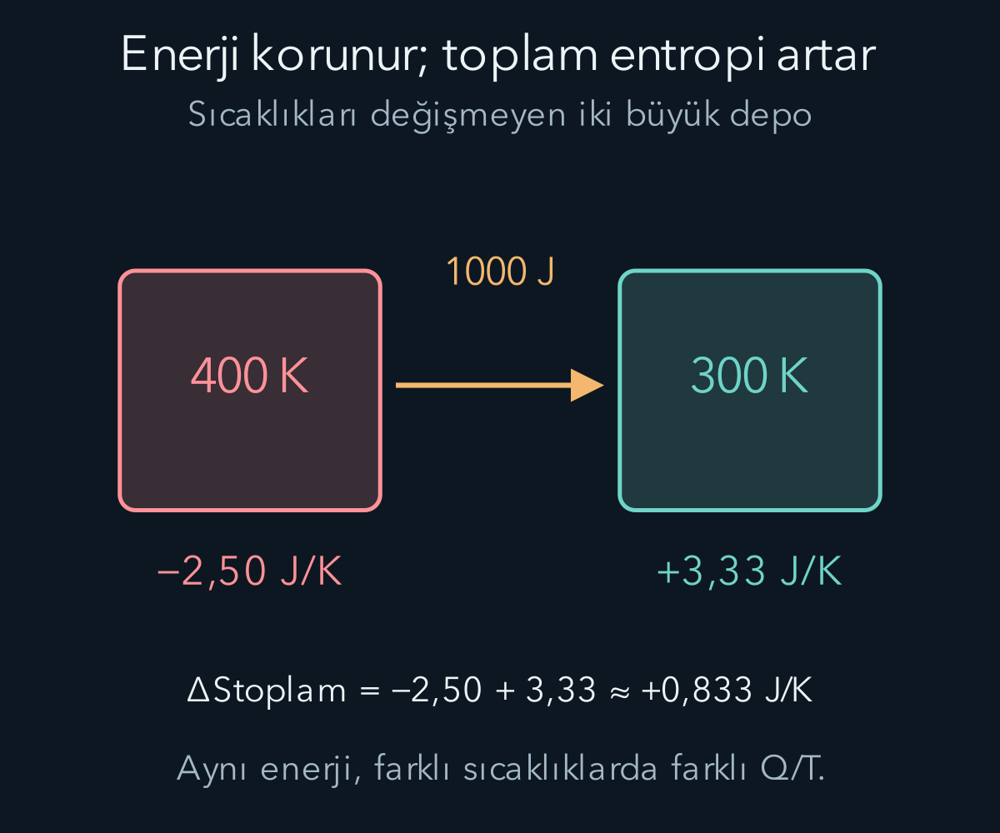
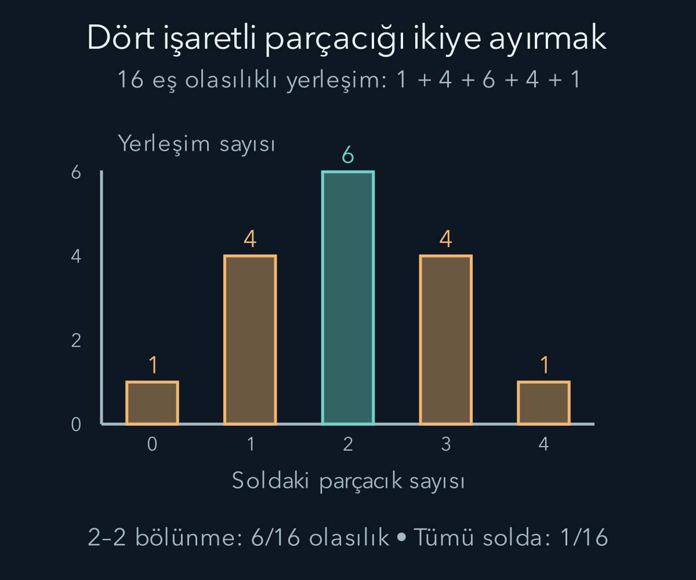

import ArticleVideo from '@/components/ArticleVideo.astro'
import kavram from './media/01-kavram.mp4?url'
import kavramPoster from './media/01-kavram.jpg?url'

Sıcak bir fincan zamanla soğur; aynı odada duran ılık fincanın kendiliğinden daha sıcak hale gelmesini beklemeyiz. İki yöndeki enerji hesabı, yalnız toplam enerjinin korunması açısından kurulabilir. Fakat doğada gerçekleşen süreçlerin belirgin bir yönü vardır. Termodinamiğin ikinci yasası, ilk yasanın miktar hesabına bu yön bilgisini ekler.

[Önceki yazıda](/blog/sicaklik-isi-ve-termodinamigin-ilk-yasasi/) iç enerjiyi, ısıyı, işi ve ideal gaz süreçlerini ayırdık. Bu yazıda kelvin sıcaklığını, logaritmayı ve olasılıkta sayma fikrini kullanacağız. Entropiyi yalnız “düzensizlik” sözcüğüne indirmeden, önce ölçülebilir süreçler üzerinden tanımlayacak, sonra mikroskobik durum sayısıyla ilişkisini kuracağız.

## 1. Tersinir süreç ne demektir?

Bir sürecin filmini geriye oynatabilmek, onun fiziksel olarak tersinir olduğunu göstermeye yetmez. **Tersinir süreç**, sistemde ve çevrede kalıcı net değişiklik bırakmadan ters yönde yürütülebilen ideal sınır süreçtir. Sürtünme, sonlu sıcaklık farkıyla ısı aktarımı ve serbest genişleme gibi etkiler bu özelliği bozabilir.

Bir gazı çok yavaş sıkıştırmak, gazın denge durumlarına yakın kalmasını sağlayabilir. Ancak piston sürtünmeli ise işlem çok yavaş olsa da tersinir olmayabilir. Yavaşlık, dengeye yakınlığı destekleyen bir koşuldur; enerji kayıplarını kendiliğinden ortadan kaldırmaz. Tersinirlik sistem ile çevrenin birlikte değerlendirilmesini gerektirir.

Isı aktarımını tersinir sınıra yaklaştırmak için sıcaklık farkını çok küçük tutarız. Sabit sıcaklıktaki iki cisim arasında belirgin bir fark varken ısı kendiliğinden sıcaktan soğuğa akar. Aynı net olayı hiçbir başka değişiklik olmadan tersine çeviremeyiz. Buzdolabı bunu soğuk bölgeden sıcak çevreye enerji taşıyarak yapabilir, fakat dışarıdan iş alır ve çevrede başka bir etki bırakır.

Tersinir modeller gerçekleşen her cihazın ayrıntısı değildir. Yine de süreçlerin ulaşabileceği sınırları belirler ve durum fonksiyonlarını hesaplamaya yarar. Gerçek süreç tersinmez olduğunda bile aynı başlangıç ve son durum arasında hayali bir tersinir yol seçerek bazı değişimleri hesaplayabiliriz.

## 2. Entropinin termodinamik tanımı

**Entropi** $S$ ile gösterilen bir durum fonksiyonudur. İki denge durumu arasındaki değişimi, onları bağlayan tersinir bir yol boyunca:

$$
\Delta S=\int_1^2\frac{\delta Q_{\mathrm{tersinir}}}{T}
$$

ile hesaplarız. $T$ mutlak sıcaklık, $\delta Q$ küçük ısı aktarımıdır. Isı için delta biçimini kullanmamız onun yol bağımlı oluşunu vurgular; iç enerji ve entropi gibi yalnız duruma bağlı bir toplam “ısı” fonksiyonu tanımlamadık.

Entropinin birimi joule bölü kelvindir. Isı aktarımını sıcaklığa bölmek, aynı enerji miktarının farklı sıcaklıklarda farklı entropi aktarımıyla ilişkili olmasını sağlar. Sabit sıcaklıkta tersinir ısı alan sistem için $\Delta S=Q/T$ olur. Sıcaklık değişiyorsa tek bir başlangıç sıcaklığına bölmek yerine integral gerekir.

Entropinin durum fonksiyonu olması, uygun tersinir yolların aynı uçlar için aynı sonucu vermesi demektir. Bu, termodinamiğin ikinci yasasıyla uyumlu bir yapı olarak kurulur; birinci yasanın basit cebirsel sonucu değildir. Burada ikinci yasayı deneyle desteklenen bağımsız bir fizik ilkesi olarak alıyoruz.

Gerçek bir tersinmez süreçte doğrudan gerçek $Q/T$ oranını entropi değişimi diye yazamayız. Örneğin önceki yazıdaki yalıtılmış serbest genişlemede ısı aktarımı sıfırdı; buna rağmen entropi artabilir. Hesap için aynı denge uçlarını bağlayan tersinir bir yol seçmemiz gerekir.

## 3. İkinci yasa hangi sistemi kapsar?

Yalıtılmış sistem için ikinci yasa:

$$
\Delta S_{\mathrm{yalıtılmış}}\ge0
$$

der. Tersinir sınırda eşitlik, tersinmez süreçte pozitif artış görülür. Yalıtılmış olmayan bir alt sistemin entropisi azalabilir. Yeterli miktarda entropi çevreye aktarılıyorsa, sistem ile çevrenin toplamı yasaya uyar.

Bir buzdolabının içindeki soğuyan yiyeceklerin entropisi azalabilir. Buzdolabı iş tüketir ve sıcak çevreye ısı verir. Yalnız yiyecekleri izleyip azalma gördüğümüzde ikinci yasanın bozulduğunu söylemeyiz; cihazı ve çevreyi de enerji ve entropi hesabına dahil ederiz. Sistem sınırı önceki momentum ve enerji problemlerinde olduğu gibi burada da belirleyicidir.

Denge termodinamiğinde gerçek bir kapalı sistem süreci için entropi değişimi, sınırdan aktarılan entropi ile içeride üretilen entropinin toplamı olarak yazılabilir. Entropi üretimi negatif değildir. Bu üretim enerjinin üretildiği anlamına gelmez. Enerji korunurken enerjinin iş üretmek için kullanılabilme koşulları değişir.

Bütün parçaların sıcaklığı aynı olan, basınç veya kimyasal dengesizlik taşımayan bir ortamdan yalnız ısı çekerek çevrimsel biçimde sürekli net iş üretmek ikinci yasayla bağdaşmaz. Isı motoru için yalnız enerji miktarı değil, sıcaklık farkı ve diğer kaynaklar da önemlidir. Böylece enerji kalitesi sözcüğünün arkasındaki fiziksel kısıt somutlaşır.

## 4. İki ısı deposu arasında somut hesap

Sıcaklığı değişmeyecek kadar büyük ideal depolar düşünelim. Sıcak deponun sıcaklığı $T_h=400\,\mathrm K$, soğuk deponunki $T_c=300\,\mathrm K$ olsun. Aralarından sıcak depodan soğuk depoya $Q=1000\,\mathrm J$ aktarılsın. Her depo sabit sıcaklıkta kaldığı için kendi entropi değişimini ısı bölü sıcaklıkla hesaplayabiliriz. Bu, depolar arasındaki gerçek aktarımın tersinir olduğu anlamına gelmez. Her deponun aynı başlangıç ve son durumunu, neredeyse aynı sıcaklıktaki yardımcı depolarla hayalî bir tersinir yoldan bağlayabiliriz; sıcaklık sabit olduğundan bu yolun integrali de alınan veya verilen enerjinin depo sıcaklığına bölünmesidir.

Sıcak depo enerji kaybeder:

$$
\Delta S_h=-\frac{1000}{400}=-2{,}50\,\mathrm{J/K}.
$$

Soğuk depo enerji alır:

$$
\Delta S_c=\frac{1000}{300}\approx3{,}33\,\mathrm{J/K}.
$$

Toplam değişim yaklaşık $0{,}833\,\mathrm{J/K}$ pozitiftir. Enerjinin bin joulesi birinden çıkıp diğerine girdi; toplam enerji değişmedi. Entropi ise aynı miktarda azalıp artmadı, çünkü iki sıcaklık farklıydı. Bu süreç toplam entropi üretir.

Aynı aktarımın tek başına ters yönde olduğunu varsaysaydık toplam entropi değişimi negatif çıkardı. İkinci yasa bu kendiliğinden ters aktarımı dışlar. Dışarıdan çalışan bir cihaz eklersek toplam hesap değişir; yalnız iki deponun arasındaki bin joulelik hareket bütün süreci artık temsil etmez.

Depoların sıcaklığı sabit kalmayacaksa bu kısa hesap yeterli değildir. Her cismin ısı kapasitesi ve sıcaklığının değişimi kullanılmalıdır. $Q/T$ ifadesindeki sıcaklığı keyfî bir ortalama seçmek yerine, uygun integral veya iki uç arasındaki durum bağıntısı gerekir.

Eşit ve sabit ısı kapasiteli iki küçük cisim için sıcaklıklar değişir. Başlangıç sıcaklıkları dört yüz ve üç yüz kelvin, her birinin ısı kapasitesi $C$ olsun. Dışarıya enerji kaçmadığında son ortak sıcaklık üç yüz elli kelvindir. Her cismin entropi değişimi $C\ln(T_f/T_i)$ olduğundan toplam:

$$
\Delta S=C\ln\frac{350}{400}+C\ln\frac{350}{300}
=C\ln\frac{49}{48}>0
$$

olur. Logaritmanın içindeki oran birden büyük olduğu için artışın işaretini sayısal hesap yapmadan görebiliriz. Burada sıcak cismin kaybettiği enerjiyle soğuk cismin aldığı enerji eşittir, fakat entropi değişimleri eşit büyüklükte değildir. Depo örneğinin sabit sıcaklık kabulünü kaldırdığımızda da aynı yön kuralı korunur; yalnız hesap yöntemi sıcaklık değişimini içerecek biçimde genişler.

## 5. İdeal gazın entropi farkı

Sabit miktarda ideal gazın iki denge durumu arasında bir tersinir yol düşünelim. İlk yasadan $\delta Q_{\mathrm{tersinir}}=dU+p\,dV$ olur. Sabit molar ısı kapasitesiyle $dU=nC_VdT$ ve $p=nRT/V$ kullanırsak:

$$
dS=nC_V\frac{dT}{T}+nR\frac{dV}{V}.
$$

İntegral almak:

$$
\Delta S=nC_V\ln\frac{T_2}{T_1}
+nR\ln\frac{V_2}{V_1}
$$

verir. Logaritmaların içi aynı birimli niceliklerin oranı olduğu için boyutsuzdur. Bu formül, sabit madde miktarı ve sabit ısı kapasitesi varsayımlarına dayanır. Isı kapasitesi değişirse sıcaklık terimi ilgili integralle değiştirilir.

Bir mol ideal gaz yalıtılmış kapta boşluğa genişleyip hacmini iki katına çıkarsın. İlk yasadan başlangıç ve son sıcaklıklarının aynı olduğunu biliyoruz. Sıcaklık logaritması sıfırdır; entropi artışı $R\ln2\approx5{,}76\,\mathrm{J/K}$ olur. Gerçek süreçte ısı sıfır olsa da entropi artışı sıfır değildir.

Aynı uçları tersinir izotermal genişlemeyle bağlasaydık gaz $nRT\ln2$ kadar ısı alırdı ve bu ısıyı sıcaklığa bölmek yine $nR\ln2$ verirdi. Kullanılan tersinir yol, gerçek olayın gizlice ısı aldığı iddiası değildir. Durum fonksiyonunun farkını hesaplayan yardımcı bir yoldur. Bu ayrımı korumak entropi hesaplarının temel alışkanlığıdır.

## 6. Isı motorunun enerji hesabı

Bir ısı motoru sıcak depodan $Q_h$ kadar enerji alsın, soğuk depoya $Q_c$ kadar enerji versin ve bir çevrim sonunda başlangıç durumuna dönsün. Burada $Q_h$ ve $Q_c$ pozitif miktarlardır; çıkış işini $W$ ile gösterelim. İç enerji farkı sıfır olduğundan ilk yasa:

$$
W=Q_h-Q_c
$$

verir. **Isıl verim**, elde edilen işin alınan ısıya oranıdır:

$$
\eta=\frac{W}{Q_h}=1-\frac{Q_c}{Q_h}.
$$

Enerji hesabı tek başına $Q_c=0$ seçimini cebirsel olarak dışlamaz. İkinci yasa, yalnız tek bir ısı deposundan enerji alıp başka hiçbir net etki bırakmadan çalışan çevrimsel motorun bütün ısıyı işe çeviremeyeceğini söyler. Çevrim koşulu önemlidir; tek bir genişleme adımında gazın durumu değişirken ısının tamamı işe dönüşebilir.

Bir motorun çalışma maddesi çevrim sonunda aynı entropiye döner. Sıcak depo $Q_h/T_h$ kadar entropi kaybeder, soğuk depo $Q_c/T_c$ kadar kazanır. Toplam için ikinci yasa:

$$
-\frac{Q_h}{T_h}+\frac{Q_c}{T_c}\ge0
$$

verir. Eşitsizliği düzenleyince $Q_c/Q_h\ge T_c/T_h$ ve dolayısıyla $\eta\le1-T_c/T_h$ bulunur. Bu sınır, yalnız verilen iki sabit sıcaklıklı depoyla çalışan çevrimsel motor içindir.

## 7. Carnot sınırının anlamı

Tersinir sınırda toplam entropi üretimi sıfırdır ve:

$$
\eta_{\mathrm C}=1-\frac{T_c}{T_h}
$$

olur. Bu **Carnot verimidir**. Sıcaklıklar mutlaka kelvinle kullanılır. Dört yüz kelvin ve üç yüz kelvin arasında çalışan ideal tersinir motorun sınır verimi dörtte birdir. Sıcak depodan bin joule alınırsa en çok iki yüz elli joule iş, en az yedi yüz elli joule soğuk depoya aktarım söz konusudur.

İdeal gazla kurulabilen Carnot çevrimi, sıcak depoda tersinir izotermal genişleme, ardından tersinir adyabatik soğuma, soğuk depoda tersinir izotermal sıkıştırma ve son olarak tersinir adyabatik ısınmadan oluşur. Adyabatik tersinir adımlarda entropi değişmez. İzotermal adımlarda alınan ve verilen entropi büyüklükleri eşittir.

Carnot sınırı gerçek motorun otomatik olarak ulaştığı verim değildir. Sonlu sıcaklık farkları, sürtünme ve başka tersinmezlikler verimi düşürür. İdeal tersinir süreçleri çok yavaş yürütmek gerekebilir; yüksek verim ile yüksek güç aynı tasarım hedefi değildir. Bir çevrim başına çok iyi oran elde etmek, bir saniyede çok büyük iş üretmek anlamına gelmez.

Sıcaklıklar birbirine yaklaştıkça üst sınır küçülür. Büyük bir ılık enerji deposunun bol enerji içermesi, tek başına yüksek işe dönüştürme imkânı vermez. Hangi soğuk alıcıya ve hangi süreçlerle bağlandığı önemlidir. İkinci yasa enerji hesabına bu kullanım sınırını ekler.

## 8. Mikrodurum ve makrodurum

Basınç, hacim ve sıcaklık gibi birkaç sayı bir gazın **makrodurumunu** anlatır. Parçacıkların çok daha ayrıntılı düzenlenişi ise mikrodurum düzeyindedir. Aynı makroduruma çok sayıda farklı mikrodurum karşılık gelebilir. Denge istatistiği, makroskobik davranışın bu büyük sayıların yapısıyla ilişkisini inceler.

Erişilebilir mikrodurumların uygun koşullarda eş olasılıklı sayıldığı bir modelde Boltzmann bağıntısı:

$$
S=k_B\ln\Omega
$$

biçimindedir. $\Omega$ ilgili makroduruma karşılık gelen mikrodurum sayısı, $k_B$ Boltzmann sabitidir. Sayı boyutsuzdur; entropinin birimi sabitten gelir. Sürekli konum ve momentumlu gerçek sistemlerde durum saymanın hassas tanımı ayrıca gerekir; burada sonlu bir modelle düşünceyi görünür kılacağız.

Birbirinden ayırt edilebilen dört işaretli parçacık, eşit hacimli sol ve sağ bölmelerden birinde bulunsun. Her parçacığın iki seçeneği olduğundan toplam on altı yerleşim vardır. Soldaki parçacık sayısı sıfır, bir, iki, üç veya dört olabilir. Bu makrodurumların yerleşim sayıları sırasıyla bir, dört, altı, dört ve birdir; binom katsayılarıyla sayılırlar.

İki parçacığın solda olduğu durum altı farklı yerleşimle gerçekleşirken hepsinin solda olduğu durum yalnız bir yerleşimle gerçekleşir. Eş olasılıklı yerleşim modelinde orta dağılım daha olasıdır. Entropi farkı $k_B\ln6$ olur. Parçacık sayısı büyüdüğünde dengeli dağılımları sağlayan düzenlemeler ezici çoğunluk oluşturabilir.

## 9. Logaritma neden kullanılır?

Birbirinden bağımsız iki sistemin erişilebilir durum sayıları $\Omega_A$ ve $\Omega_B$ olsun. Birleşik sistemde her A durumu her B durumuyla eşleşebilir; toplam sayı çarpılır: $\Omega_{AB}=\Omega_A\Omega_B$. Entropilerin toplanabilmesini istiyorsak logaritma doğal seçimdir:

$$
k_B\ln(\Omega_A\Omega_B)
=k_B\ln\Omega_A+k_B\ln\Omega_B.
$$

Böylece mikrodurum sayısının çarpımı, makroskobik entropinin toplamına dönüşür. Bu, logaritmanın yalnız sayıları küçültmek için seçilmediğini gösterir. Bağımsız sistemleri bir araya getirme davranışını doğru temsil eder.

İstatistiksel açıklama, küçük sistemlerde dalgalanmaların hiç olamayacağını söylemez. Dört parçacığın yeniden aynı tarafta bulunması mümkündür. Çok büyük sayıda parçacığın makroskobik ölçekte olağan dışı düzenlenmesi ise çok düşük olasılıklı olabilir. Termodinamik ikinci yasanın makroskobik gücüyle küçük sistemlerdeki olasılıksal dalgalanmaları aynı dilde, koşulları belirterek değerlendirmeliyiz.

Ayrıca gerçek özdeş parçacıkları yalnız hayalî isimler vererek fiziksel olarak farklı durumlar gibi saymak yanlış entropi sonuçları üretebilir. Aynı gazın iki eşit bölümünü, aynı sıcaklık ve basınçta aradaki bölmeyi kaldırarak birleştirmek, farklı gazların karışmasıyla aynı sayma problemi değildir. Ayırt edilemezlik konusu dikkatli durum sayımı gerektirir; buradaki dört işaretli parçacık örneği bu ayrıntının kuantum kanıtı değildir.

## 10. Entropiyi tek bir benzetmeye sıkıştırmamak

Entropi bazen “düzensizlik” diye anlatılır. Bu sözcük gündelik bir sezgi verebilir ama hangi mikrodurumların sayıldığı belirtilmezse hesap yapılabilir bir tanım değildir. Görsel olarak düzenli görünen bir yapı, çevresine yeterli entropi aktararak oluşabilir. Kristalleşme gibi olayları yalnız görünüş üzerinden ikinci yasaya karşı örnek sayamayız.

Bilgi eksikliğiyle bağlantı da dikkat ister. Makrodurum yalnız sınırlı ayrıntıyı söylediğinde birçok mikrodurumu birbirinden ayırmamış oluruz. Bu, fiziksel entropinin herhangi bir kişinin öznel şaşkınlığıyla keyfî olarak değiştiği anlamına gelmez. Sistem, kısıtlar ve olasılık modeli açıkça belirtilmelidir.

<ArticleVideo src={kavram} poster={kavramPoster} title="İki rezervuarın toplam entropisi" caption="400 K rezervuardan 300 K rezervuara 120 J ısı geçer. Sıcak tarafın −0,30 J/K ve soğuk tarafın +0,40 J/K katkıları toplamda +0,10 J/K verir." />

Enerji korunumu bize hesabın kapanmasını, entropi ise süreçlerin yönünü ve dönüşüm sınırlarını gösterdi. Buradan sonra elektrik yükü ve alanlarla yeni bir etkileşim türüne geçeceğiz. Kuvvet, enerji, potansiyel ve korunum kavramları yeni niceliklerle yeniden kullanılacak.

## Kaynaklar

- [OpenStax — İkinci yasanın ifadeleri](https://openstax.org/books/university-physics-volume-2/pages/4-4-statements-of-the-second-law-of-thermodynamics).
- [OpenStax — Carnot çevrimi](https://openstax.org/books/university-physics-volume-2/pages/4-5-the-carnot-cycle).
- [OpenStax — Entropi](https://openstax.org/books/university-physics-volume-2/pages/4-6-entropy).
- [OpenStax — Mikroskobik ölçekte entropi](https://openstax.org/books/university-physics-volume-2/pages/4-7-entropy-on-a-microscopic-scale).
