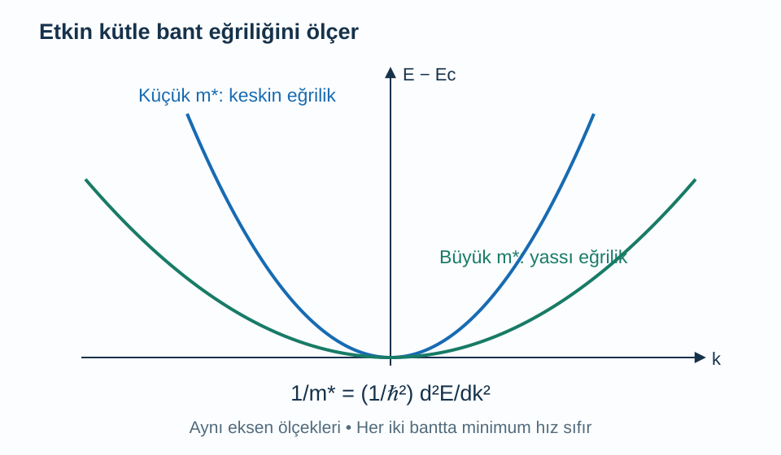
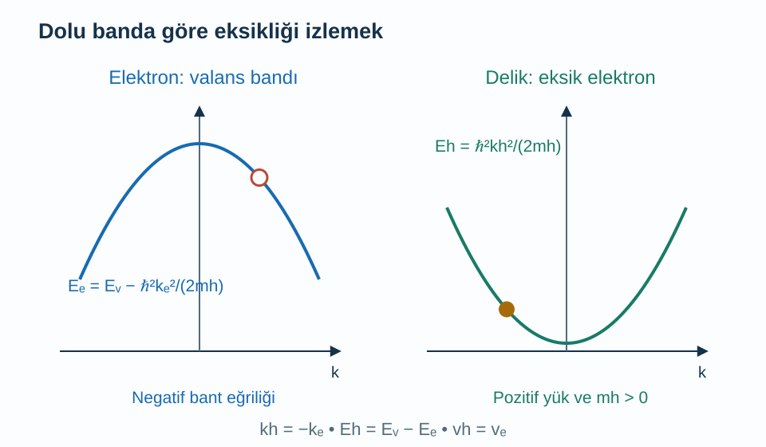

Bir elektronun boşluktaki kütlesini biliyoruz. Buna rağmen bir kristalde elektron için daha küçük, daha büyük, hatta bazı bölgelerde negatif bir etkin kütleden söz edilir. Burada elektronun iç yapısının değiştiğini söylemiyoruz. Periyodik ortamda hazırlanmış bir elektron dalga paketinin dış kuvvete nasıl yanıt verdiğini, enerji bandının biçimi üzerinden tarif ediyoruz.

Ön bilgilerimiz [enerji bantları](/blog/kristaller-ve-enerji-bantlari/), [durum yoğunluğu ve Fermi yüzeyi](/blog/durum-yogunlugu-ve-fermi-yuzeyi/), [dalga paketleri](/blog/fourier-serileri-ve-dalga-paketleri/) ve [türevin anlamı](/blog/turevin-anlami-ve-temel-kurallari/). Önce bir boyutlu, tek bantlı ve yavaş değişen dış alanlı bir model kullanacağız. Elektron dalga paketi birçok hücreye yayılsın, fakat kristalin tamamına göre yine yerelleşmiş olsun. Alanın bantlar arası geçiş üretmediği, manyetik alanın ve Berry eğriliği etkilerinin bulunmadığı koşullara odaklanacağız.

## 1. Bant eğrisi bir yörünge çizimi değildir

Yatay ekseni dalga sayısı $k$, düşey ekseni enerji $E$ olan grafikteki bir nokta, elektronun gerçek uzaydaki konumunu göstermez. Nokta, dalga paketinin merkez dalga sayısında bandın hangi enerjiye sahip olduğunu gösterir. $k$ birimi ters metre, enerji birimi joule veya elektronvolt olabilir. Eğrinin şeklinden hareket bilgisi çıkarabilmemiz, bu grafiğin bir yol haritası olduğu anlamına gelmez.

Yakın dalga sayılı bileşenleri üst üste koyduğumuzda dalga paketinin zarfı **grup hızıyla** ilerler. Açısal frekans $\omega$ için $v_g=d\omega/dk$ ve kuantum enerjisi için $E=\hbar\omega$ kullanılır. $\hbar$ indirgenmiş Planck sabitidir. Sabit $\hbar$'ı türevin dışına çıkarınca:

$$
v_g=\frac1\hbar\frac{dE}{dk}
$$

elde ederiz. Enerji sağa doğru artıyorsa eğim pozitif, grup hızı pozitiftir. Enerji eğrisi yataysa hız sıfırdır. Bir bant maksimumunda enerji yüksek olmasına rağmen eğim sıfır olabildiği için grup hızı sıfır olabilir. Bu, serbest parçacığın enerji ile hız arasında kurduğu alışılmış ilişkinin kristalde doğrudan kullanılamayacağını gösterir.

## 2. Kuvvet dalga sayısını değiştirir

Tek bantlı yarı klasik hareket denkleminde $\hbar\,dk/dt=F$ yazılır. $t$ zaman, $F$ dalga paketine uygulanan dış kuvvettir. Bu denklemde $\hbar k$ kristal momentumudur; kristaldeki elektronun bütün mikroskobik momentum bileşenlerini tek başına temsil etmez. Yavaş değişen alan altında dalga paketinin hangi Bloch durumlarına doğru kaydığını belirler.

Hızın zamana göre türevini alalım. $E$'nin $k$'ye, $k$'nin de zamana bağlı olduğunu dikkate alarak zincir kuralını kullanırız:

$$
\begin{aligned}
\frac{dv_g}{dt}
&=\frac1\hbar\frac{d^2E}{dk^2}\frac{dk}{dt}\\
&=\frac1{\hbar^2}\frac{d^2E}{dk^2}F.
\end{aligned}
$$

İvmeyi $a_x=dv_g/dt$ ile gösterelim. Eğer denklemi $a_x=F/m^*$ biçiminde yazmak istiyorsak **etkin kütle** $m^*$ şu koşulu sağlamalıdır:

$$
\frac1{m^*}=\frac1{\hbar^2}\frac{d^2E}{dk^2}.
$$

Birinci türev hızı, ikinci türev hızın kuvvet karşısındaki değişimini belirler. İki kavramı ayırmak önemlidir: eğim büyükken eğrilik küçük olabilir. Hızlı hareket eden bir dalga paketi, aynı anda kuvvete küçük ivmeyle yanıt verebilir. [MIT'nin etkin kütle ders notu](https://ocw.mit.edu/courses/6-730-physics-for-solid-state-applications-spring-2003/resources/lecture_23/) bu bant eğriliği yaklaşımını ayrıntılandırır.

## 3. Parabol neden özel bir kolaylık sağlar?

Bir bandın minimumu $k=0$ noktasında ve enerji değeri $E_c$ olsun. Minimumda ilk türev sıfırdır. Minimumun yeterince yakınında daha yüksek kuvvetleri ihmal ederek:

$$
E(k)\simeq E_c+\frac{\hbar^2k^2}{2m^*}
$$

yazabiliriz. Buradaki $m^*>0$ sabittir. Türevi alırsak önce $dE/dk=\hbar^2k/m^*$, sonra $v_g=\hbar k/m^*$ çıkar. İkinci türev $\hbar^2/m^*$ olduğundan etkin kütle tanımı kendisiyle tutarlıdır. Sabit $E_c$ türevde yok olur; enerji sıfırını değiştirmek hızı değiştirmez.

Bu parabolik yaklaşım bütün bandın tam biçimi olmak zorunda değildir. Minimumdan uzaklaştıkça üçüncü, dördüncü ve daha yüksek dereceli terimler önem kazanabilir. O zaman etkin kütle dalga sayısına göre değişir. Bir eğrilik sıfırından geçerken $m^*$ ifadesi sonsuza gidebilir; bunun anlamı elektronun gerçek kütlesinin sonsuz olması değil, o noktada kuvvete verilen birinci mertebe ivme yanıtının sıfırlanmasıdır.

Şekilde düşey enerji ölçeği ve yatay dalga sayısı ölçeği iki eğri için aynıdır. Eğrilikleri karşılaştırmak ancak bu ölçekler ortak olduğunda anlamlıdır; iki ayrı grafiğin farklı yakınlaştırmaları yanıltıcı olabilir.

## 4. Sayısal örnek: Elektronun hızı ve ivmesi

$m^*=0{,}20m_e$ olan bir bant minimumu seçelim; $m_e=9{,}10938\times10^{-31}\,\mathrm{kg}$ boşluktaki elektron kütlesidir. Dalga paketinin merkez dalga sayısı $k=2{,}0\times10^8\,\mathrm{m^{-1}}$ olsun. Önce kütleyi kilogram cinsinden yazarız: $m^*=1{,}82188\times10^{-31}\,\mathrm{kg}$. Hız:

$$
\begin{aligned}
v_g&=\frac{(1{,}05457\times10^{-34})(2{,}0\times10^8)}
{1{,}82188\times10^{-31}}\\
&\simeq1{,}158\times10^5\,\mathrm{m/s}
\end{aligned}
$$

olur. $\hbar k$ bir momentum birimi taşır; kütleye bölününce hız elde edilmesi birim kontrolüdür.

Şimdi $+x$ yönünde $\mathcal E=1{,}0\times10^3\,\mathrm{V/m}$ elektrik alanı uygulayalım. Enerji $E$ ile karışmaması için elektrik alanını $\mathcal E$ ile gösteriyoruz. Elektron yükü $-e$, $e=1{,}60218\times10^{-19}\,\mathrm C$ olduğundan kuvvet $F=-e\mathcal E$ olur. Böylece:

$$
\begin{aligned}
a_x&=-\frac{e\mathcal E}{m^*}\\
&\simeq-8{,}794\times10^{14}\,\mathrm{m/s^2}.
\end{aligned}
$$

Başlangıçta pozitif olan hız, alanın etkisiyle azalır. İvmenin büyük sayısal değeri tek başına gözle görülür hız değişiminin çok kısa bir sürede sonsuza büyüyeceği anlamına gelmez. Saçılma, bant dışına çıkma ve parabolik yaklaşımın geçerlilik aralığı sonraki hareketi sınırlar. Bu hesap, verilen andaki ve verilen bant bölgesindeki yerel yanıtı verir.

## 5. Sayısal örnek: Kosinüs bandında kütle değişir

Önceki bant yazısındaki tek boyutlu sıkı bağ enerjisini kullanalım:

$$
E(k)=E_a-2J\cos(ka).
$$

$E_a$ sabit enerji, $J>0$ komşu hücreler arasındaki enerji bağlaşımı, $a$ örgü aralığıdır. Zamanla karışmaması için bağlaşımı burada $J$ ile adlandırdık. Türevleri adım adım alırsak:

$$
\begin{aligned}
\frac{dE}{dk}&=2Ja\sin(ka)\\
\frac{d^2E}{dk^2}&=2Ja^2\cos(ka).
\end{aligned}
$$

Birinci türevde kosinüsün türevindeki eksi, baştaki eksiyle çarpılıp artı olur. İç fonksiyon $ka$ her türevde bir $a$ çarpanı getirir. Dolayısıyla:

$$
m^*(k)=\frac{\hbar^2}{2Ja^2\cos(ka)}.
$$

$J=0{,}50\,\mathrm{eV}$ ve $a=0{,}50\,\mathrm{nm}$ seçelim. Minimumda $k=0$ ve kosinüs $1$ olduğundan, $J$'yi joule'a, $a$'yı metreye çevirerek:

$$
\begin{aligned}
2Ja^2&\simeq4{,}0054\times10^{-38}\,\mathrm{J\,m^2},\\
m^*(0)&=\frac{1{,}1121\times10^{-68}}{4{,}0054\times10^{-38}}\,\mathrm{kg}\\
&\simeq2{,}7765\times10^{-31}\,\mathrm{kg}\\
&\simeq0{,}3048m_e.
\end{aligned}
$$

buluruz. $ka=\pi/3$ noktasında kosinüs $1/2$ olur; kütle $0{,}6096m_e$'ye çıkar. $ka=\pi/2$ noktasında eğrilik sıfırdır. $ka=\pi$ noktasında ise kosinüs $-1$ olduğundan $m^*=-0{,}3048m_e$ elde edilir. Aynı elektron için kullanılan yanıt parametresinin bant boyunca nasıl değiştiği açıkça görülür.

## 6. Negatif eğrilik neden bir çelişki değildir?

Bant maksimumu çevresinde eğri aşağı doğru kıvrılır. Kuvvetin dalga sayısını artırdığı bir durumda, eğim azalabilir; hızın değişimi kuvvetin tersi yönde olur. Etkin kütlenin negatif olması tam olarak bu yerel ilişkiyi kısaltır. Dış kuvvet ile kristalin elektron üzerindeki bütün mikroskobik kuvvetlerini aynı şey sanarsak bir çelişki varmış gibi görünür.

Bununla birlikte, neredeyse tamamen dolu bir bandı çok sayıda negatif eğrilikli elektronla anlatmak kullanışlı değildir. Dolu banttaki zıt hız katkıları dengede birbirini götürür. Zayıf alan altında tamamen dolu bir bandın bütün durumlarını birlikte dikkate aldığımızda, periyodik enerji eğrisinin türevinin bölge boyunca toplamı yine sıfırdır. Bu nedenle eksik olan az sayıdaki elektronu takip etmek daha kolaydır.

Bir elektrik akımı yoğunluğunun tek elektron katkısı hacim $V$ içinde $-e v_e/V$ olsun; $v_e$ çıkarılan elektronun hızıdır. Bu elektronu dolu banttan çıkardığımızda akım değişimi bunun ters işaretlisi, $+e v_e/V$ olur. İşte **delik**, dolu banda göre bu eksikliğin taşıdığı uyarımı temsil eder. Pozitif yük ataması, yalnız sözlü bir benzetmeden değil, eksilen akımın işaretinden çıkar.

## 7. Deliğin enerjisi ve dalga sayısı

Valans bandı maksimumunu $k_e=0$ noktasında alalım; maksimum enerji $E_v$ olsun. Yakında elektron enerjisi:

$$
E_e(k_e)=E_v-\frac{\hbar^2k_e^2}{2m_h}
$$

biçiminde yazılabilir. $m_h>0$ deliğin etkin kütlesidir. Bir elektronun bu dolu referanstan çıkarılmasının dalga sayısını $k_h=-k_e$, enerji maliyetini de $E_h=E_v-E_e$ diye tanımlarsak:

$$
\begin{aligned}
E_h(k_h)&=\frac{\hbar^2k_h^2}{2m_h}\\
v_h&=\frac{\hbar k_h}{m_h}\\
&=v_e.
\end{aligned}
$$

Son eşitlikte elektron hızının aşağı bakan parabolün türevinden $v_e=-\hbar k_e/m_h$ geldiğini kullandık. Deliğin dalga sayısı eksik elektronunkinin tersidir; bu tanımlarla hızları aynıdır. Deliğin kuvveti $+e\mathcal E$ olduğundan pozitif kütleli, pozitif yüklü bir taşıyıcı dili elde edilir.

Şekilde boş daire gerçek bir atom boşluğu değildir. Kristal yerinde dururken bir elektronik durumun doluluğu değişmiştir. Delik bir pozitron da değildir; farklı bir vakum parçacığı değil, çok elektronlu katının uyarımıdır.

## 8. Bir bantta sürekli hızlanma neden beklemiyoruz?

Sabit dış kuvvet altında $\hbar\,dk/dt=F$ denklemini integre edersek $k(t)=k(0)+Ft/\hbar$ buluruz. Serbest parçacıkta enerji parabolik olduğundan hız da zamanla doğrusal büyür. Kosinüs bandında ise hız $v_g=(2Ja/\hbar)\sin(ka)$ biçimindedir. Dalga sayısı ilerlerken hız önce artar, sonra azalır ve işaret değiştirebilir. Enerji bandının periyodikliği, sabit kuvvete verilen yanıtın bütün zamanlarda tek bir sabit kütleyle anlatılamayacağını gösterir.

Dalga sayısının bir ters örgü adımı kadar değişmesi için gereken süre, $|F|T_B/\hbar=2\pi/a$ koşulundan:

$$
T_B=\frac{2\pi\hbar}{|F|a}
$$

olur. $T_B$ bu ideal modeldeki **Bloch salınımı periyodudur**. Bir elektron için $|F|=e|\mathcal E|$ yazılabilir. Bu sonucun gözlenebilmesi saçılmanın yeterince zayıf, alanın bantlar arası geçişleri ihmal etmeye uygun ve dalga paketinin tek bant tanımının geçerli olmasını gerektirir.

Buradaki salınım sonucunu sıradan bir metal telde elektronların düzenli biçimde ileri geri gidip hiç direnç üretmeyeceği iddiasına çevirmemeliyiz. Gerçek akımda saçılma ve doluluk dağılımı devreye girer. Bu ideal örnek, etkin kütlenin yerel anlamını sınamak içindir: bandın küçük bir parçasında başarılı olan parabol, bütün Brillouin bölgesinin hareketini temsil etmek zorunda değildir.

## 9. Üç boyutta tek kütle her zaman yetmez

Gerçek bir bant bir yönde keskin, başka yönde daha yassı olabilir. Üç boyutta hızın $i$ bileşeni $v_i=(1/\hbar)\partial E/\partial k_i$ olur. İvmenin kuvvetle ilişkisini yazarken farklı yönleri birleştiren ikinci türevler ortaya çıkar:

$$
(m^{*-1})_{ij}=\frac1{\hbar^2}\frac{\partial^2E}{\partial k_i\partial k_j}.
$$

Bu bir **ters kütle tensörüdür**; pratikte bir matris gibi davranır. Kuvvetin yönü ile ivmenin yönü her zaman aynı olmak zorunda değildir. Simetri veya uygun ana eksenler sayesinde bazı durumlarda ilişki üç ayrı kütleyle sadeleşir. Buradaki skaler örnekler bu genel yapının tek yönlü ya da izotropik sınırlarıdır.

Dolayısıyla bir malzeme için tek bir “etkin kütle” sayısı duyduğumuzda hangi bandın, hangi yönün ve hangi ölçümün kastedildiğini sormalıyız. Durum yoğunluğu, elektrik taşınımı ve manyetik yörüngeler farklı kütle birleşimlerine duyarlı olabilir. [Tong'un elektron dinamiği notları](https://davidtong.org/pdfs/teaching/solid-state-physics/solidstate3.pdf) delikler ve yarı klasik hareket için bu ayrımları kurar. Bundan sonraki akım hesabında hem taşıyıcı sayısına hem de kuvvete verilen bu bant yanıtına ihtiyaç duyacağız.
