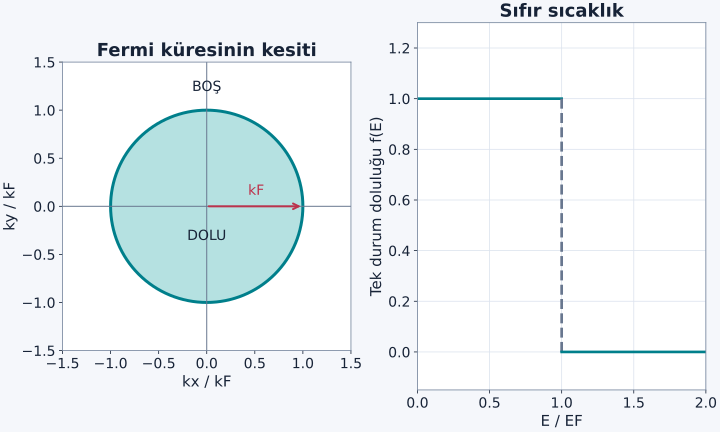
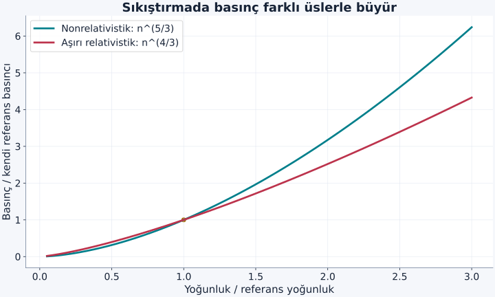

Bir gaz soğutulunca parçacıkların hareket enerjisinin ve basıncının sıfıra yaklaşmasını beklemek doğaldır. Bu beklenti, klasik seyrek gaz için belirli bir aralıkta işe yarar. Fermiyonlarda ise aynı kuantum durumuna yalnız bir parçacık yerleşebilir. Düşük enerjili yerler dolduğunda sıradaki parçacık daha yüksek momentumlu bir duruma gitmek zorundadır. Sıcaklık sıfır olsa bile bu doluluk zorunluluğu ortadan kalkmaz.

[Fermi–Dirac dağılımı](/blog/bose-einstein-ve-fermi-dirac-dagilimlari/) ve [durum yoğunluğu](/blog/durum-yogunlugu-ve-fermi-yuzeyi/) ön bilgilerimiz. Üç boyutlu bir kutuda, etkileşmeyen, spin $1/2$ parçacıklar kullanacağız. İki spin türünün eşit dolu olduğunu ve enerjinin $p^2/(2m)$ olduğunu varsayıyoruz; $p$ momentum büyüklüğü, $m$ parçacık kütlesidir. Elektron örneğinde elektriksel nötrlüğü sağlayan pozitif arka planın bulunduğunu düşünürüz; elektronlar arasındaki Coulomb enerjisini bu ideal hesapta çözmeyiz.

## 1. Sıfır sıcaklık, sıfır momentum demek değildir

Fermi–Dirac doluluğu $f(E)=1/[e^{(E-\mu)/(k_BT)}+1]$ idi. $\mu$ kimyasal potansiyel, $T$ sıcaklık ve $k_B$ Boltzmann sabitidir. $T\to0$ limitinde $E<\mu$ durumları dolu, $E>\mu$ durumları boş olur. Sıfır sıcaklıktaki en yüksek dolu enerjiye **Fermi enerjisi** $E_F$ denir. Bu ideal gazda $\mu(T=0)=E_F$ olur.

Parçacıklar birbirinden kaçan küçük bilyeler gibi düşünülmemelidir. Pauli ilkesi uzaysal noktayı değil, spin dahil **tam tek parçacık kuantum durumunu** sınırlar. Aynı uzaysal durum zıt spinli iki elektron alabilir. Buna karşılık aynı spin ve aynı uzaysal durum iki elektron alamaz. Bu yazıdaki bütün iki çarpanları bu iki spin seçeneğinden gelir.

Sıfır sıcaklık taban durumu, enerjiyi bu kurala uyarak en aza indiren doluluktur. Dolayısıyla “basınç var, öyleyse sıcaklık sıfır olamaz” çıkarımı geçersizdir. Termal uyarılma ile Pauli ilkesi nedeniyle taban durumda bulunması zorunlu kinetik enerji farklı kavramlardır.

## 2. Momentum uzayında yerleri saymak

Kenar uzunluğu $L$, hacmi $V=L^3$ olan büyük bir kutu seçelim. Sayımı kolaylaştırmak için periyodik sınır koşulu kullanalım. İzinli dalga vektörü bileşenleri $k_x=2\pi n_x/L$ biçimindedir; $n_x$ tam sayı, benzer biçimde $n_y,n_z$ de tam sayıdır. Her uzaysal durum $k$ uzayında $(2\pi)^3/V$ hacim kaplar.

$\hbar$ indirgenmiş Planck sabiti olmak üzere enerji $E=\hbar^2 k^2/(2m)$ yalnız $k=|\mathbf k|$ büyüklüğüne bağlı olduğundan en düşük enerjileri doldurmak, $k$ uzayında yarıçapı $k_F$ olan küreyi doldurmaktır. Kürenin hacmi $4\pi k_F^3/3$; iki spinle toplam sayı:

$$
N=2\frac{V}{(2\pi)^3}\frac{4\pi k_F^3}{3}
=\frac{Vk_F^3}{3\pi^2}.
$$

Yoğunluk $n=N/V$ tanımıyla:

$$
\begin{aligned}
k_F&=(3\pi^2n)^{1/3},\\
p_F&=\hbar k_F,\\
E_F&=\frac{\hbar^2}{2m}(3\pi^2n)^{2/3}.
\end{aligned}
$$

bulunur. $k_F$ ters metre, $p_F$ momentum, $E_F$ enerji birimlidir. Yoğunluk sekiz katına çıkınca $k_F$ iki, enerji dört katına çıkar. Bu üsler, üç boyutlu durum sayımı ile karesel enerji ilişkisinin birlikte sonucudur.

Şekil: Daire üç boyutlu kürenin kesitidir; iki boyutlu gaz sayımı yapılmıyor. Doluluk grafiğindeki basamak tek bir tam kuantum durumu içindir, toplam parçacık sayısı değildir.

## 3. Bütün parçacıklar Fermi enerjisinde bulunmaz

En yüksek dolu enerji $E_F$ olsa da daha düşük enerjili bütün kabuklar da doludur. $k$ ile $k+dk$ arasındaki ince küresel kabukta:

$$
dN=\frac{V}{\pi^2}k^2\,dk
$$

durum vardır. Kinetik enerjileri toplayalım:

$$
\begin{aligned}
U&=\int_0^{k_F}\frac{\hbar^2k^2}{2m}\,dN\\
&=\frac{V\hbar^2}{2m\pi^2}\int_0^{k_F}k^4\,dk\\
&=\frac{V\hbar^2k_F^5}{10m\pi^2}.
\end{aligned}
$$

$N=Vk_F^3/(3\pi^2)$ ile bölünce:

$$
\frac UN=\frac35\frac{\hbar^2k_F^2}{2m}=\frac35E_F
$$

çıkar. Ortalama enerji en yüksek enerjinin yüzde altmışıdır. Hesapta $k^2$ kabuk sayısı ile $k^2$ enerji çarpıldığı için integral $k^4$ içerdi; ara adımı atlamak $3/5$ katsayısını ezberlenecek bir sayıya dönüştürürdü.

## 4. Basıncı enerji türevinden çıkarmak

Sıfır sıcaklıkta parçacık sayısı sabitken hacmi biraz küçültelim. Yoğunluk artar, izinli durumların momentum ölçeği yükselir, taban durum enerjisi büyür. Dışarıdan yapılan sıkıştırma işi bu artışa gider. Basıncın termodinamik tanımı:

$$
P=-\left(\frac{\partial U}{\partial V}\right)_N
$$

olur. $E_F$ yoğunluğun $2/3$ kuvvetiyle orantılı olduğundan $U=(3/5)NE_F=A N^{5/3}V^{-2/3}$ biçimindedir; $A$ burada sabit bir katsayıdır. Türev alınca:

$$
P=\frac23A N^{5/3}V^{-5/3}
=\frac{2U}{3V}
=\frac25nE_F.
$$

Enerji yoğunluğu birimi $\mathrm{J/m^3}=\mathrm{Pa}$ olduğu için boyutlar uygundur. Buna **dejenerasyon basıncı** denir. Buradaki dejenerasyon sözcüğü, gazın kuantum istatistiğinin belirleyici olduğu rejimi anlatır; sadece iki düzeyin eş enerjili olması anlamıyla karıştırılmamalıdır. [Tong'un kuantum gazları notları](https://davidtong.org/pdfs/teaching/statistical-physics/statphys3.pdf), bu ideal gazdan yıldız ölçeğine geçişin temel sınırlarını verir.

Aynı toplam enerji kimyasal potansiyeli de denetler. Sıfır sıcaklıkta sabit hacimde bir parçacık eklemenin maliyeti $\mu=(\partial U/\partial N)_V$'dir. Yukarıdaki $U=A N^{5/3}V^{-2/3}$ ifadesinden:

$$
\begin{aligned}
\mu&=\frac53A N^{2/3}V^{-2/3}\\
&=\frac53\frac UN=E_F.
\end{aligned}
$$

Ortalama parçacık enerjisi $3E_F/5$ iken eklenen son parçacığın maliyeti $E_F$'dir: alttaki durumlar dolu olduğundan yeni parçacık sınırda yer bulur. Ayrıca $U+PV=U+2U/3=NE_F$ kontrolü sağlanır. Enerjiye dinlenim katkısı $Nmc^2$ ekleseydik kimyasal potansiyel $mc^2$ kadar artardı, fakat sabit N'de bu terimin hacim türevi sıfır olduğundan basınç değişmezdi. Enerji sıfırı ile mekanik basıncın ayrımı bu örnekte açıkça görülür.

## 5. Örnek: Metal yoğunluğunda elektron gazı

$n=8{,}0\times10^{28}\,\mathrm{m^{-3}}$, $m=m_e=9{,}1094\times10^{-31}\,\mathrm{kg}$ ve $\hbar=1{,}05457\times10^{-34}\,\mathrm{J\,s}$ alalım. Önce:

$$
\begin{aligned}
k_F&=(3\pi^2\times8{,}0\times10^{28})^{1/3}\\
&\simeq1{,}333\times10^{10}\,\mathrm{m^{-1}}.
\end{aligned}
$$

Bundan $E_F\simeq1{,}085\times10^{-18}\,\mathrm J$ bulunur. $1\,\mathrm{eV}=1{,}60218\times10^{-19}\,\mathrm J$ dönüşümüyle $E_F\simeq6{,}77\,\mathrm{eV}$ elde ederiz. **Fermi sıcaklığı** $T_F=E_F/k_B\simeq7{,}86\times10^4\,\mathrm K$ olur.

Oda sıcaklığında $T/T_F\simeq300/78600\simeq0{,}00382$'dir. Elektronlar bu anlamda kuvvetle kuantum dejeneredir; metalin kendisinin on binlerce kelvin sıcaklıkta olduğu söylenmiyor. Fermi sıcaklığı mevcut enerji ölçeğinin sıcaklık biriminde ifadesidir.

Basıncı hesaplarken enerjiyi tekrar joule kullanmalıyız:

$$
\begin{aligned}
P&=\frac25nE_F\\
&\simeq\frac25(8{,}68\times10^{10})\,\mathrm{Pa}\\
&\simeq3{,}47\times10^{10}\,\mathrm{Pa}.
\end{aligned}
$$

Bu yaklaşık $34{,}7\,\mathrm{GPa}$'lık ideal **elektron katkısıdır**. Bir metal parçasının dışarıya bu büyüklükte net basınç uyguladığı sonucu çıkmaz. İyonların, elektriksel çekimin ve kristalin diğer enerji katkıları da toplam mekanik dengeye katılır. Yalnız bir enerji teriminin türevini hesaplayıp toplam malzeme gerilimi diye sunamayız.

## 6. Isınmak neden hemen klasik gaza döndürmez?

$T\ll T_F$ iken yalnız Fermi sınırının yaklaşık $k_BT$ genişliğindeki çevresinde doluluklar belirgin değişir. Derindeki elektronların geçebileceği yakın boş durumlar bulunmaz. Bu nedenle bütün elektronların ortalama termal enerjisini $3k_BT/2$ yapmak doğru değildir. Taban durumdaki enerji büyük kalır; ısınmayla eklenen enerji bunun küçük bir düzeltmesidir.

Sabit yoğunlukta ideal gazın düşük sıcaklık açılımı:

$$
P(T)\simeq P(0)\left[1+\frac{5\pi^2}{12}\left(\frac{T}{T_F}\right)^2\right]
$$

verir. Bu sonuç, Fermi–Dirac integralinin küçük $T/T_F$ için açılmasına dayanır; yüksek sıcaklıkta kullanılmaz. Metal örneğinde paranteze eklenen terim yaklaşık $6{,}0\times10^{-5}$'tir. Düşük sıcaklık elektron basıncının başlıca kaynağı böylece termal hareket değildir. Klasik $P=nk_BT$ bağıntısı, dolulukların seyrekleştiği farklı bir sınıra aittir.

## 7. Sıkıştırma yasası ve mekanik direnç

Aynı parçacık sayısı için $P\propto n^{5/3}\propto V^{-5/3}$ bulduk. Hacmi yarıya indirmek, yoğunluğu ikiye ve basıncı $2^{5/3}\simeq3{,}175$ katına çıkarır. Enerji ise $U\propto V^{-2/3}$ olduğu için $2^{2/3}\simeq1{,}587$ katına çıkar. Basınç ile enerjinin aynı oranla değişmesini beklememeliyiz; basınç hacim türevidir.

Sıkıştırılmaya karşı yerel direnci anlatan hacim modülü $K=-V\,dP/dV$ olarak tanımlanır. Türevden $K=(5/3)P$ çıkar. $K$'nın pozitif olması hacim küçültüldüğünde karşı basıncın artması demektir. Yine bu, ideal elektron gazının katkısıdır; gerçek malzemenin elastik sabitlerini tek başına vermez.

Şekil: Her eğri kendi referans basıncıyla normalize edilmiştir. Aynı katsayılı iki gerçek gaz gösterilmez; amaç iki rejimde yoğunluk üssünün farkını görmektir.

## 8. Örnek: Yıldız yoğunluğunda önce yaklaşımı sınamak

$c$ boşluktaki ışık hızı olsun. Elektron yoğunluğunu $n=10^{35}\,\mathrm{m^{-3}}$ seçelim. Aynı sayım $k_F\simeq1{,}436\times10^{12}\,\mathrm{m^{-1}}$ ve $p_F\simeq1{,}514\times10^{-22}\,\mathrm{kg\,m/s}$ verir. Fakat enerji formülünü hemen uygulamak yerine:

$$
\begin{aligned}
m_ec&\simeq2{,}731\times10^{-22}\,\mathrm{kg\,m/s},\\
x&=\frac{p_F}{m_ec}=\frac{1{,}514}{2{,}731}\\
&\simeq0{,}555.
\end{aligned}
$$

oranını kontrol ederiz. $x\ll1$ koşulu iyi sağlanmıyor. Nonrelativistik formül yaklaşık $78{,}6\,\mathrm{keV}$ verirken doğru tek parçacık kinetik enerjisi:

$$
\begin{aligned}
E_{F,\mathrm{kin}}&=\sqrt{p_F^2c^2+m_e^2c^4}-m_ec^2\\
&=m_ec^2(\sqrt{1+x^2}-1)\\
&\simeq73{,}3\,\mathrm{keV}.
\end{aligned}
$$

olur. $m_ec^2\simeq511\,\mathrm{keV}$ kullandık. Yaklaşık yüzde yedi fark, bu yoğunlukta göreli düzeltmenin önem kazandığını gösterir. Burada $x$ sonsuz büyük de değildir; aşırı relativistik $E\simeq pc$ formülüne atlamak da doğru olmaz.

Bu örnek bir beyaz cücenin tüm yapısını çözmez. Bunun için yoğunluğun yarıçapa göre değişimini, kütleçekim dengesini ve bileşimi de çözmek gerekir. Yalnızca elektron istatistiğinin büyük basınç sağlayabildiğini ve yoğunluk yükseldikçe hareket yasasının yeniden kontrol edilmesi gerektiğini gösterir.

## 9. Görelilik kuvvet yasasının üssünü değiştirir

$p_F\gg mc$ sınırında enerji yaklaşık $pc$ olur. Durum sayısı hâlâ momentum küresinin hacmiyle, yani $p_F^3$ ile orantılıdır. Ancak enerji artık momentumun karesiyle değil birinci kuvvetiyle büyür. Bu yüzden toplam enerji yoğunluğu $n^{4/3}$ ölçeğine geçer. Aynı integralle ortalama enerji $3p_Fc/4$, basınç:

$$
P=\frac14np_Fc=\frac{U}{3V}
$$

bulunur. $5/3$ yerine $4/3$ üssünün gelmesi, yoğunluk artırıldığında basıncın farklı hızda büyümesi demektir. Yıldızların kararlılığında bu değişim önemlidir. [MIT'nin fermiyon sistemleri ders notları](https://ocw.mit.edu/courses/8-333-statistical-mechanics-i-statistical-mechanics-of-particles-fall-2013/9d5207eef23c4d6e18ef3afbca5d9d81_MIT8_333F13_Lec24.pdf) kuantum gazı hesaplarını termodinamik bağlamda ele alır.

### Duvara çarpan momentumla aynı basıncı bulmak

Enerji türeviyle bulduğumuz basınç, kinetik momentum akışıyla da kontrol edilebilir. Düzgün ve yön bakımından simetrik gazda $x$, $y$ ve $z$ doğrultuları eşdeğerdir. Bu nedenle momentum karesinin ortalaması üç bileşene eşit dağılır: $\langle p_x^2\rangle=\langle p^2\rangle/3$. Bir duvara aktarılan momentumdan $P=n\langle p_xv_x\rangle$ elde edilir. Nonrelativistik hız $v_x=p_x/m$ olduğuna göre $P=n\langle p^2\rangle/(3m)$ olur. Öte yandan parçacık başına kinetik enerji $\langle p^2\rangle/(2m)$ olduğundan yine $P=2U/(3V)$ çıkar.

Bu ikinci yol, termodinamik türevdeki eksi işaretini ve üçte iki katsayısını bağımsız biçimde doğrular. Hesapta sıcaklığı açıkça kullanmadık; momentum dağılımının hangi yasa tarafından belirlendiğini kullandık. Klasik gazın Maxwell dağılımını koyarsak farklı bir enerji–sıcaklık bağıntısı üzerinden ideal gaz yasasına gideriz. Sıfır sıcaklık Fermi doluluğunu koyunca ise taban durum basıncı kalır. Aynı mekanik tanım, farklı istatistiklerle farklı denklemler üretir.

Momentum küresinin bütün yönleri dolu olduğundan toplam momentum sıfırdır. Fakat momentumun karesinin ortalaması sıfır değildir. Bu ayrım, basınçla akımı birbirinden ayırır: Dengede net elektron akımı yokken duvarlara momentum aktarımı ve sıkıştırmaya direnç bulunabilir. Ortalama hızların birbirini götürmesi, ortalama kinetik enerjinin de sıfır olması demek değildir. Sayılarla düşünürsek eşit olasılıklı $+v$ ve $-v$ hızlarının ortalaması sıfır, karelerinin ortalaması $v^2$ olur. Fermi gazında aynı mantık üç boyutlu momentum dağılımına uygulanır.

Böylece “sıfır toplam hareket” gibi belirsiz bir ifade yerine, hangi ortalamanın sıfır olduğunu söylemek gerekir. Net momentum, ortalama enerji ve basınç ayrı gözlenebilirlerdir. Modelin denge halinde bulunması onların hepsinin sıfırlanmasını gerektirmez.

## 10. “Pauli kuvveti” ifadesini dikkatli okumak

Pauli ilkesi, elektromanyetik kuvvete eklenmiş yeni bir temel kuvvet değildir. İzin verilen çok parçacıklı durumları kısıtlar; bu kısıt enerji–hacim bağıntısını ve dolayısıyla basıncı değiştirir. Parçacıklar arası etkileşimleri sıfırladığımız modelde bile basıncın kalabilmesi bu ayrımı açıkça gösterir. Gerçek yoğun maddede etkileşimler elbette ek katkılar üretir.

Yoğunluk birimini kontrol etmek burada özellikle yararlıdır. Üç boyutlu gazda sayı bölü hacim kullanırken iki boyutlu bir tabaka için sayı bölü alan gerekir. Bu değişiklik yalnız birim etiketini değil, durum sayımını ve basıncın yoğunluk üssünü de değiştirir.

Burada üç boyut, iki spin seçeneği, parabolik enerji ve düşük sıcaklık varsayımlarını birlikte kullandık. Spin kutuplanması, farklı boyut veya bant yapısı durum sayımını değiştirebilir. Hesabı başka sisteme taşırken yalnız kütleyi değiştirmek her zaman yeterli değildir. Fermiyonların düşük durumları sırayla doldurmak zorunda olması, bozonların aynı durumda büyük sayılarla birikebilmesiyle karşılaştırıldığında daha da belirginleşir.
