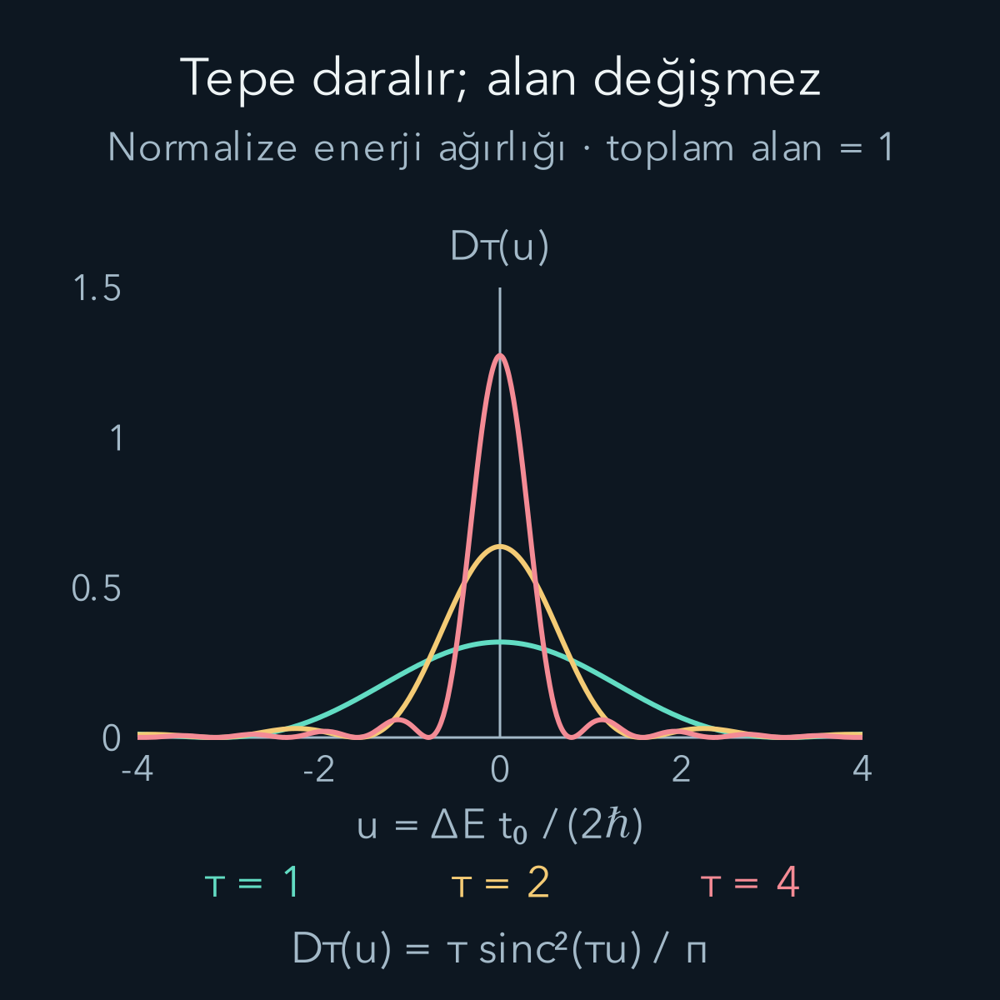
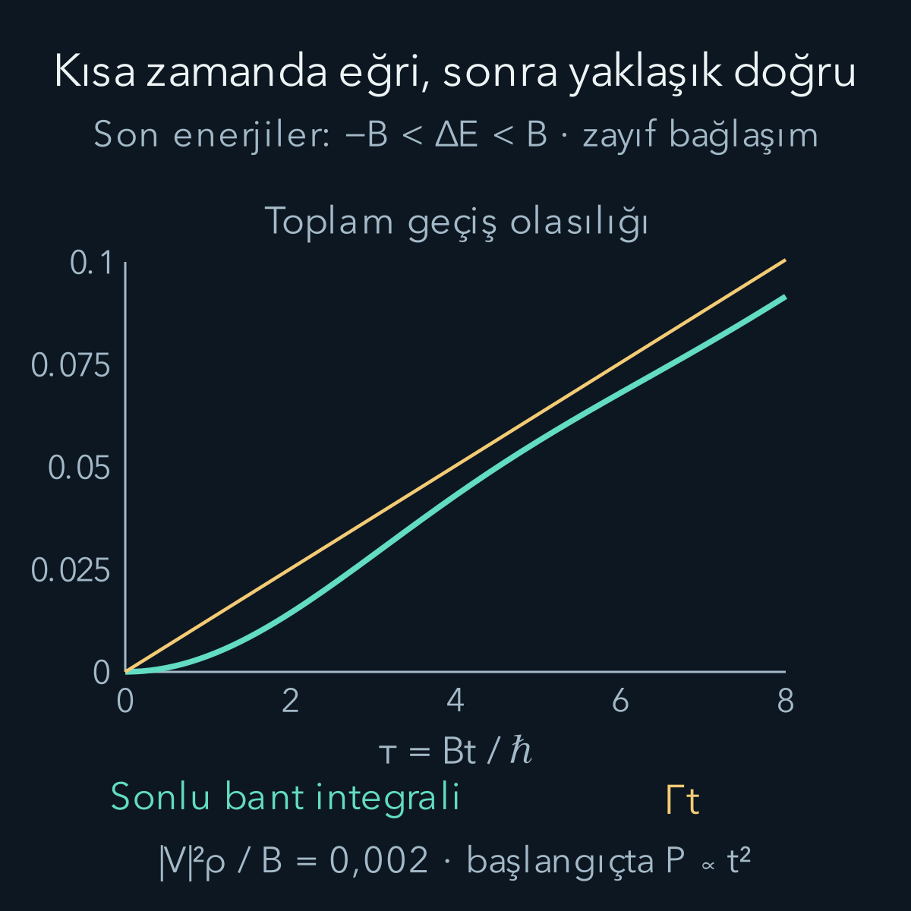

import ArticleVideo from '@/components/ArticleVideo.astro'
import kavram from './media/01-kavram.mp4?url'
import kavramPoster from './media/01-kavram.jpg?url'

Bir dış etki iki enerji durumunu bağlıyorsa geçiş olasılığı zamanla artabilir, sonra yeniden azalabilir. [Rabi salınımları](/blog/zamana-bagli-perturbasyon-ve-rabi-salinimlari/) yazısında bunu görmüştük. Buna karşılık deneylerde sık sık “saniye başına geçiş sayısı” veya “bozunma hızı” konuşulur. Salınan bir olasılıktan yaklaşık sabit bir hız nasıl çıkar?

Kilit değişiklik, tek bir son durum yerine birbirine çok yakın çok sayıda son durumun bulunmasıdır. Her birinin genliği kendi fazını biriktirir. Hepsine geçiş olasılıklarını topladığımızda uygun koşullarda zamanla yaklaşık doğrusal artış elde ederiz. Bu yazı [zamana bağlı pertürbasyon](/blog/zamana-bagli-perturbasyon-ve-rabi-salinimlari/), olasılık yoğunluğu ve belirli integral üzerine kurulur. Dirac delta gösterimini kullanmadan önce onun integral içindeki anlamını açıklayacağız; sonunda da ortaya çıkan hızın hangi sürelerde geçerli olduğunu kontrol edeceğiz.

## 1. Geçiş olasılığı bir kronometre okuması değildir

Aynı başlangıç durumunu tekrar tekrar hazırlayıp her deneyin sonunda enerji ölçelim. $P(t)$, $t$ süre beklendiğinde sistemin seçilmiş son durumlar kümesinde bulunma olasılığı olsun. $P(t)=0{,}02$ demek, çok sayıda aynı deneyin yaklaşık yüzde ikisinde bu kümenin bir üyesinin ölçülmesi demektir. Tek atomun iki düzey arasında tam iki nanosaniye yol aldığı anlamına gelmez.

Eğer belirli bir zaman aralığında $P(t)\approx\Gamma t$ ise $\Gamma$'ya **geçiş hızı** deriz. Birimi saniyenin tersidir. Başlangıç durumunda yaklaşık $N$ bağımsız sistem varken, kısa bir $\Delta t$ aralığında beklenen geçiş sayısı yaklaşık $N\Gamma\Delta t$ olur. Burada $\Gamma\Delta t\ll1$ olmalıdır; aynı basit hesap her sistemin başlangıçta kalma olasılığını henüz ciddi biçimde azaltmıyor.

Bu hızın nasıl ortaya çıktığını anlamak için önce son durumları saymamız gerekir. Tek bir “hedef enerji” var gibi görünse bile farklı yön, momentum veya başka kuantum sayıları aynı enerji çevresinde çok sayıda ortogonal durum sağlayabilir.

## 2. Durum yoğunluğu neyi sayar?

$E$ ile $E+dE$ arasındaki son durum sayısını $dN$ ile gösterelim:

$$
dN=\rho(E)\,dE.
$$

$\rho(E)$ **durum yoğunluğudur**. Enerji joule ile ölçülüyorsa birimi $\mathrm{J^{-1}}$, elektronvoltla ölçülüyorsa $\mathrm{eV^{-1}}$ olur. $\rho$ bir olasılık yoğunluğu değildir. Son durumların mevcut olup olmadığını sayar; sistemin o durumlara hangi olasılıkla gideceğini matris elemanı belirler.

Örneğin bir enerji bölgesinde yaklaşık eşit aralıklı düzeyler ve düzey aralığı $d$ varsa, yeterince geniş küçük bir enerji penceresinde $\rho\approx1/d$ olur. $d=0{,}001\,\mathrm{eV}$ için $\rho\approx1000\,\mathrm{eV^{-1}}$'dir. $0{,}02\,\mathrm{eV}$ genişliğindeki pencere yaklaşık 20 durum içerir. Pencere tek düzey aralığından daralırsa sürekli yoğunluk dili ayrık basamakları artık doğru temsil etmez.

Bu yüzden “sürekli” sözcüğünün iki kullanımı vardır: gerçekten sürekli bir enerji spektrumu ve deneyin enerji çözünürlüğüne göre çok sık aralıklı ayrık spektrum. İkinci durumda toplamı integralle değiştirme yalnız uygun çözünürlük ve zaman ölçeğinde yapılabilir.

Ortogonal son durumların sonuçlarını birbirinden ayırmadan “bunlardan herhangi biri” diye soruyorsak olasılıkları toplarız:

$$
P(t)=\sum_f |c_f(t)|^2
\ \longrightarrow\
\int \rho(E)|c_E(t)|^2\,dE.
$$

Burada $f$ son durum etiketi, $c_f$ geçiş genliğidir. Farklı son durum genliklerini önce toplayıp sonra kare almak başka bir ölçüm sorusunu yanıtlar. İntegrale geçerken kullandığımız $c_E$, yoğunlukla birlikte seçilen normalizasyonun parçasıdır; durum sayısı ve matris elemanı tutarlı normalizasyonla kullanılmalıdır.

## 3. Tek son durum için sonlu süre hesabı

Hamiltonyen $H=H_0+V$ olsun. $H_0$'ın enerji özdurumlarını biliyoruz. Zayıf ve zaman boyunca sabit $V$ etkileşimini $t=0$'da açıp $t$ anında olasılığı soralım. Başlangıç $|i\rangle$, son durum $|f\rangle$, enerjiler $E_i,E_f$ olsun. $V_{fi}=\langle f|V|i\rangle$ enerji birimli matris elemanıdır.

Birinci mertebede başlangıç genliğini yaklaşık bir alarak:

$$
c_f^{(1)}(t)=-\frac{iV_{fi}}{\hbar}
\int_0^t e^{i(E_f-E_i)s/\hbar}\,ds
$$

bulmuştuk. $\hbar$ indirgenmiş Planck sabiti, $s$ integralin zaman değişkenidir. $\Delta E=E_f-E_i$ yazalım. Üstelin integralini alıp $e^{iu}-1=2ie^{iu/2}\sin(u/2)$ özdeşliğini kullanınca:

$$
c_f^{(1)}(t)
=-\frac{2iV_{fi}}{\Delta E}
 e^{i\Delta E t/(2\hbar)}
\sin\!\left(\frac{\Delta E t}{2\hbar}\right).
$$

Fazın mutlak değeri bir olduğundan:

$$
P_f(t)=\frac{|V_{fi}|^2t^2}{\hbar^2}
\operatorname{sinc}^2\!\left(
\frac{\Delta E t}{2\hbar}\right).
$$

Tanımımız $\operatorname{sinc}u=\sin u/u$ ve $\operatorname{sinc}0=1$'dir. Tam rezonans, burada $\Delta E=0$, olasılığı başlangıçta $t^2$ ile büyütür. Rezonans dışındaki farklı zaman katkıları birbirini kısmen götürür. Eğrinin ilk sıfırları $\Delta E=\pm2\pi\hbar/t$ noktalarındadır.

Bu sonuç enerji korunumu olmadığını söylemez. Sonlu süre boyunca etkileşimi açıp kapatmak zaman bağımlı bir deneydir. Önce enerji farkına göre sonlu genişlikli cevap elde ediyoruz; uzun gözlem süresinde enerji seçiciliği keskinleşiyor. Sabit toplam Hamiltonyenin enerji özdurumları ile pertürbe edilmemiş $H_0$ enerji etiketlerini de birbirine karıştırmamalıyız.

## 4. Daralan eğriyi birim alanla tanımlamak

Aynı sinc kare eğrisini şimdi şöyle normalize edelim:

$$
\delta_t(\varepsilon)
=\frac{t}{2\pi\hbar}
\operatorname{sinc}^2\!\left(
\frac{\varepsilon t}{2\hbar}\right).
$$

$\varepsilon$ enerji farkı değişkenidir. $\delta_t$ enerji başına birim taşır. Tepesi $t/(2\pi\hbar)$ ile yükselir, genişliği $1/t$ ölçeğinde küçülür ve tüm enerji eksenindeki alanı birdir:

$$
\int_{-\infty}^{\infty}\delta_t(\varepsilon)d\varepsilon
=\frac1\pi\int_{-\infty}^{\infty}
\left(\frac{\sin u}{u}\right)^2du=1.
$$

Burada $u=\varepsilon t/(2\hbar)$ ve $d\varepsilon=(2\hbar/t)du$ dönüşümü kullanıldı. Son integralin $\pi$ olmasının kısa bir kontrolü de yapılabilir. Pozitif yarı eksende kısmi integral:

$$
\int_0^\infty\frac{\sin^2u}{u^2}du
=\int_0^\infty\frac{\sin(2u)}u du
$$

verir; uçlardaki $-\sin^2u/u$ terimi sıfırdır. Sağ integralde yakınsamayı kontrol etmek için $e^{-\eta u}$ çarpanı ekleyelim, $\eta>0$ olsun. $I_\eta(b)=\int_0^\infty e^{-\eta u}\sin(bu)du/u$ tanımını $b$'ye göre türetirsek:

$$
\begin{aligned}
I_\eta'(b)&=\int_0^\infty e^{-\eta u}\cos(bu)du\\
&=\frac{\eta}{\eta^2+b^2}.
\end{aligned}
$$

İlk integral, $e^{(-\eta+ib)u}$ üstelinin integralinin gerçek kısmıdır. $I_\eta(0)=0$ olduğundan $I_\eta(b)=\arctan(b/\eta)$. $b=2$ için $\eta$ sıfıra pozitif taraftan giderken sonuç $\pi/2$ olur. Negatif yarı eksenin katkısı da aynı olduğu için sinc karenin bütün alanı $\pi$'dir. Böylece normalizasyon yalnız bir çizim izlenimi olarak kalmadı.

Şekilde keyfî bir $t_0$ zaman ölçeğiyle $\tau=t/t_0$ ve $u=\varepsilon t_0/(2\hbar)$ kullandık. Boyutsuz eğri $D_\tau(u)=\tau\operatorname{sinc}^2(\tau u)/\pi$'dir. $\tau=1,2,4$ için tepe sırasıyla $1/\pi,2/\pi,4/\pi$, ilk sıfırlar $u=\pm\pi/\tau$ olur. Alanın sabitliği, tepenin yükselişi ile daralmasının birlikte sonucudur.

## 5. Dirac delta bir integral kısaltmasıdır

$f(\varepsilon)$, daralan tepenin üzerinde yavaş değişen düzgün bir fonksiyon olsun. Enerji aralığı tepenin iki tarafını da yeterince kapsıyorsa:

$$
\int f(\varepsilon)\delta_t(\varepsilon)d\varepsilon
\approx f(0).
$$

Neden? Ağırlığın çoğu sıfır yakınındadır; orada $f(\varepsilon)\approx f(0)$ dışarı alınabilir. Geriye birim alan kalır. Tepe dışındaki katkıların da küçük olduğu bir sınır aranır. **Dirac delta** $\delta(\varepsilon)$ gösterimi, bu seçme etkisini $\int f(\varepsilon)\delta(\varepsilon)d\varepsilon=f(0)$ diye kısaltır. Onu sıradan bir noktada “sonsuz değer alan fonksiyon” olarak hesaplamayacağız.

Özellikle $\delta_t(0)$'ı alıp tek durum geçiş hızına koymak doğru değildir. Delta yaklaşımı enerji integrali içinde, çevrede çok sayıda son durum bulunduğunda kullanılır. Eşik, ani durum yoğunluğu değişimi veya dar bir rezonans tam tepenin içindeyse fonksiyonu dışarı almak başarısız olabilir.

## 6. Altın kuralın katsayısını çıkarmak

Üçüncü bölümdeki olasılığı normalize eğriyle yeniden yazarsak:

$$
P_f(t)=\frac{2\pi t}{\hbar}|V_{fi}|^2
\delta_t(E_f-E_i).
$$

Son durumlar üzerinde integral alalım. $V_{Ei}$, $E$ enerjili durumlara bağlantıyı temsil etsin. Aynı enerjide farklı kanallar varsa bunların uygun toplamını ayrıca hesaba katmalıyız. Tek etkili kanal için:

$$
\begin{aligned}
P(t)&=\frac{2\pi t}{\hbar}\int
\rho(E)|V_{Ei}|^2\delta_t(E-E_i)dE\\
&\approx\frac{2\pi t}{\hbar}
|V_{E_i i}|^2\rho(E_i).
\end{aligned}
$$

$\rho|V|^2$ tepe genişliği boyunca yavaş değiştiğinde ikinci satıra geçtik. Buradaki $V_{E_i i}$, başlangıç durumu dışındaki eşenerjili son kanalın matris elemanıdır; başlangıcın köşegen enerji kaymasını saymıyoruz. Zamanın katsayısı:

$$
\boxed{\Gamma=\frac{2\pi}{\hbar}
|V_{fi}|^2\rho(E_f)\Big|_{E_f=E_i}.}
$$

Bu **Fermi'nin altın kuralıdır**. Geçişi mümkün kılan iki unsur açıkça ayrılır: dinamik bağlantı $|V_{fi}|^2$ ve erişilebilir son durumların sayısı $\rho$. Durum çok olsa da matris elemanı sıfırsa bu mertebede geçiş olmaz. Bağlantı güçlü olsa da gerekli enerjide son durum yoksa aynı ifade sıfır verir.

Aynı enerjideki farklı son kanalları nasıl toplayacağımızı da belirtelim. Kanal etiketi a, örneğin farklı bir iç durum veya ayrık çıkış türünü ayırsın. Her kanal kendi durum yoğunluğuna ve bağlantısına sahipse:

$$
\Gamma=\frac{2\pi}{\hbar}
\sum_a |V_{ai}|^2\rho_a(E_i).
$$

İki ortogonal kanal için $\rho_1=\rho_0$, $\rho_2=2\rho_0$, $V_{1i}=V_0$ ve $V_{2i}=V_0/2$ seçelim. $\Gamma_0=2\pi|V_0|^2\rho_0/\hbar$ dersek ilk hız $\Gamma_0$, ikincisi $(1/4)\times2\Gamma_0=\Gamma_0/2$ olur; toplam $3\Gamma_0/2$'dir. Toplam durum yoğunluğunu $3\rho_0$ yapıp hepsini aynı $|V_0|^2$ ile çarpsaydık iki kat büyük sonuç bulurduk. Dejenerasyon sayısını doğrudan bir çarpan olarak kullanmak, ancak kanalların bağlantı büyüklükleri eşitse uygundur. Ortogonal kanallar için girişim genliklerini değil bu ayrı hız katkılarını topladık.

Birim kontrolü $\mathrm{eV^2}\times\mathrm{eV^{-1}}/(\mathrm{eV\,s})=\mathrm{s^{-1}}$ şeklindedir. Açısal frekans başına yoğunluk kullanılırsa $E=\hbar\omega$ nedeniyle $\rho_\omega=\hbar\rho_E$ olur. Dolayısıyla aynı hız $\Gamma=2\pi|V|^2\rho_\omega/\hbar^2$ diye yazılır. Yoğunluğun değişkenini değiştirmeden $\hbar$ kuvvetini değiştiremeyiz.

<ArticleVideo src={kavram} poster={kavramPoster} title="Enerji seçiciliği ve birim alanlı daralan tepe" caption="Zaman oranı τ birden dörde yükselirken normalize sinc kare eğrisi daralır. Altın noktalar ilk sıfırlardır. Eğri tek başına geçiş olasılığı değildir; durum yoğunluğu ve matris elemanıyla enerji üzerinde integral alınırken kullanılan normalize ağırlıktır." />

## 7. Çok kısa süre niçin yine kareseldir?

Matematiksel delta limiti uzun süre ister; birinci mertebe ise toplam geçişin küçük kalmasını ister. Bu iki koşul çelişmek zorunda değildir. “Uzun” ve “kısa” farklı ölçeklere göredir.

Örnek olarak son enerjiler $-B<\varepsilon<B$ bandında bulunsun, $B>0$ enerji yarı genişliği olsun. Bant içinde $|V|^2\rho$ sabit, dışında sıfır seçelim. $\tau=Bt/\hbar$ ve $\eta=|V|^2\rho/B$ tanımlarıyla:

$$
P(\tau)=\eta\tau^2\int_{-1}^{1}
\operatorname{sinc}^2(u\tau/2)du.
$$

$u=\varepsilon/B$ boyutsuz enerjidir. $\tau\ll1$ iken bütün bantta sinc yaklaşık birdir; integral yaklaşık iki ve $P\approx2\eta\tau^2$ olur. $\tau\gg1$ iken tepe bant içine sığar ve $P\approx2\pi\eta\tau$ bulunur. Aynı model, başlangıçtaki karesel büyümeden daha sonraki yaklaşık doğrusal büyümeye geçer.

Şekilde $\eta=0{,}002$ seçildi. Altın kural doğrusu $P=0{,}004\pi\tau$'dur. Bu küçük bağlaşım, gösterilen aralıkta toplam olasılığı küçük tutar. Eğri ile doğrunun farkı özellikle ilk anda belirgindir. Doğruyu geriye doğru sıfır zamana uzatmak, tam kısa süre davranışını değiştirmez; yalnız yaklaşımın hangi ayrıntıyı sildiğini gösterir.

## 8. Geçerlilik penceresi ve sayısal bir örnek

$B$ bağlantı ile durum yoğunluğunun belirgin değiştiği enerji ölçeği, $d$ son durumların tipik aralığı olsun. Kullanışlı zaman penceresini ölçek olarak:

$$
\frac{\hbar}{B}\ll t
\ll\min\!\left(\frac1\Gamma,\frac{\hbar}{d}\right)
$$

şeklinde okuyabiliriz. Soldaki koşul enerji cevabının yeterince dar olmasını, ilk sağ koşul başlangıç nüfusunun çok az azalmasını, ikinci sağ koşul çok sık düzeylerin tek tek çözülememesini sağlar. Sayısal sınırlar burada keskin eşitlikler değildir; seçilen bant biçimine ve hata toleransına bağlıdır. Gerçek sürekli spektrumda ayrık düzey aralığı sınırı bulunmaz.

Bir modelde $|V|=10^{-9}\,\mathrm{eV}$, $\rho=10^9\,\mathrm{eV^{-1}}$ seçelim. $\hbar\approx6{,}582\times10^{-16}\,\mathrm{eV\,s}$ ile:

$$
\Gamma=\frac{2\pi(10^{-9})^2(10^9)}
{6{,}582\times10^{-16}}\,\mathrm{s^{-1}}
\approx9{,}55\times10^6\,\mathrm{s^{-1}}.
$$

$t=1\,\mathrm{ns}=10^{-9}\,\mathrm s$ için $P\approx0{,}00955$, yani yaklaşık yüzde 0,955 olur. Ayrıca $B=10^{-3}\,\mathrm{eV}$ ve $d\approx1/\rho=10^{-9}\,\mathrm{eV}$ kabul edersek alt zaman ölçeği $0{,}658\,\mathrm{ps}$, nüfus ölçeği $1/\Gamma\approx105\,\mathrm{ns}$, ayrık düzey ölçeği $\hbar/d\approx658\,\mathrm{ns}$'dir. Seçilen bir nanosaniye, bu ölçeklerin arasında kalır. Yalnız formüle sayı koymadık; sayıların izin verdiği zaman aralığını da kontrol ettik.

## 9. Sinüslü sürme, Rabi ve yaşam süresi

Dış etki $V(t)=W\cos\omega t$ ise kosinüs iki üstel bileşene ayrılır. Soğurma için rezonans yapan bileşenin matris elemanı $W_{fi}/2$, hedef enerji $E_f=E_i+\hbar\omega$ olur. Bu nedenle uygun sürekli son durumlar için:

$$
\Gamma_{\mathrm{abs}}
=\frac{2\pi}{\hbar}
\left|\frac{W_{fi}}2\right|^2
\rho(E_i+\hbar\omega).
$$

Tam kosinüs genliğini doğrudan $V_{fi}$ yerine koymak hızı dört kat fazla verir. Diğer üstel bileşen uygun üst başlangıç durumundan aşağı geçişi, yani uyarılmış yayımı destekler. Tek bir izole son düzey varsa enerji integrali kuramayız; iki bağlı genliği birlikte çözmek gerekir ve [Rabi salınımına](/blog/zamana-bagli-perturbasyon-ve-rabi-salinimlari/) döneriz.

Son olarak $1/\Gamma$'ya her koşulda tek geçişin süresi diyemeyiz. Eğer sistemin başlangıçta kalması koşuluyla geçiş hızı yaklaşık sabitse ve geri dönüşler ihmal edilebiliyorsa başlangıç nüfusu $N(t)$ için $dN/dt=-\Gamma N$ hız denklemi kurulur. Değişkenleri ayırıp integral almak $N(t)=N(0)e^{-\Gamma t}$ verir; bu ek modelde $1/\Gamma$ karakteristik yaşam süresidir. İlk mertebedeki $P\approx\Gamma t$ hesabını üstel yasa olmadan bütün zamanlara uzatmak olasılığın biri aşmasına neden olur. Üstel yasa da çok kısa zamandaki karesel davranışı veya sonlu sistemlerin geri dönüşlerini tek başına anlatmaz.

## Kaynaklar ve kapsam

Sonlu süreli pertürbasyondan yoğunlukla ağırlıklı hıza geçiş ve enerji/frekans normalizasyonu için [MIT, Time Evolution in Quantum Mechanics, bölüm 6.4](https://ocw.mit.edu/courses/22-02-introduction-to-applied-nuclear-physics-spring-2012/b5106a499ae03e36b5a2e002355668f9_MIT22_02S12_lec_ch6.pdf); bozunma hızının daha ileri kapsamı için [Richard Fitzpatrick, Energy-Shifts and Decay-Widths](https://farside.ph.utexas.edu/teaching/389/lectures/node76.html) kullanıldı. Sonlu bant örneği, normalize eğriler ve verilen sayılar bu yazı için bağımsız hesaplandı. Kapsamımız zayıf bağlaşımda geçiş hızı; tam açık sistem dinamiği veya genel bozunma kuramı değildir.
