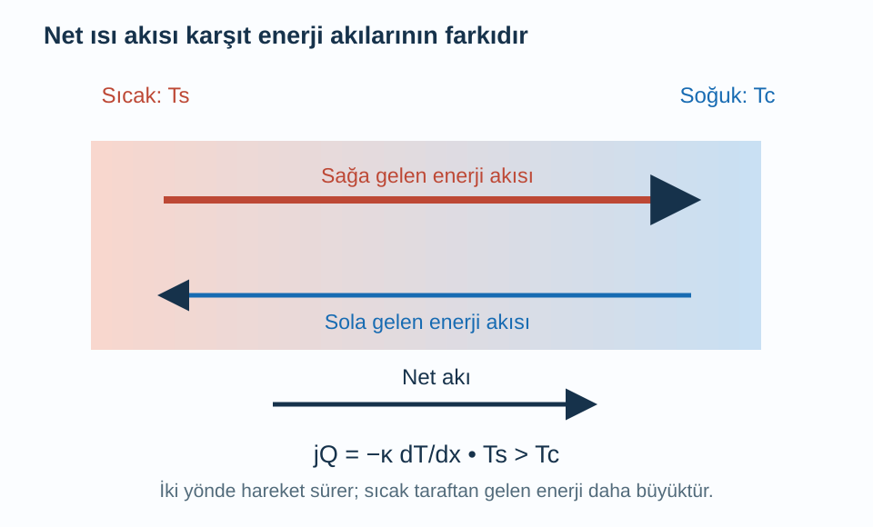
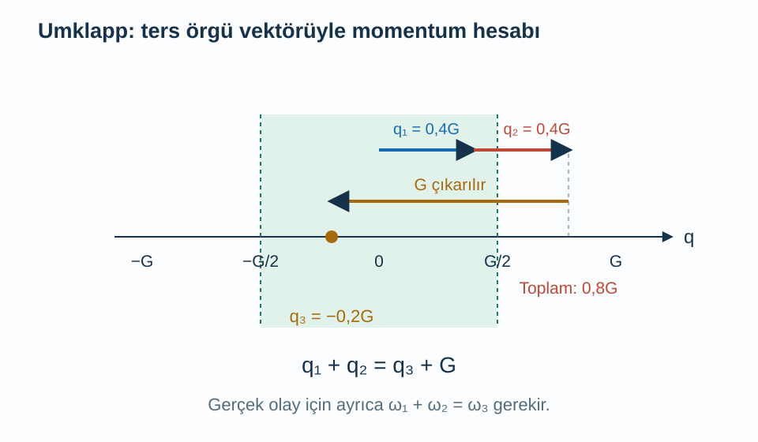

Bir kristalin bir ucunu ısıttığımızda diğer ucu da zamanla ısınır. Atomlar sıcak uçtan soğuk uca topluca taşınmaz; denge konumları çevresindeki bağlı hareketler enerji aktarır. Elektrik akımını iyi taşımayan bir yalıtkan bile bu yolla ısı iletebilir. Isı sığasının anlattığı enerji depolama ile ısıl iletkenliğin anlattığı enerji aktarımı burada birbirinden ayrılır.

Önce [örgü titreşimleri ve fononlar](/blog/orgu-titresimleri-ve-fononlar/), [Einstein ve Debye modelleri](/blog/katilarin-isi-sigasi-ve-debye-modeli/), [ters örgü](/blog/ters-orgu-ve-bragg-kirinimi/) ve [Drude modeli](/blog/elektriksel-iletkenlik-ve-drude-modeli/) ile bağ kuracağız. İlk hesabımız üç boyutlu, izotropik, yerel dengeye yakın bir yalıtkan içindir. Sıcaklığın uzayda yavaş değiştiğini, saçılmaların yönlü enerji akışını sonlu bir sürede gevşettiğini varsayacağız. Metal elektronlarının ayrıca ısı taşıyabileceğini sonunda ayıracağız.

## 1. Fourier yasasında eksi işareti

Sıcaklığı konuma bağlı $T(x)$ fonksiyonu olarak yazalım. $x$ boyunca birim alandan birim zamanda geçen enerjiye **ısı akısı** $j_Q$ diyelim; birimi $\mathrm{W/m^2}$'dir. Yerel, doğrusal taşıma yaklaşımında:

$$
j_Q=-\kappa\frac{dT}{dx}
$$

yazılır. $\kappa>0$ **ısıl iletkenliktir**; birimi $\mathrm{W/(m\,K)}$'dir. Sıcaklık sağa doğru azalıyorsa $dT/dx<0$ olur, dolayısıyla $j_Q>0$: enerji sağa, sıcak bölgeden soğuk bölgeye akar. Eksi işareti bu fiziksel yönü korur.

Bu bağıntı kararlı durumda her yerde aynı sıcaklık var demek değildir. Örneğin uçları farklı sıcaklıklarda tutulan homojen bir çubukta zamanla değişmeyen doğrusal bir sıcaklık profili ve sabit bir enerji akısı bulunabilir. Denge halinde ise sıcaklık gradyanı sıfırdır ve iki yöndeki enerji taşınımları ortalamada birbirini götürür.

Toplam aktarılan gücü $P$, kesit alanını $A$, uzunluğu $L$, uç sıcaklık farkını $\Delta T=T_{\text{sıcak}}-T_{\text{soğuk}}>0$ ile gösterelim. Sabit iletkenlik ve yan yüzeylerden ihmal edilebilir kayıp için:

$$
P=\kappa A\frac{\Delta T}{L}
$$

olur. Bu sonuçla birim kontrolü yaparsak $[\mathrm{W/(m\,K)}][\mathrm{m^2}][\mathrm K]/[\mathrm m]=\mathrm W$ elde ederiz. Malzeme özelliği olan iletkenlik ile bütün parçanın ısıl direncini aynı şey saymamalıyız.

## 2. Fononlar dengede neden net akı taşımaz?

Bir fonon modunun açısal frekansı $\omega$, dalga vektörü $\mathbf q$ ve enerjisi $\hbar\omega$ olsun. $\hbar$ indirgenmiş Planck sabitidir. Dalga paketinin grup hızı $\mathbf v=\nabla_{\mathbf q}\omega$ ile verilir. Dengede zıt yönlü modlar aynı sıcaklık dağılımına sahipse hızların enerji akısına katkıları birbirini götürür.

Sıcaklık gradyanı bulunduğunda pozitif $x$ yönünde gelen fononlar son saçılmalarını daha sıcak veya daha soğuk bir yerde yapmış olabilir. İki yönden gelen dağılımlar artık tam eşit değildir. Net akıyı oluşturan bu küçük farktır; bütün fononların aynı yönde ilerlemesi gerekmez. Bu düşünce, elektron sürüklenmesindeki küçük yönlü asimetriyle benzerlik taşır, fakat burada elektrik yükü taşımayı şart koşmuyoruz.

**Gevşeme zamanı** $\tau$, ilgili modun yönlü dağılım sapmasının sönüm ölçeği olsun. **Ortalama serbest yol** $\ell=v\tau$ ile tanımlanır; $v=|\mathbf v|$ grup hızı büyüklüğüdür. Bu değer atomun denge konumundan uzaklığı değildir. Fonon dalga paketinin taşıma bilgisini saçılmalar arasında hangi mesafe ölçeğinde koruduğunu anlatır.

## 3. Üçte bir çarpanı nereden gelir?

Tek hız ve tek gevşeme zamanı kullanan bir model kuralım. Denge fonon doluluğu $n_0(T)$ olsun; mod enerjisi sabitken sıcaklığa bağlıdır. $x$ yönlü hız bileşeni $v_x$ olan bir fonon, son saçılmasından bu yana yaklaşık $v_x\tau$ uzaklıktan bilgi getirir. Doluluğu birinci dereceden açarsak:

$$
n_0[T(x-v_x\tau)]
\simeq n_0[T(x)]-\tau v_x\frac{\partial n_0}{\partial T}\frac{dT}{dx}.
$$

Denge değerinden sapma $\delta n=-\tau v_x(\partial n_0/\partial T)(dT/dx)$ olur. Enerji akısına katkı $\hbar\omega v_x\delta n$ ile orantılıdır. Bir $v_x$ dağılım sapmasından, diğeri enerji taşıma hızından gelir; sonuçta $v_x^2$ ortaya çıkar.

İzotropik üç boyutlu ortamda üç yön eşdeğerdir. $v_x^2+v_y^2+v_z^2=v^2$ olduğundan açısal ortalamalar $\langle v_x^2\rangle=\langle v_y^2\rangle=\langle v_z^2\rangle=v^2/3$ olur. Hacim başına ısı sığasını $C_{\mathrm{vol}}$ ile gösterirsek bütün modların enerji türevlerini topladıktan sonra:

$$
\begin{aligned}
\kappa&=\frac13C_{\mathrm{vol}}v^2\tau\\
&=\frac13C_{\mathrm{vol}}v\ell
\end{aligned}
$$

elde ederiz. Üçte bir evrensel bir sabit değil, üç boyutlu izotropik yön ortalamasıdır. Tek boyutlu bir zincire veya güçlü yön bağımlı kristale otomatik olarak uygulanmaz.

Şekilde iki yönde de hareket vardır. Kalın ok, yalnız bir tarafta fonon bulunduğunu değil, iki karşıt enerji akısının farkını temsil eder. Atomların kütlesel akışı gösterilmemiştir.

## 4. Sayısal örnek: Mikroskobik uzunluktan ısı akışına

Bir model kristalde $C_{\mathrm{vol}}=1{,}2\times10^6\,\mathrm{J/(m^3\,K)}$, ortalama hız $v=3000\,\mathrm{m/s}$ ve ortalama serbest yol $\ell=50\,\mathrm{nm}=5{,}0\times10^{-8}\,\mathrm m$ olsun. Formülde yerine koyarsak:

$$
\begin{aligned}
\kappa&=\frac13(1{,}2\times10^6)(3000)(5{,}0\times10^{-8})\\
&=60\,\mathrm{W/(m\,K)}.
\end{aligned}
$$

Karşılık gelen gevşeme zamanı $\tau=\ell/v\simeq1{,}667\times10^{-11}\,\mathrm s$'dir. Isı sığasını molar bir değerle karıştırıp doğrudan bu denkleme koysaydık sonuç yanlış boyut taşırdı; burada mutlaka hacim başına büyüklük gerekir.

Aynı malzemeden uzunluğu $L=2{,}0\,\mathrm{mm}$, kesit alanı $A=1{,}0\,\mathrm{cm^2}$ olan bir parça düşünelim. Metre biriminde $L=2{,}0\times10^{-3}\,\mathrm m$ ve $A=10^{-4}\,\mathrm{m^2}$ olur. Uçlar arasındaki fark $\Delta T=5{,}0\,\mathrm K$ ise:

$$
\begin{aligned}
P&=\frac{(60)(10^{-4})(5{,}0)}{2{,}0\times10^{-3}}\,\mathrm W\\
&=15\,\mathrm W.
\end{aligned}
$$

Bu, kararlı durumda sıcak uçtan verilmesi ve soğuk uçtan alınması gereken model gücüdür. Parçanın her an $15\,\mathrm J$ enerji depoladığı anlamına gelmez; saniyede $15\,\mathrm J$ enerji içinden geçmektedir. Isıl direnç $R_{\mathrm{th}}=\Delta T/P=L/(\kappa A)=1/3\,\mathrm{K/W}$ olur.

## 5. Gerçek modları ayrı ayrı toplamak

Gerçek kristalde tek $v$ ve tek $\tau$ yoktur. Modu $\lambda$ etiketiyle gösterelim; bu etiket hem dalga vektörünü hem titreşim dalını içersin. $\lambda$ burada dalga boyu değildir. Modun ısı sığası katkısı $c_\lambda=\partial[\hbar\omega_\lambda\bar n_\lambda]/\partial T$ olsun. Örnek hacmi $V$ için gevşeme zamanı yaklaşımında:

$$
\kappa_{xx}=\frac1V\sum_\lambda
c_\lambda v_{\lambda,x}^2\tau_\lambda
$$

yazılır. Her modun enerji depolama kapasitesi, doğru yöndeki hızı ve akış bilgisini koruma süresi birlikte ağırlık olur. Yüksek frekanslı bir mod çok enerji taşıyabilir, fakat grup hızı küçük veya saçılma süresi kısa olduğunda ısıl iletkenliğe katkısı sınırlı kalabilir.

Bu ifade aynı zamanda tek bir “ortalama serbest yol” değerinin neden ölçüm ve modele göre değişebildiğini gösterir. Toplam iletkenliği taşıyan modlar geniş bir uzunluk dağılımına sahip olabilir. Belirli bir örnek boyutu bazı modları sınırlandırırken diğerlerini etkilemeyebilir. [MIT'nin nano ölçekten makro ölçeğe taşıma notları](https://ocw.mit.edu/courses/2-57-nano-to-macro-transport-processes-spring-2012/2e4ecaa5cf55f03bcefbc8ccce79aed6_MIT2_57S12_lec_notes_2004.pdf) fonon dağılımları ile bu taşıma hesabını ilişkilendirir.

## 6. Fononların yönlü hareketini ne bozar?

Kusurlar, izotop kütle farkları, tane sınırları ve örneğin dış sınırları fononları saçabilir. Kusursuz harmonik modelde normal modlar bağımsızdır; birbirleriyle enerji alışverişi yapmazlar. Gerçek bağ potansiyelindeki üçüncü ve daha yüksek dereceli terimler ise modları bağlar. Bu anharmoniklik, fononların birleşmesi veya ayrılması gibi süreçlere izin verir.

Örneğin iki fononun birleşerek üçüncü bir fonon oluşturduğu süreçte enerji korunumu $\omega_1+\omega_2=\omega_3$ gerektirir. Dalga vektörü koşulu ise:

$$
\mathbf q_1+\mathbf q_2=\mathbf q_3+\mathbf G
$$

biçimindedir. $\mathbf G$ bir ters örgü vektörüdür. $\mathbf G=0$ olan olaylara **normal süreç**, sıfır olmayan ters örgü vektörü gerektirenlere **Umklapp süreci** denir. Kristal momentumu ters örgü vektörü farkıyla korunur; bunu gerçek toplam momentumun fizik yasalarını ihlal etmesi gibi okumamalıyız.

Normal süreçler fononlar arasında enerji ve momentum dağıtır, fakat korudukları toplam kristal momentumu nedeniyle tek başlarına bütün koşullarda sonlu ısıl direnç üretmezler. Umklapp süreçleri, sınırlar ve kusurlar yönlü akışın gevşemesine katkı verebilir. Bununla birlikte her Umklapp olayını bir fononun hızının basitçe ters çevrildiği çarpışma resmiyle anlatmak da yeterli değildir. Enerji koşulunu, dal seçimini ve bütün dağılımı birlikte değerlendirmek gerekir.

Şekil yalnız dalga vektörü koşulunu açıklar. Çizilen herhangi bir toplamın gerçek bir saçılma olayı olması için frekansların da enerji korunumunu sağlaması gerekir; geometrik katlama tek başına süreç olasılığını kanıtlamaz.

## 7. Sayısal örnek: Birkaç saçılma kaynağı

Bağımsız direnç oluşturan saçılma kanallarının oranlarını yaklaşık topladığımızda **Matthiessen yaklaşımı** elde edilir:

$$
\frac1{\tau_{\mathrm{etkin}}}
=\frac1{\tau_B}+\frac1{\tau_I}+\frac1{\tau_U}.
$$

$B$ sınır, $I$ kusur, $U$ anharmonik Umklapp katkısını etiketlesin. Aynı hız varsayımında bunu serbest yollarla da yazabiliriz. $\ell_B=1{,}0\,\mathrm{\mu m}$, $\ell_I=2{,}0\,\mathrm{\mu m}$ ve $\ell_U=0{,}20\,\mathrm{\mu m}$ seçelim. O zaman:

$$
\begin{aligned}
\frac1{\ell_{\mathrm{etkin}}}
&=(1+0{,}5+5)\,\mathrm{\mu m^{-1}}\\
&=6{,}5\,\mathrm{\mu m^{-1}}
\end{aligned}
$$

$$
\begin{aligned}
\ell_{\mathrm{etkin}}&=0{,}15385\,\mathrm{\mu m}\\
&=1{,}5385\times10^{-7}\,\mathrm m.
\end{aligned}
$$

Etkin uzunluk en kısa tekil uzunluktan da küçüktür; birden fazla saçılma olasılığı birlikte çalışır. Önceki örnekteki $C_{\mathrm{vol}}$ ve $v$ değerlerini kullanırsak $\kappa\simeq184{,}6\,\mathrm{W/(m\,K)}$ çıkar. Yalnız $\ell_U=0{,}20\,\mathrm{\mu m}$ kalsaydı sonuç $240\,\mathrm{W/(m\,K)}$ olurdu. Diğer kanallar iletkenliği azaltmıştır.

Bu sayıları birinci örnekteki $50\,\mathrm{nm}$ ile aynı örneğin zorunlu ölçümleri saymıyoruz; farklı saçılma parametreleri seçtik. Ayrıca normal süreçleri aynı biçimde bağımsız bir direnç terimi olarak eklemek her rejimde doğru değildir. Özellikle kolektif fonon akışında basit gevşeme zamanı yaklaşımının sınırları belirginleşir.

## 8. Sıcaklık profili hangi zaman ölçeğinde değişir?

Kararlı güç hesabından farklı olarak başlangıçta bir bölgeyi ısıtıp bırakırsak sıcaklık zamanla değişir. Hacim başına iç enerjiye $u$ diyelim. Küçük bir hacme giren ve çıkan enerji akısının farkı, o hacimdeki enerjinin değişimidir. Tek boyutta bu korunumu $\partial u/\partial t=-\partial j_Q/\partial x$ biçiminde yazarız. Hacim başına ısı sığası sabitse $\partial u/\partial t=C_{\mathrm{vol}}\partial T/\partial t$ olur.

Fourier yasasını yerine koyduğumuzda, sabit iletkenlik için:

$$
\begin{aligned}
\frac{\partial T}{\partial t}
&=\alpha\frac{\partial^2T}{\partial x^2}\\
\alpha&=\frac{\kappa}{C_{\mathrm{vol}}}
\end{aligned}
$$

elde edilir. $\alpha$ **ısıl yayınırlıktır**, birimi $\mathrm{m^2/s}$'dir. İletkenlik enerjiyi hızla dağıtmaya çalışırken ısı sığası sıcaklığı değiştirmek için ne kadar enerji gerektiğini belirler. Aynı iletkenliğe sahip iki malzemenin ısınma ve soğuma süreleri bu yüzden farklı olabilir.

İlk örneğin değerleriyle $\alpha=60/(1{,}2\times10^6)=5{,}0\times10^{-5}\,\mathrm{m^2/s}$ olur. $L=2\,\mathrm{mm}$ ölçeğindeki değişimin karakteristik süresi boyut hesabıyla $L^2/\alpha\simeq0{,}080\,\mathrm s$ çıkar. Bu tam bir soğuma süresi değildir; sınır koşulları ve sıcaklık profilinin biçimi sayısal katsayıyı değiştirir. Hesap, uzunluk iki katına çıktığında yayınım zamanının yaklaşık dört katına çıktığını gösterir.

Sınırların sayısal katsayıyı nasıl değiştirdiğini aynı denklemde çözebiliriz. Çubuğun iki ucunu aynı $T_0$ sıcaklığında tutalım ve başlangıçtaki fazlalığı $\delta T(x,0)=\Delta T_0\sin(\pi x/L)$ seçelim. Sinüs uçlarda sıfır olduğundan sınır koşulunu sağlar. İkinci uzay türevi sinüsü $-(\pi/L)^2$ ile çarpar. Bu yüzden çözüm:

$$
\begin{aligned}
\delta T(x,t)&=\Delta T_0\sin\frac{\pi x}{L}\,e^{-t/\tau_T},\\
\tau_T&=\frac{L^2}{\pi^2\alpha}
\end{aligned}
$$

olur. Önceki sayılarla $\tau_T\simeq0{,}00811\,\mathrm s$ elde edilir. Bu sürede sıcaklık fazlalığı $1/e$'ye iner; tam sıfıra ulaşmaz. $0{,}080\,\mathrm s$ boyut kestirimiyle fark, artık seçilmiş bir profilin ve sınır koşulunun $\pi^2$ katsayısını içermesidir. Daha ince uzaysal sinüs desenleri daha büyük ikinci türev taşıdığı için daha hızlı söner.

## 9. Sıcaklık ve boyut birlikte önemlidir

Yeterince düşük sıcaklıkta bir üç boyutlu yalıtkanın örgü ısı sığası yaklaşık $T^3$ ile artar. Eğer hız ve sınırların belirlediği serbest yol bu aralıkta yaklaşık sabitse $\kappa\propto T^3$ beklenebilir. Daha yüksek sıcaklıkta ısı sığası doygunluğa yaklaşırken anharmonik saçılma kuvvetlenip serbest yolu kısaltabilir. Bazı rejimlerde yaklaşık $1/T$ azalma görülebilir; bu bütün malzemelere bütün sıcaklıklarda uygulanacak evrensel bir yasa değildir.

Örnek uzunluğu veya kalınlığı baskın serbest yollardan küçük olduğunda fononlar içerde çok az saçılarak karşı sınıra ulaşabilir. Bu **balistik** rejimde yerel sıcaklık ve Fourier yasası dikkatle değerlendirilmelidir. Sınır temasları ve örnek boyutu ölçülen iletimi belirler; büyük numune için verilmiş tek bir iletkenliği küçük aygıta sorgusuz taşımak uygun olmaz.

Metallerde toplam ısı iletkenliği elektron ve örgü katkılarını içerir. İyi elektrik iletkenliğinin ısı iletkenliğiyle ilişkisi çoğu metalde güçlüdür, fakat bu yazıdaki fonon hesabı tek başına elektronik katkıyı vermez. [MIT'nin katıhal ders notları](https://web.mit.edu/course/6/6.732/www/6.732-pt1.pdf) örgü taşınımını diğer katıhal süreçleriyle birlikte tartışır. Burada ulaştığımız temel hesap üç bağımsız soruya dayanır: ne kadar enerji sıcaklığa duyarlıdır, bu enerji hangi hızlarla ilerler ve yönlü ilerleme ne kadar süre korunur?
