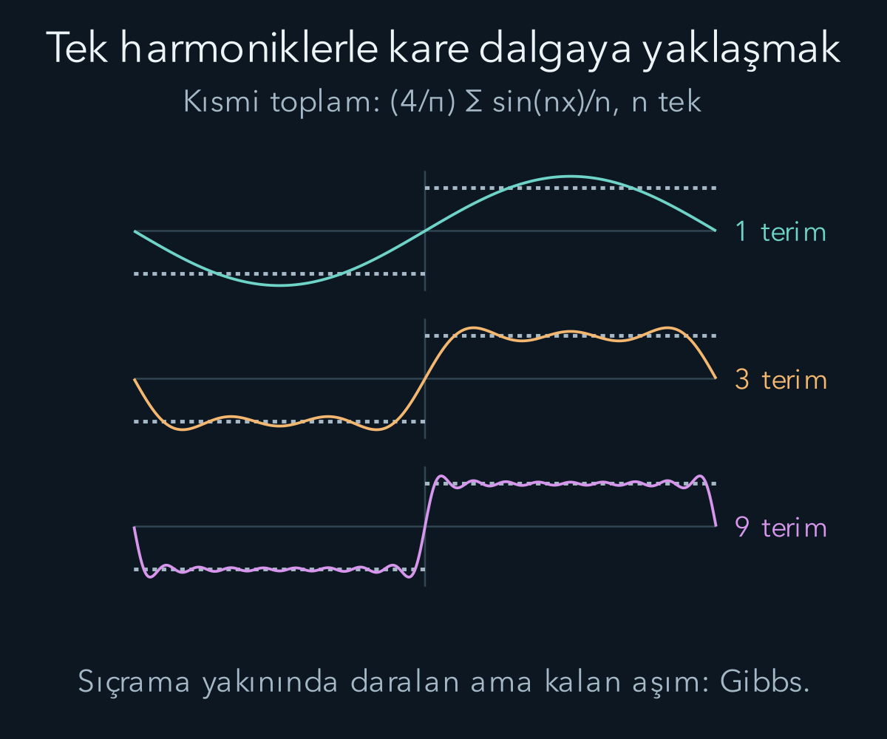
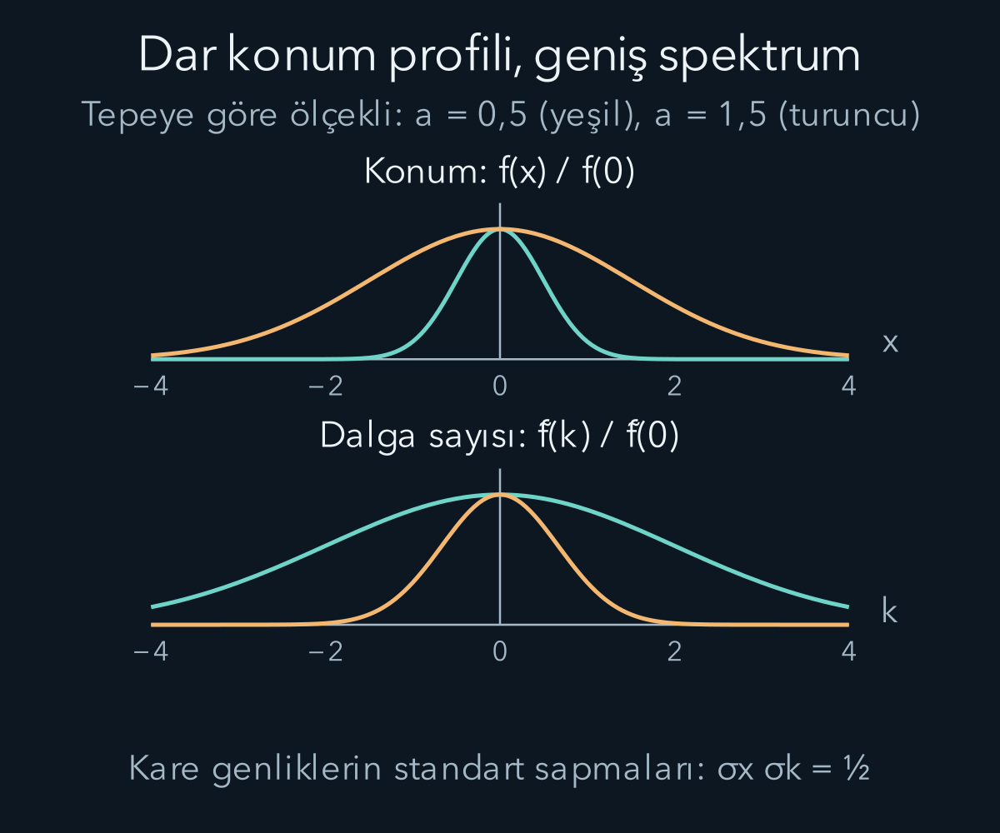

import ArticleVideo from '@/components/ArticleVideo.astro'
import kavram from './media/01-kavram.mp4?url'
import kavramPoster from './media/01-kavram.jpg?url'

Bir ipte tek bir sinüs dalgası çizmek kolaydır. Fakat bir kez çekilip bırakılan ipin üçgen biçimi, kısa bir darbe veya konuşma sesi tek bir sinüse benzemez. Yine de bu şekilleri daha basit salınımların toplamı olarak ifade edebiliriz. Fourier yaklaşımı, karmaşık görünen bir fonksiyonun içinde hangi uzaysal veya zamansal tekrarların bulunduğunu araştırır.

[Dalga denkleminde](/blog/dalgalar-ve-dalga-denklemi/) normal modların toplanabildiğini gördük. Burada integraller, sonsuz seriler ve [karmaşık iç çarpım](/blog/karmasik-vektorler-hermit-ve-uniter-matrisler/) kullanacağız. Euler bağıntısı karmaşık üsteli sinüs ve kosinüsle bağlayacak. Önce periyodik fonksiyonları ayrık modlarla, sonra tüm doğru üzerindeki yerelleşmiş fonksiyonları sürekli dalga sayılarıyla temsil edeceğiz.

## 1. Fonksiyonları vektör gibi karşılaştırmak

İki sütun vektörünün iç çarpımı, karşılık gelen bileşen çarpımlarının toplamıydı. Fonksiyonlarda aynı düşünceyi integral ile kurabiliriz. $[-L,L]$ aralığında:

$$
\langle f,g\rangle=\int_{-L}^{L}f(x)^*g(x)\,dx
$$

tanımını kullanalım. Yıldız karmaşık eşleniği gösterir. Reel fonksiyonlarda eşlenik değişiklik yapmaz. İç çarpımın sıfır olması, fonksiyonların bu aralıkta birbirine dik, yani **ortogonal** olduğunu söyler. Burada geometrik olarak çizilen iki eğrinin birbirine dik kesişmesini kastetmiyoruz.

Sinüs ve kosinüsler tam dönemler boyunca karşılaştırıldığında yararlı bir ortogonallik taşır. Pozitif tam sayılar $m$ ve $n$ için:

$$
\int_{-L}^{L}\sin\frac{m\pi x}{L}\sin\frac{n\pi x}{L}\,dx
=\begin{cases}L,&m=n,\\0,&m\ne n.\end{cases}
$$

Kosinüsler için de pozitif indekslerde aynı sonuç vardır. Sinüs-kosinüs çarpımının integrali sıfırdır. Sabit bir fonksiyon da bütün bu sıfır ortalamalı dalgalara ortogonaldir. Böylece farklı tekrar sayılarını birbirine karıştırmadan seçebiliriz.

Bu sonucun nedeni çarpımın toplam özdeşliğidir. Örneğin iki sinüsün çarpımı fark ve toplam frekanslı kosinüslerin yarı farkıdır. Tam sayı kadar dönem içeren aralıkta sıfırdan farklı frekanslı kosinüsün pozitif ve negatif alanları birbirini götürür. İndeksler eşitse fark frekansı sıfır olur ve kalan sabit katkı integrali sıfır olmaktan çıkarır.

## 2. Katsayıları tahmin etmek yerine hesaplamak

Periyodu $2L$ olan reel bir fonksiyon için Fourier serisini:

$$
f(x)=\frac{a_0}{2}
+\sum_{n=1}^{\infty}\left[
 a_n\cos\frac{n\pi x}{L}+b_n\sin\frac{n\pi x}{L}
\right]
$$

biçiminde yazmayı amaçlarız. $a_0/2$ ortalama düzeyi, diğer katsayılar farklı harmoniklerin ağırlıklarını gösterir. Eşitliğin hangi anlamda geçerli olduğu birazdan yakınsaklık koşullarıyla açıklanacak; her fonksiyonda her noktada sorgusuz bir eşitlik varsaymıyoruz.

Her iki tarafı $\cos(m\pi x/L)$ ile çarpıp bir dönem boyunca integral alalım. Ortogonallik yüzünden bütün diğer frekanslar elenir. Kalan $a_mL$ olduğundan:

$$
a_n=\frac1L\int_{-L}^{L}f(x)\cos\frac{n\pi x}{L}\,dx.
$$

Benzer biçimde $b_n=(1/L)\int_{-L}^{L}f(x)\sin(n\pi x/L)\,dx$ olur. Sabit terim için $a_0=(1/L)\int_{-L}^{L}f(x)\,dx$ bulunur. Paydadaki $L$, baz fonksiyonunun iç çarpım normundan geldi. Sabit terimin başındaki yarım ise sabit fonksiyonun integralinin $2L$ olmasını dengeler.

Vektörleri ortogonal eksenlere izdüşürmeye benzer bir işlem yaptık. Bir fonksiyondaki belirli sinüslü bileşeni çıkarmak için onu o sinüsle karşılaştırıp ortalamasını aldık. Katsayı yalnız eğrinin tepe yüksekliğine bakarak seçilen bir sayı değildir; bütün aralıktaki faz uyumunu içerir.

## 3. Kare dalganın katsayıları

Boyutsuz bir örnekte, $-L<x<0$ aralığında eksi bir, $0<x<L$ aralığında artı bir olan ve periyodik devam eden fonksiyon düşünelim. Bu tek fonksiyondur: İşaret değiştirerek yansır. Bu nedenle ortalama ve bütün kosinüs katsayıları sıfırdır. Sinüs katsayısı iki yarı aralığın eş katkısıyla:

$$
b_n=\frac2L\int_0^L\sin\frac{n\pi x}{L}\,dx
=\frac{2}{n\pi}\left[1-(-1)^n\right]
$$

olur. Çift $n$ için sonuç sıfır, tek $n$ için $4/(n\pi)$ çıkar. Böylece:

$$
f(x)\sim\frac4\pi\left[
\sin\frac{\pi x}{L}
+\frac13\sin\frac{3\pi x}{L}
+\frac15\sin\frac{5\pi x}{L}+\cdots\right].
$$

Buradaki yaklaşık seri işareti, özellikle sıçrama noktalarındaki yorumun ayrıca yapılacağını hatırlatır. İlk terim yumuşak bir salınımdır. Üçüncü ve beşinci harmonikler eklendikçe geniş düz bölümler ve daha keskin geçişler oluşur. Yüksek frekanslar, şeklin daha kısa uzunluk ölçeğindeki ayrıntılarını kurar.

İlk harmonik katsayısının birden büyük olması çelişki değildir. Son fonksiyonu tek bir terim değil, farklı işaretlerde katkı veren toplam oluşturur. Her bileşenin kendi tepe noktasını bütün toplamın tepe değeri sanmamalıyız. Aynı biçimde katsayıların işaretleri ve fazları, yalnız büyüklükleri kadar önemlidir.

## 4. Yakınsama ve Gibbs davranışı

Bir dönem içinde parçalı düzgün, sonlu sayıda sonlu sıçraması olan fonksiyonlarda Fourier serisi süreklilik noktalarında fonksiyonun değerine yaklaşır. Bir sıçrama noktasında sağ ve sol sınırların ortalamasına yaklaşır. Kare dalganın sıfırdaki iki sınırı eksi bir ve artı bir olduğundan seri burada sıfır verir.

Fonksiyonun tek bir noktadaki değerini değiştirmek integral katsayılarını değiştirmez. Bu nedenle Fourier serisi, sıçrama noktasına bizim sonradan atadığımız keyfî değeri zorunlu olarak seçemez. Fonksiyon eşitliğinin hangi noktada ve hangi yakınsama anlamında söylendiğini belirtmek bu yüzden matematiksel bir ayrıntı değil, temsilin anlamıdır.

Sıçramanın yakınında sonlu kısmi toplamlar dalgalanır ve aşım gösterir. Terim sayısı arttıkça sorunlu bölge daralır, fakat en büyük göreli aşım tamamen kaybolmaz. Buna **Gibbs olayı** denir. Bu durum, bütün aralık boyunca hata aynı anda küçülüyormuş gibi bir yakınsamayı beklemememiz gerektiğini gösterir.

Kare integrallenebilir fonksiyonlarda Fourier yaklaşımı ortalama kare hata bakımından da kurulabilir. Bu, hata karesinin aralık boyunca integralinin sıfıra yaklaşmasıdır. Tek tek noktalardaki davranışla aynı ölçüt değildir. Bir şeklin genel enerjisini iyi temsil eden sonlu toplam, keskin bir sınırın hemen çevresinde hâlâ görünür dalgalanma gösterebilir.

## 5. Parseval bağıntısıyla toplam büyüklüğü denetlemek

Ortogonallik, fonksiyonun kare integralini katsayılarla hesaplamamızı sağlar. Reel, kare integrallenebilir periyodik fonksiyon için:

$$
\frac1L\int_{-L}^{L}|f(x)|^2\,dx
=\frac{a_0^2}{2}+\sum_{n=1}^{\infty}(a_n^2+b_n^2).
$$

Bu **Parseval bağıntısıdır**. Sonlu toplamın karesini açtığımızda farklı modların çapraz terimleri integralde yok olur. Aynı modun karesi kalır. Sonsuz seriye geçiş, kare integral anlamındaki yakınsamayla gerekçelendirilir.

Buradaki integral her bağlamda doğrudan fiziksel enerji değildir. Bir telin gerçek enerjisi yer değiştirme kadar zamana ve konuma göre türevleri de içerir. Yine de kare normun korunması, bir temsil değiştirirken toplam büyüklüğü nasıl izlediğimizi gösterir. Fiziksel enerjiyle ilişki kurmak için kullanılan dalga modelinin katsayıları ayrıca eklenmelidir.

Basit bir kontrol olarak $f(x)=3\cos(\pi x/L)+4\sin(2\pi x/L)$ seçelim. Sağ taraf dokuz artı on altı, yani yirmi beştir. Bir dönem üzerindeki ortalama kare değer bunun yarısı, on iki virgül beştir. Çünkü sol tarafta ortalama için gereken $2L$ yerine $L$ ile böldük. Normalizasyon katsayılarını açık tutmak bu tür iki çarpanı hatalarını önler.

## 6. Periyodik olmayan bir şekle geçmek

Tek bir darbe bütün doğru boyunca tekrar etmeyebilir. Periyodik seride komşu dalga sayıları arasındaki uzaklık $\pi/L$ idi. Aralığı büyüttükçe bu aralık küçülür ve dalga sayıları sürekli bir değişken gibi davranmaya başlar. Ayrık toplamın yerini integral aldığı dönüşüm **Fourier dönüşümü**dür.

Bu yazıda simetrik normalizasyonu ve şu işaretleri kullanacağız:

$$
\widetilde f(k)=\frac1{\sqrt{2\pi}}
\int_{-\infty}^{\infty}f(x)e^{-ikx}\,dx,
$$

$$
f(x)=\frac1{\sqrt{2\pi}}
\int_{-\infty}^{\infty}\widetilde f(k)e^{ikx}\,dk.
$$

Tilde işareti dalga sayısı temsilini gösterir. İlk eşitlik bileşenleri bulur; ikinci eşitlik onları birleştirir. Başka kaynaklarda işaretler veya iki pi katsayıları farklı olabilir. Her seçim tutarlı bir çift oluşturduğunda kullanılabilir; bir kaynağın ilk formülüyle diğerinin ters formülünü karıştırmamak gerekir.

İlk aşamada hızla azalan düzgün fonksiyonlarla çalışmak, integrallerin ve işlemlerin güvenli olduğu somut bir sınıf sağlar. Daha genel kare integrallenebilir fonksiyonlara dönüşüm norm anlamında genişletilir. Sonsuz boyunca sabit genlikli bir sinüs, sıradan mutlak integrallenebilir bir darbe değildir; onu aynı integralde hiçbir açıklama yapmadan sonlu katsayılı bir fonksiyon gibi ele alamayız. Dağılımlar dili daha sonra ayrı bir genişletme sağlar.

## 7. Karmaşık katsayı fiziksel karmaşa değildir

Euler bağıntısı $e^{ikx}=\cos(kx)+i\sin(kx)$ olduğundan karmaşık üsteller iki reel baz fonksiyonunu birleştirir. Reel bir $f$ için dönüşüm $\widetilde f(-k)=\widetilde f(k)^*$ simetrisini sağlar. Pozitif ve negatif dalga sayıları birlikte gerçek fonksiyonu üretir. Negatif dalga sayısı, bu uzaysal açılımda işaretli bir faz değişimini temsil eder.

Dönüşümün büyüklüğü bileşenin ağırlığını, fazı ise konumsal hizalanmayı taşır. Aynı büyüklük spektrumuna sahip iki fonksiyon, fazları farklıysa farklı şekiller oluşturabilir. Yalnız spektrumun mutlak değerini saklamak bütün bilgiyi korumaz. Bir darbenin yerini değiştirmek bile bu farkı gösterir.

Örneğin $g(x)=f(x-x_0)$ olsun. İntegralde $y=x-x_0$ değişkenini kullanınca $\widetilde g(k)=e^{-ikx_0}\widetilde f(k)$ çıkar. Uzayda öteleme, spektrumun büyüklüğünü değiştirmeden fazına doğrusal bir katkı ekler. Bu, dalga paketini başka bir yere taşırken bileşenlerin neden uygun biçimde yeniden hizalandığını açıklar.

Birimler de tutarlıdır. $x$ metre ise $k$ metrenin tersidir. Dönüşümdeki $dx$ nedeniyle $\widetilde f$ birimi, $f$ biriminin metreyle çarpımıdır. Ters dönüşümdeki $dk$ bu çarpanı geri kaldırır. İki temsilin düşey eksenlerindeki sayıları, birimleri farklıyken doğrudan karşılaştırmayız.

## 8. Gauss darbesinin dönüşümünü hesaplamak

Pozitif uzunluk ölçeği $a$ için $f(x)=e^{-x^2/(2a^2)}$ alalım. Bu fonksiyon merkezde bir, uzaklarda sıfıra yaklaşır. Dönüşümünü bulmak için önce $I(k)=\int e^{-x^2/(2a^2)}e^{-ikx}\,dx$ yazalım; integral tüm reel doğru üzerindedir.

$k$'ya göre türev integralin içine alınabildiğinde $I'(k)=\int(-ix)f(x)e^{-ikx}\,dx$ olur. Gauss fonksiyonunun türevi $f'(x)=-(x/a^2)f(x)$ olduğundan $xf=-a^2f'$ kullanabiliriz. Kısmi integrasyonda sınır terimi hızla azalan Gauss nedeniyle sıfırdır. İşaretlerin nereden geldiğini tek satırda izleyelim:

$$
I'(k)=ia^2\int f'(x)e^{-ikx}\,dx
=ia^2\left([f(x)e^{-ikx}]_{-\infty}^{\infty}
+ik\int f(x)e^{-ikx}\,dx\right)
=-a^2kI(k).
$$

Son adımda sınır katkısı sıfır, $i\cdot i=-1$ olduğundan işaret eksidir.

Bu birinci mertebe denklemin çözümü $I(k)=I(0)e^{-a^2k^2/2}$ biçimindedir. Daha önce kurduğumuz Gauss integralinden $I(0)=a\sqrt{2\pi}$ gelir. Simetrik dönüşüm çarpanını ekleyince:

$$
\widetilde f(k)=a\,e^{-a^2k^2/2}.
$$

Uzayda Gauss biçimi, dalga sayısında yine Gauss biçimine dönüştü. Fakat genişlik ters değişti: Uzaysal $a$ büyüdüğünde dönüşüm daha dar olur. Kısa ve yerelleşmiş bir darbe oluşturmak için geniş dalga sayısı aralığının faz uyumuyla toplanması gerekir.

## 9. Genişlik çarpımının anlamı

Genişliği kesin bir nicelikle ifade etmek için $|f|^2$ ve $|\widetilde f|^2$ eğrilerini kendi integrallerine bölerek normalize edelim. Bu matematiksel ağırlık dağılımlarının standart sapmalarına $\sigma_x$ ve $\sigma_k$ diyelim. Gauss örneğinde:

$$
\sigma_x=\frac{a}{\sqrt2},\qquad
\sigma_k=\frac1{a\sqrt2},\qquad
\sigma_x\sigma_k=\frac12.
$$

Burada genişliği genliğin Gauss parametresiyle değil karesinin standart sapmasıyla tanımladık. Hangi genişlik tanımını kullandığımızı söylemeden “çarpım birdir” veya “yarımdır” demek karışıklık oluşturabilir. Uzaysal genişlik metre, dalga sayısı genişliği metrenin tersi olduğundan çarpım boyutsuzdur.

Bu sonuç şu aşamada kuantum ölçüm iddiası değildir. Tamamen Fourier matematiğinin belirli bir Gauss fonksiyonu için verdiği yayılım ilişkisidir. İleride dalga sayısını momentumla ve kare genliği olasılık yoğunluğuyla bağladığımızda fiziksel yorum ekleyeceğiz. Ölçüm aletinin duyarlılığıyla bir dalga paketinin matematiksel genişliğini şimdiden birbirine eşitlememeliyiz.

Simetrik normalizasyonda Parseval-Plancherel eşitliği $\int|f(x)|^2dx=\int|\widetilde f(k)|^2dk$ olur. Gauss örneğinde her iki integral $a\sqrt\pi$ verir. Böylece birim ve normalizasyon denetimini somut bir hesapla yaptık. Uygun sınıfta dönüşüm, normu koruyan bir temsil değişimidir.

<ArticleVideo src={kavram} poster={kavramPoster} title="Tek harmonikleri toplamak" caption="4/π ile ölçeklenmiş sinüsün tek harmonikleri art arda eklenir. Kare dalga biçimine yaklaşılırken sıçrama yakınındaki Gibbs taşması görünür kalır." />

## 10. Faz hızı ve grup hızını ayırmak

Yakın iki dalga sayısına sahip bileşenleri toplayalım. Ortalama değerleri $k_0$, $\omega_0$; farkları $\Delta k$, $\Delta\omega$ olsun. İki kosinüsün toplamı:

$$
2\cos\left(\frac{\Delta k\,x-\Delta\omega\,t}{2}\right)
\cos(k_0x-\omega_0t)
$$

biçimindedir. Hızlı salınan ikinci çarpan taşıyıcıdır; yavaş değişen birinci çarpan zarfı oluşturur. Taşıyıcının sabit fazı $\omega_0/k_0$ hızıyla, zarfın sabit fazı $\Delta\omega/\Delta k$ hızıyla ilerler. Bileşenler çok yakın olduğunda oran türeve yaklaşır.

Çok bileşenli dar bant paket için de $k_0$ çevresinde $\omega(k)\approx\omega_0+\omega'_0(k-k_0)$ açılımı aynı sonucu verir:

$$
v_{\mathrm{grup}}=\left.\frac{d\omega}{dk}\right|_{k_0}.
$$

Doğrusal yaklaşım geçerliyken zarf biçimini yaklaşık korur. İkinci türev katkısı önemli hale gelirse farklı bileşenler farklı biçimde faz biriktirir ve paket yayılabilir veya biçim değiştirebilir. Grup hızını her koşulda değişmez bir “nesnenin hızı” diye okumamak gerekir.

Matematiksel bir örnekte pozitif $k$ için $\omega=\alpha k^2$ seçelim; $\alpha$ metre kare bölü saniye birimindedir. Faz hızı $\alpha k$, grup hızı $2\alpha k$ olur. Burada belirli bir ortamın yasa bağıntısını iddia etmedik; doğrusal olmayan bir dispersiyonun iki hızı nasıl ayırdığını gösterdik. İdeal gerilmiş ipte $\omega=ck$ olduğundan ikisi aynı $c$ değeridir.

Dar bant koşulunun anlamını bir trafik benzetmesine bırakmadan matematikte görebiliriz. Spektrum yalnız merkez dalga sayısının küçük bir çevresinde önemliyse, dispersiyon eğrisinin bu kısa bölümünü teğet doğrusu iyi temsil edebilir. Paket daha geniş dalga sayısı aralığı taşıdığında aynı teğet bütün bileşenler için yeterli olmaz. Bu durumda tek bir zarf hızıyla şeklin geleceğini tarif etmek bilgi kaybettirir.

Paketin daha keskin yerelleştirilmesiyle spektrumun genişlemesi, bu yaklaşımın sınırını da etkiler. Dar bir uzaysal paket oluşturmak için uzak dalga sayıları eklendiğinde dispersiyon eğrisinin daha büyük bölümünü kullanırız. Yalnız merkezdeki eğimi bilmek artık yeterli olmayabilir. Şeklin başlangıç genişliği ile zaman içindeki yayılması farklı kavramlardır, fakat dispersiyon varsa birbirleriyle ilişkilidirler. Biri başlangıçtaki Fourier bileşenlerinin dağılımını, diğeri bu bileşenlerin farklı faz hızlarıyla zaman içinde yeniden birleşmesini anlatır.

## 11. Temsil değişince soru da berraklaşır

Uzay temsili bir darbenin nerede yoğunlaştığını gösterir. Dalga sayısı temsili bu şekli hangi uzunluk ölçeklerinin oluşturduğunu gösterir. Aynı bilgiyi iki farklı açıdan görmek, her problemi aynı görünüşte çözmek zorunda olmadığımız anlamına gelir. Türevler Fourier uzayında dalga sayısıyla çarpmaya dönüştüğünden birçok doğrusal dalga denklemi bileşenler için daha basit hale gelir.

Bir bilgisayar ölçümünde ise sonsuz doğru veya sonsuz sayıda veri noktası yoktur. Sonlu gözlem aralığı ve örnekleme adımı, hesaplanan spektruma ek sınırlamalar getirir. Buradaki sürekli dönüşümü bir sayısal grafikle karşılaştırırken bu farkı hatırlamak gerekir. Sınırlı veriden çıkan bir spektrum, matematiksel fonksiyonun bütün ayrıntılarının otomatik olarak bilindiği anlamına gelmez.

Salınımları ve dalgaları kurduktan sonra fiziksel enerjinin başka bir yüzüne geçeceğiz: çok sayıda parçacığın hareketini sıcaklık, ısı ve iç enerjiyle anlatmak. Fourier düşüncesi ise dalga paketlerine ve kuantum durumlarının uzaysal temsiline döndüğümüzde elimizde hazır bir araç olarak kalacak.

## Kaynaklar

- [NIST DLMF — Fourier serileri](https://dlmf.nist.gov/1.8): Ortogonallik, katsayılar, yakınsama ve Parseval ilişkileri.
- [NIST DLMF — Fourier dönüşümü](https://dlmf.nist.gov/1.14): Simetrik normalizasyon, ters dönüşüm ve kare norm ilişkileri; bu yazıda ileri dönüşüm için eksi işaret seçilmiştir.
- [MIT OpenCourseWare — Dalga paketleri ve Fourier gösterimi](https://ocw.mit.edu/courses/8-04-quantum-physics-i-spring-2016/resources/wavepackets-and-fourier-representation/): Dalga paketlerine hazırlık için ders anlatımı.
