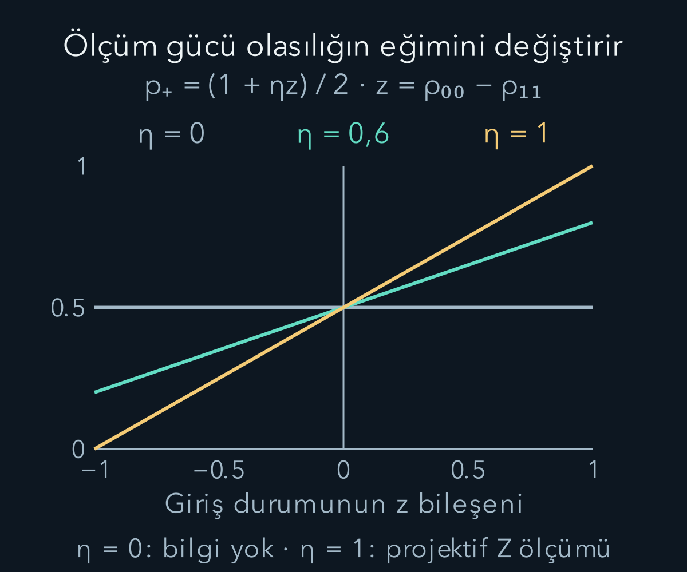
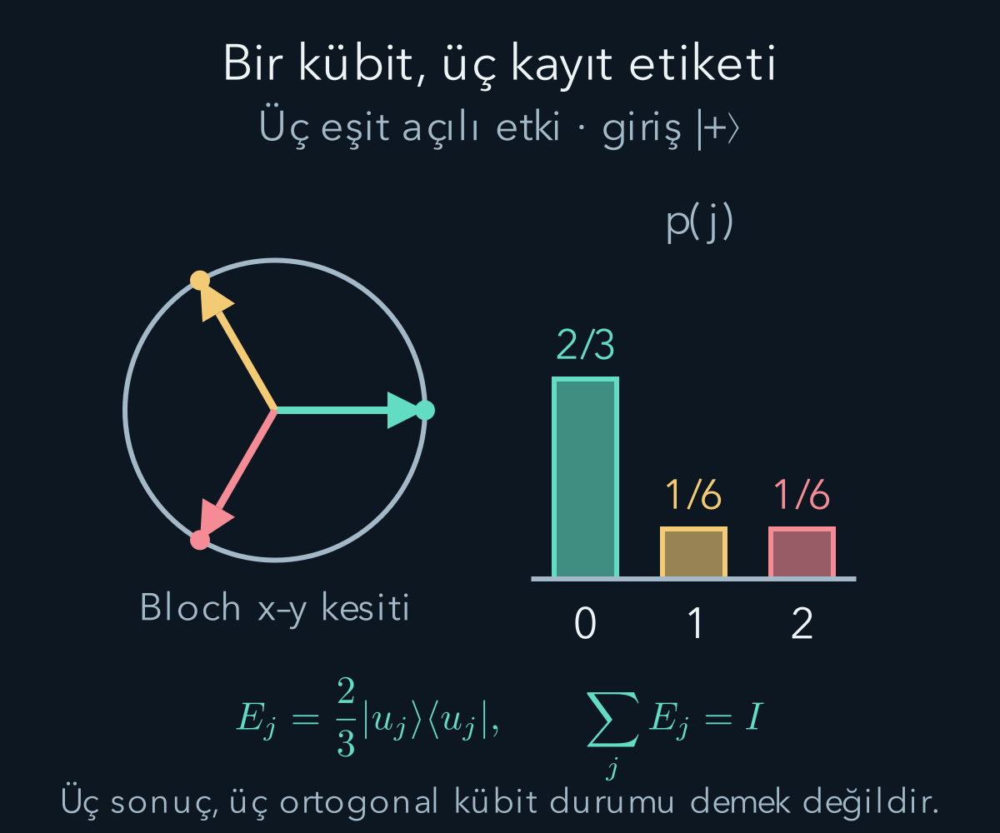

import ArticleVideo from '@/components/ArticleVideo.astro'
import kavram from './media/01-kavram.mp4?url'
import kavramPoster from './media/01-kavram.jpg?url'

Bir dedektör bir durumu her denemede kusursuz ayırt etmeyebilir. Bazı sonuçlar belirsiz kalabilir, bazı aygıtlar yalnız kısmi bilgi verebilir. Böyle deneyleri açıklamak için Born kuralını terk etmemiz gerekmez. Sistemi ölçüm aygıtıyla birlikte ele aldığımızda, sistemin tek başına olasılıklarını **genelleştirilmiş ölçüm** operatörleriyle yazabiliriz.

[Projektörle ölçüm](/blog/kuantum-gozlenebilirleri-ve-beklenen-deger/), [yoğunluk matrisi](/blog/yogunluk-matrisleri-ve-karisik-durumlar/) ve [tensor çarpımı](/blog/tensor-carpimi-ve-dolaniklik/) bu yazının ön koşullarıdır. İlk kez görülen her matris işlemini iki boyutlu örnekle açacağız. Temel ayrım şudur: bir sonucun olasılığı ile o sonuçtan sonra sistemin hangi durumda kaldığı iki ayrı sorudur. Aynı olasılık dağılımını üreten aygıtlar farklı durumlar bırakabilir.

Başlamadan üç işlemi hatırlayalım. Ket, seçilen bazdaki genlikleri taşıyan sütundur; bra onun karmaşık eşlenik satırıdır. Bir matrisle keti çarpmak yeni bir sütun verir. Bu yeni sütunun bileşenlerinin mutlak karelerini topladığımızda normun karesini buluruz. Örneğin $(\sqrt{0{,}4},\sqrt{0{,}1})^T$ sütununun norm karesi $0{,}5$'tir. Bunu durum olarak kullanacaksak her bileşeni $\sqrt{0{,}5}$'e böleriz; olasılığı hesaplarken ise henüz bölmeyiz.

Burada sonlu boyutlu, ayrık kayıtları olan aygıtları inceliyoruz. İki boyutlu kuantum sisteme **kübit** denir. Deneyin tekrarları aynı hazırlıkla başlar; bu, aynı tek kübiti ardışık ölçmekle farklıdır. İlkinde ilk ölçümün sonuç sıklığını, ikincisinde önceki ölçümün değiştirdiği durumun sonraki davranışını sorarız. Yazının sonunda bu farkı iki sayı üzerinden göreceğiz. Ölçüm operatörleri de boyutsuzdur: bir enerji değerini değil, durum genliklerinin ve kayıt olasılıklarının dönüşümünü temsil ederler.

## 1. Projektör ölçümü bir başlangıç örneği

$|0\rangle=(1,0)^T$ ve $|1\rangle=(0,1)^T$ bazında iki projektör $\Pi_0=|0\rangle\langle0|$, $\Pi_1=|1\rangle\langle1|$ olsun. $T$ sütun gösterimindeki transpozu belirtir. Saf durum $|\psi\rangle=\alpha|0\rangle+\beta|1\rangle$ için $|\alpha|^2+|\beta|^2=1$'dir. Sonuçların olasılıkları $p_0=|\alpha|^2$ ve $p_1=|\beta|^2$ olur.

İdeal Lüders güncellemesinde sıfır sonucu alındığında normalize durum $\Pi_0|\psi\rangle/\sqrt{p_0}$'dır. Sıfır olasılıklı bir sonuç için bu koşullu durum tanımlanmaz. Projektörler $\Pi_m^2=\Pi_m$, $\Pi_m\Pi_n=0$ ($m\ne n$) ve $\sum_m\Pi_m=I$ koşullarını sağlar. $I$ birim matristir. Genel ölçümde olasılıkları koruyan son koşulun uygun karşılığı kalacak; her operatörün projektör olması gerekmeyecek.

Projektörü açıkça yazarsak $\Pi_0=\begin{pmatrix}1&0\\0&0\end{pmatrix}$ olur. Örneğin $|\psi\rangle=(\sqrt3|0\rangle+|1\rangle)/2$ girişinde $\Pi_0|\psi\rangle=(\sqrt3/2)|0\rangle$ kalır. Norm karesi $3/4$, normalleştirilmiş çıkış $|0\rangle$'dır. İkinci bileşen ilk işlemde silindi; kalan katsayıyı bire tamamlamak olasılığı değiştiren yeni bir işlem değil, seçilmiş alt topluluğun durumunu yazmaktır. Aynı projektif ölçümü hemen yinelersek, arada ek evrim yokken sıfır sonucunu kesin alırız.

## 2. Ölçüm operatörü olasılığı nasıl üretir?

Her sonuç etiketi $m$ için bir $M_m$ operatörü verilsin. Önce sonucu normalleştirmeden $M_m|\psi\rangle$ hesaplarız. Bu vektörün norm karesi sonucun olasılığı olsun:

$$
\begin{aligned}
p_m&=\|M_m|\psi\rangle\|^2\\
&=\langle\psi|M_m^\dagger M_m|\psi\rangle.
\end{aligned}
$$

$\dagger$ eşlenik transpozdur. Tüm sonuçların toplam olasılığı her giriş durumu için bir olmalı. Bunun için:

$$
\sum_m M_m^\dagger M_m=I
$$

koşulu gerekir. Sonuç $m$ kaydedildiğinde saf durum $M_m|\psi\rangle/\sqrt{p_m}$ olur. Operatörün önce uygulanması ve sonra bölme yapılması önemlidir; paydaki vektörün normu genel olarak bir değildir.

Karışık giriş durumunu $\rho=\sum_jw_j|\psi_j\rangle\langle\psi_j|$ yazabiliriz. $w_j$ hazırlık ağırlıklarıdır. Her bileşenin katkısını toplayınca:

$$
\begin{aligned}
p_m&=\operatorname{Tr}(M_m\rho M_m^\dagger),\\
\rho_m&=\frac{M_m\rho M_m^\dagger}{p_m}.
\end{aligned}
$$

elde edilir. İz, matrisin köşegen toplamıdır. Bu formüller seçilen karışım ayrışımına değil, yalnız $\rho$'ya bağlıdır. Saf durumdaki mutlak kareyi daha genel bir matris biçiminde yazmış olduk.

## 3. Olasılık için gereken daha az bilgi: POVM

$E_m=M_m^\dagger M_m$ tanımlayalım. Her $|v\rangle$ için $\langle v|E_m|v\rangle=\|M_m|v\rangle\|^2\ge0$ olduğundan $E_m$ **pozitif yarı tanımlıdır**. Negatif özdeğeri yoktur. Ayrıca $\sum_m E_m=I$ olur. Bu özellikleri taşıyan operatör ailesine **POVM**, Türkçede pozitif operatör değerli ölçü denir.

İzin çevrim özelliği $\operatorname{Tr}(ABC)=\operatorname{Tr}(BCA)$ ile:

$$
\boxed{p_m=\operatorname{Tr}(E_m\rho)}
$$

bulunur. $E_m$'ye etki operatörü diyebiliriz. Pozitiflik olasılığın negatif olmamasını, toplamın birim olması tüm sonuçların birlikte tam olmasını sağlar. Her $E_m\le I$ de buradan gelir; çünkü $I-E_m$ diğer pozitif etkilerin toplamıdır.

POVM sonuçlarının sayısı Hilbert uzayının boyutundan büyük olabilir. Etkilerin birbirine dik olması veya karelerinin kendilerine eşit olması gerekmez. “Bir ölçüm varsa mutlaka aynı boyutta bir hermit matrisin farklı özvektörlerini seçiyordur” düşüncesi yalnız projektif özel durumda yeterlidir. Sonuç etiketleri de her zaman enerji gibi bir gözlenebilirin özdeğerleri olarak yorumlanmaz.

## 4. Keskin olmayan bir Z ölçümü

$Z=\operatorname{diag}(1,-1)$ Pauli matrisini alalım. Ölçümün ayırt etme gücünü $0\le\eta\le1$ parametresiyle:

$$
\begin{aligned}
E_+&=\frac{I+\eta Z}{2}\\
&=\begin{pmatrix}(1+\eta)/2&0\\0&(1-\eta)/2\end{pmatrix},\\
E_-&=\frac{I-\eta Z}{2}.
\end{aligned}
$$

olarak tanımlayalım. $+$ ve $-$ aygıtın iki kayıt etiketidir. İki özdeğer $(1\pm\eta)/2$ negatif değildir, toplam $E_++E_-=I$'dır. $\eta=1$ bildiğimiz Z projektörlerine, $\eta=0$ ise girişten bağımsız yazı-tura kaydına karşılık gelir.

$z=\operatorname{Tr}(Z\rho)=\rho_{00}-\rho_{11}$ olsun. $\rho_{00}+\rho_{11}=1$ olduğundan doğrudan köşegen çarpımıyla:

$$
\begin{aligned}
p_+&=\tfrac12(1+\eta)\rho_{00}\\
&\quad+\tfrac12(1-\eta)\rho_{11}\\
&=\frac{1+\eta z}{2},\\
p_-&=\frac{1-\eta z}{2}.
\end{aligned}
$$

Örneğin $\eta=0{,}6$ için $|0\rangle$ hazırlanırsa artı kayıt olasılığı $0{,}8$, $|1\rangle$ hazırlanırsa $0{,}2$'dir. Tek kayıt kusursuz ayrım yapmaz. Birçok özdeş hazırlıkta sonuç sıklıkları $z$ hakkında bilgi verir. $\eta=0$ durumunda kayıtlar giriş hakkında hiçbir bilgi taşımaz.

## 5. Aynı ölçümün somut durum güncellemesi

Şimdi bir aygıt gerçekleştirimini seçelim: $M_\pm=\sqrt{E_\pm}$. Matris köşegen olduğu için karekök, pozitif köşegenlerin karekökünü almak demektir. Örneğin:

$$
M_+=\begin{pmatrix}\sqrt{\frac{1+\eta}{2}}&0\\0&\sqrt{\frac{1-\eta}{2}}\end{pmatrix}.
$$

Giriş $|+\rangle=(|0\rangle+|1\rangle)/\sqrt2$ olsun. Buradaki ket adı $|+\rangle$, X matrisinin artı özdurumudur; aygıtın $+$ kayıt etiketiyle aynı nesne değildir. İki kayıt da $1/2$ olasılıklıdır. Artı kayıt sonrası vektör:

$$
\begin{aligned}
|\psi_+\rangle&=\sqrt{\frac{1+\eta}{2}}|0\rangle\\
&\quad+\sqrt{\frac{1-\eta}{2}}|1\rangle.
\end{aligned}
$$

olur. Çünkü $M_+|+\rangle$ içindeki ek $1/\sqrt2$, normalleştirmede $\sqrt{p_+}=1/\sqrt2$ ile bölününce silinir. Eksi sonuçta iki köşegen katsayı yer değiştirir.

$X=\begin{pmatrix}0&1\\1&0\end{pmatrix}$ ile beklentileri hesaplarsak iki koşullu durumda $x=\langle X\rangle=\sqrt{1-\eta^2}$, $z=\pm\eta$ elde ederiz; $Y=\begin{pmatrix}0&-i\\i&0\end{pmatrix}$ üçüncü Pauli matrisidir ve $i^2=-1$'dir. Katsayılar gerçek olduğundan $y=\langle Y\rangle=0$ olur. Bunlar Bloch vektörünün bileşenleridir. $x^2+y^2+z^2=1$ olduğu için her koşullu durum saftır. $\eta=0{,}6$ örneğinde vektörler $(0{,}8,0,\pm0{,}6)$ olur.

Kayıt tutulmazsa iki koşullu durumu olasılıklarıyla toplarız:

$$
\begin{aligned}
\rho'&=\tfrac12\rho_++\tfrac12\rho_-\\
&=\frac12\begin{pmatrix}1&\sqrt{1-\eta^2}\\\sqrt{1-\eta^2}&1\end{pmatrix}.
\end{aligned}
$$

Köşegenler değişmeden kaldı, girişim bilgisini taşıyan köşegen dışı elemanlar küçüldü. $\eta=1$ ucunda $I/2$ karışımı oluşur. Bu belirli aygıtta, güçlü Z bilgisiyle kaydedilmemiş sonuçların faz bilgisindeki kayıp birlikte görülüyor. Bunu her ölçüm için aynı sayısal bağıntı geçerliymiş gibi genellemiyoruz.

<ArticleVideo src={kavram} poster={kavramPoster} title="Ölçüm gücü artarken koşullu durumlar" caption="Giriş |+⟩ ve M±=√E± seçimi için Bloch küresinin x–z kesiti. η büyürken iki koşullu saf durum x=√(1−η²), z=±η yönlerine ayrılır. Altın ok, kayıt unutulduğunda iki durumun ortalamasıdır. Bu okların hareketi fiziksel parçacık yörüngesi değil, farklı ölçüm güçlerinin durum uzayındaki karşılaştırmasıdır." />

Aynı örneğin sayıları matrisin anlamını açık eder. $\eta=0{,}6$ ve artı kayıt için $|\psi_+\rangle=\sqrt{0{,}8}|0\rangle+\sqrt{0{,}2}|1\rangle$ olur. Dış çarpımda köşegenler $0{,}8$ ve $0{,}2$; çapraz çarpım $\sqrt{0{,}8\times0{,}2}=0{,}4$'tür:

$$
\begin{aligned}
\rho_+&=\begin{pmatrix}0{,}8&0{,}4\\0{,}4&0{,}2\end{pmatrix},\\
\rho_-&=\begin{pmatrix}0{,}2&0{,}4\\0{,}4&0{,}8\end{pmatrix}.
\end{aligned}
$$

Her birinin determinantı sıfır, izi birdir; özdeğerleri sıfır ve birdir. Kayıt unutulduğundaki ortalamada köşegenler $0{,}5$, çapraz elemanlar $0{,}4$ olur. Ortalamanın özdeğerleri ise $0{,}9$ ve $0{,}1$'dir: iki saf durumun olasılıklı toplamı artık saftır diyemeyiz. Bu sonuç, ketleri toplayıp yeniden normalleştirmenin neden yanlış işlem olacağını da gösterir. Kaydı unutmak, iki deney seçeneğini koherent olarak üst üste bindirmek değildir.

## 6. POVM ölçüm sonrası durumu tek başına belirlemez

Aynı etkileri $\widetilde M_m=U_mM_m$ operatörleri de verir; burada $U_m$ sonuca bağlı herhangi bir üniterdir. Gerçekten $\widetilde M_m^\dagger\widetilde M_m=M_m^\dagger U_m^\dagger U_mM_m=E_m$. Olasılıklar değişmez, fakat son durum $U_m$ ile ayrıca döndürülür.

Çok basit bir örnek: $E_0=|0\rangle\langle0|$ için $M_0=|0\rangle\langle0|$ seçimi sıfır kayıt sonrasında $|0\rangle$ bırakır. $\widetilde M_0=|1\rangle\langle0|$ seçimi aynı olasılıkla aynı kayıt etiketini üretip $|1\rangle$ bırakır. İkinci cihazı “ölç, sıfır sonucuysa durumu çevir” diye gerçekleştirebiliriz. Kayıtların istatistiği aynı olduğu halde sonraki Z ölçümleri farklı sonuç verir.

Daha genel bir aygıtta tek kayıt $m$, gözlenmeyen birden fazla alt süreci $\alpha$ birleştirebilir. O zaman:

$$
\begin{aligned}
E_m&=\sum_\alpha M_{m\alpha}^\dagger M_{m\alpha},\\
p_m&=\operatorname{Tr}(E_m\rho),\\
\rho_m&=\frac{\sum_\alpha M_{m\alpha}\rho M_{m\alpha}^\dagger}{p_m}.
\end{aligned}
$$

$\alpha$ burada saklanan etiket değildir; aygıtın ayrıntılarını topladığımız indistir. Bu koşullu durum saf giriş için bile karışık olabilir. Olasılık etkileri ile durum değiştiren tüm işlemleri birbirine karıştırmamak, sonraki deneyin doğru hesabını sağlar.

## 7. İki boyutta üç sonuç mümkün mü?

Evet. $\phi_j=2\pi j/3$, $j=0,1,2$ ve $|u_j\rangle=(|0\rangle+e^{i\phi_j}|1\rangle)/\sqrt2$ seçelim. Etkiler:

$$
\begin{aligned}
E_j&=\frac23|u_j\rangle\langle u_j|\\
&=\frac13\begin{pmatrix}1&e^{-i\phi_j}\\e^{i\phi_j}&1\end{pmatrix}.
\end{aligned}
$$

olsun. Her biri pozitif; özdeğerleri $2/3$ ve sıfırdır. Dolayısıyla projektör değillerdir. Topladığımızda köşegenler bir olur. Köşegen dışı toplam $1+e^{2\pi i/3}+e^{4\pi i/3}=0$ olduğundan $\sum_jE_j=I$ sağlanır.

Giriş $|+\rangle$ için $p_j=\langle+|E_j|+\rangle=(1+\cos\phi_j)/3$ bulunur: $p_0=2/3$, $p_1=p_2=1/6$. Üç farklı kayıt etiketi elde ettik; bu, kübitin üç ortogonal durumu olduğu anlamına gelmez. Yardımcı aygıtın kayıt uzayı daha geniş olabilir. Ayrıca üç sonuç bulunması, tek bir bilinmeyen kübitin tüm durum bilgisini tek denemede öğrendiğimiz anlamına gelmez.

Bu üç kayıtla hangi durum bilgisini elde ettiğimizi genel bir girişte hesaplayalım. $\rho=\tfrac12\begin{pmatrix}1+z&x-iy\\x+iy&1-z\end{pmatrix}$ yazımında $x,y,z$ Bloch bileşenleri olsun. İz kuralıyla:

$$
\begin{aligned}
p_j&=\frac13\left[1+\frac{(x-iy)e^{i\phi_j}+(x+iy)e^{-i\phi_j}}2\right]\\
&=\frac{1+x\cos\phi_j+y\sin\phi_j}{3}.
\end{aligned}
$$

Köşegenlerin toplamı bir olduğundan z bilgisi silindi. Örneğin $|0\rangle$ ve $|1\rangle$ farklı saf durumlar olmalarına rağmen ikisi de üç sonuca $1/3$ olasılık verir. Bu aygıtı çok sayıda aynı hazırlıkta tekrarlamak da bu ikisini ayıramaz; z hakkında ayrıca bir ölçüm gerekir. Dolayısıyla “üç kayıt” ile “üç Bloch bileşeninin tamamına duyarlı ölçüm” aynı iddia değildir. Önceki $|+\rangle$ örneğinde $x=1,y=z=0$ koymak $2/3,1/6,1/6$ sonuçlarını geri verir.

## 8. Büyük sistemde sıradan ölçümle bağlantı

Sisteme başlangıcı $|a_0\rangle$ olan bir aygıt ekleyelim. Ortak etkileşim:

$$
\begin{gathered}
|\psi\rangle|a_0\rangle\\
\longmapsto\sum_m M_m|\psi\rangle|m\rangle.
\end{gathered}
$$

biçiminde bir kayıt bağı kurabilir. Aygıt durumları $|m\rangle$ birbirine ortogonaldir. Sağ tarafın normu $\sum_m\langle\psi|M_m^\dagger M_m|\psi\rangle=1$ olduğundan bu dönüşüm giriş altuzayında normu korur; yeterli yardımcı boyutta bir üniter etkileşime genişletilebilir. Aygıt üzerinde projektif kayıt ölçümü yapıldığında sistem için biraz önceki olasılık ve güncellemeler çıkar.

Böylece genel ölçüm, kuantum kurallarına ayrı bir olasılık istisnası eklemez. Daha büyük bir sistemdeki etkileşim ve kaydın, yalnız ilgilendiğimiz parçaya ait ifadesidir. Hesap yaparken önce neyin kaydedildiğini, sonra hangi alt ayrıntıların unutulduğunu söylemek gerekir. Sonucun dağılımını POVM verir; tekrar ölçüm veya sonraki evrim için durum güncellemesini de bilmeliyiz.

## 9. Ölçümü tekrarlayınca ne olur?

Aynı keskin olmayan aygıtı hemen ikinci kez uygulayalım; iki ölçüm arasında başka evrim olmadığını varsayıyoruz. İlk giriş yine $|+\rangle$, ölçüm gücü $\eta=0{,}6$ olsun. İlk artı kaydın olasılığı $1/2$'ydi. Bu kayıt sonrasında $z=0{,}6$ olduğu için ikinci artı kaydın **koşullu olasılığı**:

$$
\begin{aligned}
p(+\mid +)&=\frac{1+0{,}6\times0{,}6}{2}\\
&=0{,}68.
\end{aligned}
$$

olur. Dikey çizgi, sağdaki kaydın bilindiğini gösterir. İlk kaydın artı olduğunu öğrendik, fakat ikinci artı kesinleşmedi. Ölçüm, projektördeki gibi tek bir Z özdurumuna tam yerleştirmedi. İki kez artının birlikte gelmesi için ilk artı olasılığıyla koşullu olasılığı çarparız: $p(+,+)=0{,}5\times0{,}68=0{,}34$. Artı ardından eksi ise $p(+,-)=0{,}5\times0{,}32=0{,}16$ olur.

Eksi ilk kaydı için simetrik hesap $p(-,-)=0{,}34$, $p(-,+)=0{,}16$ verir. Dört sayı toplamda birdir. İlk kaydı görmezden gelirsek ikinci artı olasılığı $0{,}34+0{,}16=0{,}5$ kalır. Demek ki tek tek kayıtların yarı yarıya olması, kayıtların birbirinden bağımsız olduğu anlamına gelmez. Burada ilk sonuç sonraki durumla ilişkilidir.

Aynı ilk hazırlıktan bağımsız iki yeni kübit ölçseydik artı-artı olasılığı $1/4$ olurdu. $0{,}34$ ile $0{,}25$ arasındaki fark, deney düzeninin hangi soruyu sorduğunu gösterir. Bu yüzden yalnız POVM listesini bilmek yeterli değildir: ilk ölçümün son durumunu değiştirirsek ikinci ölçümün istatistiği de değişebilir. Olasılık hesabını, aygıtın durum güncellemesini ve kayıtların tutulup tutulmadığını birlikte belirtmek gerekir.

Dedektörün bazen hiç kayıt üretmemesi de bu çerçeveye sığar. Verim $0\le q\le1$ ise $E_0=q\Pi_0$, $E_1=q\Pi_1$ ve $E_{\varnothing}=(1-q)I$ seçilebilir. Boş kayıt etiketi $\varnothing$, “bu denemede algılama yok” demektir. Üç etkiyi topladığımızda $qI+(1-q)I=I$ buluruz. Boş kayıtları listeden çıkarıp kalan ham olasılıkların toplamını bir sanmak yanlış olur; yalnız algılanmış denemeleri inceliyorsak ayrıca koşullamalıyız; bunun için $q>0$ olmalıdır. Bu basit modelde verim giriş durumundan bağımsızdır. Gerçek aygıtta verim baz durumuna bağlıysa boş kayıt bile giriş hakkında bilgi taşır; etki operatörleri buna göre yeniden kurulmalıdır. Genel ölçümün yararı, bu deney ayrıntılarını hangi kayıtların tutulduğuyla birlikte açıkça yazabilmemizdir.

## Kaynaklar

Genelleştirilmiş ölçüm, POVM ve aynı etkilerin farklı güncellemeleri [John Preskill, Caltech — Foundations II: Measurement and Evolution, §§3.1–3.2](https://www.preskill.caltech.edu/ph219/chap3_15.pdf) ile karşılaştırıldı. Keskin olmayan ölçümün koşullu Bloch bileşenleri ve üç sonuçlu örneğin matris toplamı burada açıkça hesaplandı. Kaynak 13 Ekim 2026 tarihinde yeniden doğrudan açılarak ilgili bölümler kontrol edildi.
