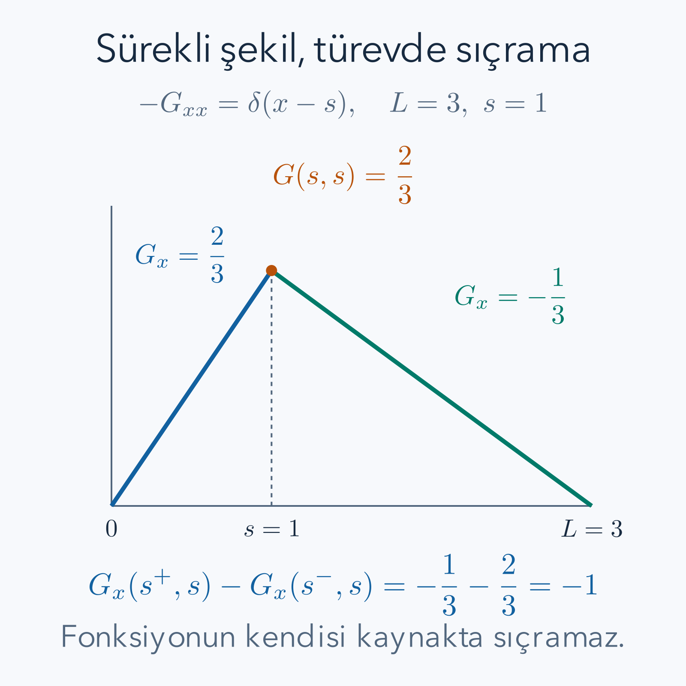

Bir telin her noktasına farklı kuvvet uygulandığında bütün şekli nasıl buluruz? Önce yalnız bir noktadaki birim etkiye verilen cevabı hesaplayabiliriz. Denklem lineerse, küçük etkilerin cevaplarını toplamak bütün kaynağın cevabını verir. Green fonksiyonu bu düşüncenin kesin biçimidir. İki ayrı konumu veya zamanı birbirine bağlar: kaynak nerede uygulanıyor, cevap nerede ölçülüyor?

Önce [ikinci derece diferansiyel denklemler](/blog/ikinci-derece-diferansiyel-denklemler/), [belirli integral](/blog/belirli-integral-ve-temel-teorem/), [integral alma yöntemleri](/blog/integral-alma-yontemleri/) ve [Sturm–Liouville kuramı](/blog/sturm-liouville-ve-ozfonksiyonlar/) okunabilir. İntegrali kaynak parçalarının toplamı, türevi ise bu toplamın yerel değişimi olarak kullanacağız. Dirac delta daha önce bilinmesi gereken bir önkoşul değildir; burada dar bir kaynak kutusundan kurulacak.

## 1. Bir operatörü tersine çevirmek ne demektir?

Bir fonksiyona türev gibi işlem uygulayıp yeni fonksiyon üreten kurala operatör diyelim. Örneğin $\mathcal L=-d^2/dx^2$, iki kez türev alıp işaret değiştiren operatördür. $u(x)$ bilinmeyen, $f(x)$ bilinen kaynak olsun:

$$
\mathcal Lu=f.
$$

Lineerlik, sabit $a,b$ sayıları için $\mathcal L(au+bv)=a\mathcal Lu+b\mathcal Lv$ olmasıdır. Türevin toplamı ayrı ayrı türevlemesi bu özelliği verir. Kaynakların toplamına cevapların toplamı uyuyorsa süperpozisyon kullanabiliriz. Kare alma içeren $u^2$ gibi bir terim eklendiğinde bu özellik genellikle kaybolur.

Ters işlem, verilen kaynaktan bilinmeyeni bulmaktır. Ancak ikinci türevi bilmek fonksiyonu tek başına belirlemez. İki kez integral aldığımızda bir doğrusal terim ve bir sabit kalır. Bu nedenle operatörün tersi yalnız diferansiyel ifadeye değil, hangi fonksiyonlara izin verdiğimize de bağlıdır. Sınır veya başlangıç koşulları bu tanımın bir parçasıdır. Green fonksiyonu değiştiğinde yalnız bir teknik tercih yapılmış olmayabilir; çözülen fiziksel problem değişmiş olabilir.

## 2. Dirac delta neden sıradan bir fonksiyon değildir?

Kaynak konumunu $s$ ile gösterelim. $\varepsilon>0$ genişlikli, birim alanlı kutu düşünelim:

$$
\delta_\varepsilon(x-s)=
\begin{cases}
1/\varepsilon,& |x-s|<\varepsilon/2,\\
0,& |x-s|>\varepsilon/2.
\end{cases}
$$

Uç noktaların değerleri integral açısından önemli değildir. Kutunun yüksekliği büyürken genişliği küçülür; alanı her zaman birdir. Sıfır genişlikte, sonlu yüksekliğe sahip sıradan bir fonksiyonun aynı işi yapması mümkün değildir. “Sıfır dışında sıfır, sıfırda sonsuz” sözü tanım olmaya yetmez; integralde ne yaptığı belirtilmelidir.

$\varphi$ kaynak çevresinde sürekli bir deneme fonksiyonu olsun. Kutu ile çarpıp integre ettiğimizde

$$
\int\delta_\varepsilon(x-s)\varphi(x)\,dx
=\frac1\varepsilon\int_{s-\varepsilon/2}^{s+\varepsilon/2}\varphi(x)\,dx
\longrightarrow\varphi(s)
$$

elde edilir. Sağ taraf dar aralıktaki ortalama değerdir. Süreklilik, aralık daraldıkça bu ortalamanın merkezdeki değere yaklaşmasını sağlar. **Dirac delta**, bu integral etkisini temsil eden dağılımdır:

$$
\int\delta(x-s)\varphi(x)\,dx=\varphi(s).
$$

Deltanın birimi, değişkenin biriminin tersidir. Konum uzunluksa delta ters uzunluktur; zaman söz konusuysa ters zamandır. Alanın bir kalması bu birim kuralını zorunlu kılar. Deltaları keyfi biçimde çarpmak, örneğin delta karesini sıradan fonksiyon gibi kullanmak bu tanımın izin verdiği bir işlem değildir.

Kutu limitini tek bir örnekle kontrol edelim. Deneme fonksiyonu $\varphi(x)=x^2$ olsun. $x=s+v$ yazarsak kutunun etkisi

$$
\begin{aligned}
\frac1\varepsilon\int_{-\varepsilon/2}^{\varepsilon/2}(s+v)^2dv
&=\frac1\varepsilon\int_{-\varepsilon/2}^{\varepsilon/2}(s^2+2sv+v^2)dv\\
&=s^2+\frac{\varepsilon^2}{12}
\longrightarrow s^2.
\end{aligned}
$$

Ortadaki tek kuvvetli terimin integrali simetriden sıfırdır; son terim kutunun sonlu genişliğinden gelen hatadır. Genişliği yarıya indirmek bu örnekte hatayı dörtte bire indirir. Deltanın “değeri seçmesi” ifadesinin somut anlamını burada görüyoruz. Dar fakat sonlu kaynak gerçek bir ortalama alır; ideal delta limitinde ortalama, merkezdeki değer olur. Gerçek deneydeki kısa bir darbe de belirli bir zaman çözünürlüğünde böyle idealize edilir; darbe süresi sistemin değişim süresine göre küçük olmalıdır.

## 3. Green fonksiyonunun iki değişkeni

$0\leq x\leq L$ aralığı alalım; $L>0$ aralığın uzunluğudur. Operatörü uzunluk sembolüyle karıştırmamak için kaligrafik $\mathcal L$ yazacağız. Sabit uçlu problem

$$
-u''(x)=f(x),\qquad u(0)=u(L)=0
$$

olsun. $G(x,s)$ Green fonksiyonu, sabit tutulan her iç kaynak noktası $0<s<L$ için

$$
-\frac{\partial^2G}{\partial x^2}(x,s)=\delta(x-s),
\qquad G(0,s)=G(L,s)=0
$$

sağlamalıdır. Operatörün etkidiği değişken cevap konumu olan ilk değişkendir. Kaynak konumu bu türev sırasında değişmez.

Bir noktadaki birim kaynak bütün aralığı etkiler, fakat uçlar yerinde kalır. Kaynak dışındaki her noktada sağ taraf sıfırdır. Bu, Green fonksiyonunun orada ikinci türevinin sıfır olması demektir. İkinci türevi sıfır olan fonksiyon doğrusal olduğundan çözümü iki doğru parçasından kurabiliriz. Bütün bir kaynak profiliyle başlamaya göre hesap bu yüzden kolaylaşır.

*Kaynak konumu sabitken Green fonksiyonu bir çadır şeklidir. Fonksiyon süreklidir; birinci türev kaynakta eksi bir kadar sıçrar. İşaret, seçtiğimiz eksi ikinci türev operatörüne bağlıdır.*

## 4. İki doğruyu sınır koşuluyla kurmak

Kaynağın solunda ve sağında çözümün genel biçimi $Ax+B$ ve $Cx+D$ olsun. Sol uçtaki sıfır koşulu $B=0$ verir. Sağ uçta $CL+D=0$ olduğundan $D=-CL$ olur. Sağ parçanın katsayısını daha okunur biçimde $B_s$ ile yeniden adlandırıp

$$
G(x,s)=
\begin{cases}
A_sx,&0\leq x<s,\\
B_s(L-x),&s<x\leq L
\end{cases}
$$

yazabiliriz. Burada $A_s,B_s$ kaynak yerine bağlı sabitlerdir. İki harfin aynı eski sabitlerle karışmaması için alt indis kullandık. Henüz kaynak noktasındaki birleşme koşullarını uygulamadık.

Fonksiyonun kendisi kaynakta sıçrasaydı, birinci dağılımsal türevi delta içerirdi; ikinci türevinde delta türevi oluşurdu. Sağ tarafta yalnız delta bulunduğundan böyle bir sıçrama istemiyoruz. Bu nedenle süreklilik koşulu

$$
A_ss=B_s(L-s)
$$

olmalıdır. Bu koşul iki eğimi tek başına belirlemez. Kaynağın toplam etkisini taşıyan ikinci koşul, denklemi dar bir aralıkta integre ederek elde edilecektir. Birleşme noktasında denklemi sıradan ikinci türev eşitliği olarak yazamayız; orada türev zaten iki farklı tek yanlı değere sahiptir.

## 5. Türev sıçramasının eksi işareti

$\eta>0$ yeterince küçük olsun; kaynak çevresinde integre edelim:

$$
-\int_{s-\eta}^{s+\eta}G_{xx}(x,s)\,dx
=\int_{s-\eta}^{s+\eta}\delta(x-s)\,dx=1.
$$

Sol tarafta temel teorem türev farkını verir. $\eta\to0$ limitinde

$$
-\bigl[G_x(s^+,s)-G_x(s^-,s)\bigr]=1.
$$

Sağ eğim $-B_s$, sol eğim $A_s$ olduğundan $-(-B_s-A_s)=1$, yani $A_s+B_s=1$ bulunur. Eksi işareti unutulursa çadır aşağı dönük çıkar ve kaynak denklemi yanlış işaretle sağlanır.

Süreklilik koşuluyla sistemi çözelim. $B_s=1-A_s$ yazıp

$$
\begin{aligned}
A_ss&=(1-A_s)(L-s),\\
A_ss&=L-s-A_sL+A_ss,\\
A_sL&=L-s
\end{aligned}
$$

buluruz. $L>0$ olduğu için bölebiliriz: $A_s=(L-s)/L$, $B_s=s/L$ olur. Sonuç

$$
G(x,s)=
\begin{cases}
x(L-s)/L,&x\leq s,\\
s(L-x)/L,&x\geq s.
\end{cases}
$$

İki ifade $x=s$'de aynı değeri verir. Boyutu uzunluktur: ikinci türev ters uzunluk bırakır ve delta ile uyumludur. Ayrıca kaynak ve cevap konumları yer değiştirince değer değişmez; $G(x,s)=G(s,x)$. Bu simetri burada açık formülden denetlenebilir.

Kaynak aralığın bir ucuna yaklaşırken ne olduğuna da bakalım. Kaynak soldan hemen içerideyse çadırın tepe değeri küçülür; sıfır değere sabitlenmiş uca uygulanan etkinin içeriye taşınması sınırlanır. Ancak tam uçta bir delta yazmak ayrı bir sınır kaynağı yorumunu gerektirebilir. Bu yüzden türetimde kaynak noktasını açık aralığın içinde tuttuk. Sonradan iç noktaların limite gidişini incelemek, başlangıçta sınır koşulunun kendisini değiştirmekle aynı işlem değildir.

Teklik de basitçe kanıtlanır. Aynı kaynağı ve aynı sıfır uçları sağlayan iki çözümün farkını alalım. Kaynaklar birbirini götürür ve farkın ikinci türevi sıfır olur. Dolayısıyla fark bir doğru fonksiyonudur. İki ayrı uçta sıfır olan doğru bütün aralıkta sıfırdır. Böylece bulduğumuz Green integrali yalnız olası bir çözüm değil, bu koşullar altındaki tek çözümdür. Bu ispatın Neumann koşulunda neden bozulduğunu son bölümde göreceğiz.

## 6. Noktasal kaynağa tam bir cevap

$L=3$ ve kaynak konumu $s=1$ seçelim; sayısal uzunluklar aynı birimle ölçülsün. Green fonksiyonu solda $2x/3$, sağda $(3-x)/3$ olur. Kaynak noktasındaki iki değer de $2/3$'tür. Sol eğim $2/3$, sağ eğim $-1/3$ ve farkları $-1$'dir. Uçlarda değer sıfırdır. Kaynağın dışındaki ikinci türev iki tarafta da sıfırdır. Dört kontrol, çözümün bütün koşullarını doğrular.

Kaynak şiddeti $Q$ ise $f(x)=Q\delta(x-1)$ yazılır ve cevap $u(x)=QG(x,1)$ olur. Deltanın integral etkisi $Q$'dur; eğim sıçraması da $-Q$ olur. Örneğin $Q=6$ için solda $u=4x$, sağda $u=2(3-x)$ bulunur. Kaynakta değer dört, eğim farkı $-2-4=-6$'dır. Kaynak kuvvetini artırdığımızda şeklin yatay konumu değişmez; bütün genlikler aynı katsayıyla büyür. Bu, lineerliğin sayısal bir sonucudur.

Burada noktasal yük benzetmesi yalnız denklemin yorumudur. Gerçek tel gerilimi gibi bir katsayı eklenseydi kaynak ve Green fonksiyonunun birimleri ona göre değişirdi. Matematiksel modeli açık yazmadan aynı sayıları farklı fiziksel sistemlere aktaramayız.

## 7. Dağılmış kaynağı integral olarak toplamak

Küçük $ds$ aralığındaki toplam kaynak yaklaşık $f(s)ds$'dir. Bu parçanın $x$ noktasındaki cevabı $G(x,s)f(s)ds$ olur. Aralığı daha küçük parçalara ayırıp cevapları toplamak

$$
u(x)=\int_0^LG(x,s)f(s)\,ds
$$

formülünü verir. Bu, sıradan Riemann toplamının limitidir. İntegralde $s$ dolaşırken gözlem konumu $x$ sabit tutulur. Deltanın tanımı ve lineerlik, uygun anlamda operatörü integralin içine soktuğumuzda $\mathcal Lu=\int\delta(x-s)f(s)ds=f(x)$ sonucunu açıklar.

Fakat çözümü yalnız bu sembolik doğrulamaya bırakmayalım. Sürekli $f$ için integrali $s=x$ noktasında ayıralım. İlk parçada $s\leq x$ olduğundan Green fonksiyonunun sağ dalı, ikinci parçada sol dalı kullanılır:

$$
u(x)=\frac{L-x}{L}\int_0^xs f(s)\,ds
+\frac{x}{L}\int_x^L(L-s)f(s)\,ds.
$$

Parçalı formülün koşulları ilk değişkenle ilgiliydi. İntegrali kaynak değişkeninde yazınca hangi dalın seçileceğini ters okumamak gerekir. İki integralin uçları bu nedenle ayrıca belirtilmiştir.

İntegral yaklaşımının bir başka yararı kaynak profilinin yalnız bir noktadaki değerini kullanmamasıdır. Gözlem noktasında kaynak sıfır olsa bile başka yerlerdeki yükler oradaki cevabı değiştirebilir. Çekirdek her kaynak parçasının etkisini uzaklık ve sınırlar aracılığıyla tartar. Bu nedenle çözüm genel olarak yerel bir çarpım değildir. Kaynakla aynı noktada Green fonksiyonuna bakıp bütün cevabı oradan çıkarmaya çalışmak eksik kalır; kaynak değişkeni boyunca toplam alınmalıdır.

## 8. İntegral çözümünü iki kez türevlemek

$A(x)=\int_0^xs f(s)ds$ ve $B(x)=\int_x^L(L-s)f(s)ds$ diyelim. Sürekli kaynak için temel teorem $A'=xf(x)$, $B'=-(L-x)f(x)$ verir; ikinci eksi işareti değişken alt sınırdan gelir. Çarpım kuralıyla

$$
\begin{aligned}
u'&=-\frac{A}{L}+\frac{L-x}{L}xf(x)
+\frac{B}{L}-\frac{x}{L}(L-x)f(x)\\
&=\frac{B-A}{L}.
\end{aligned}
$$

İki sınır katkısı aynı büyüklükte ve ters işaretlidir. Bir kez daha türev alırsak

$$
u''=\frac{B'-A'}L
=\frac{-(L-x)f(x)-xf(x)}L=-f(x).
$$

Dolayısıyla denklem sağlanır. $x=0$ için ilk çarpanın integrali sıfır, ikinci çarpan sıfırdır; $u(0)=0$ çıkar. $x=L$ için de iki terim sıfır olur. Sürekli kaynağın çözümünün iki kez türevli olduğunu bu hesap doğrudan gösterir. Daha kaba kaynaklar için türevler zayıf veya dağılımsal anlamda yorumlanabilir; bu ek analiz burada gerekli değildir.

## 9. Sabit kaynak için bütün işlemler

Önce $f(s)=1$ alalım. Formüldeki iki integral

$$
\begin{aligned}
A(x)&=\left[\frac{s^2}2\right]_0^x=\frac{x^2}2,\\
B(x)&=\left[Ls-\frac{s^2}2\right]_x^L
=\frac{L^2}2-Lx+\frac{x^2}2=\frac{(L-x)^2}2
\end{aligned}
$$

olur. Yerlerine koyarsak

$$
\begin{aligned}
u(x)&=\frac{(L-x)x^2+x(L-x)^2}{2L}\\
&=\frac{x(L-x)[x+(L-x)]}{2L}
=\frac{x(L-x)}2.
\end{aligned}
$$

Bölünen $L$ sıfır değildir. Açılmış biçim $u=(Lx-x^2)/2$ olduğundan $u'=L/2-x$, $u''=-1$'dir. Böylece $-u''=1$, iki uç değeri sıfır ve orta noktada en büyük değer $L^2/8$ bulunur. En büyük noktada birinci türev sıfır, ikinci türev negatiftir.

$L=2$ için $u=x(2-x)/2$ ve orta nokta değeri $1/2$ olur. Kaynağı iki katına çıkarırsak cevap da iki katına çıkar. Aralık uzunluğunu iki katına çıkarıp kaynak yoğunluğunu aynı bırakırsak en büyük değer dört katına çıkar. Bu farklı ölçek davranışı, integralin hem daha fazla kaynak toplaması hem de Green fonksiyonunun uzunlukla büyümesinden gelir.

## 10. Değişen kaynak için ikinci tam çözüm

Birim aralıkta $L=1$ ve $f(s)=s$ seçelim. Kaynak sağa doğru büyür; şeklin simetrik olmasını beklemeyiz. İlk integral $A=x^3/3$'tür. İkinci integralde

$$
\begin{aligned}
B(x)&=\int_x^1(s-s^2)ds\\
&=\left[\frac{s^2}2-\frac{s^3}3\right]_x^1
=\frac16-\frac{x^2}2+\frac{x^3}3.
\end{aligned}
$$

Buna göre

$$
\begin{aligned}
u(x)&=(1-x)\frac{x^3}3
+x\left(\frac16-\frac{x^2}2+\frac{x^3}3\right)\\
&=\frac{x^3}3-\frac{x^4}3+\frac x6-\frac{x^3}2+\frac{x^4}3\\
&=\frac{x-x^3}6.
\end{aligned}
$$

Dördüncü dereceden terimler iptal oldu. Türevler $u'=(1-3x^2)/6$, $u''=-x$'tir. Denklem $-u''=x$ ve uçlar sağlanır. Tepe $x=1/\sqrt3\approx0.57735$ noktasındadır; kaynak daha güçlü olan sağ tarafa kaymıştır. $x=1/2$ için değer $(1/2-1/8)/6=1/16$ bulunur. Bu tam değer, yaklaşık bir sayısal integral hesabının doğruluğunu sınamak için de kullanılabilir.

Sayısal hesapta da aynı integral kullanılabilir. Kaynak aralığını küçük hücrelere ayırıp her hücrenin orta noktasındaki kaynak değerini Green fonksiyonuyla çarpar, hücre genişliğiyle ağırlıklandırırız. Sonlu sayıda hücreyle elde edilen sonuç yaklaşıktır; hücre sayısını iki katına çıkarıp değişimi izlemek gerekir. Kaynak veya çekirdeğin türevi bir noktada sıçrıyorsa o noktada integrali ayırmak doğruluğu iyileştirir. Buradaki doğrusal kaynak örneğinde bölme noktası gözlem konumudur. İki tarafta düzgün integrandlarla çalışıp polinom çözümündeki değerle karşılaştırabiliriz.

### Uç değerleri sıfır değilse

Sol ve sağ uçta verilen değerler sırasıyla $a$ ve $b$ olsun; bunlar kaynak konumu değildir. Sıfır uçlar için kurduğumuz Green integrali yine kullanılabilir, fakat önce sınır değerlerini taşıyan basit bir fonksiyon ayırmalıyız. İki ucu birleştiren doğruyu

$$
q(x)=a+\frac{b-a}{L}x
$$

seçelim. Bu doğrunun ikinci türevi sıfırdır. $u=q+v$ yazınca $-u''=-v''$ olur; ayrıca $v(0)=v(L)=0$ çıkar. Dolayısıyla sıfır uçlar için zaten bildiğimiz Green integrali yalnız $v$ kısmını hesaplar. Sonra doğruyu geri ekleriz.

Örneğin uzunluğu iki olan aralıkta sol değer bir, sağ değer üç ve kaynak sabit bir olsun. Uçları taşıyan doğru $q=1+x$, sıfır uçlu kaynak cevabı $v=x(2-x)/2$'dir. Toplam çözüm $u=1+2x-x^2/2$ olur. Sol uçta bir, sağ uçta üç verdiği doğrudan görülür; iki kez türevde eksi bir çıkar ve kaynak denklemi sağlanır. Yeni sınır değerleriyle eski çekirdeği kullanabilmemizin nedeni sınırları önce homojenleştirmiş olmamızdır. Başka bir kaynak veya başka bir uç çifti seçildiğinde de aynı ayrıştırma işlemi açıkça yapılır; sabit bir çekirdeğin her koşulu kendiliğinden taşıdığı varsayılmaz.

## 11. Başlangıç koşullu zaman problemi

Şimdi konum yerine zaman değişkeni $t$ kullanalım. $\omega>0$ sabit açısal frekans, $f(t)$ ivme birimli sürücü olsun. Denklem ve başlangıç koşulları

$$
y''+\omega^2y=f(t),\qquad y(0)=y'(0)=0
$$

olsun. Burada $y$ konum, türevler zamana göredir. Kütleli fiziksel denklem $my''+m\omega^2y=F(t)$ ise önce $m>0$ ile bölüp $f=F/m$ yazılır. Green fonksiyonunu hangi operatör için tanımladığımız, bu kütle katsayısının nerede durduğunu belirler.

Zaman kaynağını $s$'de uyguladığımızda, daha önce cevap gelmemesini isteriz. Bu koşula **gecikmeli**, yani retarded seçim denir. $t<s$ için $G_R(t,s)=0$ alınır. $t>s$ için kaynak yoktur; homojen salınım denklemi sağlanır. Kaynak anında konum sürekli kalır, fakat hız sıçrayabilir. Operatörün baş katsayısı bu kez pozitif olduğu için hız sıçramasının işareti mekânsal örnekten farklıdır.

## 12. Gecikmeli Green fonksiyonunu türetmek

$\tau=t-s$ zaman farkı olsun. Pozitif tarafta genel homojen cevap $A\cos(\omega\tau)+B\sin(\omega\tau)$'dur. Negatif tarafta sıfır seçmiştik. Konum sürekliliği $A=0$ verir. Denklemi kaynak anının çevresinde integre edelim:

$$
G_R'(s^+,s)-G_R'(s^-,s)
+\omega^2\lim_{\eta\to0}\int_{s-\eta}^{s+\eta}G_Rdt=1.
$$

$G_R$ sonlu ve sürekli olduğundan dar aralık integrali sıfıra gider. Sol hız sıfır, sağ hız $B\omega$'dır; $B\omega=1$, yani $B=1/\omega$ bulunur. Heaviside basamak fonksiyonu $\Theta(\tau)$ negatifte sıfır, pozitifte bir olsun. Sonuç

$$
G_R(t,s)=\Theta(t-s)\frac{\sin[\omega(t-s)]}{\omega}.
$$

Basamağın sıfırdaki değeri bu integral problemini değiştirmez; sinüs zaten kaynak anında sıfırdır. Green fonksiyonunun birimi zamandır; iki zaman türevi ters zaman bırakır ve zaman deltasıyla uyumludur. $\omega\to0$ limiti de sonludur: $\sin(\omega\tau)/\omega\to\tau$ olur. Sıfır frekanslı serbest ivmelenme problemi ayrı bir tekillik üretmez.

## 13. Zaman integralini başlangıçlarıyla doğrulamak

Sıfır başlangıçlar için cevap

$$
y(t)=\int_0^t\frac{\sin[\omega(t-s)]}{\omega}f(s)\,ds
$$

olur. Üst sınır $t$'dir; gelecek kaynaklar henüz etkileyemez. Sürekli $f$ için değişken üst sınırla türev alırken önce sınırdaki değer yazılır:

$$
\begin{aligned}
y'(t)&=\frac{\sin0}{\omega}f(t)
+\int_0^t\cos[\omega(t-s)]f(s)ds\\
&=\int_0^t\cos[\omega(t-s)]f(s)ds,\\
y''(t)&=\cos0\,f(t)
-\omega\int_0^t\sin[\omega(t-s)]f(s)ds\\
&=f(t)-\omega^2y(t).
\end{aligned}
$$

İlk sınır terimi sıfır, ikinci sınır terimi kaynağın kendisidir. Denklemin sağ tarafı bu terimden doğar. $t=0$'da iki integralin aralığı sıfır olduğundan hem konum hem hız sıfırdır.

Başlangıç konumu $y_0$, hızı $v_0$ sıfır değilse bunları kaynak gibi integralin içine gelişigüzel eklemeyiz. Homojen cevap eklenir:

$$
y(t)=y_0\cos\omega t+\frac{v_0}{\omega}\sin\omega t
+\int_0^tG_R(t,s)f(s)ds.
$$

İlk iki terimin başlangıçları sırasıyla konum ve hızı taşır; kaynak integrali başlangıçta ikisine de katkı vermez. Bu ayrım, Green fonksiyonunun hangi başlangıç problemi için ters işlemi temsil ettiğini açık tutar.

## 14. Darbe ve sabit kuvvet örnekleri

$t_0>0$ anında bir darbe uygulansın; $f(t)=J\delta(t-t_0)$ olsun. $J$'nin birimi hızdır; fiziksel itme $mJ$ olur. Deltanın seçme özelliğiyle

$$
y(t)=\Theta(t-t_0)\frac J\omega\sin[\omega(t-t_0)].
$$

Darbe öncesinde konum ve hız sıfırdır. Sonrasında hız $J\cos[\omega(t-t_0)]$ olur. Kaynakta konumun iki yanlı değeri sıfır, hızın sağ değeri $J$'dir. Böylece hız sıçraması tam $J$'dir. $\omega=2$, $J=3$, $t_0=1$ için darbe sonrası genlik $1.5$, ilk tepe zamanı $1+\pi/4$ olur; bu zamanda sinüs birdir.

İkinci örnekte $t=0$ sonrasında sabit $f_0$ sürücüsü açılsın. $\tau=t-s$ dönüşümüyle

$$
\begin{aligned}
y(t)&=\frac{f_0}{\omega}\int_0^t\sin(\omega\tau)d\tau\\
&=\frac{f_0}{\omega}\left[-\frac{\cos\omega\tau}{\omega}\right]_0^t
=\frac{f_0}{\omega^2}(1-\cos\omega t).
\end{aligned}
$$

Türevler $y'=f_0\sin\omega t/\omega$, $y''=f_0\cos\omega t$'dir. Toplam $y''+\omega^2y=f_0$ çıkar; başlangıçlar sıfırdır. $\omega=2$, $f_0=8$ için $y=2(1-\cos2t)$ olur. Denge kayması iki iken en büyük yer değiştirme dörttür; sönüm olmadığı için sistem dengeye yerleşmez, onun çevresinde salınır.

Küçük zamanda $\cos\omega t=1-\omega^2t^2/2+\cdots$ yazılır; cevap başta $f_0t^2/2$'dir. Bu, başlangıçta hız sıfırken sabit ivme altında bildiğimiz sonuçtur. Hem denklem kontrolü hem kısa zaman kontrolü aynı formülü destekler.

## 15. Neumann koşulunda neden her kaynağa ters yok?

Mekânsal probleme dönüp bu kez $u'(0)=u'(L)=0$ isteyelim. Denklem $-u''=f$ bütün aralıkta integre edilirse

$$
\int_0^Lf(x)dx=-u'(L)+u'(0)=0
$$

olmalıdır. Demek ki toplam kaynağı sıfır olmayan problem için çözüm yoktur. Örneğin sabit birim kaynak bu koşulla bağdaşmaz. Dirichlet probleminin Green fonksiyonunu aynı denkleme sahip diye burada kullanamayız.

Toplam kaynak sıfır olsa bile teklik yoktur. Bir çözüm $u$ varsa $u+C$ de aynı ikinci türeve ve uç türevlerine sahiptir. Sabit fonksiyon operatör tarafından sıfıra gönderilir; buna **sıfır mod** denir. Tersi tek değerli kurmak için örneğin $\int_0^Lu\,dx=0$ gibi ek ortalama koşulu gerekir.

Bu durumda değiştirilmiş çekirdek denklemi $-G_{xx}=\delta(x-s)-1/L$ biçiminde kurulabilir. Sağ tarafın integrali $1-1=0$'dır ve uyumluluk koşulu sağlanır. Sıfır ortalamalı kaynaklara etkidiğinde çıkarılan sabit parça sonuca katkı vermez. Bu ek çekirdeğin tam parçalı hesabını burada yapmıyoruz; amacımız evrensel bir “her operatörün Green fonksiyonu vardır” iddiasının neden yanlış olduğunu göstermektir.

Sıfır ortalamalı bir kaynakla uyumluluğu somutlaştıralım. Birim aralıkta $f(x)=2x-1$ seçelim. Toplam kaynak $[x^2-x]_0^1=0$'dır. Doğrudan iki kez integral almak

$$
u'=-x^2+x+C_1,\qquad
u=-\frac{x^3}3+\frac{x^2}2+C_1x+C_2
$$

verir. Sol Neumann koşulu $C_1=0$ seçer; sağ koşul da $-1+1=0$ olduğundan sağlanır. Fakat sabit $C_2$ hâlâ serbesttir. Sıfır ortalama istenirse

$$
\int_0^1u\,dx=-\frac1{12}+\frac16+C_2=0
$$

ve $C_2=-1/12$ bulunur. Burada kaynak uyumluluğu çözümün varlığını, ek ortalama koşulu ise sabitin seçimini sağladı. Bu iki soruyu aynı koşulla çözmeye çalışmadık. Dirichlet örneğinde doğrudan elde edilen teklik, farklı sınır probleminde ek bilgi gerektirdi.

## 16. Hangi kontroller çözümün parçasıdır?

Bir Green fonksiyonunu elimize aldığımızda yalnız diferansiyel denklemine bakmak yeterli değildir. Kaynak dışındaki homojen denklemi, kaynakta süreklilik ve doğru türev sıçramasını, ayrıca uç veya başlangıç koşullarını kontrol etmeliyiz. Zaman probleminde hangi tarafın sıfır seçildiği de fiziksel bilgidir. Gecikmeli cevap geleceğin geçmişi etkilemesini dışlar; gelişmiş cevap seçilseydi başka bir sınır problemi çözülürdü.

Bu yazıdaki iki operatör arasında bir işaret değişikliği vardı: eksi ikinci uzay türevi eğimde negatif sıçrama, pozitif ikinci zaman türevi hızda pozitif sıçrama üretti. Aynı ezber formülünü ikisine taşımadık; denklemi kaynak çevresinde integre ederek işareti yeniden bulduk. Bu kısa integral, uygulamalarda en güvenilir hata kontrolüdür.

Green yöntemi yalnız delta kaynaklarla sınırlı değildir. Noktasal cevabı bir kez hesapladıktan sonra sabit, doğrusal, zamanla değişen veya parça parça sürekli kaynaklar integralde toplanabilir. Ancak lineerlik, uygun kaynak sınıfı ve belirlenmiş koşullar işin temelidir. Sayısal bir yöntemle çekirdeği hesaplamak da mümkündür; o durumda aynı sınır ve sıçrama kontrolleri sayısal hatayla birlikte izlenmelidir.

## Kaynaklar

- [MIT OCW 18.03SC, evrişim ve Green formülü](https://ocw.mit.edu/courses/18-03sc-differential-equations-fall-2011/pages/unit-iii-fourier-series-and-laplace-transform/convolution/): keyfi girdinin darbe cevabından kurulması ve formülün türevi için.
- [MIT Open Learning Library, darbeler ve darbe cevabı](https://openlearninglibrary.mit.edu/courses/course-v1%3AOCW%2B18.031%2B2019_Spring/courseware/week5/lec9/): konum sürekliliği ile hız sıçramasının ayrımı için.
- [MIT OCW 18.303, Green fonksiyonlarına giriş](https://ocw.mit.edu/courses/18-303-linear-partial-differential-equations-analysis-and-numerics-fall-2014/e2ac5c8e1b07eb8d9bed4aca68e4cf09_MIT18_303F14_green.pdf): sabit uçlu aralıkta parçalı doğru çözümü ve eğim sıçramasını karşılaştırmak için.
