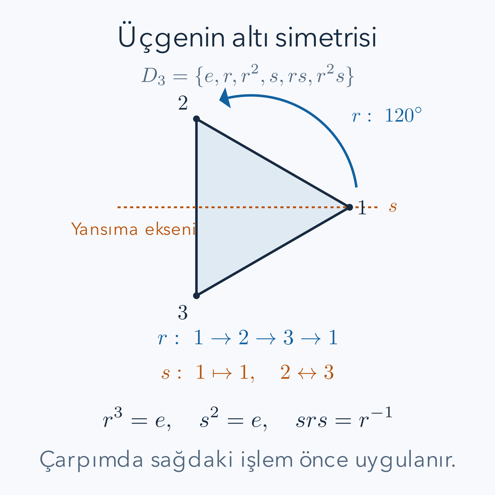

Bir eşkenar üçgeni masada döndürdüğümüzde, boyalı köşeleri takip etmiyorsak başlangıçtaki şekli yeniden görebiliriz. Fakat üçgen aynı görünse bile köşeler yer değiştirmiştir. Simetriyi yalnız “güzel ve dengeli görünmek” olarak değil, **bir nesne üzerinde yapılıp belirli özellikleri koruyan işlem** olarak ele alacağız. Bu işlemleri art arda yaptığımızda ne olduğunu hesaplamak grup kuramının başlangıcıdır.

Ön bilgi olarak [fonksiyonların bileşkesi](/blog/fonksiyonlarda-bileske-ters-ve-donusum/), [baz ve doğrusal birleşim](/blog/dogrusal-birlesim-baz-ve-boyut/), [matris çarpımı](/blog/matrisler-ve-dogrusal-donusumler/) ve [determinant](/blog/determinant-ters-matris-ve-sistemler/) yararlıdır. Bileşkeyi burada yeniden tanımlayacağız; matrisleri ise geometrik hesabımızı başka bir dille doğrulamak için kullanacağız. Fizikteki herhangi bir korunma yasasını veya ileri bir simetri teoremini bilmek gerekmiyor.

## 1. Nesne, özellik ve dönüşüm

Bir şeklin simetrisi olduğunu söylemek için önce hangi nesneyi ve hangi özelliği koruduğumuzu belirtmeliyiz. Üçgenin köşe kümesini koruyan düzlemsel uzaklık koruyucu dönüşümleri arıyoruz. Bir köşe başka bir köşeye gidebilir; fakat kenarların uzunluğu değişemez ve şekil masadan kaldırılıp keyfî biçimde bükülemez. Üçgenin yanına çizilmiş bir ok da nesnenin parçası sayılırsa izin verilen simetriler azalabilir.

Dolayısıyla simetri grubu, yalnız görünüşten çıkarılan evrensel bir etiket değildir. Boyasız eşkenar üçgenin dönüşümleri ile her köşesine farklı renkte sabit bir etiket konmuş nesnenin renkleri de koruyan dönüşümleri aynı değildir. Biz köşeleri hesap yapabilmek için numaralandıracağız; numaraların kendi yerlerinde kalmasını şart koşmayacağız. Etiketler, hangi işlemin yapıldığını ayırt etmemize yarayacak.

Dönüşüme $g$, noktaya $p$ dersek $g(p)$, dönüşümün o noktayı götürdüğü yerdir. İki dönüşümün çarpımını

$$
(gh)(p)=g(h(p))
$$

diye tanımlıyoruz. **Sağdaki önce uygulanır.** Bu bir yazım seçimidir; başka bir kaynak ters sırayı seçerse aynı geometrik işlemler farklı görünen formüllerle yazılabilir. Bu yazıda bütün tablolar ve matrisler yukarıdaki sıraya bağlıdır.

## 2. İşlem ne zaman bir grup oluşturur?

$G$ dönüşümler kümesi olsun. Bir grup için dört özelliği ayrı ayrı kontrol ederiz. Birincisi kapanıştır: $g$ ve $h$ izin verilen dönüşümlerse $gh$ de kümede bulunmalıdır. Üçgeni bir simetriyle dönüştürüp sonra başka bir simetri uygulamak yine köşeleri köşelere götürür ve uzaklıkları korur. Sonuç aynı türden bir işlemdir.

İkincisi birleşmedir. Üç dönüşüm için her noktada

$$
\begin{aligned}
((gh)k)(p)&=(gh)(k(p))\\
&=g(h(k(p))),\\
(g(hk))(p)&=g((hk)(p))\\
&=g(h(k(p))).
\end{aligned}
$$

İki ifade aynı nokta görüntüsünü verdiği için $(gh)k=g(hk)$ olur. Burada işlemlerin sırasını değiştirmedik; yalnız hesapta önce hangi ikisini bir araya getirdiğimizi değiştirdik.

Üçüncüsü birim dönüşüm $e$'dir: $e(p)=p$. Bir dönüşümün önüne veya arkasına hiçbir şey yapmama işlemini koymak sonucu değiştirmez. Dördüncüsü her $g$ için ters $g^{-1}$ bulunmasıdır: önce yapılan işi geri alabilmeliyiz. Simetri uzaklıkları koruyan bire bir bir dönüşüm olduğundan ters dönüşüm de aynı şekil üzerinde tanımlıdır.

Bu şartlar yalnızca ezberlenecek isimler değildir. Örneğin sıfır dahil gerçek sayılar, çarpma altında grup olmaz: sıfırı çarparak bire döndürecek bir gerçek sayı yoktur. Pozitif gerçek sayılar ise çarpma altında gruptur; iki pozitif sayının çarpımı pozitiftir, birim birdir ve her pozitif sayının pozitif çarpımsal tersi vardır.

## 3. Birleşme, değişme anlamına gelmez

Değişme özelliği $gh=hg$ eşitliğidir. Grup tanımı bunu istemez. Günlük işlemlerde bile sıra fark yaratır: bir kâğıdı döndürüp sonra aynalamak ile önce aynalayıp sonra aynı yönde döndürmek farklı sonuç verebilir. Birleşme ise sıralama sabitken parantezlerin etkisiz olmasıdır.

Karşılaştırma için çıkarma işlemine bakalım. Gerçek sayılarda

$$
(8-3)-2=5-2=3,
\qquad
8-(3-2)=8-1=7.
$$

Çıkarma birleşmeli değildir; bu nedenle gerçek sayılar çıkarma altında grup oluşturmaz. “İki sayıyı işleme sokabiliyorum” demek grup kurmak için yeterli değildir. Toplama altında gerçek sayılarda ise parantez değişse de sonuç değişmez ve her $a$ sayısının tersi $-a$ olur. Tersin ne olduğu, seçilen işleme bağlıdır; toplamsal ters ile çarpımsal tersi karıştırmamalıyız.

## 4. Üçgenin altı simetrisini kurmak

Köşeleri saat yönünün tersine $1,2,3$ olarak adlandıralım. $r$, her köşeyi sonraki köşeye götüren $120^\circ$ dönme olsun:

$$
r:1\mapsto2,\quad2\mapsto3,\quad3\mapsto1.
$$

$s$, birinci köşeden ve karşı kenarın orta noktasından geçen eksene göre yansıma olsun:

$$
s:1\mapsto1,\quad2\mapsto3,\quad3\mapsto2.
$$

Bir dönüşümü $(g(1),g(2),g(3))$ üçlüsüyle kaydedebiliriz. İki kez dönme $r^2=(3,1,2)$, birim $e=(1,2,3)$ olur. $rs$ için önce $s$, sonra $r$ uygulanır. Birinci köşe $1\to1\to2$, ikinci köşe $2\to3\to1$, üçüncü köşe $3\to2\to3$ yolunu izler; dolayısıyla $rs=(2,1,3)$ bulunur. Aynı yöntemle $r^2s=(3,2,1)$ elde edilir.

Altı işlemimiz $e,r,r^2,s,rs,r^2s$'dir. Neden daha fazlası yok? Birinci köşenin görüntüsü üç seçenekten biridir. Onu seçtikten sonra ikinci köşe kalan iki köşeden birine gitmelidir. Üçüncü köşenin görüntüsü artık belirlenmiştir. En çok $3\times2=6$ seçenek vardır; yazdığımız altı dönüşüm farklı olduğundan bütün seçenekleri bulduk. Bu gruba burada $D_3$ diyeceğiz; bazı kaynaklar eleman sayısını vurgulayarak $D_6$ yazar.

*Dönme köşeleri çevrimsel taşır; yansıma bir köşeyi sabit bırakıp diğer ikisini değiştirir. Şema, çarpım hesabında izlediğimiz etiketleri gösterir.*

## 5. Üç temel bağıntıyı tek tek doğrulamak

Üç kez dönünce her köşe başlangıcına gelir: birinci köşe $1\to2\to3\to1$, ikinci $2\to3\to1\to2$, üçüncü $3\to1\to2\to3$ yolunu izler. Bu nedenle $r^3=e$ ve $r^{-1}=r^2$'dir. Yansıma iki kez uygulanınca değiştirilen iki köşe geri gelir; birinci köşe zaten sabittir. Demek ki $s^2=e$ ve $s^{-1}=s$.

Şimdi $srs$'yi sağdan başlayarak hesaplayalım:

$$
\begin{aligned}
1&\xrightarrow{s}1\xrightarrow{r}2\xrightarrow{s}3,\\
2&\xrightarrow{s}3\xrightarrow{r}1\xrightarrow{s}1,\\
3&\xrightarrow{s}2\xrightarrow{r}3\xrightarrow{s}2.
\end{aligned}
$$

Görüntü üçlüsü $(3,1,2)$ olduğundan $srs=r^2=r^{-1}$. İki tarafı sağdan $s$ ile çarparsak

$$
\begin{aligned}
(srs)s&=r^2s,\\
sr(ss)&=r^2s,\\
sr&=r^2s.
\end{aligned}
$$

Burada önce birleşme, sonra $ss=e$ kullandık. Son eşitlik, yansımayı bir dönmenin öte yanına taşırken dönme yönünün neden değiştiğini cebirle anlatır.

## 6. Sıra farkını bir köşe üzerinde görmek

$sr$ ile $rs$'nin farklı olduğunu yalnız sembollerle ilan etmek yerine köşeleri izleyelim. $sr$ için birinci köşe $1\to2\to3$ gider; $rs$ için aynı köşe $1\to1\to2$ gider. Bir tek köşede farklı sonuç bulmak dönüşümlerin eşit olmadığını göstermeye yeterlidir.

Bütün görüntüler de şöyledir:

$$
sr=(3,2,1),\qquad rs=(2,1,3).
$$

Bu sonuç fiziksel bir belirsizlik değildir. Hangi işlemi önce yaptığımızı biliyorsak sonuç tam olarak belirlenir. Yalnızca “bir dönme ve bir yansıma yaptım” açıklaması sıra bilgisini sakladığı için yetersizdir. Değişmeli olmayan bir grup, sıra bilgisini işlem yasasında korur.

## 7. Bütün çarpımları üreten kural ve tablo

Altı elemanı $r^as^b$ biçiminde yazabiliriz; $a=0,1,2$ ve $b=0,1$ seçilir. $sr=r^{-1}s$ bağıntısını art arda kullanmak $sr^c=r^{-c}s$ verir. Örneğin $sr^2=(sr)r=r^{-1}sr=r^{-1}r^{-1}s=r^{-2}s=rs$ olur. Son adımda üsleri üçe göre sadeleştirdik.

İki genel elemanı çarparsak

$$
(r^as^b)(r^cs^d)
=r^{a+(-1)^bc}s^{b+d}.
$$

Dönme üssünü üçe, yansıma üssünü ikiye göre indirgeriz. $b=0$ ise arada yansıma yoktur ve dönme üsleri toplanır. $b=1$ ise aradaki yansıma, sağdaki dönmenin yönünü tersine çevirir. Bu kuraldan çıkan bütün çarpımlar aşağıdadır; satır elemanı solda, sütun elemanı sağdadır.

| $\cdot$ | $e$ | $r$ | $r^2$ | $s$ | $rs$ | $r^2s$ |
|---|---|---|---|---|---|---|
| $e$ | $e$ | $r$ | $r^2$ | $s$ | $rs$ | $r^2s$ |
| $r$ | $r$ | $r^2$ | $e$ | $rs$ | $r^2s$ | $s$ |
| $r^2$ | $r^2$ | $e$ | $r$ | $r^2s$ | $s$ | $rs$ |
| $s$ | $s$ | $r^2s$ | $rs$ | $e$ | $r^2$ | $r$ |
| $rs$ | $rs$ | $s$ | $r^2s$ | $r$ | $e$ | $r^2$ |
| $r^2s$ | $r^2s$ | $rs$ | $s$ | $r^2$ | $r$ | $e$ |

Örneğin tablonun $rs,r^2s$ hücresi $r^2$'dir:

$$
(rs)(r^2s)=r(sr^2)s=r(rs)s=r^2s^2=r^2.
$$

Tablo kapanışı görünür kılar. Birim satır ve sütunları işlemi değiştirmez. Her satırda birim bulunması terslerin varlığıyla uyumludur; üç yansımanın her biri kendi tersidir. Birleşmeyi yalnız tablonun güzel görünmesinden çıkarmıyoruz: onu dönüşümlerin bileşkesi olarak daha önce kanıtladık.

## 8. Üç durumlu sayaç: $C_3$

Yalnız dönmeleri alırsak $C_3=\{e,r,r^2\}$ grubunu elde ederiz. Bu yapı üç durumlu bir sayaçla aynıdır. Durumları $0,1,2$ diye yazalım ve toplamdan üçün katlarını çıkararak kalanını alalım. Bu işleme üçe göre modüler toplama denir; $2+2=4$ toplamı bu işlemde $1$ verir.

| $+$ mod $3$ | $0$ | $1$ | $2$ |
|---|---|---|---|
| $0$ | $0$ | $1$ | $2$ |
| $1$ | $1$ | $2$ | $0$ |
| $2$ | $2$ | $0$ | $1$ |

$0$ birimdir. $1$'in tersi $2$'dir çünkü $1+2=3$ ve üçe göre kalan sıfırdır. $2$'nin tersi de $1$'dir. Toplama birleşmeli olduğundan mod alma sırasını değiştirmek sonucu değiştirmez: arada çıkardığımız her sayı üçün katıdır ve son kalanı etkilemez. Ayrıca tablo simetriktir; bu grup değişmelidir. $0\leftrightarrow e$, $1\leftrightarrow r$, $2\leftrightarrow r^2$ eşlemesi işlem yapısını tam korur; bu tür bire bir, örten, işlem koruyan eşlemeye izomorfizma denir.

## 9. Altgrup ve koset neyi ayırır?

$D_3$ içindeki $H=\{e,r,r^2\}$, aynı işlemle kendi başına grup olduğu için altgruptur. Kapanış, yukarıdaki dönme tablosunda vardır; birim aynıdır; $r$ ile $r^2$ birbirinin tersidir. Buna karşılık $\{e,r\}$ altgrup değildir çünkü $rr=r^2$ kümenin dışında kalır.

Bir $g$ elemanının sol koseti $gH$, $H$'nin her elemanını soldan $g$ ile çarparak elde edilen kümedir. Yansıma için

$$
sH=\{se,sr,sr^2\}=\{s,r^2s,rs\}.
$$

Bu, üç yansımanın kümesidir. $eH=rH=r^2H=H$ ve diğer üç sol koset $sH$'ye eşittir. Grup iki eşit büyüklükte parçaya ayrılır: yönelimi koruyan dönmeler ve yönelimi ters çeviren yansımalar. Kosetin kendisi genellikle altgrup değildir; örneğin $sH$ birimi içermez ve iki yansımayı çarptığımızda dönme elde ederiz.

Eşit büyüklüğün nedeni geometrik benzerlik değil, $h\mapsto gh$ eşlemesinin tersinin $x\mapsto g^{-1}x$ olmasıdır. Hiçbir eleman kaybolmaz veya iki farklı eleman aynı görüntüye sıkışmaz. Bu küçük örnek, büyük bir grubu daha küçük kümeler üzerinden saymanın mantığını gösterir.

## 10. Aynı işlemleri matrislerle yazmak

Şimdi köşeleri Kartezyen düzlemde $p_1=(1,0)$, $p_2=(-1/2,\sqrt3/2)$, $p_3=(-1/2,-\sqrt3/2)$ seçelim. Bir önceki numaralandırma korunur. $r$ ile $s$'ye karşılık gelen matrisler

$$
R=\begin{pmatrix}-1/2&-\sqrt3/2\\ \sqrt3/2&-1/2\end{pmatrix},
\qquad
S=\begin{pmatrix}1&0\\0&-1\end{pmatrix}
$$

olur. Kontrol olarak $Rp_1=(-1/2,\sqrt3/2)=p_2$ ve $Sp_2=(-1/2,-\sqrt3/2)=p_3$ bulunur. Dönüşümün cebiri artık satır ile sütun çarpımıyla hesaplanabilir:

$$
R^2=\begin{pmatrix}
1/4-3/4&\sqrt3/4+\sqrt3/4\\
-\sqrt3/4-\sqrt3/4&-3/4+1/4
\end{pmatrix}
=\begin{pmatrix}-1/2&\sqrt3/2\\-\sqrt3/2&-1/2\end{pmatrix}.
$$

Ayrıca

$$
SRS=\begin{pmatrix}-1/2&\sqrt3/2\\-\sqrt3/2&-1/2\end{pmatrix}=R^2.
$$

Sağdan $S$ ile çarpmak ikinci sütunun, soldan $S$ ile çarpmak ikinci satırın işaretini değiştirir. Bu gözlem son çarpımın dört girişini de açıklar. Matris hesabı ile köşe hesabı aynı bağıntıyı vermiştir.

## 11. Temsil ve sadık temsil arasındaki fark

Bir grup temsili, her $g$ elemanına terslenebilir bir $\rho(g)$ matrisi atayıp

$$
\rho(gh)=\rho(g)\rho(h)
$$

eşitliğini korur. Burada $\rho$ Yunan alfabesinin ro harfidir; yeni bir çarpım işlemi değildir. Üçgen için $r\mapsto R$ ve $s\mapsto S$ seçimi bir temsildir. Altı farklı dönüşüm farklı matrisler verdiği için bu temsil **sadıktır**. Yalnız işlem yapısını değil, grup elemanlarını ayırt etme bilgisini de korur.

Her temsil sadık olmak zorunda değildir. Örneğin her elemana bir boyutlu $(1)$ matrisi atarsak $1\cdot1=1$ olduğundan temsil şartı sağlanır. Fakat bütün simetriler aynı matrise gittiği için hangi dönüşümü yaptığımızı anlayamayız. Temsilin boyutu ile grubun eleman sayısı da aynı kavram değildir: altı elemanlı grubu ikiye iki matrislerle temsil ettik.

## 12. Homomorfizma ve çekirdekte kaybolan bilgi

İşlem koruyan bir $\phi:G\to K$ eşlemesine homomorfizma denir. Matris temsili bunun özel bir örneğidir; hedef grup terslenebilir matrislerden oluşur. Üçgen dönüşümlerinden yalnız yönelim bilgisini tutalım:

$$
\phi(e)=\phi(r)=\phi(r^2)=+1,
\qquad
\phi(s)=\phi(rs)=\phi(r^2s)=-1.
$$

Hedef grup $\{+1,-1\}$, sıradan çarpma altındadır. Dönme ile dönme $+1$, dönme ile yansıma $-1$, iki yansıma ise $+1$ verir; dört olasılığın hepsi hedefteki çarpmayla uyuşur. Kaynakta hangi dönme yapıldığını artık ayırt edemeyiz.

Hedefteki birime gönderilen elemanların kümesine çekirdek denir. Bu örnekte $\ker\phi=H$'dir. Çekirdekteki elemanlar “hiçbir şey yapmayan işlemler” değildir; yalnızca seçtiğimiz ölçüm onların farkını göremez. Sadık bir temsilin çekirdeği yalnız $e$'dir. Bu cümle soyut tanımı geometrik bir soruya çevirir: seçilen matrisler hangi simetri farklarını saklıyor?

## 13. Sonlu üçgenden sürekli dönmelere: $SO(2)$

Üçgen yalnız belirli açılarda kendisiyle çakışır. Bir çember için her açıya izin verilir. Açısı $\theta$ olan dönmenin matrisi

$$
R(\theta)=\begin{pmatrix}\cos\theta&-\sin\theta\\\sin\theta&\cos\theta\end{pmatrix}
$$

şeklindedir. Transpozeyi $T$ ile gösterirsek doğrudan çarpım

$$
R(\theta)^TR(\theta)
=\begin{pmatrix}
\cos^2\theta+\sin^2\theta&-\cos\theta\sin\theta+\sin\theta\cos\theta\\
-\sin\theta\cos\theta+\cos\theta\sin\theta&\sin^2\theta+\cos^2\theta
\end{pmatrix}=I
$$

verir. $I$ birim matristir. Bu koşul uzunlukları korur. Determinant ise $\cos^2\theta+\sin^2\theta=1$'dir; yönelim de korunur. Gerçek, ikiye iki, bu iki koşulu sağlayan matrisler $SO(2)$ grubunu oluşturur. Adındaki “özel”, determinantın özellikle $+1$ seçilmesini belirtir; yansımanın determinantı $-1$ olduğu için $S$ bu gruba girmez.

Matrisleri çarpıp trigonometrik toplam bağıntılarını kullanınca $R(\alpha)R(\beta)=R(\alpha+\beta)$ bulunur. Birim $R(0)$, ters $R(-\theta)$'dır. Açıların $2\pi$ farkla aynı matrisi vermesi nedeniyle açıdan matrise eşleme bire bir değildir: aynı dönmeyi sonsuz sayıda gerçek açıyla yazabiliriz. Üçgenin dönme grubu bu sürekli grubun üç elemanlı bir altgrubudur. Aynı grup düşüncesi hem altı seçenekli bir şekli hem sonsuz seçenekli bir çemberi düzenleyebilir; belirleyici şey elemanların sayısından önce işlem yasasıdır.

## 14. Ortogonal bir matrisin determinantı neden iki seçeneklidir?

Uzunluk koruyan gerçek bir $Q$ matrisinde $Q^TQ=I$ koşulu vardır. İki tarafın determinantını alırsak $\det(Q^T)\det Q=\det I$ olur. Transpozenin determinantı değişmediğinden $(\det Q)^2=1$ elde ederiz. Gerçek bir sayının karesi birse sayı ya artı bir ya eksi birdir. Uzunluk koruma şartı tek başına yansımayı dışlamaz; yönelimi de korumak istiyorsak artı işaretini ayrıca seçeriz.

İki boyutta bu sonucu daha açık görebiliriz. $Q$'nun ilk sütunu birim uzunlukta $(\cos\theta,\sin\theta)$ olsun. İkinci sütunun ilkine dik ve birim uzunlukta olması gerekir. İki seçenek vardır: $(-\sin\theta,\cos\theta)$ veya $(\sin\theta,-\cos\theta)$. İlk seçimde determinant artı bir, ikincide eksi bir çıkar. Dolayısıyla iki boyuttaki her gerçek ortogonal matris, ya bir dönme ya da dönmeyle bir yansımanın bileşkesidir. Üçgen örneğindeki dönme ve yansıma ayrımı daha büyük bir matris ailesinin içinde de sürer.

Determinant ayrıca bir homomorfizma örneğidir. Matris çarpımının determinantı çarpanların determinantlarının çarpımıdır. Üçgenin yönelim eşlemesini bu nedenle $\phi(g)=\det\rho(g)$ biçiminde yazabiliriz. Önce geometrik hareketi iki boyutlu matrise, sonra matrisi bir işarete gönderiyoruz. İlk eşleme bütün altı dönüşümü ayırt ediyordu; ikincisi dönme açısını atıp yalnız yönelimi tutuyor. İki adımlı bu bilgi azaltımı, temsil ile çekirdek kavramlarını aynı örnekte birleştirir.

## 15. Bir dönüşümün mertebesi ile grubun mertebesi

Bir elemanın mertebesi, onu kendisiyle kaç kez çarptığımızda ilk kez birime ulaştığımızı söyler. Üçgenin $r$ dönmesinin mertebesi üçtür; çünkü $r$ ve $r^2$ birim değildir, $r^3$ birimdir. Her yansımanın mertebesi ikidir. Grubun mertebesi ise grubun bütün elemanlarının sayısıdır; bu örnekte altıdır. Aynı sözcük iki farklı sayma sorusunda kullanıldığı için hangi nesnenin mertebesinden söz ettiğimizi belirtmeliyiz.

Bir elemanın bütün kuvvetleri bir altgrup oluşturur. $r$'nin kuvvetlerini izleyince üç elemanlı dönme altgrubu gelir; $s$'nin kuvvetlerini izleyince yalnız birim ile o yansıma gelir. Tek bir yansımanın bütün üçgen simetrilerini üretmesi mümkün değildir. Buna karşılık dönme ve bir yansımayı birlikte kullanarak altı elemanın hepsini üretmiştik. “Üreteç” sözü burada, seçilen işlemlerin çarpımlarıyla bütün grubun kurulabilmesini ifade eder; işlemlerin kendilerinin bütün grup olduğunu söylemez.

## 16. Ters neden tektir ve sadeleştirme neden çalışır?

Bir grubun tersleri bizi cebirde alıştığımız sadeleştirmeye bağlar. Örneğin $gx=gy$ eşitliğinde iki taraftaki $g$'yi yalnızca çizip silmeyiz. İki tarafı soldan $g^{-1}$ ile çarparız:

$$
\begin{aligned}
g^{-1}(gx)&=g^{-1}(gy),\\
(g^{-1}g)x&=(g^{-1}g)y,\\
ex&=ey,\\
x&=y.
\end{aligned}
$$

İkinci satırda birleşme, üçüncüde ters, son satırda birim özelliği kullanıldı. Eşitliğin iki tarafını aynı taraftan çarpmak önemlidir. Değişmeli olmayan bir grupta soldaki çarpanı sağdan tersle çarparak yok edemeyiz; araya başka bir eleman girmiş olur. Matris denklemlerinde sık görülen sıra hatası buradan gelir.

Bir elemanın iki tersi olduğunu varsayalım: $a$ ve $b$. O zaman $ag=e$ ve $gb=e$ olsun. Birim ekleme, yerine koyma ve birleşmeyle

$$
a=ae=a(gb)=(ag)b=eb=b
$$

bulunur. Dolayısıyla ters tektir. Bu kanıtta yeni bir simetri resmi çizmedik; bütün grupların ortak dört özelliğini kullandık. Soyutlamanın faydası tam burada ortaya çıkar: üçgen için öğrendiğimiz bir işlem gerekçesi, aynı aksiyomları sağlayan matrisler veya modüler sayılar için de geçerli olur.

Ayrıca bir çarpımın tersini alırken sıra döner. $(gh)(h^{-1}g^{-1})=g(hh^{-1})g^{-1}=geg^{-1}=e$ ve ters sıradaki çarpım da birimdir. Bu nedenle $(gh)^{-1}=h^{-1}g^{-1}$ olur. Önce dönüp sonra yansıttığımız bir nesneyi geri getirmek için önce son yansımayı geri almak, ardından ilk dönmeyi geri almak gerekir. Cebirdeki sıra kuralı, yaptığımız işlemleri geriye doğru çözmenin tam ifadesidir.

## 17. Kaynaklar ve kapsam

Grup, altgrup ve koset tanımlarını [MIT OCW, James McKernan: Modern Algebra ders notları](https://ocw.mit.edu/courses/18-703-modern-algebra-spring-2013/pages/lecture-notes/) ile karşılaştırabilirsiniz. Homomorfizma ve çekirdeğin biçimsel tanımı için aynı dersin [Homomorphisms and Kernels notu](https://ocw.mit.edu/courses/18-703-modern-algebra-spring-2013/resources/mit18_703s13_pra_l_8/) doğrudan kaynaktır. Matris grupları ve temsil kavramının daha geniş çerçevesi [Hugh Osborn, Cambridge: Group Theory Lecture Notes](https://www.damtp.cam.ac.uk/user/ho10/GNotes.pdf) içinde bulunur.

Buradaki sonuçlar üçgenin somut dönüşümleri, modüler toplam ve iki boyutlu matrisler üzerinden türetildi. Genel temsil sınıflandırmasını, bölüm gruplarının bütün kurallarını veya sürekli grupların türev yapısını kanıtlamadık. Bu sınır, örneklerimizin eksik hesaplandığı anlamına gelmez: üçgenin bütün elemanlarını ve bütün ikili çarpımlarını belirledik; daha büyük kuramların hangi soruları genişlettiğini de ayırmış olduk.
