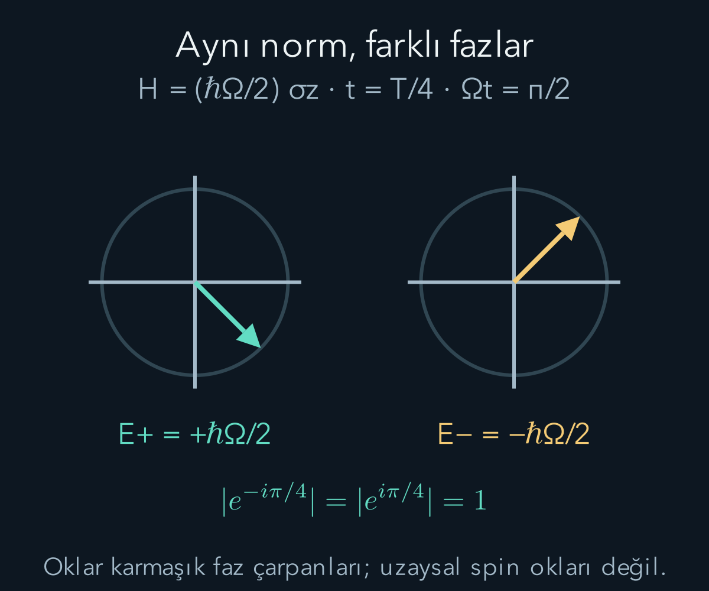
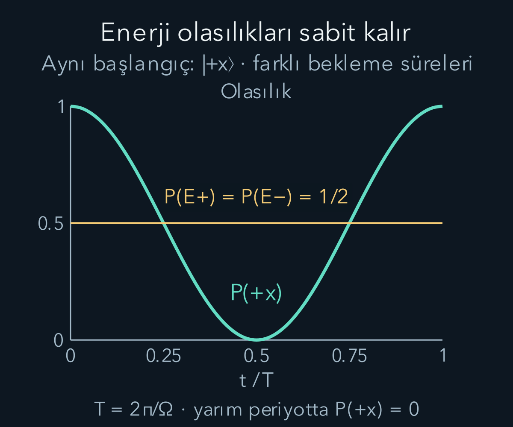

import ArticleVideo from '@/components/ArticleVideo.astro'
import kavram from './media/01-kavram.mp4?url'
import kavramPoster from './media/01-kavram.jpg?url'

Bir kuantum sistemini hazırlayıp hemen ölçmek yerine bir süre bekletirsek sonuç olasılıkları değişebilir. Bekleme sırasında sisteme hangi fiziksel etkileşimlerin etki ettiğini belirtmemiz gerekir. Kuantum kuramında kapalı bir sistemin zamanla değişimini belirleyen temel nesne **Hamiltonyen**dir. Hamiltonyen enerji gözlenebiliridir; aynı zamanda durumun zaman evriminin üretecidir.

[Durum vektörlerini](/blog/kuantum-durumu-superpozisyon-ve-born-kurali/) ve [Hermit gözlenebilirleri](/blog/kuantum-gozlenebilirleri-ve-beklenen-deger/) biliyoruz. [Diferansiyel denklemler](/blog/birinci-derece-diferansiyel-denklemler/) ile karmaşık üstel fonksiyonu kullanacağız. Bu yazıda çoğunlukla iki veya sonlu sayıda düzeyli kapalı sistemleri ve zamandan bağımsız Hamiltonyenleri ele alıyoruz. Çevreyle enerji ve bilgi alışverişi yapan bir alt sistemin evrimi, tek başına aynı basit üniter biçimde olmak zorunda değildir.

## 1. Schrödinger denklemini durum için yazmak

Zamana bağlı durum ketini $|\psi(t)\rangle$, Hamiltonyeni $H$ ile gösterelim. Temel evrim yasası:

$$
\boxed{i\hbar\frac{d}{dt}|\psi(t)\rangle=H|\psi(t)\rangle.}
$$

Burada $t$ zaman, $i^2=-1$, $\hbar=h/(2\pi)$'dir. Denklem durumun zamana göre türevini verir. İlk durum biliniyorsa, Hamiltonyenin tanımlandığı koşullar altında sonraki durumu hesaplarız. Bu yasa, yalnız Born olasılığından veya enerji korunumundan kendiliğinden çıkmaz; kuantum kuramının ek dinamik ilkesidir.

Birimler tutarlıdır. Durum katsayılarını boyutsuz seçtiğimiz sonlu boyutlu gösterimde türev saniyenin tersi birimine sahiptir. $\hbar$ birimi enerji çarpı zaman olduğundan sol taraf enerji birimi taşır. Sağ tarafta $H$ de enerji birimine sahiptir. Üstel çözümlerde ortaya çıkacak $Et/\hbar$ oranı bu nedenle boyutsuzdur.

Denklemde birinci zaman türevi bulunduğu için başlangıç durumunu vermek yeterlidir. Klasik ikinci mertebe hareket denkleminde konumla birlikte başlangıç hızını vermemiz gerekmişti. Burada iki bileşenli durumun her bileşeni birinci mertebe bağlı denklem izler; ayrı bir ‘durum hızı’nı bağımsız başlangıç verisi olarak seçmeyiz.

## 2. Bir enerji özdurumunun evrimi

Zamandan bağımsız Hamiltonyenin normalleştirilmiş özdurumu $|E_n\rangle$ olsun: $H|E_n\rangle=E_n|E_n\rangle$. Durumu $|\psi(t)\rangle=c_n(t)|E_n\rangle$ biçiminde ararsak özvektör sabit olduğundan denklem $i\hbar\dot c_n=E_nc_n$ olur. Nokta zamana göre türevdir.

Bu skaler diferansiyel denklemi $\dot c_n=-(iE_n/\hbar)c_n$ biçiminde yazabiliriz. Başlangıç katsayısı $c_n(0)$ için çözüm:

$$
c_n(t)=c_n(0)e^{-iE_nt/\hbar}.
$$

Doğrudan türev alarak kontrol edelim: türev üstel ifadenin önüne $-iE_n/\hbar$ getirir; $i\hbar$ ile çarpınca katsayı $E_n$ olur. Eksi işareti ve $\hbar$ böylece yalnız ezberden değil, yerine koyma işleminden doğrulanır.

$E_n$ gerçek olduğundan üstel çarpanın mutlak değeri birdir. Genlik karmaşık düzlemde döner, büyüklüğü değişmez. Saf bir enerji özdurumunda bütün ket yalnız global faz kazanır. Bu yüzden zamandan bağımsız bir ölçüm aygıtıyla elde edilen sonuç dağılımları değişmez. Böyle durumlara **durağan durum** deriz. Ketin türevi sıfır olmak zorunda değildir; fiziksel olasılık dağılımlarının zamandan bağımsız olması yeterlidir.

## 3. Genel durumu enerji bazında açmak

Hermit $H$ için ortonormal bir enerji özbazı seçelim. Başlangıç $|\psi(0)\rangle=\sum_n c_n(0)|E_n\rangle$ olsun. Denklemin doğrusal olması sayesinde her bileşeni kendi üstel çarpanıyla evriltip toplarız:

$$
|\psi(t)\rangle=\sum_n c_n(0)e^{-iE_nt/\hbar}|E_n\rangle.
$$

Bu toplamda farklı enerjilere ait bileşenler farklı hızlarda faz biriktirir. Katsayı büyüklükleri $|c_n(t)|^2=|c_n(0)|^2$ kaldığından enerji ölçümünün olasılıkları sabittir. Buna rağmen farklı enerji bileşenlerini birleştiren başka bir ölçümün olasılıkları değişebilir. Enerji dağılımının sabit olması, bütün ölçüm dağılımlarının sabit olduğu anlamına gelmez.

İki enerji $E_1$ ve $E_2$ arasındaki göreli faz değişimi $-(E_2-E_1)t/\hbar$'dir. Ortak enerji katkısı iki bileşene aynı fazı ekler; fark ise aralarındaki girişimi değiştirir. Önceki yazının global ve göreli faz ayrımı, burada zaman içinde oluşan bir fiziksel etkiye dönüşür.

## 4. Zaman evrim işleci

Başlangıç durumundan sonraki duruma geçişi $|\psi(t)\rangle=U(t)|\psi(0)\rangle$ diye yazalım. Zamandan bağımsız Hamiltonyende:

$$
U(t)=e^{-iHt/\hbar}
=\sum_n e^{-iE_nt/\hbar}|E_n\rangle\langle E_n|
$$

olur. Matris üsteli, elemanların her birinin ayrı ayrı üstelini almak demek değildir. $e^M=I+M+M^2/2!+\cdots$ serisiyle veya burada olduğu gibi spektral ayrışımla tanımlanır. Enerji özbazında her köşegen eleman kendi fazını alır; başka bazlarda matris karışık görünebilir.

$U^\dagger(t)$ içinde üstellerin işareti ters döner. Aynı enerji bileşeninde çarpım $e^{iE_nt/\hbar}e^{-iE_nt/\hbar}=1$ olur; farklı dik bileşenlerin izdüşümleri sıfır verir. Böylece $U^\dagger U=I$ çıkar. Yani evrim **üniterdir**. Üniterlik, başlangıçta bir olan toplam olasılığın bir kalmasını sağlar.

## 5. Norm korunmasını denklemden görmek

Üstel çözümü kullanmadan da normu kontrol edebiliriz. Schrödinger denkleminden $d|\psi\rangle/dt=-(i/\hbar)H|\psi\rangle$ olur. Eşlenik devriğini alınca $d\langle\psi|/dt=(i/\hbar)\langle\psi|H$ elde edilir; Hermitliği kullandık. Çarpım kuralıyla:

$$
\frac d{dt}\langle\psi|\psi\rangle
=\frac i\hbar\langle\psi|H|\psi\rangle
-\frac i\hbar\langle\psi|H|\psi\rangle=0.
$$

Başlangıç normu zamanla değişmez. Bu gerekçe, uygun Hermit zamana bağlı Hamiltonyenlerde de geçerlidir. Buna karşılık açık bir alt sistemin etkili betimlemesine gelişigüzel karmaşık enerji eklemek, aynı norm korunumunu sağlamayabilir. Hangi sistemi kapalı kabul ettiğimizi belirtmek, formülün fiziksel kapsamının parçasıdır.

Normun korunması tek başına durumun değişmediği anlamına gelmez. Düzlemde uzunluğu sabit bir okun yönü değişebilir. Karmaşık durum uzayında da norm sabitken genlikler arasındaki faz ilişkileri değişir. Bu benzetme yalnız norm fikrine aittir; durum vektörünü gerçek uzayda dönen bir cisim olarak yorumlamıyoruz.

## 6. İki düzeyli tam bir örnek

Hamiltonyeni $H=(\hbar\Omega/2)\sigma_z$ seçelim; $\Omega>0$ açısal frekans, birimi saniyenin tersidir. Enerji özdurumları $|+z\rangle$ ve $|-z\rangle$, enerjileri sırasıyla $+\hbar\Omega/2$ ve $-\hbar\Omega/2$'dir. Negatif enerji, seçilmiş sıfır noktasının altını ifade eder; fiziksel kararsızlık iddiası değildir.

Başlangıç $|+x\rangle=(|+z\rangle+|-z\rangle)/\sqrt2$ olsun. Evrimden sonra:

$$
|\psi(t)\rangle=\frac1{\sqrt2}\left(
 e^{-i\Omega t/2}|+z\rangle+
 e^{i\Omega t/2}|-z\rangle\right).
$$

$z$ ölçümünde olasılıklar her zaman yarımdır. $+x$ genliği ise $(e^{-i\Omega t/2}+e^{i\Omega t/2})/2=\cos(\Omega t/2)$ olur. Dolayısıyla:

$$
P(+x;t)=\cos^2(\Omega t/2),\qquad
P(-x;t)=\sin^2(\Omega t/2).
$$

Bekleme süresi, aynı $x$ aygıtındaki sonuç dağılımını değiştirmiştir. Arada enerji ölçümü yapmadık; durumun iki enerji bileşeni arasında göreli faz birikmesine izin verdik. Enerji ölçümüyle bu bileşenlerden birini seçseydik farklı bir deney yapmış olurduk.

Videoda enerji özdurumlarını düşük enerji için $|0\rangle$, yüksek enerji için $|1\rangle$ diye adlandırıyoruz; burada adlar spin işaretini değil enerji sırasını belirtir. Ortak $e^{-iE_0t/\hbar}$ fazını çıkarınca durum $(|0\rangle+e^{-i\omega t}|1\rangle)/\sqrt2$ olur; $\omega=(E_1-E_0)/\hbar>0$'dır. $|+\rangle=(|0\rangle+|1\rangle)/\sqrt2$ ölçümünün olasılığı yine $\cos^2(\omega t/2)$ olur. Böylece videodaki saat yönündeki faz oku ile üstteki spin bazındaki yazım, farklı enerji etiketleriyle aynı olasılık salınımını anlatır.

<ArticleVideo src={kavram} poster={kavramPoster} title="Göreli faz ve ölçüm olasılığı" caption="İki enerji bileşeni arasındaki göreli faz döner. Artı baz durumunun olasılığı cos²(ωt/2) ile salınır; ω enerji farkının ħ’ye bölümüdür." />

## 7. Bir periyodu sayılarla izlemek

$\Omega=2\pi\times10^6\ \mathrm{s^{-1}}$ seçelim. Olasılıkların tekrar süresi $T=2\pi/\Omega=10^{-6}\ \mathrm s$, yani bir mikrosaniyedir. Başlangıçta $P(+x)=1$ olur. Çeyrek periyotta $\Omega t=\pi/2$ olduğundan $P(+x)=\cos^2(\pi/4)=1/2$ bulunur.

Yarım periyotta $\Omega t=\pi$ ve artı olasılığı sıfırdır; durum global faz dışında $|-x\rangle$ olmuştur. Tam periyotta olasılık yeniden bire çıkar. Ketin her iki bileşeni başlangıca göre eksi işaret kazanır: $|\psi(T)\rangle=-|\psi(0)\rangle$. Global eksi faz fiziksel saf durumu değiştirmediği için olasılık periyodu $T$'dir; ketin yazılı temsilcisinin aynen geri gelmesi için $2T$ beklemek gerekebilir.

Enerji farkı $\Delta E=\hbar\Omega$ olur. $\hbar\Omega=h\times10^6\ \mathrm{s^{-1}}$ olduğundan yaklaşık $6{,}63\times10^{-28}\ \mathrm J$, yani $4{,}14\times10^{-9}\ \mathrm{eV}$ çıkar. Çok küçük bir enerji farkı bile yeterli süre beklendiğinde ölçülebilir bir faz farkı oluşturabilir. Enerji ve zamanın çarpımı bu örnekte dinamik fazı belirler; henüz herhangi bir evrensel zaman-enerji belirsizliği iddiası kullanmadık.

## 8. Ortalama hareketi ve tek sonuçlar

Bu örnekte $\langle S_z\rangle=0$ sabittir. $x$ sonuçları $\pm\hbar/2$ olduğundan $\langle S_x\rangle=(\hbar/2)[P(+x)-P(-x)]=(\hbar/2)\cos(\Omega t)$ olur. $y$ bazında aynı hesap $\langle S_y\rangle=(\hbar/2)\sin(\Omega t)$ verir. Ortalama spin bileşenleri düzlemde dönme gibi çizilebilir.

Bu çizim, her tekil ölçümün sürekli ara değerler verdiğini söylemez. Her $x$ ölçümü yine yalnız $+\hbar/2$ veya $-\hbar/2$ sonucunu üretir. Sürekli değişen, hazırlama süresine bağlı olasılıklar ve bunlardan hesaplanan ortalamadır. Her zaman noktasındaki dağılımı görmek için aynı başlangıç durumunu tekrar tekrar hazırlayıp farklı bekleme sürelerinden sonra ölçeriz.

Aynı parçacığı art arda sert ölçümlerle izlemek bu hesabın aynısı değildir. Her ölçüm sonraki durumu değiştirebilir. Bu nedenle ‘zaman grafiği’ çizilirken deneyin bağımsız hazırlıklar mı, yoksa tek sistemde ardışık ölçümler mi kullandığı belirtilmelidir. Dışarıdan masum görünen izleme işlemi dinamiğe ek bir müdahale getirebilir.

## 9. Enerji korunurken olasılıklar değişebilir

Zamandan bağımsız $H$ için enerji özbazındaki olasılıklar sabit olduğu için $\langle H\rangle=\sum_n|c_n|^2E_n$ sabittir. İki düzeyli örneğimizde artı ve eksi enerjilerin olasılıkları yarım olduğundan ortalama enerji sıfırdır. Buna rağmen $x$ ölçüm olasılıkları zamanla salınır. Enerji korunumu, durumun donması anlamına gelmez.

Enerji varyansı da bu kapalı sabit Hamiltonyen modelinde sabit kalır; çünkü enerji dağılımı bütünüyle değişmemiştir. Farklı gözlenebilirlerin zaman davranışını belirleyen şey, onların enerji özbazında hangi bileşenleri birleştirdiğidir. Enerji bazında köşegen bir gözlenebilirin olasılıkları sabit kalırken başka bir bazdaki girişim zamanla değişebilir.

Birden fazla bağımsız durum aynı enerji özdeğerine sahipse, bu özuzayın herhangi bir süperpozisyonu aynı ortak fazı kazanır. Dolayısıyla dejenereli bir enerji özuzayında süperpozisyon bulunması tek başına değişen dağılım doğurmaz. Gerekli olan, farklı enerji bileşenleri arasındaki göreli fazın ölçümde etkili olmasıdır.

## 10. Enerji sıfırını değiştirirsek

Hamiltonyene sabit $E_0I$ ekleyelim: $H'=H+E_0I$. Sabit birim işleç bütün enerji özdeğerlerini aynı miktarda kaydırır. Evrim işleci $U'(t)=e^{-iE_0t/\hbar}U(t)$ olur. Aynı kapalı sistemin bütün durumuna ortak eklenen bu çarpan global fazdır; ölçüm olasılıkları değişmez.

Bu sonuç, fiziksel olarak iki farklı yolun yalnız birine enerji eklemenin etkisiz olduğu anlamına gelmez. Bir girişim düzeninde yalnız bir bileşen farklı potansiyelden geçerse iki bileşenin **göreli** fazı değişebilir. Ortak sıfır seçimiyle gerçek bir enerji farkı üretmek farklı işlemlerdir. Hesapta hangi alt durumlara aynı katkının uygulandığı açık olmalıdır.

Örneğimizde negatif ve pozitif enerjileri sıfır ve $\hbar\Omega$ olacak biçimde kaydırabiliriz. Enerji farkı aynı kaldığı için $x$ olasılık salınımının frekansı da aynı kalır. Ölçülebilir salınımı mutlak sıfırın seçimi değil, iki düzey arasındaki fark belirler.

## 11. Hamiltonyen zamana bağlıysa

Dış alanı zamanla değiştiriyorsak $H(t)$ kullanmamız gerekir. Schrödinger denklemi aynı temel biçimde sürer, fakat genel çözümü $e^{-iH(t)t/\hbar}$ diye yazmak yanlıştır. Bu ifade hem Hamiltonyenin geçmiş değerlerini unutur hem de farklı zamanlardaki işleçlerin çarpım sırasını göz ardı eder.

Eğer bütün zaman çiftlerinde $H(t_1)$ ve $H(t_2)$ değişmeliyse, $U(t)=\exp[-(i/\hbar)\int_0^tH(s)\,ds]$ biçimi kullanılabilir. Bu özel koşul yoksa zaman sıralaması gerekir. Başlangıç düzeyinde güvenli yöntem, zamanı küçük aralıklara ayırıp her aralığın kısa evrim işleçlerini doğru sırada çarpmaktır; sonraki fiziksel işlem ketin solunda yer alır.

Bu ürün yaklaşımının hata kontrolü, zaman adımının yeterince küçük olmasına ve Hamiltonyenin değişimine bağlıdır. Yalnız ‘küçük adım kullandım’ demek kesin çözüm kanıtı değildir. Adımı küçülttüğümüzde sonuçların yakınsadığını denetlemek gerekir. Sabit Hamiltonyen örneğinde ise elimizde tam çözüm olduğu için böyle bir sayısal yaklaşım zorunlu değildir.

## 12. Köşegen olmayan gösterimi kontrol etmek

Aynı örneği $x$ bazında yazarsak Hamiltonyen köşegen görünmez. Bu bazda $H$ matrisi $(\hbar\Omega/2)\begin{pmatrix}0&1\\1&0\end{pmatrix}$ olur. Bunun nedeni, $\sigma_z$ işleminin $|+x\rangle$ durumunu $|-x\rangle$ durumuna, tersini de ilkine çevirmesidir. Fiziksel Hamiltonyen değişmedi; onu temsil ettiğimiz baz değişti. Köşegen görünüm yalnız enerji özbazının özel kolaylığıdır.

Buradaki boyutsuz $\begin{pmatrix}0&1\\1&0\end{pmatrix}$ matrisine $M$ dersek $M^2=I$ olduğu için üstel serisini çift ve tek kuvvetlere ayırabiliriz. Çift kuvvetler birim matrisi, tek kuvvetler $M$ matrisini taşır. Sonuç $U=I\cos(\Omega t/2)-iM\sin(\Omega t/2)$ olur. Başlangıç $x$ bazında $(1,0)^T$ olduğunda son durum $(\cos(\Omega t/2),-i\sin(\Omega t/2))^T$ bulunur. Bileşenlerin norm kareleri önceki olasılıkları aynen verir.

Üstel serisinin bu sonucu nasıl verdiğini açıkça ayıralım. $\vartheta=\Omega t/2$ kısaltmasıyla, $M^2=I$ olduğu için $M^{2r}=I$ ve $M^{2r+1}=M$ olur. Burada $r=0,1,2,\ldots$ seri indeksidir. İlk terimler:

$$
\begin{aligned}
e^{-i\vartheta M}
&=I-i\vartheta M-\frac{\vartheta^2}{2!}I
+\frac{i\vartheta^3}{3!}M+\cdots\\
&=I\left(1-\frac{\vartheta^2}{2!}+\cdots\right)\\
&\quad-iM\left(\vartheta-\frac{\vartheta^3}{3!}+\cdots\right)\\
&=I\cos\vartheta-iM\sin\vartheta.
\end{aligned}
$$

Çift kuvvetlerde $(-i)^{2r}=(-1)^r$, teklerde $(-i)^{2r+1}=-i(-1)^r$ kullanıldı. Üstel matrisin içindeki sıfırları tek tek üstele çevirmek bu çarpım yapısını kaybederdi. Sonuç ayrıca $\vartheta=0$ için $U=I$ verir; başlangıçta durumun değişmemesi gereken sınır da sağlanır.

Bu ikinci yol, genliklerin bir bazda yalnız faz kazanırken başka bir bazda birbirine aktarılıyor gibi görünmesinin çelişki olmadığını gösterir. Ölçülebilir sonuçlar aynı kalır. Hesabın ara satırlarındaki katsayılar baz seçimine bağlıdır; gerçek olasılık tahmini, aynı durumu aynı fiziksel ölçüme bağlayarak yapılmalıdır.

Bir enerji farkından frekans çıkarırken son bir birim ayrımını koruyalım. Açısal frekans $\Omega=\Delta E/\hbar$, saniyedeki çevrim sayısı ise $f=\Delta E/h$ olur. Aralarında $\Omega=2\pi f$ bağıntısı vardır. Planck sabitiyle indirgenmiş Planck sabitini aynı formülde gelişigüzel değiştirmek periyotta tam $2\pi$ çarpanı kadar hata üretir. Periyodu doğrudan $T=h/\Delta E$ ile kontrol etmek, bu hatayı yakalayan bağımsız bir adımdır.

Burada çevrim, olasılık dağılımının bir tam tekrarını anlatır. Karmaşık katsayıların tek tek yaptığı dönüşleri sayarken global faz eşdeğerliğini ayrıca hesaba katmak gerekir; her görünür faz dönüşü yeni bir fiziksel durum değildir.

## 13. Üniter evrim ve ölçüm aynı işlem değildir

Kapalı sistemin üniter evrimi tersinirdir. Zamandan bağımsız Hamiltonyende $U(-t)=U(t)^\dagger$ ve $U(t+s)=U(t)U(s)$ bağıntıları sağlanır. Zamana bağlı genel durumda başlangıç ve bitiş zamanlarını ayrı yazarız: $U(t_0,t)=U(t,t_0)^\dagger$. Burada $U(t,t_0)$, durumu $t_0$ anından $t$ anına taşır; eşlenik transpozu bu evrimi geri alır. İdeal bir seçici ölçüm ise bir çıkışı seçip durumu normalleştirir; yalnız seçilmiş alt topluluğun betimlemesidir. Bu iki kural farklı deney koşullarını anlatır.

Ölçüm aygıtı ve çevresi de dahil edilerek daha büyük bir kapalı sistem kurulabilir. O zaman bütün sistemin dinamiğiyle yalnız seçilen alt sistemin koşullu betimlemesi arasındaki ilişkiyi incelemek gerekir. Burada bu daha büyük problemi çözmüş sayılmıyoruz. Yalnız bekleme sırasında kapalı evrim ile bir sonuç seçme adımlarını karıştırmadan hesap yapıyoruz.

Sonraki adımda iki bileşen yerine konumun sürekli değerleriyle etiketlenen bir durum temsiline geçeceğiz. Zaman evriminin temel fikri aynı kalacak; ama normalleştirme toplamdan integrale, momentum ise uygun koşullarda bir türev işlemine dönüşecek. Bu geçiş için önce dalga fonksiyonunun tam olarak neyi temsil ettiğini belirlemek gerekecek.

## Kaynakça

Aşağıdaki açık kaynaklar 11 Ekim 2026 tarihinde yeniden doğrudan kontrol edildi. Metin, hesap örnekleri ve şekiller bu yazı için özgün olarak hazırlandı.

- [Caltech, Feynman Lectures — The Dependence of Amplitudes on Time](https://www.feynmanlectures.caltech.edu/III_07.html): Zaman bağımlı genliklerin temel yapısı.
- [Caltech, Feynman Lectures — The Hamiltonian Matrix](https://www.feynmanlectures.caltech.edu/III_08.html): Hamiltonyen ve iki durumlu evrim.
- [MIT OpenCourseWare — Quantum Physics II Lecture Notes](https://ocw.mit.edu/courses/8-05-quantum-physics-ii-fall-2013/pages/lecture-notes/): Üniter evrim ve Schrödinger denklemi.
