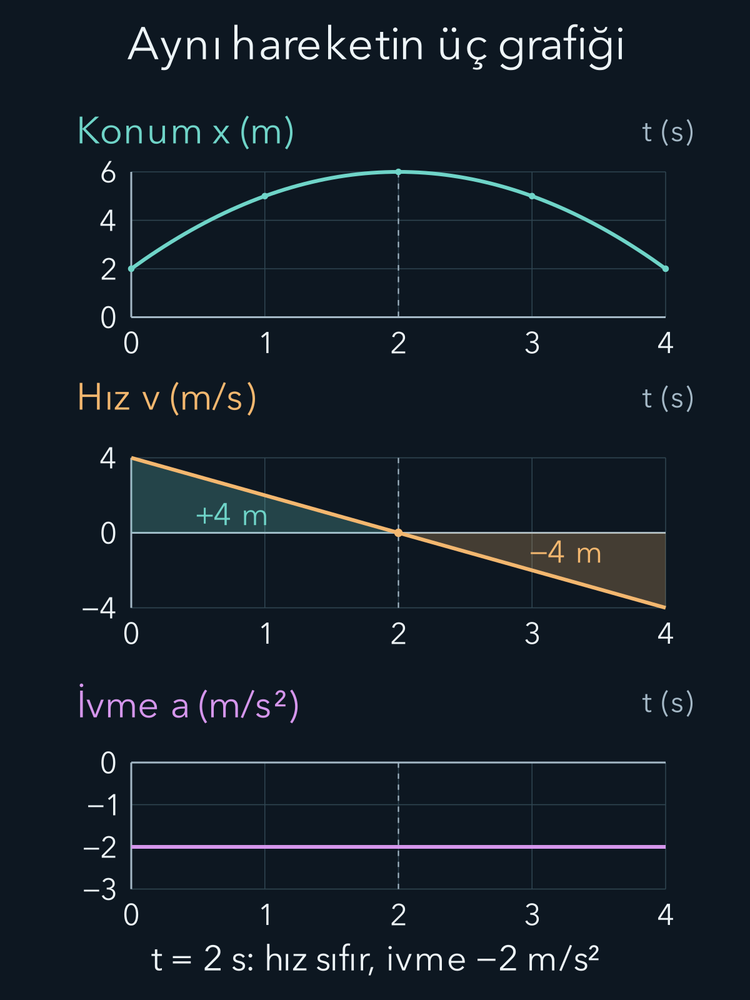

import ArticleVideo from '@/components/ArticleVideo.astro'
import kavram from './media/01-kavram.mp4?url'
import kavramPoster from './media/01-kavram.jpg?url'
import cemberHareket from './media/02-cember-hareket.mp4?url'
import cemberPoster from './media/02-cember-hareket.jpg?url'

Bir bisikletlinin nerede olduğunu söylemek, nasıl hareket ettiğini söylemeye yetmez. Aynı kavşakta duran, doğuya giden veya batıdan gelip fren yapan üç bisikletli aynı konumu paylaşabilir. Hareketi anlamak için konumun zaman içinde nasıl değiştiğine bakarız. Bu değişimin ilk türevi hız, hızın değişiminin türevi ivmedir.

[Ölçüm ve modeller yazısında](/blog/fizikte-olcme-birimler-ve-modeller/) birim, referans sistemi ve varsayım kavramlarını kurduk. Burada koordinatları, vektörleri, türevi ve belirli integrali kullanacağız. Türev bir andaki değişim oranını; integral küçük değişimlerin birikimini verir. Bu matematiksel ilişkileri fiziksel bir hareketin üzerinde görünür kılacağız. Henüz hareketin neden değiştiğini sormuyoruz. Hareketi nedenleriyle açıklayan dinamikten önce, onu tarif eden **kinematiği** kuruyoruz.

Gereken ön bilgileri kısaca hatırlayalım:

- [Koordinatlar ve eğim](/blog/koordinatlar-uzaklik-ve-egim/): Bir noktanın yerini seçilmiş eksenlere göre belirtiriz; eğim, düşey değişimin yatay değişime oranıdır.
- [Vektörler ve bileşenleri](/blog/vektorler-ve-bilesenleri/): Bir yönlü büyüklüğü yatay ve düşey katkılarına ayırabiliriz.
- [Türevin anlamı](/blog/turevin-anlami-ve-temel-kurallari/): Ortalama değişim oranından, zaman aralığını küçülterek bir andaki değişim oranına geçeriz.
- [Belirli integral](/blog/belirli-integral-ve-temel-teorem/): İşaretli küçük katkıları toplar, toplam değişimi elde ederiz.

Önce düz bir yoldaki hareketi kuracağız. Ardından aynı düşünceyi iki bileşene uygulayarak atışa ve çember üzerinde harekete geçeceğiz. Her örnekte cismi tek bir noktayla temsil ediyoruz; kendi çevresinde dönmesini veya biçim değiştirmesini henüz izlemiyoruz.

## 1. Konum için önce bir başlangıç seçmek

Düz bir yolun bir noktasını başlangıç, doğu yönünü pozitif yön seçelim. Bisikletlinin konumu $x$ ile gösterilsin. Başlangıcın üç metre doğusu $x=3\,\mathrm m$, iki metre batısı $x=-2\,\mathrm m$ olur. Eksi işareti uzunluğun fiziksel olarak negatif olduğunu söylemez; seçtiğimiz eksende yönü belirtir.

Konum zamanla değişiyorsa $x(t)$ yazarız. Parantezdeki $t$, saniyeyle ölçülen zamanı temsil eder. Böyle bir fonksiyon her ölçüm anına bir konum atar. Zaman başlangıcını kronometreyi çalıştırdığımız an seçebiliriz. Farklı bir zaman başlangıcı kullanmak olayın kendisini değiştirmez; fonksiyonun yazılışını değiştirir.

Başlangıç ve son konum arasındaki fark **yer değiştirmedir**:

$$
\Delta x=x_2-x_1.
$$

Burada $x_1$ ilk, $x_2$ son konumdur. Delta işareti son değer eksi ilk değer anlamındadır. Bisikletli $2\,\mathrm m$ konumundan $8\,\mathrm m$ konumuna gidip sonra $5\,\mathrm m$ konumuna dönerse yer değiştirme $5-2=3\,\mathrm m$ olur. Aldığı toplam yol ise ilk bölümde altı, dönüşte üç metre olmak üzere dokuz metredir. Yol, izlenen güzergâhın uzunluğudur; yer değiştirme yalnız iki uç konuma bağlıdır.

Bu ayrım iki boyutta daha belirgin hale gelir. Bir parkın çevresinde tam tur atan kişi başlangıç noktasına döner ve yer değiştirmesi sıfır olur. Attığı adımların toplam uzunluğu sıfır değildir. Aynı sözcükle iki niceliği anlatmaya çalışırsak ileride enerji ve hareket hesaplarında hangi büyüklüğü topladığımızı karıştırırız.

## 2. Ortalama hız ve ortalama sürat

İki an arasındaki ortalama hız, yer değiştirmenin geçen süreye oranıdır:

$$
\overline v=\frac{x(t_2)-x(t_1)}{t_2-t_1}.
$$

Üst çizgi ortalamayı gösterir. $t_1$ ilk, $t_2$ son andır; geçen süre $\Delta t=t_2-t_1>0$ olmalıdır. Yol örneğimiz dokuz saniye sürmüşse ortalama hız $3/9=1/3\,\mathrm{m/s}$ doğu yönündedir. Ortalama sürat ise toplam yolun süreye oranıdır ve $9/9=1\,\mathrm{m/s}$ çıkar. Hız yön bilgisi taşırken sürat negatif olmayan bir büyüklüktür. Tek boyutta $v$ diye yazdığımız işaretli sayı, hız vektörünün seçilen eksendeki bileşenidir.

Ortalama hız, hareketin her anında bu hızla gerçekleştiğini söylemez. Duraklamalar, hızlı bölümler ve dönüşler tek bir oranda özetlenmiştir. Başlangıçla sonu birleştiren konum-zaman doğrusunun eğimi ortalama hızı verir. Eğrinin bu iki nokta arasında nasıl kıvrıldığını bilmeden ara anlardaki hızı çıkaramayız.

Bir yolculuğun iki bölümündeki süratlerin aritmetik ortalamasını almak da her zaman doğru değildir. Eşit süreler boyunca iki farklı süratle gidilirse bu yöntem çalışır. Eşit yollar farklı süratlerle alınırsa yavaş bölüm daha uzun sürer. Örneğin bir metreyi bir saniyede, bir metreyi üç saniyede almak toplam iki metreyi dört saniyede almak demektir: Ortalama sürat yarım metre bölü saniyedir. Bölüm süratlerinin basit ortalaması farklı sonuç verir.

## 3. Anlık hız bir limitten doğar

Bir anın çevresindeki süre aralığını küçülterek anlık hıza geçeriz:

$$
v(t)=\lim_{\Delta t\to0}\frac{x(t+\Delta t)-x(t)}{\Delta t}
=\frac{dx}{dt}.
$$

Bu tanım hareket modelinde türevin var olduğunu varsayar. Gerçek ölçümde tam sıfır zaman aralığı kullanmayız; yakın anlardan elde ettiğimiz verilerle modelin değişim oranını tahmin ederiz. Çok kısa aralık seçmek de otomatik olarak daha doğru sonuç vermez: Konum ölçümünün belirsizliği, küçük bir zamana bölününce hız tahmininde büyüyebilir.

Hızı konum-zaman grafiğinin teğet eğimi olarak okuyabiliriz. Grafik yukarı çıkıyorsa hız pozitiftir. Aşağı iniyorsa hız negatiftir. Teğet yataysa hız o anda sıfırdır. Grafiğin yüksek bir konumda olması, hızın büyük olması demek değildir; hız yüksekliğe değil eğime bağlıdır.

Anlık sürat tek boyutta $|v(t)|$ olur. İki veya üç boyutta hız vektörünün uzunluğunu alırız. Bir cismin “sürati sabit” demekle “hızı sabit” demek bu yüzden aynı iddia değildir. Dairesel harekette sürat sabit kalabilir fakat yön sürekli değiştiği için hız vektörü değişir.

## 4. İvme hızdaki değişimdir

Önce iki an arasındaki **ortalama ivmeyi**, hız değişiminin geçen süreye oranı olarak tanımlayalım:

$$
\overline a=\frac{v(t_2)-v(t_1)}{t_2-t_1}.
$$

Örneğin hız iki saniyede $1\,\mathrm{m/s}$ değerinden $5\,\mathrm{m/s}$ değerine çıkarsa ortalama ivme $(5-1)/2=2\,\mathrm{m/s^2}$ olur. Aradaki değişimin düzenli olup olmadığını bu tek sayıdan bilemeyiz. Zaman aralığını küçültünce **anlık ivmeye** geçeriz. Onu $a(t)$ ile gösterelim:

$$
a(t)=\frac{dv}{dt}=\frac{d^2x}{dt^2}
$$

biçimindedir. Birimi metre bölü saniye karedir. $2\,\mathrm{m/s^2}$ değerindeki sabit ivme, hız bileşeninin her saniyede iki metre bölü saniye arttığını söyler. Bu nicelik doğrudan konumun her saniyede ne kadar değiştiğini söylemez; önce hız değişir, konum o hızın birikimiyle belirlenir.

Negatif ivmeye her durumda yavaşlama demeyiz. Cisim pozitif yönde giderken ivmesi negatifse sürati başlangıçta azalır. Cisim negatif yönde giderken ivmesi de negatifse hızının mutlak değeri artar. Yön, hızın işareti; yavaşlama veya hızlanma, süratin değişimiyle ilgilidir.

Tek boyutta hız sıfır değilken hız ile ivmenin çarpımı pozitifse sürat artar, negatifse azalır. Bunu $v^2$ türevinden görebiliriz: $d(v^2)/dt=2va$. Hızın sıfır olduğu dönme anında bu kısa işaret kontrolü tek başına anın iki tarafını anlatmaz; yakındaki zamanlara bakmak gerekir. Bir an için sıfır hız, cismin daha sonra da duracağını garanti etmez.

Örneğin $v=-3\,\mathrm{m/s}$ iken bir saniye boyunca $a=-2\,\mathrm{m/s^2}$ sabit kalırsa son hız $-5\,\mathrm{m/s}$ olur. Sürat üçten beşe çıkmıştır. Aynı ilk hızla $a=+2\,\mathrm{m/s^2}$ olsaydı son hız $-1\,\mathrm{m/s}$, son sürat bir metre bölü saniye olurdu. Bu kez pozitif ivmeye rağmen cisim yavaşlamıştır.

## 5. Aynı hareketin üç grafiği

Sayısal bir örnekte zamanın saniye, konumun metre cinsinden yazıldığını belirterek şu modeli kullanalım:

$$
x(t)=2\,\mathrm m+(4\,\mathrm{m/s})t
-(1\,\mathrm{m/s^2})t^2.
$$

Sabit $2\,\mathrm m$ teriminin türevi sıfırdır. $t$'nin türevi bir, $t^2$'nin türevi $2t$ olduğundan:

$$
v(t)=4\,\mathrm{m/s}-(2\,\mathrm{m/s^2})t.
$$

Bir kez daha türev alınca $a(t)=-2\,\mathrm{m/s^2}$ bulunur. İlk iki saniyede konum iki metreden altı metreye çıkar. Tam $t=2\,\mathrm s$ anında hız sıfırdır. $t=4\,\mathrm s$ anında konum yeniden iki metredir ve hız $-4\,\mathrm{m/s}$ olur. Ara değerler, yönün nerede değiştiğini görmemizi sağlar:

| Zaman $t$ (s) | Konum $x$ (m) | Hız $v$ (m/s) | İvme $a$ (m/s²) |
| --- | --- | --- | --- |
| 0 | 2 | 4 | −2 |
| 1 | 5 | 2 | −2 |
| 2 | 6 | 0 | −2 |
| 3 | 5 | −2 | −2 |
| 4 | 2 | −4 | −2 |

İlk bölümde hız pozitifken ivme negatiftir: Cisim yavaşlar. Dönüşten sonra ikisi de negatiftir: Cisim geri yönde giderek hızlanır. İvme hiç değişmediği halde süratin davranışı değişmiştir.

Dört saniyelik toplam yer değiştirme sıfırdır. Alınan yol önce dört metre ileri, ardından dört metre geri olmak üzere sekiz metredir. Ortalama hız sıfır, ortalama sürat $8/4=2\,\mathrm{m/s}$ çıkar. Dönüş anındaki sıfır hız, hareketin bütün dört saniyesinin özelliği değildir.

Grafikleri birbirine karıştırmamak için eksen birimlerini okuruz. Konum-zaman grafiğinin eğimi metre bölü saniye; hız-zaman grafiğinin eğimi metre bölü saniye kare verir. Hız-zaman grafiğinin altında kalan işaretli alan ise metre verir. Grafik okumak, şeklin görünüşünden çok hangi niceliklerin karşılaştırıldığını anlamaktır.

### Ölçüm noktalarından türev tahmin etmek

Konumu yarım saniyede bir kaydettiğimizi düşünelim. Bir andaki hızı tahmin etmek için o anın hemen öncesi ve sonrasındaki konum farkını toplam zaman aralığına bölebiliriz. Bu, teğet yerine yakın iki noktayı birleştiren doğrunun eğimini kullanmaktır. Aralık küçülürken düzgün bir hareket modelinde teğete yaklaşırız. Fakat konum okumalarındaki küçük gürültü fark işleminde belirgin hale gelir. İkinci kez fark alarak ivme hesaplamak bu duyarlılığı daha da artırabilir.

Bu nedenle gerçek verilerden elde edilen kırıklı bir hız eğrisindeki her sivri köşeyi aniden ortaya çıkan fiziksel etki diye yorumlamayız. Ölçüm aralığını, aletin belirsizliğini ve veriye uygulanan yumuşatmanın neleri gizleyebileceğini birlikte değerlendiririz. Matematiksel türev tanımı kesindir; belirli bir veri kümesinden o türevi çıkarmak ise bir ölçüm ve modelleme işidir. İkisini ayırmak, doğru formülü kullanırken yanlış bir kesinlik duygusuna kapılmamayı sağlar.

## 6. İntegral ve başlangıç bilgileri

İvme biliniyorsa hızdaki toplam değişim integralden bulunur:

$$
v(t)=v_0+\int_0^t a(\tau)\,d\tau.
$$

Burada zaman başlangıcı $t=0$, o andaki hız $v_0=v(0)$ olarak seçilmiştir. İntegraldeki $\tau$, üst sınırdaki $t$ ile karışmaması için seçilmiş geçici zaman değişkenidir. Sonra hızı biriktirerek konumu buluruz; $x_0=x(0)$ başlangıç konumudur:

$$
x(t)=x_0+\int_0^t v(\tau)\,d\tau.
$$

Aynı ivmeye sahip iki cisim farklı başlangıç hızlarına veya konumlarına sahip olabilir. Bu nedenle yalnız ivmeyi bilmek, hareketin tamamını belirlemez. İkinci türevden geri dönerken iki başlangıç bilgisi gerekir. Daha önceki ikinci mertebe diferansiyel denklemlerde ortaya çıkan iki sabitin fiziksel karşılığı burada başlangıç konumu ve başlangıç hızıdır.

İşaretli integral yer değiştirmeyi verir; toplam yol için sürati biriktiririz: $\int_0^t|v(\tau)|\,d\tau$. Hız işaret değiştiriyorsa mutlak değeri kaldırmadan önce aralığı dönüş anlarında bölmek gerekir. Böylece geri gidilen bölüm, toplam yoldan yanlışlıkla çıkarılmaz.

Önceki örnekte hız-zaman grafiğinin ilk iki saniyesindeki üçgenin alanı:

$$
A_+=\frac12(2\,\mathrm s)(4\,\mathrm{m/s})=4\,\mathrm m
$$

olur. Son iki saniyede grafik zaman ekseninin altındadır; işaretli katkısı $A_-=-4\,\mathrm m$ olur. $A_+$ ve $A_-$ burada iki bölümün işaretli alanlarını gösterir. Yer değiştirme $A_++A_-=0$, toplam yol $|A_+|+|A_-|=8\,\mathrm m$ çıkar. İntegralin verdiği sonuç, daha önce konumlardan bulduğumuz sonuçla aynıdır.

İvme-zaman grafiğinin alanı ise konumu değil, **hız değişimini** verir. Aynı dört saniyede $(-2\,\mathrm{m/s^2})(4\,\mathrm s)=-8\,\mathrm{m/s}$ elde ederiz. Başlangıç hızı $4\,\mathrm{m/s}$ olduğundan son hız $4-8=-4\,\mathrm{m/s}$ olur. Grafiğin altındaki alanın ne anlama geldiğini birimler belirler.

## 7. Sabit ivmenin özel denklemleri

İvme zaman boyunca sabitse integral içinden çıkar:

$$
v(t)-v_0=\int_0^t a\,d\tau=at.
$$

Buradan $v(t)=v_0+at$ çıkar. Bu hızı konum integraline yerleştirelim:

$$
\begin{aligned}
x(t)-x_0
&=\int_0^t(v_0+a\tau)\,d\tau\\
&=v_0t+\frac12at^2.
\end{aligned}
$$

Yarım katsayısı, $\tau$'nun integralinin $\tau^2/2$ olmasından gelir. Bunu grafikte de görebiliriz: Başlangıç hızının dikdörtgenine, tabanı $t$ ve işaretli yüksekliği $at$ olan bir üçgen eklenir. Üçgenin katkısı $at^2/2$ olur. Böylece $x(t)=x_0+v_0t+at^2/2$ bağıntısını elde ederiz.

Sabit ivmede hız doğrusal değiştiği için bu aralıktaki ortalama hız $\overline v=(v_0+v)/2$ olur. Burada $v$, aralığın sonundaki hızdır. Ortalama hızdan yer değiştirmeyi yazıp iki tarafı $2a$ ile çarpalım:

$$
\begin{aligned}
x-x_0&=\frac{v_0+v}{2}\,t,\\
2a(x-x_0)&=(v_0+v)at\\
&=(v_0+v)(v-v_0)\\
&=v^2-v_0^2.
\end{aligned}
$$

İkinci satırdan üçüncüye geçerken $at=v-v_0$ kullandık; son satır iki kare farkıdır. Böylece $v^2=v_0^2+2a(x-x_0)$ bulunur. Bu ifade zamanın verilmediği hesaplarda kullanışlıdır. Ancak hızın karesini içerdiği için yön bilgisi tek başına sonuçtan çıkmaz; karekökün işareti fiziksel duruma göre seçilir. İvme sıfırsa da eşitlik doğrudur, fakat bu bağıntı tek başına yer değiştirmeyi belirlemez.

Bu denklemler genel hareket tanımları değildir. İvme değişiyorsa $at$ yerine uygun integral kullanılmalıdır. Bir cismin yalnız başlangıç ivmesini bilip uzun süre boyunca aynı kaldığını varsaymak ayrı bir model kararıdır. Modeli parçalı kuruyorsak her parçanın sonunda bulunan konum ve hız, sonraki parçanın başlangıç bilgisi olur; durma anından sonra aynı fiziksel etki sürüyor mu ayrıca değerlendirilir.

### Durana kadar frenlemek

Pozitif yönde $12\,\mathrm{m/s}$ hızla giden bir aracın, durana kadar $-3\,\mathrm{m/s^2}$ sabit ivmeyle yavaşladığını varsayalım. Frenlemenin başladığı anı $t=0$, konumu $x_0=0$ seçiyoruz. Durma anına $t_{\mathrm d}$ dersek:

$$
0=12\,\mathrm{m/s}-(3\,\mathrm{m/s^2})t_{\mathrm d},
\qquad t_{\mathrm d}=4\,\mathrm s.
$$

Bu süreyi konum denklemine koyunca:

$$
\begin{aligned}
x(4\,\mathrm s)
&=(12\,\mathrm{m/s})(4\,\mathrm s)\\
&\quad+\frac12(-3\,\mathrm{m/s^2})(4\,\mathrm s)^2\\
&=48\,\mathrm m-24\,\mathrm m=24\,\mathrm m.
\end{aligned}
$$

Hız durana kadar negatif olmadığından bu yer değiştirme, alınan yola da eşittir. Hız-zaman üçgeninin alanı da $(4\,\mathrm s)(12\,\mathrm{m/s})/2=24\,\mathrm m$ verir. Aynı sonucu iki yoldan denetledik. Bu hesap frenleme anından başlar; sürücünün tepki süresinde aldığı yol burada yoktur.

Aracın durduktan sonra yerinde kaldığını varsayıyorsak $t>4\,\mathrm s$ için yeni model $x=24\,\mathrm m$, $v=0$, $a=0$ olur. Eski hız formülüne beş saniye yazıp $-3\,\mathrm{m/s}$ bulmak, frenin aracı kendiliğinden geri götürdüğünü göstermez. Yalnızca sabit negatif ivme varsayımını geçerli olduğu aralığın dışına uzatmış oluruz. İvmenin geçiş anında keskin değişmesi de bu parçalı modelin idealizasyonudur.

### Durgun başlayıp hızlanmak

Aşağıdaki animasyonda ise $x_0=0$, $v_0=0$ ve $a=1\,\mathrm{m/s^2}$ alınmıştır. Birer saniye aralıklarla konumlar $0$; $0{,}5$; $2$; $4{,}5$; $8$ metre olur. Ardışık yer değiştirmeler $0{,}5$; $1{,}5$; $2{,}5$; $3{,}5$ metredir. Eşit sürede daha çok yol alınmasının nedeni süratin artmasıdır.

<ArticleVideo src={kavram} poster={kavramPoster} title="Eşit zamanda büyüyen yer değiştirmeler" caption="Başlangıç hızı sıfır ve ivmesi 1 m/s² olan cismin konumları, birer saniye aralıklarla gösterilir. Konum t² ile büyüdüğü için ardışık yer değiştirmeler eşit değildir." />

## 8. İki boyutta bileşenleri ayırmak

Düzlemde yatay konum bileşenine $x(t)$, düşey konum bileşenine $y(t)$ diyelim. Konum vektörünü $\mathbf r(t)=x(t)\hat{\mathbf i}+y(t)\hat{\mathbf j}$ yazarız. Şapkalı birim vektörler sırasıyla pozitif yatay ve düşey yönleri gösterir; uzunlukları birdir. Bu eksenlerin yönleri zamanla değişmiyor. Türev bileşen bileşen alınır:

$$
\mathbf v=\dot x\hat{\mathbf i}+\dot y\hat{\mathbf j},
\qquad
\mathbf a=\ddot x\hat{\mathbf i}+\ddot y\hat{\mathbf j}.
$$

Üstteki bir nokta zamana göre birinci, iki nokta ikinci türevi gösterir. Hız bileşenleri $v_x=\dot x$ ve $v_y=\dot y$, ivme bileşenleri $a_x=\ddot x$ ve $a_y=\ddot y$ olur. Sürat ise Pisagor bağıntısıyla $|\mathbf v|=\sqrt{v_x^2+v_y^2}$ bulunur. İki bileşen aynı zamana bağlıdır; ayrı hesaplanmaları hareketin iki bağımsız saati olduğu anlamına gelmez.

Hava direncini ihmal ettiğimiz ve yerçekimi ivmesini sabit aldığımız bir atışta yatay ivme sıfır, yukarı yönü pozitif seçtiğimiz düşey ivme $-g$ olur. Burada $g$ pozitif büyüklüktür. Başlangıç hız bileşenleri $v_{0x}$ ve $v_{0y}$ ise:

$$
x=x_0+v_{0x}t,\qquad y=y_0+v_{0y}t-\frac12gt^2.
$$

Başlangıç hızı bir sürat ve açıyla verilmişse önce bileşenlere ayırırız. Başlangıç sürati $v_0$, pozitif yatay eksenle yaptığı açı $\theta$ ise $v_{0x}=v_0\cos\theta$ ve $v_{0y}=v_0\sin\theta$ olur. Dik üçgendeki yatay ve düşey izdüşümler burada hareketin iki bileşenini verir.

Örnek hesabı kolaylaştırmak için $g=10\,\mathrm{m/s^2}$ yuvarlamasını, $v_{0x}=6\,\mathrm{m/s}$ ve $v_{0y}=8\,\mathrm{m/s}$ değerlerini kullanalım. İki başlangıç koordinatı da sıfır olsun. Başlangıç sürati $\sqrt{6^2+8^2}=10\,\mathrm{m/s}$ çıkar. Hareket denklemleri:

$$
\begin{aligned}
x(t)&=(6\,\mathrm{m/s})t,\\
y(t)&=(8\,\mathrm{m/s})t-(5\,\mathrm{m/s^2})t^2,\\
v_y(t)&=8\,\mathrm{m/s}-(10\,\mathrm{m/s^2})t.
\end{aligned}
$$

Tepe anını $t_{\mathrm{tepe}}$ ile gösterelim. Düşey hızın sıfır olması gerekir:

$$
t_{\mathrm{tepe}}=\frac{8\,\mathrm{m/s}}{10\,\mathrm{m/s^2}}
=0{,}8\,\mathrm s.
$$

O anda yatay konum $(6\,\mathrm{m/s})(0{,}8\,\mathrm s)=4{,}8\,\mathrm m$ olur. Yüksekliği düşey denklemden buluruz:

$$
\begin{aligned}
y(0{,}8\,\mathrm s)
&=(8\,\mathrm{m/s})(0{,}8\,\mathrm s)\\
&\quad-(5\,\mathrm{m/s^2})(0{,}8\,\mathrm s)^2\\
&=6{,}4\,\mathrm m-3{,}2\,\mathrm m=3{,}2\,\mathrm m.
\end{aligned}
$$

Başlangıç yüksekliğine dönüş için $y(t)=0$ çözelim:

$$
0=t\left(8\,\mathrm{m/s}-(5\,\mathrm{m/s^2})t\right).
$$

Çarpımın sıfır olması için çarpanlardan biri sıfırdır. $t=0$ atış anını, ikinci çarpandan çıkan $t=1{,}6\,\mathrm s$ dönüş anını verir. Bu sürede yatay yer değiştirme $(6\,\mathrm{m/s})(1{,}6\,\mathrm s)=9{,}6\,\mathrm m$ olur. **Menzil** dediğimiz bu yatay uzaklık, cismin eğri yörünge boyunca aldığı toplam yol değildir.

Tepede düşey hız sıfırdır ama yatay hız altı metre bölü saniye kalır. Dolayısıyla cisim tepede tamamen durmaz. İvmesi de sıfır olmaz; modelde her an aşağı yönlüdür. Bu sonuçlar [atış hareketi modelinin](https://openstax.org/books/university-physics-volume-1/pages/4-3-projectile-motion) açık varsayımlarına bağlıdır.

### Sonucu yalnız sayıyla bırakmamak

Atış örneğindeki dokuz virgül altı metre sonucunu okurken başlangıç yüksekliğine dönüldüğünü unutmamalıyız. Cisim daha aşağıdaki bir yere düşüyorsa düşey denklem başka bir son yükseklikle çözülür ve havada kalma süresi uzar. Daha yukarıdaki bir platforma ulaşması isteniyorsa denklem iki farklı pozitif zaman verebilir: Cisim aynı yüksekliği çıkarken ve inerken geçebilir. Her iki kök cebirsel olarak doğru olabilir; hangi olayın sorulduğu fiziksel seçimi belirler.

Yatay bileşenin sabit kalması da her atışın değişmez özelliği değildir. Bu sonuç yatay ivmenin sıfır kabulünden geldi. Hava direnci hesaba katılırsa hızın yönüne ve büyüklüğüne bağlı ek ivme oluşabilir. Rüzgâr da aynı modelin basit bir parametresi olmayabilir; cisim ile hava arasındaki göreli hız önem taşır. Önce varsayımları söylemek, elde edilen güzel parabolü bütün gerçek uçuşların zorunlu şekli sanmamızı engeller.

## 9. Sabit süratle ivmeli hareket

Yarıçapı $R>0$ olan çember üzerinde sabit açısal hız $\omega$ ile hareket eden bir nokta düşünelim. Açısal hız, açının zamana göre değişimidir ve radyan bölü saniyeyle ifade edilir. Pozitif açı yönünü saat yönünün tersi seçelim. Çemberin merkezini koordinat başlangıcı, $t=0$ anındaki açıyı sıfır seçersek açı $\omega t$ olur. Konum:

$$
\mathbf r=R\cos(\omega t)\hat{\mathbf i}
+R\sin(\omega t)\hat{\mathbf j}.
$$

Zincir kuralında içteki $\omega t$ ifadesinin türevinden $\omega$ çarpanı gelir. Hız bileşenleri:

$$
v_x=-R\omega\sin(\omega t),\qquad
v_y=R\omega\cos(\omega t)
$$

olur. Örneğin çemberin en sağındaki noktada ve $\omega>0$ iken $v_x=0$, $v_y=R\omega$ bulunur: Hız yukarı, çembere teğet yönelir. Her anda süratin karesi:

$$
|\mathbf v|^2=R^2\omega^2\left(\sin^2(\omega t)+\cos^2(\omega t)\right)
=R^2\omega^2
$$

olduğundan sürat $|\mathbf v|=R|\omega|$ sabittir. Bir kez daha türev alalım:

$$
\mathbf a=-R\omega^2\cos(\omega t)\hat{\mathbf i}
-R\omega^2\sin(\omega t)\hat{\mathbf j}
=-\omega^2\mathbf r.
$$

Eksi işareti ivmenin merkez yönünde olduğunu söyler. Bu **merkezcil ivmenin** büyüklüğü $|\mathbf a|=R\omega^2=|\mathbf v|^2/R$ olur. İvme burada sürati değiştirmek yerine hızın yönünü değiştirir. Örneğin $R=2\,\mathrm m$ ve $|\mathbf v|=3\,\mathrm{m/s}$ için büyüklük $9/2=4{,}5\,\mathrm{m/s^2}$ çıkar; süratin sabitliği ivmenin sıfır olmasını gerektirmez. Bunun hangi etkileşimle sağlandığını sonraki yazıda kuvvetlerle açıklayacağız.

<ArticleVideo src={cemberHareket} poster={cemberPoster} title="Sabit süratli çembersel harekette hız ve ivme" caption="Yarıçap 2 m, sürat 3 m/s: turkuaz hız oku çembere teğet, pembe ivme oku merkeze yönelir. Büyüklükleri değişmez. Bir tur, inceleyebilmek için yavaşlatılarak gösterilir; hız ve ivme okları farklı birimler nedeniyle ayrı ölçeklerle çizilmiştir." />

Çember üzerindeki sürat de değişiyorsa ivmenin teğet doğrultuda bir bileşeni daha vardır. Merkeze doğru bileşen yön değişimini, teğet bileşen sürat değişimini anlatır. Yukarıda türettiğimiz yalnız merkeze yönelen toplam ivme, sabit süratli çembersel hareketin özelliğidir.

## 10. Başka bir gözlemci ne ölçer?

Yere göre sağa sabit $U$ hızıyla giden bir tren düşünelim. Eksenler aynı yönlü ve başlangıçları ilk anda çakışıksa, tren içindeki koordinat $x'=x-Ut$ olur. Üstteki kesme işareti tren sisteminde ölçülen niceliği ayırır. Klasik mekanikte iki sistemin aynı zamanı kullandığını kabul ediyoruz.

Türev alınca $v'=v-U$ bulunur. Trene göre sağa iki metre bölü saniye yürüyen kişinin, yere göre tren hızına iki metre bölü saniye eklenen bir hızı vardır. Bu toplama yönlüdür; ters yönde yürümek eksi bileşen üretir. Sabit $U$ için ikinci türev $a'=a$ verir. Böylece sabit hızla kayan iki referans sistemi konum ve hızda farklı sayılar bulurken aynı ivmeyi ölçer.

Tren doğrusal yolda hızlanıyorsa başlangıç noktasının yere göre konumuna $X(t)$ diyelim. Eksenlerin birbirine göre dönmediğini koruyalım. Artık dönüşüm $x'=x-X(t)$, trenin hızı da $U(t)=dX/dt$ olur; sabit hız için kullandığımız $Ut$ yerine genel konumu yazdık. İki türev alınca $a'=a-dU/dt$ bulunur. Referans sisteminin kendi ivmesi hesapta görünür. Bu ayrım, Newton yasalarını hangi sistemlerde doğrudan kullanabileceğimizi anlamak için önemlidir. Sabit bağıl hız için yazdığımız dönüşüm **Galilei dönüşümüdür**; hızlanan tren hesabı bunun zamanla değişen öteleme için genişletilmesidir. Bu klasik yaklaşımı ışık hızına yakın hızlar için geçerli kabul etmeyiz; o sınırı daha sonra ayrıca kuracağız.

Hareketi artık üç bağlı nicelikle tarif edebiliyoruz: Konum, onun değişimi olan hız ve hızın değişimi olan ivme. Bir sonraki adım, bu değişimin hangi etkileşimlerle üretildiğini incelemek olacak.

## Kaynaklar

- [OpenStax — Konum, yer değiştirme ve ortalama hız](https://openstax.org/books/university-physics-volume-1/pages/3-1-position-displacement-and-average-velocity).
- [OpenStax — Sabit ivmeli hareket](https://openstax.org/books/university-physics-volume-1/pages/3-4-motion-with-constant-acceleration).
- [OpenStax — Atış hareketi](https://openstax.org/books/university-physics-volume-1/pages/4-3-projectile-motion).
- [OpenStax — Dairesel hareket](https://openstax.org/books/university-physics-volume-1/pages/4-4-uniform-and-nonuniform-circular-motion) ve [göreli hareket](https://openstax.org/books/university-physics-volume-1/pages/4-5-relative-motion-in-one-and-two-dimensions).
