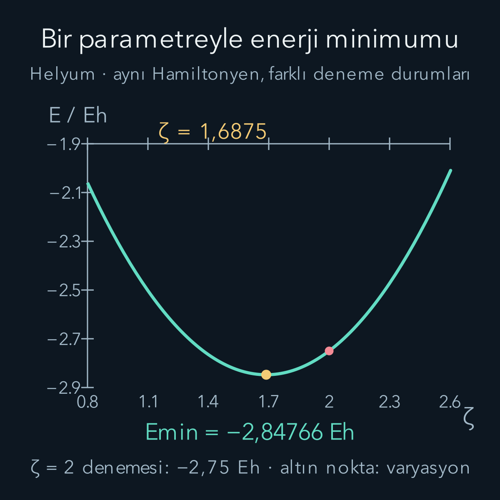
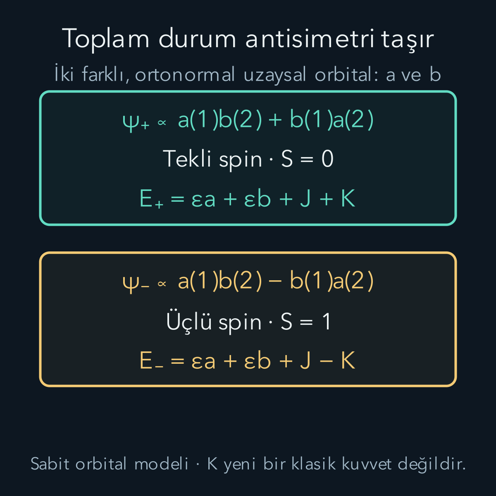

import ArticleVideo from '@/components/ArticleVideo.astro'
import kavram from './media/01-kavram.mp4?url'
import kavramPoster from './media/01-kavram.jpg?url'

Hidrojenin yanına bir elektron daha koymak, aynı hesabı iki kez yapmak gibi görünebilir. Oysa yeni elektron yalnız çekirdeği hissetmez; öteki elektronla da etkileşir. Artık iki konumu aynı anda bilmek gerekir. Helyum, tek parçacıklı bir problemin nasıl çok parçacıklı bir probleme dönüştüğünü görebildiğimiz en küçük atomdur.

Burada [hidrojen atomundaki orbitalleri](/blog/merkezi-potansiyel-ve-hidrojen-atomi/), [özdeş fermiyonların antisimetri koşulunu](/blog/ozdes-parcaciklar-bozonlar-ve-fermiyonlar/), [iki spinin tekli ve üçlü birleşimlerini](/blog/acisal-momentumlarin-toplanmasi/) ve [varyasyon ilkesini](/blog/varyasyon-yontemi/) kullanacağız. [Pertürbasyon yazısı](/blog/zamandan-bagimsiz-perturbasyon-teorisi/) ilk yaklaşımı karşılaştırmak için yararlı olacak. Sonucun nasıl çıktığını yalnız alıntılamak yerine gerekli enerji integrallerini kuracağız.

## 1. Hangi helyum modelini çözüyoruz?

Çekirdeği orijinde sabit kabul edelim. Elektronların konumları $\mathbf r_1,\mathbf r_2$, çekirdeğe uzaklıkları $r_1,r_2$, birbirlerine uzaklıkları $r_{12}=|\mathbf r_1-\mathbf r_2|$ olsun. Çekirdeğin yükü $+Ze$, elektronların yükü $-e$; helyumda $Z=2$'dir. Elektron kütlesini $m_e$, boşluğun elektriksel geçirgenliğini $\varepsilon_0$ ile gösteriyoruz.

Görelilik etkilerini, çekirdek hareketini ve küçük manyetik etkileşimleri şimdilik dışarıda bırakan Hamiltonyen:

$$
\begin{aligned}
H={}&-\frac{\hbar^2}{2m_e}(\nabla_1^2+\nabla_2^2)\\
&-\frac{Ze^2}{4\pi\varepsilon_0}
\left(\frac1{r_1}+\frac1{r_2}\right)\\
&+\frac{e^2}{4\pi\varepsilon_0r_{12}}.
\end{aligned}
$$

İlk satır iki kinetik enerjiyi, ikinci satır çekirdek çekimini, son satır elektron itmesini anlatır. $\nabla_i^2$, yalnız i numaralı koordinatın üç uzaysal bileşenine göre ikinci türevleri toplar. Negatif çekim terimleri yakınlaşmayı enerjice elverişli, pozitif itme terimi elektronların yakınlaşmasını maliyetli yapar. Enerjinin sıfırı, çekirdek ile iki elektronun birbirlerinden sonsuz uzakta ve durgun olduğu durumdur.

Spin bu Hamiltonyende açıkça görünmüyor. Buna rağmen spin önemsiz değildir: Elektronlar fermiyon olduğu için izinli uzaysal durumlar spin durumuyla birlikte seçilir. Enerji hesabına başlamadan durumumuzun bu koşulu sağladığından emin olacağız.

## 2. İtme neden çözümü değiştirir?

Son terimi kaldırırsak $H_0=h(1)+h(2)$ olur. Her h, çekirdek yükü Z olan hidrojen benzeri Hamiltonyendir. $\phi_a(\mathbf r_1)\phi_b(\mathbf r_2)$ çarpımına uygulandığında enerji $\epsilon_a+\epsilon_b$ çıkar. Her elektron kendi tek parçacık denklemini sağlar.

Fakat $1/r_{12}$ yalnız $r_1$'in ya da yalnız $r_2$'nin fonksiyonu değildir. Örneğin iki elektron da çekirdekten aynı r uzaklığında olsun. Aralarındaki açı sıfıra yaklaşırsa birbirlerine yaklaşırlar; açı $\pi$ olduğunda uzaklıkları $2r$ olur. Tek tek çekirdek uzaklıkları değişmeden itme değişebilir. Bu yüzden etkileşim, bağımsız iki radyal enerjiye bölünemez.

Yine de çarpım fonksiyonunu **deneme** olarak kullanabiliriz. Bir fonksiyonun tam özdurum olmaması, ortalama enerjisinin hesaplanamayacağı anlamına gelmez. Varyasyon ilkesi tam burada yardımcı olur: Fiziksel olarak izinli ve normalize her denemenin enerjisi, aynı Hamiltonyenin gerçek temel enerjisinin üstündedir.

İtmeyi yok sayarak bulunan enerjiye bu güvencenin uygulanamayacağına dikkat edelim. Orada yalnız durum değil, Hamiltonyen de değiştirilmiştir. Birazdan aynı deneme fonksiyonunu tam H içinde değerlendirdiğimizde üst sınır elde edeceğiz. Bu iki işlemi ayırmak, yaklaşık hesapları doğru yorumlamanın ilk koşuludur.

## 3. Atomik birimler hesabı sadeleştirir

Bohr yarıçapı ve Hartree enerjisini tanımlayalım:

$$
a_0=\frac{4\pi\varepsilon_0\hbar^2}{m_e e^2},
\qquad
E_h=\frac{e^2}{4\pi\varepsilon_0a_0}.
$$

Yaklaşık olarak $a_0=0{,}52918$ ångström, $E_h=27{,}2114$ elektronvolttur. Bir ångström $10^{-10}$ metredir. Bundan sonraki integrallerde uzunlukları $a_0$, enerjileri $E_h$ cinsinden yazacağız. Böylece örneğin $r=2$, fiziksel uzaklığın $2a_0$ olduğunu belirtir. Hamiltonyenin boyutsuz hali:

$$
\frac H{E_h}=-\frac12(\nabla_1^2+\nabla_2^2)
-Z\left(\frac1{r_1}+\frac1{r_2}\right)+\frac1{r_{12}}.
$$

Buradaki türevler de boyutsuz koordinatlara göredir. Birimleri atmadık; ortak ölçeklerini dışarı çıkardık. Hidrojenin temel enerjisi bu ölçekte $-1/2$, yükü Z olan tek elektronlu iyonunki $-Z^2/2$ olur. İki bağımsız 1s elektronu için toplam $-Z^2$; helyumda $-4$ Hartree çıkar. Bu yaklaşık $-108{,}85$ eV değerinin fazla negatif olması, unutulan pozitif itmenin önemini düşündürür.

## 4. Genişliği ayarlanabilen izinli bir durum

Normalize hidrojen biçimli orbital seçelim:

$$
\phi_\zeta(\mathbf r)=
\left(\frac{\zeta^3}{\pi}\right)^{1/2}e^{-\zeta r},
\qquad \zeta>0.
$$

$\zeta$ boyutsuz deneme parametresidir. Büyük $\zeta$, çekirdeğe daha yakın bir dağılım demektir. Fiziksel birimli orbitalde katsayıya ayrıca $a_0^{-3/2}$, üste de $r/a_0$ gelir. Küresel simetriden radyal olasılık yoğunluğu:

$$
P_\zeta(r)=4\zeta^3r^2e^{-2\zeta r}.
$$

$P(r)dr$, elektronun r ile $r+dr$ arasındaki küresel kabukta bulunma olasılığıdır; uzaysal yoğunluk $|\phi|^2$ ile aynı şey değildir. $\int_0^\infty r^n e^{-ar}dr=n!/a^{n+1}$ bağıntısı kısmi integrasyonla ardışık olarak elde edilir. $n=2$, $a=2\zeta$ koyunca $\int P(r)dr=1$ olduğunu doğrularız.

İki elektronun uzaysal denemesi $\Phi_\zeta=\phi_\zeta(1)\phi_\zeta(2)$ olsun. Bu, etiket değişiminde aynı kalır. Tam fermiyon durumunu antisimetriye kavuşturmak için tekli spinle çarparız:

$$
\chi_0=\frac{|\uparrow\downarrow\rangle-
|\downarrow\uparrow\rangle}{\sqrt2},
\qquad \Psi_\zeta=\Phi_\zeta\chi_0.
$$

Oklar, seçilmiş eksende spin izdüşümünü gösterir; uzaydaki dönme yönleri değildir. Spin fonksiyonu normalize olduğundan spinsiz enerji operatörünün beklentisinde spin kısmı bir verir. Aynı 1s uzaysal orbitalinde iki elektron bulunması Pauli ilkesini bozmaz: Tam spin orbitalleri farklıdır ve ortak durum antisimetri taşır.

## 5. Tek elektronlu katkıları hesaplamak

Önce çekim için gereken ortalamayı bulalım:

$$
\begin{aligned}
\left\langle\frac1r\right\rangle
&=4\zeta^3\int_0^\infty r e^{-2\zeta r}dr\\
&=4\zeta^3\frac1{(2\zeta)^2}=\zeta.
\end{aligned}
$$

İki elektron için toplam çekirdek çekimi bu nedenle $-2Z\zeta$ Hartree'dir. Kinetik enerjiyi, sınır terimleri sıfır olduğu için $\frac12\int|\nabla\phi|^2d^3r$ olarak yazabiliriz. Radyal türev $d\phi/dr=-\zeta\phi$ verdiğinden bir elektron için $\zeta^2/2$, iki elektron için $\zeta^2$ elde edilir.

Daralan durum çekimi büyüklükçe artırırken kinetik enerji daha hızlı, $\zeta^2$ ile artar. Bulutu sonsuza kadar daraltarak sınırsız negatif enerjiye ulaşamayız. Bu dengeyi birazdan elektron itmesi de değiştirecek.

## 6. Altı boyutlu itme integralini küçültmek

İtme enerjisi iki konum üzerinden ortalamadır:

$$
\frac{\langle V_{ee}\rangle}{E_h}
=\iint\frac{|\phi(\mathbf r_1)|^2|\phi(\mathbf r_2)|^2}{r_{12}}
\,d^3r_1d^3r_2.
$$

Dağılımlar küresel olduğundan açısal ortalama kolaylaşır. $r$ ve s iki yarıçap, $u=\cos\theta$ aralarındaki açının kosinüsü olsun. Ortalama:

$$
\begin{aligned}
\frac12\int_{-1}^{1}
\frac{du}{\sqrt{r^2+s^2-2rsu}}
&=\frac{r+s-|r-s|}{2rs}\\
&=\frac1{\max(r,s)}.
\end{aligned}
$$

Son eşitliği $r>s$ ve $s>r$ durumlarını ayrı ayrı koyarak görebiliriz. Böylece altı değişkenli integral, iki radyal değişkene iner. İki yarı bölge eşit katkı verdiği için:

$$
\frac{\langle V_{ee}\rangle}{E_h}
=2\int_0^\infty\frac{P_\zeta(r)}r
\left[\int_0^rP_\zeta(s)ds\right]dr.
$$

Köşeli parantez içindeki ifade, bir elektronun r yarıçaplı kürenin içinde bulunma olasılığıdır. İntegrali alınca:

$$
\int_0^rP_\zeta(s)ds
=1-e^{-2\zeta r}(1+2\zeta r+2\zeta^2r^2).
$$

Bunu yerine koyup aynı üstel integral kuralını kullanırsak:

$$
\begin{aligned}
\frac{\langle V_{ee}\rangle}{E_h}
=8\zeta^3\bigg[&\frac1{(2\zeta)^2}
-\frac1{(4\zeta)^2}\\
&-\frac{4\zeta}{(4\zeta)^3}
-\frac{12\zeta^2}{(4\zeta)^4}\bigg]
=\frac58\zeta.
\end{aligned}
$$

Sonuç pozitiftir ve daralma parametresiyle artar; fiziksel beklentimizle uyumludur. Bu integralin ayrıntıları, üniversite düzeyindeki [Fitzpatrick helyum hesabıyla](https://farside.ph.utexas.edu/teaching/qmech/Quantum/node128.html) karşılaştırılabilir. Burada kullandığımız radyal olasılık yolu, açısal simetriyi hesabın başında görünür kılar.

## 7. En iyi etkin çekirdek yükü

Üç katkıyı birleştirelim:

$$
\mathcal E(\zeta)=\frac{E(\zeta)}{E_h}
=\zeta^2-2Z\zeta+\frac58\zeta.
$$

Gerçek çekirdek yükü hâlâ Z'dir. $\zeta$'yı değiştirdiğimizde atomun çekirdeğini değiştirmiyoruz; aynı Hamiltonyende denediğimiz orbitalin genişliğini değiştiriyoruz. Türev koşulu:

$$
\begin{aligned}
\mathcal E'(\zeta)&=2\zeta-2Z+\frac58=0,\\
\zeta_*&=Z-\frac5{16}.
\end{aligned}
$$

İkinci türev 2 olduğu için bu minimumdur. Helyumda:

$$
\begin{aligned}
\zeta_*&=\frac{27}{16}=1{,}6875,\\
E(\zeta_*)&=-\frac{729}{256}E_h\\
&\approx-77{,}489\ \mathrm{eV}.
\end{aligned}
$$

Minimumu cebirsel olarak da kontrol edebiliriz: $\mathcal E(\zeta)=(\zeta-27/16)^2-(27/16)^2$. İlk terim negatif olamayacağından en düşük nokta doğrudan görülür.

$\zeta=Z=2$ seçip itmenin beklentisini ekleseydik $E=-4+5/4=-2{,}75$ Hartree, yaklaşık $-74{,}831$ eV bulurduk. Bu, hidrojen benzeri başlangıca birinci mertebe pertürbasyon hesabıyla da elde edilir. Genişliği serbest bırakmak enerjiyi yaklaşık $2{,}66$ eV daha düşürdü. Elektronların birbirini kısmen perdelemesi, denemede $\zeta_*<Z$ çıkmasıyla temsil ediliyor.

<ArticleVideo src={kavram} poster={kavramPoster} title="Helyum denemesinin genişliği ve enerjisi" caption="Parametre değişimi fiziksel bir zaman evrimi değildir. Her nokta farklı, normalize bir deneme durumunun enerji beklentisidir; daireler yalnız genişlik şemasıdır." />

## 8. Toplam enerji ile iyonlaşma enerjisi

Bulduğumuz negatif sayı, tek bir elektronu koparmak için gereken enerji değildir. İyonlaşma deneyinde başlangıç helyum, son durum ise bir helyum iyonu ve uzaktaki serbest elektrondur. Son durumda çekirdeğin yükü değişmez; yalnız elektron sayısı iki yerine bir olur. Kalan elektronun Hamiltonyeninde elektronlar arası itme bulunmaz.

Sabit çekirdek modelimizde bu iyon hidrojen benzeridir ve temel enerjisi $E(\mathrm{He}^+)=-Z^2E_h/2=-2E_h$ olur. Serbest elektronu sıfır kinetik enerji eşiğinde aldığımızda, iyonlaşma için gereken enerji son enerjiden ilk enerjinin çıkarılmasıdır:

$$
\begin{aligned}
I_{\rm deneme}
&=E(\mathrm{He}^+)-E_{\rm deneme}(\mathrm{He})\\
&=-2E_h-(-2{,}84765625E_h)\\
&=0{,}84765625E_h\approx23{,}066\ \mathrm{eV}.
\end{aligned}
$$

Sonucun pozitif olması, bu denemenin iyonlaşma eşiğinin altında olduğunu gösterir. Elektronu çıkarmak için dışarıdan enerji gerekir. İki elektronu birden uzaklaştırmak ise farklı bir son durumdur ve yaklaşık $77{,}489$ eV gerektirir. İlk koparmadan sonra sistem yeniden düzenlendiği için toplam enerjiyi ikiye bölerek birinci iyonlaşma enerjisini bulamayız.

Burada üst sınırın yönü de öğreticidir. Helyum deneme enerjisi gerçek temel enerjiden yüksek olduğuna göre, son durumun enerjisini tam bildiğimiz bu modelde hesaplanan enerji farkı gerçek iyonlaşma enerjisine alt sınır verir. Başlangıç ve son durumun ikisi de yaklaşık hesaplanıyorsa, iki üst sınırın farkı için böyle otomatik bir yön garantisi kalmaz.

Etkin yükün anlamını bu örnek üzerinden de sınayabiliriz. İyonlaşmadan önce seçtiğimiz $\zeta_*=1{,}6875$ değerini, iyonlaşmadan sonra kalan elektrona aynen taşımak doğru değildir. Artık perdeleyen ikinci elektron yoktur; kalan orbitalin en iyi ölçeği 2'dir. Dolayısıyla etkin çekirdek yükü, çekirdeğe ait yeni bir sabit veya kesirli proton sayısı değildir. Seçtiğimiz durum ailesinin, belirli bir çok elektronlu ortama verdiği yanıttır.

Aynı nedenle, bu hesabı “iki elektron çekirdeğin yükünü tam olarak 0,3125 azaltır” biçiminde yerel bir alan yasasına çeviremeyiz. Gerçekte çekirdeğe çok yakın ve çok uzak bölgeler aynı perdelemeyi görmez. Tek parametre, bütün uzayı tek bir üstel biçimle temsil etmeye çalışır; işe yararlılığı sade bir enerji hesabını mümkün kılmasındadır. Daha ayrıntılı dağılımlar, yarıçapa bağlı etkin potansiyeller ve ortak konum bağımlılığı gerektirir.

## 9. İyi bir enerji, tam dalga fonksiyonu değildir

En iyi denemede ortalama yarıçap $\langle r\rangle=3/(2\zeta_*)=8/9$ Bohr yarıçapıdır. Perdelenmemiş $\zeta=2$ denemesinde ise $3/4$ Bohr yarıçapıydı. Böylece perdeleme, daha geniş bir dağılımla birlikte ortaya çıkar. Aynı minimumda $2\langle T\rangle+\langle V\rangle=0$ bulunması da ölçek değişimine göre eniyilemenin tutarlılık kontrolüdür; tek başına çözümün kesinliğini göstermez.

Çarpım denemesinde bir elektronun nerede bulunduğu verildiğinde ötekinin uzaysal dağılımı değişmez. Gerçek Coulomb itmesi ise iki konum arasında korelasyon oluşturur: Elektronların ortak dağılımı, bağımsız dağılımların çarpımından farklıdır. Daha esnek denemelere $r_{12}$ bağımlılığı eklemek bu eksikliği azaltabilir.

Varyasyon üst sınırı yalnız enerji için bir garantidir. Deneme enerjisinin iyi olması, yarıçapın, geçiş olasılığının ya da yerel yoğunluğun aynı oranda doğru olduğunu ispatlamaz. Ayrıca burada bulduğumuz enerji ile gerçek temel enerji arasındaki farkın tamamına teknik anlamda “korelasyon enerjisi” dememeliyiz. Bu terim genellikle tam enerji ile en iyi Hartree–Fock enerjisi arasındaki farkı anlatır. Bizim tek parametreli ailemiz, bütün mümkün tek determinantlı orbitalleri bile taramaz.

## 10. Tekli ve üçlü durumlar neden ayrılır?

Şimdi birbirinden farklı, ortonormal a ve b orbitalleri düşünelim. Normalize simetrik ve antisimetrik uzaysal birleşimler:

$$
\Phi_\pm=
\frac{a(1)b(2)\pm b(1)a(2)}{\sqrt2}.
$$

$\Phi_+$ tekli spinle, $\Phi_-$ üçlü spinle eşleşir. Sabit orbitaller kullanıldığında enerji beklentileri:

$$
E_\pm=\epsilon_a+\epsilon_b+J\pm K.
$$

Burada $\epsilon_a=\langle a|h|a\rangle$, J doğrudan Coulomb integrali, K değiş tokuş integralidir. Atomik birimlerde açık biçimleri:

$$
J=\iint\frac{|a(1)|^2|b(2)|^2}{r_{12}}\,d^3r_1d^3r_2,
$$

$$
K=\iint\frac{a^*(1)b(1)b^*(2)a(2)}{r_{12}}\,d^3r_1d^3r_2.
$$

J klasik yük yoğunluklarının itmesine benzeyen bir ortalamadır. K ise iki ayırt edilemeyen yerleşimin genliklerini birlikte topladığımızda oluşan çapraz terimdir. Eklediğimiz yeni bir kuvvet yoktur; aynı Coulomb operatörünü farklı izinli durumlarda ölçüyoruz. Bu ayrım [iki elektronlu atomlar ders notlarında](https://farside.ph.utexas.edu/teaching/362k/08_TwoElectron.pdf) spin simetrisiyle birlikte ele alınır.

Sabit a ve b için Coulomb değiş tokuş integrali negatif değildir. Dolayısıyla bu modelde üçlü uzaysal beklenti, tekli beklentiden $2K$ kadar aşağıdadır. Antisimetrik fonksiyon $\mathbf r_1=\mathbf r_2$ noktasında sıfır olur; aynı konumun bastırılması bunun uzaysal bir izidir. Fakat orbital biçimlerinin yeniden ayarlandığı gerçek atomda bütün enerji farkını tek başına “elektronlar daha uzakta” cümlesine indirgemek doğru değildir.

Temel helyumdaki a=b durumuna bu farklı-orbital formülünü uygulayamayız. Eksi birleşim tamamen sıfır olur, artı birleşimin normalizasyonu değişir. İki elektronun aynı 1s orbitalinde bulunduğu temel deneme bu nedenle tekli spindir. Üçlü durum için uzaysal dolumun da değişmesi gerekir.

Helyum hesabından çıkan yeni düşünce şudur: Çok parçacıklı enerji, tek parçacık enerjilerine yalnız sabit bir düzeltme eklemek değildir. Orbitalin biçimi, elektronların ortak olasılıkları ve izinli spin simetrisi beraber belirlenir. Bu bağlantı, daha kalabalık atomların kabuklarını anlamanın başlangıcıdır.
