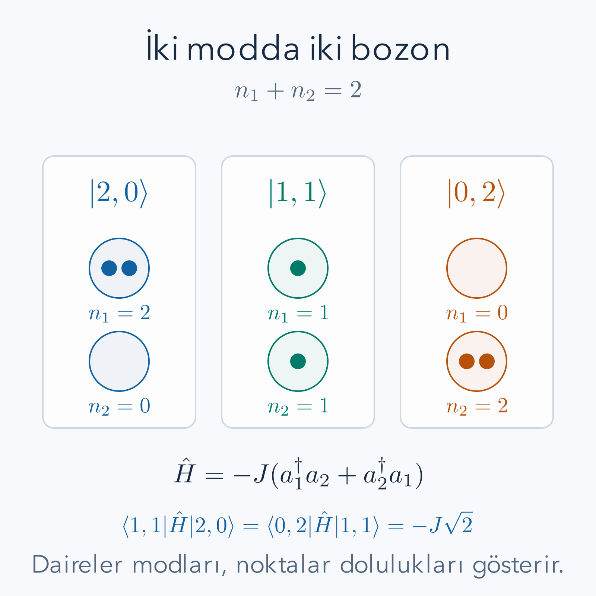

İki özdeş parçacık iki farklı tek parçacık durumunu doldursun. Birinci parçacığın hangi durumda olduğunu sorarak başlarsak, fiziksel olarak ayırt edemeyeceğimiz parçacıklara geçici etiketler vermiş oluruz. Sonra bu etiketlerin değişimine göre dalga fonksiyonunu simetrikleştirmemiz veya antisimetrikleştirmemiz gerekir. Parçacık sayısı büyüdüğünde bu doğru yöntem hızla uzun bir yazıma dönüşür. Bunun yerine her tek parçacık durumunda kaç parçacık bulunduğunu kaydedebiliriz.

Ön bilgiler [özdeş parçacıklar](/blog/ozdes-parcaciklar-bozonlar-ve-fermiyonlar/), [kuantum harmonik osilatörü](/blog/kuantum-harmonik-osilatoru/) ve [atom–ışık etkileşimi](/blog/atom-isik-etkilesimi-ve-secim-kurallari/) yazılarıdır. Özellikle durum vektörü, norm, Hermit eşlenik ve operatör çarpımının sağdan sola uygulanması tanıdık olmalıdır. Burada kullanılan yeni dil, önceki kuantum kurallarını ikinci kez uygulamaz. Sabit parçacık sayısında aynı fiziği başka bir bazda anlatır; farklı parçacık sayısı sektörlerini aynı uzayda tutmayı da kolaylaştırır.

## 1. Etiketten doluluğa geçmek

Birbirine dik ve birim normlu tek parçacık durumlarını $|i\rangle$ ile gösterelim. $i$ bir konum kutusu olmak zorunda değildir; enerji düzeyini, momentumu ve spini birlikte belirten bir indis olabilir. Bu yazıda **mod** dediğimiz şey bu tek parçacık durumudur. Bir modun doluluğu $n_i$, o durumda bulunan parçacık sayısıdır. Doluluk vektörünü:

$$
|n_1,n_2,\ldots\rangle
$$

diye yazarız. Sıra parçacıkları değil modları etiketler. Örneğin $|2,1\rangle$, ilk modda iki, ikinci modda bir parçacık demektir; toplam üç parçacık vardır. Bozonlar için her doluluk sıfır veya pozitif tamsayı olabilir. Fermiyonlarda ise spin dahil bütün tek parçacık kuantum sayıları aynı olan bir moda en fazla bir parçacık yerleşir.

Sabit toplam sayı $N$ için yalnız $\sum_i n_i=N$ sağlayan vektörleri alırız. Farklı toplam sayılara ait uzayları bir arada tutan yapıya **Fock uzayı** denir. Matematiksel olarak bu, sıfır parçacık uzayı, bir parçacık uzayı, iki parçacık uzayı ve devamının doğrudan toplamıdır. Her sektörün içinde simetri koşulu zaten doğru kurulmuştur. Bir hesapta yalnız iki parçacık varsa diğer sektörlerin yazımda bulunması fiziksel olarak onlara geçildiği anlamına gelmez.

*Şema, iki mod ve iki bozon için üç boyutlu sabit sayı sektörünü gösterir. Okların katsayısı olasılık değil, aşağıda hesaplanacak geçiş genliğinin boyutsuz çarpanıdır.*

## 2. Vakum neden sıfır vektörü değildir?

Hiç parçacık bulunmayan duruma $|0\rangle$, yani vakum diyelim. Çok mod varsa bunun açılımı $|0,0,\ldots\rangle$ olur. Fiziksel durum olması için:

$$
\langle0|0\rangle=1
$$

seçilir. Buna karşılık sıfır vektörün normu sıfırdır; sıfır vektör normalize edilemez ve bir hazırlama durumunu temsil etmez. İki sembolün yazıda benzemesi bu ayrımı ortadan kaldırmaz.

$i$ modundan parçacık eksilten operatöre $a_i$, ekleyen operatöre $a_i^\dagger$ diyelim. Vakumda eksiltilecek parçacık bulunmadığı koşulu $a_i|0\rangle=0$ biçimindedir. Sağdaki sonuç **sıfır vektördür**. Bu işlem vakumu başka bir normalize duruma dönüştürmez. Öte yandan $a_i^\dagger|0\rangle$ tek parçacıklı bir vektördür. Operatör adları, laboratuvarda tek başına bir parçacık üreten fiziksel aygıt bulunduğunu söylemez. Bunlar durum uzayındaki geçişleri kuran matematiksel araçlardır; hangi geçişin gerçekten gerçekleşeceğini Hamiltonyen belirler.

## 3. Bozon cebiri ve sayı operatörü

Bozonlar için cebiri şu koşullarla kuruyoruz:

$$
\begin{aligned}
[a_i,a_j^\dagger]&=\delta_{ij},\\
[a_i,a_j]&=0,\\
[a_i^\dagger,a_j^\dagger]&=0.
\end{aligned}
$$

Köşeli parantez $[A,B]=AB-BA$ komütatörüdür. $\delta_{ij}$, indisler aynıysa bir, farklıysa sıfır olan Kronecker deltasıdır. Sağda bir yazılması, birim operatörün kısa yazımıdır. Farklı modların yaratma operatörleri yer değiştirebildiği için ekleme sırası fiziksel durumu değiştirmez; bu, bozon simetrisine uygun özelliktir.

Tek modda $\hat n=a^\dagger a$ sayı operatörünü tanımlayalım. Şapka, operatörü özdeğer olan $n$ sayısından ayırır. $\hat n|n\rangle=n|n\rangle$ ve $\langle n|n\rangle=1$ olsun. Komütatörü çarpım üzerine açarsak:

$$
\begin{aligned}
[\hat n,a^\dagger]
&=a^\dagger aa^\dagger-a^\dagger a^\dagger a\\
&=a^\dagger(aa^\dagger-a^\dagger a)\\
&=a^\dagger.
\end{aligned}
$$

Buradan $\hat n a^\dagger=a^\dagger\hat n+a^\dagger$ gelir. Duruma uygularsak:

$$
\hat n(a^\dagger|n\rangle)=(n+1)a^\dagger|n\rangle.
$$

Dolayısıyla sıfır olmayan sonuç bir sonraki doluluğa aittir. Aynı açılım eksiltme için $[\hat n,a]=-a$ verir. Bunlar katsayıyı henüz belirlemez; katsayı normdan gelecektir.

## 4. Karekök katsayısını normdan çıkarmak

$a|n\rangle=C_n|n-1\rangle$ yazalım. Sağdaki baz vektörü normalize olduğundan sonucun norm karesi $|C_n|^2$ olur. Sol tarafın normunu eşlenikle hesaplayalım:

$$
\begin{aligned}
\|a|n\rangle\|^2
&=\langle n|a^\dagger a|n\rangle\\
&=\langle n|\hat n|n\rangle\\
&=n\langle n|n\rangle=n.
\end{aligned}
$$

Baz durumlarının fazını tutarlı seçerek $C_n=\sqrt n$ alabiliriz. Yaratmanın normu için $aa^\dagger=\hat n+1$ kullanılır:

$$
\begin{aligned}
\|a^\dagger|n\rangle\|^2
&=\langle n|aa^\dagger|n\rangle=n+1,\\
a|n\rangle&=\sqrt n\,|n-1\rangle,\\
a^\dagger|n\rangle&=\sqrt{n+1}\,|n+1\rangle.
\end{aligned}
$$

Karekökün nedeni “parçacıklar daha istekli” gibi bir söz değildir: komütatör ile birim normun birlikte zorladığı katsayıdır. Ölçüm olasılığına geçtiğimizde katsayının mutlak karesi alınacağından $n$ veya $n+1$ çarpanı ortaya çıkar.

Vakumdan art arda yaratma uygulamak şu normalize bazı verir:

$$
|n\rangle=\frac{(a^\dagger)^n}{\sqrt{n!}}|0\rangle.
$$

Çünkü birinci uygulama $\sqrt1$, ikincisi $\sqrt2$, sonuncusu $\sqrt n$ getirir; çarpım $\sqrt{n!}$ olur. Çok modda her mod için ayrı faktöriyel gerekir. Tüm yaratmalar komütatif olduğundan bozonlarda çarpım sırası sonucu değiştirmez.

## 5. Çözülmüş örnek: normalizasyon ve enerji

İki bozon modunun tek parçacık enerjileri $\epsilon_1=1\,\mathrm{eV}$ ve $\epsilon_2=3\,\mathrm{eV}$ olsun. Etkileşimsiz ve vakum enerjisi sıfıra ayarlanmış Hamiltonyen ile toplam sayı operatörü:

$$
H_0=\epsilon_1\hat n_1+\epsilon_2\hat n_2,
\qquad \hat N=\hat n_1+\hat n_2
$$

şeklindedir. $|2,1\rangle$ durumunu hazırlamak için:

$$
|2,1\rangle=\frac{(a_1^\dagger)^2a_2^\dagger}{\sqrt{2!1!}}|0\rangle
=\frac{(a_1^\dagger)^2a_2^\dagger}{\sqrt2}|0\rangle
$$

yazarız. Normalizasyonu yalnız formüle güvenerek bırakmayalım. Önce $a_2^\dagger|0\rangle=|0,1\rangle$, sonra $a_1^\dagger|0,1\rangle=|1,1\rangle$, ardından $a_1^\dagger|1,1\rangle=\sqrt2|2,1\rangle$ olur. Başta konan $1/\sqrt2$ son çarpanı götürür.

Sayı ve enerji sonuçları:

$$
\begin{aligned}
\hat N|2,1\rangle&=(2+1)|2,1\rangle=3|2,1\rangle,\\
H_0|2,1\rangle&=(2\cdot1+1\cdot3)\,\mathrm{eV}|2,1\rangle\\
&=5\,\mathrm{eV}|2,1\rangle.
\end{aligned}
$$

Burada toplam sayı ile enerji farklı gözlenebilirlerdir. Örneğin $|1,2\rangle$ yine üç parçacıklıdır fakat enerjisi $7\,\mathrm{eV}$ olur. Doluluk vektörünü enerjiye çevirmek için hangi modun hangi enerjiye sahip olduğu bilgisi gerekir. Etkileşim eklenirse bu doluluk vektörleri artık enerji özdurumları olmayabilir.

## 6. Bozon simetrisiyle eski yazımın bağlantısı

İki farklı modu $u$ ve $v$ ile gösterelim. İki özdeş bozonun birer parçacıkla bu modları doldurması, etiketli konum yazımında:

$$
\Psi(x_1,x_2)=\frac{u(x_1)v(x_2)+v(x_1)u(x_2)}{\sqrt2}
$$

olur. Fonksiyonlar ortonormalse çapraz integral sıfırdır; diğer iki terimin norm katkısı birer birimdir. Paydadaki $\sqrt2$ bu toplamı bire indirir. Doluluk yazımında aynı durum yalnız $|1,1\rangle=a_u^\dagger a_v^\dagger|0\rangle$ şeklindedir. Parçacık etiketleri kaybolmuştur, simetri kaybolmamıştır.

İki parçacık aynı moddaysa simetrik dalga fonksiyonu $u(x_1)u(x_2)$ zaten normalize olur. Buna karşılık normalize olmayan yaratma çarpımı $(a_u^\dagger)^2|0\rangle$ norm karesi iki olan bir vektör verir. Fock yazımındaki $1/\sqrt{2!}$ bu farkı düzeltir. Dolayısıyla birinci kuantizasyonun simetrikleştirme katsayısını, yaratma operatörlerinin katsayısıyla düşünmeden kopyalamak doğru değildir. İki yazımın her birinde normu kendi tanımına göre kontrol ederiz.

## 7. Fermiyonlar neden antikomütatör ister?

Fermiyon operatörlerini karışıklık olmaması için $c_i,c_i^\dagger$ ile gösterelim. Süslü parantez $\{A,B\}=AB+BA$ antikomütatörüdür. Fermiyon cebiri:

$$
\begin{aligned}
\{c_i,c_j^\dagger\}&=\delta_{ij},\\
\{c_i,c_j\}&=0,\\
\{c_i^\dagger,c_j^\dagger\}&=0
\end{aligned}
$$

olur. Son satırda $i=j$ seçersek $2(c_i^\dagger)^2=0$, dolayısıyla $(c_i^\dagger)^2=0$ çıkar. Aynı modu ikinci kez doldurmaya çalışmak sıfır vektör üretir. Bu, Pauli dışarlama ilkesinin operatör biçimidir. Bir uzaysal orbitalin iki zıt spinle dolabilmesi çelişki oluşturmaz: spinleri farklı iki tek parçacık modu kullanılmıştır.

$\hat n_i=c_i^\dagger c_i$ için:

$$
\begin{aligned}
\hat n_i^2&=c_i^\dagger c_i c_i^\dagger c_i\\
&=c_i^\dagger(1-c_i^\dagger c_i)c_i\\
&=c_i^\dagger c_i-(c_i^\dagger)^2c_i^2=\hat n_i.
\end{aligned}
$$

Bir özdeğeri $\nu_i$ ile gösterirsek $\nu_i^2=\nu_i$, yani $\nu_i(\nu_i-1)=0$ elde edilir. İzin verilen doluluklar yalnız sıfır ve birdir. Farklı modların yaratmalarını değiştirmek eksi işaret üretir; etiketli dalga fonksiyonundaki antisimetrinin Fock uzayındaki karşılığı budur. Bu işareti hesap boyunca taşımak gerekir.

## 8. Fermiyon bazında sıra seçimi

Üç mod için bir sözleşme sabitleyelim:

$$
|n_1,n_2,n_3\rangle
=(c_1^\dagger)^{n_1}(c_2^\dagger)^{n_2}
(c_3^\dagger)^{n_3}|0\rangle.
$$

Yaratmalar artan mod indisiyle yazılır. Bir operatörü kendi moduna götürürken önündeki her dolu modun yaratmasını geçmesi bir eksi işaret getirir. Önceki dolu modların sayısı $S_j=\sum_{i<j}n_i$ olsun. Eylem:

$$
\begin{aligned}
c_j|\ldots,n_j,\ldots\rangle
&=(-1)^{S_j}n_j|\ldots,0,\ldots\rangle,\\
c_j^\dagger|\ldots,n_j,\ldots\rangle
&=(-1)^{S_j}(1-n_j)|\ldots,1,\ldots\rangle
\end{aligned}
$$

şeklindedir. Birinci satır boş modda, ikincisi dolu modda sıfır verir. Sayı bir olduğu zaman karekök bir olduğu için ayrıca bozon tipi bir büyüme katsayısı görünmez.

Başka bir baz sırası seçmek mümkündür. O durumda bazı baz vektörlerinin fazı ve bazı matris elemanlarının işareti birlikte değişir. Ölçülebilir sonuçlar tutarlı dönüşüm altında korunur. Ancak hesabın ortasında sıralama değiştirilirse yanlış girişim işaretleri çıkar. Bu yüzden “fermiyon olunca bir eksi ekle” ezberi yerine operatörün hangi yaratmaları geçtiğini saymak daha güvenlidir.

## 9. Çözülmüş örnek: üç modda eksi işareti

Başlangıç $|1,1,0\rangle=c_1^\dagger c_2^\dagger|0\rangle$ olsun. Birinci moddaki fermiyonu üçüncü moda taşıyan $c_3^\dagger c_1$ operatörünü uygulayalım. Sağdan başladığımızda:

$$
\begin{aligned}
c_1|1,1,0\rangle&=|0,1,0\rangle,\\
c_3^\dagger|0,1,0\rangle&=-|0,1,1\rangle,\\
c_3^\dagger c_1|1,1,0\rangle&=-|0,1,1\rangle.
\end{aligned}
$$

Son eksi, üçüncü moda eklerken öncesinde yalnız ikinci modun dolu olmasından gelir. Bunu operatörlerle de izleyebiliriz:

$$
c_3^\dagger c_1c_1^\dagger c_2^\dagger|0\rangle
=c_3^\dagger c_2^\dagger|0\rangle
=-c_2^\dagger c_3^\dagger|0\rangle.
$$

İlk eşitlikte $c_1c_1^\dagger=1-n_1$ kullanıldı; geriye kalan vektörde birinci mod boştur. Son eşitlik baz sırasını geri kurar. Ters aktarımı son duruma uygularsak $c_1^\dagger c_3|0,1,1\rangle=-|1,1,0\rangle$ çıkar. İki yönün katsayıları eşittir ve gerçektir; aşağıdaki Hermitlik koşuluyla uyumludur. Başlangıçtan aynı fermiyonu zaten dolu ikinci moda taşımak ise $c_2^\dagger c_1|1,1,0\rangle=0$ verir. Bu sonuç bir faz tercihi değil, dışarlamadır.

Fermiyon işaretini, eski dalga fonksiyonu yazımında da kontrol edebiliriz. Birinci ve üçüncü modun normalize tek parçacık fonksiyonları $\phi_1(x)$ ve $\phi_3(x)$ olsun; ikinci mod boş kalsın. Seçtiğimiz mod sırasına göre $|1,0,1\rangle=c_1^\dagger c_3^\dagger|0\rangle$ durumunun iki parçacıklı fonksiyonu:

$$
\Psi(x_1,x_2)=\frac{\phi_1(x_1)\phi_3(x_2)-\phi_3(x_1)\phi_1(x_2)}{\sqrt2}
$$

olur. Buradaki $x$ değişkeni gerektiğinde spin değişkenini de kapsar. İki parçacık koordinatını değiştirmek iki terimin yerini değiştirir ve bütün fonksiyonun önüne eksi getirir. Normda iki doğrudan terim birer katkı yapar, çapraz terimler modların dikliğinden sıfır olur. Paydadaki karekök iki toplam normu bire indirir. İki mod fonksiyonunu aynı seçmeye çalışırsak payın iki terimi eşit olur ve birbirini götürür. Bu kez sıfır normlu vektör elde ederiz; onu normalize ederek ikinci bir fermiyon durumu kurtaramayız.

Yaratma sırasını ters çevirmek de aynı bütünsel eksiyi verir. Bu, tek bir yalıtık durum için ölçüm olasılıklarını değiştirmez; çünkü bütün katsayıların birlikte eksiyle çarpılması genel fazdır. Fakat süperpozisyondaki yalnız bir terimin eksisini değiştirmek göreli fazı değiştirir ve girişim sonuçlarını etkileyebilir. Üç modlu aktarım örneğinde işaretin izlenmesinin nedeni budur. Bir yolun genliğiyle öteki yolun genliği toplanacaksa, her iki yol aynı baz sırası kullanılarak hesaplanmalıdır.

## 10. Çözülmüş örnek: iki bozonun modlar arasında aktarımı

İki moda parçacık aktaran Hamiltonyeni:

$$
H_T=-J(a_1^\dagger a_2+a_2^\dagger a_1)
$$

diye tanımlayalım; $J$ gerçek ve enerji biriminde bir bağlantı katsayısıdır. $|1,1\rangle$ için önce ikinci moddan eksiltip birinciye ekleyelim:

$$
\begin{aligned}
a_2|1,1\rangle&=\sqrt1|1,0\rangle,\\
a_1^\dagger a_2|1,1\rangle&=\sqrt1\sqrt2|2,0\rangle.
\end{aligned}
$$

Öteki terim aynı yöntemle $\sqrt2|0,2\rangle$ verir. Sonuç:

$$
H_T|1,1\rangle=-J\sqrt2(|2,0\rangle+|0,2\rangle).
$$

$\{|2,0\rangle,|1,1\rangle,|0,2\rangle\}$ sırasında matris:

$$
H_T=-J\begin{pmatrix}
0&\sqrt2&0\\
\sqrt2&0&\sqrt2\\
0&\sqrt2&0
\end{pmatrix}
$$

olur. Örneğin $a_2^\dagger a_1|2,0\rangle=\sqrt2|1,1\rangle$ ters elemanı doğrular. Bu matrisin özdeğerleri $-2J,0,2J$'dir. Sıfır özdeğerli vektör $(|2,0\rangle-|0,2\rangle)/\sqrt2$ olur; Hamiltonyen iki parçadan aynı $|1,1\rangle$ katkısını zıt işaretle üretir ve toplam sıfırlanır.

Hamiltonyenin uygulanması zaman evriminin tamamı değildir. Kısa bir $t$ süresinde $|\psi(t)\rangle\simeq(1-iH_Tt/\hbar)|1,1\rangle$ kullanılır. Her uç duruma geçiş olasılığı en düşük mertebede $2J^2t^2/\hbar^2$ olur. Bu yaklaşık ifade yalnız $Jt/\hbar\ll1$ iken güvenilirdir; büyük zamanda birden büyük olasılık vermesi yaklaşımın sınırını gösterir.

## 11. Aktarım matrisinin özdeğerlerini gerçekten bulmak

Üç boyutlu aktarım örneğinin enerji değerlerini determinantla denetleyelim. $b=J\sqrt2$ kısaltmasını kullanalım; bu da enerji birimindedir. Birim matrisi $I$ ile gösterirsek karakteristik determinantın ilk satırdan açılımı:

$$
\begin{aligned}
\det(H_T-EI)
&=\det\begin{pmatrix}-E&-b&0\\-b&-E&-b\\0&-b&-E\end{pmatrix}\\
&=(-E)(E^2-b^2)-(-b)(bE)\\
&=-E^3+Eb^2+Eb^2\\
&=-E(E^2-2b^2)=-E(E^2-4J^2).
\end{aligned}
$$

Determinantın sıfır olması ya $E=0$ ya da $E^2=4J^2$ gerektirir. Böylece daha önce belirtilen üç enerji elde edilir. Ortadaki durum ile uçların simetrik toplamı bağlanırken, uçların antisimetrik farkı bağlanmaz. Bu ayrımı operatör diliyle bulmak, üçüncü derece denklemin bütün köklerini ezberlemekten daha açıklayıcıdır. Şimdi aynı ayrım Hamiltonyen matrisinin yalnız enerji değerlerini değil, bütün zaman evrimini de kolaylaştıracak.

Uçların simetrik ve antisimetrik durumlarını:

$$
|S\rangle=\frac{|2,0\rangle+|0,2\rangle}{\sqrt2},
\qquad
|A\rangle=\frac{|2,0\rangle-|0,2\rangle}{\sqrt2}
$$

diye tanımlayalım. Her iki durumda norm bir, aralarındaki iç çarpım sıfırdır. Bunun nedeni, iki uç doluluk vektörünün birbirine dik olması ve simetrik toplamın bir artı bir, antisimetrik farkın bir eksi bir katkı vermesidir. Hamiltonyen bu yeni bazda $H_T|A\rangle=0$, $H_T|S\rangle=-2J|1,1\rangle$ ve $H_T|1,1\rangle=-2J|S\rangle$ verir. Böylece hesap iki boyutlu bir bağlanan blokla bir bağımsız duruma ayrılır.

## 12. Aynı iki bozon örneğinin tam zaman evrimi

Başlangıçta her modda bir bozon bulunsun. Yeni bazdaki durumu $|\psi(t)\rangle=u(t)|1,1\rangle+v(t)|S\rangle$ yazalım. Başlangıç katsayıları $u(0)=1$, $v(0)=0$'dır. Schrödinger denklemi:

$$
i\hbar\dot u=-2Jv,
\qquad i\hbar\dot v=-2Ju
$$

verir. İlk denklemi bir kez türevleyip ikinciyi yerine koyarsak $\ddot u=-(2J/\hbar)^2u$ buluruz. Başlangıçta türev sıfır olduğu için kosinüs çözümü seçilir; ikinci katsayının işareti ilk diferansiyel denklemden belirlenir:

$$
|\psi(t)\rangle=\cos(2Jt/\hbar)|1,1\rangle
+i\sin(2Jt/\hbar)|S\rangle.
$$

Katsayının önündeki artı $i$, Hamiltonyendeki eksi bağlantıyla uyumludur. Kısa zamanda üstel açılımından bulunan sonuçla da aynı işareti verir. Doluluk ölçümünün üç olasılığı:

$$
\begin{aligned}
P_{11}&=\cos^2(2Jt/\hbar),\\
P_{20}&=\tfrac12\sin^2(2Jt/\hbar),\\
P_{02}&=\tfrac12\sin^2(2Jt/\hbar)
\end{aligned}
$$

olur. Toplamları her anda birdir; kısa zaman yaklaşımının aksine hiçbir zaman birden büyük sonuç üretmezler. $J>0$ için $t=\pi\hbar/(4J)$ anında ortadaki durumun olasılığı sıfır, iki uç durumun olasılıkları eşit yarımdır. Başlangıçta ayrı modlarda bulunan iki bozon, bu anda aynı moda birlikte bulunacak şekilde ölçülür. Hangi modun seçileceği kesin değildir.

Buna rağmen her modun ortalama doluluğu bir kalır. Çünkü ilk modun ortalaması, iki parçacık sonucunun ikiyle, tek parçacık sonucunun birle çarpılıp toplanmasıdır. Tam aktarım anında bu, yarım olasılıkla iki ve yarım olasılıkla sıfırın ortalamasıdır. Başlangıçtaki kesin bir ile sondaki dalgalanan bir aynı ortalamayı verir. Dolayısıyla ortalama yoğunluk değişmedi diye durumun değişmediğini söyleyemeyiz. Korelasyonlar, yani iki moddaki sayıların birlikte nasıl sonuç verdiği, ek fiziksel bilgi taşır.

Bu hesap yalnız belirtilen aktarım Hamiltonyeni içindir. Modlar arası enerji farkı veya aynı moddaki parçacıklar arasında ek etkileşim varsa matrisin köşegenine yeni terimler gelir. O durumda aynı kosinüsü doğrudan kullanamayız. Önce yeni matrisi kurar, varsa yeni simetrisini belirler ve zaman evrimini yeniden çözeriz. Sonucun basit olması, modeli tanımlayan varsayımların unutulmasına izin vermez.

## 13. Mod bazı değişirse doluluklar nasıl değişir?

Parçacık sayısı ile mod sayısının ayrımını görmek için iki yeni mod tanımlayalım:

$$
b_+^\dagger=\frac{a_1^\dagger+a_2^\dagger}{\sqrt2},
\qquad
b_-^\dagger=\frac{a_1^\dagger-a_2^\dagger}{\sqrt2}.
$$

Bu, iki ortonormal modu yine iki ortonormal moda dönüştüren bir baz seçimidir. Komütatör açılırsa $[b_+,b_+^\dagger]=(1+1)/2=1$ ve $[b_+,b_-^\dagger]=(1-1)/2=0$ elde edilir. İkinci kuantizasyon dili bu dönüşüme kapalıdır: yeni modlar için de aynı bozon cebiri geçerlidir. Vakum, eski iki modu da boş bıraktığı için yeni iki modu da boş bırakır.

Yeni artı modunda iki bozon bulunan normalize durum:

$$
\begin{aligned}
\frac{(b_+^\dagger)^2}{\sqrt2}|0\rangle
&=\frac{(a_1^\dagger)^2+2a_1^\dagger a_2^\dagger+(a_2^\dagger)^2}
{2\sqrt2}|0\rangle\\
&=\frac12|2,0\rangle+\frac1{\sqrt2}|1,1\rangle+\frac12|0,2\rangle
\end{aligned}
$$

olur. Son satıra geçerken aynı moddaki çift yaratmaların karekök iki katsayısı unutulmadı. Katsayıların kareleri dörtte bir, yarım ve dörtte birdir; toplam bir eder. Yeni bazda kesin doluluk olan durum, eski bazda üç olası doluluğun süperpozisyonudur. Yine de her terim iki parçacık taşıdığı için toplam parçacık sayısı kesindir. Mod doluluğunun hangi tek parçacık bazının seçildiğine bağlı olduğu, toplam sayının ise bu baz dönüşümünde değişmediği somut olarak görülür.

Fiziksel ölçümde hangi modun sayıldığı bu nedenle belirtilmelidir. Bir enerji düzeyinin doluluğunu saymakla iki düzeyin belirli bir birleşiminin doluluğunu saymak aynı deney değildir. Birinci ölçümün olasılıklarını ikinci ölçümün kesin sonucuymuş gibi okumak, baz değişimini fiziksel değişimle karıştırır. Hesapta baz seçimi serbesttir; fakat aygıtın ölçtüğü operatör de aynı baz dönüşümünden geçirilmelidir. Yalnız durum vektörünü dönüştürüp ölçüm operatörünü eski haliyle bırakmak, farklı bir sorunun cevabını verir.

## 14. Hermitlik ve sayı korunumu ayrı denetimlerdir

Operatör çarpımının eşleniğinde sıra ters döner:

$$
(a_i^\dagger a_j)^\dagger=a_j^\dagger a_i.
$$

Bu nedenle genel tek parçacık Hamiltonyeni $H=\sum_{ij}h_{ij}a_i^\dagger a_j$ için $h_{ji}=h_{ij}^*$ gerekir. Gerçek bağlantı iki yönde aynı seçilirse önceki örnek Hermittir. Karmaşık bağlantıda ikinci terimin katsayısı ilk katsayının karmaşık eşleniği olmalıdır. Fermiyonlarda da aynı Hermitlik koşulu geçerlidir; eşlenik alma sırasında ayrıca varsayımsal bir fermiyon eksisi eklenmez.

Her aktarım bir parçacık eksiltip bir parçacık ekler. Cebirsel kontrol:

$$
\begin{aligned}
[\hat N,a_i^\dagger a_j]
&=[\hat N,a_i^\dagger]a_j+a_i^\dagger[\hat N,a_j]\\
&=a_i^\dagger a_j-a_i^\dagger a_j=0.
\end{aligned}
$$

Dolayısıyla bu Hamiltonyen toplam parçacık sayısını korur; tek tek mod doluluklarını korumak zorunda değildir. Fermiyon sayı operatörüyle yaratma ve yok etmenin aynı komütatör ilişkileri bulunduğundan sonuç fermiyonlar için de geçerlidir. İki yaratma içeren bir terim ise toplam sayıyla komütatif değildir. Hermit olması için eşlenik teriminin bulunması, sayı korunumunu kendi başına geri getirmez.

## 15. Alan operatörünü modlardan kurmak

$i$ modunun konum dalga fonksiyonuna $\phi_i(\mathbf r)=\langle\mathbf r|i\rangle$ diyelim. Bir noktada parçacık eksiltme genliklerini birleştiren alan operatörü:

$$
\hat\psi(\mathbf r)=\sum_i\phi_i(\mathbf r)a_i,
\qquad
\hat\psi^\dagger(\mathbf r)=\sum_i\phi_i^*(\mathbf r)a_i^\dagger
$$

olarak tanımlanır. Üç boyutta normalize $\phi_i$ fonksiyonunun birimi $\mathrm{m}^{-3/2}$ olur; boyutsuz $a_i$ nedeniyle alan da aynı birimdedir. Bozon cebirini yerleştirirsek:

$$
\begin{aligned}
[\hat\psi(\mathbf r),\hat\psi^\dagger(\mathbf r')]
&=\sum_{ij}\phi_i(\mathbf r)\phi_j^*(\mathbf r')[a_i,a_j^\dagger]\\
&=\sum_i\phi_i(\mathbf r)\phi_i^*(\mathbf r').
\end{aligned}
$$

Tek parçacık bazı **tam** ise son toplam $\delta^{(3)}(\mathbf r-\mathbf r')$ dağılımıdır. Yalnız iki mod tutarsak sonuç delta değildir; seçilen altuzayın izdüşüm çekirdeğidir. Bu ayrım, sonlu sayıda modla yapılan sayısal hesaplarda çok önemlidir. Sürekli uzayın tam yerel cebiri kesilmiş modele aynen yüklenemez. Fermiyon alanında aynı hesap antikomütatörle yapılır ve tam bazda aynı delta elde edilir.

## 16. Konum yoğunluğu ve tek parçacık operatörü

Yerel sayı yoğunluğu $\hat\rho(\mathbf r)=\hat\psi^\dagger(\mathbf r)\hat\psi(\mathbf r)$ olsun. Ortonormallik $\int d^3r\,\phi_i^*\phi_j=\delta_{ij}$ kullanılırsa:

$$
\begin{aligned}
\int d^3r\,\hat\rho(\mathbf r)
&=\sum_{ij}a_i^\dagger a_j\int d^3r\,\phi_i^*\phi_j\\
&=\sum_i a_i^\dagger a_i=\hat N.
\end{aligned}
$$

Bu sonuç yoğunluğun biriminin neden hacim başına parçacık olduğunu da açıklar. Tek parçacıklı $|\chi\rangle=\sum_i b_i a_i^\dagger|0\rangle$ durumunda alan operatörü $\hat\psi(\mathbf r)|\chi\rangle=\sum_i b_i\phi_i(\mathbf r)|0\rangle$ verir. Norm karesi alınırsa beklenen konum olasılık yoğunluğu $|\sum_i b_i\phi_i(\mathbf r)|^2$ geri gelir. Yeni yazım eski Born kuralını korumaktadır.

Bir tek parçacık operatörünün mod matris elemanı $h_{ij}=\langle i|h|j\rangle$ ise, çok parçacıklı toplamı $\sum_{ij}h_{ij}a_i^\dagger a_j$ olur. Bu ifade “$j$ modundan al, $i$ moduna koy, tek parçacık geçiş genliğiyle çarp” diye okunur. Parçacıklar arası iki cisim etkileşimleri dört alan operatörü gerektirir; katsayıların simetri ve çift sayım faktörleri ayrıca kurulmalıdır. Buradaki tek parçacık formülü bütün etkileşimlerin zaten çözülmüş olduğu anlamına gelmez.

## 17. Yaratma sözcüğünün fiziksel sınırı

$H_D=\eta a^\dagger+\eta^*a$ gibi bir dış sürüş terimi sayıyı değiştirebilir. $\eta$ enerji birimindedir ve dış aygıtın sistemle enerji alışverişini temsil eder. Yalıtılmış bir atom gazına böyle bir terim yazıp hiçbir enerji veya madde kaynağı belirtmeden “parçacıklar kendiliğinden oluşuyor” diyemeyiz. Elektron sayısı koruyan bir modelde yalnız uygun sayı koruyan etkileşimler bulunur. Foton gibi uyarımların sayısı ise maddeyle enerji alışverişinde değişebilir; korunması gereken toplam enerji ve ilgili yüklerdir.

Ayrıca atomu bir uyarılmış iç düzeyden aşağı indirmek atomu yok etmek değildir. Hangi “parçacığın” sayıldığı baştan belirtilmelidir. Bir mod uyarımı, bir atom ve temel bir elektron farklı sayım nesneleridir. İkinci kuantizasyon bu ayrımları ortadan kaldırmaz; yalnız seçilen nesnelerin simetri ve doluluk muhasebesini açık hale getirir.

Son kontrol yöntemi üç sorudur: baz vektörleri birim normlu mu, Hamiltonyen eşleniğine eşit mi, korunduğunu iddia ettiğimiz sayıyla komütatörü sıfır mı? Bozon örneğinde karekök iki, fermiyon örneğinde sıra eksisi ve alan örneğinde tam baz koşulu bu sorularla görünür oldu. Bu denetimler yapılmadan yalnız operatör simgelerinin benzemesi bir hesabı güvenilir yapmaz.

## 18. Kaynaklar ve kapsam

[David Tong, Quantum Field Theory ders notları](https://www.damtp.cam.ac.uk/user/tong/qft/qft.pdf) içindeki Fock uzayı ve kanonik kuantizasyon bölümleri, kullanılan operatör dilinin daha geniş çerçevesini verir. Bu yazının amaçları için göreli alan teorisinin tamamına ihtiyaç yoktur. [MIT 22.51, Quantum Theory of Radiation Interactions ders notları](https://ocw.mit.edu/courses/22-51-quantum-theory-of-radiation-interactions-fall-2012/693972cea9cf9da5e4e9e86fbc72c9e7_MIT22_51F12_Notes.pdf) içindeki harmonik osilatör ve alan modları bölümleri de merdiven operatörlerinin ışığa uygulanmasına kaynak sağlar. Buradaki iki ve üç modlu hesaplar seçtiğimiz baz sırası ve birimleriyle doğrudan yapılmıştır.
