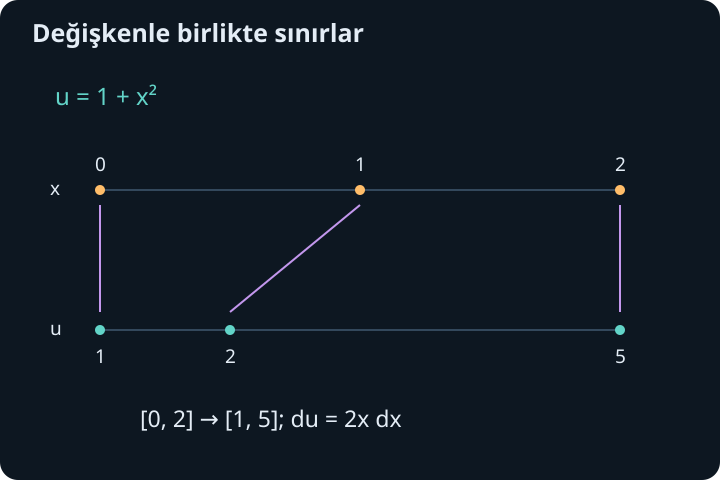
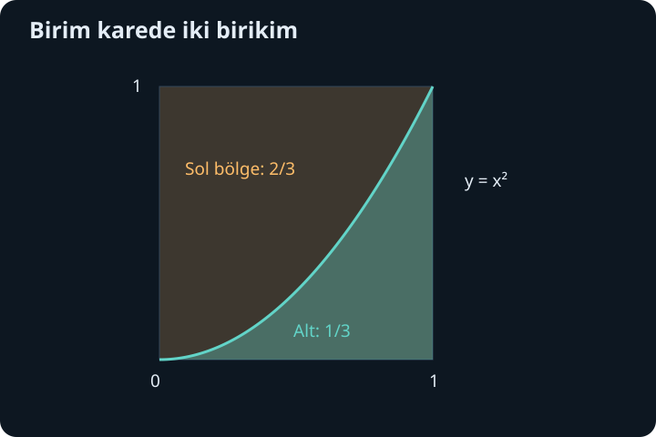

import ArticleVideo from '@/components/ArticleVideo.astro'
import kavram from './media/01-kavram.mp4?url'
import kavramPoster from './media/01-kavram.jpg?url'

Bir integralin anlamını bilmek ile onu hesaplayabilmek aynı şey değildir. Bir eğrinin altında biriken miktar tanımlı olabilir, ama uygun antitürevi hemen göremeyebiliriz. Hesap yöntemleri burada devreye girer. Çoğu yöntem yepyeni bir işlem icat etmez; türev alırken öğrendiğimiz kuralları geriye doğru okur veya ifadeyi bildiğimiz biçimlere ayırır.

[Önceki yazıda](/blog/belirli-integral-ve-temel-teorem/) sürekli bir fonksiyonun belirli integralinin, bir antitürevin uç değerleri farkıyla hesaplanabildiğini gösterdik. Doğal logaritma ve üstel fonksiyonun türevlerini de kurduk. Şimdi zincir kuralını değişken değiştirmeye, çarpım kuralını kısmi integrasyona çevireceğiz. Cebirsel ayrıştırma ve trigonometrik özdeşlikler de bu araçlara yardımcı olacak.

## 1. Küçük bir temel tabloyu anlamak

$F'(x)=f(x)$ ise $\int f(x)dx=F(x)+C$ yazıyoruz. $C$ aynı aralıkta seçilebilen keyfi sabittir. Güç kuralını tersine çevirirsek, $p\ne-1$ için:

$$
\int x^p\,dx=\frac{x^{p+1}}{p+1}+C
$$

buluruz. İfadelerin gerçek ve türevlenebilir olduğu aralıkta çalışırız. Örneğin keyfi gerçek $p$ için $x>0$ güvenli bir ortak alandır; tamsayı üslerde tanım alanı daha geniş olabilir. Formülün kontrolü basittir: türev alırken $p+1$ çarpanı paydadakini götürür ve üs bir azalır.

$p=-1$ için formülde sıfıra bölme oluşur; bu durum ayrı ele alınmalıdır. Sonuç:

$$
\int\frac1x\,dx=\ln|x|+C,\qquad x\ne0
$$

olur. Pozitif tarafta $|x|=x$ olduğu için önceki logaritma türevini kullanırız. Negatif tarafta $|x|=-x$ ve $(\ln(-x))'=(-1)/(-x)=1/x$ olur. Tek bir integral aralığı sıfırı geçemez; iki ayrı tarafta sabitler bağımsız olabilir.

Diğer temel eşleşmeler $\int e^x dx=e^x+C$, $\int\cos x dx=\sin x+C$ ve $\int\sin x dx=-\cos x+C$'dir. Son eşleşmedeki eksi işareti türevle kontrol ederiz: $(-\cos x)'=\sin x$. Ayrıca $\int dx/(1+x^2)=\arctan x+C$ ve $\int dx/\sqrt{1-x^2}=\arcsin x+C$ elde edilir; ikinci eşleşme $-1<x<1$ aralığında geçerlidir.

Tablo, hangi fonksiyonun hangi fonksiyona dönüştüğünü hatırlatır. Bir ifadenin tablodaki biçime gerçekten uyup uymadığını kontrol etmek ise hesaplamanın asıl kısmıdır. Örneğin paydada $1+x^4$ görmek, sonucun doğrudan arktanjant olduğunu söylemeye yetmez; iç değişimin türevi de bulunmalıdır.

### Kuvveti artırırken katsayıyı neden bölüyoruz?

$\int x^2\,dx$ için yalnız $x^3$ yazsaydık türevi $3x^2$ olurdu; istenenin üç katını elde ederdik. $x^3/3$ seçmek bu fazla çarpanı kaldırır. Genel güç kuralındaki $p+1$ paydası aynı düzeltmedir: üs bir arttığında türevden gelecek çarpanı önceden dengeleriz.

Kesirli bir örnekte $\sqrt x=x^{1/2}$ olduğundan yeni üs $3/2$ olur. Bu sayıya bölmek, onun karşılıklısı $2/3$ ile çarpmaktır:

$$
\int\sqrt x\,dx
=\frac{x^{3/2}}{3/2}+C
=\frac23x^{3/2}+C.
$$

$x>0$ için türev alırsak $(2/3)(3/2)x^{1/2}=\sqrt x$ çıkar. Katsayılar birbirini götürürken üs bir azalır. Bu iki işi ayrı izlemek, kesirli üslerdeki işlem hatalarını azaltır.

$p=-1$ durumunun dışarıda kalması ise küçük bir not değildir. Üs artırınca sıfır, paydada da sıfır oluşur; bu formülle bir fonksiyon tanımlayamayız. Sonucun logaritma olmasını başka bir türev eşleşmesinden biliyoruz. Bir kuralın istisnasında zorla aynı kalıbı kullanmak yerine, başlangıçtaki türev sorusuna geri döneriz.

## 2. Değişken değiştirme zincir kuralından gelir

$F'=f$ olsun. Zincir kuralı:

$$
\frac{d}{dx}F(g(x))=f(g(x))g'(x)
$$

der. Bu eşitliği ters yönde okuyunca:

$$
\int f(g(x))g'(x)\,dx=F(g(x))+C
$$

buluruz. $u=g(x)$ ve $du=g'(x)dx$ yazımı bu yapıyı izlemek için kullanılır. $du$ ile $dx$'i bu aşamada gelişigüzel cebir nesneleri gibi kullanmak yerine, yazımın zincir kuralını temsil ettiğini hatırlamak güvenlidir.

Örneğin $\int 2x(1+x^2)^4dx$ içinde $1+x^2$'nin türevi olan $2x$ hazır bulunuyor. $u=1+x^2$ seçersek $du=2x dx$ ve integral $\int u^4du=u^5/5+C$ olur. Eski değişkene döneriz:

$$
\int2x(1+x^2)^4dx=\frac{(1+x^2)^5}{5}+C.
$$

Kontrol için türev alalım: dıştaki beşinci güçten 5 gelir, paydadaki 5 gider, kalan $(1+x^2)^4$ iç türev $2x$ ile çarpılır. Başlangıçtaki ifadeyi tam olarak elde ederiz.

### Yeni değişkene geçince eski değişken gerçekten gitmeli

$\int2x(1+x^2)^4dx$ ifadesinde $u=1+x^2$ dediğimizde yalnız parantezi yeniden adlandırmadık. Aynı zamanda $2x\,dx$ bütününü $du$ ile eşleştirdik. Böylece integralde yalnız $u$ ve $du$ kaldı. Dönüşümün işe yaraması, iki parçanın birlikte uyumundan gelir.

Buna karşılık $\int(1+x^2)^4dx$ için aynı seçimi yaptığımızda $du=2x\,dx$ yanında gereken $2x$ çarpanı yoktur. Onu kendiliğimizden ekleyemeyiz. İfadeyi $2x$ ile çarparsak integrali değiştirmiş oluruz; bunu telafi etmek için $1/(2x)$ çarpanı gerekir ve bu da sabit olmadığı için integralin dışına çıkarılamaz. Bu örnekte polinomu açıp terim terim integral almak daha doğrudan bir yoldur.

Değişken değiştirme her zaman ifadeyi kısaltmak zorunda değildir; fakat bir sonuca ulaştığımızı söylerken bütün parçalar aynı değişkenle yazılmış olmalıdır. $u$'ya bağlı bir kuvvetin yanına açıklanmamış bir $x$ bırakmak, dönüşümün tamamlanmadığını gösterir. Sonunda eski değişkene dönüş ise yalnız belirsiz integralde istenen fonksiyonun hangi girdiye bağlı olduğunu yeniden görünür kılar.

## 3. Eksik sabit çarpanı telafi etmek

$\int x e^{x^2}dx$ örneğinde iç ifade $x^2$'dir, fakat onun türevi $2x$ iken integralde yalnız $x$ bulunuyor. Bu küçük farkı açıkça ayıralım:

$$
\int x e^{x^2}dx=\frac12\int2x e^{x^2}dx.
$$

$u=x^2$ dönüşümüyle sonuç $e^{x^2}/2+C$ olur. Katsayıyı atlamak iki kat büyük bir cevap üretirdi. Türevle kontrol, bu tür sabit hatalarını hemen yakalar.

Bir başka örnekte $\int 3/(2+3x)dx$ için $u=2+3x$ ve $du=3dx$ seçeriz. Sonuç $\ln|2+3x|+C$'dir; $x=-2/3$'ü içermeyen bir aralıkta geçerlidir. Mutlak değer, içerinin negatif olduğu aralığı da kapsar. Fonksiyonun tanımsız olduğu noktayı ise ortadan kaldırmaz.

$\int x\sqrt{4+x^2}dx$ için yine $u=4+x^2$, $du=2x dx$ kullanırız. İntegral $\frac12\int u^{1/2}du$ olur. Güç kuralıyla $\frac12\cdot\frac23u^{3/2}=u^{3/2}/3$ elde edilir. Sonuç $(4+x^2)^{3/2}/3+C$'dir. Bu kez iç ifade bütün gerçek girdilerde pozitif olduğundan ek bir gerçeklik kısıtı yoktur.

### Eksik çarpan sabitse işlem neden kolaylaşıyor?

$\int\cos(5x-2)\,dx$ için iç fonksiyonun türevi 5'tir. İntegralde 5 bulunmadığından ifadeyi $\frac15\int5\cos(5x-2)\,dx$ diye yazarız. Bu kez $u=5x-2$, $du=5dx$ seçimiyle

$$
\int\cos(5x-2)\,dx
=\frac15\sin(5x-2)+C
$$

bulunur. Dıştaki $1/5$ sabittir; bu yüzden integralin dışına çıkabilir. Türev kontrolünde zincirden gelen 5 ile çarpılıp yok olur.

Aynı mantık $\int1/(2+3x)\,dx$ için sonucu $\frac13\ln|2+3x|+C$ yapar. Önceki $\int3/(2+3x)\,dx$ örneğinde iç fonksiyonun türevi olan 3 zaten kesrin payında bulunuyordu; sonuç bu yüzden doğrudan $\ln|2+3x|+C$ idi. Şimdiki integralin payı 1 olduğundan sonucu ayrıca üçe bölmek gerekir. İki integrali ayıran yalnız paydaki katsayıdır.

Bu karşılaştırmayı kısaca türevle okuyabiliriz: $\ln|2+3x|$'in türevi $3/(2+3x)$'tir. Aradığımız pay 1 ise sonucu üçe bölmeliyiz. İç ifadeyi doğru seçmek kadar, onun türevinin integralde **hangi katsayıyla** bulunduğunu denetlemek de gerekir.

## 4. Belirli integralde sınırlar da dönüşür

Değişkeni $x$'ten $u=g(x)$'e çeviriyorsak sınırlar artık $x$ değerleri olarak bırakılamaz. $x=a$ iken $u=g(a)$, $x=b$ iken $u=g(b)$ olur. Yeterli süreklilik ve türev koşullarında:

$$
\int_a^b f(g(x))g'(x)dx
=\int_{g(a)}^{g(b)}f(u)du.
$$

Bu biçimin kanıtı temel teoremden gelir: iki taraf da $F(g(b))-F(g(a))$'dır. Burada kullanılan bileşke biçimi için $g$'nin bütün aralıkta bire bir olması gerekmez. Buna karşılık genel bir integrali ters değişkenle yeniden yazarken dalları ve aralığı ayrıca incelemek gerekir.

$\int_0^2 2x/(1+x^2)dx$ için $u=1+x^2$ seçelim. Alt sınır 1, üst sınır 5 olur:

$$
\int_0^2\frac{2x}{1+x^2}dx
=\int_1^5\frac1u du=\ln5.
$$

Yeni integralde eski 0 ve 2 sınırlarını bırakmak $\ln2-\ln0$ gibi anlamsız bir ifadeye götürürdü. İki güvenli yol vardır: bütün hesabı yeni değişken ve yeni sınırlarla tamamlamak veya önce antitürevi eski değişkene döndürüp eski sınırları kullanmak.

Yön de korunmalıdır. $\int_0^1 2x\sqrt{4-x^2}dx$ için $u=4-x^2$ ve $du=-2x dx$ olur. Sınırlar 4'ten 3'e gider. Böylece integral $-\int_4^3\sqrt u\,du=\int_3^4\sqrt u\,du$ biçimindedir. Sonuç $\frac23(8-3\sqrt3)$ olur. Eksi işaretiyle ters sınır birbirini telafi eder; ikisini de rastgele kaldırmayız.

<ArticleVideo src={kavram} poster={kavramPoster} title="Zincir kuralından değişken değiştirmeye" caption="u = x² ve du = 2x dx dönüşümü, 2x cos(x²) ifadesinin integralini sin(x²) + C biçimine götürür. Sonuç türevle kontrol edilir." />

### Sınırlar aynı sayıya dönüşürse sonuç ne anlatır?

Belirli değişken değiştirme formülü için kullanabileceğimiz açık yeterli koşullar şunlardır: $g$'nin türevi $[a,b]$ üzerinde sürekli olsun; $f$ de $g$'nin bu aralıkta aldığı bütün değerleri içeren bir aralıkta sürekli olsun. Böylece zincir kuralı ve temel teorem iki tarafta da uygulanır.

Örneğin $\int_{-1}^{1}2x\cos(x^2)\,dx$ için $u=x^2$ seçersek iki uç da 1'e gider. Sonuç $\int_1^1\cos u\,du=0$ olur. Bu, aralığın içinde hiçbir şey olmadığı anlamına gelmez. $x$, $-1$'den 0'a giderken $u$ 1'den 0'a; sonra 0'dan 1'e giderken tekrar 1'e ilerler. Yönlü katkılar birbirini götürür. $2x$ çarpanının işareti bu yön değişimini zaten taşır.

Antitürevle kontrol de $[\sin(x^2)]_{-1}^{1}=\sin1-\sin1=0$ verir. Ama integralde $|2x|$ olsaydı aynı iptal olmazdı; mutlak değer yön değişiminin eksi işaretini kaldırırdı. Bu durumda $x=0$'da aralığı ayırmak gerekir. Dönüşümün uçları tek başına yeterli bilgi değildir; başlangıç integrandının zincir kuralı biçimine gerçekten uyduğunu da kontrol ederiz.

Mutlak değerli örnekte gereken iki hesabı tamamlayalım. $[-1,0]$ üzerinde $|2x|=-2x$, $[0,1]$ üzerinde $|2x|=2x$ olur. İki parçada da $u=x^2$ seçersek:

$$
\begin{aligned}
&\int_{-1}^{1}|2x|\cos(x^2)\,dx\\
&\quad=-\int_1^0\cos u\,du+\int_0^1\cos u\,du\\
&=2\int_0^1\cos u\,du\\
&=2\sin1.
\end{aligned}
$$

İlk parçanın eksi işareti mutlak değeri açmaktan, ters sınırları ise $x^2$'nin bu parçada azalmasından geldi. İkisi birlikte pozitif katkı verdi. İki uçtaki u değerleri aynı olsa bile sonuç sıfır olmadı; çünkü başlangıç ifadesinde zincir kuralının işaretli $2x$ çarpanı yerine $|2x|$ vardı. Buradaki 1 radyandır.

## 5. Kısmi integrasyon çarpım kuralını geri alır

İki türevlenebilir fonksiyon $u(x)$ ve $v(x)$ için $(uv)'=u'v+uv'$ olduğunu biliyoruz. Terimlerden birini karşıya alıp integral alırsak:

$$
\boxed{\int uv'\,dx=uv-\int u'v\,dx.}
$$

Kısa gösterimi $\int u\,dv=uv-\int v\,du$'dur. Kısmi integrasyon, bir integraldeki türev yükünü bir çarpandan diğerine aktarır. Yararlı seçim, yeni integralin daha kolay olduğu seçimdir. Her çarpımı sırf çarpım olduğu için bu yöntemle çözmek zorunda değiliz.

$\int x e^x dx$ için $u=x$, $v'=e^x$ seçelim. O zaman $u'=1$ ve $v=e^x$ olur. Formül:

$$
\int x e^x dx=xe^x-\int e^x dx
=xe^x-e^x+C
$$

verir. Kontrol edelim: $(xe^x-e^x)'=e^x+xe^x-e^x=xe^x$. Seçim başarılıdır; $x$ türev alınca sadeleşti, üstel fonksiyon integral alınca biçimini korudu.

Ters seçimde $u=e^x$ ve $dv=x dx$ alınabilir, fakat yeni integral $\int x^2e^x dx$ olur ve başlangıçtan daha karmaşıktır. Yöntemin doğruluğu her seçimde aynı kalır; pratik yararı seçime bağlıdır. Bir formülün uygulanabilir olması, o anda en iyi yol olduğu anlamına gelmez.

### Kısmi integrasyon formülündeki eksi işaretinin kaynağı

$u$ ve $v$'nin türevlerinin sürekli olduğu bir aralıkta çarpım kuralını integral alabiliriz. Önce eşitliği yalnız cebirle düzenleyelim:

$$
\begin{aligned}
(uv)'&=u'v+uv',\\
uv'&=(uv)'-u'v.
\end{aligned}
$$

İntegral alınca ilk terimin antitürevi $uv$, ikinci terimin önünde ise aynı eksi işareti kalır. Dolayısıyla eksi, yöntemin hatırlanması gereken rastgele bir parçası değildir; diğer değişim katkısını karşı tarafa taşımanın sonucudur.

Seçimde $dv$ bir bütün olarak integral alınacak çarpanı gösterir. $dv=e^x\,dx$ dediğimizde $v=e^x$ seçebiliriz; bu aşamada ayrıca keyfi sabit yazmamıza gerek yoktur. $v=e^x+K$ seçsek formülde oluşacak $Ku$ ile $\int K u'\,dx$ katkıları birbirini götürür ve sonuç yine aynı antitürev ailesi olur. En sonda tek bir $C$ kullanmak yeterlidir.

Böylece yöntem iki farklı soruyu içerir: $u$ türev alınca sadeleşiyor mu ve $dv$'nin antitürevini bulabiliyor muyuz? Bu iki koşul birlikte elverişliyse yeni integral daha kolay hale gelir.

## 6. Görünmeyen ikinci çarpan ve tekrar

$\int\ln x dx$ ifadesinde görünürde çarpım yoktur; ancak $\ln x\cdot1$ diye yazabiliriz. $u=\ln x$, $dv=dx$ seçersek $du=dx/x$ ve $v=x$ olur. Dolayısıyla:

$$
\begin{aligned}
\int\ln x dx&=x\ln x-\int1dx\\
&=x\ln x-x+C,\\
&x>0.
\end{aligned}
$$

Türev alırken $x\ln x$ teriminden $\ln x+1$ gelir, son $-x$ teriminden $-1$ gelir ve istenen $\ln x$ kalır. Bu yöntem doğal logaritmanın türevini bildiğimiz için mümkün oldu; onu kanıtlamak için henüz bilinmeyen bu integrali kullanmıyoruz.

$\int x^2e^x dx$ için yöntemi iki kez uygularız. İlk seçim $u=x^2$, $dv=e^x dx$ olsun. Sonuç $x^2e^x-2\int xe^x dx$ olur. Az önce bulduğumuz ifadeyi yerine koyarsak:

$$
\int x^2e^x dx=e^x(x^2-2x+2)+C.
$$

Polinomun derecesi her türevde bir azaldığı için bu süreç sonlanır. Türev kontrolünde üstel çarpanın türevi ile parantezin türevi toplanır: $e^x[(x^2-2x+2)+(2x-2)]=x^2e^x$.

Belirli integralde çarpım terimini de uçlarda değerlendiririz. $\int_0^1 xe^x dx=[xe^x]_0^1-\int_0^1e^x dx=e-(e-1)=1$. Köşeli parantez $[F(x)]_a^b=F(b)-F(a)$ kısaltmasıdır. Kısmi integrasyonun sonundaki çarpım, sınırların etkisini taşıdığı için unutulamaz.

### Tekrar edilen adımda parantezin tamamını çıkarmak

$\int x^2e^x\,dx$ hesabındaki ara sonucu $x^2e^x-2\int xe^x\,dx$ bulmuştuk. İkinci integralin yerine $xe^x-e^x$ yazarken dıştaki $-2$, iki terime birden uygulanmalıdır:

$$
\begin{aligned}
\int x^2e^x\,dx
&=x^2e^x-2(xe^x-e^x)+C\\
&=x^2e^x-2xe^x+2e^x+C\\
&=e^x(x^2-2x+2)+C.
\end{aligned}
$$

Son sabitin işareti artıdır; çünkü dıştaki eksi içerideki eksiyle çarpılır. İlk adımda bir $C_1$, ikinci adımda bir $C_2$ yazılsaydı bunlar da $C_1-2C_2$ biçiminde tek bir keyfi sabitte birleşirdi.

Belirli integralde ise sabit yazmak yerine uçları kullanırız. Örneğin $[0,1]$ üzerinde sonuç $e(1-2+2)-1(0-0+2)=e-2$ olur. İntegrand bu aralıkta negatif olmadığından sonucun da negatif olmaması gerekir; $e-2>0$ bu kontrolü sağlar. Sınır teriminde yalnız üst değeri alıp alt değeri unutmak $e$ sonucunu verirdi ve hesaplanan birikimi değiştirmiş olurdu.

## 7. Bir alan ayrımıyla çarpım kuralını görmek

Artan ve terslenebilir pozitif bir $y=f(x)$ eğrisi düşünelim. Bir dikdörtgenin içini eğrinin altındaki bölge ile yanındaki bölge olarak ayırabiliriz. Bir bölgeyi düşey dilimlerle toplarken diğerini yatay dilimlerle toplarız. Toplam, dikdörtgen alanına eşittir. Bu geometri, bir çarpım ile iki integral arasındaki ilişkinin neden doğal olduğunu gösterir.

Basit örnek $y=x^2$, $0\leq x\leq1$ olsun. Eğrinin altındaki alan $\int_0^1x^2dx=1/3$'tür. Eğrinin solundaki alan $\int_0^1\sqrt y\,dy=2/3$ olur. İkisi birim kareyi doldurur. Burada yatay dilimin uzunluğu $\sqrt y$'dir; eğrinin sağı alınsaydı $1-\sqrt y$ olurdu. Bölgeyi hangi taraftan topladığımızı açıkça belirlemek işaret hatasını önler.

Bu resim her kısmi integrasyonun pozitif alan hesabı olduğu anlamına gelmez. Genel formül işaretli fonksiyonlar için çarpım kuralından gelir. Geometrik örnek yalnız aynı hesabın görülebilir bir özel durumunu sunar.

## 8. Basit kesirlere ayırma

Rasyonel fonksiyonlarda bazen engel kalkülüs değil cebirdir. $1/[x(x+1)]$ ifadesini daha basit iki kesrin toplamı olarak arayalım:

$$
\frac1{x(x+1)}=\frac A x+\frac B{x+1}.
$$

Paydalarla çarpınca $1=A(x+1)+Bx=(A+B)x+A$ olur. Bu eşitlik bütün uygun $x$ değerlerinde geçerli olacağı için sabit katsayıdan $A=1$, $x$ katsayısından $A+B=0$ ve $B=-1$ bulunur. Artık:

$$
\int\frac{dx}{x(x+1)}
=\ln|x|-\ln|x+1|+C.
$$

Çalıştığımız aralık $x=0$ ve $x=-1$ noktalarını içeremez. Kontrol için iki logaritmanın türevini çıkarırız: $1/x-1/(x+1)=[x+1-x]/[x(x+1)]$, yani başlangıçtaki ifade. $[1,2]$ üzerindeki belirli integral $\ln(2/3)-\ln(1/2)=\ln(4/3)$ olur ve pozitiftir; integrandın o aralıkta pozitif olmasıyla uyumludur.

Payın derecesi paydanın derecesinden küçük değilse önce polinom bölmesi yapmak gerekebilir. Örneğin $x^2/(x+1)=x-1+1/(x+1)$ olur. Sağ tarafı ortak paydaya getirerek doğrulayabiliriz. İntegral artık $x^2/2-x+\ln|x+1|+C$'dir. Daha karmaşık paydalarda tekrarlı doğrusal veya indirgenemeyen ikinci derece çarpanlar için farklı ayrıştırma biçimleri gerekir; tek örneğimizin kalıbını hepsine zorla uygulamayız.

### Kareye tamamlama, tabloya giden yolu açar

Paydası ikinci dereceden olan her kesir gerçek doğrusal çarpanlara ayrılmaz. Örneğin $x^2+4x+8$ ifadesini $(x+2)^2+4$ olarak yazabiliriz; her gerçek $x$ için en az 4'tür. Bu nedenle sıfır yapan gerçek bir kök arayarak basit doğrusal kesirlere ayırmaya çalışmak burada sonuç vermez. Bunun yerine arktanjantın türevindeki $1+u^2$ biçimine ulaşacağız.

$$
\int\frac{dx}{x^2+4x+8}
=\int\frac{dx}{(x+2)^2+4}.
$$

Paydadan 4 ortak çarpanını ayıralım: $(x+2)^2+4=4[1+((x+2)/2)^2]$. Yeni değişkeni $u=(x+2)/2$ seçersek $du=dx/2$, yani $dx=2du$ olur. İki katsayıyı birlikte takip edelim:

$$
\begin{aligned}
\int\frac{2du}{4(1+u^2)}&=\frac12\int\frac{du}{1+u^2}\\
&=\frac12\arctan u+C.
\end{aligned}
$$

Eski değişkene döndüğümüzde sonuç $\tfrac12\arctan((x+2)/2)+C$'dir. Dıştaki yarım katsayısı isteğe bağlı değildir; paydadaki dört ile değişken dönüşümünden gelen ikinin oranıdır. Türev alarak kontrol edersek:

$$
\frac12\frac1{1+((x+2)/2)^2}\frac12
=\frac1{4+(x+2)^2}
$$

elde ederiz. Başlangıçtaki integrand tam olarak geri geldi. Payda hiçbir gerçek noktada sıfır olmadığı için bu antitürev bütün gerçek doğru üzerinde kullanılabilir.

Aynı integralin $-2$ ile 0 arasındaki belirli değerini de bulalım. Yeni sınırlar sırasıyla $u=0$ ve $u=1$ olur. Dolayısıyla sonuç $\tfrac12[\arctan u]_0^1=\tfrac12(\pi/4-0)=\pi/8$'dir. Burada arktanjant değerleri radyan cinsindedir.

Bu örneğin yöntem sırası önemlidir: önce cebirle kareye tamamladık, sonra kaydırma ve ölçeklemeyle tablodaki standart biçime geçtik. Başlangıçta tabloya benzemeyen bir ifade, yalnızca doğru değişkeni seçtiğimizde tanıdık hâle geldi. Paydayı görünce doğrudan $\arctan x$ yazmak ise hem kaydırmayı hem ölçeklemeyi hem de gerekli katsayıyı kaybettirirdi.

### Kesir ayrışımında “her x için” koşulu neden gereklidir?

$1=A(x+1)+Bx$ eşitliğini yalnız bir $x$ değerinde sağlamak iki bilinmeyeni belirlemeye yetmez. Aradığımız eşitlik, başlangıç kesrinin tanımlı olduğu bütün girdilerde geçerli olmalıdır. Sağ tarafı açınca $(A+B)x+A$ olur. Sol tarafta değişkenli terim yoktur; yani $x$ katsayısı sıfır, sabit katsayı 1'dir. Bu nedenle iki ayrı denklem kurarız: $A+B=0$ ve $A=1$.

Bulduğumuz $A=1$, $B=-1$ değerlerini başlangıç kesrine geri koymak son kontroldür. Ortak paydada pay $(x+1)-x=1$ olur. Böylece eşitliğin yalnız seçilmiş bir noktada değil, bütün uygun girdilerde geçerli olduğunu doğrularız.

Polinom bölmesi örneğinde de aynı ters kontrol işe yarar:

$$
(x+1)(x-1)+1=x^2-1+1=x^2.
$$

Bu eşitliği $x+1$'e ancak $x\ne-1$ için bölebiliriz. Elde edilen $x-1+1/(x+1)$ ifadesi başlangıç fonksiyonunun tanım dışı noktasını korur. Cebirsel sadeleşme, integral yönteminden önce gelir; fakat her cebir adımında izin verilen aralığı da birlikte taşırız.

## 9. Trigonometrik özdeşlik hesabı kolaylaştırır

$\int\sin^2x dx$ ifadesini doğrudan güç kuralıyla çözmek mümkün değildir; güç kuralındaki değişken $x$, burada ise sinüs vardır. İç türev olan kosinüs de hazır bulunmuyor. Çift açı özdeşliği $\sin^2x=(1-\cos2x)/2$ yeni bir yol açar:

$$
\begin{aligned}
\int\sin^2x dx&=\frac x2-\frac12\int\cos2x dx\\
&=\frac x2-\frac{\sin2x}{4}+C.
\end{aligned}
$$

Son adımda $\int\cos2x dx=\sin2x/2$ olduğunu kullandık; 2 çarpanı zincir kuralından gelir. $[0,\pi]$ aralığında sonuç $\pi/2$'dir. Sinüsün karesi negatif olamaz ve ortalama değeri bu aralıkta $1/2$ olur; sonuç bu yorumla tutarlıdır.

$\int\sin x\cos x dx$ için ise değişken değiştirme daha kısadır. $u=\sin x$, $du=\cos x dx$ alınca $u^2/2+C=\sin^2x/2+C$ bulunur. Çift açı kullanarak $-\cos2x/4+C$ da elde edilebilir. İki cevap farklı görünse de $\sin^2x/2=(1-\cos2x)/4$ olduğundan yalnız $1/4$ sabiti kadar ayrılırlar; aynı antitürev ailesidir.

### İki farklı antitürevin aynı aileyi vermesi

$\sin x\cos x$ için bir yöntem $F(x)=\sin^2x/2$, diğeri $G(x)=-\cos2x/4$ verdi. Özdeşlikten $F(x)=1/4-\cos2x/4$ olduğundan $F-G=1/4$ çıkar. Fark sabittir; türevleri aynı olmalıdır. Gerçekten $F'=\sin x\cos x$ ve $G'=(1/2)\sin2x=\sin x\cos x$ olur.

Bu kontrolün bir sonucu da belirli integrallerde görülür. Aynı aralıkta $F(b)-F(a)$ ile $G(b)-G(a)$ eşittir; aradaki $1/4$ sabiti iki uçta da bulunup silinir. Yalnız formüllerin farklı görünmesi birinin yanlış olduğu anlamına gelmez.

Öte yandan $\int\sin^2x\,dx$ için $\sin^3x/3$ yazsaydık onun türevi $\sin^2x\cos x$ olurdu. Fazladan kosinüs kaldığı için başlangıç integrandına dönemeyiz. Bu yanlış cevapla doğru cevap arasındaki fark sabit değildir. Türev kontrolü, “farklı ama eşdeğer” ifadelerle gerçekten yanlış ifadeleri ayırır; özellikle trigonometrik özdeşliklerin farklı görünüşler ürettiği hesaplarda bu ayrım yararlıdır.

## 10. Yöntem seçimini sonucun türeviyle tamamlamak

Bir integrale bakarken önce ifadeyi sadeleştirmek çoğu zaman en iyi başlangıçtır. Ardından bir iç fonksiyonun türevi yanında duruyor mu, bir çarpan türev alınca sadeleşiyor mu, rasyonel ifade ayrışabiliyor mu veya bir özdeşlik şekli değiştiriyor mu diye bakarız. Bunlar mutlak bir sıra değil, yapıyı tanımaya yarayan sorulardır.

$\int e^{x^2}dx$ ile $\int xe^{x^2}dx$ arasındaki fark küçüktür ama belirleyicidir. İkincisinde iç türevle eşleşen $x$ vardır; birincisinde yoktur. Birinci integralin elementer bir antitürevi bulunmaz. Bu, integralin anlamsız veya hesaplanamaz olduğu demek değildir; belirli değerleri sayısal yöntemlerle hesaplanabilir ve integralin kendisi yeni bir fonksiyon tanımlar.

Hangi yöntemi seçersek seçelim son kontrol aynı kalır: antitürevin türevini al, başlangıç ifadesini ve tanım aralığını yeniden bul. Belirli integralde sınırları ve işareti ayrıca kontrol et. Bu alışkanlık, ezberlenen yöntemleri birbiriyle tutarlı bir hesap sistemine dönüştürür. Artık bu araçlarla alan, hacim, ortalama ve sonsuza uzanan birikim sorularına geçebiliriz.

## Kaynaklar

- [OpenStax, Calculus Volume 1: Substitution](https://openstax.org/books/calculus-volume-1/pages/5-5-substitution)
- [OpenStax, Calculus Volume 2: Integration by Parts](https://openstax.org/books/calculus-volume-2/pages/3-1-integration-by-parts)
- [OpenStax, Calculus Volume 2: Partial Fractions](https://openstax.org/books/calculus-volume-2/pages/3-4-partial-fractions)
