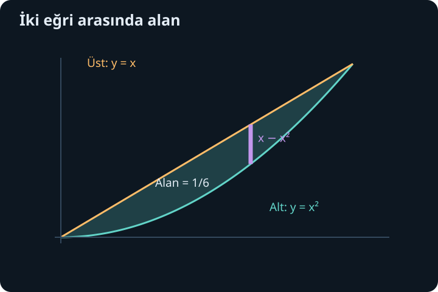
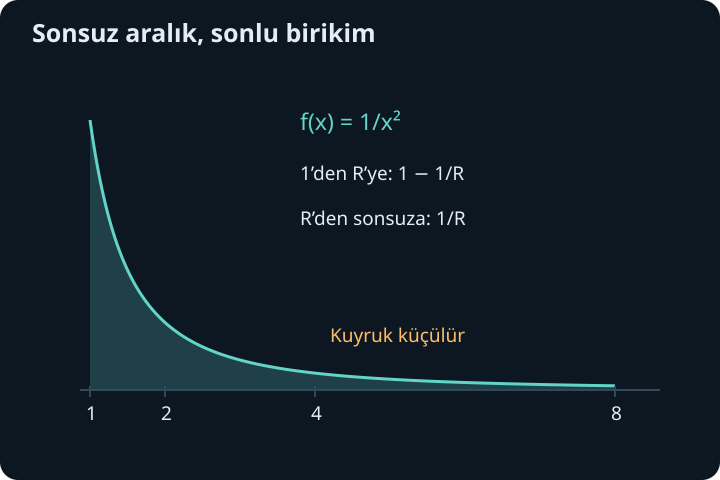

import ArticleVideo from '@/components/ArticleVideo.astro'
import kavram from './media/01-kavram.mp4?url'
import kavramPoster from './media/01-kavram.jpg?url'

İntegral bir formülden çok bir toplama düzenidir. Önce küçük parçanın neyi ölçtüğünü belirler, sonra o parçaları bir aralık boyunca toplarız. Parça bazen ince bir dikdörtgen, bazen ince bir disk, bazen kısa sürede alınan yol olur. Aynı integral işareti farklı büyüklükler için kullanılabilir; anlamı, integrandın ve değişkenin birlikte taşıdığı birimlerden gelir.

[Önceki yazıda](/blog/integral-alma-yontemleri/) değişken değiştirme, kısmi integrasyon ve cebirsel ayrıştırma yöntemlerini öğrendik. Burada bu hesapları ölçme sorularına bağlayacağız. Ardından birikim aralığı sonsuza uzadığında veya fonksiyon sınırsızlaştığında integralin nasıl tanımlanacağını inceleyeceğiz. Sonsuz bir şeklin sonlu alanı olabilmesi şaşırtıcıdır; bunu mümkün kılan şey, uzak parçaların yeterince hızlı küçülmesidir.

## 1. İki grafik arasındaki alan

Bir aralıkta üstte $f(x)$, altta $g(x)$ bulunsun. Düşey bir şeridin yüksekliği $f(x)-g(x)$, genişliği yaklaşık $\Delta x$'tir. Şerit alanı yaklaşık $[f(x)-g(x)]\Delta x$ olduğundan limitte:

$$
A=\int_a^b[f(x)-g(x)]dx
$$

olur. Bu formülde “üst eksi alt” sözü yalnız bir ezber değildir; geometrik bir uzunluk hesaplıyoruz ve uzunluğun negatif olmamasını istiyoruz.

$y=x$ ile $y=x^2$ arasındaki kapalı bölgeyi ele alalım. Kesişimler $x=x^2$, yani $x(x-1)=0$ denkleminden $x=0$ ve $x=1$ çıkar. Bu aralıkta $x\geq x^2$ olduğundan doğru üsttedir. Alan:

$$
\begin{aligned}
A&=\int_0^1(x-x^2)dx\\
&=\left[\frac{x^2}{2}-\frac{x^3}{3}\right]_0^1\\
&=\frac12-\frac13\\
&=\frac16.
\end{aligned}
$$

Eğer eğriler aralık içinde yer değiştiriyorsa integral aralığını kesişim noktalarında bölmeliyiz veya $|f-g|$ kullanmalıyız. Tek bir farkı bütün aralıkta toplamak, bazı bölgeleri negatif sayıp alanları birbirinden çıkarabilir. Önce kaba bir grafik veya işaret tablosu oluşturmak bu hatayı önler.

### Üstteki eğri değişince hesabı ikiye bölmek

$y=x$ ile $y=x^2$ arasındaki alanı bu kez $[0,2]$ aralığında soralım. $0<x<1$ için $x-x^2=x(1-x)>0$ olduğundan doğru üsttedir. $1<x<2$ için $1-x<0$ olduğundan parabol üsttedir. Bu nedenle aynı farkı bütün aralıkta kullanamayız:

$$
\begin{aligned}
A
&=\int_0^1(x-x^2)\,dx\\
&\quad+\int_1^2(x^2-x)\,dx\\
&=\frac16+\left[\frac{x^3}3-\frac{x^2}2\right]_1^2\\
&=\frac16+\left(\frac23+\frac16\right)\\
&=1.
\end{aligned}
$$

İkinci parçada alt uç değeri $1/3-1/2=-1/6$'dır; onu çıkarmak $+1/6$ oluşturur. Her iki alanın da pozitif çıkması geometrik anlamla uyumludur.

Yanlışlıkla $\int_0^2(x-x^2)\,dx$ alsaydık $2-8/3=-2/3$ bulurduk. Bu bir alan değil, iki bölgenin işaretli farkıdır. Hata antitürevde değildir; küçük şeridin yüksekliğini yanlış kurmuş olmamızdadır. İntegral hesaplamadan önce kesişimleri bulmak, yalnız sınırları değil hangi sırayla çıkarma yapacağımızı da belirler.

## 2. Yatay dilim bazen daha kolaydır

Aynı bölgeyi yatay dilimlerle de toplayabiliriz. $y=x$ doğrusu $x=y$, $y=x^2$ eğrisinin pozitif dalı $x=\sqrt y$ olur. $0\leq y\leq1$ için sağdaki sınır $\sqrt y$, soldaki sınır $y$'dir. Yatay şeridin uzunluğu $\sqrt y-y$ ve kalınlığı $dy$ olduğundan:

$$
\begin{aligned}
A&=\int_0^1(\sqrt y-y)dy\\
&=\left[\frac23y^{3/2}-\frac{y^2}{2}\right]_0^1\\
&=\frac23-\frac12\\
&=\frac16.
\end{aligned}
$$

İki hesap aynı bölgeyi farklı yönde dilimler. Değişken seçimi fiziksel alanı değiştirmez; sınırların yazılışını değiştirir. Bazı bölgeler düşey yönde birkaç parçaya ayrılırken yatay yönde tek integral ile anlatılabilir. “Mutlaka $dx$ kullanmalıyım” düşüncesi yerine hangi dilimin sınırlarını daha kolay yazabildiğimize bakarız.

### Yatay dilimde hangi karekök dalını seçiyoruz?

$y=x^2$ denklemini $x$ için çözerken $x=\pm\sqrt y$ çıkar. Önceki kapalı bölgede $0\le x\le1$ olduğundan yalnız pozitif dal kullanılabilir. Negatif dal başka bir parçaya aittir; bütün denklemin çözümü içinde bulunması, seçtiğimiz bölgenin sınırı olduğu anlamına gelmez.

Bir deneme yüksekliğiyle yönü kontrol edelim. $y=1/4$ olduğunda doğru üzerindeki nokta $x=1/4$, parabol üzerindeki nokta $x=1/2$'dir. Yatay şerit solda $1/4$'ten sağda $1/2$'ye uzanır; uzunluğu $1/4$ olur. Bu, $\sqrt y-y$ kuralının verdiği sonuçtur. Düşey dilimde “üst eksi alt” yaparken yatay dilimde “sağ eksi sol” yapmamızın nedeni değişen ölçüm yönüdür.

$dy$ ise yatay uzunluk değil, şeridin küçük düşey kalınlığıdır. Uzunlukla kalınlığın çarpımı alan verir. Değişkeni değiştirmek yalnız integraldeki harfi değiştirmek değildir: şeridin yönünü, sınırların fonksiyon olarak yazılışını ve hangi iki uzaklığı çıkardığımızı birlikte değiştiririz. Aynı bölgenin iki hesapta da $1/6$ vermesi bu kurulumların karşılıklı kontrolüdür.

## 3. Kesit alanlarından hacme

Bir cismin $x$ konumundaki dik kesit alanı $B(x)$ olsun. Kalınlığı küçük $\Delta x$ olan dilimin hacmi yaklaşık $B(x)\Delta x$ olur. Kesit alanı uygun biçimde sürekli değişiyorsa bütün hacim:

$$
V=\int_a^b B(x)dx
$$

ile bulunur. Alanın birimi metrekare ve $x$ metre ise çarpım metreküptür. Hacmi hesaplamak için her zaman üç katlı integral gerekmez; kesitleri zaten biliyorsak tek değişkenli toplama yeterlidir.

$y=x$ doğrusunun $0\leq x\leq2$ altında kalan bölgeyi $x$ ekseni çevresinde döndürelim. Her kesit yarıçapı $x$ olan bir dairedir; $B(x)=\pi x^2$. Böylece:

$$
V=\pi\int_0^2x^2dx=\pi\left[\frac{x^3}{3}\right]_0^2=\frac{8\pi}{3}.
$$

Ortaya taban yarıçapı 2, yüksekliği 2 olan koni çıkar. Bilinen koni formülü $\pi r^2h/3$ de aynı sonucu verir. İntegral, bu formülün neden üçte bir çarpanı taşıdığını dilimlerin değişen alanıyla açıklar.

### Koni hacmindeki üçte bir genel olarak nereden gelir?

Yüksekliği $H>0$, taban yarıçapı $R>0$ olan bir konide $x$ uzaklığını tepeden tabana doğru ölçelim. Benzer üçgenlerden, $x>0$ için kesit yarıçapının tepeden uzaklığa oranı sabittir: $r(x)/x=R/H$. İki tarafı $x$ ile çarparak $r(x)=Rx/H$ buluruz. Tepede oranı yazamayız, çünkü sıfıra bölme tanımsızdır; fakat elde ettiğimiz $r(x)=Rx/H$ ifadesi $x=0$ için de geometrinin gerektirdiği sıfır yarıçapı verir. $x=H$ için de yarıçap $R$'dir; iki uç doğru geometriyi verir.

Kesit alanı yarıçapın karesiyle değişir. Böylece

$$
\begin{aligned}
V
&=\int_0^H\pi\left(\frac{Rx}{H}\right)^2dx\\
&=\frac{\pi R^2}{H^2}\frac{H^3}{3}\\
&=\frac{\pi R^2H}{3}
\end{aligned}
$$

elde edilir. Üçte bir çarpanı, kesit alanındaki $x^2$'nin integralinden geldi. Yarıçap doğrusal artsa da alan doğrusal artmaz; bu nedenle yalnız başlangıç ve bitiş kesitlerinin ortalamasını almak doğru sonuç vermez.

Aynı taban ve yüksekliğe sahip silindirin her kesiti $\pi R^2$ olduğundan hacmi $\pi R^2H$'dir. Koni, bu silindirin içinde kalır ve bulduğumuz hacim onun üçte biridir. Böyle bir geometrik karşılaştırma, sonuçtaki birim ve büyüklüğü kontrol etmemizi sağlar.

## 4. Delikli kesit: halka yöntemi

Dönme bölgesi eksene değmiyorsa kesit bir disk yerine halka olabilir. Dış yarıçap $R(x)$, iç yarıçap $r(x)$ ve $R\geq r\geq0$ olsun. Halka alanı dış diskten iç diski çıkarınca:

$$
B(x)=\pi[R(x)^2-r(x)^2]
$$

olur. Burada $\pi(R-r)^2$ yazmak yanlıştır; yarıçap farkının karesi, iki disk alanının farkı değildir.

$y=x$ ile $y=x^2$ arasındaki önceki bölgeyi $x$ ekseni çevresinde döndürürsek $0\leq x\leq1$ için $R=x$, $r=x^2$ olur. Hacim:

$$
V=\pi\int_0^1(x^2-x^4)dx
=\pi\left(\frac13-\frac15\right)=\frac{2\pi}{15}.
$$

Geometrik alanın $1/6$ olması ile dönmüş cismin hacminin $2\pi/15$ olması arasında eşitlik beklemeyiz; farklı boyutlarda büyüklükler ölçüyoruz. Ayrıca dönüş eksenini değiştirirsek yarıçapları yeniden hesaplamalıyız. Eksen her zaman koordinat ekseni olmak zorunda değildir; yarıçap, seçilen eksene dik uzaklıktır.

### Dönme ekseni kayınca yarıçaplar nasıl değişir?

$0\le x\le1$ üzerindeki $x^2\le y\le x$ bölgesini bu kez $y=2$ doğrusu çevresinde döndürelim. Eksen bölgenin üzerindedir. Daha aşağıdaki $y=x^2$ eğrisi eksene daha uzaktır; dış yarıçap $R=2-x^2$ olur. Üstteki $y=x$ eğrisinin uzaklığı ise iç yarıçap $r=2-x$'tir.

Kesit alanını açarken iki karenin bütün terimlerini yazalım:

$$
\begin{aligned}
R^2-r^2
&=(2-x^2)^2-(2-x)^2\\
&=(4-4x^2+x^4)-(4-4x+x^2)\\
&=4x-5x^2+x^4.
\end{aligned}
$$

Böylece hacim $\pi(2-5/3+1/5)=8\pi/15$ çıkar. Aynı düzlemsel bölgeyi $x$ ekseni çevresinde döndürdüğümüzde $2\pi/15$ bulmuştuk; eksen değişince hacmin değişmesi beklenir.

$x=1/2$ kesitinde $R=7/4$, $r=3/2$ ve alan farkı $\pi(49/16-36/16)=13\pi/16$'dır. Yalnız kalınlığın karesini alsaydık $\pi(R-r)^2=\pi/16$ bulurduk. Halka kalınlığı, halkanın eksenden ne kadar uzakta olduğunu tek başına içermez; disk alanlarının farkını kullanmamızın nedeni budur.

Eksene uzaklık alırken bir başka durumu da ayırmalıyız: dilim dönme eksenini kesiyorsa içte delik kalmaz. Örneğin $x$ ekseni çevresinde dönen bir düşey dilim $-1\le y\le2$ aralığında olsun. Pozitif taraf 0'dan 2'ye kadar bütün yarıçapları zaten tarar. Negatif tarafın taradığı 0 ile 1 arasındaki disk bunun içindedir; ikinci kez eklenmez ve çıkarılmaz. Kesit bu yüzden $4\pi$ alanlı tek disktir.

Bu örnekte $\pi(2^2-1^2)=3\pi$ yazmak, merkezde gerçekte bulunmayan bir delik açardı. Önce dönmüş kesitin hangi uzaklıkları gerçekten doldurduğunu belirler, sonra disk veya halka formülünü seçeriz. İki eğrinin y değerlerini mutlak değere çevirmek tek başına iç ve dış yarıçapları belirlemeye yetmez; aralarındaki dilimin ekseni içerip içermediğini de kontrol ederiz.

## 5. Bir fonksiyonun aralık ortalaması

Sonlu sayıların ortalaması toplamın adet sayısına bölünmesidir. Sürekli bir fonksiyonun $[a,b]$ üzerindeki ortalama değeri de birikimin aralık uzunluğuna bölünmesiyle tanımlanır:

$$
f_{\mathrm{ort}}=\frac1{b-a}\int_a^b f(x)dx,\qquad a<b.
$$

Böylece sabit yüksekliği $f_{\mathrm{ort}}$ olan dikdörtgen aynı işaretli birikimi verir. $f$ sürekli olduğunda bu ortalama, en küçük ve en büyük değerler arasında kalır. Ara değer teoremi sayesinde en az bir noktada gerçekten alınır.

$f(x)=x^2$ için $[0,3]$ ortalaması $(1/3)[x^3/3]_0^3=3$ olur. Fonksiyon bu değeri $x=\sqrt3$'te alır. Uç değerlerin aritmetik ortalaması $(0+9)/2=4{,}5$'tir; farklı sonuç çıkar. Yalnız uçları ortalamak, fonksiyonun aralıktaki dağılımını hesaba katmaz. Doğrusal fonksiyonlarda bu kısa yol çalışır, fakat genel bir kural değildir.

### Ortalama formülünü eşit parçaların ortalamasından kurmak

$[a,b]$ aralığında eşit uzaklıklı $n$ örnek nokta seçelim. Fonksiyon değerlerinin aritmetik ortalaması $(1/n)\sum_i f(\xi_i)$ olur. Parça genişliği $\Delta x=(b-a)/n$ olduğundan $1/n=\Delta x/(b-a)$ yazabiliriz. Böylece

$$
\frac1n\sum_i f(\xi_i)
=\frac1{b-a}\sum_i f(\xi_i)\Delta x
$$

elde edilir. Sağdaki toplam, parçalar incelirken belirli integrale yaklaşır. Dolayısıyla integral ortalaması, sıradan aritmetik ortalamanın eşit aralıklı çok sayıda örneğe uygulanmasının limitidir.

Eşit olmayan parçalar kullanırsak her örneğe aynı ağırlığı vermek doğru olmaz. Daha geniş bir bölgeyi temsil eden değerin katkısı daha büyük olmalıdır; Riemann toplamındaki $\Delta x_i$ çarpanı bu ağırlığı taşır. Ortalama alınan şey yalnız bir değer listesi değil, değerlerin aralık boyunca ne kadar yer tuttuğudur.

$f(x)=x^2$ için $[0,3]$ üzerinde bulduğumuz 3 sayısı, fonksiyonun birimiyle aynı birimdedir: integralde eklenen uzunluk birimi $b-a$'ya bölünürken gider. Bu da ortalamanın alan değil, ortalama yükseklik olduğunu gösterir.

## 6. Hızdan yer değiştirme ve yol

Bir doğru üzerindeki konumu $s(t)$, işaretli hızı $v(t)=s'(t)$ ile gösterelim. $t$ zaman olsun. Temel teorem:

$$
s(b)-s(a)=\int_a^b v(t)dt
$$

der. Bu yer değiştirmedir; son konum ile ilk konumun farkını ölçer. Toplam yol ise ileri ve geri gidilen uzunlukları ayrı ayrı pozitif sayar:

$$
\text{toplam yol}=\int_a^b|v(t)|dt.
$$

Örneğin $0\leq t\leq4$ saniye boyunca $v(t)=t-2$ metre/saniye olsun. İlk iki saniyede hız negatif, son iki saniyede pozitiftir. Yer değiştirme $[t^2/2-2t]_0^4=0$ metredir. Toplam yol ise:

$$
\begin{aligned}
\int_0^2(2-t)dt+\int_2^4(t-2)dt&=2+2\\
&=4\ \text{metre}
\end{aligned}
$$

olur. Cisim başladığı yere dönmüş ama hareketsiz kalmamıştır. İşaretli alan sıfır, mutlak alan dört olduğu için bu ayrım grafikte de görülebilir. Bu örnekte kuvvet veya enerji bilgisi gerekmiyor; yalnız konumun türevi ile birikimini kullanıyoruz.

<ArticleVideo src={kavram} poster={kavramPoster} title="İşaretli birikim ile toplam yol" caption="Hızın işaret değiştirdiği bölgelerde yer değiştirme katkıları birbirini azaltır; toplam yol her iki yöndeki hareketi pozitif sayar." />

### Konumu geri kurup toplam yolu denetlemek

$v(t)=t-2$ için $s(t)=t^2/2-2t+C$ bir konum fonksiyonudur. Başlangıç konumunu 5 metre seçersek $C=5$ olur. Böylece $s(0)=5$, $s(2)=3$ ve $s(4)=5$ çıkar. Cisim önce 5'ten 3'e, sonra 3'ten 5'e gider. Parçaların uzunlukları $|3-5|=2$ ve $|5-3|=2$ metredir; toplam 4 metre olur.

Bu ikinci hesap integral sonucunu doğrudan konumlardan doğrular. Başlangıç konumunu değiştirseydik bütün konumlara aynı sabit eklenirdi; yer değiştirme ve toplam yol değişmezdi. Bu büyüklükler konum seviyesinden değil, konum farklarından oluşur.

Sıfır hızı bulduğumuz $t=2$ noktası, burada işaret değişiminin olduğu noktadır; bu yüzden yolu hesaplarken aralığı orada böldük. Her hız sıfırı mutlaka yön değişimi değildir. Örneğin $v(t)=(t-2)^2$ sıfıra değse de iki yanında pozitiftir; cisim yön değiştirmez. Mutlak değeri açmak için yalnız kökleri bulmakla kalmayıp her aralıktaki işareti de incelememiz gerekir.

## 7. Sonsuz aralıkta integral bir limittir

Şimdi $\int_1^\infty 1/x^2\,dx$ yazımını ele alalım. Sonsuzluk sıradan bir üst sınır sayısı değildir; önce sonlu $R>1$ için hesap yapar, sonra $R$'yi büyütürüz:

$$
\begin{aligned}
\int_1^\infty\frac{dx}{x^2}&:=\lim_{R\to\infty}\int_1^R\frac{dx}{x^2}\\
&=\lim_{R\to\infty}\left(1-\frac1R\right)\\
&=1.
\end{aligned}
$$

İki nokta ve eşittir birlikte, soldaki ifadenin sağdaki limit ile tanımlandığını belirtir. Limit sonluysa integral **yakınsaktır**. Sonlu bir limit yoksa **ıraksaktır**. Sonsuza uzanan bölgenin alanı burada 1'dir. Yatay uzunluk sınırsız olsa da yükseklik yeterince hızlı küçülür.

Buna karşılık $\int_1^R dx/x=\ln R$ olur ve $R\to\infty$ iken sınırsız büyür. $1/x$ de sıfıra yaklaşır, fakat toplam alanı sonlu yapmak için yeterince hızlı azalmaz. İntegrandın sıfıra yaklaşması tek başına yeterli bir yakınsaklık testi değildir.

### Sonsuz toplamda geriye kalan kısmı ölçmek

$1/x^2$ örneğinde $[1,R]$ boyunca birikim $1-1/R$, bütün uygunsuz integral ise 1'dir. Bu nedenle $R$'den sonrasındaki kuyruk alanı $1/R$ olur. İstenen hata $0{,}001$'den küçükse $1/R<0{,}001$, yani $R>1000$ seçmeliyiz. Büyük ama sonlu bir sınırla hesap yaptığımızda ne kadar alanı dışarıda bıraktığımızı böyle ölçebiliriz.

Bu, sonsuzluğun yerine 1000 yazmakla aynı iddia değildir. $R=1000$ için sonuç $0{,}999$'dur ve dışarıda kalan alan tam $0{,}001$'dir. Limit, bu hatanın istediğimiz kadar küçültülebileceğini söyler.

$1/x$ için aynı yaklaşım işlemez. $[R,2R]$ parçasının alanı $\ln(2R)-\ln R=\ln2$'dir; $R$ ne kadar büyürse büyüsün bu katkı değişmez. Her ikiye katlanan yeni uzaklık dilimi aynı pozitif alanı ekler. Fonksiyonun yüksekliği küçülse de yeni dilimlerin genişliği bu azalmayı telafi eder. $1/x$ ile $1/x^2$ arasındaki yakınsaklık farkını yalnız grafik yüksekliğinden okuyamamamızın nedeni budur.

## 8. Sonsuzdaki p testi

$p$ gerçek bir sabit olsun. $p\ne1$ için güç kuralı:

$$
\int_1^R x^{-p}dx=\frac{R^{1-p}-1}{1-p}
$$

verir. $p>1$ ise $1-p<0$ olduğundan $R^{1-p}\to0$ ve sonuç $1/(p-1)$ olur. $p<1$ ise pozitif üs nedeniyle $R^{1-p}$ büyür. $p=1$ durumunu logaritmayla zaten inceledik. Dolayısıyla:

$$
\begin{aligned}
&\int_1^\infty\frac{dx}{x^p}\text{ yakınsaktır}\\&\quad\Longleftrightarrow\quad p>1.
\end{aligned}
$$

Buradaki başlangıç noktası 1 yerine herhangi bir pozitif sayı olabilir; sonsuzdaki yakınsaklık davranışı değişmez. Sonlu başlangıç parçası yalnız toplam değeri değiştirir. Test bize büyük girdilerde ne olduğuna bakmanın neden yeterli olduğunu gösterir.

## 9. Sınırlı aralıkta sınırsız yükseklik

Uygunsuzluk yalnız sonsuz aralıktan doğmaz. $1/\sqrt x$, sıfıra yaklaşırken sınırsızdır. Bu nedenle integralini sıfırdan doğrudan sıradan sürekli fonksiyon teoremiyle alamayız. Önce $\varepsilon>0$ seçeriz:

$$
\begin{aligned}
\int_0^1\frac{dx}{\sqrt x}&:=\lim_{\varepsilon\to0^+}\int_\varepsilon^1x^{-1/2}dx\\
&=\lim_{\varepsilon\to0^+}(2-2\sqrt\varepsilon)\\
&=2.
\end{aligned}
$$

Yüksekliğin sınırsız olması alanın zorunlu olarak sonsuz olacağı anlamına gelmez. Buna karşılık $\int_\varepsilon^1dx/x=-\ln\varepsilon$ büyüdüğünden $\int_0^1dx/x$ ıraksar. Genel güç hesabı $\int_0^1x^{-p}dx$ integralinin ancak $p<1$ iken yakınsak olduğunu verir.

Sonsuz uçtaki koşul $p>1$, sıfırdaki koşul $p<1$'dir. Bu farkı bir çelişki gibi görmeyelim: iki farklı bölgedeki davranışı inceliyoruz. $x^{-p}$ büyük $x$ için $p$ arttıkça daha hızlı küçülür; küçük pozitif $x$ için ise daha hızlı büyür.

### Sıfırdaki güç testini de aynı limit hesabıyla çıkarmak

$p\ne1$ için alt sınırı önce $\varepsilon>0$ tutalım. Güç kuralı

$$
\begin{aligned}
\int_\varepsilon^1x^{-p}\,dx
&=\left[\frac{x^{1-p}}{1-p}\right]_\varepsilon^1\\
&=\frac{1-\varepsilon^{1-p}}{1-p}
\end{aligned}
$$

verir. $p<1$ ise $1-p>0$ olur; pozitif kuvvetteki $\varepsilon$ sıfıra gider ve limit $1/(1-p)$ çıkar. Örneğin $p=1/2$ için sonuç 2'dir. $p>1$ olduğunda ise $\varepsilon^{1-p}=1/\varepsilon^{p-1}$ sınırsız büyür. Pay ve payda negatif olduğundan integral pozitif yönde sınırsız büyür. $p=1$ durumunu yine ayrı logaritma hesabı belirler.

Sonsuzdaki testte büyüyen değişkenin kuvvetini, burada küçülen değişkenin kuvvetini inceliyoruz. Aynı üs işaretinin farklı sonuç vermesi bundan kaynaklanır. Tek başına $x^{-p}$ fonksiyonunu $0$'dan sonsuza kadar toplamak istersek iki ucun da yakınsak olması gerekir. Biri $p<1$, diğeri $p>1$ istediğinden hiçbir gerçek $p$ iki koşulu birden sağlayamaz. Bir ucu düzeltmek, öteki ucun sorununu otomatik olarak çözmez.

## 10. İç tekillikleri ayrı ayrı ele almak

Bir fonksiyon $[a,b]$ aralığının içindeki $c$ noktasında sınırsızsa iki tarafı ayrı limitlerle tanımlarız:

$$
\begin{aligned}
&\int_a^b f(x)dx\\&\quad=\lim_{u\to c^-}\int_a^u f(x)dx\\&\qquad+\lim_{v\to c^+}\int_v^b f(x)dx.
\end{aligned}
$$

Standart uygunsuz integralin yakınsak olması için iki limitin de ayrı ayrı sonlu olması gerekir. $f(x)=1/x$ için $[-1,1]$ aralığında sol limit negatif sonsuza, sağ limit pozitif sonsuza gider. Bu yüzden integral yakınsak değildir.

$\int_{-1}^{-\varepsilon}dx/x+\int_\varepsilon^1dx/x=0$ eşitliği doğrudur. Fakat iki kesmeyi aynı hızla yaklaştırmak, farklı bir kavram olan simetrik esas değeri hesaplar. Bir tarafta $\varepsilon$, diğer tarafta $2\varepsilon$ seçilse sonuç başka bir sabit olur. Bağımsız limit koşulu tam da bu keyfi iptalleri önler. Sonsuz aralığın iki ucu varsa da aynı ilke geçerlidir: iki kuyruğu ayrı denetleriz.

### Simetrik kesmenin sakladığı keyfîliği hesaplamak

$1/x$ örneğinde sol tarafta $-\varepsilon$'e, sağ tarafta $2\varepsilon$'e kadar yaklaşalım; $0<\varepsilon<1/2$ olsun. $\ln|x|$ antitürevini kullanınca

$$
\begin{aligned}
\int_{-1}^{-\varepsilon}\frac{dx}{x}
&=\ln\varepsilon,\\
\int_{2\varepsilon}^{1}\frac{dx}{x}
&=-\ln(2\varepsilon)
\end{aligned}
$$

buluruz. Toplam $-\ln2$ olur; simetrik kesmedeki sıfır sonucundan farklıdır. Sağ kesmeyi $k\varepsilon$ seçseydik, sabit $k>0$ için yeterince küçük $\varepsilon$ değerlerinde sonuç $-\ln k$ çıkardı. İki sonsuz katkının birbirini nasıl götüreceğini seçtiğimiz yaklaşma oranı belirlemektedir.

Standart uygunsuz integral bu seçime izin vermez: sol parçanın limiti ve sağ parçanın limiti ayrı ayrı sonlu olmalıdır. Burada $\ln\varepsilon$ negatif yönde, $-\ln(2\varepsilon)$ pozitif yönde sınırsızdır; koşul sağlanmaz. “Sonsuz eksi sonsuz eşittir sıfır” diye bir aritmetik kural olmamasının somut örneğini görüyoruz.

Simetrik esas değer başka sorularda yararlı olabilir, ama onun varlığı standart uygunsuz integralin varlığı değildir. Hangi limit tanımını kullandığımızı söylemek, hesapladığımız sayının anlamını belirler.

## 11. Karşılaştırmayla karar vermek

Bazen antitürevi bulmadan yakınsaklığa karar verebiliriz. Yeterince büyük $x$ için $0\leq f(x)\leq g(x)$ olsun. $g$'nin kuyruğunun integrali sonluysa $f$'ninki de sonludur. Gerekçe, $f$'nin sonlu kesmelerdeki birikiminin artan ama $g$'nin toplamıyla yukarıdan sınırlı olmasıdır. Gerçek sayıların tamlığı bu artan sınırlı birikime bir limit verir.

Örneğin $x\geq1$ için $0\leq1/(1+x^2)\leq1/x^2$ olduğundan ilk integral yakınsaktır. Aslında antitürevi arktanjantla değerini $\pi/4$ bulabiliriz, fakat karşılaştırma değeri bilmeden varlığı garanti etti. Ters yönde, $f\geq g\geq0$ ve $g$'nin integrali ıraksaksa $f$ de ıraksaktır. Eşitsizliği yanlış yönde kullanmak sonuç vermez.

### Aynı integralde iki farklı uygunsuz uç

Bir integral hem sıfır yakınında sınırsız bir yüksekliğe hem de sonsuza uzanan bir aralığa sahip olabilir. Şu örnekte iki sorunu ayrı ayrı ele almalıyız:

$$
I=\int_0^\infty\frac{dx}{\sqrt{x}(1+x)}.
$$

İntegrand yalnız $x>0$ için yazılmıştır. Sıfırda $\sqrt{x}$ paydası küçülür; sonsuzda ise toplama aralığı bitmez. Önce 1 noktasında bölelim. $0<x\le1$ için $1+x\ge1$ olduğundan integrand en fazla $1/\sqrt{x}$'tir. Bu üst sınırın sıfır yakınındaki integrali sonludur. $x\ge1$ için ise $1+x\ge x$ olur; integrand en fazla $1/x^{3/2}$'dir. Bunun sonsuzdaki integrali de sonludur. Böylece iki parça ayrı ayrı yakınsaktır.

Değerini bulmak için önce sonlu $0<\varepsilon<R$ sınırlarında çalışalım. $t=\sqrt{x}$, yani $x=t^2$ seçersek $t>0$ ve $dx=2t\,dt$ olur. Dolayısıyla:

$$
\begin{aligned}
\int_\varepsilon^R\frac{dx}{\sqrt{x}(1+x)}&=2\int_{\sqrt\varepsilon}^{\sqrt R}\frac{dt}{1+t^2}\\
&=2[\arctan t]_{\sqrt\varepsilon}^{\sqrt R}.
\end{aligned}
$$

Pay ile paydadaki $t$'leri yalnız $t>0$ olan bu sonlu aralıkta sadeleştirdik; sıfırda geçersiz bir bölme yapmadık. Şimdi iki parçanın limitlerini bağımsız alabiliriz. Sıfırdan 1'e kadar olan parça $2(\pi/4-0)=\pi/2$, 1'den sonsuza kadar olan parça $2(\pi/2-\pi/4)=\pi/2$ verir. Toplam $I=\pi$'dir.

Tek bir güç fonksiyonunda sıfır ve sonsuz için farklı koşullar bulmuştuk. Burada da aynı düşünce geçerlidir: sıfır yakınında baskın davranış $x^{-1/2}$, büyük girdilerde $x^{-3/2}$ gibidir. Ancak “gibi” benzetmesiyle yetinmedik; iki bölgede geçerli açık eşitsizlikler kurduk. Böylece bir uçta yakınsaklık göstermenin diğer ucu otomatik olarak çözmediğini, buna rağmen uygun biçimde değişen bir fonksiyonun her iki koşulu da sağlayabildiğini gördük.

### Karşılaştırmada doğru yönü seçmek

$0\le f\le g$ eşitsizliğinde büyük fonksiyonun toplamı sonluysa küçük fonksiyonunki de sonlu olmak zorundadır. Ancak büyük fonksiyonun toplamı sonsuz diye küçük fonksiyon için karar veremeyiz. Örneğin $x\ge1$ için $1/x^2\le1/x$'tir; sağdaki integral ıraksakken soldaki yakınsaktır.

Iraksaklık kanıtında ise küçük ama zaten sonsuz toplam veren bir alt sınır ararız. $x\ge1$ için $x+1\le2x$ olduğundan, pozitif sayıların karşılıklısını alınca eşitsizlik yönü ters döner:

$$
\frac1{x+1}\ge\frac1{2x}.
$$

Sağ tarafın integrali $\frac12\ln R$ ile sınırsız büyür. Dolayısıyla $\int_1^\infty1/(x+1)\,dx$ de ıraksaktır. Bu kez doğru yönde bir alt sınır kullandık.

Karşılaştırmanın “yeterince büyük girdilerde” yapılabilmesi de sonlu başlangıç bölümünün ayrı tutulmasına dayanır. Başlangıç bölgesinde bir tekillik varsa onu ayrıca incelemeliyiz; kuyruktaki iyi davranış bu tekilliği ortadan kaldırmaz. Böylece karşılaştırma, bütün integrali düşünmeden yalnız bir eşitsizliği ezberleme işlemi olmaktan çıkar.

## 12. İşaret değişimiyle yakınsaklık

Pozitif fonksiyonlarda biriken toplam yalnız artar. İşaret değişen fonksiyonlarda karşılıklı iptal başka bir yakınsaklık türü doğurabilir. $\int_1^\infty\sin x/x\,dx$ örneğine bakalım. Kısmi integrasyonla sonlu $R$ için:

$$
\int_1^R\frac{\sin x}{x}dx
=\left[-\frac{\cos x}{x}\right]_1^R
-\int_1^R\frac{\cos x}{x^2}dx.
$$

Sınır terimi sonlu bir değere yaklaşır. Son integralin mutlak değeri, $\int_1^\infty1/x^2dx$ ile kontrol edilir. Bu nedenle sinüslü uygunsuz integral yakınsaktır. Burada değerini hesaplamadık; yakınsaklığını gerekçelendirdik.

Ancak mutlak değer alınırsa $\int_1^\infty|\sin x|/x\,dx$ ıraksar. Her $[n\pi+\pi/6,n\pi+5\pi/6]$ aralığında $|\sin x|\geq1/2$ ve $x\leq(n+1)\pi$ olur. Bu parçanın katkısı en az $1/[3(n+1)]$'dir. Bu alt sınırların toplamı sınırsız büyür: paydaları 2 ile 4, 4 ile 8, 8 ile 16 arasındaki gruplara ayırdığımızda her grup sabit bir pozitif alt katkı verir. Grup sayısı büyüdükçe toplam da büyür.

### İşaretli kuyruk ile mutlak alanın farkını nicel görmek

Kısmi integrasyon sonucundaki $\cos x/x^2$ kuyruğu için

$$
\begin{aligned}
\left|\int_R^S\frac{\cos x}{x^2}\,dx\right|
&\le\int_R^S\frac{dx}{x^2}\\
&\le\frac1R,\qquad S>R>1.
\end{aligned}
$$

olur. İstediğimiz kadar uzaktaki iki kesme arasında kalan fark, $R$ büyüdükçe sıfıra zorlanır. Yakınsaklığı sağlayan, yalnız toplamların sınırlı görünmesi değil, uzak kuyruk farklarının bu şekilde kontrol edilebilmesidir. Sınırdaki $\cos R/R$ terimi de mutlak değerce en fazla $1/R$ olduğundan sıfıra gider.

Mutlak alan için kullanılan alt sınırı da açalım. $n\ge1$ tam sayısında seçtiğimiz aralığın uzunluğu $2\pi/3$'tür. Bu aralıkta yükseklik en az $1/[2(n+1)\pi]$ olduğundan katkı en az $1/[3(n+1)]$ olur. $k=1,2,3,\ldots$ için paydaları $m=2^k$ ile $m=2^{k+1}-1$ arasında gruplayınca $2^k$ terim vardır; her biri en az $1/[3\cdot2^{k+1}]$ olduğundan her grup en az $1/6$ katkı verir. Sonsuz sayıda böyle grup sonlu bir alana sığmaz.

Böylece iki sonucu ayrı gerekçelerle kurduk: işaretli integralin kuyrukları küçülür, mutlak değerli katkıların toplamı ise sınırsız büyür.

Mutlak değerli integral de yakınsaksa **mutlak yakınsaklık**, yalnız işaretli integral yakınsaksa **koşullu yakınsaklık** deriz. İptale bağlı bir sonucun, toplam geometrik alanın sonluluğunu söylemediğini bu örnek açıkça gösterir. Birikim hesaplarında önce neyi topladığımızı, sonra limitin nasıl alındığını belirtmek bütün bu ayrımları düzenler. Bir sonraki yazıda sürekli parçalar yerine tek tek sayıları sonsuza kadar toplayarak serileri kuracağız.

## Kaynaklar

- [OpenStax, Calculus Volume 2: Determining Volumes by Slicing](https://openstax.org/books/calculus-volume-2/pages/2-2-determining-volumes-by-slicing)
- [OpenStax, Calculus Volume 2: Improper Integrals](https://openstax.org/books/calculus-volume-2/pages/3-7-improper-integrals)
