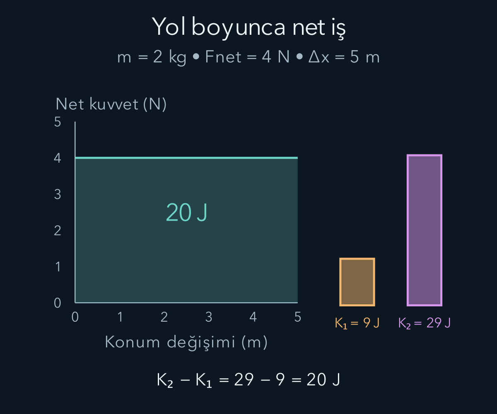
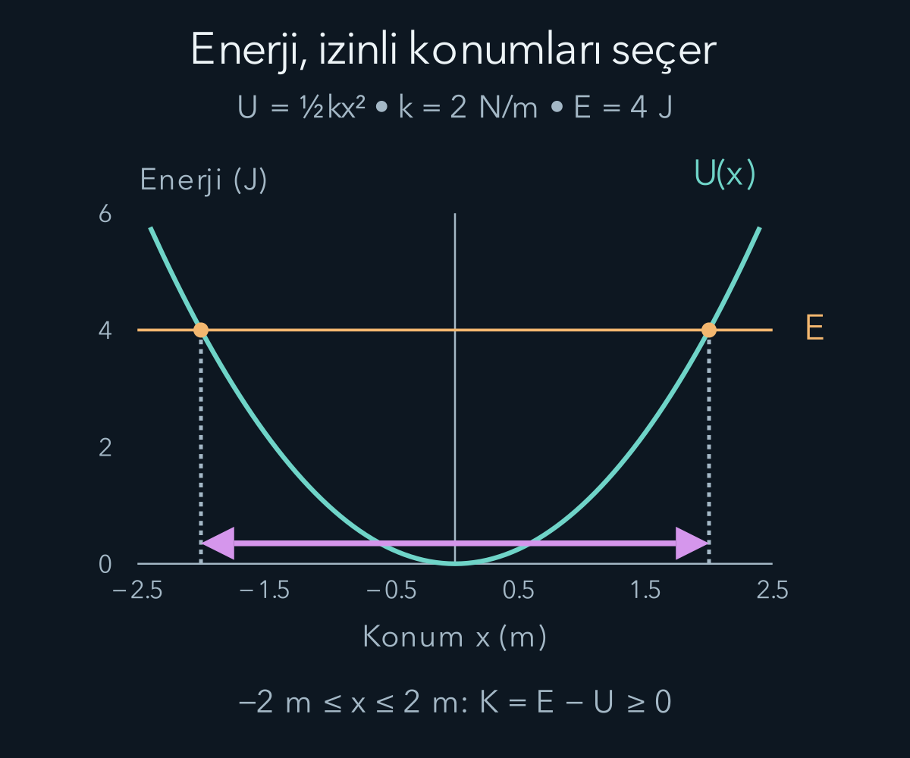

import ArticleVideo from '@/components/ArticleVideo.astro'
import kavram from './media/01-kavram.mp4?url'
import kavramPoster from './media/01-kavram.jpg?url'

Bir kutuyu bir metre itmekle on metre itmek aynı sonucu doğurmaz. Kuvvetin büyüklüğünün yanında, kuvvetin hangi yönde ve ne kadar yol boyunca etkidiği önemlidir. Newton yasalarını her an için çözmek mümkündür; bazen ise bütün yol boyunca etkiyi toplamak başlangıç ve son durum arasındaki ilişkiyi çok daha doğrudan verir. Bu toplam bizi **iş** ve **enerji** kavramlarına götürür.

[Newton yasaları yazısında](/blog/newton-yasalari-ve-kuvvetler/) net kuvvet ile ivme arasındaki bağı kurduk. Şimdi skaler çarpımı, çizgi integralini ve türevde zincir kuralını kullanacağız. Skaler çarpımın bir vektörün diğerinin yönündeki bileşenini seçtiğini; integralin küçük katkıları topladığını hatırlayalım. Enerji yönteminin başarısı, kuvvetleri ortadan kaldırmasından değil onların etkisini farklı biçimde hesaplamasından gelir.

**Ön bilgi bağlantıları:** [Skaler çarpım](/blog/skaler-carpim-aci-ve-izdusum/), [belirli integral](/blog/belirli-integral-ve-temel-teorem/) ve [vektör alanlarında çizgi integrali](/blog/vektor-alanlari-ve-integral-teoremleri/). Bir küçük yer değiştirmede yalnız kuvvetin yol doğrultusundaki bileşeni işe katkı verir.

## 1. Fizikte işin belirli bir anlamı vardır

Bir parçacık küçük $d\mathbf r$ yer değiştirmesi yaparken $\mathbf F$ kuvvetinin yaptığı küçük iş:

$$
dW=\mathbf F\cdot d\mathbf r
$$

ile tanımlanır. Burada nokta skaler çarpımdır ve $W$ işi gösterir. Bir yolun tamamında küçük katkıları toplarsak $W=\int_C\mathbf F\cdot d\mathbf r$ elde edilir. $C$ harfi izlenen yolu belirtir. İş yön taşıyan bir vektör değildir; pozitif, negatif veya sıfır olabilen skaler niceliktir.

Kuvvet sabitse sonuç $W=Fs\cos\theta$ biçimine iner. $s$ burada doğrusal yer değiştirmenin büyüklüğü, $\theta$ kuvvet ile yer değiştirme arasındaki açıdır. Kuvvet hareketle aynı yöndeyse iş pozitif, ters yöndeyse negatif olur. Dik kuvvetin skaler çarpımı sıfırdır. Bu durumda kuvvet hareket yönünü değiştirebilse de o küçük harekette iş yapmaz.

On newtonluk kuvvet, yatayla altmış derece açı yaparak bir kutuyu yatay doğrultuda üç metre çeksin. Hareket doğrultusundaki bileşen $10\cos60^\circ=5\,\mathrm N$ olur. Kuvvetin işi $5\times3=15\,\mathrm J$ çıkar. Joule, $\mathrm J$ ile gösterilen enerji ve iş birimidir; bir joule bir newton metreye eşittir. Kuvvetin tamamını üçle çarpıp otuz bulmak, işe katkı vermeyen dik bileşeni de sayardı.

Günlük dilde yorucu olan her davranış, belirli bir cisim üzerinde mekanik iş yapmak zorunda değildir. Bir çantayı aynı yükseklikte hareketsiz tutarken çantaya uygulanan kuvvet vardır ama çantanın yer değiştirmesi yoktur. Kasların enerji tüketmesi başka bir sistemin iç süreçleriyle ilgilidir. “Çanta üzerinde mekanik iş sıfır” sonucu, insan bedeninde hiç enerji dönüşümü olmadığını söylemez.

## 2. Değişken kuvveti küçük parçalarda toplamak

Kuvvet konuma bağlıysa tek bir kuvvet değeriyle toplam yolu çarpamayız. Tek boyutta $W=\int_{x_1}^{x_2}F_x(x)\,dx$ kullanırız. Kuvvet-konum grafiğinin altındaki işaretli alan bu integrali temsil eder. Alanın birimi newton metre olduğu için sonuç iş birimiyle uyumludur.

Örneğin $F_x=bx$ olsun; $b=4\,\mathrm{N/m}$ sabitini seçelim. Parçacık sıfırdan iki metreye giderken kuvvet sıfırdan sekiz newtona çıkar. İş:

$$
W=\int_0^{2\,\mathrm m} bx\,dx
=\frac12b(2\,\mathrm m)^2=8\,\mathrm J
$$

olur. Grafikte tabanı iki metre, yüksekliği sekiz newton olan üçgenin alanını hesapladık. Son kuvveti bütün yol boyunca varmış gibi kullanmak işi iki kat fazla verirdi. Başlangıç ve son kuvvetlerin ortalamasını kullanabilmemizin nedeni burada kuvvetin doğrusal değişmesidir; genel bir eğride aynı kısayol güvenilir değildir.

Birden fazla kuvvet varsa her kuvvetin işini ayrı hesaplayıp toplayabiliriz. İntegral ve skaler çarpım toplama göre doğrusal olduğundan bu toplam net kuvvetin işiyle aynıdır. Fakat farklı kuvvetlerin işleri birbirini kısmen götürebilir. Pozitif bir çekme işi yapılırken sürtünme negatif iş yapabilir; hareketi belirleyen enerji değişimi net iştir.

## 3. Kinetik enerji bağıntısını türetmek

Sabit kütleli parçacık için net kuvvet $\mathbf F_{\mathrm{net}}=m\,d\mathbf v/dt$ olur. Küçük yer değiştirme $d\mathbf r=\mathbf v\,dt$ olduğundan:

$$
dW_{\mathrm{net}}
=m\frac{d\mathbf v}{dt}\cdot\mathbf v\,dt
=m\mathbf v\cdot d\mathbf v.
$$

Vektörlü türev adımını bileşenlerde açmak yararlıdır. Sabit Kartezyen eksenlerde $v^2=v_x^2+v_y^2+v_z^2$ olduğundan zincir kuralı verir:

$$
\begin{aligned}
d(v^2)&=2v_x\,dv_x+2v_y\,dv_y+2v_z\,dv_z\\
&=2\mathbf v\cdot d\mathbf v.
\end{aligned}
$$

Buradaki $v^2$, tek bir bileşenin değil hız vektörünün uzunluğunun karesidir. Dolayısıyla türetim yalnız düz çizgide harekete bağlı değildir. Hız sadece yön değiştiriyorsa $d(v^2)=0$ olabilir; bu durumda net iş sıfırdır, fakat net kuvvetin sıfır olması gerekmez. Sabit süratli çembersel hareket bu ayrımın örneğidir.

Hız vektörünün kendisiyle skaler çarpımı $v^2$ olduğuna göre $d(v^2)=2\mathbf v\cdot d\mathbf v$ yazabiliriz. Böylece:

$$
dW_{\mathrm{net}}=d\left(\frac12mv^2\right).
$$

İki durum arasında integral almak şu ilişkiyi verir:

$$
W_{\mathrm{net}}=K_2-K_1,\qquad K=\frac12mv^2.
$$

$K$, **kinetik enerji**, yani bu parçacık modelinde hareketle ilişkili enerjidir. Yarım katsayısı bir ezberden değil integralden çıktı. Hızın yönü enerji ifadesinde görünmez; büyüklüğün karesi vardır. Aynı kütle ve aynı sürat, hareket farklı yönlerde olsa bile aynı kinetik enerjiyi verir.

Kinetik enerji negatif olamaz ve seçilen referans sistemine bağlıdır. Trende duran çantanın trene göre kinetik enerjisi sıfırken yere göre sıfır olmayabilir. Bu, enerjinin tutarsız olduğu anlamına gelmez. Aynı fiziksel hesabın kuvvet, yer değiştirme ve hızlarını aynı referans sisteminde kullanmak gerekir.

## 4. Bir hız hesabını iki yoldan görmek

Kütlesi iki kilogram olan bir kızak başlangıçta üç metre bölü saniye süratle gidiyor olsun. Hareket doğrultusunda sabit dört newton net kuvvet, kızağı beş metre boyunca etkilesin. Net iş $4\times5=20\,\mathrm J$ olur. Başlangıç kinetik enerjisi $K_1=\tfrac12(2)(3^2)=9\,\mathrm J$ bulunduğundan son enerji yirmi dokuz jouledür.

Son hızın büyüklüğü için:

$$
\frac12(2\,\mathrm{kg})v_2^2=29\,\mathrm J,
\qquad v_2=\sqrt{29}\,\mathrm{m/s}\approx5{,}39\,\mathrm{m/s}.
$$

Aynı sonuca Newton yasasıyla da ulaşabiliriz. İvme $4/2=2\,\mathrm{m/s^2}$ olur. Sabit ivme bağıntısı $v_2^2=v_1^2+2a\Delta x=9+20=29$ verir. Enerji yöntemi, kuvvet yasası ile kinematikten gelen bilgiyi farklı bir biçimde düzenledi.

Enerji hesabı süreyi doğrudan vermedi. Ayrıca sonucun pozitif karekökünü sürat olarak aldık; hızın yönünü fiziksel hareketten biliyoruz. Birden fazla olası hareket yolu veya yön varsa yalnız tek bir enerji eşitliği bütün ayrıntıları seçmeyebilir. Enerji yönteminin kısa olması, her soruyu tek başına çözeceği anlamına gelmez.

## 5. Korunumlu kuvvet ve potansiyel enerji

Bazı kuvvetlerin A'dan B'ye yaptığı iş, bu iki nokta arasında hangi yolun izlendiğine bağlı değildir. Böyle bir kuvvete **korunumlu kuvvet** deriz. Aynı noktaya dönülen kapalı yol boyunca toplam işi sıfırdır. Bu özellik, konuma bağlı bir potansiyel enerji fonksiyonu tanımlamamızı sağlar:

$$
U(B)-U(A)=-\int_A^B\mathbf F\cdot d\mathbf r.
$$

$U$ potansiyel enerjidir. Eksi işareti, korunumlu kuvvetin pozitif iş yaparken potansiyel enerjiyi azalttığını gösterir. Bir cisim düşerken yerçekimi pozitif iş yapar; cisim-Dünya sisteminin kütleçekim potansiyel enerjisi azalır. Potansiyel enerji bir etkileşim düzenine aittir. “Cismin potansiyel enerjisi” kısaltması kullanılsa da kaynakla ilişki unutulmamalıdır.

Tek boyutta $F_x=-dU/dx$; çok boyutta $\mathbf F=-\nabla U$ yazılır. Gradyan, potansiyelin en hızlı arttığı yönü gösterir; kuvvet ters yöndedir. Önceki alanlar yazısında gördüğümüz potansiyel fikri burada fiziksel enerjiye bağlandı. Bir alanın dönelinin sıfır olmasından küresel potansiyel çıkarırken bölgenin uygun topolojisi, örneğin basit bağlantılı olması gerekir. Bu yazıdaki düzgün yay ve yakın Dünya alanlarında böyle bir engelle karşılaşmıyoruz.

Potansiyel enerjiye sabit eklemek kuvveti değiştirmez. Çünkü sabitin türevi sıfırdır. Sıfır düzeyini seçme özgürlüğü bu yüzden vardır; ölçülebilir hareket hesabında enerji farkları önemlidir. Farklı sıfır seçimleriyle yazılan enerjileri aynı denklemde tutarsız biçimde birleştirmemek gerekir.

### Aynı iki uç, iki farklı yol

Bir kitabı masadan üst rafa önce dikey, sonra yatay hareketle taşıyabiliriz. Başka bir denemede daha uzun, kıvrımlı bir yol izleyebiliriz. Yakın Dünya modelinde yerçekiminin yaptığı iş yalnız yükseklik farkına bağlıdır. Yatay küçük hareketlerde kuvvet ile yer değiştirme diktir ve katkı sıfırdır. Yukarı ve aşağı fazladan gidilen bölümlerin katkıları ters işaretle birbirini götürür. Son yükseklik aynı kaldığı için yerçekimi işi de aynıdır.

Aynı anlatımı sürtünmeye uygulayamayız. Duran pürüzlü yüzey üzerinde kutuyu ileri götürüp geri getirirsek sürtünme her bölümde kaymaya karşıdır. Gidişte negatif, dönüşte yine negatif iş yapar. Başlangıç noktasına dönmek toplam sürtünme işini sıfırlamaz. Bu yüzden yalnız konuma bağlı tek bir sürtünme potansiyeli tanımlayıp kayıpları iki uç arasındaki farkla temsil edemeyiz.

Enerji sıfırını değiştirmenin zararsızlığını da bu örnekle görebiliriz. Alt rafı sıfır alırsak üst rafın enerjisi pozitiftir. Üst rafı sıfır alırsak alt rafın enerjisi negatiftir. İki seçimde de yukarı taşımak için gereken potansiyel enerji artışı aynıdır. Negatif potansiyel enerji, cismin imkânsız bir durumda olduğu anlamına gelmez; seçilen sıfırın altında olduğunu anlatır. Negatif olamayan nicelik, bu klasik modelde kinetik enerjidir.

## 6. Yerçekimi ve yayın enerji depolaması

Yukarı yönü $y$ ekseni alıp yakın Dünya alanında $F_y=-mg$ yazalım. Potansiyel farkı:

$$
U(y)-U(0)=-\int_0^y(-mg)\,dy'=mgy
$$

olur. $U(0)=0$ seçilirse $U=mgy$ elde edilir. Bu ifade, $g$ büyüklüğünün yaklaşık sabit olduğu yükseklik aralığı içindir. Dünya'dan çok uzaklaşan bir cisim için aynı doğrusal bağıntıyı sınırsız kullanamayız; kütleçekim alanının uzaklıkla değişimini hesaba katacağız.

Yayda $F_x=-kx$ olduğundan:

$$
U(x)-U(0)=-\int_0^x(-kx')\,dx'=\frac12kx^2.
$$

Denge uzunluğunda enerji sıfır seçilirse yay potansiyeli $U=\tfrac12kx^2$ olur. Uzama ve sıkışma, aynı büyüklükteyse aynı enerjiyi verir. Buna karşılık kuvvetin yönleri zıttır; enerji eğrisinin iki yanındaki eğimleri ters işaretlidir.

Yay sabiti yüz newton bölü metre olan yay on santimetre sıkıştırılsın. Depolanan enerji $\tfrac12(100)(0{,}10)^2=0{,}50\,\mathrm J$ olur. Yayın önündeki yarım kilogramlık cisim bu enerjinin tamamını sürtünmesiz yatay düzlemde kinetik enerjiye dönüştürürse $\tfrac12(0{,}50)v^2=0{,}50$ denkleminden sürat $\sqrt2\,\mathrm{m/s}$ bulunur. Yayın kendi kütlesini ve diğer enerji dönüşümlerini ihmal ettiğimiz bu örnekte açıkça varsaydık.

## 7. Mekanik enerji ne zaman korunur?

Bu bölümde potansiyelin yalnız konuma bağlı olduğunu, yani $U(\mathbf r)$ biçiminde yazıldığını ve açık bir zaman bağımlılığı taşımadığını kabul ediyoruz. Dışarıdan zamanla değiştirilen bir potansiyel varsa bu enerji hesabına ek aktarım terimi gelir; aşağıdaki korunum koşulunu o duruma doğrudan taşımayız.

İş-enerji bağıntısındaki kuvvetleri, potansiyelle temsil ettiğimiz korunumlu kuvvetler ve geri kalanlar olarak ayıralım. Korunumlu kuvvetlerin işi $-\Delta U$ olduğundan:

$$
\Delta K=-\Delta U+W_{\mathrm{diğer}},
\qquad \Delta(K+U)=W_{\mathrm{diğer}}.
$$

Toplam $E_{\mathrm{mek}}=K+U$ **mekanik enerji** adını alır. Sağ taraftaki iş sıfırsa mekanik enerji korunur. Sürtünmesiz bir kızak sabit bir eğimde aşağı inerken normal kuvvet hareket yönüne diktir ve iş yapmaz; kütleçekim enerjisi kinetik enerjiye dönüşür.

Sürtünme varsa mekanik enerjinin azalması, toplam enerjinin yok olması demek değildir. Temas eden cisimlerin iç enerjileri, ses veya deformasyon gibi başka kanallar değişebilir. Hangi sistemi seçtiğimiz burada önemlidir. Yalnız kızağı izlerken dışarıyla enerji aktarımını, kızak ve zemini birlikte izlerken sistem içindeki dönüşümü anlatıyor olabiliriz.

Duran zeminde iki metre kayıp duran bir cisme sabit üç newton kinetik sürtünme etki etsin. Sürtünme işi eksi altı jouledür. Başka iş yoksa kinetik enerji altı joule azalır. İdeal olarak bütün bu azalmayı kızak ve zemin iç enerjisindeki artışa atfedersek toplam altı joule korunur. Gerçekte bunun bir bölümü sese veya kalıcı deformasyona gidebilir; enerji bilançosu seçtiğimiz ayrıntı düzeyinde tamamlanır.

Normal kuvvetin veya statik sürtünmenin her durumda iş yapmadığını söylemek de doğru olmaz. Sabit, hareketsiz bir yüzey üzerindeki parçacıkta normal kuvvet yer değiştirmeye diktir. Hareketli bir platform ise cisme normal kuvvet aracılığıyla enerji aktarabilir. İşi belirleyen kuvvetin adı değil, kuvvetin uygulandığı noktadaki yer değiştirme ve aralarındaki açıdır.

## 8. Enerji grafiği hareketi nasıl sınırlar?

Tek boyutlu korunumlu harekette $K=E-U(x)$ olduğundan izinli konumlar $U(x)\le E$ koşulunu sağlar. Enerji eğrisinin toplam enerji çizgisinin üstünde olduğu bölge, klasik parçacık için negatif kinetik enerji gerektirir ve bu modelde erişilemez. Kesişimlerde kinetik enerji, dolayısıyla hız sıfır olur. Uygun eğimde bu noktalar hareketin dönüş noktalarıdır.

Yay için toplam enerji $E=\tfrac12kA^2$ yazılsın. $A$ pozitif en büyük uzaklık, yani genliktir. Dönüş noktaları $x=\pm A$ olur. Denge konumunda potansiyel en küçüktür, dolayısıyla sürat en büyüktür. Enerji grafiği cismin ne zaman hangi noktada bulunacağını tek başına söylemez; fakat erişilebilir aralığı ve hızın nerelerde artacağını gösterir.

Denge noktası $dU/dx=0$ koşuluyla bulunur. Düzgün bir yerel minimumda küçük bir uzaklaşma geri döndüren kuvvet üretir ve denge kararlıdır. Yerel maksimumda küçük uzaklaşma daha fazla uzaklaştıran kuvvet üretebilir. İkinci türev pozitifse minimum için, negatifse maksimum için yerel yeterli bilgi verir; ikinci türevin sıfır olması durumunda daha ileri inceleme gerekir.

Çok boyutta $U(\mathbf r)\le E$ koşulu yine gereklidir; fakat toplam kinetik enerji sıfır olmadan bir koordinat bileşeni yön değiştirebilir. Örneğin yörüngede radyal hareket dönerken teğetsel hız devam edebilir. Tek boyutlu bir grafikteki bütün dönüş yorumlarını çok boyuta aynı biçimde taşımamak gerekir.

<ArticleVideo src={kavram} poster={kavramPoster} title="Yayda enerji dönüşümü" caption="Kütle uç konumlarda dururken enerji potansiyeldir. Dengeye yaklaşırken kinetik enerji artar; iki çubuğun toplamı sürtünmesiz modelde sabit kalır." />

## 9. Güç, enerjinin aktarılma hızıdır

Aynı işi farklı sürede yapmak farklı **güç** gerektirir. Ortalama güç $\overline P=W/\Delta t$, anlık güç ise $P=dW/dt$ olur. İşin küçük artışını zamana bölersek:

$$
P=\mathbf F\cdot\mathbf v.
$$

Güç birimi watt, $\mathrm W$, joule bölü saniyedir. Burada birim simgesi olan $\mathrm W$ ile iş değişkeni $W$ farklıdır. Yüz joule enerji beş saniyede aktarılırsa ortalama güç yirmi watt olur. Aynı enerji bir saniyede aktarılırsa ortalama güç yüz watt olur; enerji miktarı aynı, aktarım hızı farklıdır.

Negatif güç, seçilen cisimden mekanik enerji çekildiğini gösterebilir. Frenleyen kuvvet hızla ters yönlü olduğunda skaler çarpım negatiftir. Kuvvet sabitken sürat arttıkça güç büyüklüğünün artması, işin daha kısa sürede yapılmasıyla uyumludur. Motor gücü ile tekerleğe aktarılan yararlı güç arasında kayıplar varsa verim ayrıca değerlendirilir.

## 10. Enerjiyi momentum değişkeniyle yazmak

İleride kullanacağımız bir tanımı burada açıkça kuralım: Klasik doğrusal **momentum** $\mathbf p=m\mathbf v$ ile tanımlanır. Birimi kilogram metre bölü saniyedir. Sabit pozitif kütle için $v^2=p^2/m^2$ olduğundan kinetik enerji $K=p^2/(2m)$ yazılabilir.

Potansiyeli yalnız konuma bağlı, standart Kartezyen koordinatlardaki bu parçacık modelinde enerjiyi:

$$
H(\mathbf r,\mathbf p)=\frac{p^2}{2m}+U(\mathbf r)
$$

biçiminde ifade ederiz. $H$ bu kapsamda Hamiltonyen adını alır ve mekanik enerjiyle aynıdır. Burada yeni bir fizik yasası türetmedik; aynı enerjiyi konum ve momentumla yazdık. Zaman bağımlı veya hız bağımlı etkileşimlerde bu basit biçim otomatik olarak kullanılmaz.

Enerji yön bilgisini karesel büyüklükte toplar. Momentum ise yönü korur. Çarpışmaları anlayabilmek için bu ikinci niceliğin nasıl değiştiğini ve hangi koşulda toplamının korunduğunu ayrıca kurmamız gerekir. Sonraki yazının başlangıcı bu ayrım olacak.

## Kaynaklar

- [OpenStax — İş](https://openstax.org/books/university-physics-volume-1/pages/7-1-work) ve [iş-enerji teoremi](https://openstax.org/books/university-physics-volume-1/pages/7-3-work-energy-theorem).
- [OpenStax — Korunumlu ve korunumsuz kuvvetler](https://openstax.org/books/university-physics-volume-1/pages/8-2-conservative-and-non-conservative-forces).
- [OpenStax — Potansiyel enerji grafikleri ve kararlılık](https://openstax.org/books/university-physics-volume-1/pages/8-4-potential-energy-diagrams-and-stability).
