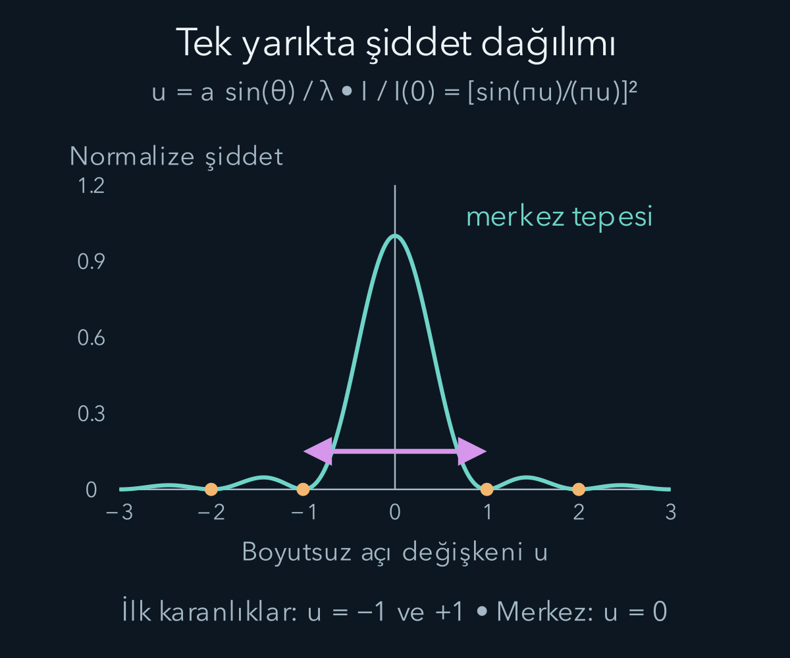
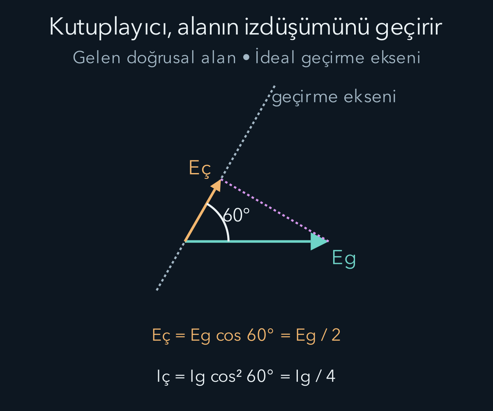

import ArticleVideo from '@/components/ArticleVideo.astro'
import kavram from './media/01-kavram.mp4?url'
import kavramPoster from './media/01-kavram.jpg?url'

Bir lazeri dar bir aralıktan geçirdiğimizde ekranda yalnız aralığın keskin gölgesini görmeyiz. Işık yanlara yayılır; iki aralık kullandığımızda parlak ve karanlık şeritler oluşur. Gözümüze ulaşan enerji her noktada aynı değildir. Bunun nedeni iki ışık demetinin birbirini itmesi değil, elektrik alanlarının yön ve faz bilgisiyle toplanmasıdır.

[Maxwell ve elektromanyetik dalgalar](/blog/maxwell-denklemleri-ve-elektromanyetik-dalgalar/) yazısında ışığın birbirine dik elektrik ve manyetik alanlarla ilerleyebildiğini gördük. Burada bu bilgiyi yansıma, kırılma, girişim, kırınım ve kutuplanma arasında bağ kurmak için kullanacağız. Sinüs, kosinüs, vektör izdüşümü ve basit integral hesabını kullanacağız. Kırınım integralinde [karmaşık sayılar ve Euler bağıntısını](/blog/karmasik-sayilar-ve-euler-bagintisi/) fazları kısa biçimde toplamak için yeniden çağıracağız. Kullanacağımız ışın ve yarık modellerinin hangi koşullarda geçerli olduğunu her adımda belirteceğiz.

## Işın resmi hangi ayrıntıyı atlar?

Bir ışın, ışığın ilerleyiş yönünü temsil eden geometrik çizgidir. Işığın tel gibi ince bir çizgiden oluştuğu iddiası değildir. Dalga boyu, karşılaşılan yüzeylerin ve açıklıkların boyutlarına göre çok küçükse ışınlarla hesap yapmak çoğu zaman iyi bir yaklaşımdır. Dar açıklıkların kenarında veya çok küçük ayrıntıları görüntülerken dalga yapısı daha belirgin olur.

Düzgün bir yüzeyden yansımada geliş açısı yansıma açısına eşittir. İki açı da yüzeye dik çizgiye, yani normale göre ölçülür. Pürüzlü bir yüzeyin ışığı birçok yöne göndermesi bu yerel yasayı bozmaz; farklı küçük bölgelerin normalleri farklı yönlere bakar. Burada yüzeyin pürüzlülüğünü dalga boyuyla karşılaştırıyoruz. Aynı yüzey bir dalga boyu için düzgün, başka bir dalga boyu için pürüzlü sayılabilir.

Işığın homojen, saydam bir ortamdaki faz hızına $v$, boşluktaki hızına $c$ dersek kırılma indisi $n=c/v$ olarak tanımlanır. Bu yazıda pozitif kırılma indisli, durgun, doğrusal ve izotropik ortamlarla çalışıyoruz. İzotropik sözcüğü ortamın bu özelliğinin yönle değişmediğini belirtir. Genel maddelerde kırılma indisi frekansa bağlı olabilir; burada her hesap belirli bir frekans için yapılır.

## Kırılmayı yol hesabından çıkarmak

İki ortamı yatay bir sınır ayırsın. Üstteki ortamda bulunan başlangıç noktasının sınıra yüksekliği $h_1$, alttaki bitiş noktasının uzaklığı $h_2$ olsun. Noktalar arasındaki yatay ayrımı $D$, ışının sınırı kestiği noktanın başlangıca göre yatay konumunu $x$ ile gösterelim. Optik yol uzunluğu

$$
\mathcal L(x)=n_1\sqrt{h_1^2+x^2}
+n_2\sqrt{h_2^2+(D-x)^2}
$$

olur. Optik yol, geometrik uzunlukların ilgili indislerle ağırlıklandırılmış toplamıdır. İndisin frekansa bağımlılığını ihmal edebildiğimizde yolculuk süresi $\mathcal L/c$ olur. Dispersiyon belirginse bu zaman yorumunu aynı biçimde kullanmayız: belirli frekansta durağan optik yol, durağan optik faz koşuludur; bir dalga paketinin yolculuk süresi ise [grup hızı](/blog/fourier-serileri-ve-dalga-paketleri/) ile ilişkilidir. Fermat ilkesi ışın yolunun optik yol bakımından durağan olmasını söyler: yolu çok az değiştirdiğimizde birinci mertebedeki değişim sıfırdır. Bu düz sınır örneğinde minimum buluruz; ilkeyi bütün optik düzeneklerde “mutlaka en kısa geometrik yol” diye söylemek doğru değildir.

Türevi sıfıra eşitleyelim:

$$
\frac{\mathrm d\mathcal L}{\mathrm dx}
=n_1\frac{x}{\sqrt{h_1^2+x^2}}
-n_2\frac{D-x}{\sqrt{h_2^2+(D-x)^2}}=0.
$$

Kesirler geometrik olarak normale göre ölçülen açıların sinüsleridir. Böylece Snell yasasına ulaşırız:

$$
n_1\sin\theta_1=n_2\sin\theta_2.
$$

Bu türetmede ışığın birden çok yolu bilerek karşılaştırdığına dair bir iddia yoktur. Durağan optik yol, dalga kuramının ışın yaklaşımında ortaya çıkan matematiksel koşuldur. Işın çizimi faz bilgisini ayrıntılı taşımadığından, birazdan göreceğimiz karanlık şeritlerin yerini tek başına açıklamakta yetersiz kalır.

Havadan yaklaşık $n_2=1{,}50$ indisli ortama, normalle $30^\circ$ yapan bir ışın gelsin; hava için $n_1\approx1$ alalım. O zaman $\sin\theta_2=(1/1{,}50)\sin30^\circ=1/3$ ve $\theta_2\approx19{,}47^\circ$ olur. Işın normale yaklaşır. Sınır durgun olduğu için frekans değişmez; hız azaldığında $v=f\lambda$ gereği ortam içindeki dalga boyu azalır. Boşluk dalga boyu $600\,\mathrm{nm}$ ise bu ortamda yaklaşık $400\,\mathrm{nm}$ olur.

Ters yönde, büyük indisten küçük indise giderken her açı için ilerleyen kırılmış ışın bulunmayabilir. $n_1>n_2$ durumunda $\sin\theta_c=n_2/n_1$ kritik açıyı verir. $1{,}50$ indisli ortamdan havaya geçişte bu açı yaklaşık $41{,}81^\circ$ olur. Daha büyük geliş açılarında ideal kayıpsız sınırda tam iç yansıma gerçekleşir. İkinci tarafta sınır yakınında azalan bir alan bulunabileceğinden, “öte tarafta hiçbir elektromanyetik alan yoktur” sonucu çıkarılmaz.

## Şiddetleri değil, önce alanları toplamak

Aynı frekansta, aynı kutuplanma yönünde ve aynı gözlem noktasında buluşan iki dalga düşünelim. Alan bileşenleri $E_1=A_1\cos\omega t$ ve $E_2=A_2\cos(\omega t+\delta)$ olsun. $A_1,A_2$ tepe genlikleri, $\omega$ açısal frekans, $\delta$ aralarındaki faz farkıdır. Lineer ortamda toplam alan $E_1+E_2$ olur. Şiddet ise alanın karesinin zaman ortalamasıyla orantılıdır.

Kareyi açarken ortadaki terimi kaybetmeyelim:

$$
\langle(E_1+E_2)^2\rangle
=\frac{A_1^2}{2}+\frac{A_2^2}{2}
+A_1A_2\cos\delta.
$$

Son terim, $\langle\cos\omega t\cos(\omega t+\delta)\rangle=\tfrac12\cos\delta$ bağıntısından gelir. Aynı ortam ve uygun ortak yayılma geometrisinde dalgaların ayrı ayrı şiddetleri $I_1,I_2$ ise

$$
I=I_1+I_2+2\sqrt{I_1I_2}\cos\delta
$$

bulunur. Girişim teriminin işareti faza bağlıdır. İki eşit dalga aynı fazdaysa şiddet $4I_1$, ters fazdaysa sıfırdır. Genliklerin iki katına çıkması şiddetin dört katına çıkmasına yol açar; iki katına değil.

Enerji kaybolmaz veya yoktan oluşmaz. Ekranın karanlık bölgelerinde azalan akış, parlak bölgelerinde artar. Tam bir düzeneğin enerji hesabı kaynakları ve bütün gözlem alanını kapsar. Tek bir noktadaki şiddeti toplayıp bütün sistemin enerji üretip üretmediğine karar vermek hatalıdır. Özellikle iki dalganın aynı noktada iptal olması, her yerde alanların iptal olduğu anlamına gelmez.

Faz farkı ölçüm süresinde rastgele dolaşıyorsa $\cos\delta$ teriminin ortalaması sıfıra yaklaşabilir ve ölçülen şiddetler toplanır. Kararlı girişim için gerekli faz ilişkisine eşevrelilik, yani koherens denir. İki bağımsız sıradan lambanın neden kolayca sabit şerit deseni oluşturmadığını bu açıklar. Aynı kaynaktan bölünmüş demetlerde bile yol farkı büyüdükçe kaynak frekanslarının yayılımı nedeniyle desenin görünürlüğü azalabilir.

Girişim çizgilerinin tam karanlık olması için katkıların büyüklüklerinin de eşleşmesi gerekir. Örneğin ayrı ayrı şiddetler $I_1=9\,\mathrm{W/m^2}$ ve $I_2=4\,\mathrm{W/m^2}$ olsun. Aynı fazda toplam $9+4+2\sqrt{36}=25\,\mathrm{W/m^2}$, ters fazda $9+4-12=1\,\mathrm{W/m^2}$ olur. Ters faz bile bu eşit olmayan alanları tamamen söndüremez. Dolayısıyla karanlık çizginin biraz aydınlık görünmesi tek başına eşevreliliğin tamamen kaybolduğunu kanıtlamaz; iki yolun genlikleri farklı olabilir.

Desenin görünürlüğünü sayıyla ifade etmek için $\mathcal V=(I_{\max}-I_{\min})/(I_{\max}+I_{\min})$ oranı kullanılabilir. Bu örnekte $\mathcal V=24/26\approx0{,}923$ olur. Görünürlük sıfırsa şiddet farkı yoktur, birse minimum sıfırdır. Bu ölçü bir enerji verimi değildir; yalnız desenin parlak ve karanlık bölgeleri arasındaki karşıtlığı anlatır. Kaynak genlikleri, faz kararlılığı, kutuplanmalar ve ölçümün çözünürlüğü gibi farklı etkiler aynı görünürlük ölçümünü değiştirebilir. Sonucu yorumlarken yalnız formülü değil deney koşullarını da bilmek gerekir.

## İki yarığın yol farkı

Aralarındaki merkez uzaklığı $d$ olan iki dar yarık, aynı frekanstaki ışıkla aynı fazda aydınlatılsın. Yarıklar ile ekran arasındaki uzaklık $L$ olsun. Uzak alan yaklaşımında ekrandaki bir noktaya giden iki yol yaklaşık paralel kabul edilir. Ekran normaline göre gözlem açısı $\theta$ ise yol farkı $\Delta\ell\approx d\sin\theta$ olur.

Yol farkının faz farkına dönüşümü $\delta=2\pi\Delta\ell/\lambda$ biçimindedir. $\lambda$ yarıklarla ekran arasındaki ortamın dalga boyudur. Başlangıç fazları aynı olduğu için ayrıca bir kaynak faz farkı eklemiyoruz. Parlak girişim koşulu

$$
d\sin\theta=m\lambda,\qquad m=0,\pm1,\pm2,\ldots
$$

olur. $m$ saçak sırasıdır. İki katkı eşit büyüklükteyse karanlık koşulu $d\sin\theta=(m+\tfrac12)\lambda$ olur. Eşitlik için $|\sin\theta|\le1$ gerektiğinden matematiksel olarak yazılan her tam sayı, gerçek bir gözlem açısı vermez.

Küçük açılarda $\sin\theta\approx\tan\theta=y/L$ yazılır. $y$ ekranın merkezinden ölçülen uzaklıktır. Ardışık parlak saçakların yaklaşık aralığı

$$
\Delta y=\frac{\lambda L}{d}
$$

çıkar. $\lambda=600\,\mathrm{nm}=6{,}0\times10^{-7}\,\mathrm m$, $L=2{,}0\,\mathrm m$ ve $d=0{,}20\,\mathrm{mm}=2{,}0\times10^{-4}\,\mathrm m$ için

$$
\Delta y=\frac{(6{,}0\times10^{-7})(2{,}0)}{2{,}0\times10^{-4}}
=6{,}0\times10^{-3}\,\mathrm m=6{,}0\,\mathrm{mm}.
$$

Birinci saçak için $\sin\theta=0{,}0030$ olduğundan küçük açı yaklaşımı burada çok iyidir. Merkezden uzaklaştıkça aynı yaklaşımın doğruluğunu yeniden değerlendirmek gerekir. Ekrandaki eşit aralıklı şerit resmi, bütün açılarda tam bir geometri yasası değildir.

## Tek yarık da neden desen oluşturur?

Bir yarığın sonlu genişliğine $a$ diyelim. Yarığı tek bir nokta kaynak gibi saymak yerine genişliği boyunca küçük parçaların dalga katkılarını toplamalıyız. Dik gelen düzgün bir dalga ve uzak gözlem bölgesi için yarıktaki $s$ konumundan gelen katkının fazı $ks\sin\theta$ kadar değişir. Burada $k=2\pi/\lambda$, $s$ ise yarık merkezinden ölçülen enine koordinattır.

Karmaşık üstel gösterimle alanın açısal genliği şu integralle orantılıdır:

$$
\mathcal A(\theta)\propto\int_{-a/2}^{a/2}e^{iks\sin\theta}\,\mathrm ds
=a\frac{\sin\beta}{\beta},\qquad
\beta=\frac{\pi a\sin\theta}{\lambda}.
$$

Üstel fonksiyonun integrali alınır, iki uçtaki değerler çıkarılır ve $e^{i\beta}-e^{-i\beta}=2i\sin\beta$ kullanılır. Böylece fazları farklı küçük katkıların nasıl toplandığı tek bir ifadede görünür. Merkezde bütün katkılar aynı fazda olduğundan genlik en büyüktür.

Şiddet genliğin mutlak değerinin karesiyle orantılıdır. Merkez şiddetine $I(0)$ dersek

$$
\frac{I(\theta)}{I(0)}=\left(\frac{\sin\beta}{\beta}\right)^2
$$

elde edilir. $\beta=0$ noktasında oranı sıfıra bölme diye değerlendirmeyiz; $\sin\beta/\beta$ limitinin bir olması merkezi tanımlar. İlk karanlıklar $a\sin\theta=\pm\lambda$, diğerleri sıfır olmayan tam sayılar için $a\sin\theta=m\lambda$ koşulundadır. Burada $m=0$ karanlık değil, en parlak merkezdir.

Yarık genişliği $a=0{,}040\,\mathrm{mm}$ ve önceki dalga boyu ile ekran uzaklığı kullanılırsa ilk karanlığın merkezden uzaklığı yaklaşık $y_1=L\lambda/a=30\,\mathrm{mm}$ olur. Merkezdeki parlak bölgenin iki ilk karanlık arasındaki genişliği yaklaşık $60\,\mathrm{mm}$ olur. Yarığı daraltmak açısal yayılmayı artırır. Bu ifade merkez tepesinin aynı parlaklıkta kalacağını söylemez; yarıktan geçen toplam güç de değişebilir.

Bu integrali uzak alan, yani Fraunhofer yaklaşımında kullandık. Serbest yayılmada açıklığın karakteristik genişliği $D_{\mathrm a}$ için $D_{\mathrm a}^2/(\lambda L)\ll1$ koşulu yeterli bir ölçüttür; iki yarıkta yalnız tek yarık genişliğini değil, bütün açıklığın yayılımını düşünmek gerekir. Uygun bir merceğin odak düzleminde de açısal desen gözlenebilir. Yakın bölgede yol uzunluklarının daha ayrıntılı hesabı gerekir; yukarıdaki sinüs oranını her ekrana değişmeden taşımayız.

Sayısal örneğimizde iki yarığın toplam dış genişliği $D_{\mathrm a}=d+a=0{,}24\,\mathrm{mm}$ olur. Boyutsuz uzak alan ölçütü yaklaşık $0{,}048$ çıkar. Açıklık kenarında ihmal edilen ikinci dereceden yol teriminin faz büyüklüğü yaklaşık $\pi D_{\mathrm a}^2/(4\lambda L)=0{,}038$ radyandır. Bu küçük değer, kullandığımız yaklaşımın burada makul olduğunu gösterir. Ekranı on kat yaklaştırmak aynı hatayı yaklaşık on kat büyütür; formülleri kullanmaya devam etmeden önce yaklaşım yeniden sınanmalıdır.

## İki yarıkla tek yarık aynı anda çalışır

Gerçek iki yarığın her biri sonlu genişliktedir. Eşit genişlikli ve aynı biçimde aydınlatılmış iki yarıkta uzak alan modeli

$$
I(\theta)=4I_s(0)
\left(\frac{\sin\beta}{\beta}\right)^2
\cos^2\left(\frac{\pi d\sin\theta}{\lambda}\right)
$$

verir. $I_s(0)$ yalnız tek yarık açıkken merkez şiddetidir. Sinüs oranı geniş kırınım zarfını, kosinüs karesi bunun içindeki ince girişim saçaklarını belirler. Bu iki etki ayrı mekanizmaların yarışması değildir; aynı alan toplamasının yarık içindeki ve yarıklar arasındaki parçalarıdır.

Önceki sayılarla $d/a=5$ olur. Çift yarığın beşinci parlak saçak koşulu $d\sin\theta=5\lambda$ iken tek yarığın ilk karanlığı $a\sin\theta=\lambda$ olur. Bu ikisi aynı açıda gerçekleşir; beklenen beşinci parlak saçak zarf tarafından söndürülür. “Kayıp sıra” ifadesi bu çakışmayı anlatır. Yalnız saçak aralığına bakmak, desenin parlaklık zarfını gözden kaçırır.

## Kutuplanma, alanın yön bilgisidir

Işığın elektrik alanı ilerleme yönüne dik düzlemde salınır. Alan hep aynı doğru üzerinde ileri geri salınıyorsa doğrusal kutuplanma vardır. Dalganın uzayda ilerlediği yön ile elektrik alanın salındığı yönü ayırmak gerekir. Elektrik alanı yukarı aşağı salınan ışık yine yatay doğrultuda ilerleyebilir.

İdeal doğrusal kutuplayıcı kendi geçirme eksenine paralel elektrik alan bileşenini geçirir. Gelen ışık doğrusal kutuplanmışsa ve alan doğrultusuyla geçirme ekseni arasındaki açı $\alpha$ ise çıkan genlik $E_{\mathrm{ç}}=E_{\mathrm{g}}\cos\alpha$ olur. Şiddet kareyle orantılı olduğundan Malus yasası

$$
I_{\mathrm{ç}}=I_{\mathrm{g}}\cos^2\alpha
$$

elde edilir. Örneğin $60^\circ$ için genlik yarıya, şiddet dörtte bire iner. Dik eksenlerde ideal model sıfır iletim verir; gerçek kutuplayıcıların sızıntıları ve kayıpları olabilir.

Kutuplanmamış ışığı “elektrik alanı olmayan ışık” diye düşünmemeliyiz. Ölçüm süresinde belirli bir enine doğrultu üstün gelmez. İdeal kutuplayıcıdan geçen şiddet, $\cos^2\alpha$ açısal ortalaması $1/2$ olduğundan başlangıç şiddetinin yarısıdır. Bu yarım katsayısı, zaten doğrusal kutuplanmış her ışığa tekrar uygulanmaz. Önce gelen ışığın kutuplanma durumu belirlenmelidir.

Başlangıçta kutuplanmamış $I_0$ şiddetli ışık önce dikey kutuplayıcıdan geçsin. Şiddet $I_0/2$ olur ve çıkan ışık dikey kutuplanır. İkinci eksen dikeyle $45^\circ$, üçüncü eksen yatay olsun. İkinci çıkışta $I_0/4$, üçüncü çıkışta $I_0/8$ kalır. Ortadaki kutuplayıcı çıkarılırsa dikey ile yatay doğrudan ardışık olur ve ideal iletim sıfıra iner. Ek bir kutuplayıcı ışık üretmemiştir; sonraki elemanın gördüğü alan yönünü değiştirmiştir.

<ArticleVideo src={kavram} poster={kavramPoster} title="Kutuplanmada genlik ve şiddet" caption="Geçirme ekseni dönerken alanın izdüşümü kosinüsle, çıkan şiddet kosinüsün karesiyle değişir; dik konumda ideal iletim sıfırdır." />

## Yön ile fazı birlikte hatırlamak

İki dalganın kutuplanma doğrultuları birbirine dikse elektrik alanlarının noktasal çarpımı sıfırdır. Karesi alınan toplam vektördeki çapraz terim de sıfır olur; ortak bir kutuplayıcı olmadan bu iki katkı sıradan toplam şiddette girişim saçakları oluşturmaz. Demek ki aynı frekans ve sabit faz ilişkisi tek başına yeterli değildir; alanların yönleri de girişim hesabına katılır.

Dairesel kutuplanma ise iki dik doğrultuda eşit genlikli ve çeyrek dönem faz farkıyla salınan alanların birleşmesiyle oluşabilir. Sabit bir noktadaki elektrik vektörünün ucu zamanla çember çizer. Bu, ışığın uzayda bir helezon yolu izleyen küçük bir cisim olduğu anlamına gelmez. Genel durumda uç nokta elips çizebilir. Alanın yönünün zamanla değişmesi ile ışığın yayılma yolu yine farklı bilgilerdir.

Işın resmi yönleri ve sınır geçişlerini, dalga resmi fazların ve genliklerin toplamını açıklar. Kırınım ile girişim arasındaki ad farkı, ikisinin de alan toplamasına dayandığını unutturmamalı. Kutuplanma ise bu alanın yalnız bir sayı olmadığını, yön taşıdığını gösterir. Işığın klasik davranışını bu temelle tanıdıktan sonra, zaman ve uzay ölçümlerinin ışık hızıyla nasıl bağlandığını ele alabiliriz.

## Kaynaklar

- [OpenStax — Yansıma yasası](https://openstax.org/books/university-physics-volume-3/pages/1-2-the-law-of-reflection), [kırılma](https://openstax.org/books/university-physics-volume-3/pages/1-3-refraction) ve [tam iç yansıma](https://openstax.org/books/university-physics-volume-3/pages/1-4-total-internal-reflection).
- [The Feynman Lectures — Optik ve durağan zaman ilkesi](https://www.feynmanlectures.caltech.edu/I_26.html).
- [OpenStax — Young çift yarık girişimi](https://openstax.org/books/university-physics-volume-3/pages/3-1-youngs-double-slit-interference) ve [girişimin matematiği](https://openstax.org/books/university-physics-volume-3/pages/3-2-mathematics-of-interference).
- [OpenStax — Tek yarık kırınımı](https://openstax.org/books/university-physics-volume-3/pages/4-1-single-slit-diffraction), [kırınım şiddeti](https://openstax.org/books/university-physics-volume-3/pages/4-2-intensity-in-single-slit-diffraction) ve [çift yarık kırınımı](https://openstax.org/books/university-physics-volume-3/pages/4-3-double-slit-diffraction).
- [OpenStax — Kutuplanma](https://openstax.org/books/university-physics-volume-3/pages/1-7-polarization).
