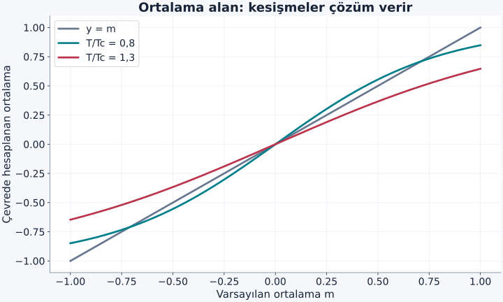
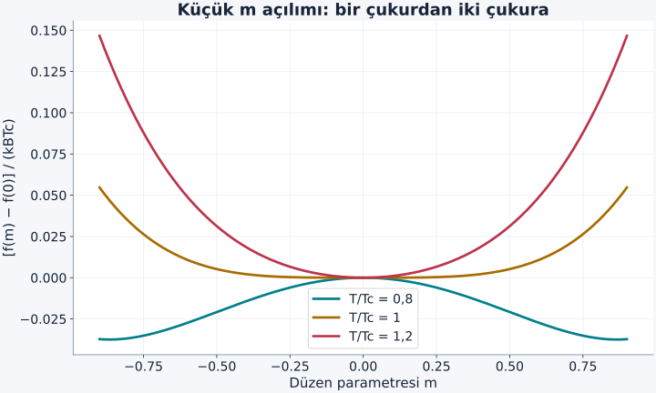

Bir maddenin düzenli olması, yalnız en düşük enerjili durumunu bulmakla açıklanamaz. Sonlu sıcaklıkta sistem başka durumları da dolaşır. Çok sayıda düzensiz durumun toplam ağırlığı, tek bir düzenli durumunkini aşabilir. Manyetik düzenin sıcaklıkla kaybolmasını anlamak için enerji kadar durum sayısını da hesaba katmalıyız. Ising modeli, bu yarışın matematiğini gereksiz ayrıntıları azaltarak görünür yapar.

[Manyetik değiş tokuş](/blog/degis-tokus-etkilesimi-ve-manyetik-duzen/), [Boltzmann dağılımı](/blog/boltzmann-dagilimi-ve-bolusum-fonksiyonu/) ve [entropi](/blog/entropi-ve-termodinamigin-ikinci-yasasi/) ön bilgilerimiz. Bu yazıda model değişkenleri klasik iki seçenekli sayılardır. “Spin” adını korusak da her yöndeki kuantum spin operatörlerini birlikte çözmüyoruz. Bu sadeleştirme, güçlü bir kolay ekseni olan mıknatısların bazı özelliklerini modellemek için yararlıdır.

## 1. Modeli önce açıkça tanımlamak

Örgüdeki her $i$ noktasına $s_i=+1$ veya $s_i=-1$ yerleştirelim. Bunlar seçilen eksen boyunca iki moment yönünü etiketler. Hamiltonyenimiz:

$$
H=-J\sum_{\langle ij\rangle}s_i s_j-h\sum_i s_i
$$

olsun. $J>0$ enerji birimli komşu bağlaşımı, $h$ tek spin için dış alan enerji parametresidir. $h=\mu B$ yazılabilir; $\mu$ moment büyüklüğü, $B$ uygulanan alandır. Her komşu bağı bir kez sayıyoruz. Önceki yazıdaki Heisenberg Hamiltonyeninden farklı bir işaret seçtiğimizi fark edelim: Burada başta eksi bulunduğu için pozitif $J$ aynı yönü kayırır.

Aynı yönlü komşularda $s_is_j=+1$ ve bağ enerjisi $-J$; ters yönlülerde çarpım $-1$ ve enerji $+J$ olur. Bir bağı uyumlu durumdan uyumsuz duruma çevirmek $2J$ enerji ister. Bu yerel kural, bütün örgünün davranışını çözmüş olmaz. Bir spini çevirmek birden fazla bağı etkileyebilir ve aynı toplam enerjiye sahip birçok farklı düzen bulunabilir.

## 2. En küçük örnekte bütün durumları saymak

Dış alan yokken iki spin ve tek bağ alalım. $++$ ve $--$ durumlarının enerjisi $-J$, $+-$ ve $-+$ durumlarının enerjisi $+J$'dir. $\beta=1/(k_BT)$ tanımıyla:

$$
Z=2e^{\beta J}+2e^{-\beta J}=4\cosh(\beta J).
$$

Aynı yönlü olma olasılığı:

$$
p_{\mathrm{aynı}}=\frac{2e^{\beta J}}Z
=\frac1{1+e^{-2\beta J}}
$$

çıkar. Örneğin $J/k_B=50\,\mathrm K$ ve $T=100\,\mathrm K$ ise $\beta J=0{,}5$, dolayısıyla $p_{\mathrm{aynı}}=1/(1+e^{-1})\simeq0{,}7311$ olur. Bağ korelasyonu $\langle s_1s_2\rangle=2p_{\mathrm{aynı}}-1\simeq0{,}4621$'dir.

Buna rağmen $\langle s_1+s_2\rangle=0$ çıkar. Çünkü iki yukarı ile iki aşağı düzenin ağırlıkları eşittir. Sıfır ortalama mıknatıslanma, komşuların tamamen bağımsız olduğunu göstermez. **Korelasyon**, birini bilmenin öteki hakkındaki olasılığı değiştirmesidir. Bu örnekte sıcaklığı değiştirince bütün olasılıklar düzgün değişir; iki spin keskin bir termodinamik geçiş oluşturmaz.

## 3. Sonlu sayıdan termodinamik sınıra

Sonlu $N$ spin için $2^N$ durum vardır; örneğin hacmini $V$ ile göstereceğiz. Bölüşüm fonksiyonu bunların pozitif Boltzmann ağırlıklarının sonlu toplamıdır. Sonlu sıcaklıkta bu toplamdan türetilen denge büyüklükleri genellikle düzgündür. **Faz geçişi** dediğimiz keskin, türevi süreksiz veya ıraksak davranış, ideal olarak $N,V\to\infty$ ve yoğunluk sabit tutulurken ortaya çıkar. Buna termodinamik sınır denir.

Gerçek örnek elbette sonludur. Çok büyük örneklerde yuvarlanma çok dar bir aralıkta kalabildiği için keskin geçiş gözlenebilir. Bu matematiksel sınır gerçek maddeyi küçümsemek için değil, “tam sıfır”, “sonsuz” ve “keskin eşik” ifadelerinin ne anlama geldiğini ayırmak için kullanılır. On spinlik benzetimde yuvarlak bir eğri görmek, makroskopik geçişin yokluğu kanıtı değildir.

Düzen parametresi olarak boyutsuz ortalama spin $m=N^{-1}\sum_i\langle s_i\rangle$ seçilir. $m=1$ bütün spinlerin yukarı, $m=-1$ aşağı olmasıdır. $h=0$ durumunda Hamiltonyen bütün spinlerin işareti aynı anda değiştirildiğinde aynıdır. Düşük sıcaklıkta sistemin iki olası yönden birini seçmesine **kendiliğinden simetri kırılması** deriz.

## 4. Sıfır alanı hangi sırada alıyoruz?

Sonlu ve tam dengedeki sistemde iki zıt yönün eşit ağırlığı ortalamayı sıfırlayabilir. Kendiliğinden mıknatıslanmayı tanımlarken önce çok küçük pozitif alanla yön seçer, sonra büyük sistem limitini, en son alanın sıfıra yaklaşmasını alırız:

$$
m_{\mathrm{sp}}=\lim_{h\to0^+}\lim_{N\to\infty}m(N,h,T).
$$

Sıranın fiziksel anlamı vardır. Büyük örneğin tamamının yön değiştirmesi çok büyük bir ortak değişim gerektirirken küçük bir çift kolayca iki durum arasında gezebilir. Bu yüzden simetri ile ölçülen yön arasındaki görünür çelişki, sistemi ve ölçüm koşulunu doğru tanımlayınca kaybolur. $m$'nin işaretini keyfi seçmek, Hamiltonyenin simetrisinin yok olduğu anlamına gelmez; seçilen denge fazının simetrisi daha düşüktür.

## 5. Komşuları ortalama bir çevreyle değiştirmek

Her spinin $z$ komşusu olsun; $z$ koordinasyon sayısıdır, bölüşüm fonksiyonu değildir. Ortalama alan yaklaşımı, komşu spinlerin anlık değerlerini ortak $m$ ortalamasıyla değiştirir. Bir spin için etkin enerji $-(zJm+h)s_i$ olur. İki olasılığı hesaplayan önceki formül bu kez:

$$
m=\tanh\!\left(\frac{zJm+h}{k_BT}\right)
$$

verir. Sağdaki $m$ de soldaki bilinmeyenin aynısıdır. Bu bir **öz tutarlılık denklemi**dir: Varsaydığımız çevre ortalaması, o çevrede hesaplanan tek spin ortalamasına eşit olmalıdır. Komşuların birbirine bağlı dalgalanmalarını ihmal ettiğimiz için sonuç kesin çözüm değildir.

$h=0$ ve küçük $m$ için $\tanh x\simeq x$ kullanırsak $m\simeq zJm/(k_BT)$ buluruz. Sıfır olmayan çok küçük çözümün ortaya çıktığı sıcaklık:

$$
T_c^{\mathrm{MF}}=\frac{zJ}{k_B}
$$

olur. Üst indis “ortalama alan” sonucunu belirtir. Bu hesabın her boyutta doğru geçiş sıcaklığı verdiğini henüz söyleyemeyiz; yaklaşımın unuttuğu dalgalanmalar bazen sonucu kökten değiştirir.

Şekil: $T/T_c^{\mathrm{MF}}=0{,}8$ ve $1{,}3$ için öz tutarlılık kesişmeleri. Pozitif ve negatif kökler iki eşdeğer düzen yönüdür; grafikteki eğriler zamanla izlenen yollar değildir.

## 6. Örnek: Ortalama alan çözümünü sayısal bulmak

Kare örgüde $z=4$, $J/k_B=50\,\mathrm K$ seçelim. Yaklaşım $T_c^{\mathrm{MF}}=200\,\mathrm K$ verir. $T=160\,\mathrm K$ için denklem $m=\tanh(1{,}25m)$ olur. Pozitif yönü seçip $m_0=0{,}8$ ile başlayalım. Ardışık yerine koymalar:

$$
\begin{aligned}
m_1&=\tanh(1{,}0)\simeq0{,}7616,\\
m_2&=\tanh(0{,}9520)\simeq0{,}7407.
\end{aligned}
$$

şeklinde ilerler. Birkaç adım sonra yaklaşık $m=0{,}7104$'e yaklaşırız. Yerine koyarak $\tanh(1{,}25\times0{,}7104)\simeq0{,}7104$ kontrolü yapılabilir. $m=0$ da cebirsel köktür; ancak bu sıcaklıkta ortalama alan serbest enerjisinin kararsız tepesidir.

Bu modelin kare örgü için sıfır alandaki kesin sonucu $k_BT_c/J=2/\ln(1+\sqrt2)\simeq2{,}2692$'dir. Aynı $J$ ile gerçek Ising modelinin geçişi yaklaşık $113{,}46\,\mathrm K$'de olur. Dolayısıyla $160\,\mathrm K$'de hesapladığımız düzen **yaklaşımın öngörüsüdür**; kesin iki boyutlu model bu sıcaklıkta düzensiz fazdadır. Yanlış kesinlik vermemek için sayısal çözüm hatası ile model yaklaşımı hatasını ayırmak gerekir. Bu karşılaştırma [Tong'un faz geçişleri notlarında](https://davidtong.org/pdfs/teaching/statistical-physics/statphys5.pdf) incelenen model sonuçlarına dayanır.

## 7. Enerji ve entropiyi tek fonksiyonda buluşturmak

Denge, uygun koşullarda Helmholtz serbest enerjisini $F=U-TS$ küçültür. $U$ iç enerji, $S$ entropidir. Ortalama alan yaklaşımında bir spin başına serbest enerji:

$$
\begin{aligned}
f(m)&=-\frac{zJ}{2}m^2-hm\\
&\quad+k_BT\frac{1+m}{2}\ln\frac{1+m}{2}\\
&\quad+k_BT\frac{1-m}{2}\ln\frac{1-m}{2}.
\end{aligned}
$$

biçiminde yazılabilir. İlk terimde $1/2$ bağları iki kez saymamak içindir. İki logaritmanın içindeki $(1\pm m)/2$ tek spin olasılıklarıdır. İki logaritmalı terim negatif entropi katkısını temsil eder. $m=0$'da iki seçenek eşit ve tek spin belirsizliği en büyük; $|m|=1$'de tek seçenek ve bu entropi sıfırdır.

$m$'ye göre türev alıp sıfıra eşitlersek:

$$
0=-zJm-h+\frac{k_BT}{2}\ln\frac{1+m}{1-m}
$$

buluruz. Logaritmayı öteki tarafa geçirip üstel alınca yukarıdaki hiperbolik tanjant denklemi geri gelir. Böylece grafik kesişmesinin yalnız cebirsel bir oyun olmadığını, enerji–entropi dengesini temsil ettiğini görürüz.

## 8. Kritik noktanın yakınında iki çukur

$h=0$ ve küçük $m$ için logaritmaları açarsak:

$$
\begin{aligned}
f(m)&=f(0)+\frac{k_BT-zJ}{2}m^2\\
&\quad+\frac{k_BT}{12}m^4+\cdots
\end{aligned}
$$

elde edilir. Yüksek sıcaklıkta $m^2$ katsayısı pozitiftir; sıfırın çevresi çukurdur. Düşük sıcaklıkta katsayı negatifleşir; pozitif dördüncü derece terim büyümeyi sınırlayarak iki çukur oluşturur. Bu yerel açılım, $|m|$ küçükken güvenilirdir; çok düşük sıcaklıkta doygunluğu hesaplamak için tam ifadeye dönmeliyiz.

Şekil: Çizgiler $[f(m)-f(0)]/(k_BT_c^{\mathrm{MF}})=(t-1)m^2/2+tm^4/12$ açılımıdır; $t=T/T_c^{\mathrm{MF}}$. Yatay eksen düzen parametresidir, gerçek uzaysal konum değildir.

## 9. Bir boyutta neden aynı öngörü başarısız olur?

Sıfır alanlı, yalnız yakın komşulu sonsuz Ising zincirinde sonlu sıcaklıkta kendiliğinden mıknatıslanma yoktur. İki düzenli bölge arasında bir alan duvarı oluşturmak yalnız tek bağın enerjisini değiştirir, yani $2J$ ister. Zincir uzadıkça duvarın bulunabileceği yerlerin sayısı artar. Sonlu sıcaklıkta bu duvarlar uzun mesafeli düzeni bozar. Ortalama alan, tek tek komşu dalgalanmalarını bastırdığı için bu olanağı kaçırır.

Kesin sıfır alan korelasyonu, aralarında $r$ bağ bulunan spinler için:

$$
\begin{aligned}
\langle s_i s_{i+r}\rangle&=[\tanh(J/k_BT)]^r\\
&=e^{-r/\xi},\\
\xi&=-\frac1{\ln[\tanh(J/k_BT)]}.
\end{aligned}
$$

olur. $\xi$ burada örgü adımı birimindeki korelasyon uzunluğudur. $T>0$ için hiperbolik tanjant birden küçüktür, dolayısıyla uzaklık arttıkça korelasyon sıfıra iner. Sonuç, bütün düşük boyutlu modelleri kapsayan bir slogan değildir; belirtilen zincir, etkileşim menzili ve alan koşullarına aittir.

### Yakın komşunun bilgisi uzağa nasıl taşınır?

Korelasyon uzunluğu bir spinin bütün komşularına doğrudan kuvvet uyguladığı menzil değildir. Modelde yalnız en yakın komşu bağı bulunsa bile, birinci komşunun ikincisiyle, ikincinin üçüncüsüyle ilişkisi nedeniyle bilgi istatistiksel olarak daha uzağa taşınabilir. $\xi$ bu ortak yön bilgisinin uzaklıkla hangi ölçekte zayıfladığını anlatır. Etkileşim menzili ile korelasyon uzunluğunun farklı olması, kısa menzilli kuvvetlerle çok büyük düzenli bölgelerin oluşabilmesini mümkün kılar.

Korelasyon sıfırdan farklıyken her örnek fotoğrafında bütün spinlerin aynı görünmesi gerekmez. Ortalama, birçok denge düzeninden alınır. Bir karede görünen büyük bir bölge sonraki karede parçalanabilir; sıcaklık ve sistem boyutu bu değişimin istatistiğini belirler. Sayısal modelde ortalamayı yeterince çok durumdan almamak, rastlantısal bir bölgeyi kalıcı düzen sanmamıza yol açabilir. Özellikle kritik bölgeye yaklaşıldığında uzun mesafeli ortak dalgalanmaların oluşması, yalnız birkaç yerel spinle kurulmuş yaklaşımın güvenilirliğini azaltır.

Bu nedenle ölçümde hem net mıknatıslanma hem onun dalgalanması hem de uzaklığa bağlı korelasyon değerlidir. Bunlar aynı sayının farklı adları değildir. İki spin örneğinde net ortalama sıfırken korelasyonu pozitif bulmuştuk; zincir hesabı aynı ayrımı çok farklı uzaklıklara taşır. Böylece “düzen var mı?” sorusuna önce hangi büyüklüğü, hangi mesafeyi ve hangi sınırı ölçtüğümüzü belirterek yanıt verebiliriz.

## 10. Örnek: Büyük görünen bir bölge ne kadar büyüktür?

$J/k_BT=1$ seçelim. $\tanh1\simeq0{,}76159$, logaritması yaklaşık $-0{,}27234$ olduğundan $\xi\simeq3{,}672$ örgü adımıdır. On bağ ötedeki korelasyon $0{,}76159^{10}\simeq0{,}0656$ olur. $J/k_BT=2$'ye çıktığımızda $\tanh2\simeq0{,}96403$ ve $\xi\simeq27{,}30$ bulunur. Aynı on bağ için korelasyon yaklaşık $0{,}693$'tür.

Soğuk zincirin kısa bir parçası çok düzenli görünebilir, fakat sonsuz mesafedeki korelasyon yine sıfırdır. “Düzenli görünüyor” ifadesine gözlenen uzunluk ölçeğini eklemek bu nedenle gerekir. Sıcaklık, örnek boyutu ve korelasyon uzunluğunu karşılaştırmadan tek bir benzetim karesinden faz tanısı koyamayız.

Ising modeli bize hem bir geçiş mekanizması hem bir yaklaşım dersi verdi. Yerel etkileşimin işaretini bilmek düzenin türünü sezdirir; geçişi bulmak için durum sayısı, boyut ve dalgalanmalar da gerekir. Bundan sonra kuantum istatistiğinin, spin düzeninden bağımsız olarak maddenin basıncını ve ortak durum doluluğunu nasıl değiştirdiğine geçebiliriz.
