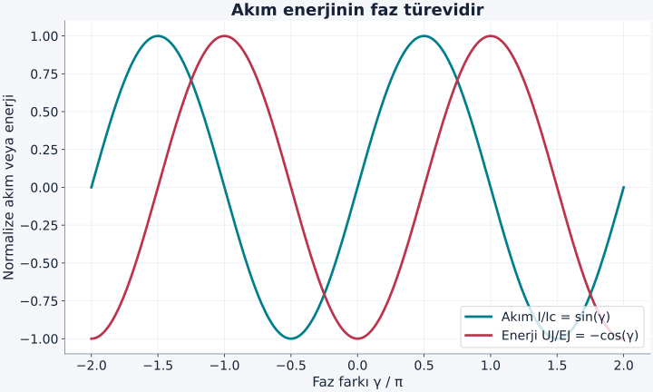
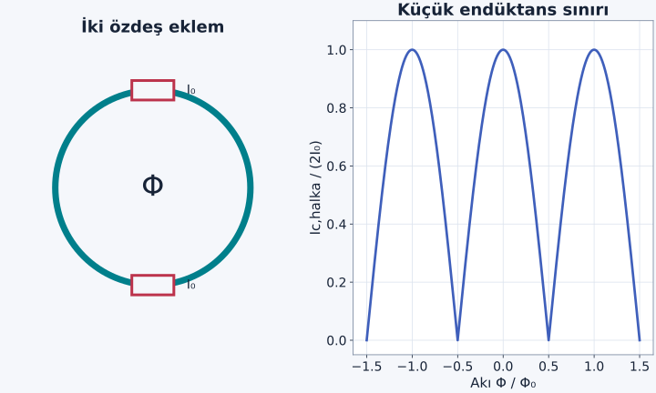

İki süperiletken arasına çok ince bir yalıtkan koyduğumuzda, tek tek elektronların normal iletimini azaltabiliriz. Buna rağmen iki taraftaki eşleşmiş kuantum düzeni zayıf biçimde bağlanabilir. Ortak düzenlerin göreli fazı, sıfır gerilimde bile akım belirleyebilir. Josephson etkisi, fazın yalnız bir dalga fonksiyonunu yazarken kullandığımız soyut açı olmadığını, uygun karşılaştırmada ölçülebilir sonuç verdiğini gösterir.

[BCS eşleşmesi](/blog/cooper-ciftleri-ve-bcs-kurami/), [kuantum tünelleme](/blog/potansiyel-basamagi-ve-tunelleme/) ve [kuantum girdapları](/blog/superakiskanlik-ve-kuantum-girdaplari/) ön bilgilerimiz. Önce ideal bir zayıf tünel eklemi ve düşük enerjili çift akımını inceleyeceğiz. Normal kuaziparçacık akımı, kapasitans ve devre kayıpları gerektiğinde ayrıca eklenir; aşağıdaki en sade denklemler tek başına tüm devre dinamiği değildir.

## 1. İki faz neden tek başına fiziksel değildir?

Sol ve sağ süperiletkenlerin düzen parametreleri $\Psi_L=|\Psi_L|e^{i\theta_L}$ ve $\Psi_R=|\Psi_R|e^{i\theta_R}$ olsun. $\theta_L,\theta_R$ faz açılarıdır. Nötr akışkanda faz farkını doğrudan karşılaştırabilmiştik. Yüklü sistemde elektromanyetik vektör potansiyeli $\mathbf A$ da önemlidir. $\mathbf B=\nabla\times\mathbf A$ manyetik alanı verir; farklı $\mathbf A$ seçimleri aynı alanı temsil edebilir.

Çift yükü $q=-2e$'dir; $e>0$ temel yük büyüklüğüdür. Sol uçtan sağ uca eklem içinden geçen yol için fiziksel faz farkını şu yönde tanımlayalım:

$$
\gamma=\theta_L-\theta_R+\frac q\hbar\int_L^R\mathbf A\cdot d\boldsymbol\ell.
$$

$\hbar$ indirgenmiş Planck sabitidir. Elektromanyetik **ayar dönüşümü** yalnız temsili değiştirir: $\mathbf A\to\mathbf A+\nabla\Lambda$ ve $\theta\to\theta+q\Lambda/\hbar$. Faz farkı $q(\Lambda_L-\Lambda_R)/\hbar$ kadar, integral ise tam tersi kadar değişir. Toplam $\gamma$ değişmez. Bu iptal, hangi faz farkının deneysel anlam taşıdığını açıklar.

Elektromanyetik potansiyelin eklem boyunca çizgi integrali sıfır seçilebilen basit durumda $\gamma=\theta_L-\theta_R$ olur. Genel durumda integral terimini atmak, yalnız gösterim seçimine bağlı bir sonuç üretirdi. “Ayar” sözcüğü burada deney cihazını ayarlamak değil, aynı fiziksel alanın matematiksel temsil özgürlüğüdür.

## 2. Zayıf bağlaşmanın enerji fonksiyonu

En basit tünel ekleminde faza bağlı enerji:

$$
U_J(\gamma)=-E_J\cos\gamma
$$

olarak yazılır. $E_J>0$ Josephson bağlaşım enerjisidir. $\gamma=0$ en düşük, $\gamma=\pi$ en yüksek enerjidir. Faz $2\pi$ değiştiğinde aynı fiziksel değere dönüldüğünden enerji periyodiktir. Zayıf tünelleme sınırında ilk kosinüs terimi baskındır; bazı başka zayıf bağlarda akım–faz ilişkisine daha yüksek harmonikler katılabilir.

Sol uçtan sağ uca pozitif elektrik akımı için:

$$
I=\frac{2e}{\hbar}\frac{dU_J}{d\gamma}
=I_c\sin\gamma,
\qquad I_c=\frac{2eE_J}{\hbar}
$$

elde edilir. $I_c$ kritik akım büyüklüğüdür. Sabit faz farkı varsa zamanla değişmeyen bir akım olabilir. Bu **doğru akım Josephson etkisidir**. “Sıfır gerilimde akım” ifadesi enerji yoktan üretiliyor demek değildir; ideal eklemde elektriksel güç $IV$ sıfırdır ve fazı/devre akımını hazırlamak için sınır koşulları gerekir.

Şekil: Enerjinin minimumu ile akımın maksimumu aynı fazda değildir. Akım enerjiye değil, enerjinin faza göre türevine bağlıdır.

## 3. Gerilim, fazı zamanla döndürür

Pozitif gerilimi soldan sağa elektrik alanın çizgi integrali olarak tanımlayalım: $V=\int_L^R\mathbf E\cdot d\boldsymbol\ell$. Durgun alanlarda bu $V=\phi_L-\phi_R$'dir; $\phi$ elektriksel potansiyeldir. İdeal eklemde eşleşmiş düzenin elektrokimyasal enerji farkı faz evrimine dönüşür:

$$
\frac{d\gamma}{dt}=\frac{2eV}{\hbar}.
$$

Sol–sağ yönü ters çevrilirse $V$, $I$ ve $\gamma$ işaretleri birlikte değişir. Sabit $V$ için integrasyon:

$$
\begin{aligned}
\gamma(t)&=\gamma(0)+\frac{2eV}{\hbar}t,\\
I(t)&=I_c\sin\left[\gamma(0)+\frac{2eV}{\hbar}t\right].
\end{aligned}
$$

verir. Sinüs içindeki katsayı açısal frekanstır. Çevrim frekansı elde etmek için $2\pi$'ye böleriz:

$$
f_J=\frac{2e|V|}{h},\qquad h=2\pi\hbar.
$$

Bu **alternatif akım Josephson etkisidir**. Sabit gerilim fazı sabit tutmaz; sabit hızla döndürür. Dolayısıyla sıfırdan farklı sabit gerilim altında ideal çift akımının sürekli aynı yönde kalmasını beklemeyiz. [Feynman'ın süperiletkenlik semineri](https://www.feynmanlectures.caltech.edu/III_21.html) göreli faz ile bu zaman evriminin bağlantısını açıklar.

## 4. Örnek: Mikrovolt gerilimden gigahertz frekans

$V=10\,\mu\mathrm V=10^{-5}\,\mathrm V$ alalım. $e=1{,}602176634\times10^{-19}\,\mathrm C$ ve $h=6{,}62607015\times10^{-34}\,\mathrm{J\,s}$ ile:

$$
\begin{aligned}
f_J&=\frac{2eV}{h}\\
&=\frac{3{,}204353268\times10^{-24}}{6{,}62607015\times10^{-34}}\,\mathrm{Hz}\\
&\simeq4{,}836\times10^9\,\mathrm{Hz}.
\end{aligned}
$$

buluruz. Periyot $\tau_J=1/f_J\simeq2{,}068\times10^{-10}\,\mathrm s=206{,}8\,\mathrm{ps}$'dir. Piko öneki $10^{-12}$ demektir. Çok küçük bir gerilim bile çok hızlı faz evrimi üretir; çünkü karşılaştırılan yük ve Planck sabiti mikroskobik ölçekler taşır.

Aynı eklem $f=10\,\mathrm{GHz}$ mikrodalgayla eşzamanlanırsa gerilim basamakları $V_n=nhf/(2e)$ konumlarında oluşabilir; $n$ tam sayıdır. Birinci basamak için $V_1\simeq20{,}68\,\mu\mathrm V$ çıkar. Bu **Shapiro basamaklarının** ideal konum bağıntısıdır. Basamağın genişliği ve gözlenebilirliği sürme genliği ile devre koşullarına bağlıdır; yalnız frekansı bilmek bütün akım–gerilim eğrisini vermez.

## 5. Kritik akımın altında ve üstünde ne olur?

Sabit akım kaynağı $|I|<I_c$ dayatırsa $I=I_c\sin\gamma$ denkleminin sabit faz çözümleri vardır. Basit kararlı dal $|\gamma|<\pi/2$ civarındadır. $|I|>I_c$ olduğunda yalnız sinüs terimi bu akımı taşıyamaz. Faz zamanla değişmeye, gerilim oluşmaya ve gerçek eklemde diğer akım kanalları devreye girmeye başlayabilir.

Bunu tam hesaplamak için kapasitif akım $C\,dV/dt$ ve örneğin dirençli kanal $V/R$ eklenebilir. $C$ kapasitans, $R$ dirençtir. Bu durumda dış akım $I_{\text{dış}}=I_c\sin\gamma+V/R+C\,dV/dt$ olur. Bu basit devre modelinin bile sönümüne göre histerezis veya salınım görülebilir. İdeal Josephson bağıntısı ile gerçek cihazın tüm akımını aynı şey sanmamak gerekir.

Ayrıca termal dalgalanmalar fazı enerji bariyerleri üzerinden geçirebilir. $E_J\gg k_BT$ koşulu klasik termal faz kararlılığı için yararlı bir ölçek karşılaştırmasıdır. Çok küçük eklemlerde yük ve fazın kuantum dalgalanmaları da önem kazanır. Burada bu ileri devre rejimlerini çözmeden, ideal bağıntıların hangi temel parçayı verdiğini ayırıyoruz.

Kararlı dalı enerjiyle sınayabiliriz. İdeal sabit akım kaynağı altında faz için etkin potansiyel:

$$
U_{\rm etkin}(\gamma)=-E_J\cos\gamma
-\frac{\hbar I_{\text{dış}}}{2e}\gamma
$$

olur. İkinci terim, kaynağın faz değişirken yaptığı işi hesaba katar; artık yalnız eklemin yalıtılmış enerjisini küçültmüyoruz. Birinci türevi sıfırlamak $I_{\text{dış}}=I_c\sin\gamma$ denklemini verir. İkinci türev $E_J\cos\gamma$ olduğundan $\cos\gamma>0$ olan durağan noktalar yerel minimumdur. $|I_{\text{dış}}|$ kritik değere yaklaşınca minimumun eğriliği azalır; eşikte minimum ile komşu tepe birleşir. Böylece sinüs denkleminin her kökünün aynı kararlılıkta olmadığı görülür.

İşaretleri bağımsız olarak güçle kontrol edebiliriz: $dU_J/dt=(dU_J/d\gamma)\dot\gamma=(\hbar I/2e)(2eV/\hbar)=IV$. Faz, gerilim ve akım yönlerini birlikte seçmemizin nedeni bu enerji hesabını da tutarlı kılmaktır.

## 6. Yüklü ortak alanın halka boyunca dolaşımı

Nötr süperakışkanda $m\mathbf v=\hbar\nabla\theta$ bulmuştuk. Yüklü çift için mekanik momentum:

$$
m_p\mathbf v_s=\hbar\nabla\theta-q\mathbf A
$$

olur. $m_p$ çift kütlesi, $q=-2e$ çift yüküdür. Süperiletken içinde kapalı bir yol boyunca integre edelim. Faz tek değerli olduğundan $\oint\nabla\theta\cdot d\boldsymbol\ell=2\pi n$; $n$ tam sayıdır. Stokes teoremi $\oint\mathbf A\cdot d\boldsymbol\ell=\Phi$ verir; $\Phi$ yolun çevrelediği yönlü manyetik akıdır. Böylece:

$$
m_p\oint\mathbf v_s\cdot d\boldsymbol\ell=nh-q\Phi.
$$

$n_p$ çift yoğunluğu, $\mu_0$ boşluğun manyetik geçirgenliği ve $\lambda_L$ London nüfuz derinliği olmak üzere $\mathbf j_s=n_pq\mathbf v_s$ akım yoğunluğu ve $\lambda_L^2=m_p/(\mu_0n_pq^2)$ kullanılırsa:

$$
\Phi+\mu_0\lambda_L^2\oint\mathbf j_s\cdot d\boldsymbol\ell
=\frac{nh}{q}
$$

bulunur. Sol taraftaki birleşime **akıoid** denir. $q$ negatif olduğundan tam sayı etiketi ters çevrilebilir; kuantumun pozitif büyüklüğü $\Phi_0=h/(2e)$'dir. İşaret yolun dolaşım yönüne bağlıdır, adım büyüklüğü değişmez.

## 7. Akı ne zaman tek başına kuantumlanır?

Kalın bir süperiletken halkanın içinden, yüzeylerden birkaç nüfuz derinliği uzakta bir yol seçebilirsek bu yolda $\mathbf j_s\simeq0$ olabilir. O zaman akıoid bağıntısı yaklaşık $\Phi=n\Phi_0$ haline iner. İnce telde veya önemli kinetik endüktans varsa akım terimi ihmal edilmez. Böyle bir durumda tam kuantumlanan büyüklük yalnız manyetik akı değildir.

Bu ayrım, “halkadaki akı her koşulda tam sayıdır” ifadesini düzeltir. Akının yüzeyi halkanın deliğini ve seçilen yolun geometrisini kapsar. Ayrıca halkanın bir faz kayması geçirmesi için yerel düzen parametresinin genliği düşebilir; bu durumda sarım sayısı değişebilir. Tam sayı olması, sistemin bütün zamanlar boyunca aynı tam sayıda kalmasının mutlak garantisi değildir.

## 8. Örnek: Akı kuantumu ne kadar küçüktür?

Sabitlerden:

$$
\begin{aligned}
\Phi_0&=\frac{h}{2e}\\
&=\frac{6{,}62607015\times10^{-34}}{3{,}204353268\times10^{-19}}\,\mathrm{Wb}\\
&\simeq2{,}068\times10^{-15}\,\mathrm{Wb}.
\end{aligned}
$$

bulunur. Weber birimi tesla çarpı metrekaredir. Etkin alanı $A=10\,\mu\mathrm m^2=10^{-11}\,\mathrm{m^2}$ olan bir halka düşünelim. Yaklaşık düzgün dik alan için $\Phi=BA$ olduğundan bir akı kuantumuna karşılık gelen alan değişimi:

$$
\Delta B=\frac{\Phi_0}{A}\simeq2{,}068\times10^{-4}\,\mathrm T
=0{,}2068\,\mathrm{mT}
$$

olur. Burada alan dönüşümüne dikkat edelim: Bir mikrometrekare $10^{-12}\,\mathrm{m^2}$'dir, $10^{-6}\,\mathrm{m^2}$ değildir.

Gerçek cihazda akı odaklanması ve tarama akımları nedeniyle etkin alan geometrik delik alanından farklı olabilir. Bu hesap ilk ölçeği verir. Deneysel periyottan alan çıkarmak istediğimizde devrenin geometrisini ve manyetik yanıtını da değerlendirmeliyiz.

## 9. İki eklemli halka bir girişimölçer olur

Bir halkaya özdeş iki Josephson eklemi yerleştirelim. Her birinin kritik akımı $I_0$ olsun. Halkanın kendi akısının ihmal edilebildiği küçük endüktans sınırında iki faz farkı arasındaki fark dış akıyla belirlenir: $\gamma_1-\gamma_2=2\pi\Phi/\Phi_0$; yön seçimi ters olursa sağ tarafın işareti değişir.

Toplam akımı trigonometrik özdeşlikle yazalım:

$$
\begin{aligned}
I&=I_0(\sin\gamma_1+\sin\gamma_2)\\
&=2I_0\sin\bar\gamma\cos(\pi\Phi/\Phi_0),
\end{aligned}
$$

burada $\bar\gamma=(\gamma_1+\gamma_2)/2$ ortalama fazdır. Faz üzerinde erişilebilen en büyük akım büyüklüğü:

$$
I_{c,\mathrm{halka}}=2I_0|\cos(\pi\Phi/\Phi_0)|
$$

olur. Bu, iki eklemli **SQUID** için ideal girişim desenidir. Dış akı küçük değişince toplam kritik akım belirgin değişebilir; hassas manyetik ölçümün temel fikri budur.

Şekil: Eğri özdeş eklemler ve ihmal edilebilir halka endüktansı içindir. Eklemler eşit değilse minimumlar genellikle tam sıfıra inmez; tek uzun eklemin uzaysal kırınım deseni de bu iki eklem sonucuyla aynı değildir.

### Girişim deseninde kaybolan şey nedir?

Yarım akı kuantumundaki ideal minimumda iki eklemin toplam kritik akımı sıfırdır. Bu, her iki süperiletkenin de normal hale geçtiği veya çiftlerin yok olduğu anlamına gelmez. İki akım–faz katkısı seçilen halka kısıtı altında birbirini götürür. Tek bir eklemi ayrı ölçseydik aynı sıcaklıkta kendi kritik akımı bulunabilirdi. Bu ayrım, dalga girişimindeki karanlık noktanın ışık kaynağının kapanması demek olmamasına benzer; burada karşılaştırılan elektrik akımı genlikleri ve ortak faz kısıtıdır.

İki eklem eşit değilse aynı hesabı $I_1\sin\gamma_1+I_2\sin\gamma_2$ ile yaparız. Maksimum toplam akım $\sqrt{I_1^2+I_2^2+2I_1I_2\cos(2\pi\Phi/\Phi_0)}$ olur. Tam akı kuantumunda en büyük değer $I_1+I_2$, yarım kuantumda en küçük değer $|I_1-I_2|$'dir. Dolayısıyla ölçülen minimumun sıfıra inmemesi mutlaka faz tutarlılığının kaybolduğunu göstermez; eklem eşitsizliği de aynı gözlemi verebilir. Gerçek veriyi ideal eğriyle karşılaştırırken önce bu basit olanağı kontrol ederiz.

Halkanın endüktansı büyükse iç akı dışarıdan verilen akıya eşit alınamaz. Dolaşan akım kendi alanını üretir; akı ve faz birbirini etkileyen bir öz tutarlılık problemine dönüşür. Bu nedenle şeklin yatay eksenindeki akıyı laboratuvar bobininin akımıyla eşleştirmek için bir kalibrasyon gerekir. Temel kuantum $h/(2e)$ aynı kalsa da görünen desenin biçimi ve faz durumu cihaz geometrisine bağlı olabilir.

## 10. Örnek hesabı tamamlamak: Akıdan akıma

Her eklem için $I_0=5\,\mu\mathrm A$ alalım. Sıfır akıda toplam kritik akım $10\,\mu\mathrm A$ olur. $\Phi=\Phi_0/4$ için $|\cos(\pi/4)|=1/\sqrt2$ olduğundan $I_c\simeq7{,}071\,\mu\mathrm A$; $\Phi=\Phi_0/2$ için ideal değer sıfırdır. Akı bir tam kuantum arttığında aynı kritik akım desenine geri döneriz.

Burada akı kuantumu çift yükünden, akımın sinüs biçimi zayıf bağlaşmadan ve girişim deseni iki yolun faz farkından doğdu. Bu üç fikir bağlantılı olsa da aynı ifade değildir. [MIT'nin süperiletkenlik laboratuvarı](https://live.ocw.mit.edu/courses/8-13-14-experimental-physics-i-ii-junior-lab-fall-2016-spring-2017/pages/experiments/superconductivity/) Meissner etkisi, kalıcı akım ve Josephson ölçümünü ayrı deneysel olgular olarak ele alır. Böylece tek bir “sıfır direnç” cümlesinin içinde kaybolan fiziksel ayrımları görünür tutabiliriz.
