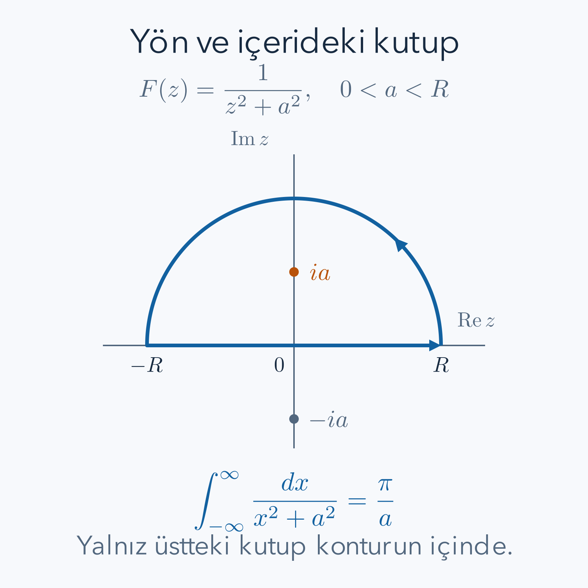

Gerçek sayılar üzerinde türev alırken bir noktaya sağdan ve soldan yaklaşırız. Karmaşık düzlemde sonsuz sayıda yaklaşma yönü vardır. Buna rağmen aynı türev değerini istemek son derece güçlü bir koşuldur. Bu güç, kapalı bir yolun integralini çoğu zaman sıfıra; bazı tekilliklerin çevresinde ise yalnız bir seri katsayısına indirger.

Önce [karmaşık sayılar ve Euler bağıntısı](/blog/karmasik-sayilar-ve-euler-bagintisi/), [türevin temel kuralları](/blog/turevin-anlami-ve-temel-kurallari/), [çok değişkenli türev](/blog/cok-degiskenli-fonksiyonlar-ve-turev/), [vektör alanları ve integral teoremleri](/blog/vektor-alanlari-ve-integral-teoremleri/) ile [Taylor serileri](/blog/sonsuz-seriler-ve-taylor-yaklasimi/) yararlıdır. Yol integrali, Green teoremi ve seri katsayılarının burada kullanılan biçimleri ayrıca açıklanacak. Karmaşık analizde her teoremin tanım bölgesi koşulunu takip edeceğiz; bir deliği gözden kaçırmak doğru cebirden yanlış sonuç çıkarmaya yeter.

## 1. Karmaşık fonksiyon iki gerçek fonksiyondur

$i^2=-1$ olsun. Karmaşık sayıyı $z=x+iy$, fonksiyonu

$$
f(z)=u(x,y)+iv(x,y)
$$

şeklinde yazalım. $x,y,u,v$ gerçektir. $u$ gerçek, $v$ sanal bileşendir. Bu gösterim karmaşık sayının tek değişken olduğunu inkâr etmez; düzlemdeki davranışını iki gerçek koordinatla incelememizi sağlar.

Örneğin $f(z)=z^2$ ise çarpımı açalım:

$$
(x+iy)^2=x^2+2ixy+i^2y^2=(x^2-y^2)+i(2xy).
$$

Burada $u=x^2-y^2$, $v=2xy$'dir. Buna karşılık karmaşık eşlenik fonksiyon $f(z)=\overline z=x-iy$ için $u=x$, $v=-y$ olur. Her iki dönüşüm düzlemde düzgündür; fakat birazdan yalnız birinin karmaşık türevi bulunduğunu göreceğiz. Gerçek koordinatlarda düzgünlük ile karmaşık türevlenebilirlik aynı koşul değildir.

## 2. Türev bütün yollardan aynı olmalı

$z_0$ noktasındaki karmaşık türev

$$
f'(z_0)=\lim_{h\to0}\frac{f(z_0+h)-f(z_0)}{h}
$$

ile tanımlanır; $h$ sıfır olmayan karmaşık artıştır. Limit alınırken $h$ yalnız gerçek eksende ilerlemez. Her doğrultudan, hatta kıvrılan yollardan aynı sayıya ulaşmalıdır. İki yol farklı sonuç veriyorsa türevin olmadığını kanıtlamış oluruz. İki yolun aynı sonuç vermesi ise tek başına bütün yolların kontrolü değildir.

Gerçek eksenden yaklaşmak yatay büyütmeyi, sanal eksenden yaklaşmak düşey büyütmeyi sınar. Karmaşık sayıyla çarpma ise bu iki yönü keyfi biçimde birbirinden bağımsız değiştiremez; aynı büyütme ve döndürme kuralını bütün yönlere uygular. Karmaşık türevin yerel anlamı budur. Bir fonksiyon küçük bir daireyi farklı eksenlerde farklı oranlarda geriyorsa genel olarak tek bir karmaşık çarpanla temsil edilemez. Bu geometrik yorum gerekli hesabın yerine geçmez, ama Cauchy–Riemann ilişkilerinin neden iki ayrı yöndeki değişimleri birbirine bağladığını açıklar.

Önce $h$ gerçek olsun. Bölümün limiti $u_x+iv_x$ olur; alt indis ilgili kısmi türevi gösterir. Sonra $h=it$, $t$ gerçek seçelim. Artış yalnız $y$ yönündedir ve

$$
\frac{f(z_0+it)-f(z_0)}{it}
\longrightarrow\frac{u_y+iv_y}{i}=v_y-iu_y
$$

bulunur; $1/i=-i$ kullandık. İki değerin eşitliği gerçek ve sanal parçaların ayrı eşitliğini gerektirir:

$$
u_x=v_y,\qquad u_y=-v_x.
$$

Bunlar Cauchy–Riemann denklemleridir. Karmaşık türev varsa bu kısmi türevler mevcuttur ve ilişkiler zorunludur. Ancak sadece iki kısmi türev eşitliğini bir noktada yazmak yeterli koşul değildir; kalan yönlerdeki hata terimini de denetlemek gerekir.

## 3. Yeterlilik koşulunu ve iki örneği görmek

$u,v$ bir açık komşulukta sürekli birinci kısmi türevlere sahip olsun. Bu durumda gerçek anlamda toplam türev vardır. $h=\Delta x+i\Delta y$ için

$$
\begin{aligned}
\Delta f={}&u_x\Delta x+u_y\Delta y\\
&+i(v_x\Delta x+v_y\Delta y)+o(|h|).
\end{aligned}
$$

Burada $o(|h|)$, $|h|$'ye bölündüğünde sıfıra giden hata demektir. Cauchy–Riemann ilişkilerini yerine koyunca ana kısım

$$
(u_x+iv_x)(\Delta x+i\Delta y)
$$

olur. Çünkü çarpımdaki gerçek parça $u_x\Delta x-v_x\Delta y$, sanal parça $v_x\Delta x+u_x\Delta y$'dir. $h$'ye bölüp limit alırsak kalan hata sıfıra gider. Demek ki bu düzgünlük varsayımı altında Cauchy–Riemann koşulları yeterlidir.

$z^2$ örneğinde $u_x=2x=v_y$ ve $u_y=-2y=-v_x$ sağlanır. Türev $2x+i2y=2z$'dir. Doğrudan kontrol de kısa ve öğreticidir:

$$
\frac{(z+h)^2-z^2}{h}=\frac{2zh+h^2}{h}=2z+h\longrightarrow2z.
$$

Eşlenik örneğinde gerçek yönden bölüm $1$, sanal yönden bölüm $-1$ olur. Bu nedenle eşlenik fonksiyon hiçbir noktada karmaşık türevlenmez.

Limitteki hata kontrolüne dikkat edelim. İki kısmi türevin varlığı yalnız iki doğru boyunca birinci mertebe bilgi sağlar. Gerçek toplam türev ise bütün küçük artışlar için aynı doğrusal yaklaşımı ve yönle birlikte bozulmayan bir hata tahminini verir. Yeterlilik ispatında asıl kullanılan ek güç budur. Sürekli kısmi türevler bunun kolay uygulanabilen bir yeterli koşuludur; mantıksal olarak tek mümkün koşul değildir. Bir noktada eşitlikleri sağladığını gördüğümüz kaba bir fonksiyonda önce bu düzgünlüğü kontrol etmeden türev vardır diyemeyiz. İki boyutlu düzgün bir dönüşüm olması bu eksikliği gidermez.

## 4. Holomorfik olmak ve tekillik

Bir fonksiyon açık bir bölgenin her noktasında karmaşık türevliyse o bölgede **holomorfik** denir. Tek bir noktada türev bulunması, çevresinde holomorfik olduğu anlamına gelmez. Örneğin $|z|^2=z\overline z$ için sıfırdaki türev vardır: $|h|^2/h=\overline h\to0$. Fakat $u=x^2+y^2$, $v=0$ olduğundan Cauchy–Riemann koşulları yalnız $x=y=0$'da sağlanır; sıfırı içeren açık bir bölgede holomorfik değildir.

$1/z$ fonksiyonu sıfır dışında holomorfiktir. Sıfırda tanımlanamaz ve sonsuza büyür; bu nokta izole tekilliktir. “İzole” demek, yeterince küçük delinmiş bir disk içinde başka tekillik olmaması demektir. Bir noktanın çıkarılması yerel cebirde küçük görünse de kapalı yol integrali açısından belirleyici olabilir.

Bir bölgenin basit bağlantılı olması, içindeki her kapalı yolun bölgeden çıkmadan bir noktaya büzülebilmesi anlamına gelir. Disk uygundur; merkezini çıkardığımız disk uygun değildir. Bu kavramı burada sezgisel kullanacağız. Genel topolojik ispatlara ihtiyaç duymadan aşağıdaki daire ve yarım disk örneklerinde deliğin yerini açıkça görebiliriz.

Tanım bölgesi ile fonksiyonun yazılışı da birbirinden ayrılır. Aynı rasyonel ifade farklı bölgelerde incelenebilir; teoremin uygulanacağı bölge seçilirken çevrelenen alanın tamamı hesaba katılır. Yolun üzerindeki değerlerin sonlu olması tek başına yeterli değildir. İçeride bir tekillik bulunması kapalı integrali değiştirebilir. Bir yolun çizimi bu yüzden yalnız görsel destek sayılmaz; hangi noktaların içeride, dışarıda veya sınırda olduğunun matematiksel kaydıdır.

## 5. Kontur integralinde dz ne demektir?

Bir yönlendirilmiş yolu $z(t)=x(t)+iy(t)$ ile tanımlayalım; $a\leq t\leq b$ parametre aralığıdır. Yol parça parça sürekli türevli olsun. Tanım

$$
\int_\gamma f(z)\,dz=\int_a^b f(z(t))z'(t)\,dt
$$

şeklindedir. $dz=z'(t)dt$ yazımı bir süs değildir: yol boyunca hangi yönde ve ne hızla hareket edildiğini taşır. Birimi yalnız uzunluk olan $|dz|$ ile karıştırılmamalıdır. Aynı yolu ters yönde izlemek integralin işaretini değiştirir.

Parametreyi değiştirmek ile yolu değiştirmek de farklıdır. Aynı noktaları aynı sırada ve aynı sayıda ziyaret eden düzgün bir yeniden parametreleme, zincir kuralı sayesinde aynı integrali verir. Daha hızlı gitmek türev çarpanını büyütür, fakat ilgili parametre aralığını küçültür; iki etki dengelenir. Buna karşılık çemberi iki kez dolaşmak yeni bir parametreleme ayrıntısı değildir: yolun her parçası iki kez katkı verir ve integral iki katına çıkar. Kontur sorusunda yön ve dolaşım sayısını belirtmek bu yüzden zorunludur.

Merkezi sıfır, yarıçapı $\rho>0$ olan saat yönünün tersindeki çemberi $z(t)=\rho e^{it}$, $0\leq t\leq2\pi$ ile yazalım. Euler bağıntısıyla $z=\rho\cos t+i\rho\sin t$ ve $z'=i\rho e^{it}$ bulunur. $f=1/z$ için sıfır yolun üzerinde değildir:

$$
\oint_{|z|=\rho}\frac{dz}{z}
=\int_0^{2\pi}\frac{i\rho e^{it}}{\rho e^{it}}\,dt
=\int_0^{2\pi}i\,dt=2\pi i.
$$

Yarıçapın sadeleşmesi integralin her pozitif yarıçapta aynı olmasını açıklar. Saat yönüne dönersek parametre aralığı terslenir ve sonuç $-2\pi i$ olur.

## 6. Aynı çemberde z neden sıfır integral verir?

Şimdi $f(z)=z$ alalım:

$$
\begin{aligned}
\oint z\,dz
&=i\rho^2\int_0^{2\pi}e^{2it}\,dt\\
&=i\rho^2\left[\frac{e^{2it}}{2i}\right]_0^{2\pi}=0.
\end{aligned}
$$

Son eşitlikte $e^{4\pi i}=1$ kullandık. Ayrıca $F(z)=z^2/2$ fonksiyonunun türevi $z$'dir; zincir kuralı integralin $F$'nin uç değerleri farkı olduğunu söyler. Kapalı yolun uçları aynı olduğundan fark sıfırdır.

$1/z$ için aynı gerekçeyle bütün delinmiş düzlemde tek değerli bir ilkel fonksiyon seçilemez. Gerçek logaritmayı doğrudan yazmak bu sorunu çözmez; karmaşık logaritmanın açı bileşeni çember tamamlandığında $2\pi$ değişir. İleride dal kesimleriyle logaritmanın uygun alt bölgelerdeki dalları kurulabilir. Burada gereken sonuç şudur: ilkel fonksiyonun bütün yolun bulunduğu bölgede tek değerli olması kontrol edilmelidir.

## 7. Cauchy teoreminin Green teoremiyle gerekçesi

Önce yeterli düzgünlükte basit bir durum ele alalım: $D$ sınırlı, deliği olmayan, parça parça düzgün sınırla çevrili bir düzlem bölgesi; $f=u+iv$ ise kapanışının açık komşuluğunda sürekli birinci kısmi türevli ve holomorfik olsun. Pozitif yön, içerinin yürüyüş sırasında solda kalmasıdır.

$dz=dx+i\,dy$ çarpımını açarsak

$$
f\,dz=(u\,dx-v\,dy)+i(v\,dx+u\,dy)
$$

çıkar. Green teoremi, $P\,dx+Q\,dy$ sınır integralini $Q_x-P_y$ alan integraline çevirir. Gerçek kısımda $P=u$, $Q=-v$; sanal kısımda $P=v$, $Q=u$ olur:

$$
\oint_{\partial D}f\,dz
=\iint_D(-v_x-u_y)\,dx\,dy
+i\iint_D(u_x-v_y)\,dx\,dy=0.
$$

İki integrand Cauchy–Riemann koşullarıyla sıfırlandı. Daha genel Cauchy teoremi, holomorfiklikten yola çıkıp bu ek sürekli türev varsayımını kaldırır. Onun tam ispatını burada yapmıyoruz. Bu yazının örneklerinde fonksiyonlar tekilliklerin uzağında rasyonel veya üstel olduğundan Green gerekçesinin düzgünlük koşulları sağlanır.

$1/z$'nin merkezini içeren diskte bu hesabı uygulayamayız: $f$ merkezde holomorfik değildir. Delikli bölgede uygularsak dış sınır saat yönünün tersinde, iç sınır saat yönünde alınır. İki çemberin katkıları $2\pi i$ ve $-2\pi i$ olup birbirini götürür; teoremle çelişki kalmaz.

## 8. Cauchy integral formülü nereden gelir?

$a$ noktası pozitif yönlü basit kapalı $\gamma$ yolunun içinde olsun. $f$, yolun ve bütün içinin açık komşuluğunda holomorfik olsun. $f(z)/(z-a)$, $a$ dışında holomorfiktir. $a$ çevresinden küçük bir disk çıkarıp önceki sınır hesabını uygularsak dış integral küçük çember integraline eşit olur; iç sınırın ters yönü eşitliğin öteki tarafına geçirilmiştir.

Küçük çemberde $z=a+\varepsilon e^{it}$ yazalım. Bölme ve türev çarpanı sadeleşir:

$$
\oint_\gamma\frac{f(z)}{z-a}\,dz
=\lim_{\varepsilon\to0}\int_0^{2\pi}i f(a+\varepsilon e^{it})\,dt
=2\pi i f(a).
$$

Son geçiş $f$'nin sürekliliğiyle gerekçelenir. Bu yüzden

$$
f(a)=\frac1{2\pi i}\oint_\gamma\frac{f(z)}{z-a}\,dz.
$$

Sınır boyunca değerleri bilmek içerideki değeri belirler. $f(z)=z^2+1$, $a=i/2$ ve $\gamma:|z|=1$ alırsak $f(a)=-1/4+1=3/4$ bulunur. Dolayısıyla integral $2\pi i(3/4)=3\pi i/2$'dir. $a$ dışarıda olsaydı payda içeride sıfır olmazdı ve integral sıfır çıkardı. $a$ yolun üzerinde olursa bu formül doğrudan kullanılamaz.

## 9. Laurent serisinde negatif kuvvetler

Taylor serisi bir merkez etrafında negatif olmayan kuvvetler kullanır. İzole tekillik çevresindeki delinmiş bölgede negatif kuvvetlere de izin veren Laurent serisi gerekir:

$$
f(z)=\sum_{n=-\infty}^{\infty}c_n(z-a)^n.
$$

Bu seri uygun bir halka bölgesinde yakınsar; hangi halka olduğu en yakın diğer tekilliklerle ilgilidir. Laurent teoreminin genel yakınsaklık ispatını burada üstlenmiyoruz. Kullanacağımız örneklerde seriler, bildiğimiz geometrik seri veya üstel Taylor serisinin açık çarpımlarıyla kurulabilir.

$w=z-a=\rho e^{it}$ için bir terimin integralini hesaplayalım:

$$
\oint w^n\,dw=i\rho^{n+1}\int_0^{2\pi}e^{i(n+1)t}\,dt.
$$

$n\ne-1$ ise üstel ilkel fonksiyonun uç değerleri eşittir; integral sıfırdır. $n=-1$ ise üstel çarpan birdir ve sonuç $2\pi i$'dir. Çember üzerindeki uygun düzgün yakınsaklık terim terim integrale izin verir. Dolayısıyla kapalı integralin tuttuğu tek katsayı $c_{-1}$'dir. Bu katsayıya $f$'nin $a$ noktasındaki **rezidüsü** denir.

### Aynı ifadenin iki ayrı halka açılımı

$f(z)=1/[z(z-1)]$ ifadesini sıfır çevresinde açalım. $0<|z|<1$ bölgesinde geometrik seri kullanılabilir:

$$
\begin{aligned}
f(z)&=-\frac1z\frac1{1-z}
=-\frac1z(1+z+z^2+\cdots)\\
&=-z^{-1}-1-z-z^2-\cdots.
\end{aligned}
$$

Bu yerel açılım sıfırdaki rezidünün eksi bir olduğunu gösterir. Fakat $|z|>1$ için aynı geometrik seri yakınsamaz. Bu kez paydayı farklı ayırırız:

$$
f(z)=\frac1{z^2}\frac1{1-1/z}
=z^{-2}+z^{-3}+z^{-4}+\cdots.
$$

İkinci açılımda eksi birinci kuvvet yoktur. Bu durum sıfırdaki rezidünün değiştiği anlamına gelmez; dış halka sıfırın küçük delinmiş komşuluğu değildir, arada birdeki başka kutup bulunur. Büyük çember iki kutbu birlikte içerir ve rezidülerinin toplamı sıfırdır. Küçük ve büyük çember integrallerinin farklılığını iki ayrı yakınsaklık halkası doğru biçimde kaydeder.

Bu örnek, seri yazarken bölgeyi neden eşitliğin yanında taşımamız gerektiğini gösterir. Cebirsel olarak benzer görünen iki sonsuz toplam, aynı noktalar kümesinde fonksiyonu temsil etmeyebilir. Geometrik seride oranının mutlak değeri birden küçük olmalıdır. İlk açılımda oran değişkenin kendisi, ikinci açılımda değişkenin tersidir; koşulların ters dönmesi bunun doğrudan sonucudur.

## 10. Basit kutup ve ikinci mertebe kutup

Negatif kuvvetlerin sayısı sonluysa ve en yüksek negatif kuvvet $(z-a)^{-m}$ ise $a$, $m$ mertebeli kutuptur. Basit kutupta $m=1$'dir. $f=g(z)/(z-a)$, $g$ çevrede holomorfik ve $g(a)\ne0$ ise $g$'nin Taylor açılımı

$$
f(z)=\frac{g(a)}{z-a}+g'(a)+\cdots
$$

verir; rezidü $g(a)$'dır. Genel $f=p/q$ için $q(a)=0$, $q'(a)\ne0$ ve $p(a)\ne0$ ise $q(z)=q'(a)(z-a)+\cdots$ olduğundan rezidü $p(a)/q'(a)$ olur. Pay da sıfırsa sadeleşme ve gerçek tekillik mertebesi yeniden incelenir.

İkinci mertebe kutupta $f=g(z)/(z-a)^2$ alalım. Taylor açılımını iki kuvvet aşağı kaydırırsak

$$
f(z)=\frac{g(a)}{(z-a)^2}+\frac{g'(a)}{z-a}+\frac{g''(a)}2+\cdots
$$

çıkar. Rezidü $g'(a)$'dır; en güçlü terimin katsayısı değildir. Örneğin $f=e^z/z^2$ için $e^z=1+z+z^2/2+\cdots$ ve $f=z^{-2}+z^{-1}+1/2+\cdots$ olur. Sıfırdaki rezidü birdir; birim çember integrali $2\pi i$ çıkar. Yalnız $1/z^2$ olsaydı rezidü sıfır, integral sıfır olacaktı; kutup varlığı tek başına sıfır olmayan integral garantilemez.

İkinci mertebe için sayısal olarak da izlenebilen bir rasyonel örnek alalım:

$$
f(z)=\frac{z+1}{(z-1)^2}.
$$

Merkez çevresinde $w=z-1$ yazınca pay $w+2$ olur; dolayısıyla $f=2w^{-2}+w^{-1}$ çıkar. Rezidü birdir. Merkezi bir ve yarıçapı yarım olan pozitif çemberde integral iki pi ile sanal birimin çarpımıdır. İlk terim çemberin farklı kısımlarında büyük değerler alabilir; fakat fazları bir turda birbirini götürür. İkinci terimse parametrizasyon türeviyle sadeleşir ve sabit bir katkı verir. Büyük mutlak değer ile büyük integralin aynı şey olmadığı bu örnekte açıktır.

### Her izole tekillik bir kutup mudur?

Hayır. Bir noktada tanımsız yazılmış ifade bazen uygun bir değer atanarak holomorfik biçimde uzatılabilir. Örneğin $\sin z/z$ için sinüs serisini $z\ne0$ iken bölelim:

$$
\frac{\sin z}{z}=1-\frac{z^2}{3!}+\frac{z^4}{5!}-\cdots.
$$

Sağ tarafta negatif kuvvet yoktur. Sıfırdaki değeri bir seçersek seri orada da düzgün bir fonksiyon tanımlar; tekillik kaldırılabilirdir. Bir kesirde paydanın sıfır olduğunu görmek tek başına kutup kararı vermeye bu nedenle yetmez. Payın hangi derecede sıfır olduğunu veya sadeleşen seriyi de incelemeliyiz.

Buna karşılık $e^{1/z}=1+z^{-1}+z^{-2}/2!+\cdots$ sonsuz sayıda negatif kuvvet taşır. Sıfırdaki tekillik sonlu mertebeli kutup değildir; esas tekillik adı verilir. Burada ayrıntılı değer dağılımını incelemiyoruz. Yine de rezidü tanımı geçerlidir; eksi birinci kuvvetin katsayısı birdir. Rezidü yaklaşımının yalnız kutup formüllerinden daha geniş olduğu bu örnekle görülebilir. Bir kutup formülünü kullanmadan önce tekilliğin tipini belirlemek, genel Laurent katsayısı fikrini yanlış bir kısayola dönüştürmemeyi sağlar.

## 11. Birden çok tekilliği toplamak

Pozitif yönlü basit kapalı bir yolun üzerinde tekillik bulunmasın; içinde sonlu sayıda izole tekillik bulunsun ve fonksiyon kalan bölgede holomorfik olsun. Her tekilliğin etrafında küçük disk çıkaralım. Delikli bölgenin sınır integralinin sıfır olması, dış integralin küçük çemberlerin pozitif yönlü integralleri toplamına eşit olduğunu verir. Her küçük çember yalnız kendi rezidüsünü tuttuğundan

$$
\oint_\gamma f(z)\,dz=2\pi i\sum_{a_j\text{ içeride}}\operatorname{Res}(f,a_j)
$$

elde edilir. Buradaki metin alt indisi yalnız hangi noktaların toplandığını belirtir. Saat yönlü basit yolda toplamın önüne eksi gelir. Kendi üzerinden geçen veya bir noktayı birden çok dolanan yollar için sarım sayıları gerekir; aşağıda basit yollarla kalacağız.

$f(z)=1/[(z-1)(z+2)]$ için birinci kutuptaki rezidü $1/3$, ikincideki $-1/3$'tür. $|z|=3/2$ çemberi yalnız $1$'i içerir; integral $2\pi i/3$ olur. $|z|=3$ ikisini içerir ve toplam sıfırdır. Daha büyük çember daha büyük integral vermek zorunda değildir.

Ayrıca bir kutbun dışarıda olması onun fonksiyonun yol üstündeki değerlerini etkilemediği anlamına gelmez. İntegrandın her değeri bütün ifadeye bağlıdır. Rezidü teoremi, bütün kapalı toplam alındığında dış tekilliklere ait katkıların doğrudan rezidü toplamına girmediğini söyler. Bu ayrımı korumak teoremi yerel alan etkileriyle karıştırmayı önler. Hesap kısaldığında bazı etkiler ihmal edilmiş değildir; holomorfik kısımların kapalı integralinin sıfır olması kullanılmıştır. $|z|=1/2$ hiçbirini içermez; sonuç yine sıfırdır. Bu örnekte hangi kutupların içeride olduğu hesabın ayrılmaz bir parçasıdır.

*Gerçek eksendeki integral, üst yayla kapatılır. Pozitif yön için doğru üzerinde soldan sağa, yay üzerinde sağdan sola ilerliyoruz. İki kutuptan yalnız üstteki çevreleniyor.*

## 12. Gerçek integralin kutuplarını seçmek

$a>0$ gerçek sabit olmak üzere

$$
I(a)=\int_{-\infty}^{\infty}\frac{dx}{x^2+a^2}
$$

integralini bulalım. $a$ ile $x$ aynı birimdeyse sonuç ters uzunluk birimindedir. Karmaşık uzantıyı $F(z)=1/(z^2+a^2)$ seçeriz. Payda

$$
z^2+a^2=(z-ia)(z+ia)
$$

şeklinde çarpanlara ayrılır. Kutuplar $ia$ ve $-ia$'dır; $a>0$ nedeniyle biri üstte, öteki alttadır.

$R>a$ seçip $-R$'den $R$'ye gerçek doğru parçasını, ardından $z=Re^{it}$, $0\leq t\leq\pi$ üst yayını izleyelim. Konturun içindeki tek kutup $ia$'dır. Basit kutup formülüyle

$$
\operatorname{Res}(F,ia)
=\left.\frac1{z+ia}\right|_{z=ia}
=\frac1{2ia}.
$$

Burada $2ia$ sıfır değildir. Rezidü teoremi

$$
\int_{-R}^{R}\frac{dx}{x^2+a^2}
+\int_{\text{üst yay}}F(z)\,dz
=2\pi i\frac1{2ia}=\frac\pi a
$$

verir. Yay integralini atmak için ayrıca bir limit hesabı gereklidir; büyük yarıçapın kendisi bunun gerekçesi değildir.

## 13. Yayın katkısını gerçekten sınırlamak

Yay üzerinde $|z|=R$'dir. Ters üçgen eşitsizliği

$$
|z^2+a^2|\geq\bigl||z^2|-a^2\bigr|=R^2-a^2
$$

verir; son ifade $R>a$ nedeniyle pozitiftir. Dolayısıyla $|F(z)|\leq1/(R^2-a^2)$ olur. Yay uzunluğu $\pi R$'dir. Parametre integralinde mutlak değer alıp üst sınırı dışarı çekersek

$$
\left|\int_{\text{üst yay}}F(z)\,dz\right|
\leq\frac{\pi R}{R^2-a^2}
=\frac{\pi/R}{1-a^2/R^2}\longrightarrow0.
$$

Böylece $R\to\infty$ limitinde $I(a)=\pi/a$ bulunur. Gerçek integral gerçekten yakınsaktır: $|x|\geq a$ için integrand $1/x^2$ ile üstten sınırlanır ve kuyruk integrali sonludur. Yalnız simetrik limitin varlığını gösterip bunu koşulsuz uygunsuz integral saymadık; iki ayrı kuyruğun da yakınsadığını biliyoruz.

$a=2$ seçersek $I=\pi/2\approx1.5707963268$ olur. Bağımsız gerçek yöntemle $x=a\tan t$, $dx=a\sec^2t\,dt$, $x^2+a^2=a^2\sec^2t$ yazılır. Uçlar $-\pi/2$ ve $\pi/2$'ye gider; integral $(1/a)\int dt=\pi/a$ olur. İki yöntem aynı sonucu farklı işlemlerle verir.

### Sonlu yarıçapta ne kadar hata yapıyoruz?

Konturu sonsuza büyütmek teorik bir limit olsa da sonlu yarıçapta hata için de bilgi verir. Gerçek integralin iki kuyrukta kalan alanı pozitiftir. Pozitif yarı eksende integrandı ters kareyle üstten sınırladığımızda kuyruğun alanı yarıçapın tersiyle sınırlanır; iki kuyruk toplamında bu sınır iki katına çıkar. Dolayısıyla kesilmiş gerçek integral tam değerin altında kalır ve eksik miktar için açık bir üst sınır vardır. Ondalık sonuç verirken bu tahmin, kaç basamağın savunulabildiğini belirlemek için kullanılabilir.

Yay tahmini daha farklı bir bilgi verir: karmaşık yay integralinin mutlak değerini kontrol eder. Gerçek kuyruklar pozitif alanlardır; karmaşık yayda ise farklı fazlar birbirini kısmen götürebilir. İki sınırın aynı sayı çıkması gerekmez. Her ikisinin de sıfıra gitmesi limit hesabını destekler, fakat farklı parçalara uygulanırlar. Hata tahmini yaparken hangi büyüklüğün sınırladığını söylemek, yalnız büyük bir sayı seçip sonucun yakın göründüğünü belirtmekten daha açıklayıcıdır.

## 14. Sınır durumları ve güvenilir kullanım

$a=0$ seçimi önceki hesabın küçük bir değişikliği değildir. Kutuplar gerçek eksende birleşir, integrand $1/x^2$ olur ve sıfır çevresinde integral ıraksar. Bu yüzden başlangıçtaki $a>0$ varsayımı sonuçta süs değildir. Negatif gerçek $a$ için integrand yalnız $a^2$'ye bağlıdır; aynı hesabın pozitif ölçeği $|a|$ olur ve sonuç $\pi/|a|$'dır. Kutupların üstteki adını da buna uygun seçmek gerekir.

Bir kontur hesabında önce fonksiyonun tanım bölgesini ve tekilliklerini bulmak, sonra yolu ve yönünü seçmek, en son katsayı toplamak sağlıklı sıradır. Yol üstünde kutup varsa ayrıca tanımlanmış esas değer veya oyuk kontur gibi yeni bir problem vardır. “Yarısını alalım” kuralını gerekçesiz kullanamayız. Sonsuzda kapanan yay varsa o yayın tahmini ayrıca yapılır; bazı integrandlarda yay kaybolmaz.

Burada tam genel Cauchy ve Laurent teoremlerinin bütün analiz ispatları verilmedi. Buna karşılık kullanılan düzgün örneklerde temel mekanizma açıkça kuruldu: yön bağımsız türev Cauchy–Riemann ilişkilerini, bu ilişkiler Green hesabında sıfır integrandı, delinmiş bölgeler ise küçük çember katkılarını üretti. Rezidü, bu küçük çember hesabında hayatta kalan tek katsayıdır.

## Kaynaklar

- [MIT OCW 18.04, karmaşık değişkenler ders notları](https://ocw.mit.edu/courses/18-04-complex-variables-with-applications-spring-2018/resources/lecture-notes/): özellikle analitik fonksiyonlar, Cauchy teoremi ve integral formülü bölümleri.
- [MIT OCW 18.04, rezidü teoremi konu notu](https://ocw.mit.edu/courses/18-04-complex-variables-with-applications-spring-2018/resources/mit18_04s18_topic8/): Laurent katsayıları ve kutup hesaplarını karşılaştırmak için.
- [MIT OCW 18.04, rezidülerle belirli integraller](https://ocw.mit.edu/courses/18-04-complex-variables-with-applications-spring-2018/resources/mit18_04s18_topic9/): sonsuz kontur sınırlarında gereken tahminler için.
