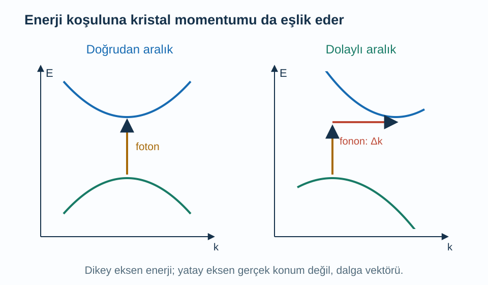
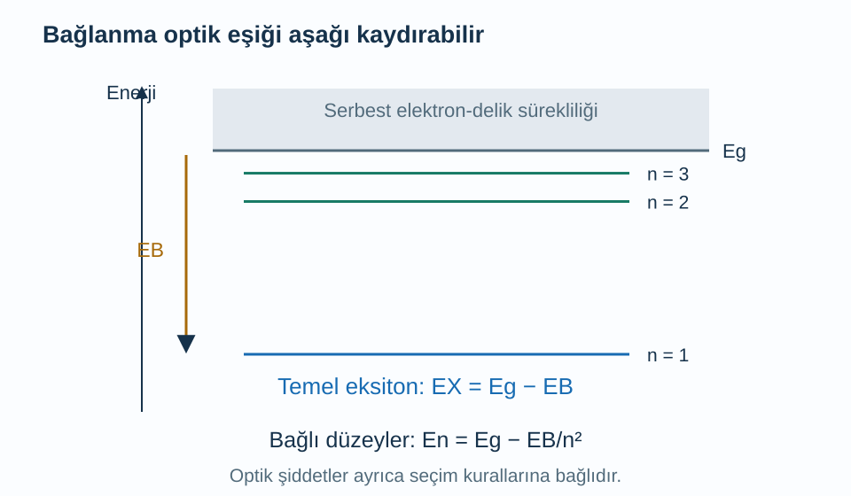

Bir katının üzerine ışık düştüğünde ışığın tamamı aynı biçimde davranmaz. Bir kısmı yansıyabilir, bir kısmı geçebilir, bir kısmı malzemenin iç enerjisini değiştirebilir. Elektronik soğurmada önemli bir süreç, valans bandındaki elektronun iletim bandındaki boş bir duruma yükselmesidir. Ancak yalnız foton enerjisinin bant aralığından büyük olması, geçişin ne kadar güçlü olacağını belirlemeye yetmez.

Bu yazı [yarı iletkenler ve katkılama](/blog/yari-iletkenler-ve-katkilama/), [etkin kütle ve delikler](/blog/etkin-kutle-ve-delikler/), [ters örgü](/blog/ters-orgu-ve-bragg-kirinimi/) ve [durum yoğunluğu](/blog/durum-yogunlugu-ve-fermi-yuzeyi/) üzerine kurulur. Işığın enerjisini, kristal momentumunu ve elektron ile deliğin birbirine uyguladığı çekimi ayrı adımlarda ele alacağız. Son kısımda kullanılan eksiton modeli, üç boyutlu, büyük yarıçaplı, yaklaşık izotropik bir yarı iletken içindir; bütün optik uyarımları tek başına kapsamaz.

## 1. Foton enerjisi ile bant aralığı

Fotonun enerjisini $E_\gamma$ ile gösterelim. Frekansı $\nu$, açısal frekansı $\omega=2\pi\nu$, boşluktaki dalga boyu $\lambda_0$ ise:

$$
\begin{aligned}
E_\gamma&=h\nu\\
&=\hbar\omega\\
&=\frac{hc}{\lambda_0}.
\end{aligned}
$$

$h$ Planck sabiti, $\hbar=h/(2\pi)$, $c$ boşluktaki ışık hızıdır. Malzeme içine girerken frekans korunur; dalga boyu kırılma indisine bağlı değişebilir. Bu nedenle $hc/\lambda$ yazarken kullanılan dalga boyunun boşluk değeri olduğunu açık tutacağız. Aksi halde aynı fotona iki farklı enerji atamış oluruz.

Valans ve iletim bantlarının enerjilerini $E_v(\mathbf k)$ ve $E_c(\mathbf k)$ diye yazalım; $\mathbf k$ elektronun Bloch dalga vektörüdür. Tek foton soğurulmasında enerji korunumu, başka uyarımlar yoksa son ve ilk elektron enerjileri arasındaki farkın $E_\gamma$ olmasını gerektirir. Ayrıca başlangıç durumunun dolu, son durumun boş olması gerekir. Dolu bir son duruma Pauli ilkesi nedeniyle aynı elektron geçişini ekleyemeyiz.

Geçişin gerçekleşebilmesi ile güçlü gerçekleşmesi de farklıdır. Işıkla etkileşim matris elemanı simetri nedeniyle sıfır olabilir. Fotonun polarizasyonu hangi durumları bağladığını etkileyebilir. Dolayısıyla bant aralığı bir enerji ölçeği verirken, optik şiddet dalga fonksiyonlarının yapısına da duyarlıdır.

## 2. Doğrudan geçiş neden grafikte dikey çizilir?

Görünür ışığın dalga boyu yüzlerce nanometre, atomik örgü aralığı çoğunlukla nanometrenin küçük bir kesri ölçeğindedir. Fotonun dalga vektörü bu yüzden Brillouin bölgesinin karakteristik boyutuna göre küçüktür. Tek fotonun kristal momentum aktarımı birçok bant çiziminde yaklaşık sıfır alınabilir. Geçiş o zaman yaklaşık aynı $\mathbf k$ değerinde gerçekleşir.

İletim bandı minimumu ile valans bandı maksimumu aynı dalga vektöründeyse malzeme **doğrudan aralıklıdır**. En küçük enerji farkına yaklaşık dikey bir geçişle ulaşılabilir. İki uç farklı dalga vektörlerindeyse malzeme **dolaylı aralıklıdır**. En küçük enerji farkını aşan geçişte aradaki kristal momentum farkını başka bir süreç taşımalıdır.

Örgünün kolektif titreşimlerinin kuantumuna **fonon** denir. Burada yalnız iki özelliğine ihtiyacımız var: enerji $\hbar\Omega$ ve kristal momentumu $\hbar\mathbf q$ taşıyan bir titreşim uyarımı olması. $\Omega$ titreşimin açısal frekansı, $\mathbf q$ dalga vektörüdür. Dolaylı geçişte fotona bir fonon soğurulması veya yayılması eşlik edebilir. Fononun ayrıntılı yapısını şimdilik bilmeden enerji ve momentum hesabına katkısını izleyebiliriz.

Okların yatay bileşeni gerçek uzayda bir elektronun aldığı yolu göstermez. Dalga vektörü değişimini gösterir. Dolaylı geçişteki yatay farkı büyük ölçüde örgü titreşimi üstlenir.

## 3. Dolaylı geçişte iki ayrı enerji koşulu

Bant aralığı $E_g$ olan dolaylı modelde bir fonon da soğuruluyorsa foton ve fonon enerjileri birlikte elektronu yükseltir: $E_\gamma+\hbar\Omega\simeq E_g$. Kenar yaklaşımında foton eşiği $E_g-\hbar\Omega$ olur. Fonon yayılıyorsa gelen foton hem elektronik enerji artışını hem çıkan fononu karşılamalıdır: $E_\gamma\simeq E_g+\hbar\Omega$.

Bu iki denklem her dalga vektöründe her fononla geçiş olacağını söylemez. Enerji ve kristal momentumu aynı anda korunmalı, ilgili bağlaşım sıfır olmamalıdır. Fonon soğurma kolunun şiddeti ortamda uygun fononların bulunmasına da bağlıdır. Çok düşük sıcaklıkta bu fononların doluluğu azaldığında soğurma katkısı zayıflayabilir. Geçiş eşiklerini yalnız enerji denkleminden çıkarıp şiddetleri de aynıymış gibi düşünmek eksik olur.

Kusurlar da momentum seçimini gevşetebilir. Ayrıca dolaylı aralıklı bir malzemede daha yüksek enerjili doğrudan geçişler bulunabilir. “Dolaylı” sözcüğü, malzemenin hiçbir koşulda foton soğuramayacağı veya ışık yayamayacağı anlamına gelmez; en düşük bant uçlarının göreli konumunu belirtir. [MIT'nin katıların optik özellikleri notları](https://web.mit.edu/6.732/www/opt.pdf) bant geçişleri ile eksitonları ayrı bölümlerde ele alır.

## 4. Sayısal örnek: Enerjiden dalga boyuna

Bağımsız elektron yaklaşımında doğrudan bant aralığı $E_g=1{,}50\,\mathrm{eV}$ olan model bir yarı iletken düşünelim. Eksiton etkisini bu ilk hesapta ihmal edelim. $hc\simeq1239{,}842\,\mathrm{eV\,nm}$ kullanarak kenardaki boşluk dalga boyunu buluruz:

$$
\begin{aligned}
\lambda_g&=\frac{hc}{E_g}\\
&=\frac{1239{,}842}{1{,}50}\,\mathrm{nm}\\
&\simeq826{,}56\,\mathrm{nm}.
\end{aligned}
$$

Daha kısa dalga boyu daha büyük foton enerjisi demektir. Örneğin $700\,\mathrm{nm}$ fotonun enerjisi $1{,}7712\,\mathrm{eV}$ olur; bandın kenarına göre $0{,}2712\,\mathrm{eV}$ fazla enerji vardır. Bu fazla enerji elektron ve deliğin bant kenarlarından uzak hareket enerjilerine gidebilir; daha sonra örgüye aktarılabilir. Fotonun bütün enerjisinin anında ısıya dönüştüğünü varsaymadık.

Ayrı bir dolaylı modelde $E_g=1{,}10\,\mathrm{eV}$, $\hbar\Omega=0{,}040\,\mathrm{eV}$ seçersek fonon soğurma ve yayma eşikleri sırasıyla $1{,}06$ ve $1{,}14\,\mathrm{eV}$ olur. Bunların dalga boyları yaklaşık $1169{,}66$ ve $1087{,}58\,\mathrm{nm}$'dir. Hangi kolun belirgin olduğu sıcaklık ve geçiş olasılıkları bilinmeden yalnız bu sayılardan çıkmaz.

## 5. Soğurma katsayısı neyi ölçer?

Işık şiddetini $I(z)$ ile gösterelim; $z$ malzeme içine ilerleme uzaklığıdır. Her küçük $dz$ kalınlığının kendisine ulaşan ışığın $\alpha\,dz$ kadarlık kısmını soğurduğunu varsayalım. $\alpha>0$ **soğurma katsayısıdır**, birimi ters uzunluktur. Şiddet azalacağı için:

$$
\begin{aligned}
dI&=-\alpha I\,dz\\
\frac{dI}{I}&=-\alpha\,dz.
\end{aligned}
$$

İki tarafı integre edince $\ln[I(z)/I(0)]=-\alpha z$ ve:

$$
I(z)=I(0)e^{-\alpha z}
$$

elde edilir. $1/\alpha$ uzaklığında şiddet başlangıç değerinin $1/e$'sine iner. Bu bağıntı sabit katsayılı homojen ortam içindir; yüzey yansımasını $I(0)$ değerinin dışında tutuyoruz. Giriş yüzeyine gelen ışık ile yüzeyi geçip içeri giren ışık aynı şiddet olmak zorunda değildir.

Örneğin $\alpha=10^4\,\mathrm{cm^{-1}}$ ve kalınlık $z=1\,\mathrm{\mu m}=10^{-4}\,\mathrm{cm}$ ise $\alpha z=1$, geçen iç şiddet oranı $e^{-1}\simeq0{,}3679$ olur. İçeri giren ışığın yaklaşık yüzde $63{,}2$'si bu kalınlıkta soğurulmuştur. Bu sayı soğurma kenarının yalnız yerini değil, seçilen foton enerjisindeki katsayıyı da bilmemiz gerektiğini gösterir.

## 6. Soğurma kenarı neden tek bir keskin basamak olmayabilir?

Doğrudan geçişte valans ve iletim bantlarını aynı merkez çevresinde parabolik alalım. Pozitif etkin kütleler $m_e^*$ ve $m_h^*$ ise aynı dalga vektöründeki enerji farkı:

$$
\begin{aligned}
E_c(k)-E_v(k)
&=E_g+\frac{\hbar^2k^2}{2m_e^*}
+\frac{\hbar^2k^2}{2m_h^*}\\
&=E_g+\frac{\hbar^2k^2}{2\mu_r}
\end{aligned}
$$

olur. Burada $1/\mu_r=1/m_e^*+1/m_h^*$ tanımladık. Daha sonra bağlanmış çiftte de aynı indirgenmiş kütle karşımıza çıkacak. Foton enerjisi kenarın üzerine çıktıkça daha büyük bir dalga vektörü kabuğundaki başlangıç ve son durum çiftleri geçişe katılabilir.

Bu uygun çiftlerin enerji başına sayısına **ortak durum yoğunluğu** denir. Üç boyutlu parabolik modelde kenar üstündeki fazla enerjinin kareköküyle büyür. Geçiş matris elemanı bu dar aralıkta yaklaşık sabitse ve doluluk engeli yoksa soğurmanın başlangıcı da bu durum sayımından güçlü biçimde etkilenir. Kenar davranışını yalnız iki bant arasındaki dikey mesafeye bakarak kestiremeyiz.

Eksiton bağlanması, sıcaklıkla genişleme, kusur düzeyleri ve güçlü taşıyıcı doluluğu bu basit başlangıç biçimini değiştirir. Bu nedenle deneysel bir eğrinin üzerine tek bir kuvvet yasası yerleştirip her malzemede kesin bant aralığı elde edeceğimizi varsaymak uygun değildir. Önce hangi geçiş modelinin ve hangi enerji aralığının temsil edildiğini belirlemeliyiz.

## 7. Elektron ve delik bağımsız kalmak zorunda mı?

İletim bandına çıkan elektron negatif, geride kalan delik pozitif yük taşır. Birbirlerini Coulomb kuvvetiyle çekebilirler. Bağlı elektron-delik uyarımına **eksiton** denir. Toplam elektrik yükü sıfırdır; buna rağmen enerji taşıyabilir ve ışıkla etkileşebilir. Eksiton oluşması ile serbest elektron ve deliklerin oluşması aynı enerji eşiğine sahip olmak zorunda değildir.

Büyük yarıçaplı **Wannier–Mott eksitonu** için elektron ve deliği etkin kütleli iki parçacık gibi yaklaşık ele alabiliriz. Elektron kütlesi $m_e^*$, delik kütlesi $m_h^*$ olsun. Göreli hareketin indirgenmiş kütlesi:

$$
\begin{aligned}
\mu_r&=\frac{m_e^*m_h^*}{m_e^*+m_h^*}\\
\frac1{\mu_r}&=\frac1{m_e^*}+\frac1{m_h^*}
\end{aligned}
$$

olur. $\mu_r$ burada kimyasal potansiyel değildir. İki cisimden biri sabit tutulmuş sayılmaz; her ikisi de hareket ettiği için indirgenmiş kütle kullanılır. $e>0$ temel elektrik yükünün büyüklüğüdür. Kristalin kutuplanması çekimi ekranlar. Bağıl dielektrik sabiti $\varepsilon_r$ ile potansiyel enerji $-e^2/(4\pi\varepsilon_0\varepsilon_r r)$ olur; $r$ elektron-delik uzaklığı, $\varepsilon_0$ boşluk geçirgenliğidir.

Bu modelde göreli hareket denklemi hidrojen atomunun biçimini taşır, fakat kütle ve Coulomb katsayısı değişmiştir. Hidrojenin temel bağlanma enerjisi $13{,}6057\,\mathrm{eV}$ ve Bohr yarıçapı $a_0=0{,}0529177\,\mathrm{nm}$ kullanılarak:

$$
\begin{aligned}
E_B&=13{,}6057\,\mathrm{eV}\,
\frac{\mu_r/m_e}{\varepsilon_r^2}\\
a_B^*&=a_0\frac{\varepsilon_r}{\mu_r/m_e}
\end{aligned}
$$

bulunur. $m_e$ boşluktaki elektron kütlesidir. Daha güçlü ekranlama çekimi azaltır; bağlanma enerjisi küçülürken yarıçap büyür. İki formülün farklı dielektrik kuvvetleri taşıması hidrojen çözümünün enerji ve uzunluk ölçeklerinden kaynaklanır.

Bağlı çiftte iki hareketi ayırmak gerekir. Kütle merkezinin hareketinde toplam kütle $M=m_e^*+m_h^*$, elektronun deliğe göre hareketinde ise $\mu_r$ kullanılır. $\mathbf r=\mathbf r_e-\mathbf r_h$ göreli koordinat, $\mathbf R=(m_e^*\mathbf r_e+m_h^*\mathbf r_h)/M$ kütle merkezi olsun. Parabolik bant modelinde kinetik enerji bu iki koordinatta:

$$
T=-\frac{\hbar^2}{2M}\nabla_R^2
-\frac{\hbar^2}{2\mu_r}\nabla_r^2
$$

biçiminde ayrılır. Çekim yalnız r'ye bağlıdır; dolayısıyla bağlanma enerjisini göreli hareket belirler. Kütle merkezinin dalga vektörü $\mathbf K_X$ ise hidrojen benzeri düzeylerin toplam uyarım enerjisi:

$$
E_n(\mathbf K_X)=E_g-\frac{E_B}{n^2}
+\frac{\hbar^2K_X^2}{2M}
$$

olur. Optik olarak dikey geçişte foton momentumu küçük olduğundan genellikle $\mathbf K_X\simeq0$ düzeylerini örnekleriz. Böylece aşağıda kullandığımız $E_g-E_B$, hareketli her eksitonun aynı enerjiye sahip olduğu iddiası değildir; temel göreli durumun küçük kütle merkezi momentumu sınırıdır. Burada iki kütlenin farklı rolleri, [MIT'nin eksiton modelindeki](https://web.mit.edu/6.732/www/opt.pdf) çift hareketi ayrımına karşılık gelir.

## 8. Sayısal örnek: Eksitonun bağlanma ölçeği

$m_e^*=0{,}20m_e$, $m_h^*=0{,}50m_e$ ve $\varepsilon_r=10$ seçelim. Önce indirgenmiş kütle:

$$
\begin{aligned}
\frac{\mu_r}{m_e}&=\frac{0{,}20\times0{,}50}{0{,}20+0{,}50}\\
&=\frac{0{,}10}{0{,}70}\\
&\simeq0{,}142857
\end{aligned}
$$

olur. Ardından:

$$
\begin{aligned}
E_B&=13{,}6057\frac{0{,}142857}{100}\,\mathrm{eV}\\
&\simeq0{,}01944\,\mathrm{eV}\\
&=19{,}44\,\mathrm{meV}
\end{aligned}
$$

$$
\begin{aligned}
a_B^*&=0{,}0529177\frac{10}{0{,}142857}\,\mathrm{nm}\\
&\simeq3{,}704\,\mathrm{nm}.
\end{aligned}
$$

Örgü aralığı örneğin $0{,}40\,\mathrm{nm}$ ise yarıçap yaklaşık dokuz örgü aralığıdır. Sürekli ortam yaklaşımının neden küçük atomik ölçekteki sıkı bir uyarıma göre daha uygun olabileceğini bu karşılaştırma gösterir; yine de gerçek bant ve ekranlama ayrıntılarını doğrulamaz.

$E_g=1{,}50\,\mathrm{eV}$ örneğine dönersek, optik olarak izinli temel eksiton için yaklaşık soğurma enerjisi $E_X=E_g-E_B\simeq1{,}48056\,\mathrm{eV}$ olur. Bunun boşluk dalga boyu yaklaşık $837{,}41\,\mathrm{nm}$'dir. Bağlanma, bağımsız çift eşiğinin altında bir çizgiye izin verir. Bu yüzden optik spektrumdaki ilk belirgin çizgiyi düşünmeden doğrudan bant aralığı saymak hatalı olabilir.

Şekilde hidrojen benzeri modelin düzeyleri $E_g-E_B/n^2$ olarak gösterilir; $n=1,2,3,\ldots$ pozitif tam sayı kuantum etiketidir. Her düzeyin aynı optik şiddete sahip olduğu ima edilmez. Seçim kuralları ve çizgi genişlikleri ayrıca gerekir.

## 9. Bağlanma ile sıcaklığı karşılaştırmak

$k_B$ Boltzmann sabiti olmak üzere $300\,\mathrm K$'de termal enerji $k_BT\simeq25{,}85\,\mathrm{meV}$'tur; örneğimizin $19{,}44\,\mathrm{meV}$ bağlanma enerjisinden büyüktür. Bu karşılaştırma termal ayrışmanın önemli olabileceğine işaret eder. Fakat “bu sıcaklıkta hiçbir eksiton yoktur” sonucunu tek başına vermez. Yoğunluk, oluşum ve bozunma hızları, ekranlama ve ölçüm zamanı da önemlidir. $E_B/k_B\simeq225{,}6\,\mathrm K$ yalnız karakteristik bir enerji ölçeğidir.

Küçük yarıçaplı Frenkel eksitonları, iki boyutlu malzemeler ve güçlü ekranlama değişimleri bu üç boyutlu hidrojen modeline doğrudan uymaz. Ayrıca eksitonun elektrik alanında ayrışması, ışığın elektrik akımına dönüşmesinde kritik olabilir. [MIT'nin optik malzeme ders kaynakları](https://ocw.mit.edu/courses/6-977-semiconductor-optoelectronics-theory-and-design-fall-2002/) bant geçişleri ve ışık-madde etkileşiminin daha geniş çerçevesini sunar. Buradaki temel ayrım şudur: bir optik ölçüm yalnız tek elektron bantlarını değil, elektron ve deliğin birlikte oluşturduğu uyarımları da görür.
