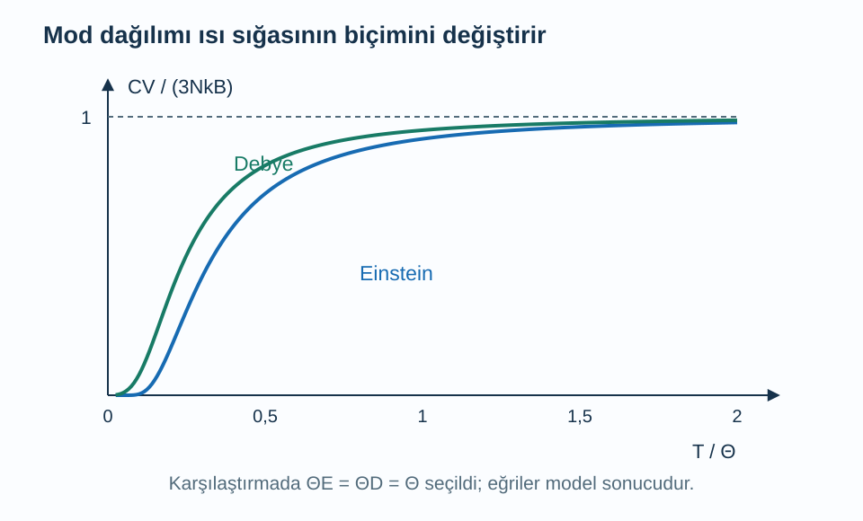
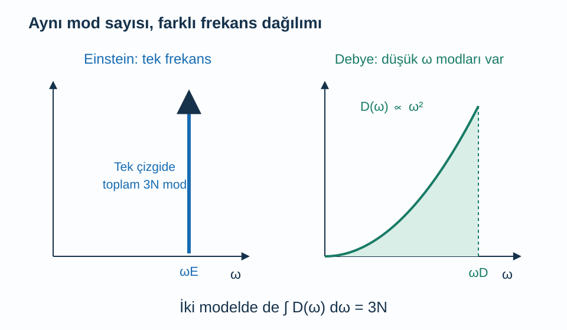

Bir katının sıcaklığını bir derece artırmak için ne kadar enerji vermek gerekir? Aynı sayıda atom içeren iki katı bu soruya her sıcaklıkta aynı yanıtı vermez. Özellikle düşük sıcaklıkta ısı sığası hızla küçülür. Klasik fiziğin her titreşim koordinatına aynı ortalama enerjiyi verdiği yaklaşım bu azalmayı açıklayamaz; kuantum enerji aralıklarının hangi hareketlerin uyarılabildiğini nasıl sınırladığını kullanmamız gerekir.

Bu yazı [örgü titreşimleri ve fononlar](/blog/orgu-titresimleri-ve-fononlar/), [kuantum harmonik osilatörü](/blog/kuantum-harmonik-osilatoru/), [Bose–Einstein dağılımı](/blog/bose-einstein-ve-fermi-dirac-dagilimlari/) ve [belirli integral](/blog/belirli-integral-ve-temel-teorem/) üzerine kurulur. Önce aynı frekanslı osilatörlerden oluşan Einstein modelini inceleyeceğiz. Ardından düşük frekanslı ortak hareketleri hesaba katan Debye modeline geçeceğiz. Burada esas olarak örgünün katkısını hesaplıyoruz; metallerdeki elektron katkısını sonunda ayrıca ayıracağız.

## 1. Isı sığası bir enerji türevidir

İç enerjiyi $U$, sıcaklığı $T$, hacmi $V$ ile gösterelim. Sabit hacimde **ısı sığası**:

$$
C_V=\left(\frac{\partial U}{\partial T}\right)_V
$$

olarak tanımlanır. Küçük sıcaklık değişiminde $dU=C_VdT$ olur. Toplam örneğin ısı sığası birimi $\mathrm{J/K}$'dir. Bir mol başına verirsek $\mathrm{J/(mol\,K)}$, hacim başına verirsek $\mathrm{J/(m^3\,K)}$ kullanırız. Aynı sembolle sunulan sayıları karşılaştırırken hangi normalleştirmenin yapıldığını kontrol etmek gerekir.

Isı sığası, enerjinin ne kadar hızlı aktığını söylemez. Bir madde çok enerji depolayabilir ama enerjiyi bir ucundan ötekine yavaş taşıyabilir. Burada denge enerji değişimini buluyoruz. Ayrıca deneyler bazen sabit basınçta $C_p$ ölçer; bu durumda ısınırken genleşme için yapılan iş de devreye girer. Katılarda belirli koşullarda fark küçük olabilir, fakat iki büyüklük tanım gereği aynı değildir.

Harmonik modelde frekansları hacim sabitken sıcaklıktan bağımsız alacağız. Böylece sıcaklık değişimi modların enerjilerini değil, ortalama doluluklarını değiştirir. Gerçekte genleşme ve anharmoniklik frekansları da değiştirebilir; bunlar ilk modelimizin dışındadır.

## 2. Tek kuantum osilatörünün katkısı

Açısal frekansı $\omega$ olan bir modun ortalama enerjisi:

$$
\bar E=\hbar\omega\left(\frac1{e^{\hbar\omega/(k_BT)}-1}+\frac12\right)
$$

olur. $\hbar$ indirgenmiş Planck sabiti, $k_B$ Boltzmann sabitidir. İlk terim termal fonon enerjisi, ikinci terim sıfır nokta enerjisidir. Frekans sabit olduğundan ikinci terimin sıcaklık türevi sıfırdır. Bu yüzden sıfır nokta enerjisi bu yaklaşımda ısı sığasına katkı vermez; enerjinin kendisinin sıfır olduğu sonucu çıkmaz.

Boyutsuz $x=\hbar\omega/(k_BT)$ değişkenini tanımlayalım. $dx/dT=-x/T$ olur. Üstel doluluğun türevini zincir kuralıyla alırsak:

$$
\begin{aligned}
\frac{d\bar E}{dT}
&=\hbar\omega\left[-\frac{e^x}{(e^x-1)^2}\right]
\left(-\frac xT\right)\\
&=k_B\frac{x^2e^x}{(e^x-1)^2}.
\end{aligned}
$$

İki negatif çarpan sonucu pozitif yapar. Sıcaklık artınca enerji artmalıdır; işaret bu fiziksel beklentiyle uyumludur. Son satırda $\hbar\omega=xk_BT$ kullandık. Bir modun katkısı böylece $k_B$ çarpı boyutsuz bir fonksiyon olur.

## 3. Einstein modeli neyi yakalar?

$N$ atomun üçer titreşim serbestliği için toplam $3N$ osilatör alalım ve hepsine aynı $\omega_E$ frekansını verelim. **Einstein sıcaklığı** $\Theta_E=\hbar\omega_E/k_B$ olsun. Bütün modların katkısını toplarsak:

$$
C_V^{(E)}=3Nk_B
\frac{(\Theta_E/T)^2e^{\Theta_E/T}}
{(e^{\Theta_E/T}-1)^2}
$$

buluruz. Bu model kuantum enerji aralığının önemini çok yalın gösterir. $T\gg\Theta_E$ olduğunda $x=\Theta_E/T$ küçüktür. $e^x-1\simeq x$ ve $e^x\simeq1$ kullanılırsa kesir bire yaklaşır. Sonuç klasik **Dulong–Petit sınırı** $C_V\to3Nk_B$ olur.

Bir mol atom için $Nk_B=R$ yazılır; $R=8{,}31446\,\mathrm{J/(mol\,K)}$ gaz sabitidir. Yüksek sıcaklık limiti $3R\simeq24{,}943\,\mathrm{J/(mol\,K)}$'dir. Bir mol formül biriminde birden fazla atom varsa atom sayısını ayrıca hesaba katmalıyız. “Bir mol katı” ifadesi bu ayrımı gizleyebilir.

Düşük sıcaklıkta $x\gg1$ olur; $e^x-1\simeq e^x$ kullanıldığında mod katkısı $k_Bx^2e^{-x}$ gibi küçülür. Enerji basamağı termal enerjiye göre büyük olduğu için uyarılma olasılığı çok azalır. Einstein modeli bu kuantum donmayı yakalar, fakat bütün modlara aynı sonlu frekansı verdiği için uzun dalga akustik modları doğru temsil etmez.

Şekilde sıcaklıklar karşılaştırma amacıyla aynı karakteristik sıcaklıkla ölçeklenmiştir. Eğriler belirli bir malzemeye uydurulmuş deney verisi değildir. Mod dağılımı seçiminin termodinamik sonucu gösterilir.

## 4. Sayısal örnek: Einstein ısı sığası

Bir mol atom için $\Theta_E=200\,\mathrm K$, ölçüm sıcaklığı $T=50\,\mathrm K$ seçelim. Boyutsuz oran $x=200/50=4$ olur. Üstel $e^4\simeq54{,}598$ olduğundan:

$$
\begin{aligned}
\frac{x^2e^x}{(e^x-1)^2}
&=\frac{16(54{,}598)}{(53{,}598)^2}\\
&\simeq0{,}304087.
\end{aligned}
$$

Molar ısı sığası:

$$
\begin{aligned}
C_{V,m}^{(E)}&=3R(0{,}304087)\\
&\simeq7{,}585\,\mathrm{J/(mol\,K)}
\end{aligned}
$$

çıkar. Alt indis $m$ molar büyüklüğü belirtir. Bu, yüksek sıcaklık sınırının yaklaşık yüzde $30{,}4$'üdür. Çok küçük bir $1\,\mathrm K$ artışı için bir molün enerji değişimini yaklaşık $7{,}6\,\mathrm J$ sayabiliriz. Büyük bir sıcaklık aralığında aynı değeri sabit çarpan olarak kullanamayız; $C_V(T)$ değiştiği için integral gerekir.

## 5. Debye modeli düşük frekansları nasıl sayar?

Gerçek kristalde uzun dalga akustik modların frekansı sıfıra yaklaşabilir. Debye modeli bu modları üç boyutlu, yaklaşık izotropik bir sürekli ortamın ses dalgaları gibi sayar. Basitlik için üç polarizasyon dalının hızını aynı $v_s$ alalım. Her dalda $\omega=v_sq$ olsun; $q$ dalga vektörünün büyüklüğüdür.

Dalga vektörü uzayında bir durumun hacmi $(2\pi)^3/V$'dir. $q$ ile $q+dq$ arasındaki küresel kabuğun hacmi $4\pi q^2dq$ olur. Üç polarizasyonu da sayarak:

$$
\begin{aligned}
d\mathcal N&=3\frac{V}{(2\pi)^3}4\pi q^2dq\\
&=\frac{3V}{2\pi^2}q^2dq
\end{aligned}
$$

buluruz. Burada $\mathcal N$ mod sayısıdır. $q=\omega/v_s$ ve $dq=d\omega/v_s$ yerine konulduğunda açısal frekans başına mod yoğunluğu:

$$
\begin{aligned}
D(\omega)&=\frac{d\mathcal N}{d\omega}\\
&=\frac{3V}{2\pi^2v_s^3}\omega^2
\end{aligned}
$$

olur. Bu $\omega^2$ davranışı üç boyutlu kabuk sayımından gelir. İki boyutlu bir sistemde aynı kuvveti otomatik kullanamayız.

Sürekli ortam dalga sayısını sonsuza kadar büyütürsek sonsuz mod saymış oluruz; oysa kristalde $3N$ titreşim serbestliği vardır. Bu nedenle **Debye kesim frekansı** $\omega_D$ seçip $\int_0^{\omega_D}D(\omega)d\omega=3N$ koşulunu uygularız. Sonuç:

$$
\begin{aligned}
D(\omega)&=\frac{9N}{\omega_D^3}\omega^2\\
&0\le\omega\le\omega_D
\end{aligned}
$$

biçiminde yazılabilir. Kesim frekansı her kristalin gerçek en yüksek titreşim frekansının tam karşılığı olmak zorunda değildir; toplam mod sayısını koruyan model parametresidir. [Tong'un kuantum gazları notları](https://davidtong.org/pdfs/teaching/statistical-physics/statphys3.pdf) Debye sayımını termal fonon enerjisiyle birleştirir.

Kesimin dalga sayısı karşılığını da bulabiliriz. Küre içinde üç polarizasyonla $\mathcal N(q_D)=Vq_D^3/(2\pi^2)=3N$ olduğundan:

$$
q_D=\left(6\pi^2\frac NV\right)^{1/3},
\qquad \omega_D=v_sq_D.
$$

Bu eşitlik modelin hem atom yoğunluğunu hem ses hızını kullandığını gösterir. Küresel kesim, gerçek Brillouin bölgesinin şeklinin yerine geçer; her yöndeki gerçek sınırı eşleştirmek için seçilmez. Çok atomlu hücrede bütün $3N$ modu doğrusal ses dallarıyla temsil etmek de optik dalları yaklaşık biçimde hesaba katma tercihidir.

Gerçekçi bir izotropik ortamda bir boyuna hız $v_L$ ve iki enine hız $v_T$ varsa düşük frekans sayımı:

$$
D(\omega)=\frac{V\omega^2}{2\pi^2}
\left(\frac1{v_L^3}+\frac2{v_T^3}\right)
$$

verir. Tek hız kullanmak istersek $3/v_s^3=1/v_L^3+2/v_T^3$ seçilir. Bu aritmetik hız ortalaması değildir: daha yavaş dallar aynı frekans aralığına daha çok mod sığdırdığı için ters küpleri ağırlık taşır.

## 6. Modların enerji katkısını toplamak

Sıcaklığa bağlı örgü enerjisi, her modun ortalama termal enerjisinin toplamıdır:

$$
U_{\mathrm{th}}=\int_0^{\omega_D}
D(\omega)\frac{\hbar\omega}{e^{\hbar\omega/(k_BT)}-1}\,d\omega.
$$

Burada sıfır nokta terimini ısı sığasını etkilemediği için ayrı bıraktık. Türevi doğrudan mod katkıları üzerinden alıp $x=\hbar\omega/(k_BT)$ değişkenine geçelim. **Debye sıcaklığı** $\Theta_D=\hbar\omega_D/k_B$ tanımıyla:

$$
C_V^{(D)}=9Nk_B\left(\frac T{\Theta_D}\right)^3
\int_0^{\Theta_D/T}
\frac{x^4e^x}{(e^x-1)^2}\,dx
$$

elde edilir. İntegralin içindeki $x^2$ faktörlerinden biri mod yoğunluğundan, diğeri tek modun ısı sığasından gelir. Dıştaki $T^3$ ise frekans değişkenini sıcaklıkla ölçeklemenin sonucudur. Üst sınır da sıcaklığa bağlıdır; yalnız dış çarpana bakıp her sıcaklıkta $T^3$ yasası var dememeliyiz.

Düşük sıcaklıkta $\Theta_D/T$ çok büyüktür; integrali üst sınırı sonsuzmuş gibi yaklaştırabiliriz. Bilinen yakınsak integralin değeri $4\pi^4/15$'tir. Böylece:

$$
\begin{aligned}
C_V^{(D)}&\simeq\frac{12\pi^4}{5}Nk_B
\left(\frac T{\Theta_D}\right)^3\\
&(T\ll\Theta_D)
\end{aligned}
$$

bulunur. Einstein modelinin üstel azalmasının yerine küp yasası gelir; çünkü sıcaklık ne kadar düşük olursa olsun yeterince küçük frekanslı akustik modlar vardır. Uyandırılabilen bu modların sayısı sıcaklıkla küp biçiminde büyür.

Einstein çizgisi matematiksel olarak tek frekansta yoğunlaşmayı simgeler; sonlu genişlikli ölçüm tepesi değildir. Debye eğrisinin kesildiği yerde toplam alan $3N$ olacak şekilde normalizasyon yapılmıştır.

## 7. Sayısal örnek: Küp yasası ve enerji artışı

Bir mol atom için $\Theta_D=300\,\mathrm K$ seçelim. $T=10\,\mathrm K$ bu ölçeğin otuzda biridir. Düşük sıcaklık yaklaşımıyla:

$$
\begin{aligned}
C_{V,m}(10\,\mathrm K)
&\simeq\frac{12\pi^4}{5}R\left(\frac{10}{300}\right)^3\\
&\simeq0{,}07199\,\mathrm{J/(mol\,K)}.
\end{aligned}
$$

Sıcaklığı $20\,\mathrm K$'ye çıkarınca küp çarpanı sekiz kat büyür ve yaklaşık $0{,}5759\,\mathrm{J/(mol\,K)}$ bulunur. Bu iki değerin oranını hesaplamak için bütün sabitleri yeniden çarpmamıza gerek yoktur: $(20/10)^3=8$. Her iki sıcaklığın da düşük sıcaklık koşulunda kaldığını ayrıca kontrol ettik.

Bir mol örneği $10$'dan $20\,\mathrm K$'ye ısıtmak için gereken enerji değişimini bulalım. $C_{V,m}=\beta T^3$ dersek $\beta=(12\pi^4R/5)/\Theta_D^3$ ve birimi $\mathrm{J/(mol\,K^4)}$ olur. İntegral:

$$
\begin{aligned}
\Delta U_m&=\int_{10}^{20}\beta T^3dT\\
&=\frac\beta4(20^4-10^4)\\
&\simeq2{,}700\,\mathrm{J/mol}
\end{aligned}
$$

verir. Başlangıç ısı sığasını sıcaklık farkıyla çarpsaydık yaklaşık $0{,}72\,\mathrm{J/mol}$ bulurduk; aralık boyunca artan ısı sığasını kaçırmış olurduk. Bu örnek türev ile integralin fiziksel rollerini birlikte gösterir.

## 8. Düşük sıcaklık integralinin katsayısını denetlemek

Küp yasasının kuvveti mod sayımından gelir; önündeki sayısal katsayı ise integralin tam değerine bağlıdır. Bunun nereden çıktığını bir adım daha açabiliriz. $x>0$ için geometrik seriden $1/(e^x-1)=\sum_{r=1}^{\infty}e^{-rx}$ yazılır. $r$ pozitif tam sayı toplam etiketidir. Bu eşitliğin türevini alınca:

$$
\frac{e^x}{(e^x-1)^2}
=\sum_{r=1}^{\infty}r e^{-rx}
$$

elde edilir. Böylece ısı sığası integralinin içi pozitif terimlerin toplamı olur. Her terimde $y=rx$ değişkeni kullanıldığında $\int_0^\infty x^4e^{-rx}dx=24/r^5$ bulunur; $24$ sayısı, üstel integralin dört kez kısmi integrasyonundan gelir. Baştaki $r$ ile çarpınca bütün integral $24\sum_{r=1}^{\infty}1/r^4$ olur.

Bu yakınsak toplamın değeri $\pi^4/90$ olduğundan sonuç $24\pi^4/90=4\pi^4/15$ çıkar. Son toplam özdeşliğinin ayrı bir matematiksel kanıtını burada kurmuyoruz; katsayının hangi standart integralden geldiğini görünür yapıyoruz. Önemli nokta, bu sabitin sıcaklık taşımamasıdır. Düşük sıcaklıkta bütün sıcaklık bağımlılığı dışarıdaki $T^3$ çarpanında kalır.

Sonlu üst sınırı sonsuza götürmenin hatası da fiziksel olarak okunabilir: kesim frekansının çok üzerindeki hayalî modları ekliyor gibi görünürüz, fakat onların üstel doluluğu bu sınırda çok küçüktür. Sıcaklık Debye sıcaklığına yaklaşınca bu ihmal artık güvenli değildir ve sonlu sınırdaki integrale geri dönmeliyiz.

## 9. Gerçek ölçümde başka katkılar

Debye modeli düşük frekanslı akustik davranışı iyi temsil eden bir başlangıçtır. Çok atomlu hücrelerde optik dallar, yönlere göre farklı ses hızları ve gerçek dağılım eğrileri orta sıcaklık davranışını değiştirebilir. Yüksek sıcaklıkta harmonik modelin bütün modları yaklaşık $k_B$ katkı verdiğinden yine $3Nk_B$ sınırına yaklaşılır; fakat çok yüksek sıcaklıkta anharmoniklik, genleşme ve erime gibi etkiler modeli sınırlar.

Metallerde elektronlar da ısı sığasına katkı verir. Yeterince düşük sıcaklıkta basit metal yaklaşımında elektronik terim sıcaklıkla doğrusal, örgü terimi kübik olabilir: $C_V\simeq\gamma T+\beta T^3$. $\gamma$ elektronik katsayı, $\beta$ örgü katsayısıdır; normalleştirmeleri aynı seçilmelidir. Bu durumda $C_V/T$'yi $T^2$'ye karşı çizmek iki katkıyı ayırmak için yararlı olabilir. Manyetik veya başka düşük enerjili uyarımlar varsa bu iki terim yeterli olmayabilir.

[MIT'nin örgü dalgalarının ısı sığası dersleri](https://ocw.mit.edu/courses/6-730-physics-for-solid-state-applications-spring-2003/pages/lecture-notes/) ayrık kristal modlarıyla termodinamik hesabı ilişkilendirir. Isı sığasının temel mantığı artık nettir: her enerji basamağının sıcaklıkla ne kadar dolduğunu hesaplar, sonra bu basamakların kaç tane olduğunu doğru biçimde sayarız.
