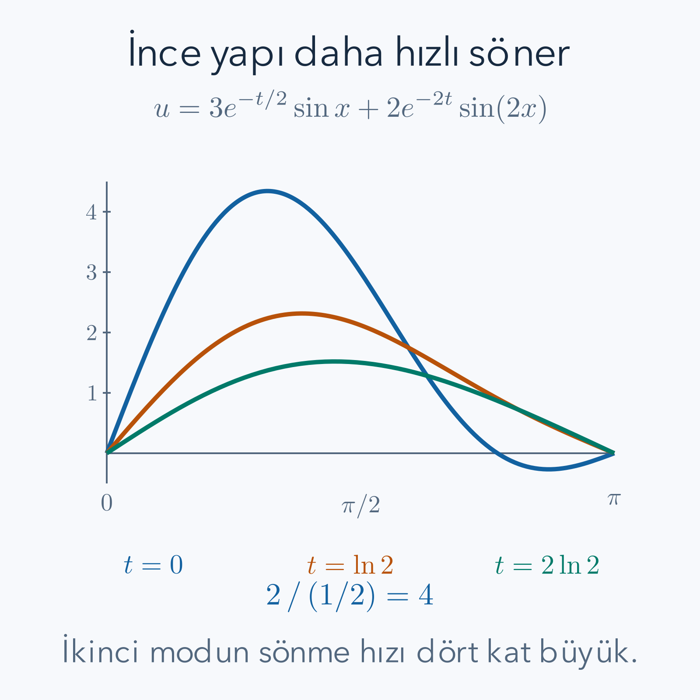

Bir çubuğun sıcaklığı yalnız zamana bağlı değildir. Aynı anda ortası sıcak, uçları soğuk olabilir; aynı konum da zaman geçtikçe soğuyabilir. Bu nedenle bilinmeyeni tek değişkenli $u(t)$ yerine $u(x,t)$ diye yazarız. Burada $x$ çubuk üzerindeki konum, $t$ zaman, $u$ ise sıcaklık veya seçtiğimiz başka bir alandır. İki değişkenli bir bilinmeyenin farklı yönlerdeki değişimleri arasındaki bağıntı bizi **kısmi diferansiyel denklemlere** götürür.

Önce [çok değişkenli türevleri](/blog/cok-degiskenli-fonksiyonlar-ve-turev/), [integral alma yöntemlerini](/blog/integral-alma-yontemleri/) ve [ikinci dereceden diferansiyel denklemleri](/blog/ikinci-derece-diferansiyel-denklemler/) hatırlamak yararlıdır. [Fourier serileri](/blog/fourier-serileri-ve-dalga-paketleri/) fizik bağlamında aynı sinüsleri kullanır; bu yazı o metni okumuş olmayı şart koşmaz. Gerekli ortogonallik ve katsayı hesabını yeniden kuracağız. Bütün modellerimiz sürekli ortam ve yeterli düzgünlük varsayar; atom ölçeğindeki ayrıntıları doğrudan çözmüyoruz.

## 1. Kısmi Türev ve Denklem Mertebesi

$u_t=\partial u/\partial t$, konum sabitken zamana göre türevdir. $u_x$ ise zaman sabitken konuma göre türevdir. İkinci türevleri $u_{tt}$ ve $u_{xx}$ ile gösteririz. Örneğin $u(x,t)=x^2t^3$ için $u_t=3x^2t^2$, $u_{xx}=2t^3$ olur. Birinci hesapta $x^2$ sabit çarpandır; ikincide $t^3$ sabit çarpandır. Değişkenlerin bağımsızlığını korumak işlemin temelidir.

Bilinmeyenin bu kısmi türevlerini içeren eşitlik bir **PDE**, Türkçede kısmi diferansiyel denklem olur. En yüksek türevin toplam türev sayısı denklemin mertebesidir. $u_t=\alpha u_{xx}$, zamanda birinci ama uzayda ikinci türev içerdiği için ikinci mertebedendir. $u_{xt}$ de toplam iki türev içerir. Mertebe, türevin karesi demek değildir: $(u_x)^2$ birinci türevin karesidir, $u_{xx}$ değildir.

Bir **adi diferansiyel denklem**de bilinmeyen yalnız bir bağımsız değişkene bağlıdır. PDE'de birden fazla değişken bulunduğundan çözüm bir eğri yerine genellikle bir yüzey veya zamanla değişen bir alan olur. Başlangıçta vereceğimiz bilgi de bir sayı çifti yerine çoğu kez bütün bir fonksiyondur.

## 2. Doğrusallık ve Üst Üste Koyma

Bir denklemin doğrusal olması için $u$ ve türevleri yalnız birinci kuvvetle bulunmalı, birbirleriyle çarpılmamalı ve katsayılar bilinmeyen $u$'ya bağlı olmamalıdır. $u_t=a(x)u_{xx}+s(x,t)$ doğrusaldır; $s$ verilmiş kaynak fonksiyonudur. $u_t=u\,u_x$ veya $u_t=(u_x)^2$ doğrusal değildir. Katsayının $x$'e bağlı olması tek başına doğrusallığı bozmaz.

Kaynak sıfırsa denklem **homojen**dir. Doğrusal homojen bir denklemin iki çözümü $u_1,u_2$ ise, sabit $c_1,c_2$ için $c_1u_1+c_2u_2$ de denklemi sağlar. Örneğin türev toplam üzerine dağılır: $(c_1u_1+c_2u_2)_t=c_1u_{1,t}+c_2u_{2,t}$. Her çözüm için ısı denklemi yazınca bu ifade $\alpha(c_1u_{1,xx}+c_2u_{2,xx})$ olur.

Fakat aynı sınır ve başlangıç verisini sağlayan çözümleri keyfi katsayılarla toplarsak veriler de toplanır. Homojen sınırların sıfır kalması bu bakımdan kullanışlıdır. Kaynaklı denklemde iki çözümün toplamı kaynağı iki katına çıkarabilir. Kullanacağımız mod toplamı, denklemle birlikte bu veri hesabına da dayanır.

## 3. Başlangıç ve Sınır Koşulları Ne Söyler?

Uzunluğu $\ell>0$ olan bir çubuğun bölgesi $0\le x\le\ell$ olsun. $u(x,0)=f(x)$ eşitliği bütün başlangıç sıcaklık profilini verir. $u(0,t)=u(\ell,t)=0$ ise uçları referans sıcaklığında tutar. Bu bir **Dirichlet sınır koşulu**dur: alanın değeri verilmiştir. Sıfır burada mutlak sıfır sıcaklık anlamına gelmez; sabit bir referanstan sıcaklık farkını ölçebiliriz.

$u_x(0,t)=u_x(\ell,t)=0$ gibi türevin verildiği koşul **Neumann koşulu**dur. Isı modelinde yalıtılmış uçlarda akı sıfır olduğundan bu koşul ortaya çıkar. Uçtaki değer ile türevin doğrusal birleşiminin verildiği koşula Robin denir. Bunlar aynı fiziksel problemi anlatmaz; sınır türünü değiştirince izin verilen uzaysal şekiller de değişir.

Klasik, köşelerde sürekli bir çözüm istiyorsak $f(0)=f(\ell)=0$ başlangıç ile sıfır Dirichlet sınırlarının uyumudur. Başlangıç uçları başka değerdeyse iç bölgede pozitif zaman için çözüm kurulabilir, fakat $(0,0)$ gibi köşelerde bütün verilerin aynı sürekli değeri almasını bekleyemeyiz. Yalnız PDE'yi yazmak bu seçimleri yapmaz.

## 4. Isı Denklemini Bir Dilimin Enerjisinden Türetmek

Kesit alanı $A$, yoğunluğu $\rho$, birim kütle başına özgül ısısı $c_p$ ve ısı iletkenliği $k$ sabit bir çubuk düşünelim. Yan yüzey yalıtılmış, içeride ısı kaynağı yoktur. Sıcaklığın kesit boyunca yaklaşık aynı olduğunu varsayıyoruz. $[x,x+\Delta x]$ diliminin hacmi $A\Delta x$, kütlesi $\rho A\Delta x$'tir.

$Q(x,t)$, pozitif $x$ yönünde birim alandan birim zamanda geçen enerji, yani ısı akısı olsun. Dilime soldan giriş $A Q(x,t)$, sağdan çıkış $A Q(x+\Delta x,t)$'dir. Yerel enerji depolanma hızı yaklaşık $\rho c_p A\Delta x\,u_t$ olduğundan bilanço

$$
\rho c_p A\Delta x\,u_t
=AQ(x,t)-AQ(x+\Delta x,t)
$$

olur. $A\Delta x$'e bölüp $\Delta x$'i sıfıra götürünce $\rho c_pu_t=-Q_x$ çıkar. Eksi işareti, sağa doğru akı artıyorsa dilimden girenden fazla enerji çıkmasını anlatır.

Fourier ısı iletim yasası $Q=-ku_x$ der: sıcaklık sağa doğru artıyorsa enerji sola akar. Sabit $k$ için $Q_x=-ku_{xx}$; iki eksiyi birleştirince

$$
\boxed{u_t=\alpha u_{xx}},\qquad
\alpha=\frac{k}{\rho c_p}>0
$$

elde edilir. $\alpha$ ısıl yayınımdır ve birimi uzunluk karesi/zamandır. Dolayısıyla $\alpha u_{xx}$ ile $u_t$ aynı birimdedir. Tepede eğrilik $u_{xx}<0$ ise sıcaklık azalır; bir çukurda pozitif eğrilik yerel ısınma verir. Bu işaret kontrolü, modelin düzleştirme davranışını daha çözmeden doğrular.

Bilanço ile malzeme yasasının farklı işler yaptığını ayıralım. Giren enerji eksi çıkan enerjinin depolanmaya eşit olması korunumdur. Akının sıcaklık gradyanıyla orantılı olması ise seçtiğimiz malzeme modelidir. Başka bir malzemede iletkenlik sıcaklığa bağlı olabilir; o zaman aynı bilanço korunurken sonuçta türev içinde değişken bir katsayı kalır. Sabit yayınım denklemimiz bütün ortamların zorunlu yasası değil, açıkça belirttiğimiz varsayımların sonucudur.

İçeride birim hacim başına enerji üretimi bulunsaydı bilançonun sağında ek bir üretim terimi olurdu. Çubuk yan yüzeyden çevreye enerji kaybetseydi başka bir kayıp terimi gerekirdi. Bu etkileri yalnız çözümün başlangıç katsayılarını değiştirerek temsil edemeyiz; diferansiyel denklem de değişir. Bu nedenle bir çözümün uzun zamanda sıfıra gitmesi, uçların referans sıcaklığında tutulduğu ve içeride kaynak bulunmadığı bu problemle birlikte okunmalıdır.

## 5. Değişkenleri Neden Ayırıyoruz?

Sıfır Dirichlet sınırları için önce özel biçimli bir çözüm arayalım:

$$
u(x,t)=X(x)T(t).
$$

Bu, bütün çözümlerin tek bir çarpım olduğunu söylemez. Ama ayrı çözümler bulursak doğrusal denklem sayesinde toplayabiliriz. Türevler $u_t=XT'$ ve $u_{xx}=X''T$ olur. Denkleme koyup çarpımın sıfır olmadığı yerlerde bölersek

$$
XT'=\alpha X''T,
\qquad
\frac{T'}{\alpha T}=\frac{X''}{X}
$$

buluruz. Sol taraf yalnız $t$'ye, sağ taraf yalnız $x$'e bağlıdır. Sabit bir zaman seçip $x$'i değiştirince sol değişmez; sağ da değişemez. Aynı gerekçeyle zaman değişiminde de ortak değer sabittir.

Bu sabiti $-\lambda$ diye adlandıralım. Eksi işareti henüz $\lambda$'nın pozitif olduğunu varsaymaz; birazdan sınırlar hangi işaretin mümkün olduğunu belirleyecek. Ayrılmış denklemler

$$
X''+\lambda X=0,
\qquad T'+\alpha\lambda T=0
$$

olur. Bölme adımı sinüsün düğümlerinde uygulanmaz; elde ettiğimiz düzgün çözümler orijinal çarpım denklemine konarak o noktalarda da kontrol edilir. Geçici bölmenin sıfır noktalarını çözümlerden silmemeliyiz.

## 6. Sınırlar Ayırma Sabitinin İşaretini Nasıl Seçer?

Sıfırdan farklı bir çözüm istiyoruz. $\lambda=0$ ise $X''=0$, $X=C+Dx$ olur. $X(0)=0$ önce $C=0$, $X(\ell)=0$ sonra $D\ell=0$ ve $D=0$ verir. Yalnız sıfır fonksiyon kaldığından bu mod kullanılamaz.

$\lambda<0$ için $\lambda=-\mu^2$, $\mu>0$ yazalım. Denklem $X''-\mu^2X=0$; çözüm $C\cosh(\mu x)+D\sinh(\mu x)$'tir. İlk uç $C=0$, ikinci uç $D\sinh(\mu\ell)=0$ verir. Pozitif argümanda hiperbolik sinüs sıfır olmadığından yine $D=0$ çıkar.

$\lambda>0$ için $r=\sqrt\lambda$ diyelim. Çözüm $C\cos(rx)+D\sin(rx)$ olur. İlk uç $C=0$; ikinci uç $D\sin(r\ell)=0$ verir. $D$'yi sıfırlamadan çözüm için $r\ell=n\pi$ gereklidir:

$$
X_n(x)=\sin\left(\frac{n\pi x}{\ell}\right),
\qquad \lambda_n=\left(\frac{n\pi}{\ell}\right)^2,
\qquad n=1,2,3,\ldots
$$

Negatif $n$ aynı şeklin eksi katını verdiğinden ayrıca sayılmaz. Her $X_n$'ye **mod şekli** deriz. Zaman denklemini $T'=-\alpha\lambda_nT$ biçiminde çözünce $T_n=C_ne^{-\alpha\lambda_nt}$ gelir. Büyüyen üstel yerine azalan üstel elde etmemiz ısının düzleştirme davranışıyla uyumludur.

*Çizim $u=3e^{-t/2}\sin x+2e^{-2t}\sin(2x)$ çözümünden hesaplandı. İkinci modun zaman üssündeki 2, birinci moddaki $1/2$'nin dört katıdır; daha ince yapı daha hızlı silinir.*

## 7. Ortogonallik Neden Katsayıları Ayırır?

Başlangıç profilini sinüslerin toplamına çevirmek için bu şekilleri birbirinden ayıran bir ölçü gerekir. İki şeklin çarpımını bütün aralıkta integral alalım. $m\ne n$ için çarpım-toplam özdeşliği

$$
2\sin\left(\frac{m\pi x}{\ell}\right)
\sin\left(\frac{n\pi x}{\ell}\right)
=\cos\left(\frac{(m-n)\pi x}{\ell}\right)
-\cos\left(\frac{(m+n)\pi x}{\ell}\right)
$$

verir. Sıfırdan farklı her tam sayı $j$ için kosinüs integrali

$$
\int_0^\ell\cos\left(\frac{j\pi x}{\ell}\right)dx
=\frac{\ell}{j\pi}[\sin(j\pi x/\ell)]_0^\ell=0
$$

olur. O halde farklı modların çarpım integrali sıfırdır; buna **ortogonallik** diyoruz. Fonksiyonların her noktada dik açı yapması gerekmez. Pozitif ve negatif çarpım alanlarının toplamı sıfırdır.

Aynı modda ise $\sin^2z=(1-\cos2z)/2$ kullanılır:

$$
\int_0^\ell\sin^2\left(\frac{n\pi x}{\ell}\right)dx
=\frac{\ell}{2}-\frac{\ell}{4n\pi}[\sin(2n\pi x/\ell)]_0^\ell
=\frac{\ell}{2}.
$$

Bu integral sıfır olmadığı için kendi modunun katsayısını geri alabiliriz. Farklı modların sıfır integrali ile aynı modun pozitif integrali birlikte katsayı yöntemini kurar.

## 8. Başlangıç Profilinden Fourier Katsayısı

Uygun anlamda $f(x)=\sum_{n\ge1}b_n\sin(n\pi x/\ell)$ yazabildiğimizi düşünelim. İki tarafı $m$'inci sinüsle çarpıp integral aldığımızda farklı indisler ortogonallikle kaybolur. Tek kalan $b_m\ell/2$ olduğundan

$$
b_m=\frac{2}{\ell}\int_0^\ell
f(x)\sin\left(\frac{m\pi x}{\ell}\right)dx
$$

bulunur. Burada $m$ yalnız hangi katsayıyı seçtiğimizi gösteren bir pozitif tam sayıdır. Sonuçta çözüm

$$
\boxed{u(x,t)=\sum_{n=1}^{\infty}
b_ne^{-\alpha(n\pi/\ell)^2t}
\sin\left(\frac{n\pi x}{\ell}\right)}
$$

biçimindedir. Sonsuz seriyi terim terim türevlemek ayrıca yakınsaklık gerektirir. Kare integrallenebilir başlangıç verileri için sinüs açılımı norm anlamında kullanılabilir; pozitif zamanda üsteller yüksek indisleri güçlü biçimde bastırır. Sürekli ve yeterince düzgün uyumlu veriler için klasik çözüm elde edilir. Bu temel varlık ve yakınsaklık sonuçlarının tam kanıtını burada vermiyoruz.

Sonlu sayıda mod içeren örneklerimizde bu teknik limit sorunu yoktur. Her terimi türevleyip toplamak sıradan sonlu toplam işlemi olur. Ayrıca sinüs bazının tamlığı, yalnız ortogonallik hesabından çıkmaz; genel Fourier teoreminin ayrı bir sonucudur. Katsayı formülünü türetmek ile her profili temsil edebilmek farklı adımlardır.

## 9. Çözülmüş Örnek: Tek Modlu Soğuma

$\ell=1\,\mathrm m$, $\alpha=0.1\,\mathrm{m^2/s}$ ve başlangıç sıcaklık farkı $f(x)=10\sin(\pi x/\ell)\,\mathrm K$ olsun. Uzunlukları metre, zamanı saniye cinsinden sayısal yazınca yalnız $b_1=10$ vardır:

$$
u(x,t)=10e^{-0.1\pi^2t}\sin(\pi x).
$$

Başlangıçta üstel 1, uçlarda sinüs sıfırdır. Türevleri bağımsızca alalım:

$$
\begin{aligned}
u_t&=-0.1\pi^2\,10e^{-0.1\pi^2t}\sin(\pi x),\\
u_x&=10\pi e^{-0.1\pi^2t}\cos(\pi x),\\
u_{xx}&=-10\pi^2e^{-0.1\pi^2t}\sin(\pi x).
\end{aligned}
$$

İlk satır son satırın $0.1$ katıdır; PDE doğrulandı. Ortadaki sıcaklığın yarıya inmesi için $e^{-0.1\pi^2t}=1/2$ gerekir. Logaritma alıp $-0.1\pi^2$'ye böleriz: $t=\ln2/(0.1\pi^2)\approx0.7023\,\mathrm s$. O anda $x=0.5$'te $u=5\,\mathrm K$ çıkar.

$n$'inci modun aynı yarılanma süresi $\ell^2\ln2/(\alpha n^2\pi^2)$ olur. Uzunluğu iki katına çıkarmak süreyi dört kat artırır; indisi iki katına çıkarmak dörtte bire indirir. Bu sonuç, yayınım katsayısının biriminin neden uzunluk karesi/zaman olduğunu da görünür kılar.

## 10. Çözülmüş Örnek: İki Modun Farklı Hızları

Bu kez boyutsuz $0\le x\le\pi$ aralığında $\alpha=1/2$, başlangıç $f(x)=3\sin x+2\sin2x$ olsun. Her iki uç sıfırdır. Katsayı seçimi doğrudan okunabilir; ortogonallik hesabı da $b_1=3$, $b_2=2$, ötekiler sıfır sonucunu verir. Çözüm

$$
u(x,t)=3e^{-t/2}\sin x+2e^{-2t}\sin2x
$$

olur. $u_t=-(3/2)e^{-t/2}\sin x-4e^{-2t}\sin2x$ bulunur. İki uzay türevinde $u_{xx}=-3e^{-t/2}\sin x-8e^{-2t}\sin2x$ çıkar; yarısı tam $u_t$'dir.

$t=\ln2$ için birinci üstel $2^{-1/2}$, ikincisi $2^{-2}=1/4$ olur. $x=\pi/4$'te $\sin x=\sqrt2/2$ ve $\sin2x=1$ olduğundan

$$
u(\pi/4,\ln2)
=3\frac{1}{\sqrt2}\frac{\sqrt2}{2}
+2\frac14=\frac32+\frac12=2.
$$

Aynı anda $x=\pi/2$'de ikinci modun sinüsü sıfırdır; sonuç $3/\sqrt2\approx2.12132$ olur. Sıcaklık her konumda aynı oranla azalmamıştır, çünkü başlangıç tek bir mod değildir. Profilin şekli değişir; yüksek indisli parçanın daha hızlı kaybolması uzun zamanda birinci modu baskın yapar.

## 11. Sinüs Olmayan Bir Profilin Katsayısını Açık Hesaplamak

$\ell=1$ ve $f(x)=x(1-x)$ olsun. Bu düzgün profil uçlara uyar fakat tek bir sinüs değildir. $r=n\pi$ diyelim. Gereken integral $I=\int_0^1x(1-x)\sin(rx)dx$'tir. İlk kısmi integrasyonda polinomu türevleyip sinüsü integral alırız. Sınırdaki polinom sıfır olduğu için

$$
I=\frac1r\int_0^1(1-2x)\cos(rx)dx
$$

kalır. Bir kez daha kısmi integrasyon uygulayınca sınırda sinüs yine sıfırdır:

$$
\begin{aligned}
I&=\frac1r\left[
\frac{(1-2x)\sin(rx)}r\right]_0^1
+\frac{2}{r^2}\int_0^1\sin(rx)dx\\
&=\frac{2}{r^3}\bigl(1-\cos r\bigr).
\end{aligned}
$$

Katsayı $b_n=2I=4[1-(-1)^n]/(n\pi)^3$ olur. Çift indislerde sıfır; tek indislerde $8/(n\pi)^3$ çıkar. Başlangıç profilinin orta noktaya göre simetrisi, ikinci ve diğer çift sinüslerin katkısını bu yolla silmiştir. Isı çözümünde bu katsayıların her birine kendi sönme üstelini takarız. Başlangıçta yaklaşık temsil için çok sayıda terim gerekebilir; zaman geçince yüksek indisler iki ayrı nedenle küçüktür: katsayı $n^{-3}$ ile, zaman çarpanı ayrıca $e^{-\text{sabit}\,n^2t}$ ile azalır.

## 12. Dalga Denklemi ve İkinci Başlangıç Verisi

Sabit uçlu ince bir telin küçük enine yer değiştirmesine $u(x,t)$ diyelim. Gerilme kuvvetinin büyüklüğü $\mathcal T$, birim uzunluk başına kütle $\mu$ olsun. Küçük eğim yaklaşımında gerilmenin düşey bileşen farkı yaklaşık $\mathcal T\Delta x\,u_{xx}$, dilimin kütlesi $\mu\Delta x$'tir. Newton yasası $\mu\Delta x\,u_{tt}=\mathcal T\Delta x\,u_{xx}$ verir. Çarpanları sadeleştirince

$$
u_{tt}=c^2u_{xx},\qquad c=\sqrt{\mathcal T/\mu}
$$

elde edilir. Buradaki $c$ dalga hızıdır, özgül ısı değildir. Zamanda iki türev bulunduğu için başlangıç konumu $f(x)$ yanında başlangıç hızı $g(x)=u_t(x,0)$ de verilmelidir. Telin bir anda nerede olduğu, o konumdan hangi yöne hareket edeceğini tek başına söylemez.

Aynı uzaysal sinüsler kullanılır, ancak zaman denklemi $T_n''+\omega_n^2T_n=0$, $\omega_n=cn\pi/\ell$ olur. Dolayısıyla

$$
u(x,t)=\sum_{n=1}^{\infty}
\left[A_n\cos(\omega_nt)+B_n\sin(\omega_nt)\right]
\sin\left(\frac{n\pi x}{\ell}\right).
$$

$t=0$'da kosinüs 1, sinüs 0 olduğundan $A_n$, $f$'nin katsayısıdır. Zaman türevinde sinüs terimi $\omega_nB_n\cos(\omega_nt)$ verir; dolayısıyla $g$'nin katsayısı $\omega_nB_n$'dir. Başlangıç hızının katsayısını $B_n$ sanmak bir frekans çarpanını kaybettirir. Sıfır Dirichlet için $n\ge1$ ve $c>0$ olduğundan bu frekansa bölmek güvenlidir.

## 13. Çözülmüş Örnek: Hem Konumu Hem Hızı Verilen Tel

Boyutsuz $\ell=\pi$, $c=2$ için $f(x)=0.1\sin x$, $g(x)=0.4\sin2x$ seçelim. Birinci modun frekansı 2, ikincinin 4'tür. $A_1=0.1$, $A_2=0$; hızdan $B_1=0$, $4B_2=0.4$ ve $B_2=0.1$ gelir:

$$
u(x,t)=0.1\sin x\cos2t+0.1\sin2x\sin4t.
$$

İlk anda yer değiştirme $0.1\sin x$'tir. Türevi $u_t=-0.2\sin x\sin2t+0.4\sin2x\cos4t$ olduğundan ilk hız tam $0.4\sin2x$ olur. Uçlar her zaman sabittir. İkinci türevler

$$
\begin{aligned}
u_{tt}&=-0.4\sin x\cos2t-1.6\sin2x\sin4t,\\
u_{xx}&=-0.1\sin x\cos2t-0.4\sin2x\sin4t
\end{aligned}
$$

verir; $u_{tt}=4u_{xx}$ doğrulanır. $x=\pi/4$, $t=\pi/8$ koyunca ilk terim $0.1(\sqrt2/2)^2=0.05$, ikinci terim $0.1\times1\times1=0.1$ olur. Sonuç $u=0.15$'tir. Isı örneğinden farklı olarak burada üstel sönme yoktur; ideal model sürtünme ve enerji kaybı içermez.

## 14. Laplace Denklemi: Zaman Değil İki Uzay Yönü

Düz bir levhada kararlı sıcaklığı $U(x,y)$ ile gösterelim. İç kaynak yoksa ve iletkenlik sabitse enerji dengesi

$$
U_{xx}+U_{yy}=0
$$

verir. Bu **Laplace denklemi**dir. İki türev de uzaya aittir; başlangıç zamanı koşulu yoktur. Dikdörtgenin kenarlarındaki değerler problemi belirler. Bölge $0\le x\le\ell$, $0\le y\le h$ olsun; yanlar ve alt kenar sıfır, üst kenar $U(x,h)=H(x)$ olsun.

$U=XY$ ayırması $X''/X=-Y''/Y=-\lambda$ verir. Yan sınırlar yine $X_n=\sin(n\pi x/\ell)$ seçer. Fakat düşey denklem $Y_n''-r_n^2Y_n=0$, $r_n=n\pi/\ell$ olur. $Y_n=C\cosh(r_ny)+D\sinh(r_ny)$ yazıp alt sınırı uygularsak $C=0$ çıkar. Üstte genliği doğru verecek çözüm

$$
U(x,y)=\sum_{n=1}^{\infty}
h_n\frac{\sinh(r_ny)}{\sinh(r_nh)}\sin(r_nx),
\qquad
h_n=\frac2\ell\int_0^\ell H(x)\sin(r_nx)dx
$$

olur. Payda sıfır değildir; $r_nh>0$'dır. Üstte oran 1, altta 0'dır. Hiperbolik fonksiyon seçimi bir ezber değil, uzay türevlerinin toplamının sıfır olmasından çıkan işaretin sonucudur.

## 15. Çözülmüş Örnek: Üst Kenarı Isıtılan Dikdörtgen

$\ell=\pi$, $h=1$, $H(x)=100\sin x$ seçelim. Yalnız bir mod vardır:

$$
U(x,y)=100\frac{\sinh y}{\sinh1}\sin x.
$$

Yan kenarlar sinüs nedeniyle, alt kenar hiperbolik sinüs nedeniyle sıfırdır; üstte $U(x,1)=100\sin x$ çıkar. İki $x$ türevi sinüsü eksi işaretli kendisine, iki $y$ türevi hiperbolik sinüsü artı işaretli kendisine çevirir:

$$
U_{xx}=-100\frac{\sinh y}{\sinh1}\sin x,
\qquad
U_{yy}=100\frac{\sinh y}{\sinh1}\sin x.
$$

Toplam tam sıfırdır. Merkezde $U(\pi/2,1/2)=100\sinh(1/2)/\sinh1\approx44.3409$ bulunur. İçeride üst kenarın en sıcak değerinden daha küçük bir sonuç çıkması kaynak bulunmamasıyla uyumludur. Ama bunu yalnız tek sayıdan genel bir teorem olarak çıkarmıyoruz; harmonik fonksiyonların maksimum ilkesi bu gözlemin genel biçimidir.

## 16. Üç Denklemin Ortak Yapısı ve Farklı Verileri

Aynı sinüs şekli üç ayrı problemde farklı rol aldı. Isı denkleminde her uzaysal modun genliği üstel azaldı. Dalga denkleminde genlik zamana göre salındı ve ilk hız ikinci bir katsayı ailesi seçti. Laplace denkleminde ikinci koordinat zamana dönüşmedi; hiperbolik fonksiyon iki kenar arasındaki kararlı bağlantıyı kurdu. Bu ayrımı yapmadan bir denklemin çözümünü ötekine taşımak yanlış başlangıç veya sınır verileri üretir.

Sıfırdan farklı uç sıcaklıklarında önce verileri sağlayan basit bir kararlı profil ayırabiliriz. Örneğin uçlar sabit $T_a,T_b$ ise $v(x)=T_a+(T_b-T_a)x/\ell$ doğrusu $v''=0$ sağlar. $u=v+w$ yazınca $w$ sıfır uçlu bir ısı problemi çözer; başlangıcı $f-v$ olur. Bu adım, sinüsleri sınır verisine uydurmanın neden gerekli olduğunu açıklar.

Değişken ayırma bütün geometriler ve bütün doğrusal olmayan modeller için genel çözüm makinesi değildir. Burada sabit katsayılar, basit bölgeler ve uyumlu sınırlar sayesinde özel çözümleri kurduk. Buna rağmen her sonuç için aynı güvenilir kontrol uygulanır: gerekli türevleri al, PDE'ye yerleştir, bütün sınırları ve başlangıç verilerini ayrı ayrı doğrula, birimleri ve uzun zaman davranışını incele.

## 17. Aynı Isı Verileri İki Ayrı Çözüm Verebilir mi?

Açık bir çözüm bulmak, aynı verileri taşıyan başka bir çözüm bulunmadığını tek başına kanıtlamaz. Bu soruya enerji hesabıyla cevap verebiliriz. Aynı sıfır sınırlar ve aynı başlangıç profili için iki yeterince düzgün çözüm olduğunu varsayalım. Farklarına $v$ diyelim. Denklem doğrusal olduğu için fark da ısı denklemini sağlar; başlangıcı ve iki uç değeri artık sıfırdır. Çözümlerin gerçekten farklı olması için bu sıfır verili farkın sonradan büyümesi gerekir.

Farkın büyüklüğünü ölçmek için $E(t)=\tfrac12\int_0^\ell v(x,t)^2dx$ tanımlayalım. Bu ifade fiziksel ısı enerjisi değildir; farkı sıfırdan büyük bir sayıyla ölçen yardımcı kare normdur. Zamana göre türev alırken kare türevinin 2 çarpanı baştaki yarıyla sadeleşir. Denklemle ve kısmi integrasyonla

$$
\begin{aligned}
E'(t)
&=\int_0^\ell vv_tdx
=\alpha\int_0^\ell vv_{xx}dx\\
&=\alpha[vv_x]_0^\ell-\alpha\int_0^\ell(v_x)^2dx\\
&=-\alpha\int_0^\ell(v_x)^2dx\le0
\end{aligned}
$$

buluruz. Sınır çarpımı, $v$ uçlarda sıfır olduğu için yok oldu. Türev normu negatif olamayacağından yardımcı enerji artamaz. Başlangıç farkı sıfırdır; dolayısıyla başlangıç kare normu da sıfırdır. Negatif olamayan ve sıfırdan başlayıp artamayan bir büyüklük her zaman sıfır kalır. Sürekli farkın kare integrali sıfırsa fark her noktada sıfırdır. Böylece belirtilen düzgünlük sınıfında çözümün tekliği kanıtlanır.

Bu hesap aynı zamanda çözümün veriye duyarlılığına ilişkin bir kontrol verir. İki başlangıç profili birbirine yakınsa aralarındaki çözüm farkının kare normu büyüyemez. Teklik için başlangıç farkını sıfır seçtik; kararlılık için küçük ama sıfır olmayan bir fark seçebiliriz. Varlık, teklik ve veriye sürekli bağımlılık farklı sorulardır. Burada serilerle özel çözümler kurduk, bu enerji hesabıyla da kurulan çözümlerin keyfi bir alternatiften ayrılmadığını gösterdik.

## 18. Telin Enerjisi Neden Isı Gibi Azalmadı?

İdeal dalga denklemi için aynı kare normun azalmasını beklememeliyiz. Telde yalnız konum büyüklüğü değil, hız ile eğim arasında sürekli enerji alışverişi vardır. Bu nedenle uygun yardımcı toplam, hız karesi ile dalga hızı karesi çarpı eğim karesinin integralidir:

$$
\mathcal E(t)=\frac12\int_0^\ell\left[u_t^2+c^2u_x^2\right]dx.
$$

Bu formülde yoğunluğun sabit çarpanını dışarıda bıraktık; fiziksel mekanik enerji için ifade birim uzunluk kütlesiyle çarpılabilir. Burada amacımız zaman değişimini görmektir. Türev alıp ilk terimde dalga denklemini kullanınca

$$
\begin{aligned}
\mathcal E'(t)
&=\int_0^\ell(u_tu_{tt}+c^2u_xu_{xt})dx\\
&=c^2\int_0^\ell(u_tu_{xx}+u_xu_{xt})dx\\
&=c^2[u_tu_x]_0^\ell=0
\end{aligned}
$$

çıkar. Son eşitlikte uçlar her zaman sabit olduğundan onların zaman türevi de sıfırdır. İç integraldeki iki katkı kısmi integrasyon sonrası birbirini götürür. Enerji kaybolmamış, iki farklı kare arasında aktarılmıştır.

Örneğin tek bir sinüs modunun bütün noktalarda aynı anda hızının sıfır olduğu bir anda tel en fazla bükülmüş olabilir. Bir süre sonra şekil sıfır çizgisine yaklaşırken hız artar. Isı çözümünde yüksek modların geri dönmeden sönmesi ile ideal telin salınması aynı zaman denklemiyle açıklanamaz. Aynı uzaysal sinüsleri kullanmak bu iki fiziksel davranışı özdeş yapmaz.

Bu enerji kontrolü, sayısal veya analitik bir dalga çözümünde görünmeyen bir sönme eklenip eklenmediğini de sınar. Denklemde sürtünme terimi varsa hesapta ek negatif katkı oluşabilir; o zaman enerji korunumu iddiasını değiştirmek gerekir. Modelin varsayımları ile sonuç kontrolü böyle birbirini tamamlar.

## Kaynaklar

Modların ayrılması ve başlangıç hızı için [Toronto Üniversitesi, Victor Ivrii: Separation of Variables](https://www.math.utoronto.ca/ivrii/PDE-textbook/Chapter4/S4.1.html); ısı bilançosu ve çözüm yapısı için [MIT, Semyon Dyatlov: The Heat Equation](https://math.mit.edu/~dyatlov/18.03/lectures/Section10-1.pdf); telin ikinci başlangıç verisi için [MIT: The Wave Equation](https://math.mit.edu/~dyatlov/18.03/lectures/Section10-2.pdf) açık ders notları karşılaştırılabilir. Ortogonallik ve seri yakınsaklığının ayrımı [Ivrii: Orthogonal Systems and Fourier Series](https://www.math.utoronto.ca/ivrii/PDE-textbook/Chapter4/S4.4.html) bölümünde daha geniş ele alınır. Sayısal örneklerin verileri ve bütün yerine koyma hesapları bu yazı için seçilmiştir.
