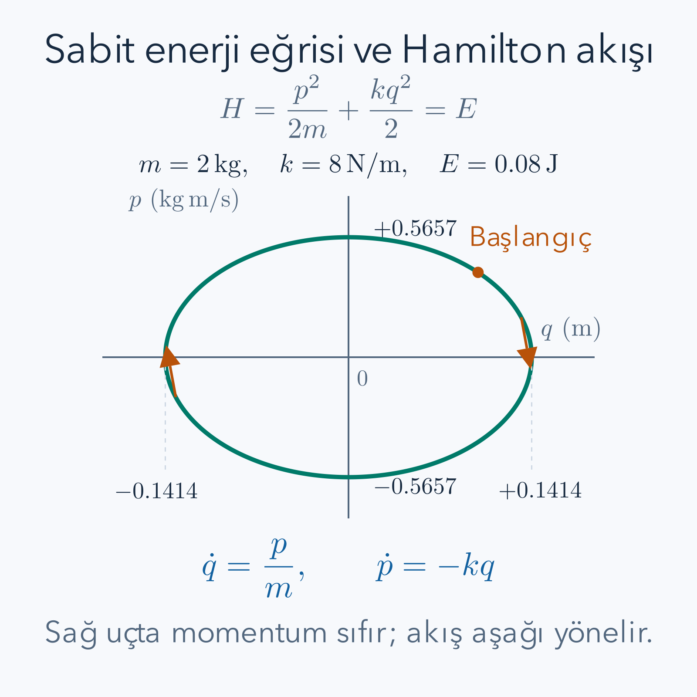

Bir yayın ucundaki kütlenin konumunu gördüğümüzde biraz sonra nereye gideceğini henüz bilemeyiz. Aynı konumda farklı hızları olabilir. Hareketi başlangıçtan belirlemek için konumla birlikte ikinci bir sayı gerekir. Lagrange mekaniği bu ikinci bilgiyi hız olarak kullanır. Hamilton mekaniği ise hızın yerine ona eşlenik olan **kanonik momentumu** koyar. Bu değişim, aynı fiziği hem geometrik olarak daha görünür hem de korunum hesaplarına elverişli hale getirir.

Bu dersten önce [Lagrange mekaniği](/blog/lagrange-mekanigi/), [momentum](/blog/momentum-itme-ve-carpismalar/), [çok değişkenli türev](/blog/cok-degiskenli-fonksiyonlar-ve-turev/) ve [diferansiyel denklemler](/blog/ikinci-derece-diferansiyel-denklemler/) yararlıdır. Yüklü parçacık örneğinde [elektrik potansiyeli](/blog/elektrik-yuku-alan-ve-potansiyel/) ile [manyetizma](/blog/manyetizma-ve-elektromanyetik-induksiyon/) bilgisine başvuracağız. Buradaki Hamilton fonksiyonu klasik bir fonksiyondur. Kuantum kuramındaki durumlar üzerinde etkileyen Hamilton operatörüne henüz geçmiyoruz.

## 1. Konum Uzayından Faz Uzayına

$n$ bağımsız genelleştirilmiş koordinatı $q_1,\ldots,q_n$ ile gösterelim. Bunlar sistemin konumunu belirler. Her birine eşlenik momentum $p_i$ ekleyince $(q_1,\ldots,q_n,p_1,\ldots,p_n)$ toplam $2n$ sayıdan oluşur. Bu sayıların uzayına **faz uzayı** denir. Bir noktası, denklemler ve dış koşullar verilmişse, sistemin anlık durumunu belirler.

Faz uzayındaki bir eğri cismin uzayda çizdiği iz değildir. Doğru boyunca gidip gelen yay kütlesi, fiziksel uzayda aynı doğru parçasını tekrar tekrar tarar. Faz uzayında ise konumun yanında momentum da çizildiği için kapalı bir elips oluşur. Aynı konumun iki farklı yöndeki geçişleri elipsin üst ve alt yarılarında ayrılır. Böyle bir çizim, hareket yönünü kaybetmeden bütün döngüyü tek resimde göstermemizi sağlar.

Düzgün ve tek çözümü olan hareket denklemlerinde aynı zamanda aynı faz noktasına gelen iki farklı devam yolu olamaz. Başlangıç değerleri aynı olduğunda çözüm tekliği onları aynı yola zorlar. Bu iddianın arkasında diferansiyel denklemin düzgünlük koşulları bulunur; tekliği bozan tekil modellerde körlemesine kullanılmaz. Ayrıca zamana açıkça bağlı sistemlerde faz uzayının aynı noktası farklı zamanlarda farklı akışlar üretebilir. Zaman bilgisini o durumda kaybetmemek gerekir.

## 2. Kanonik Momentum Bir Türevdir

Lagrange fonksiyonu $L(q,\dot q,t)$ verilsin. Kanonik momentumun tanımı

$$
p_i=\frac{\partial L}{\partial\dot q_i}
$$

şeklindedir. Türev alırken bütün $q_j$, diğer hız girişleri ve zaman sabit tutulur. Bu tanım, momentumun her durumda $m\dot q_i$ olduğunu söylemez. Ancak Kartezyen uzaklık koordinatında $L=\frac12m\dot x^2-V(x)$ ise gerçekten $p_x=m\dot x$ elde ederiz.

Dönme açısı $\theta$ olan sabit uzunluklu bir sarkaçta $L=\frac12m\ell^2\dot\theta^2-V(\theta)$ yazılır. Dolayısıyla $p_\theta=m\ell^2\dot\theta$ olur. Bu nicelik doğrusal momentum değildir; desteğe göre açısal momentumdur. Birimi kilogram metre kare bölü saniyedir. Açı boyutsuz olduğu için $p_\theta\dot\theta$ yine enerji birimindedir. Kanonik eşleniklik, her koordinatın hızına göre türevden doğar; koordinatın fiziksel birimi değişince momentumun birimi de ona uyar.

Düzlemde kutupsal koordinatlar için $T=\frac12m(\dot r^2+r^2\dot\theta^2)$'dir. Buradan $p_r=m\dot r$, $p_\theta=mr^2\dot\theta$ çıkar. Teğetsel doğrusal momentumun büyüklüğü ise $mr\dot\theta$'dır. Aralarında fazladan bir $r$ bulunur; çünkü açısal momentum, doğrusal momentumla uzaklığın çarpımıdır. Bu örnek, aynı harfin farklı koordinatlarda neden farklı fiziksel nicelikleri adlandırabileceğini somutlaştırır.

## 3. Hızı Momentuma Çevirmek Her Zaman Mümkün mü?

Hamilton yaklaşımında hızları $q,p,t$ cinsinden ifade etmek isteriz. Tek koordinatta $p=m\dot q$ ve $m>0$ ise bölerek $\dot q=p/m$ bulunur. Çok koordinatta bu tersine çevirmenin yerel koşulu, hızlara göre ikinci türevlerden oluşan Hessian matrisinin tekil olmamasıdır:

$$
W_{ij}=\frac{\partial^2L}
{\partial\dot q_i\partial\dot q_j},
\qquad \det W\ne0.
$$

Hessian burada hızdaki küçük bir değişimin momentumları nasıl değiştirdiğini ölçer. Determinant sıfır değilse ters fonksiyon teoremi yeterince küçük bir çevrede hızları momentumlardan çözebileceğimizi söyler. Bu, bütün faz uzayında tek bir küresel ters var demek değildir. Daha güçlü dışbükeylik koşulları altında küresel bir Legendre dönüşümü kurulabilir; burada ihtiyacımız olan yerel mekanik dönüşümdür.

Örneğin $L=a(q,t)\dot q-V(q,t)$ hızda yalnız birinci derecedense $p=a(q,t)$ çıkar. Bu eşitlik hızın ne olduğunu söylemez. Aynı $q,t$ için birçok hız aynı momentumu verir ve Hessian sıfırdır. Böyle bir sistemde aşağıdaki alışılmış Hamilton denklemlerini bağımsız $q,p$ çiftlerine hemen uygulayamayız; ek kısıt analizi gerekir. Bu sınırlama özellikle alan kuramlarında önemlidir. Buradaki yay, serbest parçacık ve sonlu kütleli elektromanyetik örnek düzenli sistemlerdir.

## 4. Legendre Dönüşümünü Adım Adım Kurmak

Hızları tersine çevirebildiğimizi varsayalım; sonuç $\dot q_i=v_i(q,p,t)$ olsun. **Hamilton fonksiyonu**

$$
H(q,p,t)=\sum_i p_i v_i(q,p,t)
-L\bigl(q,v(q,p,t),t\bigr)
$$

olarak tanımlanır. Bu işlem hız değişkenleri bakımından **Legendre dönüşümü**dür. Sağ tarafta kalan bütün hızlar artık ters çözümle değiştirilmelidir. Son ifadede bağımsız bir $\dot q$ bırakmak, değişken değiştirme işlemini yarım bırakır.

Bir boyutlu yayda bunu açıkça yapalım:

$$
\begin{aligned}
p&=m\dot q,\qquad v=p/m,\\
H&=p\frac pm-\left[\frac12m\left(\frac pm\right)^2
-\frac12kq^2\right]\\
&=\frac{p^2}{m}-\frac{p^2}{2m}+\frac12kq^2\\
&=\frac{p^2}{2m}+\frac12kq^2.
\end{aligned}
$$

İki kinetik terimden biri ötekini yarıya indirir. Hamilton fonksiyonu bu örnekte mekanik enerjidir. Tanımın kendisi “enerjiyi yaz” olmadığı için bu eşitliği her modelde ayrıca inceleyeceğiz. İşlemin yararı, yeni fonksiyonun türevlerinde hızın yerine doğrudan momentumun yer almasıdır.

## 5. Diferansiyelde Kaybolan Terimler

Hamilton denklemlerinin eksi işareti ezberlenebilir; fakat neden orada olduğunu toplam diferansiyelden görmek daha güvenlidir. $L_{q_i}$ gibi alt indisler kısmi türevleri kısaltsın. Çarpım ve zincir kurallarıyla

$$
\begin{aligned}
dH&=d\left(\sum_i p_i v_i-L\right)\\
&=\sum_i(v_i\,dp_i+p_i\,dv_i)
-\sum_i(L_{q_i}\,dq_i+L_{\dot q_i}\,dv_i)-L_t\,dt.
\end{aligned}
$$

Momentum tanımı $L_{\dot q_i}=p_i$ olduğu için her $p_i\,dv_i$ terimi eksi işaretli eşiyle gider. $v_i$'nin içinde $q,p,t$ bağımlılığı olması bu iptali bozmaz; iptal bütün diferansiyel olarak gerçekleşir. Geriye

$$
dH=\sum_i v_i\,dp_i-\sum_iL_{q_i}\,dq_i-L_t\,dt
$$

kalır. Diğer yandan yeni değişkenlerde doğrudan $dH=\sum_iH_{q_i}dq_i+\sum_iH_{p_i}dp_i+H_tdt$ yazılır. Bağımsız diferansiyellerin katsayılarını eşitleyince

$$
H_{p_i}=v_i=\dot q_i,
\qquad H_{q_i}=-L_{q_i},
\qquad H_t=-L_t
$$

buluruz. İlk iki eşitliğe Euler–Lagrange denkleminin $\dot p_i=L_{q_i}$ biçimini eklemek yeterlidir:

$$
\boxed{\dot q_i=\frac{\partial H}{\partial p_i},
\qquad \dot p_i=-\frac{\partial H}{\partial q_i}.}
$$

İkinci mertebeden $n$ denklem yerine birinci mertebeden $2n$ denklem elde ettik. Başlangıç bilgisinin miktarı değişmedi. Önceden $q_i(0),\dot q_i(0)$ veriyorduk; şimdi $q_i(0),p_i(0)$ veriyoruz. Ters dönüşümün düzenliliği bu iki bilgi takımının eşdeğerliğini sağlar.

## 6. Tam Örnek: Yayın Faz Elipsi

Önceki dersteki $m=2\,\mathrm{kg}$, $k=8\,\mathrm{N/m}$ yayı kullanalım. Başlangıçta $q(0)=0.10\,\mathrm m$ ve hız $0.20\,\mathrm{m/s}$ olduğundan $p(0)=0.40\,\mathrm{kg\,m/s}$'dir. Hamilton fonksiyonu ve denklemler

$$
H=\frac{p^2}{4}+4q^2,
\qquad \dot q=\frac p2,
\qquad \dot p=-8q
$$

olur; katsayıların birimleri verilen SI değerlerinden gelir. İlk denklemin türevini alıp ikincisini koyarsak $\ddot q=\dot p/2=-4q$ buluruz. İki başlangıç koşulunu uyguladığımız çözüm

$$
\begin{aligned}
q(t)&=0.10[\cos(2t)+\sin(2t)]\,\mathrm m,\\
p(t)&=0.40[\cos(2t)-\sin(2t)]\,\mathrm{kg\,m/s}
\end{aligned}
$$

şeklindedir. Momentum ifadesi konumun türevinin kütleyle çarpımıdır; iki çözümü birbirinden bağımsız tahmin etmedik. Başlangıç enerjisi $H=0.40^2/4+4(0.10)^2=0.08\,\mathrm J$ olur.

Enerji sabitken izinli faz noktaları $p^2/(2m)+kq^2/2=E$ eşitliğini sağlar. Her terimi $E$'ye bölüp eksen uzunluklarını ayıralım:

$$
\frac{q^2}{2E/k}+\frac{p^2}{2mE}=1.
$$

Konum yarı ekseni $\sqrt{2E/k}=0.14142\,\mathrm m$, momentum yarı ekseni $\sqrt{2mE}=0.56569\,\mathrm{kg\,m/s}$ çıkar. Sayısal büyüklükleri farklı birimlere sahiptir; elipsin sayfa üzerindeki şekli eksen ölçeklerine bağlıdır. Fiziksel anlam taşıyan şey, belirtilen birimlerle aynı enerji düzeyidir.

*Şekil $E=0.08$ joule için hesaplanmıştır. Sağ uçta momentum sıfırdır; $\dot p=-kq$ negatif olduğundan hareket aşağıya yönelir. Üst uçta konum sıfırdır ve pozitif momentum cismi sağa götürür.*

$t=\pi/8\,\mathrm s$ anında sinüs ve kosinüs $1/\sqrt2$ olur. Konum $0.14142\,\mathrm m$, momentum sıfır çıkar: sağ dönüş noktası. Bir çeyrek periyot sonra, $t=3\pi/8$ anında konum sıfır ve momentum $-0.56569$ olur. Enerji ilk noktada tamamen potansiyel, ikinci noktada tamamen kinetiktir. Elips üzerindeki oklar bu iki dönüşümün zaman sırasını gösterir.

## 7. Tam Örnek: Açısal Momentumla Sarkaç

Sarkaç için ters dönüşüm $\dot\theta=p_\theta/(m\ell^2)$'dir. Yerine koyunca

$$
H(\theta,p_\theta)=\frac{p_\theta^2}{2m\ell^2}
+mg\ell(1-\cos\theta)
$$

elde edilir. Türevler $\dot\theta=p_\theta/(m\ell^2)$ ve $\dot p_\theta=-mg\ell\sin\theta$ verir. İlk eşitliğin türevi, ikinci eşitlikle birleşince tam sarkaç denklemi yeniden bulunur. İp gerilmesinin, hem Lagrange hem Hamilton hesabında koordinat kısıtına katıldığını hatırlayalım.

$m=2\,\mathrm{kg}$, $\ell=0.50\,\mathrm m$, $\theta=\pi/6$ ve $\dot\theta=1\,\mathrm{s^{-1}}$ anını inceleyelim. Kanonik momentum $p_\theta=2(0.50)^2(1)=0.50\,\mathrm{kg\,m^2/s}$'dir. Teğetsel doğrusal hız $\ell\dot\theta=0.50\,\mathrm{m/s}$, doğrusal momentumun büyüklüğü $1.00\,\mathrm{kg\,m/s}$ olur. Bu iki momentumun sayıları da birimleri de farklıdır.

Hamilton fonksiyonunun kinetik terimi $0.50^2/[2(2)(0.50)^2]=0.25\,\mathrm J$ verir. Doğrudan hızla hesaplayınca $m v^2/2=2(0.50)^2/2=0.25\,\mathrm J$ çıkar. Potansiyel $2(9.81)(0.50)(1-\sqrt3/2)=1.31429\,\mathrm J$ olduğundan toplam $1.56429\,\mathrm J$'dür. Açısal momentumun değişim hızı $-2(9.81)(0.50)(1/2)=-4.905\,\mathrm{N\,m}$ olur. Tork birimi, açısal koordinatla eşlenik momentumun zaman türevine tam uyar.

Bu an, korunmuş bir açısal momentum örneği değildir. Yerçekimi desteğe göre tork uyguladığı için $p_\theta$ değişir. Hamilton fonksiyonunda $\theta$ görünmeseydi $\dot p_\theta=0$ olacaktı. Bir değişkenin yalnız açısal olmasından onun momentumunun korunduğu sonucu çıkmaz; korunum için ilgili türevin sıfır olması gerekir.

## 8. Poisson Parantezi Hareketi Kısaltır

Faz uzayındaki iki düzgün fonksiyon $F(q,p,t)$ ve $G(q,p,t)$ için **Poisson parantezi** şu işlemdir:

$$
\{F,G\}=\sum_i\left(
\frac{\partial F}{\partial q_i}\frac{\partial G}{\partial p_i}
-\frac{\partial F}{\partial p_i}\frac{\partial G}{\partial q_i}
\right).
$$

Bu bir çarpım değildir. İki fonksiyonun farklı yönlerdeki türevlerinden yeni bir fonksiyon üretir. Tek koordinatta $F=q$, $G=p$ alırsak dört türev sırayla $1,1,0,0$ olur; dolayısıyla $\{q,p\}=1$ bulunur. Sırayı çevirince $\{p,q\}=-1$, aynı fonksiyonu iki yere koyunca $\{F,F\}=0$ çıkar. Çok koordinatta $\{q_i,p_j\}=\delta_{ij}$'dir; Kronecker sembolü indisler aynıysa bir, farklıysa sıfırdır.

Bir gözlenebilirin yol boyunca türevini zincir kuralıyla yazalım:

$$
\begin{aligned}
\frac{dF}{dt}
&=\sum_i\left(F_{q_i}\dot q_i+F_{p_i}\dot p_i\right)+F_t\\
&=\sum_i\left(F_{q_i}H_{p_i}-F_{p_i}H_{q_i}\right)+F_t\\
&=\{F,H\}+\frac{\partial F}{\partial t}.
\end{aligned}
$$

Açık zaman bağımlılığı yoksa $\{F,H\}=0$ yeterli bir korunum ölçütüdür. $F$ açıkça zamana bağlıysa parantezin sıfır olması tek başına yetmez; iki terimin toplamı sıfır olmalıdır. “Kısmi zaman türevi” ile “hareket boyunca toplam türev” ayrımını bu satırlar görünür kılar.

## 9. Tam Örnek: Korunan ve Değişen Nicelik

Yayda $H=p^2/(2m)+kq^2/2$ olduğundan $H_q=kq$, $H_p=p/m$'dir. Önce enerjiyi kontrol edelim. $\{H,H\}=H_qH_p-H_pH_q=0$ ve $H_t=0$ olduğu için $dH/dt=0$ çıkar. Sayısal çözüme her an yeniden enerji yerleştirmeden korunum elde ettik.

Buna karşılık $F=qp$ seçelim. $F_q=p$, $F_p=q$ olduğu için

$$
\{qp,H\}=p\frac pm-q(kq)
=\frac{p^2}{m}-kq^2.
$$

Başlangıçtaki $q=0.10$, $p=0.40$, $m=2$, $k=8$ değerleriyle bu türev $0.16/2-8(0.01)=0$ olur. Fakat bu yalnız o andaki değerdir. Sağ dönüş noktasında $p=0$, $q^2=0.02$ olduğu için aynı türev $-0.16\,\mathrm J$ çıkar. Bir niceliğin türevinin tek anda sıfır olması onun korunumu değildir. Korunum iddiası, denklem boyunca bütün zamanlarda sıfır değişim gerektirir.

Açık zaman içeren bir korunum örneği için serbest parçacığa dönelim. $H=p^2/(2m)$ ve $F=q-pt/m$ olsun. Türevler $F_q=1$, $F_p=-t/m$, $F_t=-p/m$'dir. Parantez $p/m$ verir; açık zaman terimi bunu götürür. Sonuç $dF/dt=0$ olur. Bu korunan sayı başlangıç konumudur: $q=q_0+pt/m$ ifadesini yerine koyunca $F=q_0$ çıkar. Yalnız zamandan bağımsız fonksiyonları korunum adayı saymanın gereksiz bir kısıtlama olduğunu bu örnek gösterir.

## 10. Hamilton Fonksiyonu Her Zaman Mekanik Enerji mi?

Durgun Kartezyen koordinatlarda, hızlarda ikinci dereceden kinetik enerji ve hızdan bağımsız potansiyel varsa $H=T+V$ olur. Zamana açıkça bağlı olmayan $H$ ayrıca korunur. Bunlar iki ayrı iddiadır: bir fonksiyonun fiziksel enerjiyle özdeşliği ve o fonksiyonun zaman boyunca sabitliği. Zamana bağlı bir potansiyelde $H=T+V(t)$ yine enerji olabilir ama dış düzenek sisteme iş yaptığı için korunmayabilir.

Hareketli koordinatta fark daha belirgindir. Laboratuvarda serbest parçacık için $x=q+ut$ dönüşümünü yapalım; $u$ sabit referans hızıdır. Kinetik enerji $L=\frac12m(\dot q+u)^2$ olur. Kanonik momentum $p=m(\dot q+u)$, ters hız $\dot q=p/m-u$'dur. Dolayısıyla

$$
H=p\left(\frac pm-u\right)-\frac{p^2}{2m}
=\frac{p^2}{2m}-up.
$$

Laboratuvarın mekanik enerjisi ise $p^2/(2m)$'dir. İki ifade $up$ kadar farklıdır. Bu bir çelişki değildir: $H$ bu zamanla değişen koordinatın evrimini üretir. Nitekim $H_p=p/m-u=\dot q$ olur; laboratuvar hızını elde etmek için tekrar $u$ ekleriz. Enerji kelimesini kullanmadan önce hangi çerçeve ve hangi Lagrange fonksiyonuyla çalıştığımızı belirtmeliyiz.

## 11. Yüklü Parçacıkta İki Momentum

Elektrik yükünü koordinatla karıştırmamak için $e_\ast$ ile gösterelim; işaretli bir yük olabilir. SI birimlerinde, dış elektromanyetik potansiyeller içindeki relativistik olmayan parçacık için

$$
L=\frac12m\mathbf v^2
+e_\ast\mathbf A(\mathbf r,t)\cdot\mathbf v
-e_\ast\phi(\mathbf r,t)
$$

alınır. $\phi$ skaler potansiyel, $\mathbf A$ vektör potansiyeldir; alanlar $\mathbf B=\nabla\times\mathbf A$ ve $\mathbf E=-\nabla\phi-\partial_t\mathbf A$ ile tanımlanır. Hız bileşenine göre türev alırsak

$$
\mathbf p=m\mathbf v+e_\ast\mathbf A,
\qquad
\boldsymbol\pi=m\mathbf v=\mathbf p-e_\ast\mathbf A
$$

çıkar. $\mathbf p$ kanonik, $\boldsymbol\pi$ kinetik momentumdur. Hareketin fiziksel hızını veren ikincisidir. Hıza doğrusal $\mathbf A$ terimi Hessianı değiştirmez; $W_{ij}=m\delta_{ij}$ olduğundan dönüşüm $m>0$ için düzenlidir.

Legendre dönüşümünde $\mathbf p\cdot\mathbf v$ içindeki $e_\ast\mathbf A\cdot\mathbf v$, Lagrange fonksiyonundaki aynı terimi götürür. Kalan ifade

$$
H=\frac{(\mathbf p-e_\ast\mathbf A)^2}{2m}+e_\ast\phi
$$

olur. Kartezyen durgun koordinatta bu, kinetik enerji ile elektrik potansiyel enerjisinin toplamıdır. Dış alan kaynaklarının enerjisini içermez; burada alanlar parçacığın etkisiyle değişmeyen verilen fonksiyonlardır. Zamana bağlı kaynakların yaptığı iş ayrıca enerji alışverişi doğurabilir.

## 12. Tam Örnek: Manyetik Alanda Korunan Kanonik Bileşen

Hesabı görünür tutmak için ideal klasik bir modelde $m=2\,\mathrm{kg}$, $e_\ast=1\,\mathrm C$, $\mathbf B=(0,0,3\,\mathrm T)$ ve $\phi=0$ seçelim. Vektör potansiyelini $\mathbf A=(0,Bx,0)$ alırsak gerçekten $\partial_xA_y=B$ olduğu için doğru manyetik alanı üretir. Bu seçimde

$$
H=\frac{p_x^2+(p_y-e_\ast Bx)^2}{2m}
$$

ve $y$ Hamilton fonksiyonunda açıkça görünmez. Dolayısıyla $\dot p_y=0$'dır. Fakat fiziksel $y$ momentumu $\pi_y=p_y-e_\ast Bx$ olduğundan $x$ değiştikçe değişebilir. Kanonik bileşen korunurken kinetik bileşenin değişmesi mümkündür.

Bir anda $x=0.40\,\mathrm m$, $v_x=0.20\,\mathrm{m/s}$, $v_y=0.50\,\mathrm{m/s}$ olsun. Kinetik momentum $(0.40,1.00)$, kanonik momentum $(0.40,2.20)$ birim olarak kilogram metre bölü saniyedir. Hamilton fonksiyonu $[0.40^2+(2.20-1.20)^2]/4=0.29\,\mathrm J$ verir. Doğrudan hızdan $m(v_x^2+v_y^2)/2=0.29\,\mathrm J$ çıkar. Yanlışlıkla $\mathbf p^2/(2m)$ yazsaydık $1.25\,\mathrm J$ bulacaktık.

Hamilton türevlerinden

$$
\dot p_x=\frac{e_\ast B}{m}(p_y-e_\ast Bx)=e_\ast Bv_y,
\qquad
\dot\pi_y=\dot p_y-e_\ast B\dot x=-e_\ast Bv_x
$$

elde edilir. Verilen anda bu kuvvet bileşenleri $1.50\,\mathrm N$ ve $-0.60\,\mathrm N$ olur. Güç $1.50(0.20)-0.60(0.50)=0$'dır. Manyetik kuvvet hızın yönünü değiştirir, kinetik enerjiyi değiştirmez. Kanonik dilin Lorentz kuvvetini doğru yeniden üretmesi, momentum ayrımının deneysel hareketle bağını kontrol eder.

## 13. Ayar Seçimi ve Kuantuma Açılan Sınır

Aynı alanları farklı potansiyellerle yazabiliriz. Düzgün bir $\chi(\mathbf r,t)$ fonksiyonu için $\mathbf A'=\mathbf A+\nabla\chi$ ve $\phi'=\phi-\partial_t\chi$ alınırsa Lagrange fonksiyonu yalnız $e_\ast d\chi/dt$ toplam türevi kadar değişir. Etkiye eklenen şey uç değerlerin farkıdır; sabit uçlu varyasyonda hareket denklemi değişmez. Kanonik momentum ise $\mathbf p'=\mathbf p+e_\ast\nabla\chi$ olur. Bu yüzden tek başına kanonik momentumun sayısını ayardan bağımsız ölçülen hız sanamayız.

Zamana bağlı ayar dönüşümünde Hamilton fonksiyonu uygun yeni kanonik değişkenlerde $H'=H-e_\ast\partial_t\chi$ biçiminde değişir. Buna karşılık $\mathbf p'-e_\ast\mathbf A'=\mathbf p-e_\ast\mathbf A$ olduğundan kinetik momentum değişmez. Önceki enerji yorumu, potansiyellerin ve zamanın belirtilen seçimi içinde yapılmıştır. Statik manyetik örnekte seçtiğimiz ayar da statiktir ve fiziksel enerjiyle Hamilton fonksiyonu çakışır.

Bu derste Hamilton fonksiyonu, faz uzayındaki gerçek sayılı bir fonksiyon olarak türevlerle hareket üretti. Kuantum kuramında Hamiltonyenin rolü yine evrimle ilişkilidir; fakat durumun ve gözlenebilirin matematiksel türü değişir. Klasik $q,p$ değerlerini yalnız isim değiştirerek kuantum hesabı yapmış olmayız. Burada kazanılan hazırlık, koordinatla momentumun eşlenikliğini, dönüşümün koşulunu ve korunumun hangi türevden çıktığını açıkça bilmektir.

## 14. Aynı Manyetik Alanı Başka Ayarda Hesaplamak

Kanonik momentumun ayara bağlı olduğunu sayıyla görmek yararlıdır. Önceki örnekte $\mathbf A=(0,Bx,0)$ seçmiştik. Şimdi $\chi=-Bxy/2$ alalım. Türevler $\partial_x\chi=-By/2$, $\partial_y\chi=-Bx/2$ olur. Yeni potansiyel

$$
\mathbf A'=\left(-\frac{By}{2},\frac{Bx}{2},0\right)
$$

çıkar. Manyetik alanı hesaplayınca $\partial_xA_y'-\partial_yA_x'=B/2-(-B/2)=B$ bulunur. Yani aynı sabit alanı iki farklı matematiksel görünümle anlattık. $\chi$ zamana bağlı olmadığından skaler potansiyel de sıfır kalır.

Önceki an için ayrıca $y=0.10\,\mathrm m$ seçelim. Eski potansiyelin bileşenleri $(0,1.20)$, yeni potansiyelinkiler $(-0.15,0.60)$ olur. Yük bir coulomb olduğu için kanonik momentum eski ayarda $(0.40,2.20)$, yeni ayarda $(0.25,1.60)$ değerini alır. Yeni momentumdan yeni potansiyeli çıkardığımızda yine $(0.40,1.00)$ kinetik momentumu elde ederiz. Hamilton fonksiyonunun sayısı da $[(0.25+0.15)^2+(1.60-0.60)^2]/4=0.29$ joule kalır.

Buna karşılık yeni Hamilton fonksiyonu hem $x$ hem $y$ içerebilir. Eski ayardaki “$p_y$ korunur” cümlesini yeni ayardaki $p_y'$ için aynen tekrar edemeyiz. Aynı fiziksel korunmuş niceliğin yeni değişkenlerdeki ifadesi $p_y'+e_\ast Bx/2$ olur. Bir korunumu belirli bir harfin sabitliğiyle özdeşleştirmek bu yüzden yanıltıcıdır. Gözlenebilir hareket değişmezken kullanılan kanonik değişkenin görünüşü değişebilir. Her korunum hesabını ait olduğu değişkenlerle birlikte okumalıyız.

## 15. Faz Eğrisinin Hangi Bilgileri Eksiktir?

Bir enerji elipsini bilmek, o eğrinin hangi yönde ve ne hızla tarandığını tek başına söylemez. Enerji denklemi yalnız izinli noktaları verir; zaman sırasını Hamilton denklemleri belirler. Yayın sağ ucunda $p=0$ iken $\dot q=0$ olur, fakat $\dot p=-kq$ sıfır değildir. Sistem faz uzayında durmaz; o anda dikey yönde hareket eder. Fiziksel cismin dönüş noktasında anlık durması, faz noktasının da durması anlamına gelmez.

Elipsin üst ucunda bunun tersi olur. Konum sıfırdır, bu yüzden momentum türevi sıfırdır; buna karşılık konum türevi pozitiftir. Bu dört uç davranışı bütün elipsin saat yönünde tarandığını belirler. $q=p=0$ noktası ise hem $\dot q$ hem $\dot p$ sıfır olduğu için gerçek bir denge noktasıdır. Pozitif enerjili elipsler denge noktasının etrafında dolaşır; sıfır enerji düzeyi tek noktaya küçülür.

Sık kullanılan bir başka yararlı kontrol elipsin alanıdır. Konum yarı ekseniyle momentum yarı ekseninin çarpımını $\pi$ ile çarparsak

$$
\mathcal A=\pi\sqrt{\frac{2E}{k}}\sqrt{2mE}
=2\pi E\sqrt{\frac mk}
=\frac{2\pi E}{\omega}
$$

buluruz. Alanın birimi konum çarpı momentum, yani joule saniyedir. Bizim örneğimizde $2\pi(0.08)/2=0.08\pi=0.25133\,\mathrm{J\,s}$ çıkar. Bunun sayfa üzerindeki santimetre kare alanı olmadığını vurgulayalım; fiziksel eksen birimlerinin çarpımıyla ölçülür. Alan ile etki biriminin aynı olması klasik hareketin sonraki matematiksel yapılarına bir hazırlıktır; buradan herhangi bir kuantum enerji kuralı çıkarmış değiliz.

## 16. Düzenli Ters Dönüşümü Yerine Koyarak Sınamak

Hızla momentumu değiştirdiğimizde ilk yapılacak kontrol, bulunan tersin başlangıç tanımını geri üretmesidir. Açısal örnekte $p_\theta=m\ell^2\dot\theta$ tanımına $\dot\theta=p_\theta/(m\ell^2)$ koyunca $p_\theta=p_\theta$ elde edilir; burada bölmenin geçerliliği için hem $m$ hem $\ell$ sıfırdan farklı olmalıdır. Sıfır uzunluklu bir sarkacı aynı açısal koordinatla tarif etmek anlamlı değildir. Sembolik sadeleştirme, fiziksel modelin koşullarını silmemelidir.

Çok koordinatlı kutupsal örnekte hız Hessianı köşegendir: köşelerde $m$ ve $mr^2$ bulunur. Determinant $m^2r^2$'dir. $r>0$ bölgesinde ters dönüşüm düzenlidir; fakat orijinde determinant sıfır olur. Bu kez sorun parçacığın kütlesinin kaybolması değil, polar açının orijinde tanımlanamamasıdır. Aynı parçacık Kartezyen koordinatlarda sorunsuz tarif edilebilir. Düzenliliğin kaybının fiziksel bir kısıttan mı, koordinat seçiminin tekilliğinden mi geldiğini ayırt etmek gerekir.

Bu kontroller sayısal uygulamada da işe yarar. Bir programın yalnız enerjiyi yaklaşık sabit tutması yeterli değildir; momentum tanımını ve iki Hamilton denklemini de sağlamasını isteriz. Enerji elipsinde ters yönde ilerleyen bir çizgi aynı enerjiye sahip olabilir ama verilen Hamilton denklemlerini çözmez. Bu dersteki bağımsız kontroller, konumun ve momentumun zaman türevlerini ayrı hesaplayarak işaret ve kütle katsayılarını da sınar. Korunum, çözüm doğrulamasının güçlü ama tek başına eksik bir parçasıdır.

Başlangıç verisini dönüştürürken de aynı özen gerekir. Elektrik yükü örneğinde deney bize çoğunlukla hızı verir; program ise kanonik momentumla çalışır. Önce seçilen ayarda $e_\ast\mathbf A$ katkısını ekleyip başlangıç momentumunu kurarız. Sonuçları hız olarak raporlarken bu katkıyı tekrar çıkarırız. Girişte kinetik, çıkışta kanonik momentumu aynı isimle kullanmak, doğru çözücüyle bile yanlış deney yorumu üretir.

Benzer bir sorun derece ile radyanı karıştırırken çıkar. Sarkaçtaki $p_\theta=m\ell^2\dot\theta$ bağıntısında açı radyanla tanımlıdır. Sayısal açısal hızı derece bölü saniye olarak alıp doğrudan yerine koyarsak kinetik enerji yanlış ölçeklenir. Önce açıyı ve hızını aynı dönüşümle radyana çeviririz. Bir koordinat yeniden ölçeklenince ona eşlenik momentumun ters ölçeklenmesi gerekir; böylece $p\,dq$ ve $p\dot q$ gibi fiziksel ifadeler aynı kalır. Koordinat sayısı tek başına ölçülen nicelik değildir; birim ve eşlenik değişkenle birlikte anlam taşır.

Bu nedenle bir Hamilton hesabının okunabilir kaydı yalnız son Hamilton fonksiyonundan oluşmamalıdır. Koordinat tanımı, momentum tanımı, ters dönüşümün geçerli bölgesi ve başlangıç verilerinin birimleri de belirtilir. Bu bilgiler sayesinde başka bir okuyucu aynı faz eğrisini kurabilir ve fiziksel hızı geri elde edebilir. Yöntem soyutlaştıkça somut tanımları korumak, hesabın güvenilirliğini artırır.

Aynı özen Hamilton fonksiyonunun kısmi türevinde de gereklidir. Konuma göre türev alırken kanonik momentumu sabit tutarız; fiziksel hızı sabit tutmayız. Manyetik örnekte bu iki talimat farklı işlemler verir, çünkü hız konuma bağlı vektör potansiyeli içerir. Bağımsız değişkenleri yazmak, doğru kuvveti elde etmenin bir parçasıdır.

## Kaynaklar

Örneklerin sayıları ve hesap sıraları bu ders için seçilmiştir. Biçimsel çerçeve şu doğrudan üniversite ders notlarıyla karşılaştırılabilir:

- [David Tong, Classical Dynamics, bölüm 4](https://www.damtp.cam.ac.uk/user/tong/dynamics/dynhtml/S4.html): Legendre dönüşümü, Hamilton denklemleri ve Poisson parantezleri.
- [Iain W. Stewart, MIT 8.09 Advanced Classical Mechanics, bölümler 1 ve 4](https://ocw.mit.edu/courses/8-09-classical-mechanics-iii-fall-2014/d9bac33f6c60b304dc0398e99b327102_MIT8_09F14_full.pdf): analitik mekanik ve kanonik yapı.
