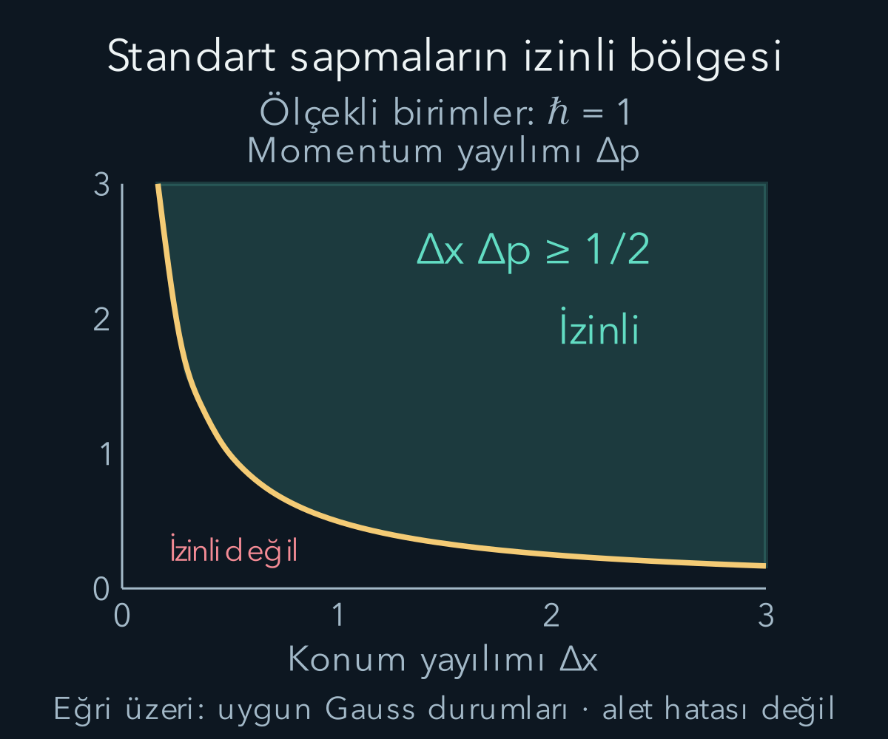
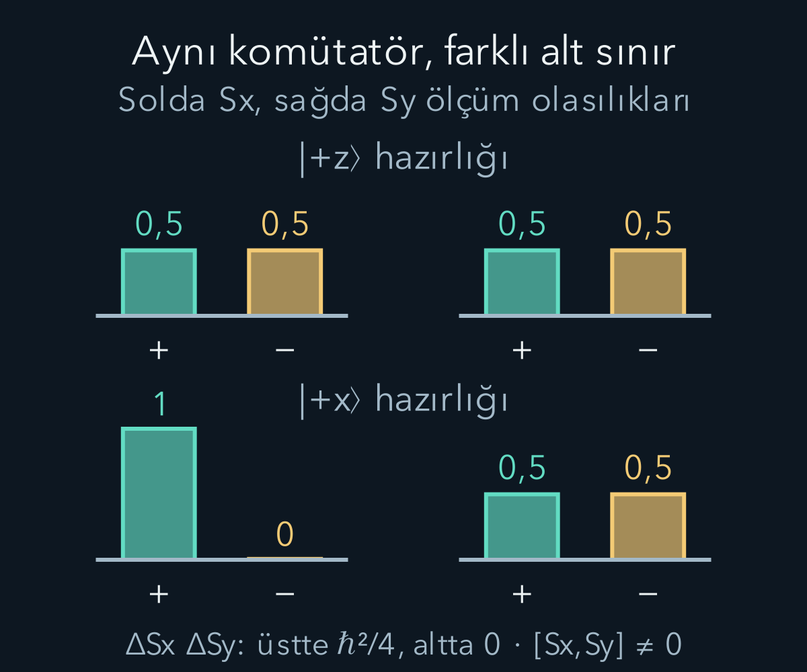

import ArticleVideo from '@/components/ArticleVideo.astro'
import kavram from './media/01-kavram.mp4?url'
import kavramPoster from './media/01-kavram.jpg?url'

İki işlemi farklı sırada yapmak aynı sonucu vermeyebilir. Giyinirken çorapla ayakkabının sırası önemlidir; matematikte de matris çarpımlarının sırası önem taşıyabilir. Kuantumda bu cebirsel yapı, farklı ölçümlerin nasıl ilişkilendiğini anlamamıza yardım eder. Fakat belirsizlik ilişkisi yalnız ‘ölçerken sistemi rahatsız ederiz’ cümlesine indirgenemez. Aynı hazırlanmış durumun farklı ölçüm dağılımlarının yayılımlarını bağlayan kesin bir eşitsizliktir.

[Hermit gözlenebilirler](/blog/kuantum-gozlenebilirleri-ve-beklenen-deger/), [karmaşık iç çarpım](/blog/karmasik-vektorler-hermit-ve-uniter-matrisler/) ve [konum-momentum gösterimleri](/blog/dalga-fonksiyonu-konum-ve-momentum/) ön bilgilerimizdir. Önce sonlu matrislerle güvenli biçimde hesaplayacak, sonra bütün doğru üzerinde yeterince düzgün ve hızla azalan fonksiyonlara geçeceğiz. İşleç çarpımlarının tanımlı olduğu durumları seçmek, ispatın koşuludur.

## 1. Komütatörün tanımı

İki doğrusal işleç için **komütatör**:

$$
[A,B]=AB-BA
$$

olarak tanımlanır. Sağdaki işleç önce uygulanır. $AB|\psi\rangle$ ifadesinde önce $B$, ardından $A$ çalışır. $[A,B]=0$ bütün uygun durumlarda iki sıranın aynı sonucu verdiğini söyler. Tek bir durumda sonuçların aynı çıkması, işleçlerin bütün uzayda değişmeli olduğunu kanıtlamaz.

Komütatör iki ölçüm sonucunun sıradan sayı farkı değildir. Önce gözlenebilirlerin işleç çarpımlarını karşılaştırırız. Gerçek ardışık ölçüm olasılıklarını bulmak için ilgili izdüşümleri ve seçilen sonuçları ayrıca kullanırız. İşleç cebri deneylerin yapısı hakkında bilgi verir, fakat tek başına bütün ölçüm protokolünün yerini tutmaz.

$A$ ve $B$ Hermitse $[A,B]^\dagger=BA-AB=-[A,B]$ olur. Yani komütatör genel olarak Hermit değil, anti-Hermittir. Bu yüzden Hermit gözlenebilirler gibi doğrudan gerçek özdeğerli bir ölçüm niceliği sayılmaz. $[A,B]/i$ ise uygun koşullarda Hermittir. Komütatörün birimi, $A$ ve $B$ birimlerinin çarpımıdır.

## 2. Pauli matrisleriyle açık çarpım

$\sigma_x=\begin{pmatrix}0&1\\1&0\end{pmatrix}$ ve $\sigma_y=\begin{pmatrix}0&-i\\i&0\end{pmatrix}$ olsun. Satır-sütun çarpımıyla:

$$
\sigma_x\sigma_y=\begin{pmatrix}i&0\\0&-i\end{pmatrix}=i\sigma_z,
\qquad
\sigma_y\sigma_x=\begin{pmatrix}-i&0\\0&i\end{pmatrix}=-i\sigma_z.
$$

Çıkardığımızda $[\sigma_x,\sigma_y]=2i\sigma_z$ bulunur. Fiziksel spin bileşenleri $S_j=(\hbar/2)\sigma_j$ olduğundan iki çarpanın ölçeğini de koruruz:

$$
[S_x,S_y]=\frac{\hbar^2}{4}(2i\sigma_z)=i\hbar S_z.
$$

Sağ tarafın birimi açısal momentum karesidir; sol tarafla uyumludur. Pauli matrislerinin boyutsuz komütatörünü doğrudan spin komütatörü diye yazmak, $\hbar$ çarpanlarını kaybettirir. İki boyutlu örnek, daha soyut eşitsizliği kurmadan önce işlemlerin elle kontrol edilebildiği bir alan sağlar.

Bu çarpımların işaret farkı herhangi bir ölçüm sonucunun negatif olasılığa sahip olduğunu anlatmaz. Matrisler genliklere etki eder. Olasılıklar, işlemler tamamlandıktan sonra uygun durumların norm karelerinden bulunur. Karmaşık işaretler fiziksel tahminde girişim ve ölçüm uyumluluğuna etki eder.

## 3. Konum ve momentum komütatörü

Bütün doğru üzerinde düzgün, yeterince hızlı azalan bir deneme fonksiyonu $f(x)$ alalım. Konum işleci $\hat x f=xf$, momentum işleci $\hat p f=-i\hbar f'$ olsun. İlk sıra $\hat x\hat p f=-i\hbar xf'$ verir. Ters sırada çarpım kuralı gerekir:

$$
\hat p\hat x f=-i\hbar(xf)'=-i\hbar(f+xf').
$$

Çıkardığımızda türevli terimler yok olur ve $[\hat x,\hat p]f=i\hbar f$ çıkar. Bu uygun ortak tanım kümesinde:

$$
\boxed{[\hat x,\hat p]=i\hbar I}
$$

diye yazılır. $I$ birim işleçtir. Sağ taraf yalnız tek bir sayıyı yazmakla kalmaz; her uygun fonksiyonu o sayıyla çarpmayı belirtir.

İspatın püf noktası $d(xf)/dx$ türevinde ek $f$ terimidir. Konumu momentum ifadesindeki türevle sıradan iki sayı gibi yer değiştirirsek bu terimi kaybederiz. İşleci bir deneme fonksiyonuna uygulamak, biçimsel sembollerle yapılan yanlış sadeleştirmeleri önler.

## 4. Hangi yayılımı ölçüyoruz?

Normalleştirilmiş aynı durum için $a=\langle A\rangle$ ve $b=\langle B\rangle$ olsun. Merkezlenmiş işleçleri $\delta A=A-aI$, $\delta B=B-bI$ tanımlayalım. Bunlar ölçüm sonuçlarından ortalamayı çıkarır. Standart sapmalar:

$$
(\Delta A)^2=\langle(\delta A)^2\rangle,
\qquad(\Delta B)^2=\langle(\delta B)^2\rangle
$$

olur. Her iki dağılım aynı hazırlama yöntemine aittir. Pratikte birçok özdeş hazırlanmış sistemin bir bölümünde $A$, başka bölümünde $B$ ölçebiliriz. Her tek parçacığa sırayla iki ölçüm uygulamak zorunda değiliz.

Bu nedenle eşitsizlik doğrudan birinci ölçümün ikincisini ne kadar bozduğunun formülü değildir. Ölçüm bozunumu için ayrı tanımlar ve ayrı ilişkiler gerekir. Buradaki $\Delta A$ ve $\Delta B$, ideal ölçümlerin sonuç dağılımlarındaki standart sapmalardır. Aygıtın çözünürlük aralığını veya kalibrasyon hatasını bu sembollerin yerine koymayacağız.

## 5. Cauchy–Schwarz ile ilk sınır

İki yeni vektör tanımlayalım: $|u\rangle=\delta A|\psi\rangle$ ve $|v\rangle=\delta B|\psi\rangle$. Norm kareleri sırasıyla $(\Delta A)^2$ ve $(\Delta B)^2$'dir. Karmaşık iç çarpım uzayında Cauchy–Schwarz eşitsizliği:

$$
(\Delta A)^2(\Delta B)^2
=\langle u|u\rangle\langle v|v\rangle
\ge|\langle u|v\rangle|^2
$$

der. Bu henüz kuantuma özgü bir matematik kuralı değildir; önceki iç çarpım çalışmasından gelen geometrik eşitsizliktir. Kuantum bağlantısı, bu vektör normlarının ölçüm standart sapmalarına karşılık gelmesidir.

$z=\langle u|v\rangle$ karmaşık sayı olsun. $|z|^2=(\operatorname{Re}z)^2+(\operatorname{Im}z)^2\ge(\operatorname{Im}z)^2$ olur. Şimdi bu sanal kısmı komütatörle ilişkilendireceğiz. Böylece ölçüm yayılımlarının çarpımına alt sınır, işleçlerin sıra farkından çıkacak.

## 6. Robertson eşitsizliğini tamamlamak

Uygun ortak tanım kümesinde $z=\langle\psi|\delta A\delta B|\psi\rangle$ ve $z^*=\langle\psi|\delta B\delta A|\psi\rangle$ olur. Çıkarma:

$$
2i\operatorname{Im}z=z-z^*
=\langle[\delta A,\delta B]\rangle
=\langle[A,B]\rangle
$$

verir; sabit birim işleç katkıları komütatörde yok olur. Önceki eşitsizliğe yerleştirip negatif olmayan karekökleri alınca:

$$
\boxed{\Delta A\,\Delta B\ge\frac12
\left|\langle[A,B]\rangle\right|}
$$

elde edilir. Bu **Robertson belirsizlik ilişkisidir**. Sağ taraf, genel olarak hazırlanmış duruma bağlıdır; komütatörün beklenen değerini o durumda hesaplarız. Komütatörün kendisini yalnız bir sayı sanıp durum bağımlılığını atlamamalıyız.

Sonlu matrislerde bütün çarpımlar tanımlıdır. Sınırsız konum ve momentum gibi işleçlerde, ilgili normların sonlu ve çarpımların gerekli tanım kümelerinde olması gerekir. Hızla azalan düzgün fonksiyonlar bu türetim için güvenli örneklerdir. Keyfî bir süreksiz fonksiyona biçimsel türev uygulayıp sınır terimlerini yok saymak ispatın koşullarını sağlamaz.

## 7. Konum-momentum sınırı

Uygun bütün doğru durumlarında $[\hat x,\hat p]=i\hbar I$ ve $\langle I\rangle=1$ olduğu için:

$$
\boxed{\Delta x\,\Delta p\ge\frac\hbar2}
$$

bulunur. Sol taraf uzunluk çarpı momentum, yani eylem birimine sahiptir; sağ tarafla aynıdır. Bu bir uzunluk veya momentumun tek başına evrensel alt sınırı değildir. Konum yayılımını küçülttüğümüzde momentum yayılımı için gereken alt sınır büyür.

Örneğin $\Delta x=2\ \mathrm{nm}$ için $\Delta p\ge1{,}055\times10^{-34}/(4\times10^{-9})\approx2{,}64\times10^{-26}\ \mathrm{kg\,m/s}$ olur. Konum yayılımını 1 nanometreye indirirsek momentum alt sınırı iki katına çıkar. Bu sayılar ölçüm aletimizin kaç basamak gösterebildiğine değil, hazırlanan durumun dağılımlarına ilişkindir.

Bir parçacığın konumunu çok iyi ölçtüğümüz tek olay, önceki hazırlığın konum dağılımının çok dar olduğunu kendiliğinden göstermez. Geniş bir dağılımdan da dar bir detektör aralığında tek kayıt alınabilir. Hazırlık yayılımını belirlemek için aynı koşulda tekrarların dağılımını incelemek gerekir.

## 8. Gauss durumunda eşitlik

Fazı konuma göre doğrusal olan Gauss paketi için $\Delta x=\sigma$ ve $\Delta p=\hbar/(2\sigma)$ bulmuştuk. Çarpım tam $\hbar/2$'dir. Bu aile Robertson sınırını eşitlikle sağlar. Konum merkezi veya ortalama momentum değiştirildiğinde yayılımlar değişmez; eşitlik sürer.

Ancak her Gauss **konum yoğunluğu** aynı momentum yayılımını vermez. $\psi(x)=N e^{-x^2/(4\sigma^2)}e^{ibx^2/(4\sigma^2)}$ alalım; $b$ gerçek boyutsuz parametredir. Mutlak değer karesi önceki Gauss yoğunluğuyla aynıdır. Fakat ek karesel faz, momentum dağılımını değiştirir.

Türevden $\hat p\psi=[\hbar(b+i)x/(2\sigma^2)]\psi$ bulunur. Ortalama simetriden sıfırdır. Momentum ikinci momentini türev normuyla hesaplayınca $\langle p^2\rangle=\hbar^2(1+b^2)/(4\sigma^2)$ çıkar. Böylece $\Delta x\Delta p=(\hbar/2)\sqrt{1+b^2}$ olur. $b\ne0$ için çarpım daha büyüktür. Yoğunluğun Gauss görünmesi tek başına en küçük momentum yayılımını garanti etmez.

<ArticleVideo src={kavram} poster={kavramPoster} title="Gauss durumunda konum ve momentum genişliği" caption="Faz eğriliği olmayan Gauss durumunda konum yoğunluğu daralırken momentum yoğunluğu genişler. Ölçekli birimlerde ħ=1 alınır; belirsizlik çarpımı 1/2 kalır." />

## 9. Spin örneğinde alt sınır

$|+z\rangle$ durumunda $S_x$ ve $S_y$ ölçümleri ayrı ayrı eşit artı-eksi dağılım verir. Ortalama değerler sıfır, standart sapmalar $\hbar/2$ olur. Komütatör $[S_x,S_y]=i\hbar S_z$ ve bu durumda $\langle S_z\rangle=\hbar/2$ olduğundan sağ taraf $\hbar^2/4$'tür. Sol taraf da aynı değerdir; eşitlik sağlanır.

Başlangıcı $|+x\rangle$ yaparsak $\Delta S_x=0$ ve $\Delta S_y=\hbar/2$ olur. Bu kez $\langle S_z\rangle=0$ olduğu için sağ taraf sıfırdır. Eşitsizlik $0\ge0$ verir; işleçler hâlâ değişmeli değildir. Bir durumda alt sınırın sıfır olması, komütatörün sıfır işleci olduğunu göstermez.

Bu örnek, ‘değişmeli olmayan iki niceliğin her durumda ikisinin de yayılımı kesinlikle pozitiftir’ cümlesinin neden yanlış olduğunu açıklar. Biri kesin olabilir; ötekinin dağılımı geniş kalır. İlişkinin tam matematiksel biçimini korumak, sezgisel sloganlardan daha güvenilir sonuç verir.

## 10. Eşitsizliğin söylemediği şeyler

Belirsizlik ilişkisi, doğanın bizi her konuda bilgisiz bıraktığı genel bir söz değildir. Belirli gözlenebilirler, belirli bir hazırlık ve tanımlı standart sapmalar için hesaplanabilir bir sınırdır. Bir enerjiyi özdurumda kesin bilmek mümkündür; bu, başka gözlenebilirlerin de kesin olduğu anlamına gelmez. Hangi işleç çiftinin ele alındığı temel bilgidir.

İlişki, parçacığın enerjiyi korunumsuz biçimde ödünç alabileceğini de söylemez. Önceki tünelleme hesabında toplam enerji sabitti ve geçiş katsayısı sınır koşullarından çıktı. Konum-momentum yayılımını enerji korunumu ihlaline dönüştüren bir adım yoktur. Matematikte yer almayan böyle bir süreç öyküsünü formülün açıklaması gibi sunmamalıyız.

Aynı şekilde $\Delta x$'i bir parçacığın gerçek ama bilinmeyen kesin yeriyle aygıtın okuduğu yer arasındaki fark olarak otomatik tanımlamıyoruz. Kuantum kuramı burada doğrudan tekrarlı ölçüm dağılımını verir. Farklı yorumların ontolojik önerileri ayrıca tartışılabilir; bu eşitsizliğin hesabı onları önceden varsaymaz.

## 11. Zaman ve enerjiye aynı formülü yazabilir miyiz?

Bu seride zaman $t$, Schrödinger denklemindeki dış parametredir; konum gibi her sisteme uygulanabilen bir öz-eşlenik zaman gözlenebiliri tanımlamadık. Bu nedenle $[t,H]=i\hbar$ yazıp aynı ispatı bütün sistemlere aktaramayız. Zaman-enerji ilişkileri vardır, fakat hangi zaman niceliğinin tanımlandığı açıklanmalıdır.

Örneğin zamanla açıkça değişmeyen bir $A$ gözlenebiliri için kapalı evrimde $d\langle A\rangle/dt=(i/\hbar)\langle[H,A]\rangle$ olur. Robertson bağıntısını $H$ ve $A$ için kullanırsak $\Delta H\Delta A\ge(\hbar/2)|d\langle A\rangle/dt|$ çıkar. Ortalama değişim hızı sıfır değilse $\tau_A=\Delta A/|d\langle A\rangle/dt|$ tanımlayabiliriz.

Bu tanımla $\Delta H\,\tau_A\ge\hbar/2$ elde edilir. $\tau_A$, ortalamanın o andaki hızla bir standart sapma kadar değişmesi için karakteristik zaman ölçeğidir. Saatin ölçüm hatası veya her olayın kesin süresi değildir. Değişim hızı sıfırsa bu oran sonlu bir zaman ölçeği vermez. Koşulları yazılmış bu ifade, belirsiz bir enerji borcu öyküsünden farklı, somut bir sonuçtur.

## 12. Eşitliği sağlayan şekil neden Gauss olur?

İspatta iki ayrı eşitsizlik kullandık. Cauchy–Schwarz'da eşitlik için merkezlenmiş iki durum vektörünün doğrusal bağımlı olması gerekir. Ardından karmaşık iç çarpımın mutlak değerini yalnız sanal kısmıyla sınırladık; burada eşitlik için gerçek kısmın sıfır olması gerekir. Konum ve momentum için bu iki koşulu birlikte sağlayan uygun bir seçim:

$$
(\hat p-p_0)\psi=i\lambda(\hat x-x_0)\psi
$$

biçimindedir. $\lambda$ gerçek pozitif sabittir; birimi momentum bölü uzunluktur. $p_0$ ve $x_0$ ilgili ortalamaları temsil eder. Denklemde momentum işlemini açık yazarsak $-i\hbar\psi'-p_0\psi=i\lambda(x-x_0)\psi$ olur. Düzenleme:

$$
\psi'=\left[\frac{ip_0}{\hbar}-\frac{\lambda}{\hbar}(x-x_0)\right]\psi
$$

verir. Birinci mertebe denklemi integre ederek $\psi=C\exp[ip_0x/\hbar-\lambda(x-x_0)^2/(2\hbar)]$ buluruz. Pozitif $\lambda$, sonsuzda azalma ve normalleşme sağlar. Önceki Gauss biçimiyle karşılaştırırsak $\lambda=\hbar/(2\sigma^2)$ çıkar. Böylece eşitlik durumunun Gauss oluşu yalnız şanslı bir örnek değildir; ispatta eşitliğin koşullarından da doğar.

Negatif $\lambda$ seçildiğinde üstel zarf sonsuzda büyür ve bütün doğru üzerinde normalleştirilemez. Sıfır değeri ise sabit yoğunluklu düzlem dalga sınırına gider. Matematiksel diferansiyel denklemin yazılabilmesi tek başına fiziksel bir durum sağlamaz; normalleşme koşulu uygun dalı seçer. Bu, önceki sınır değer problemlerindeki fiziksel çözüm seçimiyle aynı düşünme alışkanlığıdır.

Ayrıca bu sonuç, her belirsizlik eşitsizliğinde eşitliği mutlaka Gauss'un sağlayacağını söylemez. Burada bütün doğru üzerindeki konum-momentum çifti ve Robertson sınırının eşitliği incelendi. Spin gibi sonlu boyutlu sistemlerde farklı durumlar eşitliği sağlayabilir. İşleçleri ve uzayı belirtmeden ‘en az belirsiz durum’ diye tek evrensel bir şekil ilan edemeyiz.

Daha güçlü belirsizlik ilişkileri, ispatta attığımız gerçek iç çarpım katkısını da koruyabilir. Bu katkı iki gözlenebilirin ortak değişim ilişkisini taşır. Burada temel Robertson sınırını kurmak için onu attık; karesel faz eklenmiş Gauss örneğinde çarpımın neden daha büyük olabildiğini bu kayıp bilgiyle ilişkilendirmek mümkündür. Tam ek bağıntıyı kullanmadan da türev hesabımız sonucu bağımsız olarak doğruladı.

Bir eşitsizliği öğrenirken yalnız sonucunu değil, eşitliğin hangi koşullarda gerçekleştiğini incelemek de öğreticidir. Bu koşullar, sınırın ulaşılabilir olduğunu ve hangi hazırlamaların onu gerçekleştirdiğini gösterir.

## 13. Hazırlıkların uzayında düşünmek

Belirsizlik sınırını tek bir olayın eksik bilgisi yerine hazırlanabilir dağılımlar arasındaki kısıt olarak düşünmek yararlıdır. Farklı laboratuvar yöntemleri farklı dalga fonksiyonları hazırlayabilir. Her hazırlık için konum ve momentum dağılımını hesaplar, standart sapmalarını bulur ve eşitsizliği denetleriz. Daha çok ölçüm, bu dağılımların parametrelerini daha iyi kestirebilir; aynı hazırlığın içsel yayılımlarını kendiliğinden değiştirmez.

Matematiksel yapı artık açıktır: ortak iç çarpım, merkezlenmiş gözlenebilirler, Cauchy–Schwarz ve komütatör. Bir sonraki modelde aynı cebri enerji düzeylerini kurmak için kullanacağız. Harmonik osilatörün yükseltme ve alçaltma işleçleri, yalnız belirsizlik sınırını değil, ayrık enerji merdivenini de açığa çıkaracak.

## Kaynakça

Aşağıdaki açık kaynaklar 11 Ekim 2026 tarihinde yeniden doğrudan kontrol edildi. Metin, hesap örnekleri ve şekiller bu yazı için özgün olarak hazırlandı.

- [OpenStax — The Heisenberg Uncertainty Principle](https://openstax.org/books/university-physics-volume-3/pages/7-2-the-heisenberg-uncertainty-principle): Konum-momentum yayılımı ve fiziksel anlamı.
- [MIT OpenCourseWare — Quantum Physics II Lecture Notes](https://ocw.mit.edu/courses/8-05-quantum-physics-ii-fall-2013/pages/lecture-notes/): Komütatörler ve genel belirsizlik ilişkisi.
- [Caltech, Feynman Lectures — Operators](https://www.feynmanlectures.caltech.edu/III_20.html): İşleç sırası ve gözlenebilirler.
